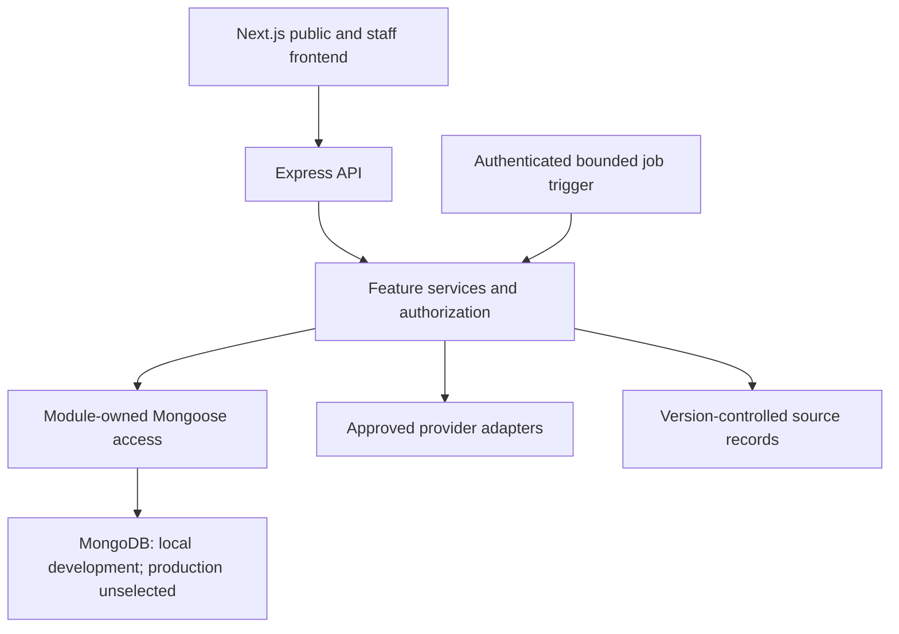
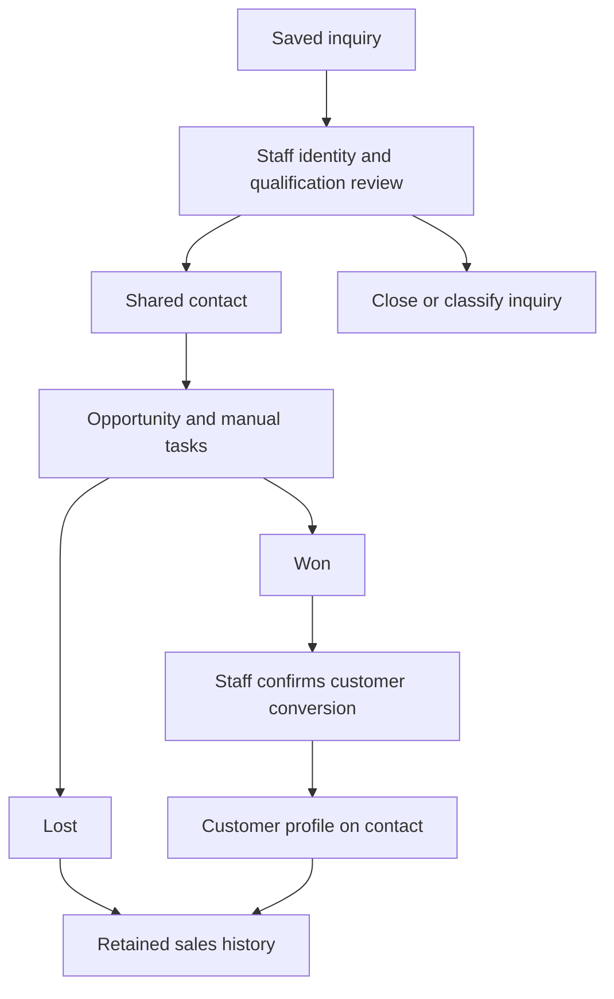

# ARADUN — Database & System Architecture

**Filename:** `05-database-architecture.md`  
**Version:** 1.1.0 — final Step 5 consolidation  
**Date:** 25 October 2026  
**Owner/approver:** ARADUN project owner  
**Approval status:** Owner-declared Step 5 completed and approved; final consolidation authorized. Existing source qualifications and unresolved decisions remain explicit.  
**Scope:** Architecture planning and declarative schema specifications only. No implementation code, dependency installation, project initialization, infrastructure deployment, or Step 6 work is authorized by this document.  
**Identity:** ARADUN — Technology & Digital Solutions · Build. Automate. Grow.

**Controlled update 1.1.0 — 25 October 2026:** Owner-authorized documentation-only amendment limited to the requested architecture, local-development database, solo-maintainer engineering rules and three-theme system where relevant. Unrelated requirements and unresolved gates remain unchanged. Earlier source-register versions/fingerprints and historical approval entries identify the pre-update inputs, not hashes of these revised files; current amended sections govern only these four changes. No implementation or Project Sources replacement is claimed.

## 1. Authority, provenance, and approval boundaries

### 1.1 Source hierarchy

| Ref | Authoritative source | Version | Responsibility |
|---|---|---|---|
| S1 | 01-master-requirements.md | 0.2.0 | Business model, exact catalog/prices, 207 functional requirements, BR/NFR/EXT rules, phase qualifications |
| S2 | 02-pages-sitemap.md | 1.1.0 | Page identities, exact supplied URLs, access, navigation and phase assignments |
| S3 | 03-page-sections.md | 1.0.0 | Ordered page regions, form inputs, publication and conversion behavior |
| S4 | 04-design-system-wireframes.md | 1.0.0 | Responsive interaction states, private previews, three themes, accessibility and performance contracts |
| C5-01 | Uploaded Step 5 brief | Current chat | Planning-only scope, modular Next.js backend, complete architecture coverage and staged review |
| C5-02 | High-level proposal in this chat | Current chat | Shared intake/CRM, module boundaries, source-controlled catalog plus database-managed limited CMS, durable notifications |
| C5-FINAL | Owner's final generation instruction | 23 October 2026 | Declares Step 5 completed/approved and authorizes this final downloadable consolidation |
| R5 | Detailed specifications supplied in this consolidation | This document | Makes the architecture actionable; does not fabricate earlier individual approvals |

The visible Chat 5 contains the high-level proposal and the owner's final completion instruction. It does not contain separate reviews of every collection, field, index, provider or permission. This file supplies those technical details under the final consolidation authorization. R5 technical defaults are distinguished from source-approved business requirements. Source decisions requiring factual, legal, operational, provider or feature-scope confirmation remain gates; the final instruction does not invent their answers.

Explicit owner changes override only what they change. S1 remains authoritative for business scope; S2 for supplied routes; S3 for sections; S4 for presentation. Source A/B/R/C codes retain provenance, not new approval: A carried public approval; B confirmed capability with allocated private route; R future proposal; C conditional. Historical statements that earlier stages had not begun are superseded by later completion instructions. O-03 historical URL reconciliation remains open; preserve supplied URLs without claiming verification against unavailable earlier S1 material.

### 1.2 Preserved scope

- Eight service categories; 57 unique services; 58 memberships because SVC-009 Mobile App UI/UX Design is cross-listed once.
- Five solutions: Digital Presence, Business Automation, Business Growth, Cloud & Technology, Complete Digital Business.
- All original indicative prices retained; no D-002 proposed increase applied. English and USD initially. One-time, monthly, setup-plus-monthly, custom models supported without inventing missing units.
- Phase 1: 91 public entries, four staff authentication entries, 27 dashboard entries, two shared states = 124 planning items (122 pages/templates plus two states). Conditional entries remain in planning.
- Phase 2: 62 additional entries; Phase 3: 28 additional entries; one Product Terms entry retains P2/P3 timing. Total 215 entries.
- Quote → Service / Project / Contact / Review; Contact and Consultation stay separate accessible journeys into common intake.
- Sales: New → Qualified → Discovery → Proposal Sent → Negotiation → Won / Lost. Spam, duplicate, no-response are classifications, not commercial stages.
- No P1 client login, public checkout, gateway, proposal signing, project suite, full page builder, campaign engine, AMS or multi-tenant SaaS.
- Manual consultation capture is the P1 baseline. Live Calendar booking, manual payment UI and selected administration interfaces retain their decision gates.
- Three light themes: Editorial Terracotta default, Muted Slate Blue alternate and Vivid Blue alternate. Theme choice cannot alter business data, permissions or submissions.

### 1.3 Reading guide

Sections 2–5 define architecture and collection boundaries; §6 defines shared field contracts; §7 specifies every baseline and conditional P1 collection; §§8–12 define catalog, CRM, CMS, access and operation boundaries; §§13–16 cover security, performance, integrations and future systems; §17 records ADRs; §18 records unresolved gates and handoff notes. Appendices preserve exact catalog, all 215 page records, all 207 functional requirement mappings, and the BR/NFR/EXT requirements. This is an architecture specification, not evidence of a running or tested application.

## 2. Architecture principles and system topology

### 2.1 Approved foundation

Next.js App Router + TypeScript frontend in `aradun/frontend/`; separate Express.js + TypeScript backend in `aradun/backend/`; MongoDB + Mongoose accessed only by Express. One repository, simple feature-based backend modules, no microservices. Local development uses locally installed MongoDB; Atlas is optional later through environment configuration and production database hosting remains unselected. Tailwind CSS + selective shadcn/ui, Zod, Motion for React and selective GSAP remain.

Express owns API endpoints, provider callbacks, session verification, business validation, record authorization, database operations and bounded scheduled work. Next.js Server Components fetch safe DTOs from Express; browser mutations call Express. Do not duplicate business APIs in Next.js Route Handlers/Server Actions or import backend services/Mongoose into the frontend. Preserve existing public/staff page URLs. API endpoint paths are implementation contracts, not new pages.

Use the minimum necessary files, dependencies, abstractions and boilerplate. Keep feature responsibilities clear, names descriptive, code readable and manually reviewable, and documentation concise, accurate and nonduplicative. Reuse components/functions only for real repeated behavior. Do not create speculative features, empty modules, generic frameworks or pass-through layers. Preserve input validation, backend authorization, secret protection, appropriate errors and meaningful tests; reducing code size never overrides security, correctness or maintainability.

The job trigger executes bounded work in the Express backend, not a separate worker service. Public analytics remains a consent-controlled frontend integration without CRM access.

Install MongoDB locally and configure a local replica set (a single-member development replica set is sufficient for transaction testing; not a production availability design). A standalone server cannot exercise the approved multi-document transactions. Backend-only environment configuration uses `MONGODB_URI` (nonsecret local example: `mongodb://127.0.0.1:27017/aradun_development?replicaSet=rs0`) and the matching `MONGODB_DB_NAME`; verify the actual configured replica-set name. Bind development MongoDB to loopback and keep test databases isolated. Atlas requires no development account; moving to Atlas later changes URI/credentials/TLS/network configuration, not approved collections, fields, validation, indexes or relationships. Production provider, region, network and recovery choices remain open.

### 2.2 Module ownership

| Module | Responsibility | Data owner / collaboration |
|---|---|---|
| Catalog | Unique offers, packages, source prices, availability, relationships | Version-controlled catalog initially; intake reads validated offer snapshots |
| Content | Articles, testimonials, FAQ/help, case studies, SEO and publication | articles, testimonials, seoOverrides; maintained FAQ/case/page data; optional faqEntries |
| Discovery | Public search, sitemap and canonical/publication projections | Read-only published content and source catalog; no master search collection |
| Intake | Public requests, reference, context, consent and idempotency | inquiries; schedules outbox work; asks CRM to link only under approved identity rules |
| CRM | Contacts, customers, opportunities, tasks and business activities | contacts, opportunities, tasks, activities; inquiries remain intake-owned with CRM handling operations |
| Identity | Staff account mapping, current access and provider session validation | staffUsers; optional provider-required staffSessions; roles maintained in source |
| Notifications | Acknowledgement/staff events, delivery/retry/reconciliation | outboxEvents; email adapter; no second workflow for FR-08-01/02 aliases |
| Operations | Audit trail, summaries, configuration, recovery, abuse controls | auditEvents, rateLimitBuckets, infrastructure settings; optional paymentRecords |

Modules invoke named functions; avoid a generic event bus or universal repository framework. The originating service owns transaction boundaries and passes the database session into its collaborating data helpers. Do not call external providers inside a database transaction. Use strict typed input contracts and allowlisted fields, not raw request objects or arbitrary MongoDB update/query objects.

## 3. Storage and source-of-truth decisions

| Data | P1 location | Rationale and evolution |
|---|---|---|
| Categories, services, solutions, packages, core copy, portfolio | Validated version-controlled records | Broad catalog/page editors remain P2; change requires review/deployment; stable IDs support later import |
| Articles/resources, testimonials, SEO overrides | MongoDB | Approved dashboard editing and publication require persistence |
| FAQ/help | Validated source records by baseline; faqEntries only if D-012 editor selected | Same public contract and stable content identity; never both active masters |
| Inquiries, contacts/customer profiles, opportunities, manual tasks, activities | MongoDB | Shared business state and history |
| Staff account mapping and audit | MongoDB | Local active status and permissions remain authoritative regardless of identity provider |
| Sessions/recovery/MFA | Selected authentication provider/library | No invented password/OTP schema; optional session contract in §7.13 |
| Media bytes | Approved controlled assets/object storage | MongoDB stores references only; public/private assets separated |
| Roles, pipeline definition, site/public settings and operational settings | Validated version-controlled configuration | No role builder/general settings editor assumed; secrets use deployment secret store |
| Retry work and abuse limits | MongoDB baseline | Durable modest-load processing across app instances; managed equivalents may replace adapters by decision |
| Theme | Device/browser preference | No MongoDB record, identity tracking or account requirement |
| Analytics | GA4 configuration and events, subject to actual consent | No parallel click/event warehouse in P1 |

One collection per noun is not required. Customer is an explicitly recorded lifecycle/profile on a contact in P1; it is not a copied contact. Quotes, contacts and consultations share inquiries distinguished by type. SEO for source-backed pages uses overrides; article SEO is owned by the article snapshot, not duplicated in seoOverrides. Pricing versions are source release identifiers plus immutable submitted snapshots, not a speculative pricing-history service.

The source-controlled strategy is the R5 default carried from C5-02. Choosing database-managed catalog authoring later requires a controlled migration and publication workflow, not changing current names, prices or routes. Detailed logical catalog schemas remain specified in §8 even though no catalog collections are created in P1.

## 4. Phase boundary and conditional interfaces

| Requirement/interface | Baseline | Conditional alternative / later scope |
|---|---|---|
| Consultation PUB-014 | Manual request in inquiries, timezone/preferences, staff confirmation | D-003 external or integrated scheduling; EXP-031 remains P2 unless promoted |
| FAQs PUB-010/011 | Required public content and search using maintained data | ADM-021/022 editor + faqEntries conditional D-012 |
| Staff provisioning/revocation | Required, using provider administration plus audited local account mapping | ADM-023/024 dedicated UI conditional; broad team module P2 |
| Audit logging | auditEvents required | ADM-025 viewer conditional; advanced console P3 |
| Manual payment operations | External ledger/documents with verified business process | ADM-027 + paymentRecords conditional D-007; gateway/invoice suite P2 |
| Staff recovery/MFA | Provider-supported access recovery and selected MFA policy | STA-002/003/004 follow provider choices; mandatory production MFA recommended, D-009 unresolved |
| Assignment email | General staff intake alerts required | FR-08-03 specific assignment alert remains proposed; same outbox if selected |
| Article images | Controlled asset references | Secure uploads only after workflow selected; security begins with first upload |

Conditional records are fully described for planning, not silently enabled. Required underlying capabilities cannot be dropped when their dedicated dashboard UI is omitted. Do not expose disabled/future menu items as nonworking controls.

## 5. MongoDB collection inventory

Twelve baseline collections are proposed. Up to four separately gated P1 collections are specified below. Exact authentication-provider internal tables/collections are provider-owned and must be inventoried when selected; do not build every alternative.

| Collection / model | Phase / module | Purpose and main relationships | Main query/index purpose | Sensitivity and CRUD |
|---|---|---|---|---|
| inquiries / Inquiry | P1, Intake | Typed requests, submitted identity, immutable offers, optional contact/opportunity links | Unique reference and submission-key hash; owner/status/time; contact history | Private PII; public create only, staff read/handle, controlled archival/redaction |
| contacts / Contact | P1, CRM | Reviewed contact identity and embedded customer profile | Email candidate lookup, owner list, customer view | Private PII; staff create/read/update/archive; reviewed merge |
| opportunities / Opportunity | P1, CRM | Commercial intent, contact, originating inquiry, fixed stage, value | Owner/stage/time; contact; unique creation key | Private commercial; authorized create/read/update/archive |
| tasks / FollowUpTask | P1, CRM | Manual follow-up, owner, target | Owner/status/due; target history | Private; create/read/update/complete/cancel/archive |
| activities / Activity | P1, CRM | Notes and semantic business events tied to explicit targets | Target/time; unique event key | Private business notes; append/read, audited note correction/redaction |
| articles / Article | P1, Content | Article/resource working draft and live snapshot | Unique slug/content key; published date; published-only text index | Draft private; approved public projection; author/edit/publish/unpublish/archive |
| testimonials / Testimonial | P1, Content | Genuine quotation, attribution, private permission proof | Content key; publication/order | Mixed public/private; curate/publish/hide/archive |
| seoOverrides / SeoOverride | P1, Content | Metadata for registered source-backed pages | Unique content key | Public metadata with privileged indexing controls; create/read/update/remove override |
| staffUsers / StaffUser | P1, Identity | Provider subject mapping, roles, active status | Unique provider+subject; unique staff email; role/status | Restricted; admin provision/update/deactivate; self limited profile read/edit |
| auditEvents / AuditEvent | P1, Operations | Actor/action/target/outcome/correlation | Target/time, actor/time, correlation | Restricted; append/read only in normal application |
| outboxEvents / OutboxEvent | P1, Notifications | Durable delivery work and bounded attempts | Unique dedupe key; status/due; expired leases | Restricted PII references/minimal payload; system create/claim/update; authorized retry |
| rateLimitBuckets / RateLimitBucket | P1, Operations | Shared fixed-window request counters | Unique scope+subject hash+window; expiry TTL | Short-lived pseudonymous abuse data; atomic increment/read/expire |
| staffSessions / StaffSession | Conditional P1, Identity | Only when selected provider/library requires local sessions | Token hash unique; user/revoked; expiry TTL | Restricted; issue/read/touch/revoke/expire; never duplicate managed sessions |
| faqEntries / FaqEntry | Conditional P1, Content | Short FAQ/help draft/public snapshot, replacing source authoring | Unique key/slug; type/order; published text | Draft private/public answer; editor CRUD/publish/hide |
| paymentRecords / ManualPaymentRecord | Conditional P1, Operations | Verified external expected/invoiced/received records | External source/reference/entry identity; customer/date | Restricted finance; append/read; audited void/replacement corrections |
| bookingRecords / BookingRecord | Conditional P1 promotion / P2 baseline, Integrations | Verified scheduling reservation and provider lifecycle | Provider booking unique; inquiry; status/start | Private PII; pending/create/reconcile/cancel/reschedule via verified provider |

Default CRUD excludes hard deletion of linked business records. Archive is operational hiding, not legal erasure. Privacy deletion follows §13 and must address snapshots, notes, provider copies and backups. Audit retention is distinct from indefinite retention. No claim that a collection is immutable against a database administrator.

## 6. Shared schema contracts and invariants

### 6.1 Specification notation

Field tables are declarative, not executable Mongoose models. R = required on persistence; O = optional/absent; C = conditionally required as stated. “None” means no default and absence must be accepted unless required; do not substitute fabricated values. Dot paths describe embedded subdocuments. All limits below are R5 defensive defaults, adjustable through measured review without changing business scope.

Mongoose type mapping: String/Boolean map directly; integer fields use Number with safe-integer/range validation; UTC timestamps use Date; IDs use Schema.Types.ObjectId; embedded contracts use explicit sub-schemas and arrays, not unvalidated Mixed. Required embedded objects are validated as subdocuments. No executable schema code is included.

Every baseline model except RateLimitBucket inherits: `_id` ObjectId, server-generated R; `createdAt` UTC Date R server-now; `schemaVersion` integer R default 1. Mutable models also inherit `updatedAt` UTC Date R server-now and `revision` nonnegative integer R default 0, incremented with compare-and-set writes. Append-only audit/activity creation uses event time plus creation time; activities have separate note-edit metadata. Mutable business/content models have optional `archivedAt` UTC Date and `archivedBy` StaffUser reference, absent by default; archive access is explicit. Infrastructure outbox/session/limit records use their own expiry/lifecycle instead of archive. `_id` has MongoDB's unique primary index in every collection.

Server validates object shape with Zod and validates persistence with Mongoose. Unknown write fields rejected; no arbitrary Mixed objects, raw HTML, executable MDX or user-defined query operators. Enable appropriate update validation, and validate complete cross-field invariants in the application; Mongoose update validators alone do not check every invariant. `unique` denotes a database index, not a Mongoose validator; pre-create indexes and handle duplicate-key races [T3]. ObjectId syntax is not proof of existence or permission.

### 6.2 Reusable value contracts

| Contract | Fields / requiredness / default | Validation and reason |
|---|---|---|
| Money | amountMinor: integer R; currency: string R, USD P1 default | Nonnegative safe integer; amounts below configured safe maximum; no floating totals. Optional entire object for unknown estimates. USD minor unit is cents. Custom price is null amount, never zero |
| SubmittedIdentity | name R 1–120; email R ≤254; emailNormalized R server-derived; company O ≤160; website O ≤2048; phone O ≤40 | Preserve submitted spelling; normalized email trims and normalizes for candidate matching only; no removal of Gmail dots/plus tags; valid http/https URL; no forced phone/company |
| Attribution | landingPath O ≤512; sourcePath O ≤512; referrerHost O ≤253; utmSource/Medium/Campaign/Term/Content O ≤200 each; sourceLabel R default Unknown; capturedAt R UTC | Strip query tokens, fragments and unapproved parameters; no raw full referrer; bounded untrusted hints; missing attribution never blocks valid intake |
| ConsentContext | privacyNoticeVersion C when acknowledgement required; privacyAcknowledgedAt C; marketingOptIn R default false; marketingNoticeVersion/marketingOptInAt C when true; locale R default en | No preselected marketing opt-in; capture exact notice used; policy/legal applicability stays D-014. Consent is not identity verification |
| RecordTarget | kind R enum inquiry/contact/opportunity; id R ObjectId | Target must exist and be visible to actor. Customer target uses contact identity; tasks may point to one primary target; no arbitrary collection names |
| OfferSelection | serviceIds R unique string array default []; solutionIds R unique string array default []; packageIds R unique string array default []; customRequested R boolean default false | IDs resolved against catalog; max 57 services/5 solutions; packages must belong to selected offer; custom/unsure allowed; selections deduplicated across category memberships |
| OfferSnapshot | catalogVersion R; capturedAt R; offers R bounded array; each entry: offerId/name/kind R, packageId/tier O, availability R, priceTerms R, scopeVersion O | Server copied and immutable; kind service/solution; retains currency/period/setup/monthly/custom basis and source display label, never trusted browser amounts. Max 100 snapshot entries and payload budget |
| PriceTerms | model R one-time/monthly/setup-plus-monthly/custom; currency R USD; startingAmountMinor O; setupAmountMinor O; recurringAmountMinor O; billingUnit O; indicative R true; sourceLabel R; unitConfirmed R false | Model-specific amount requirements apply only when source has confirmed data; missing units block misleading publication. No binding calculated quote. Source label retained exactly |
| SeoFields | title O ≤200; description O ≤500; canonicalPath O ≤512; noindex O boolean; socialTitle O ≤200; socialDescription O ≤500; socialImage O AssetRef | Lengths are storage safety limits, not ranking promises; canonical same-origin registered public URL unless explicitly reviewed; private route indexing cannot be overridden |
| AssetRef | assetKey R ≤300; visibility R public/private; alt R ≤500, may be empty only for decorative images; width/height C positive integers for images; mimeType R allowlist; bytes O nonnegative; rightsStatus R verified/demo/pending | Asset key resolves trusted storage or controlled manifest, never arbitrary fetch URL. Pending rights cannot publish. Private source-proof assets not returned in public DTOs |
| EditorialBody | format R structured; blocks R array ≤1000, serialized body ≤200 KiB | Approved paragraph/heading/list/link/image/quote/code-text blocks only; no executable embeds/scripts; sanitize on rendering. Rich editor library remains unselected |
| ContentSnapshot | title R on publish ≤200; excerpt O ≤1000; body R on publish; image O AssetRef; authorDisplay C on publish, string 1–160; topicKeys R default []; tags R default []; relatedServiceIds/solutionIds R default []; seo O SeoFields; searchText R server-derived | Draft may be incomplete; validate full snapshot before publish; taxonomy keys from controlled source list, tags ≤20 × 60 chars; author and claims must be truthful |
| Evidence | sourceReference O ≤2048; permissionStatus R pending/granted/revoked; permissionAt/by C when granted; verificationNote O ≤2000; asset O private AssetRef | Private provenance only; consent/source must be reviewed, never a fake checkbox. Publishing requires granted permission where applicable |
| Actor | kind R staff/system/anonymous; staffUserId C if staff; jobKey C if system | Derived from trusted session/job identity; clients cannot set actor fields |

All timestamp instants use UTC and timezone-aware display. User scheduling preferences retain IANA timezone and local preference text; do not silently convert ambiguous daylight-saving times. Business IDs such as SVC-009 and page IDs are separate namespaces from database ObjectIds.

### 6.3 References, indexes, and deletion

Embed small bounded owned values (submitted identity, consent, price snapshot, customer profile, article working/live snapshots). Reference independent or growing records (contacts, staff, inquiries, opportunities, tasks, activity/audit/outbox). Never accumulate unlimited inquiries or history arrays inside a contact. Do not use populate chains in list views; bounded batched joins or scoped aggregation supply summary fields.

Unique optional keys use explicitly filtered indexes on actual populated values, not a blanket unique index on nullable fields. Email is deliberately not unique for prospect contacts: shared mailboxes and uncertain identity require review. Staff identity mapping is unique. Scope references are checked by application services and periodically audited; MongoDB references are not foreign-key enforcement. Reject dangling new references; archive referenced records and preserve safe labels until an approved erasure operation redacts them.

Indexes below are proposed query-backed starting indexes, not permission grants. List queries always apply authorization before pagination/aggregation. Review query plans against representative data; avoid adding indexes for every field. TTL expiry is asynchronous cleanup, not an authorization clock; session and limiter logic explicitly test expiration [T4].

### 6.4 Relationship map and consistency ownership

| Relationship | Cardinality / representation | Integrity owner and deletion behavior |
|---|---|---|
| Category ↔ service | Many-to-many source categoryIds; one primary category | Catalog validator; exactly 58 memberships, no duplicate service record |
| Solution ↔ service | Many-to-many bounded source serviceIds | Catalog owner; only approved constituent mappings; no inferred scope |
| Offering → package | One-to-many source package IDs; each package has one owner | Catalog owner checks offer/package consistency; old inquiries retain snapshots |
| Contact → inquiry | One-to-many; inquiry.contactId optional until reviewed | Intake/CRM link command; no public overwrite; canonical merge checked |
| Contact → opportunity | One-to-many; opportunity.contactId required | CRM service; archived/merged contacts resolved under access rules |
| Opportunity ↔ inquiry | One opportunity to several inquiries; one primary inquiry required | CRM transaction; P1 inquiry has at most one primary opportunity link |
| Contact → customer profile | Zero-or-one embedded profile | Conversion transaction; customer route uses same identity; reversal audited |
| Customer organization → contacts | Deferred P2 company/customer-account model | No P1 company directory or invented multi-contact customer account |
| Record → tasks | One-to-many references by target kind/id | CRM validates target and assignee access; no target grants by implication |
| Staff → assignments/tasks | One-to-many references | Identity + CRM ensure active/eligible user; Admin reassigns orphaned work |
| Record → activities/audit | One-to-many separate paginated collections | Originating service appends events atomically with sensitive mutation |
| Article → taxonomy | Bounded topic keys/tags, source dictionary | Content validation; no new topic route or category CRUD module |
| Content → SEO | Embedded for editable content snapshots; source-page override otherwise | One owning metadata path per contentKey; no duplicate writable copies |
| Staff → roles | Bounded source-defined role keys | Identity checks allowed bundle and current local status; no roles collection |
| Inquiry → outbox | One-to-many deduped delivery events | Intake transaction + notification worker; no orphan send before commit |

Every new ObjectId reference must resolve to a permitted existing target. List/detail DTOs independently filter linked records; possessing a parent link does not grant access to all child history. Source keys resolve against the active versioned registry. Archival preserves references; privacy erasure applies explicit cross-record redaction and provider/backup handling rather than cascading uncontrolled deletes.

## 7. Detailed Phase 1 schema specifications

All models below include §6 inherited fields unless explicitly excluded. Field tables define requiredness, defaults, constraints and purpose. Index notation is declarative: + ascending, − descending; U unique; P partial; TTL expiry cleanup.

### 7.1 Inquiry / inquiries

Owner: Intake with CRM handling commands. Public requests can create a record but cannot list/read it. Staff access is scoped. No separate leads, quoteRequests, contactInquiries or consultationRequests collection.

| Field | Type; required/default | Rules / reason |
|---|---|---|
| reference | String; R generated | Human-readable random reference, e.g. ARQ-year-random; unique index and bounded collision retry; sample format only, not sequential business promise |
| submissionKeyHash | String; R server hash | High-entropy client submission key, bound to public browser flow; stored as hash; U; stable across retries |
| payloadHash | String; R server hash | Hash canonical validated submission; same key plus changed payload is conflict, never overwrite |
| type | String; R | quote / consultation / contact; drives required fields |
| submittedIdentity | SubmittedIdentity; R | Immutable submitted contact snapshot; public values never overwrite reviewed contact identity |
| contactId | ObjectId → contacts; O None | Reviewed identity link; absence allowed at capture so matching does not lose an inquiry |
| opportunityId | ObjectId → opportunities; O None | At most one primary opportunity per inquiry in P1; one opportunity may have several inquiries |
| subject | String ≤200; C | Required contact subject or consultation topic; quote brief handled below |
| message | String ≤10000; C | Required contact message or quote brief; optional consultation preparation |
| selection | OfferSelection; C quote | At least one offer or explicit custom/unsure choice |
| offerSnapshot | OfferSnapshot; C quote | Built server-side for valid selection; immutable historical context |
| projectContext | Embedded; O None | budgetText ≤200, timelineText ≤300, additionalDetails ≤5000; no invented budget bands |
| consultation | Embedded; C consultation | mode R manual-request baseline; preferredTimeText R ≤500; timezone R valid IANA; state R requested/pending-confirmation/confirmed/cancelled default requested; confirmedStartAt/confirmedBy C if staff confirms actual arrangement |
| attribution | Attribution; R default Unknown context | Original allowed campaign/page data, not staff attribution reports |
| consent | ConsentContext; R | Privacy policy evidence and separate optional marketing choice |
| handlingStatus | String; R default received | R5 received/in-review/closed; separate from commercial pipeline; exact semantics D-011 |
| classifications | String array; R [] | Unique subset spam/duplicate/no-response; manual classification does not destroy history |
| duplicateOfInquiryId | ObjectId → inquiries; C if duplicate | Cannot point to itself or form cycles; staff-reviewed link |
| assignedTo | ObjectId → staffUsers; O None | Active eligible staff only; unassigned queue remains visible to Admin |
| assignedAt / assignedBy | UTC Date / StaffUser ref; C when assigned | Trusted ownership-change metadata |
| linkedAt / linkedBy | UTC Date / StaffUser ref; C when contact linked | Explains reviewed identity association |
| closedAt / closedBy | UTC Date / StaffUser ref; C if closed | Reopening records an activity; closure is not Won/Lost |
| redactedAt / redactionReason | UTC Date / String ≤500; O None | Controlled privacy action can remove PII without falsely treating archive as deletion |

Indexes: U reference; U submissionKeyHash; (+assignedTo,+handlingStatus,−createdAt,−_id); (+contactId,−createdAt,−_id); (+opportunityId,−createdAt); (+type,−createdAt,−_id); normalized submitted email candidate index only if staff matching query requires it. Snapshot changes rejected by ordinary update commands. Redaction is a separate audited exceptional operation. Return only reference and safe receipt state to the browser, never existing contact/customer identity.

### 7.2 Contact / contacts

Owner: CRM. Customer is a role/profile of this shared identity. `/dashboard/customers/[customerId]` resolves the same ObjectId as Contact but requires an active customerProfile. This storage decision preserves both approved page families and avoids duplicated PII. Company text is not the P2 company/organization module.

| Field | Type; required/default | Rules / reason |
|---|---|---|
| displayName | String 1–120; R | Staff-reviewed identity |
| email / emailNormalized | String ≤254; R | Valid email, normalization per §6; matching candidate, not automatic identity proof |
| phone | String ≤40; O None | Only when actually provided/needed |
| companyName / website | String ≤160 / URL ≤2048; O None | Basic context, no organization record implied |
| ownerId | ObjectId → staffUsers; O None | Controls proposed sales access; active eligible owner |
| originatingInquiryId | ObjectId → inquiries; O None | Provenance; original link remains after conversion |
| identityStatus | String; R default active | active / merged / archived; merged records no longer selected for new links |
| mergedIntoContactId | ObjectId → contacts; C if merged | Canonical surviving identity; reject cycles; preserve old identity for authorized history resolution |
| customerProfile | Embedded; O None | Absence means not converted; no extra customer collection |
| customerProfile.status | String; C profile exists | active / reversed; reversal requires recorded reason and checks |
| customerProfile.confirmedAt / confirmedBy | UTC Date / StaffUser ref; C profile exists | Explicit staff conversion decision |
| customerProfile.firstWonOpportunityId | ObjectId → opportunities; C profile exists | Must belong to same contact and be Won at conversion time; history persists on reopening |
| customerProfile.reversedAt / reversedBy / reversalReason | Date / StaffUser ref / String 1–1000; C reversed | Explicit correction, does not silently delete won deals or payment records |
| communicationPreference | String ≤300; O None | Basic volunteered preference only, no segmentation/campaign system |
| redactedAt | UTC Date; O None | Controlled privacy handling |

Indexes: (+emailNormalized), not unique; (+ownerId,−updatedAt,−_id); (+customerProfile.status,−customerProfile.confirmedAt,−_id); (+mergedIntoContactId) partial if populated. Customer uniqueness comes from one profile per canonical contact, not a unique email assumption. Duplicate-person merges are staff reviewed; no public request can change customer status. Staff-only CRUD and archive; note history lives in activities, not unbounded arrays.

### 7.3 Opportunity / opportunities

Owner: CRM. Represents one commercial engagement, not a person or invoice.

| Field | Type; required/default | Rules / reason |
|---|---|---|
| creationKey | String; R server-generated command key | U; retry-safe staff creation |
| title | String 1–200; R | Clear business need |
| contactId | ObjectId → contacts; R | Existing active canonical contact; explicit staff link |
| primaryInquiryId | ObjectId → inquiries; R | Originating inquiry; inquiry and opportunity must resolve same contact |
| ownerId | ObjectId → staffUsers; R | Active eligible salesperson/admin |
| stage | String; R default New | Exact New / Qualified / Discovery / Proposal Sent / Negotiation / Won / Lost |
| stageChangedAt | UTC Date; R now | Current-stage time; full transition history in activities |
| selection | OfferSelection; R | Current intended scope; may be updated without rewriting original inquiry snapshot |
| scopeSnapshot | OfferSnapshot; O None | Captures staff-reviewed offer basis when useful, separate from binding proposal |
| expectedValue | Money; O None | Unknown is absent; estimate is not revenue; USD default |
| expectedCloseAt | UTC Date; O None | Staff estimate, no forecasting engine |
| nextFollowUpAt | Derived Date; not persisted | Earliest open linked task due date, permission-aware; no conflicting second reminder date |
| outcomeReason | String ≤2000; C on Lost; O on Won | R5 require reason when closing Lost; business taxonomy remains free text pending policy |
| wonAt / lostAt | UTC Date; C corresponding terminal stage | Reopening removes current terminal date from current-state fields; historical event retained |
| convertedContactId | ObjectId → contacts; O None | If conversion recorded, equals contactId; redundant ID only for explicit operation receipt, not separate identity |
| convertedAt / convertedBy | UTC Date / StaffUser ref; C when converted | Audited staff-confirmed conversion |

Indexes: U creationKey; (+ownerId,+stage,−updatedAt,−_id); (+contactId,−createdAt,−_id); (+primaryInquiryId); (+stage,+expectedCloseAt) only for approved list query. All transitions are explicit staff commands with expected revision. Require a reason for backwards/reopened transitions as R5 safety default; no automated stage advancement. One source inquiry cannot be linked to conflicting primary opportunities; enforce transaction/compare-and-set on inquiry.opportunityId. Distinct later engagements should have distinct inquiry context; splitting an inquiry into several opportunities is a D-011 reconsideration trigger.

### 7.4 FollowUpTask / tasks

Owner: CRM. Manual follow-ups only; not project delivery tasks or automated outbound reminders.

| Field | Type; required/default | Rules / reason |
|---|---|---|
| creationKey | String; R | U; idempotent staff create |
| title | String 1–200; R | Action to take |
| description | String ≤5000; O None | Private task notes; no credential storage |
| target | RecordTarget; R | Inquiry/contact/opportunity; customer uses contact target |
| assignedTo | StaffUser ref; R | Active eligible person with access to target |
| dueAt | UTC Date; R | Instant used for due/overdue; timezone-aware UI |
| timezone | IANA string; R | Staff-selected/display timezone; no server locale assumption |
| status | String; R open | open / completed / cancelled; overdue is derived, not a stored competing status |
| completedAt / completedBy | Date / StaffUser ref; C completed | Trusted completion metadata |
| cancelledAt / cancelledBy / cancellationReason | Date / StaffUser ref / String ≤1000; C cancelled | Explain cancellation |
| createdBy | StaffUser ref; R | Manual creation actor |

Indexes: U creationKey; (+assignedTo,+status,+dueAt,+_id); (+target.kind,+target.id,+status,+dueAt). Completion and reopening use revision checks and activity. Reassignment must not grant access by itself; reject assignment unless target visibility is authorized. No automatic task creation after intake/stage change unless separately approved.

### 7.5 Activity / activities

Owner: CRM. Business-readable timeline, distinct from restricted audit evidence. Events link to targets; the contact timeline queries linked records without copying all events into each record.

| Field | Type; required/default | Rules / reason |
|---|---|---|
| eventKey | String; R generated | U, stable per domain mutation |
| target | RecordTarget; R | Authorized business record |
| contactId | Contact ref; O None | Optional routing hint; access still based on target, not solely this field; merge maintenance required |
| kind | String; R | note / inquiry-linked / assignment-changed / stage-changed / task-created / task-completed / task-cancelled / customer-converted / conversion-reversed / contact-merged / record-corrected |
| actor | Actor; R | Trusted source |
| occurredAt | UTC Date; R now | Business event time, distinct from insertion time |
| noteText | String 1–10000; C note | Plain text/safe structured note; internal-only |
| transition | Embedded; C state/assignment event | fromValue O ≤100, toValue R ≤100, reason O ≤2000; typed allowed keys only |
| relatedTaskId / relatedInquiryId / relatedOpportunityId | Corresponding refs; O None | Event context when relevant; reference validation |
| editedAt / editedBy / editReason | Date / StaffUser ref / String ≤1000; C edited note | R5 note corrections only by original author or Admin; preserve audit of change; no silent history editing |
| redactedAt / redactedBy / redactionReason | Date / StaffUser ref / String ≤1000; C redacted | Authorized privacy correction; retain non-sensitive event skeleton |

Indexes: U eventKey; (+target.kind,+target.id,−occurredAt,−_id); (+contactId,−occurredAt,−_id). Semantic events append-only; note corrections increment revision and use restricted audit. No unlimited previous-note copies or secrets in audit diffs. Note permission details remain D-011/D-013; do not expose private timelines to future clients by default.

### 7.6 Article / articles

Owner: Content. One model covers blog/article/resource type. Working copy and current public snapshot avoid accidental publication when saving a draft. This is the R5 recommendation for U-03, not a full revision-history feature.

| Field | Type; required/default | Rules / reason |
|---|---|---|
| contentKey | String; R generated | U, stable across title changes; separate from PUB-009 route-template identity |
| slug | String 1–160; R when first saved | Lowercase safe slug, unique in Insights namespace; reserved route names excluded; lock after first publication unless explicit redirect migration |
| type | String; R article | article / resource; no duplicate content in FAQ/Insights |
| workingDraft | ContentSnapshot; R | Can be incomplete; explicit Save Draft, no assumed autosave |
| publishedSnapshot | ContentSnapshot; O None | Read-only to ordinary edit; replaced only by Publish command after validation |
| publicationState | String; R draft | draft / published / unpublished; published requires valid snapshot |
| publishedVersion | Integer; R 0 | Increment on authorized publication; working revision uses inherited revision |
| firstPublishedAt | UTC Date; O until first publication | Stable article date, not rewritten on every save |
| lastPublishedAt / publishedBy | Date / StaffUser ref; C published | Visible editorial accountability |
| unpublishedAt / unpublishedBy | Date / StaffUser ref; C unpublished | Explicit removal from public discovery |
| createdBy / lastEditedBy | StaffUser refs; R | Ownership and editing accountability |
| searchText | String ≤200 KiB; R empty | Derived only from current published snapshot; cleared on unpublish; not draft text |

Indexes: U contentKey; U slug; (+publicationState,−firstPublishedAt,−_id); text index searchText (and published title where supported by chosen index definition); (+lastEditedBy,−updatedAt). Draft and live snapshot are bounded, not an unlimited revision array. Publication copies validated draft atomically, updates SEO within that snapshot, then refreshes relevant discovery. No scheduled publishing, public preview token, or generalized visual builder. Published snapshot may remain privately retained after unpublish, but all public readers filter state and archive. Authors/claims/assets must satisfy source truth rules.

### 7.7 Testimonial / testimonials

Owner: Content. No public review-submission platform. One curated record with public projection and private evidence.

| Field | Type; required/default | Rules / reason |
|---|---|---|
| contentKey | String; R generated | U |
| quote | String 1–3000; R | Genuine quotation meaning preserved |
| attribution | Embedded; R | name R ≤120; role/company O ≤160; avatar O AssetRef; only permitted display details |
| evidence | Evidence; R default pending | Private source/permission; publish requires granted and verified facts |
| contactId | Contact ref; O None | Private engagement relation; no public disclosure |
| caseStudyKey | Source case-study key; O None | Must exist; never claim a client relationship for concept work |
| serviceIds / solutionIds | Unique catalog ID arrays; R [] | Related placement, existing IDs only |
| state | String; R private | private / published / hidden; no false verification claims |
| displayOrder | Integer; R 0 | Stable curated order, tie by _id |
| publishedAt / publishedBy | Date / StaffUser ref; C published | Publication evidence |
| createdBy / updatedBy | StaffUser refs; R | Accountable editing |
| isDemo | Boolean; R false | Demo only in preview/test data; production publication prohibited for fictional testimonials |

Indexes: U contentKey; (+state,+displayOrder,+_id). Private evidence omitted explicitly from DTOs, search and analytics. R5 editing published quotation/attribution first hides it and requires republish, avoiding an unreviewed live change; permission revocation hides it immediately. Full testimonial revision history deferred.

### 7.8 SeoOverride / seoOverrides

Owner: Content. Used only for registered source-backed content (fixed pages, services, categories, solutions, case studies, source FAQ/help). Article and database FAQ metadata live in their own working/published snapshots and are edited through the same dashboard facade, without a second master.

| Field | Type; required/default | Rules / reason |
|---|---|---|
| contentKey | String 1–180; R | U, stable source entity key; registry maps to correct URL/template |
| pageId | Existing page ID; R | E.g. PUB-S009; content instances also retain instance contentKey; template IDs alone do not identify all articles |
| fields | SeoFields; R | Only explicit overrides persisted; absent fields fall back to approved source defaults |
| lastEditedBy | StaffUser ref; R | Mutation actor |
| reviewedAt / reviewedBy | Date / StaffUser ref; C high-impact indexing/canonical changes | Admin review requirement in recommended permission matrix |

Indexes: U contentKey; (+pageId). Canonical normalization resolves same-origin approved routes. Private/auth/confirmation/search utility routes have enforced indexing policy that overrides editable data. No site-wide noindex toggle in ordinary editor. Removing an override restores safe defaults rather than deleting a page. Inherited revision protects concurrent metadata edits.

### 7.9 StaffUser / staffUsers

Owner: Identity. Authentication provider verifies identity; this record authorizes ARADUN access. No public registration or automatic access based on email domain.

| Field | Type; required/default | Rules / reason |
|---|---|---|
| provider / providerSubject | String ≤80 / String ≤300; R after activation | U compound; subject issued/verified by selected provider, not browser |
| email / emailNormalized | String ≤254; R | Verified onboarding identity; U normalized staff email for one local staff account; account linking requires review |
| displayName | String 1–120; R | Staff UI attribution |
| roles | String array; R | Nonempty unique subset admin/sales/editor; no custom role builder; detailed permissions D-013 |
| status | String; R invited | invited / active / suspended / deactivated; only active may access business data |
| provisionedBy | StaffUser ref; C except initial bootstrap | Initial owner bootstrap is a documented privileged one-time operation |
| activatedAt / deactivatedAt / deactivatedBy | Date / Date / StaffUser ref; C corresponding state | Offboarding evidence |
| accessVersion | Integer; R 0 | Increment on role/status changes; invalidate stale sessions/policy caches |
| lastSignInAt | UTC Date; O None | Operational account history; no broad tracking profile |
| preferredTimezone | IANA string; R UTC until chosen | Staff display preference only |
| mfaPolicy | String; R pending-decision | required / provider-policy / pending-decision; launch must resolve D-009; no bypass enabled by pending value |
| mfaLastVerifiedAt | UTC Date; O None | Optional provider-attested observation, not proof of current session assurance |

Indexes: U (+provider,+providerSubject) partial when both populated; U emailNormalized; (+status,+roles). invited may have no provider subject until activation; enforce activation prerequisites. Never store raw passwords, MFA seeds, recovery codes, access/refresh tokens or API keys in this model. A self-service DTO excludes roles editing and administrative fields. Last active Admin cannot be removed without approved replacement/recovery. Account deactivation blocks new authorization immediately regardless of provider session lifetime.

### 7.10 AuditEvent / auditEvents

Owner: Operations. No updatedAt, mutable revision or ordinary archive; append-only application interface. This is a security/event record, not the source of CRM state.

| Field | Type; required/default | Rules / reason |
|---|---|---|
| eventKey | String; R | U per audit event for retry deduplication |
| actor | Actor; R | Never accepted from browser |
| action | String ≤120; R allowlist | Explicit operation name (publish, role-change, stage-change, etc.) |
| targetType / targetId | String allowlist / String ≤180; R | Supports ObjectId and stable source keys; no arbitrary collection query |
| outcome | String; R | success / denied / failed |
| occurredAt | UTC Date; R now | Event time |
| correlationId | String ≤100; R generated | Link request, activity, outbox without storing raw request body |
| changedFields | String array; R [] | Allowlisted names ≤50 items; not full document dumps |
| safeSummary | String ≤2000; R | Redacted operation/result; no messages, credentials or unnecessary PII |
| reasonCode | String ≤100; O None | Safe failure/denial/correction classification |
| actorIpHash | String; O None | Only if security policy chooses it; keyed and rotated; no raw IP default |
| retentionClass | String; R security | security / business-change / privacy-action; periods D-014/D-020 |

Indexes: U eventKey; (+targetType,+targetId,−occurredAt,−_id); (+actor.staffUserId,−occurredAt); (+correlationId); (−occurredAt,−_id). No audit TTL until retention is approved. Successful sensitive business change and audit event commit together. Denied/failed attempts are recorded outside failed business transactions using bounded, redacted logging; if audit persistence fails, alert through independent monitoring. Normal staff cannot edit/delete. Approved erasure/retention job has separately constrained authority and leaves permissible non-PII evidence.

### 7.11 OutboxEvent / outboxEvents

Owner: Notifications. Durable work accompanies inquiry saves; provider failure never rolls back a successfully saved request.

| Field | Type; required/default | Rules / reason |
|---|---|---|
| dedupeKey | String ≤200; R | U, e.g. inquiry/event-kind/recipient-role/version; no raw email in key |
| kind | String; R | inquiry-acknowledgement / staff-intake-alert; assignment-alert only if selected |
| aggregateType / aggregateId | String enum inquiry/opportunity / ObjectId; R | Source of notification; protected links resolve authorized record |
| recipient | Embedded; R | kind prospect/staff; prospectEmail C prospect; staffUserId C staff; no arbitrary user-supplied recipient lists |
| templateKey / templateVersion | String ≤100 / Integer; R | Controlled transactional template, no executable user template |
| payload | Embedded; R | reference R; inquiryType R; safe public summary O ≤500; locale R en; excludes full message/internal notes |
| status | String; R pending | pending / processing / retry / sent / failed / suppressed / uncertain |
| attempts | Integer; R 0 | Bounded maximum set in operations config |
| nextAttemptAt | UTC Date; R now | Due work selection |
| leaseToken / leaseUntil | String / Date; C processing | Atomic claim; completion must match token; recover expired lease |
| provider / providerMessageId | String ≤80 / String ≤300; O None | Provider evidence, not claimed recipient delivery |
| lastAttemptAt / sentAt | Date; O None | sent means provider acceptance, not inbox receipt |
| lastErrorCode / lastErrorSummary | String ≤100 / String ≤1000; O None | Redacted actionable failure, never credentials/full provider payload |
| deliveryState | String; R unknown | unknown / accepted / delivered / bounced; latter two only with verified evidence |
| expiresAt | UTC Date; O None | Only terminal records after retention approval; never expire pending work |

Indexes: U dedupeKey; (+status,+nextAttemptAt,+_id); (+status,+leaseUntil); (+aggregateType,+aggregateId); optional TTL expiresAt after retention selected. Claim atomically and fence updates with leaseToken. Provider idempotency key should reuse dedupeKey where supported. Timeout after possible provider acceptance produces uncertain state and reconciliation; no promise of exactly-once delivery across providers. Staff retry uses existing event with controlled attempt metadata, not new duplicate event. Before delivery recheck recipient eligibility and source privacy/deletion status; suppress stale assignment alerts. Do not send after database transaction retries until commit completes.

### 7.12 RateLimitBucket / rateLimitBuckets

Owner: Operations. Infrastructure data; no user-facing dashboard module. Only this collection omits general mutable-record fields; `_id`, createdAt and schemaVersion remain.

| Field | Type; required/default | Rules / reason |
|---|---|---|
| scope | String ≤80; R allowlist | intake/contact/quote/consultation/search/recovery/provider callback, as applicable |
| subjectHash | String; R | HMAC of minimal trusted client/network key using rotating server secret; no raw email/IP |
| windowStart | UTC Date; R | Deterministic fixed-window start |
| requestCount | Integer; R 0 before increment | Atomically increment; reject request beyond configured budget |
| expiresAt | UTC Date; R | Window plus bounded cleanup period; limits and retention approved before launch |

Indexes: U (+scope,+subjectHash,+windowStart); TTL (+expiresAt) expiry-at-date. Handle concurrent upsert collisions with retry, not unlimited acceptance. Window boundaries are checked in application even while TTL cleanup lags. Verify forwarded-IP trust at deployment; never trust arbitrary client headers. Provider/platform ingress controls limit requests before database writes to resist bucket exhaustion. Exact thresholds/load policy remain D-020. If limiter unavailable, return an honest retryable response for writes; reads use bounded fallback policy. Accessible challenge only when justified; no silent drop or fake successful submission.

### 7.13 StaffSession / staffSessions — conditional provider adapter

Only select this when authentication architecture needs local opaque sessions. A managed provider may own equivalent state; then do not create this collection. No custom credential implementation is approved.

| Field | Type; required/default | Rules / reason |
|---|---|---|
| tokenHash | String; R | U, hash of high-entropy opaque cookie value; raw token never stored |
| staffUserId | StaffUser ref; R | Current active account |
| accessVersion | Integer; R copied | Must match current staff accessVersion |
| authenticatedAt / lastSeenAt | UTC Date; R | Absolute and inactivity checks; bounded lastSeen updates |
| expiresAt / idleExpiresAt | UTC Date; R | Enforce server-side every request; values from approved session policy |
| assurance | String; R | primary / mfa; only provider-validated assertion |
| mfaVerifiedAt | UTC Date; C assurance mfa | Freshness policy applies to sensitive actions |
| revokedAt / revokedBy | Date / StaffUser ref; O None | Revocation; system logout can have system actor in audit |

Indexes: U tokenHash; (+staffUserId,+revokedAt); TTL expiresAt. Session deletion does not replace explicit expiry checks. Secure HttpOnly SameSite cookies, HTTPS-only, session rotation at sign-in/privilege changes; no tokens in URLs or analytics. Provider-owned account/recovery/verification records must follow selected library schema, with hashed single-use expiring recovery secrets where applicable; do not invent compatible fields in advance. Absolute/idle/fresh-auth durations remain unresolved launch configuration.

### 7.14 FaqEntry / faqEntries — conditional FAQ editor

If D-012 selects source authoring, use §8 logical records instead and create no collection. If selected, this collection becomes the sole FAQ/help content master; migrate source keys once.

| Field | Type; required/default | Rules / reason |
|---|---|---|
| contentKey | String; R | U stable source/import key |
| type | String; R | short-faq / help-article |
| slug | String ≤160; C help-article | U partial populated; no additional page for short FAQ, which uses stable anchor |
| workingDraft | Embedded; R | question/title, body, categoryKey, related IDs, SeoFields and AssetRef; same bounds as §6 |
| publishedSnapshot | Same embedded type; O None | Only validated published copy returned publicly |
| publicationState | String; R draft | draft / published / hidden |
| displayOrder | Integer; R 0 | Controlled hub order |
| publishedVersion | Integer; R 0 | Increment only on publish |
| publishedAt / publishedBy | Date / StaffUser ref; C published | Accountability |
| createdBy / lastEditedBy | StaffUser refs; R | Editor identity |
| searchText | String ≤200 KiB; R empty | Derived published content only |

Indexes: U contentKey; U slug partial populated; (+publicationState,+type,+displayOrder,+_id); text searchText. Short FAQ answers render safe structured body, no executable content. Category dictionary is controlled configuration, not a separate P1 collection. SEO editor delegates to this snapshot. Publication and slug controls match articles. No duplicated article/help body published at two canonical URLs.

### 7.15 ManualPaymentRecord / paymentRecords — conditional D-007

Default business recordkeeping remains external. If approved, this is a limited tracker of evidence, not an invoicing engine. Include inherited timestamps/revision; corrections use replacement records and audit, not silent financial edits.

| Field | Type; required/default | Rules / reason |
|---|---|---|
| creationKey | String; R | U idempotency key |
| contactId | Contact ref; R | Customer identity; appropriate finance access |
| opportunityId | Opportunity ref; O None | Context, never infer payment from Won |
| externalSource / externalReference / entryKey | String ≤100 / String ≤200 / String ≤100; R | U compound identifies external record and line/payment; supports several receipts against one invoice |
| recordKind | String; R | expected / invoiced / received; no combined revenue total across kinds |
| amount | Money; R | Nonnegative precise amount; currency mandatory |
| occurredAt | UTC Date; R | Actual record/receipt date |
| dueAt | UTC Date; O None | Applicable external obligation due date |
| externalStatus | String; R | Draft / Issued / Partially Paid / Paid / Overdue / Cancelled; verified external state, not inferred from opportunity |
| evidenceReference | String ≤2048; R | Protected approved reference; no public file share implied |
| verifiedAt / verifiedBy | Date / StaffUser ref; R | Actual review, not automatic reconciliation |
| state | String; R active | active / voided; corrections preserve history |
| replacesRecordId / voidReason | PaymentRecord ref / String ≤1000; C correction/void | Cannot form replacement cycle; no destructive overwrite |

Indexes: U creationKey; U (+externalSource,+externalReference,+entryKey) filtered to active records when correction reuses identity; (+contactId,−occurredAt,−_id); (+opportunityId); (+recordKind,+externalStatus,+dueAt). Amount corrections void old record and create replacement in one transaction with audit. Prevent duplicate source entries. Never store payment card/bank login credentials. External ledger owns invoice math, balance and tax treatment until P2. Mixed currencies and expected/invoiced/received are never silently summed.

### 7.16 BookingRecord / bookingRecords — conditional D-003 promotion

No collection needed for manual requests. Integrated booking needs this contract plus verified provider callbacks from its first release. External booking link alone must not claim synchronized CRM data.

| Field | Type; required/default | Rules / reason |
|---|---|---|
| commandKey | String; R | U for reservation request retry |
| inquiryId | Inquiry ref; R | Shared consultation request; no second lead store |
| provider / providerBookingId | String ≤80 / String ≤300; C after reservation | U compound partial populated; provider event identity |
| status | String; R pending | pending / confirmed / cancelled / rescheduled / failed / uncertain |
| requestedSlotStart / requestedSlotEnd | UTC Date; R | Actual selected provider slot; end > start; recheck availability |
| confirmedStartAt / confirmedEndAt | UTC Date; C confirmed | Authoritative provider result |
| timezone | IANA string; R | Display and user preference |
| providerRevision / lastProviderEventId | String ≤300; O None | Reconciliation/idempotency; verify provider event order before applying |
| replacementBookingId | BookingRecord ref; O None | Rescheduling chain without overwrite loss |
| lastSyncedAt / lastErrorCode | Date / String ≤100; O None | Operational visibility |

Indexes: U commandKey; U (+provider,+providerBookingId) partial populated; (+inquiryId); (+status,+confirmedStartAt). Database writes cannot reserve a provider slot by themselves. Coordinate provider command and reconciliation; do not hold database transaction over network. Confirm only verified success. Provider-specific callback deduplication ledger may be needed if its event model cannot be represented by these fields; select it with D-003, not by assuming last-event ID alone handles every out-of-order event. No payment-required scheduling in P1 without a separate scope decision.

## 8. Catalog, pricing, maintained content, and logical schemas

### 8.1 Catalog record contracts

These are validated TypeScript-data contracts for P1 source records, not executable code or MongoDB collections. R5 logical field names do not rename any source service/page ID. They supply an eventual import shape if P2 database authoring is selected.

| Record | Fields, types and defaults | Integrity / publication rules |
|---|---|---|
| ServiceCategory | categoryId R existing CAT-01…08; name R exact source; slug R exact supplied route segment; order R integer; summary O text ≤1000; seo O SeoFields | Exactly eight; unique category IDs/slugs; category/service slugs share flat `/services/[slug]` resolver and must be disjoint |
| Service | serviceId R SVC-001…057; pageId R PUB-S001…057 mapping; name R exact source; slug R; categoryIds R unique existing IDs; primaryCategoryId R member; availability C approved available/specialist-led/coming-soon; availabilityApprovedAt/by O; body R structured sections; packageIds R []; relatedServiceIds/solutionIds R []; contentVersion R | Exactly 57 records, 58 memberships; SVC-009 belongs to Mobile and Design; one canonical detail route. Pending availability is internal approval state, not invented fourth public availability value |
| Solution | solutionId R SOL-001…005; pageId R SOL-01…05; name/slug R exact; serviceIds R unique approved constituent IDs or empty while scope unresolved; packageIds R; body R; version R | Exactly five; do not infer contractual services from solution name. Internal unresolved composition blocks false package claims, not required page planning |
| Package | packageId R stable internal string; offerType R service/solution; offerId R; tierLabel O; sourceOrdinal R; priceTerms R; deliverables/exclusions/assumptions/clientInputs R arrays default []; revisionPolicy/timelineConditions/supportPolicy O text; scopeApproval R pending/approved default pending; scopeVersion R | Unique package ID within global registry. Two-price service pairs retain Starter/Professional; solution tiers Starter/Professional/Enterprise; unnamed three-price recurring tiers keep source order, no invented tier names. Missing price is Custom only where source says Custom |
| CatalogRelease | version R stable source revision; effectiveFrom R UTC; approvedBy R accountable release identity; service/category/solution/package manifests R | One active release for new display/intake; previous submitted snapshots remain unchanged. Production release only after content/availability/commercial validation |
| PageRegistryEntry | pageId R exact S2; template R approved S3/S4; route R exact S2; phase/status/access R source; contentKey R; indexPolicy R; conditionalGate O decision ID | No invented routes. Registry is common input to routing, nav, metadata and sitemap; not a CMS page builder |
| CorePageContent | contentKey/pageId R; orderedSections R approved S3 recipe; publicFacts R reviewed; relatedKeys R []; version R | Preserve section order/fields and truth labels; source data stays separate from presentation/theme |
| FAQ/help source record | contentKey R stable; type R short-faq/help-article; question/title/body R; slug C help; categoryKey R; relatedKeys R []; seo O; visibility R draft/published/hidden default draft; order R 0; version R | Same public behavior as optional faqEntries; short FAQ anchor not extra page; only published content enters search |
| CaseStudy source record | contentKey/slug/title R; classification R Client Work/ARADUN Internal Product/Concept-Demo; problem/contribution/approach/outcome R structured content; evidence O private source; permittedAssets R []; serviceIds R []; publication R draft/published default draft; seo O; version R | Verified client permission and supported metrics; never present employer/client experience as ARADUN contract. Private evidence separate from browser-delivered manifest |
| Content taxonomy | topicKey/name/order R; type R article/resource/help; active R true | Small reviewed dictionary in source, no standalone categories/tags collection needed P1 |
| Asset manifest | assetKey R; AssetRef fields R as applicable; source/rights private; checksum O; variant keys O | Public asset references resolve only approved locations; hero/logo versions retain dimensions; no uploads/media library implied |
| PublicSettings | siteName/descriptor/tagline R approved; primaryEmail R hello@aradun.com; verifiedContactFlags R; locale R en; currency R USD; socialLinks R supplied list; appearanceOptions R three approved themes | Publication requires functioning inbox and verified links; no invented GitHub/sales/support account |
| OperationalSettings | notificationRecipients R active staff IDs; retryPolicy R; limiterPolicy R; retentionPolicy C launch; sessionPolicy C launch; senderIdentity C verified; providerKeys R names only | Values reviewed per environment; secrets remain outside source. No settings editor or permission builder introduced |

No separate related-service, solution-membership, price-configuration, article-category, consent, customer or generic settings collections are required by this baseline. Relationships that are small and bounded live as validated fields. Search projections are disposable derivations, not another content master.

### 8.2 Pricing and quote preservation

The full unchanged source service and solution price tables are included in Appendix A. All public placements and forms read the same catalog module. Prices use USD minor units after approved period/model interpretation; preserve source labels for unknown billing units. Do not publish a guessed per-project or monthly period. Source-only unresolved values remain in planning records with explicit readiness gates.

For selection, server checks each service/package/solution ID, relationship, active catalog release and availability. Browser amounts, hidden fields, query strings and client-calculated totals are untrusted. If the visitor's catalog version changed during the form, return a recoverable “offer information changed” state with valid answers retained; ask them to review refreshed context before final save. Do not silently save a different amount as what they saw.

Snapshot copied on successful intake includes selected identity/name, source price label, exact numeric terms when confirmed, currency/unit, indicative flag, catalog version, capture time and scope version. New prices affect new submissions only. No public binding automatic sum; staff reviews overlaps, setup/recurring costs and custom scope. Cross-listed SVC-009 is selected once. One-time and monthly figures are not added as a single misleading amount. Offer comparisons preserve third-party cost exclusions and unknown scope rather than inventing checkmarks.

Source payment scheduling guidance remains Starter 50%/50%, Professional 40%/30%/30%, Enterprise custom milestones, retainers monthly in advance with source cancellation/rollover qualifications. These are operational terms pending actual agreements; no checkout or financial engine follows from retaining them.

### 8.3 Catalog migration boundary

If P2 authoring is selected, proposed collections are serviceCategories, services, solutions, packages, pageContent, caseStudies, mediaAssets and contentRevisions as justified. Import source IDs and release version without replacing them with only ObjectIds. Validate counts/relationships/URLs/prices, compare public output, freeze writes during cutover, switch the catalog adapter once, and preserve rollback. Do not run source files and database as competing writable masters. Search and SEO resolution consume the catalog interface across the transition.

## 9. Unified lead lifecycle, CRM, and customer conversion

### 9.1 Conversion input contracts

| Path / exact page | Required input | Optional input | Persisted result |
|---|---|---|---|
| Quote, PUB-013 `/get-a-quote` | Service/solution/package or custom/unsure; brief; name; email; applicable privacy acknowledgement | Multiple selections, budget, timeline, company, website | inquiries.type=quote, immutable offer/identity/consent/source snapshots; reference |
| Consultation, PUB-014 `/consultation` | Name, email, meeting topic, preferred time and timezone in manual mode | Necessary preparation context | inquiries.type=consultation, pending request; no false slot confirmation |
| Contact, PUB-012 `/contact` | Name, email, subject, message | Relevant page/offer context; phone/company only if voluntarily collected | inquiries.type=contact, same staff inbox and CRM workflow |

A free 15-minute screening/assessment is retained where approved commercial copy specifies it; that does not choose a booking provider or promise an available slot. Existing section order, editable incoming context, Back/Continue controls, validation error summary and review step are unchanged. No public account required. Form errors preserve safe entered input in the current session; do not automatically persist private form bodies to browser local storage.

### 9.2 Durable submission and idempotency

1. Receive bounded structured payload and high-entropy submission key; enforce trusted origin/CSRF strategy, request-size limits and abuse controls.
2. Validate type-specific fields, privacy notice context, permitted attribution and catalog IDs. Server derives timestamps, references, hashes and snapshot.
3. Start a short database transaction; insert Inquiry plus acknowledgement and staff-alert outbox work, and minimal audit/intake activity as applicable. An intake without a matched contact is valid.
4. Commit before returning success. Unique submissionKeyHash detects concurrent retries. If the existing payloadHash matches, return the same safe receipt. If different, return conflict and retain form data for review. Never merge submissions merely because their email/message resembles another.
5. Confirm through PUB-015 `/thank-you` using a minimal short-lived receipt mechanism; direct URL visits cannot fetch PII or count as saved conversion. A reference alone grants no private access.
6. Retry worker sends committed outbox work. Provider unavailability is operational failure, not intake failure. At-least-once job processing plus dedupe/reconciliation reduces duplicates; exactly-once external email is not guaranteed.

Persist only a minimal acknowledgement template payload and protected staff link. Do not echo long untrusted messages into email or allow requester-controlled recipients/subjects to turn the form into a relay. Safely escape template substitutions. Refresh/retry after a lost HTTP response recovers the existing receipt; do not require resubmission with a new key. Hash keys and payload hashes are still treated as private metadata; retention policy applies.

Database transactions coordinate the defined multi-document invariants; Mongoose transaction operations run sequentially on one session and retry transient database errors through the supported helper [T5]. External network operations stay outside retries/transactions.

### 9.3 Identity matching and assignment

Initial submission remains a submitted identity snapshot, not a verified person. Query normalized email as a candidate hint. Do not auto-merge, change a customer email, reassign a contact, or reveal existing customer status from an unauthenticated submission. Staff reviews matching candidates and either links an existing canonical contact or creates a new one. Contact creation is idempotent for the same reviewed inquiry using an atomic link/transaction; concurrent reviewers cannot create two contacts for one inquiry. Different submissions may legitimately refer to different people sharing an address.

Unassigned inquiry queue is Admin-visible; no round-robin automation is presumed. Assignment command checks current target/staff eligibility, updates revision and assignment metadata, appends activity/audit, and optionally queues FR-08-03 only if selected. Reassignment or staff deactivation must leave work visible to Admin and present an explicit reassignment queue; it must not grant a deactivated employee continuing access.

Contact merges are Admin-reviewed under D-011. Recommended initial policy: no bulk merge or hard-delete UI; select survivor, show all affected links, record reason, freeze conflicting edits, then reparent controlled references and mark duplicate merged. For a small bounded graph use one transaction; for a large graph use resumable audited maintenance and canonical-resolution rules. Conflicting active customer profiles or financial links require explicit review. Preserve original submitted snapshots and original event references; do not rewrite history to claim a different original submitter.

### 9.4 Opportunity workflow and history

Staff qualifies an inquiry, links/creates contact, then creates the opportunity with current owner and scope. Every stage transition updates opportunity.stage and appends an Activity with from/to, actor, time and reason; AuditEvent records the sensitive mutation outcome. Spam/duplicate/no-response remain inquiry classifications. Stage history is a paginated event query, not an unbounded embedded array.

Terminal stages Won and Lost require explicit selection. Estimate, currency, expected close, original inquiry snapshot and activities remain accessible according to record permissions. Opportunity list shows owner/stage/value and derived next open follow-up. Source pipeline is fixed. Backwards/reopened transitions require a reason; validate allowed edges in source policy and record them, rather than silently discarding intermediate history. Exact business exceptions remain D-011; no configurable pipeline builder is created.

### 9.5 Customer conversion and correction

Conversion is a separate explicit command after Won. In one transaction: verify active authorized actor; reload opportunity and canonical contact; require stage Won; compare revisions; create customerProfile only if absent/inactive under approved correction policy; link opportunity conversion fields; append conversion activity/audit. If already converted, return existing result, never duplicate profile. Two won opportunities for the same contact converge on the same customer identity; preserve first conversion provenance and record each later relationship.

Reopening an opportunity does not automatically delete the customer or mark money unpaid. Customer reversal requires Admin review of other won opportunities, linked external obligations and reason; normally retain active customer if other engagements support it. Store reversal state and history rather than deleting the original opportunity/inquiry. P2 company/customer-account modeling can separate a purchasing organization from people; it must migrate existing contact-customer links deliberately. No company directory is introduced in P1 just to anticipate that.

### 9.6 Activities, tasks and summaries

Tasks are created manually and tied to one authorized inquiry/contact/opportunity. Due/overdue is computed from UTC dueAt and status, displayed with timezone. Completion creates history; automated external reminders and campaigns remain P2. Client communication timeline integration is P2; P1 manually recorded activities do not imply mailbox synchronization.

Dashboard counts apply exactly the same access predicate as lists. Show inquiries, opportunities and customers as distinct counts; duplicate classification filters are explicit. Estimated opportunity totals are labelled estimated, grouped by currency, not revenue. Failure/permission denial is not displayed as zero. No revenue/attribution forecasting or staff-performance surveillance added to P1 summaries.

## 10. CMS, publication, SEO, search, and media

### 10.1 Article editing and publication

R5 recommendation for U-03: persist one workingDraft plus one publishedSnapshot. Saving a draft never changes live content. Protected preview renders the saved working copy in the actual public template with a private notice and staff authorization; no public preview link or shared cache. Publish validates complete body, actual author, allowed assets, title/slug, SEO and related IDs, then atomically replaces the public snapshot and increments publishedVersion. Unpublish immediately removes public eligibility. No full historical content version store or scheduled publication is added; those remain FR-04-11/12 future features.

Publish/read conflicts use revision preconditions; stale writers receive a recoverable conflict, never silently overwrite each other's work. Unsaved navigation warning is UI state, not autosave. Draft and published labels remain explicit across list/editor/preview; new article content instances do not create new page-template IDs.

Published slugs are locked by default in P1. If a legitimate rename is approved, implement and verify an explicit old-to-new redirect registry change and all canonical/sitemap/links; do not simply overwrite the slug. Archiving a published item first unpublishes it. Restore does not automatically publish.

### 10.2 Publication read policy

Public content access uses a single eligibility predicate: not archived, state published, valid published snapshot, approved proof/asset readiness. Database content uses request-time reads with request-local memoization initially; no shared public content cache that could keep withdrawn content readable. Static source-backed pages may use build/deployment caching; dynamic SEO overrides and related database content must be composed with the appropriate fresh path. Never cache draft or staff DTOs in a shared public cache.

Search and sitemap read the same authoritative publication state. A write may optionally queue cache/search projection refresh later, but removing publication must immediately remove public eligibility even if a downstream index is stale. Any later shared cache or Atlas Search design must gate hits against current authoritative visibility and define invalidation/withdrawal behavior before enabling it. Client router/back-button display cannot guarantee instant erasure of content already downloaded; sensitive drafts are never public in the first place.

### 10.3 FAQ, testimonials, portfolio and SEO

Required FAQ/help public pages work under either source authoring or selected faqEntries. Short FAQs have anchors; help articles use PUB-011. FAQs about offers use canonical maintained references, not invented package details. Duplicate article bodies must not be copied into help pages with competing canonicals.

Testimonial permission/source data stays private; only verified display attribution and quotation are public. Concept/demo portfolio work must be honestly classified. Fictional testimonials, clients, metrics, certifications and partnerships never enter published production data. Centralize sample records separately with unmistakable demo labels and exclude them by production validation. The public testimonial capability remains even if no genuine testimonial is yet available.

The SEO dashboard resolves registered contentKey/pageId to the owner: source-backed target → seoOverrides; article → workingDraft/publishedSnapshot metadata; conditional database FAQ → its own snapshot. ADM-020 keeps its approved `/dashboard/content/seo/[pageId]` path for registered source-backed page targets. Article-instance metadata can link from the SEO list to the existing ADM-015 article editor; do not use the shared PUB-009 template ID as if it uniquely identified every article. Conditional FAQ-instance metadata follows ADM-022. Saving article SEO as draft does not publish it. UI must communicate which action changes live metadata. Root/private route indexing policy cannot be relaxed by an Editor. Truthful Organization/Service/Article/BreadcrumbList structured data comes from approved published fields; do not invent review aggregate ratings or certification schema.

### 10.4 Public and private search

Baseline public search merges (a) a small generated in-memory index of published catalog/solutions/source FAQs and (b) indexed published article search, plus database FAQ search only when selected. Source index contains public allowlisted fields only. Text search applies bounded query length ≤200, bounded tokens, normalized whitespace and a consistent type filter. Avoid unbounded regex scans and arbitrary sort/filter fields. Queries include publication eligibility, and results project title/snippet/canonical type only. The exact initial ranking is an R5 simple deterministic score/type/tie-break policy, documented in the UI contract; sophisticated fuzzy/vector/AI search is not required.

Use fixed small page size (R5 default 20, maximum 50), capped page depth for merged results, and deterministic tie-breaks. A public search query across multiple sources may use bounded top candidates per source and a merged capped window; report counts as exact only when actually computed. Atlas Search becomes an option when relevance, content scale or multilingual requirements justify added operating complexity. It is not a P1 dependency.

Staff search uses private access-scoped database queries for reference, reviewed name/email and authorized filters. Do not reuse the public index. Direct reference lookup is exact; name prefix normalization/index choice should follow measured query plans. Counts and pagination apply permissions before results. Private CRM queries/search terms never go to GA4.

### 10.5 Assets and theme

Baseline images are controlled assets with references/alt/dimensions; a full media library remains P2. Public published assets and private evidence/draft assets have separate access/storage paths. No P1 public file-attachment intake is introduced. If uploads are selected for articles, apply size/type/content validation, random object keys, ownership checks, scanning/quarantine policy, safe served MIME and bounded signed URLs immediately. Reject active content or isolate it; never execute uploaded HTML/SVG/scripts. Prevent arbitrary remote URL fetching/SSRF through allowlisted asset resolution. File size limits/provider/scanner remain explicit deployment decisions.

Theme is local browser/device preference with safe fallback, no customer record or cross-device profiling. Rendering must avoid flash/hydration mismatch and preserve form values/focus/navigation. Exact cookie or early local-storage mechanism remains U4-05. Keep body readable server-side; selective Motion/GSAP loads only where needed and reduced motion works. Theme changes cannot trigger catalog re-selection, quote reset or a new backend write.

## 11. Authentication, authorization and settings

### 11.1 Identity strategy

Use a supported authentication library/provider; prefer provider-managed identity, recovery and MFA with a small local staff mapping. Auth.js or a managed service remain alternatives, not a selected vendor. Evaluate Express/Node support and Next.js frontend integration, verified identities, enforced MFA, recovery, revocation, session assurance, pricing and deployment compatibility before selecting. Do not hand-roll passwords, cryptographic recovery tokens or MFA. No open staff registration.

Provision staff through Admin-approved invitation/provider workflow and local mapping. Identity provider subject+issuer/provider is verified server-side; matching email alone must not auto-grant staff access or link providers. Local status and roles are checked on each sensitive read/mutation. Deactivation and accessVersion changes revoke local authorization even when a provider cookie still exists. Reauthentication is required for role changes, MFA/recovery changes and other selected sensitive operations. Production MFA is recommended mandatory, especially Admin, but D-009 and recovery policy remain unresolved.

The auth provider remains unselected and must support the Express API boundary. Express validates identity/session and current staff status/roles/record access on every protected operation; frontend guards are navigation only. Use the selected library’s secure HttpOnly cookie/session flow, explicit trusted origins and CSRF protection for cookie-authenticated mutations; never store session secrets in localStorage. Deployment must choose a same-origin reverse proxy or explicit frontend/API origins before configuring cookie scope, callback URLs and CORS. Cross-origin credentialed requests require exact allowlisted origins (never wildcard credentials); CORS is not authorization. SSR forwards only the intended request credentials to the configured trusted API, never arbitrary destinations; private responses are not shared-cached. Trust proxy/forwarded headers only for the selected ingress topology. Provider signatures/raw bodies, body limits, safe errors and rate limits remain enforced in Express.

### 11.2 Recommended permission matrix — D-013 remains explicit

| Operation | Admin | Sales | Editor | Public |
|---|---|---|---|---|
| Submit intake/search published content | Yes | Yes | Yes | Yes, bounded public inputs only |
| View/handle inquiries, deals and tasks | All authorized business records | Assigned records; linked context only under explicit target policy | No | No |
| Contact/customer view | All | Owned contacts or minimum fields needed for an assigned inquiry/deal/task; not all contact history automatically | No | No |
| Reassign sales ownership / merge contacts | Yes | No by default | No | No |
| Create/complete follow-up tasks | Yes | For permitted targets and eligible assignees | No | No |
| Mark Won/Lost / confirm customer conversion | Yes | For owned opportunities, explicit confirmation | No | No |
| Reverse conversion / sensitive correction | Yes with reason | No by default | No | No |
| Article/testimonial draft editing | Yes | No | Yes | No |
| Publish/unpublish content | Yes | No | Proposed yes after evidence checks; final D-013 choice | No |
| SEO title/description | Yes | No | Yes for permitted content | No |
| Canonical/indexing exceptions | Yes with review | No | No by default | No |
| Staff roles/deactivation / audit review | Yes | No; own account only | No; own account only | No |
| Conditional payment tracker | Admin with explicit finance permission | No by default | No | No |

Admin, Sales and Editor are permission bundles in source, not editable role documents. Multiple bundles may be assigned explicitly; account status/record gates still apply. Manager/Finance distinct roles only if operationally justified and approved. Own account cannot edit roles. An assigned task does not automatically expose an entire customer's unrelated opportunities or private notes; authorize each returned record/field. Set exact visibility/publish policy before implementation; recommended matrix is complete for review, not evidence of an earlier policy decision.

### 11.3 Sessions, recovery and bootstrap

Session lifetime, inactivity timeout, fresh-auth interval and recovery process must be chosen before launch. Secure HttpOnly cookies, HTTPS, appropriate SameSite, explicit trusted origins, rotation, logout and revocation are required. CSRF protection is separate from authentication. Auth endpoints provide generic identity-safe responses, rate limits and no tokens in analytics/logs. Session/provider callbacks verify issuer/audience/state/nonce/PKCE or library-equivalent safeguards appropriate to the selected protocol; do not bypass provider guidance.

Initial Admin provisioned with a documented one-time bootstrap outside public signup; log actor/system provenance. Maintain controlled recovery and guard last active Admin. Recovery/verification URLs remain the exact planned STA routes where compatible; if the chosen provider owns a different UI path, record an explicit route reconciliation decision, not silent deletion. Broad staff/team administration remains P2; minimal provisioning/offboarding is P1 regardless of dedicated UI selection.

### 11.4 Settings ownership

Version-controlled settings cover public identity, valid catalogs/taxonomies, fixed pipeline, role bundles, notification destinations and operational policies. Validate at startup/deploy and reject missing required production configuration. PublicSettings has a separate safe projection; secrets, staff email lists and internal policies never enter public bundles. No arbitrary key/value settings collection or browser editor is introduced. Source-controlled changes require normal code review and deployment evidence; a future editor requires its own authorization/audit schema.

## 12. API and server-operation boundaries

Operation names below are logical contracts, not new URLs or implementation files. Detailed route/file structure belongs to Step 6. Define each operation once in the Express backend; HTTP handlers call its owning feature service.

| Operation | Input and validation | Authorization/data | Side effect and response |
|---|---|---|---|
| Read public offer/page | Registered slug/key, bounded query | Published source/catalog + fresh SEO; allowlisted public fields | Safe page DTO; true missing/unpublished state; no write |
| Submit inquiry | §9 type contract, origin, limits, catalog version, submission key | Anonymous create only; transaction inquiries + outbox + audit | Same reference on retry; field errors preserve values; no provider call before commit |
| List/read CRM records | Allowlisted filters/sort/cursor, valid IDs | Session, active staff, role and record predicate; projections | Stable bounded results; deny/not-found without leaking existence |
| Link contact/create opportunity | Selected canonical IDs, expected revisions, command key | Authorized staff; contacts/inquiries/opportunities + history | Atomic link; no unsafe email merge; conflict returns current safe state |
| Assign or transition stage | Eligible assignee/exact stage, reason, revision | Target permission and transition rule; audit + activity | Mutation receipt; optional gated assignment outbox |
| Convert customer | Won opportunity ID, staff confirmation, revisions | Transaction contact profile + opportunity + activity/audit | Existing customer on retry; no invoice/payment side effect |
| Create/complete task | Target, dueAt/timezone, assignee, command key/revision | Record access; tasks + activity/audit | Updated task; no campaign trigger |
| Save article draft / preview | Allowed structured blocks/assets/metadata, revision | Editor/Admin; draft private | Draft saved vs preview, never public publication |
| Publish/unpublish | Content ID, expected revision, publication checks | Publish permission; atomic snapshot/state and audit | Exact public state; discovery updates; no scheduled publish |
| Curate testimonial | Attribution, quote, private evidence, revision | Editor/Admin; publication evidence check | Safe preview, published/hide state; private proof omitted |
| Edit SEO | Registered content key, fields, review scope | Delegates to owning content model; restricted indexing | Defaults/overrides resolve consistently; no page creation |
| Provision/deactivate staff | Verified provider subject, allowed bundles, target confirmation | Admin + fresh auth; staffUsers + audit | Immediate local access revocation; provider revocation attempt tracked |
| Process outbox batch | Trusted scheduler identity, batch size/lease budget | System service with limited notification capability | Atomic claims; retry/backoff; per-item results and alerting |
| Public/private search | Query ≤200, bounded filters/page | Public publication filter or private record policy | Safe snippets, no draft/PII leak; no raw database query passthrough |
| Conditional FAQ/payment/booking | Relevant §7 contract | Separate feature gate + record/role scope | Same audit/retry/error standards from first release |

Express owns API endpoints, provider callbacks, session verification, business validation, record authorization, database operations and bounded scheduled work. Next.js Server Components fetch safe DTOs from Express; browser mutations call Express. Do not duplicate business APIs in Next.js Route Handlers/Server Actions or import backend services/Mongoose into the frontend. Preserve existing public/staff page URLs. API endpoint paths are implementation contracts, not new pages. Never perform writes in rendering, metadata generation or GET requests. Framework endpoint obscurity is not access control [T1]. Keep errors typed at the service boundary: validation, unauthenticated, forbidden, not-found, stale-conflict, rate-limited, dependency-unavailable, unexpected. UI maps these to accessible errors/status; raw database/provider error strings never reach visitors.

Client-controlled IDs, hidden fields and query parameters are untrusted. Use safe local redirect destinations after sign-in. Private data must not be embedded in static pages, serialized Server Component props beyond need, public error messages, caches or analytics. Raw database credentials and documents remain server-only.

## 13. Security, privacy, audit, and recovery architecture

### 13.1 Security controls and ownership

| Risk/control | Required architecture behavior | Verification boundary |
|---|---|---|
| Unauthorized record access | Current active session + operation permission + record scope in server data path; reject guessed IDs and privilege fields | Negative tests across actions, handlers, lists, counts, preview and files |
| NoSQL injection / mass assignment | Parse allowlisted scalar/structured fields; build queries server-side; reject operators/prototype keys; never spread request body into filters/updates | Malformed IDs, nested operator payloads, unexpected fields and unsafe sorts rejected |
| Stored XSS | Safe structured content, validated links, escape output; no runtime MDX or arbitrary HTML/script/iframe | Malicious content/link/image payload tests; appropriate CSP |
| CSRF / cross-origin actions | Validate trusted origins, secure cookies and framework protections; add CSRF tokens where cookie-auth handlers require them; no state-changing GET | Cross-origin mutation and missing/invalid protection tests; reverse-proxy headers verified |
| Session theft / privilege drift | Secure cookies, fresh auth for sensitive operations, provider validation, local account status/accessVersion, revocation | Suspended user and stale-role sessions denied |
| Abuse / spam / email relay | Shared rate limits, payload bounds, honeypot/timing signals as appropriate, accessible challenge only if needed; controlled recipients/templates | Legitimate retries work; floods bounded; no fake success or arbitrary mail recipients |
| Secret exposure | Environment-separated secret storage, server-only modules, least-privilege provider keys; redacted logs | Client bundles/telemetry/config inspected; rotation and revocation procedure |
| Database compromise | TLS, restricted database access, separate app/migration/backup credentials, least privilege, no production secrets in previews | Connection policy and access checks; explicit migrations; backup restore |
| File abuse / SSRF | Approved asset keys/providers, size/type/content validation, quarantine/scanning decision; private download auth, bounded signed links | Active content, cross-user asset ID, forged MIME and untrusted URL tests |
| Webhook spoofing/replay | Verify provider signature/auth with raw-body requirements, timestamp/replay limits, event identity, idempotency | Starts with first webhook even if broader integration UI is later |
| Audit tampering | Application append-only audit interface; restricted read/retention identity; independent operational error stream | Ordinary staff cannot modify audit, denied actions observable |
| Race and double action | Unique keys, expected revision, atomic updates, short transactions; provider dedupe/reconciliation | Parallel submission, stage update, conversion, publish and retry tests |
| Supply-chain/configuration drift | Pin selected compatible versions, review dependency updates, CI checks, staging/prod separation | No assumption that plan equals secure running system |

Security applies to the implemented feature immediately; FR-14-11/12 protections are not postponed to P2 when an approved P1 upload/webhook is introduced. No compliance certification, penetration-test result or guaranteed uptime is claimed.

### 13.2 Data minimization and privacy lifecycle

Do not collect government IDs, payment cards, health records, passwords or production client secrets through public inquiry forms. Collect only approved project/contact context. Prefer secure credential exchange outside intake under later operational policy. Required privacy acknowledgement and optional marketing consent are separate; exact lawful basis, wording, tracking/embeds and retention depend on actual jurisdictions and D-014 review, not invented universal compliance.

| Data class | Retention approach | Deletion/correction behavior |
|---|---|---|
| Inquiries and submitted snapshots | Owner-approved purpose-based period; no guessed duration | Locate by verified requester/contact links; redact eligible PII/messages/snapshots while retaining permissible operational reference |
| Contacts/customer profiles | Business relationship plus approved obligations | Correct reviewed identity; archive for operations; erasure separately evaluated against legitimate retention needs |
| Opportunities/tasks/activities | Business-history policy | Preserve relationship and non-PII event facts where allowed; redact notes and copied identity context as necessary |
| Articles/testimonials | Publication/permission lifecycle | Hide/unpublish promptly on withdrawal; private evidence retention reviewed; purge unused assets safely |
| Staff/audit/security events | Employment/access/security policy | Revoke access immediately; minimize retained personal data; restricted evidence/retention job |
| Outbox/email data | Pending until resolved; terminal records retain approved diagnostic window | Cancel/suppress pending events when source deleted/consent/recipient eligibility requires; address provider copies |
| Session/rate-limit data | Short operational lifetime chosen before launch | Expiry checked by service; TTL cleanup; no marketing reuse |
| Backups | Approved schedule/window, recovery point/time | Restricted access; expiry according to policy; restored data re-applies deletion ledger before production exposure |

Maintain a controlled privacy request/deletion procedure with identity verification, scope, decision, actor, time and permitted evidence. This can be a documented operational process and restricted audit records; no new privacy dashboard module is assumed. Store a minimal non-sensitive deletion/suppression ledger in the approved operational recovery process so restoration does not silently resurrect erased data. Its final format/access/retention must be selected with D-014/D-020, not hidden inside free-text public settings. Do not promise immediate deletion from backups; document actual limitations and applicable obligations.

Audit snapshots/diffs must exclude full private messages, tokens and credentials. Immutable business snapshots mean ordinary staff cannot alter history; they do not forbid authorized privacy redaction. Analytics URLs/UTMs must be sanitized before transmission; email, phone, names, bodies, receipt secrets and private identifiers never become event parameters.

### 13.3 Backups and disaster recovery

Select production MongoDB hosting (Atlas remains optional), database backup plan, media backup/versioning and configuration/source recovery together. Provider/tier capabilities, region and retention remain D-020 decisions; no free-tier backup assumption. Define RPO (acceptable lost data interval), RTO (restore time target), incident owner and escalation channel before launch. Separate backup credentials, encrypt transport/storage according to selected platform capabilities, restrict restore access and test restoration into an isolated environment.

Restore procedure: recover database and compatible source/catalog release; restore needed media; run migrations/integrity checks; apply deletion/suppression records; prevent outbox re-sends by reconciling provider acceptance and terminal delivery evidence; verify staff access, public visibility, reference uniqueness and customer links; resume schedulers deliberately. Backups without a demonstrated restore are not a passed recovery gate. Recovery targets are decisions, not performance claims.

## 14. Performance, queries, schema evolution and deployment constraints

### 14.1 Query and connection policy

Reuse a bounded Mongoose connection/pool within each warm Node process; do not create one connection per request or disconnect after every operation. Serverless deployments may create several pools, so budget aggregate pool size against the selected MongoDB deployment’s connection limits and concurrency. Co-locate app/database appropriately after region/privacy review. Set bounded server selection/query/request timeouts; do not let buffering silently hang public forms. Use projections/lean results for read-only DTOs and batch permitted lookups; never eagerly populate entire contact history.

Stable staff pagination uses keyset cursors on indexed date+_id or dueAt+_id, with filters encoded/validated and matching sort. R5 default 25/max100 for staff lists. Bounded offset pagination is acceptable for small published content lists; prevent unbounded skip/deep pages. Histories, audits and outbox diagnostics paginate separately. Query counts with the same filters/access as the corresponding list; avoid N+1 queries or unscoped aggregate totals. Proposed index directions are in §7; explain representative queries before adding indexes.

No unbounded arrays, global full-collection reads, broad unescaped regexes, arbitrary aggregation pipelines, or user-supplied database sort expressions. A failed query yields an error/retry state, not an empty or zero result. Large jobs run bounded batches with lease/continuation, not long request blocking. Archive indexes may be adjusted after measurement; no blind proliferation of every possible filter combination.

### 14.2 Reliability and workload defaults

Use retry/backoff with jitter and finite attempts. Exact schedules/thresholds remain reviewed operational configuration; terminal failures and uncertain provider outcomes surface to maintainers through monitoring and authorized record delivery state, without creating a P1 global notification console. Scheduler is authenticated and idempotent; app startup/in-memory timers do not constitute durable job scheduling. Outbox lease duration must exceed expected batch call time or renew safely, and completion is fenced by lease token. Do not run external sends concurrently inside a database transaction [T5].

Submission transaction failure returns recoverable failure; known committed result returns success even when emails are delayed. API response delivery can be uncertain independently of commit, so idempotency lookup is essential. Distinguish temporary provider errors, permanent bad-recipient/configuration errors and unknown acceptance. Use safe error/correlation IDs. No promise of exactly-once external delivery.

### 14.3 Frontend/backend performance contract

Preserve source p75 field targets LCP ≤2.5 s, INP ≤200 ms, CLS ≤0.1. Pre-launch lab results do not prove field compliance. Keep SEO-readable initial markup, optimized assets/fonts, reserved dimensions and selective client interactivity. Dashboard operations need no decorative GSAP. Avoid eager loading all theme hero variants. Authentication/analytics/provider SDKs load only where necessary. Exact payload/query/latency budgets require measured representative load and D-020/U4-06; no invented throughput promise.

Static source content should remain available without unnecessary database work where possible; dynamic SEO overrides/content slots have explicit failure policy. Do not silently treat a database outage as confirmed empty content. Critical contact/quote persistence must fail honestly with safe retry when unavailable. No service worker/offline persistence of private CRM data is introduced.

### 14.4 Schema evolution and migrations

Each persisted record has schemaVersion. Use explicit small numbered migrations with preconditions, dry-run counts, bounded batches, checkpoints, before/after verification and rollback/recovery plan. Do not change production schema on arbitrary request startup. Separate migration privileges from application privileges. Build unique indexes only after detecting/resolving existing duplicate keys; index existence is verified before relying on uniqueness. Avoid destructive automatic index synchronization in production.

Prefer expand → migrate → verify → switch reads → contract. Support old/new shapes during a controlled transition; never require old application rollback to read data it cannot understand. Preserve business IDs, original snapshots and source phase allocations. Catalog source-to-database migration is a separately reviewed data ownership cutover (§8.3). Database changes do not silently authorize a new admin interface.

### 14.5 Environments and deployment

One repository with separate Next.js frontend and Express backend build/runtime targets; Node runtime, MongoDB connectivity, scheduler trigger and backend secret injection required. Managed Next.js hosting is the source direction, but provider is unselected. A long-running Node host is an alternative if provider constraints/costs justify its operational burden; no Kubernetes requirement. Separate development/staging/production databases, credentials, email sender behavior, analytics properties/configuration and object-store paths. Preview deployments must not read production private records or send real prospect mail.

GitHub Actions/CI checks include lint/type/build and meaningful validation/auth/intake/conversion/publication tests. Document release, rollback, schema migration and provider dependency handling. GitHub integration as a P3 business feature is distinct from P1 source control/CI. No site publication, vendor subscription or account connection has occurred in this planning document.

## 15. Integration boundaries and provider decisions

| Capability | Phase / status | Adapter contract and system of record | Required failure/security behavior |
|---|---|---|---|
| Transactional email | P1 required; provider unselected (Resend/Postmark examples only) | Send controlled template with idempotency/reference; provider acceptance ID; ARADUN inquiry/outbox owns business state | Verified sender/domain, SPF/DKIM/DMARC as applicable; bounded retries/bounces; no resubmission required |
| Staff identity | P1 required; provider unselected | Verify identity/session/assurance; local staffUsers owns ARADUN roles/status | Recovery/revocation/MFA selected; no public auto-enrollment |
| Google Calendar scheduling | P2 baseline; P1 promotion D-003 | External link or availability/reserve/cancel/reschedule/reconcile; provider owns reservation truth; ARADUN owns inquiry | No booked state from click; timezone/conflicts; callback verification; minimal calendar scopes |
| Media/object storage | When required by chosen image path | Upload/sign/read/delete owned key; metadata and rights remain controlled | Separate public/private access, scanning decision, orphan cleanup, backup coverage |
| GA4 | P1 required configuration | Public measurement only; saved inquiry event is distinct from click/start/request/verified booking | Consent and sanitized URLs/events; no private dashboard/form payloads; dedupe conversion receipt |
| Search Console | P1 required setup | Verify correct property, sitemap and access; no ongoing custom API required | Authorized maintainers, index checks; not fabricated integration status |
| Error/uptime monitoring | P1 required; provider unselected | Redacted errors, correlation, availability and outbox failure metrics | Alert owner defined; redact bodies/PII/tokens; outages visible independently of app DB |
| Hosting/scheduler/abuse protection | P1 required capabilities | Authenticated bounded job trigger; ingress limits; Node app runtime | No process-local rate limiter as only control; job retries/leases; cost/load limits |
| GoHighLevel/external CRM | P2 proposed | Approve per-entity source of truth, external IDs, direction and conflict policy | Do not create two writable CRM masters; retries/deletion/consent reconciliation |
| ClickSend/WhatsApp/email sequences | P2 proposed | Approved eligible recipient/channel/template/workflow | Consent/opt-out/frequency/cost rules; verified callbacks, stop on ineligibility |
| Drive/storage collaboration, Slack/Teams, accounting, Zapier/Make/n8n | P2 proposed | Explicit mapping/ownership/scopes per integration | Revoke access, verify callbacks, minimize outbound data; no permission bypass |
| Payments/signatures | P2 proposed | Provider owns verified transaction/signature truth; local documents retain version/reference | Eligibility verified; signed callbacks; dedupe; partial payments/refunds reconcile |
| AI/provider inference | P2 limited assistants, P3 advanced conditional | Read approved authorized context; nonbinding suggestions with human review | No invented claims, autonomous commitments, private data leaks or unbounded cost |

Choose one provider per needed capability based on actual budget/country/account support, operational fit, dependency cost and recovery needs. No prices, free-tier allowances or vendor eligibility are assumed. Concrete vendor selection is a later recorded decision before installation. Zod remains the validation direction. React Hook Form is optional UI convenience, not required persistence architecture. No Redis, queue platform, search SaaS or workflow engine is mandatory unless measured need justifies it; MongoDB outbox/limiter baseline is replaceable behind adapters.

Synchronous work: validate, authorize, perform critical database transaction, return safe receipt/result. Asynchronous work: transactional email, retry/reconciliation and later external synchronization. Dashboard reminders derive from data and do not require timed outbound jobs. Webhooks and uploaded files bring their own security controls in the same release. Search Console/analytics do not need invented database collections just because they are integrations.

## 16. Future Phase 2 and Phase 3 models — outlines only

The following is a complete domain-level candidate inventory covering source feature families. Names/boundaries are recommendations to refine when each feature is approved, not a demand to create empty collections now. Common future invariants: stable IDs, timestamps/schema versions, authorization scope, lifecycle state, archive/deletion policy, external identifiers where relevant, query-backed indexes and audited consequential changes.

| Candidate collection/domain | Phase and owner | Main data / relationships | Index/security/CRUD outline |
|---|---|---|---|
| serviceCategories, services, solutions, packages | P2 Catalog | Source stable IDs, category memberships, prices/scopes, release/publication state | Unique IDs and disjoint slugs; controlled author/publish; historical snapshot preservation |
| pageContent, caseStudies, mediaAssets, contentRevisions | P2 Content | Template-bound content, asset ownership/rights, revisions, public/draft references | Unique content keys/slugs; private revision reads; authorized restore as new revision; no arbitrary executable blocks |
| companies | P2 CRM | Business organization, contact memberships/roles, linked opportunities/customer-account relation | Reviewed company identity; indexes on memberships/external IDs; never confuse client companies with platform tenants |
| communicationEvents, segments | P2 CRM | Provider-linked message metadata, participant/contact references; maintained segmentation rules | Provider message dedupe; private/internal vs client-visible separation; consent and retention |
| clientIdentities, clientAccessGrants | P2 Portal | Verified provider identity → explicit contact/customer/project grants | Unique provider identity/grant; per-record client access, no shared-email automatic access |
| proposals, contracts, documentVersions | P2 Sales/Delivery | Opportunity/customer links, immutable scope/price/terms versions, approval/signature evidence | Unique reference/version; approved lifecycle; sign only reviewed exact version; no automatic sending |
| projects, projectTasks, milestones, projectMemberships | P2 Delivery | Accepted proposal/customer, source operational project states, team, deadlines, task hierarchy | Scoped project membership/time/status; child-parent consistency; contractor commercial-data limits |
| projectFiles, deliverableReviews, changeRequests, projectMessages | P2 Delivery | Owned assets/versions, explicit approvals, requested changes, internal/client-visible messages | Project/visibility/date indexes; secure files and version-specific approval; no client exposure of internal notes |
| timeEntries | P2 Delivery | Staff/task/project, duration/date, review | No overlapping/impossible durations; access-controlled CRUD/corrections; optional until approved |
| billingProfiles, invoices, invoiceItems, paymentTransactions | P2 Finance | Customer/legal billing identity; precise lines/tax/currency; provider payment IDs; allocations | Unique references/provider events; finance permissions; expected/invoiced/received distinguished; bounded invoice lines may embed |
| refunds, paymentAdjustments | P2 Finance | Original payment/invoice, amount, reason, provider evidence | Cannot exceed applicable eligible amounts; human controls; audited status; legal policy confirmed |
| supportTickets, supportMessages | P2 Support | Client/project, topic/status/owner, public/internal replies | Own-client access; ticket/date indexes; private file references; actual support policies |
| notifications | P2 Communications | Recipient, event key, read state, target | Recipient/event uniqueness; no cross-recipient disclosure; source target reauthorized on open |
| departments, teamMemberships | P2 Administration | Department/team, active staff, manager roles | Membership uniqueness; does not grant global record access automatically |
| integrationConnections, externalMappings, webhookReceipts | P2 Integrations, or first earlier selected webhook | Provider account/scope/status, internal↔external IDs, event digest/state | Unique provider+event/object mapping; encrypted secret references; replay/dedupe; disconnect/reconcile |
| workflowDefinitions, workflowRuns, workflowSteps | P2 Automation basic; P3 advanced | Versioned rules, trigger, eligibility, step idempotency, bounded execution | Run/event/step uniqueness; permissions/consent/cost limits; loop limits; P3 graphical builder not implied |
| bookingRecords | P2 Scheduling baseline | §7.16 logical reservation contract | Provider reconciliation; D-003 decides earlier scope |
| products, industryContent, productInquiryContext | P2 public proposed | Approved product readiness/status, truthful industry content; existing inquiries carry product reference | Public content eligibility; no empty product marketing or duplicate CRM; PRD-02 follows actual product phase |
| reportDefinitions, reportSnapshots | P3 advanced; P2 reports may aggregate directly | Metric definition/time window/filters/source version; optional materialized results | Permission-scoped queries, bounded cost; no speculative report warehouse P1 |
| expenses, capacityPlans | P3 conditional | Actual costs/currency/project, team availability/allocation | Finance/staff privacy; audit corrections; no false profitability from estimated deals |
| subscriptions, subscriptionEvents | P2 recurring billing proposed; P3 client self-service conditional | Customer/product, provider subscription, plan/version/status | Provider truth and unique events; renew/cancel/payment reconciliation; portal own-account scope |
| roleDefinitions, permissionGrants, dashboardPreferences | P3 conditional | Approved custom bundles/effective grants; safe layout preferences | Escalation prevention, audit, no privilege from widget preferences |
| organizations, organizationMemberships | P3 conditional SaaS | Tenant boundary, staff/client membership, platform-admin rules | Tenant-scoped indexes/queries/cache/files/jobs/search/integrations; isolated migration before enabling |
| apiClients, apiCredentials, integrationListings | P3 conditional developer platform | Scoped client/hashed API keys, expiry/revocation, approved integration metadata | Authz/rate limits/rotation/audit; no secrets stored in cleartext; marketplace approval/security review |
| aiJobs, aiEvaluations, aiSuggestions | P2 limited/P3 advanced conditional | Authorized context references, model/prompt version, bounded outputs, review/outcome | Sensitive data minimization, source citations, cost/evaluation records; no automatic CRM rejection/publication/commitments |
| agencyCustomers, households, householdMemberships | P3 conditional AMS | Separate agency-domain identity/relationships; selected agency deployment scope | Agency permission rules; household membership is not disclosure permission; no default ARADUN customer merge |
| policies, carriers, agencyWorkflows, renewalEvents | P3 conditional AMS | Coverage/policy references/dates, carrier identity, verified external workflow states | Renewal/date queries; agent eligibility; no internal status represented as binding insurance confirmation |
| commissionEntries, agencyDocuments, agencyServiceRequests | P3 conditional AMS | Expected/received commission evidence; private documents; claims/service request lifecycle | Policy/customer/agency-scoped access, audit, adjustments; carrier decisions remain external truth |
| agencyIntegrationMappings, agencyAuditEvents, agencyReportDefinitions | P3 conditional AMS | Carrier adapter identity, reconciliation, domain event/report controls | Contract/API eligibility verified; tenant isolation only if selected; no fabricated universal carrier API |

Do not add tenantId to every P1 collection solely for hypothetical SaaS. Preserve module ownership and stable identifiers now; if tenancy is approved, perform a migration/backfill and comprehensive isolation review before onboarding multiple organizations. An AMS may be single-agency; it is a separate domain/product decision, not an automatic extension of ARADUN's agency CRM.

Future AI features are aliases where the source says so: FR-02-18/FR-12-03, FR-03-12/FR-12-09, FR-04-14/FR-12-07 and related forecast/support/project assistants share capabilities instead of creating duplicate engines. FR-08-01/02 already reuse P1 notifications. Future reports generally derive from operational records until measurement justifies projections. Source-controlled diagram/template/theme choices need no speculative database entities.

## 17. Architecture decision records

Status vocabulary: **Baseline** = existing approved stack/requirement; **R5** = detailed consolidation recommendation consistent with current planning approval; **Gate** = unresolved choice requiring explicit selection before related implementation. Each ADR records alternatives, tradeoffs and reconsideration trigger.

| ADR | Decision and context | Alternatives / reason / tradeoff | Risk and reconsideration trigger | Status |
|---|---|---|---|---|
| ADR-01 | MongoDB + Mongoose through Express; local development, Atlas optional later | Relational PostgreSQL/Prisma superseded by owner; document modeling suits owned snapshots while independent records use refs | Application must enforce relationships/transactions; reconsider only with explicit stack approval and demonstrated constraint | Baseline |
| ADR-02 | One feature-based Express.js + TypeScript backend on Node, separate from the Next.js frontend | Owner-approved separation in one aradun/ repository; no NestJS or microservices | Coordinate frontend/API compatibility and releases; keep the backend modular and simple | Baseline |
| ADR-03 | Thin actions/handlers; server services and scoped data access | Component-level ad hoc queries are simpler initially but spread policy; generic repository framework is unnecessary | Helpers can be bypassed if conventions weak; enforce server imports/review/tests [T1] | Baseline + R5 boundary details |
| ADR-04 | Catalog/core pages/portfolio in validated source; limited CMS in MongoDB | All-database catalog enables editing but broad editor belongs P2; all-source articles would omit approved CMS | Deployment needed for offer edits; migrate when approved authoring volume requires it | R5, carries C5-02 |
| ADR-05 | Typed inquiries unify three public conversion paths | Separate stores duplicate identity/history/notifications | Type-specific validation must stay clear; split only if distinct retention/workload requires it without breaking CRM linkage | R5 |
| ADR-06 | Customer profile embedded in canonical contact | Separate customer collection duplicates identity at P1 scale; organization account may later justify separation | Several people per purchasing company needs P2 organization/account migration; D-011 correction rules retained | R5 / D-011 gate |
| ADR-07 | Small owned values embedded; independent/growing records referenced | Embed everything causes unbounded histories; normalize everything adds joins | Application referential integrity and merge complexity; reconsider based on actual access patterns | R5 |
| ADR-08 | Original inquiry offer snapshot is immutable in routine operations | Live catalog lookup would rewrite historical context; full price-version service excessive P1 | Snapshot PII/retention must allow controlled redaction; reconsider formal quote versioning in P2 | Baseline + R5 fields |
| ADR-09 | Article working draft plus one public snapshot | Editing live record risks accidental publishing; full revision history is P2 | Doubles bounded current body, no historic restore UI; choose U-03 explicitly before implementation | R5 / U-03 gate |
| ADR-10 | Provider/library identity with local staff authorization | Custom passwords/MFA rejected; Auth.js and managed providers remain options | Vendor cost/recovery/revocation dependence; select provider after D-009/013/020 | Gate |
| ADR-11 | Published-only source index + Mongo text queries initially | Atlas Search/external search useful later; no AI/vector requirement | Simple ranking/merged pagination limits; upgrade for proven scale/relevance need | R5 |
| ADR-12 | Transactional outbox with bounded scheduled worker | Sending before save loses consistency; fire-and-forget loses work; large queue engine unnecessary initially | Duplicate/uncertain external delivery remains possible; use dedupe/leases/reconciliation; managed queue if workload demands | Baseline reliability + R5 mechanism |
| ADR-13 | Shared Mongo limiter as minimal baseline | Process memory fails across instances; managed Redis/WAF can substitute later | Database abuse pressure; ingress protection and threshold tuning required; replace adapter when volume warrants | R5 / thresholds gate |
| ADR-14 | Source-defined roles/settings and fixed pipeline | Editable role/stage/settings builders add unapproved surface | Changes require reviewed deployment; add editors only with approved operational need | Baseline boundary + R5 |
| ADR-15 | Request-time published database reads initially; private data uncached across users | Broad shared caching increases invalidation/withdrawal risk | More read load; introduce measured cache only with precise publication/access invalidation | R5 |
| ADR-16 | Controlled asset references; uploads conditional | Full media library is P2; arbitrary URLs risk SSRF/private leaks | Editor convenience limited; add secure minimal upload if D-012 selects it | Gate with baseline fallback |
| ADR-17 | Manual consultation and external finance baseline | Live booking/payment tracker are candidates; checkout is P2 | Manual operations require owner process; promote only explicit D-003/D-007 decision | Baseline / gates |
| ADR-18 | No P1 tenancy/AMS/AI engine | Empty future collections and organization framework add complexity | Later migration needed; revisit at separately approved product/tenant scope | Baseline |
| ADR-19 | Next.js frontend and Node-capable Express hosting; isolated environments; production MongoDB hosting unselected | Long-running host viable if cost/capability demands; Kubernetes unnecessary | Scheduler/runtime/pool/backup limits depend on vendor; select actual plan and test before release | Gate |
| ADR-20 | Local theme preference without business database | Account/profile storage unnecessary for device choice | First-paint mechanism must preserve caching/privacy; select U4-05 with real render QA | Baseline capability + mechanism gate |

## 18. Open decisions, verification gates, and future implementation notes

### 18.1 Focused Step 5 decision register

| ID | Decision | Current recommendation / valid baseline | Required before |
|---|---|---|---|
| A5-01 | Provider/library and session details | Provider identity, local staff access; session collection only if required | Auth installation and recovery/MFA implementation |
| A5-02 | Exact permission/publish matrix D-013 | §11 recommended Admin/Sales/Editor; no separate Manager unless needed | Any protected production workflow |
| A5-03 | Identity/merge/conversion D-011 | Reviewed contact links, embedded customer profile, reversible audited correction | CRM mutation implementation |
| A5-04 | Live article edit U-03 | Working draft + current published snapshot, explicit Publish | Article editor implementation |
| A5-05 | FAQ authoring and media D-012 | Source FAQ/help + controlled asset references baseline; conditional schemas ready | Related editor/upload implementation |
| A5-06 | Booking D-003 | Manual request P1; provider-confirmed integrated mode only after selection | Any live slot/booking claim |
| A5-07 | Payment tracker D-007 | External ledger baseline; conditional limited tracker specified | ADM-027 implementation |
| A5-08 | Operational budget/load/provider/region/recovery D-020 | Next.js frontend + Express backend; local MongoDB development, production host unselected; bounded jobs/pools; no numeric recovery/uptime claim | Deployment architecture lock and procurement |
| A5-09 | Retention/privacy/consent D-014 | Data minimization, explicit policy-version context, redaction process | Public analytics/forms and retention TTL enablement |
| A5-10 | Catalog commercial readiness D-002/D-004 | Retain original prices; unknown units/scopes/readiness remain explicit | Public offer publication |
| A5-11 | Specific assignment alerts FR-08-03 | Shared outbox if selected; no new notification center | Enabling assignment emails |
| A5-12 | URL history O-03 | Preserve all supplied S2 exact URLs | Claiming historical URL reconciliation or changing routes |
| A5-13 | Recovery/suppression operational ledger | Minimal restricted restoration-safe deletion record; format/retention pending | Production backup/deletion process |
| A5-14 | Conditional interface selection | Keep all conditional page plans; required capabilities have valid alternate process | Implementing conditional menus/pages |

The source D-001–D-025, O-01–O-07, U-01–U-06 and U4-01–U4-10 registers are preserved in Appendix F. D-008 is settled by scope (article publication P1, broader CMS P2); D-019 full 57-service P1 planning supersedes reduced subset; D-022 palette portion superseded by S4 three-theme decisions; D-025 basic reliability accompanies first feature release. Other source qualifications remain. This document does not newly approve business facts, legal terms, provider eligibility or all future phase implementations.

### 18.2 Required verification when implementation is authorized

| Check | Acceptance evidence |
|---|---|
| Catalog/route consistency | 57 unique services, 58 memberships, eight categories, five solutions, exact preserved prices/URLs; no duplicate SVC-009; invalid ID/availability tampering rejected |
| Submission durability | Concurrent same-key requests produce one inquiry/reference/outbox set; changed payload with reused key conflicts; database failure produces no false success |
| Notification reliability | Commit survives email failure; lease expiry/retry/uncertain-provider response handled; acknowledged send not falsely called delivered; no duplicate alias workflows |
| CRM integrity | Reviewed contact linking; no public identity overwrite; repeated/concurrent conversion yields one customer profile; old inquiry/history retained; Won distinct from Paid |
| Permissions | Unauthenticated/other-owner/Editor reads and writes denied as policy requires; list/count/search/file/preview scopes match; deactivated staff immediately blocked |
| Content | Saving live article draft leaves public snapshot unchanged; protected preview never public; publish/unpublish updates all discovery surfaces; slug conflicts and stale writes handled |
| Testimonials/SEO | Private proof omitted; fictional reviews blocked in production; restricted canonical/index policy; source defaults and owned metadata consistent |
| Tasks | Manual creation/completion/reopening, timezone and due/overdue correct; no unintended campaign or automatic task creation |
| Security/privacy | Runtime validation, CSRF/origin, injection/XSS, rate-limit concurrency, safe errors, minimal analytics, no secret/PII logs; uploads/webhooks controls if introduced |
| Accessibility/design | All three themes, keyboard/focus/error recovery, mobile forms, reduced motion, preserved section/UI-region contracts; data failures never fake zero states |
| Performance | Representative indexed query plans, bounded pagination/history, pool concurrency and serverless limits; measured frontend budgets and source CWV targets |
| Recovery/release | Isolated restore, compatible migrations/rollback, deletion suppression and outbox reconciliation, environment isolation, alert routing and mailbox readiness |

These are planned acceptance checks; no application tests have been run because no application implementation was requested. Document validation results are recorded in Appendix G.

### 18.3 Handoff notes for later Step 6 — not started

Before initialization, resolve the gates relevant to the first build slice, select supported compatible versions/providers and record ADR deltas. Preserve exact source IDs/URLs, module ownership, explicit server-only boundaries, query/validation contracts and source-controlled catalog. Step 6 may define the actual folder tree, dependency configuration and initialization tasks only after its explicit authorization. Later coding tasks must cite requirement IDs, exact scope/dependencies/affected modules, acceptance/security/accessibility/performance expectations, meaningful tests and out-of-scope features. Do not implement this entire plan in one prompt.

No Next.js project, executable Mongoose model, API handler, migration, deployment config or application code is delivered here. No Step 6 has begun. Planning completeness includes explicit conditional schemas and open decision gates; it does not mean every candidate feature is ready to deploy.

## 19. Technical references

Official documentation checked on 23 October 2026; verify versions again before installation. These references support technical behavior, not business approvals. R5 architecture is a project-specific recommendation rather than a verbatim documentation prescription.

- T1 — [Next.js data security](https://nextjs.org/docs/app/guides/data-security): server-only data access, minimal DTOs, authorization at mutations/reads.
- T2 — [Mongoose with Next.js](https://mongoosejs.com/docs/nextjs.html): Node runtime compatibility and Edge limitation.
- T3 — [Mongoose validation](https://mongoosejs.com/docs/validation.html) and [MongoDB unique indexes](https://www.mongodb.com/docs/manual/core/index-unique/): validation/index distinction, duplicate-key handling and update-validation limitations.
- T4 — [MongoDB TTL indexes](https://www.mongodb.com/docs/manual/core/index-ttl/): asynchronous expiry cleanup and single-field TTL behavior.
- T5 — [Mongoose transactions](https://mongoosejs.com/docs/transactions.html): supported transaction helpers and sequential operations within a transaction.
- T6 — [MongoDB embedded data](https://www.mongodb.com/docs/manual/data-modeling/embedding/): owned data embedding and access-pattern tradeoffs.

## Appendix A. Preserved catalog and commercial source

The following source sections are retained verbatim as commercial evidence. Their original section numbers are source-local. Logical data contracts in §8 do not alter these prices or identities.

### Source section 3. Business model, commercial policy, and operations

#### 3.1 Revenue streams

| Revenue stream | Baseline |
|---|---|
| Project services | Defined deliverables and agreed project fees; indicative starting prices lead to tailored quotes. |
| Recurring services | Maintenance, managed services, marketing, design, and video retainers as listed in the catalog. |
| Setup plus monthly | Separate setup/implementation charge and recurring operation/support where actually applicable. |
| Custom engagements | Discovery and tailored scope for complex work. |
| Owned products | Strategic intent: subscriptions, licenses, or one-time digital-product sales; select per validated product, not automatically. |

Products, SaaS, business software, and industry platforms overlap. They are not automatically four separate systems. ARADUN's internal CRM/CMS/operations platform is separate in purpose from software sold to customers. Internal features do not automatically become a commercial SaaS. Future AMS scope remains a separate domain/product decision. An AMS may be scoped for a single agency; multi-organization tenancy is a dependency only if that product scope is explicitly selected, not a mandatory feature of every AMS.

#### 3.2 Package and quote rules

- Preserve the 57 unique services, canonical service identity, cross-listing, prices, and five solutions below.
- Display USD starting prices as indicative “From” amounts; no binding automatic quote or public checkout in Phase 1.
- Define deliverables, units/limits, revision rounds, assumptions, exclusions, timeline conditions, and support before publishing a package as purchasable scope. These details are incomplete in the sources and must not be invented.
- Four pricing models: one-time, monthly, setup plus monthly, and custom. Clarify ambiguous units before publication, including Monthly Video Editing and any packages lacking an explicit period.
- Separate hosting, licenses, advertising spend, API usage, third-party subscriptions, taxes where applicable, and travel/production costs where relevant to the approved scope.
- Solutions reference constituent services. Avoid double-charging overlapping deliverables; quoting remains staff-reviewed rather than blindly adding every public starting price.
- The server resolves valid service/package IDs, prices, and availability. Store an immutable inquiry/quote snapshot; never trust amounts submitted by the browser.
- Service availability values: available, specialist-led, coming-soon. Owner must confirm each service's current delivery readiness before publication.
- Cybersecurity work requires authorization and qualified capability; do not promise guaranteed security or a 24/7 SOC that does not exist.

#### 3.3 Operational workflows

Sales pipeline: **New → Qualified → Discovery → Proposal Sent → Negotiation → Won / Lost**. Spam, duplicate, and no-response are secondary classifications, not replacements for commercial stages. Phase 1's default pipeline is fixed; configurable multiple pipelines are a future proposal.

Delivery: **Lead → Qualification → Discovery → Proposal → Written agreement/SOW → Initial payment → Kickoff → Delivery → Review → Acceptance → Final payment → Handoff → Optional maintenance**.

Project states from S1: **Pending Agreement → Pending Deposit → Ready → In Progress → Client Review → Completed → Closed**. These describe business operations before the project-management module exists.

Payment states from S1: **Draft → Issued → Partially Paid → Paid / Overdue / Cancelled**. The final model may distinguish overdue as a derived condition; do not silently change the business meaning.

Won does not mean paid. Customer conversion preserves inquiry and opportunity history and avoids duplicate contacts. A client can have more than one inquiry/opportunity; the precise linking, merge, and correction rules require review.

#### 3.4 Existing payment scheduling guidance

| Engagement | Existing guidance |
|---|---|
| Starter project | 50% deposit, 50% before final handoff |
| Professional project | 40% / 30% / 30% by agreed milestones |
| Enterprise | Custom milestones |
| Retainer | Monthly in advance; generally 30-day cancellation notice subject to signed terms; unused hours do not roll over unless agreed |

These are existing planning policies, not jurisdiction-specific legal advice or finalized customer contracts. Phase 1 uses proposal/agreement/invoice-based collection; payment providers and eligibility are unconfirmed. Manual financial operations can occur outside the platform. Whether Phase 1 includes a staff payment tracker is unresolved.

#### 3.5 Delivery, support, and readiness

Proposals should identify goals, scope, deliverables, exclusions, dependencies, timelines, milestones, revisions, fees, payment schedule, third-party costs, support, expiration, and signatures. Agreements may include MSA, SOW, NDA, DPA where applicable, change orders, maintenance terms, and contractor terms. Determine applicable legal/tax obligations from the actual operating entity and jurisdictions before use.

Define onboarding information, secure credential exchange, communication owner, change control, QA, client UAT, acceptance, documentation, handoff, and maintenance escalation. Support hours, response targets, warranty periods, revision limits, refunds, cancellation rules, and IP/license terms remain decisions for approval. Do not promise unlimited revisions or round-the-clock support.

Business readiness includes appropriate registration/ownership decisions, working business communication, contracts, permitted payment collection, receipts, reconciliation, and records. These do not automatically require building accounting or legal-management software. The separate business-roadmap numbering in S4/S6 does not supersede the platform's eight planning stages.

### Source section 4. Services and existing pricing

The following source-preserved catalog has **58 category entries representing 57 unique services**. Mobile App UI/UX Design is one service cross-listed in Mobile and Design. Stable `SVC-###` identifiers below are proposed documentation IDs, not approved URLs or database schemas. They distinguish catalog entries from functional requirement IDs.

Prices are existing indicative public display values from S1. Proposed increases are isolated in the decision register and are not applied here. Two-price entries represent **Starter / Professional**, as stated in S1. Three-price recurring entries preserve the source order; exact tier names and limits still need confirmation. Unless explicitly monthly, amounts must be assigned a confirmed billing unit during package review. Package scope, revision count, delivery estimate, and individual availability remain unresolved for every service unless separately approved.

#### A. Web & Software Development (5)

| Service ID | Service | Existing indicative prices |
|---|---|---|
| SVC-001 | Business Website Development | $699+ / $1,499+ |
| SVC-002 | E-commerce Website Development | $999+ / $2,499+ |
| SVC-003 | Custom Web Application | Custom quote |
| SVC-004 | Website Redesign | $399+ / $999+ |
| SVC-005 | Website Maintenance | $49 / $99 / $199+ per month |

#### B. Mobile App Development (5)

| Service ID | Service | Existing indicative prices |
|---|---|---|
| SVC-006 | Business Mobile App | $1,999+ / $4,999+ |
| SVC-007 | E-commerce Mobile App | $2,499+ / $5,999+ |
| SVC-008 | Custom Mobile App | Custom quote |
| SVC-009 | Mobile App UI/UX Design | $299+ / $899+ (cross-listed under Design) |
| SVC-010 | Mobile App Maintenance | $99 / $249 / $499+ per month |

#### C. AI Automation & CRM (7)

| Service ID | Service | Existing indicative prices |
|---|---|---|
| SVC-011 | Workflow Automation | $299+ / $899+ |
| SVC-012 | CRM Setup & Customization | $399+ / $1,199+ |
| SVC-013 | Lead Follow-up Automation | $349+ / $999+ |
| SVC-014 | AI Chatbot | $499+ / $1,499+ |
| SVC-015 | AI Integrations | $799+ / $2,499+ |
| SVC-016 | AI Voice Agent | $799+ / $2,499+ |
| SVC-017 | Automation Maintenance | $99 / $249 / $599+ per month |

#### D. Digital Marketing (9)

| Service ID | Service | Existing indicative prices |
|---|---|---|
| SVC-018 | SEO Services | $299 / $699 per month |
| SVC-019 | Google Ads Management | $249 / $599 per month (setup and ad spend separate) |
| SVC-020 | Social Media Management | $299 / $699 per month |
| SVC-021 | Meta Ads Management | $249 / $599 per month (ad spend separate) |
| SVC-022 | Content Marketing | $199+ / $599+ |
| SVC-023 | Email Marketing | $249+ / $699+ |
| SVC-024 | Local SEO / Google Business Profile | $199+ / $499+ |
| SVC-025 | Conversion Rate Optimization & Analytics | $299+ / $899+ |
| SVC-026 | Digital Marketing Consulting | $149+ / $499+ |

#### E. Cloud & DevOps (8)

| Service ID | Service | Existing indicative prices |
|---|---|---|
| SVC-027 | Cloud Infrastructure Setup | $399+ / $1,299+ |
| SVC-028 | Application Deployment | $199+ / $599+ |
| SVC-029 | CI/CD Pipeline Setup | $299+ / $899+ |
| SVC-030 | Docker Containerization | $249+ / $699+ |
| SVC-031 | Infrastructure as Code | $399+ / $1,199+ |
| SVC-032 | Monitoring & Observability | $249+ / $799+ |
| SVC-033 | Cloud Security & Backup | $349+ / $999+ |
| SVC-034 | Managed Cloud Services | $99 / $299 / $799+ per month |

#### F. Cybersecurity (8)

| Service ID | Service | Existing indicative prices |
|---|---|---|
| SVC-035 | Web Application Security Assessment | $299+ / $899+ |
| SVC-036 | Vulnerability Assessment / Penetration Testing | Custom quote |
| SVC-037 | Cloud Security Assessment | $399+ / $1,299+ |
| SVC-038 | Security Hardening | $249+ / $999+ |
| SVC-039 | Identity & Access / Email Security | $199+ / $699+ |
| SVC-040 | Security Awareness Training | $199+ / $599+ |
| SVC-041 | Compliance Readiness | Custom quote |
| SVC-042 | Managed Security Services | $149 / $399 / $999+ per month |

#### G. UI/UX, Graphic Design & Branding (8 category entries)

| Service ID | Service | Existing indicative prices |
|---|---|---|
| SVC-043 | Website UI/UX Design | $299+ / $899+ |
| SVC-009 | Mobile App UI/UX Design | $299+ / $899+ (same service as Mobile category) |
| SVC-044 | SaaS Dashboard UI/UX | $499+ / $1,499+ |
| SVC-045 | Logo & Brand Identity | $149+ / $599+ |
| SVC-046 | Graphic Design | $49+ / $249+ |
| SVC-047 | Landing Page Design | $199+ / $599+ |
| SVC-048 | UX Audit | $199+ / $799+ |
| SVC-049 | Monthly Design Support | $149 / $399 / $899+ per month |

#### H. Video Editing & Production (8)

| Service ID | Service | Existing indicative prices |
|---|---|---|
| SVC-050 | Short-form Video Editing | $39+ / $199+ |
| SVC-051 | YouTube Video Editing | $99+ / $349+ |
| SVC-052 | Promotional / Ad Video | $149+ / $499+ |
| SVC-053 | Corporate Video Production | $249+ / $899+ |
| SVC-054 | Motion Graphics | $199+ / $699+ |
| SVC-055 | Podcast Editing | $149+ / $499+ |
| SVC-056 | Captions / Subtitles | $29+ / $149+ |
| SVC-057 | Monthly Video Editing | $199 / $599 / $1,499+ |

### Source section 5. Business solutions and packages

| ID | Solution | Starter | Professional | Enterprise |
|---|---|---|---|---|
| SOL-001 | Digital Presence | From $899/project | From $2,499/project | Custom |
| SOL-002 | Business Automation | From $699/project | From $2,499/project | Custom |
| SOL-003 | Business Growth | From $399/month | From $999/month | Custom |
| SOL-004 | Cloud & Technology | From $499/project | From $1,999/project | Custom |
| SOL-005 | Complete Digital Business | Custom | Custom | Custom |

Names/prices are confirmed concepts from S1 §5. Exact included services, quantities, exclusions, revisions, timelines, setup fees, recurring costs, and upgrade/maintenance rules are not fully specified in the supplied sources. Do not infer a bundle's contractual scope from its name. Each solution must have one maintained package definition and enter the unified quote flow. Existing canonical solution URLs in S1 remain reference constraints; final page inventory belongs to Step 2.

## Appendix B. Every page/template and backend allocation

All 215 source inventory entries retain exact identity/name/URL/phase/status. Two shared states are included. Source phase overrides a cross-reference to a future page; mapping a P1 capability to a future enhancement never promotes that page. A/B/R/C meanings remain §1. Source S3 ordered regions and S4 presentation are unchanged.

| Page ID | Name | Exact supplied URL / state | Source phase / qualification | Status | Access | Source FR references | Module | Data handling | Implementation / access notes |
|---|---|---|---|---|---|---|---|---|---|
| PUB-001 | Home | `/` | P1 | A | Public | FR-01-02, FR-01-07 | Presentation / Content | Source core/policy data + seoOverrides; published slots as needed | No dedicated collection; privacy/policy/evidence gates remain; §§8,10,13 |
| PUB-002 | Services | `/services` | P1 | A | Public | FR-01-03, FR-01-04, FR-04-01, FR-04-03 | Catalog / Content | Source catalog + seoOverrides; no P1 catalog collection | Registered IDs, exact slug, packages/availability; published projection; §8 |
| PUB-003 | Solutions | `/solutions` | P1 | A | Public | FR-01-05 | Catalog / Content | Source catalog + seoOverrides; no P1 catalog collection | Registered IDs, exact slug, packages/availability; published projection; §8 |
| PUB-004 | Pricing & Packages | `/pricing` | P1 | A | Public | FR-01-06, FR-04-02 | Catalog / Content | Source catalog + seoOverrides; no P1 catalog collection | Registered IDs, exact slug, packages/availability; published projection; §8 |
| PUB-005 | About ARADUN | `/about` | P1 | A | Public | FR-01-08, FR-01-11 | Presentation / Content | Source core/policy data + seoOverrides; published slots as needed | No dedicated collection; privacy/policy/evidence gates remain; §§8,10,13 |
| PUB-006 | Our Work | `/our-work` | P1 | A | Public | FR-01-10 | Content | Source case studies + seoOverrides | Evidence/classification/rights gates, no mandatory P1 portfolio editor; §8 |
| PUB-007 | Case Study / Project Detail | `/our-work/[slug]` | P1 | A | Public | FR-01-07, FR-01-10 | Content | Source case studies + seoOverrides | Evidence/classification/rights gates, no mandatory P1 portfolio editor; §8 |
| PUB-008 | Insights & Resources | `/insights` | P1 | A | Public | FR-01-12, FR-04-06, FR-04-08 | Content | articles + source taxonomies | Published snapshot only; draft excluded; §10 |
| PUB-009 | Article / Resource Detail | `/insights/[slug]` | P1 | A | Public | FR-01-12, FR-04-06, FR-04-08 | Content | articles + source taxonomies | Published snapshot only; draft excluded; §10 |
| PUB-010 | FAQs & Help | `/faq` | P1 | A | Public | FR-01-13, FR-01-14 | Content / Discovery | Source FAQ/help; faqEntries conditional | Required public content; conditional authoring gate D-012; §10 |
| PUB-011 | Detailed Help Article | `/faq/[slug]` | P1 | A | Public | FR-01-13, FR-01-14 | Content / Discovery | Source FAQ/help; faqEntries conditional | Required public content; conditional authoring gate D-012; §10 |
| PUB-012 | Contact | `/contact` | P1 | A | Public | FR-01-09, FR-02-04 | Intake | inquiries/outboxEvents/rateLimitBuckets/auditEvents | §9 path-specific fields; thank-you is safe receipt, not public inquiry read; live booking conditional |
| PUB-013 | Get a Quote | `/get-a-quote` | P1 | A | Public | FR-01-07, FR-02-01, FR-02-02, FR-02-03, FR-02-07 | Intake | inquiries/outboxEvents/rateLimitBuckets/auditEvents | §9 path-specific fields; thank-you is safe receipt, not public inquiry read; live booking conditional |
| PUB-014 | Consultation | `/consultation` | P1 | A | Public | FR-02-05 | Intake | inquiries/outboxEvents/rateLimitBuckets/auditEvents | §9 path-specific fields; thank-you is safe receipt, not public inquiry read; live booking conditional |
| PUB-015 | Inquiry Confirmation | `/thank-you` | P1 | A | Public | FR-02-06, FR-02-07 | Intake | inquiries/outboxEvents/rateLimitBuckets/auditEvents | §9 path-specific fields; thank-you is safe receipt, not public inquiry read; live booking conditional |
| PUB-016 | Search Results | `/search` | P1 | A | Public | FR-01-14 | Discovery | Published source index + articles; conditional faqEntries | §10.4 bounded public search; no private content; noindex utility route |
| PUB-017 | Privacy Policy | `/privacy` | P1 | A | Public | FR-14-08 | Presentation / Content | Source core/policy data + seoOverrides; published slots as needed | No dedicated collection; privacy/policy/evidence gates remain; §§8,10,13 |
| PUB-018 | Website Terms | `/terms` | P1 | A | Public | Shared cross-cutting rules | Presentation / Content | Source core/policy data + seoOverrides; published slots as needed | No dedicated collection; privacy/policy/evidence gates remain; §§8,10,13 |
| CAT-01 | Web & Software Development | `/services/web-software-development` | P1 | A | Public | FR-01-03, FR-01-04, FR-01-06, FR-01-07, FR-04-01, FR-04-02, FR-04-03 | Catalog / Content | Source catalog + seoOverrides; no P1 catalog collection | Registered IDs, exact slug, packages/availability; published projection; §8 |
| CAT-02 | Mobile App Development | `/services/mobile-app-development` | P1 | A | Public | FR-01-03, FR-01-04, FR-01-06, FR-01-07, FR-04-01, FR-04-02, FR-04-03 | Catalog / Content | Source catalog + seoOverrides; no P1 catalog collection | Registered IDs, exact slug, packages/availability; published projection; §8 |
| CAT-03 | AI Automation & CRM | `/services/ai-automation-crm` | P1 | A | Public | FR-01-03, FR-01-04, FR-01-06, FR-01-07, FR-04-01, FR-04-02, FR-04-03 | Catalog / Content | Source catalog + seoOverrides; no P1 catalog collection | Registered IDs, exact slug, packages/availability; published projection; §8 |
| CAT-04 | Digital Marketing | `/services/digital-marketing` | P1 | A | Public | FR-01-03, FR-01-04, FR-01-06, FR-01-07, FR-04-01, FR-04-02, FR-04-03 | Catalog / Content | Source catalog + seoOverrides; no P1 catalog collection | Registered IDs, exact slug, packages/availability; published projection; §8 |
| CAT-05 | Cloud & DevOps | `/services/cloud-devops` | P1 | A | Public | FR-01-03, FR-01-04, FR-01-06, FR-01-07, FR-04-01, FR-04-02, FR-04-03 | Catalog / Content | Source catalog + seoOverrides; no P1 catalog collection | Registered IDs, exact slug, packages/availability; published projection; §8 |
| CAT-06 | Cybersecurity | `/services/cybersecurity` | P1 | A | Public | FR-01-03, FR-01-04, FR-01-06, FR-01-07, FR-04-01, FR-04-02, FR-04-03 | Catalog / Content | Source catalog + seoOverrides; no P1 catalog collection | Registered IDs, exact slug, packages/availability; published projection; §8 |
| CAT-07 | UI/UX, Graphic Design & Branding | `/services/design-branding` | P1 | A | Public | FR-01-03, FR-01-04, FR-01-06, FR-01-07, FR-04-01, FR-04-02, FR-04-03 | Catalog / Content | Source catalog + seoOverrides; no P1 catalog collection | Registered IDs, exact slug, packages/availability; published projection; §8 |
| CAT-08 | Video Editing & Production | `/services/video-editing-production` | P1 | A | Public | FR-01-03, FR-01-04, FR-01-06, FR-01-07, FR-04-01, FR-04-02, FR-04-03 | Catalog / Content | Source catalog + seoOverrides; no P1 catalog collection | Registered IDs, exact slug, packages/availability; published projection; §8 |
| PUB-S001 | Business Website Development | `/services/business-website-development` | P1 | A | Public | FR-01-04, FR-01-06, FR-01-07, FR-02-01, FR-02-02, FR-02-03, FR-04-01, FR-04-02, FR-04-03 | Catalog / Content | Source catalog + seoOverrides; no P1 catalog collection | Registered IDs, exact slug, packages/availability; published projection; §8 |
| PUB-S002 | E-commerce Website Development | `/services/ecommerce-website-development` | P1 | A | Public | FR-01-04, FR-01-06, FR-01-07, FR-02-01, FR-02-02, FR-02-03, FR-04-01, FR-04-02, FR-04-03 | Catalog / Content | Source catalog + seoOverrides; no P1 catalog collection | Registered IDs, exact slug, packages/availability; published projection; §8 |
| PUB-S003 | Custom Web Application | `/services/custom-web-application` | P1 | A | Public | FR-01-04, FR-01-06, FR-01-07, FR-02-01, FR-02-02, FR-02-03, FR-04-01, FR-04-02, FR-04-03 | Catalog / Content | Source catalog + seoOverrides; no P1 catalog collection | Registered IDs, exact slug, packages/availability; published projection; §8 |
| PUB-S004 | Website Redesign | `/services/website-redesign` | P1 | A | Public | FR-01-04, FR-01-06, FR-01-07, FR-02-01, FR-02-02, FR-02-03, FR-04-01, FR-04-02, FR-04-03 | Catalog / Content | Source catalog + seoOverrides; no P1 catalog collection | Registered IDs, exact slug, packages/availability; published projection; §8 |
| PUB-S005 | Website Maintenance | `/services/website-maintenance` | P1 | A | Public | FR-01-04, FR-01-06, FR-01-07, FR-02-01, FR-02-02, FR-02-03, FR-04-01, FR-04-02, FR-04-03 | Catalog / Content | Source catalog + seoOverrides; no P1 catalog collection | Registered IDs, exact slug, packages/availability; published projection; §8 |
| PUB-S006 | Business Mobile App | `/services/business-mobile-app` | P1 | A | Public | FR-01-04, FR-01-06, FR-01-07, FR-02-01, FR-02-02, FR-02-03, FR-04-01, FR-04-02, FR-04-03 | Catalog / Content | Source catalog + seoOverrides; no P1 catalog collection | Registered IDs, exact slug, packages/availability; published projection; §8 |
| PUB-S007 | E-commerce Mobile App | `/services/ecommerce-mobile-app` | P1 | A | Public | FR-01-04, FR-01-06, FR-01-07, FR-02-01, FR-02-02, FR-02-03, FR-04-01, FR-04-02, FR-04-03 | Catalog / Content | Source catalog + seoOverrides; no P1 catalog collection | Registered IDs, exact slug, packages/availability; published projection; §8 |
| PUB-S008 | Custom Mobile App | `/services/custom-mobile-app` | P1 | A | Public | FR-01-04, FR-01-06, FR-01-07, FR-02-01, FR-02-02, FR-02-03, FR-04-01, FR-04-02, FR-04-03 | Catalog / Content | Source catalog + seoOverrides; no P1 catalog collection | Registered IDs, exact slug, packages/availability; published projection; §8 |
| PUB-S009 | Mobile App UI/UX Design | `/services/mobile-app-ui-ux-design` | P1 | A | Public | FR-01-04, FR-01-06, FR-01-07, FR-02-01, FR-02-02, FR-02-03, FR-04-01, FR-04-02, FR-04-03 | Catalog / Content | Source catalog + seoOverrides; no P1 catalog collection | Registered IDs, exact slug, packages/availability; published projection; §8 |
| PUB-S010 | Mobile App Maintenance | `/services/mobile-app-maintenance` | P1 | A | Public | FR-01-04, FR-01-06, FR-01-07, FR-02-01, FR-02-02, FR-02-03, FR-04-01, FR-04-02, FR-04-03 | Catalog / Content | Source catalog + seoOverrides; no P1 catalog collection | Registered IDs, exact slug, packages/availability; published projection; §8 |
| PUB-S011 | Workflow Automation | `/services/workflow-automation` | P1 | A | Public | FR-01-04, FR-01-06, FR-01-07, FR-02-01, FR-02-02, FR-02-03, FR-04-01, FR-04-02, FR-04-03 | Catalog / Content | Source catalog + seoOverrides; no P1 catalog collection | Registered IDs, exact slug, packages/availability; published projection; §8 |
| PUB-S012 | CRM Setup & Customization | `/services/crm-setup-customization` | P1 | A | Public | FR-01-04, FR-01-06, FR-01-07, FR-02-01, FR-02-02, FR-02-03, FR-04-01, FR-04-02, FR-04-03 | Catalog / Content | Source catalog + seoOverrides; no P1 catalog collection | Registered IDs, exact slug, packages/availability; published projection; §8 |
| PUB-S013 | Lead Follow-up Automation | `/services/lead-follow-up-automation` | P1 | A | Public | FR-01-04, FR-01-06, FR-01-07, FR-02-01, FR-02-02, FR-02-03, FR-04-01, FR-04-02, FR-04-03 | Catalog / Content | Source catalog + seoOverrides; no P1 catalog collection | Registered IDs, exact slug, packages/availability; published projection; §8 |
| PUB-S014 | AI Chatbot | `/services/ai-chatbot` | P1 | A | Public | FR-01-04, FR-01-06, FR-01-07, FR-02-01, FR-02-02, FR-02-03, FR-04-01, FR-04-02, FR-04-03 | Catalog / Content | Source catalog + seoOverrides; no P1 catalog collection | Registered IDs, exact slug, packages/availability; published projection; §8 |
| PUB-S015 | AI Integrations | `/services/ai-integrations` | P1 | A | Public | FR-01-04, FR-01-06, FR-01-07, FR-02-01, FR-02-02, FR-02-03, FR-04-01, FR-04-02, FR-04-03 | Catalog / Content | Source catalog + seoOverrides; no P1 catalog collection | Registered IDs, exact slug, packages/availability; published projection; §8 |
| PUB-S016 | AI Voice Agent | `/services/ai-voice-agent` | P1 | A | Public | FR-01-04, FR-01-06, FR-01-07, FR-02-01, FR-02-02, FR-02-03, FR-04-01, FR-04-02, FR-04-03 | Catalog / Content | Source catalog + seoOverrides; no P1 catalog collection | Registered IDs, exact slug, packages/availability; published projection; §8 |
| PUB-S017 | Automation Maintenance | `/services/automation-maintenance` | P1 | A | Public | FR-01-04, FR-01-06, FR-01-07, FR-02-01, FR-02-02, FR-02-03, FR-04-01, FR-04-02, FR-04-03 | Catalog / Content | Source catalog + seoOverrides; no P1 catalog collection | Registered IDs, exact slug, packages/availability; published projection; §8 |
| PUB-S018 | SEO Services | `/services/seo-services` | P1 | A | Public | FR-01-04, FR-01-06, FR-01-07, FR-02-01, FR-02-02, FR-02-03, FR-04-01, FR-04-02, FR-04-03 | Catalog / Content | Source catalog + seoOverrides; no P1 catalog collection | Registered IDs, exact slug, packages/availability; published projection; §8 |
| PUB-S019 | Google Ads Management | `/services/google-ads-management` | P1 | A | Public | FR-01-04, FR-01-06, FR-01-07, FR-02-01, FR-02-02, FR-02-03, FR-04-01, FR-04-02, FR-04-03 | Catalog / Content | Source catalog + seoOverrides; no P1 catalog collection | Registered IDs, exact slug, packages/availability; published projection; §8 |
| PUB-S020 | Social Media Management | `/services/social-media-management` | P1 | A | Public | FR-01-04, FR-01-06, FR-01-07, FR-02-01, FR-02-02, FR-02-03, FR-04-01, FR-04-02, FR-04-03 | Catalog / Content | Source catalog + seoOverrides; no P1 catalog collection | Registered IDs, exact slug, packages/availability; published projection; §8 |
| PUB-S021 | Meta Ads Management | `/services/meta-ads-management` | P1 | A | Public | FR-01-04, FR-01-06, FR-01-07, FR-02-01, FR-02-02, FR-02-03, FR-04-01, FR-04-02, FR-04-03 | Catalog / Content | Source catalog + seoOverrides; no P1 catalog collection | Registered IDs, exact slug, packages/availability; published projection; §8 |
| PUB-S022 | Content Marketing | `/services/content-marketing` | P1 | A | Public | FR-01-04, FR-01-06, FR-01-07, FR-02-01, FR-02-02, FR-02-03, FR-04-01, FR-04-02, FR-04-03 | Catalog / Content | Source catalog + seoOverrides; no P1 catalog collection | Registered IDs, exact slug, packages/availability; published projection; §8 |
| PUB-S023 | Email Marketing | `/services/email-marketing` | P1 | A | Public | FR-01-04, FR-01-06, FR-01-07, FR-02-01, FR-02-02, FR-02-03, FR-04-01, FR-04-02, FR-04-03 | Catalog / Content | Source catalog + seoOverrides; no P1 catalog collection | Registered IDs, exact slug, packages/availability; published projection; §8 |
| PUB-S024 | Local SEO / Google Business Profile | `/services/local-seo-google-business-profile` | P1 | A | Public | FR-01-04, FR-01-06, FR-01-07, FR-02-01, FR-02-02, FR-02-03, FR-04-01, FR-04-02, FR-04-03 | Catalog / Content | Source catalog + seoOverrides; no P1 catalog collection | Registered IDs, exact slug, packages/availability; published projection; §8 |
| PUB-S025 | Conversion Rate Optimization & Analytics | `/services/conversion-rate-optimization-analytics` | P1 | A | Public | FR-01-04, FR-01-06, FR-01-07, FR-02-01, FR-02-02, FR-02-03, FR-04-01, FR-04-02, FR-04-03 | Catalog / Content | Source catalog + seoOverrides; no P1 catalog collection | Registered IDs, exact slug, packages/availability; published projection; §8 |
| PUB-S026 | Digital Marketing Consulting | `/services/digital-marketing-consulting` | P1 | A | Public | FR-01-04, FR-01-06, FR-01-07, FR-02-01, FR-02-02, FR-02-03, FR-04-01, FR-04-02, FR-04-03 | Catalog / Content | Source catalog + seoOverrides; no P1 catalog collection | Registered IDs, exact slug, packages/availability; published projection; §8 |
| PUB-S027 | Cloud Infrastructure Setup | `/services/cloud-infrastructure-setup` | P1 | A | Public | FR-01-04, FR-01-06, FR-01-07, FR-02-01, FR-02-02, FR-02-03, FR-04-01, FR-04-02, FR-04-03 | Catalog / Content | Source catalog + seoOverrides; no P1 catalog collection | Registered IDs, exact slug, packages/availability; published projection; §8 |
| PUB-S028 | Application Deployment | `/services/application-deployment` | P1 | A | Public | FR-01-04, FR-01-06, FR-01-07, FR-02-01, FR-02-02, FR-02-03, FR-04-01, FR-04-02, FR-04-03 | Catalog / Content | Source catalog + seoOverrides; no P1 catalog collection | Registered IDs, exact slug, packages/availability; published projection; §8 |
| PUB-S029 | CI/CD Pipeline Setup | `/services/ci-cd-pipeline-setup` | P1 | A | Public | FR-01-04, FR-01-06, FR-01-07, FR-02-01, FR-02-02, FR-02-03, FR-04-01, FR-04-02, FR-04-03 | Catalog / Content | Source catalog + seoOverrides; no P1 catalog collection | Registered IDs, exact slug, packages/availability; published projection; §8 |
| PUB-S030 | Docker Containerization | `/services/docker-containerization` | P1 | A | Public | FR-01-04, FR-01-06, FR-01-07, FR-02-01, FR-02-02, FR-02-03, FR-04-01, FR-04-02, FR-04-03 | Catalog / Content | Source catalog + seoOverrides; no P1 catalog collection | Registered IDs, exact slug, packages/availability; published projection; §8 |
| PUB-S031 | Infrastructure as Code | `/services/infrastructure-as-code` | P1 | A | Public | FR-01-04, FR-01-06, FR-01-07, FR-02-01, FR-02-02, FR-02-03, FR-04-01, FR-04-02, FR-04-03 | Catalog / Content | Source catalog + seoOverrides; no P1 catalog collection | Registered IDs, exact slug, packages/availability; published projection; §8 |
| PUB-S032 | Monitoring & Observability | `/services/monitoring-observability` | P1 | A | Public | FR-01-04, FR-01-06, FR-01-07, FR-02-01, FR-02-02, FR-02-03, FR-04-01, FR-04-02, FR-04-03 | Catalog / Content | Source catalog + seoOverrides; no P1 catalog collection | Registered IDs, exact slug, packages/availability; published projection; §8 |
| PUB-S033 | Cloud Security & Backup | `/services/cloud-security-backup` | P1 | A | Public | FR-01-04, FR-01-06, FR-01-07, FR-02-01, FR-02-02, FR-02-03, FR-04-01, FR-04-02, FR-04-03 | Catalog / Content | Source catalog + seoOverrides; no P1 catalog collection | Registered IDs, exact slug, packages/availability; published projection; §8 |
| PUB-S034 | Managed Cloud Services | `/services/managed-cloud-services` | P1 | A | Public | FR-01-04, FR-01-06, FR-01-07, FR-02-01, FR-02-02, FR-02-03, FR-04-01, FR-04-02, FR-04-03 | Catalog / Content | Source catalog + seoOverrides; no P1 catalog collection | Registered IDs, exact slug, packages/availability; published projection; §8 |
| PUB-S035 | Web Application Security Assessment | `/services/web-application-security-assessment` | P1 | A | Public | FR-01-04, FR-01-06, FR-01-07, FR-02-01, FR-02-02, FR-02-03, FR-04-01, FR-04-02, FR-04-03 | Catalog / Content | Source catalog + seoOverrides; no P1 catalog collection | Registered IDs, exact slug, packages/availability; published projection; §8 |
| PUB-S036 | Vulnerability Assessment / Penetration Testing | `/services/vulnerability-assessment-penetration-testing` | P1 | A | Public | FR-01-04, FR-01-06, FR-01-07, FR-02-01, FR-02-02, FR-02-03, FR-04-01, FR-04-02, FR-04-03 | Catalog / Content | Source catalog + seoOverrides; no P1 catalog collection | Registered IDs, exact slug, packages/availability; published projection; §8 |
| PUB-S037 | Cloud Security Assessment | `/services/cloud-security-assessment` | P1 | A | Public | FR-01-04, FR-01-06, FR-01-07, FR-02-01, FR-02-02, FR-02-03, FR-04-01, FR-04-02, FR-04-03 | Catalog / Content | Source catalog + seoOverrides; no P1 catalog collection | Registered IDs, exact slug, packages/availability; published projection; §8 |
| PUB-S038 | Security Hardening | `/services/security-hardening` | P1 | A | Public | FR-01-04, FR-01-06, FR-01-07, FR-02-01, FR-02-02, FR-02-03, FR-04-01, FR-04-02, FR-04-03 | Catalog / Content | Source catalog + seoOverrides; no P1 catalog collection | Registered IDs, exact slug, packages/availability; published projection; §8 |
| PUB-S039 | Identity & Access / Email Security | `/services/identity-access-email-security` | P1 | A | Public | FR-01-04, FR-01-06, FR-01-07, FR-02-01, FR-02-02, FR-02-03, FR-04-01, FR-04-02, FR-04-03 | Catalog / Content | Source catalog + seoOverrides; no P1 catalog collection | Registered IDs, exact slug, packages/availability; published projection; §8 |
| PUB-S040 | Security Awareness Training | `/services/security-awareness-training` | P1 | A | Public | FR-01-04, FR-01-06, FR-01-07, FR-02-01, FR-02-02, FR-02-03, FR-04-01, FR-04-02, FR-04-03 | Catalog / Content | Source catalog + seoOverrides; no P1 catalog collection | Registered IDs, exact slug, packages/availability; published projection; §8 |
| PUB-S041 | Compliance Readiness | `/services/compliance-readiness` | P1 | A | Public | FR-01-04, FR-01-06, FR-01-07, FR-02-01, FR-02-02, FR-02-03, FR-04-01, FR-04-02, FR-04-03 | Catalog / Content | Source catalog + seoOverrides; no P1 catalog collection | Registered IDs, exact slug, packages/availability; published projection; §8 |
| PUB-S042 | Managed Security Services | `/services/managed-security-services` | P1 | A | Public | FR-01-04, FR-01-06, FR-01-07, FR-02-01, FR-02-02, FR-02-03, FR-04-01, FR-04-02, FR-04-03 | Catalog / Content | Source catalog + seoOverrides; no P1 catalog collection | Registered IDs, exact slug, packages/availability; published projection; §8 |
| PUB-S043 | Website UI/UX Design | `/services/website-ui-ux-design` | P1 | A | Public | FR-01-04, FR-01-06, FR-01-07, FR-02-01, FR-02-02, FR-02-03, FR-04-01, FR-04-02, FR-04-03 | Catalog / Content | Source catalog + seoOverrides; no P1 catalog collection | Registered IDs, exact slug, packages/availability; published projection; §8 |
| PUB-S044 | SaaS Dashboard UI/UX | `/services/saas-dashboard-ui-ux` | P1 | A | Public | FR-01-04, FR-01-06, FR-01-07, FR-02-01, FR-02-02, FR-02-03, FR-04-01, FR-04-02, FR-04-03 | Catalog / Content | Source catalog + seoOverrides; no P1 catalog collection | Registered IDs, exact slug, packages/availability; published projection; §8 |
| PUB-S045 | Logo & Brand Identity | `/services/logo-brand-identity` | P1 | A | Public | FR-01-04, FR-01-06, FR-01-07, FR-02-01, FR-02-02, FR-02-03, FR-04-01, FR-04-02, FR-04-03 | Catalog / Content | Source catalog + seoOverrides; no P1 catalog collection | Registered IDs, exact slug, packages/availability; published projection; §8 |
| PUB-S046 | Graphic Design | `/services/graphic-design` | P1 | A | Public | FR-01-04, FR-01-06, FR-01-07, FR-02-01, FR-02-02, FR-02-03, FR-04-01, FR-04-02, FR-04-03 | Catalog / Content | Source catalog + seoOverrides; no P1 catalog collection | Registered IDs, exact slug, packages/availability; published projection; §8 |
| PUB-S047 | Landing Page Design | `/services/landing-page-design` | P1 | A | Public | FR-01-04, FR-01-06, FR-01-07, FR-02-01, FR-02-02, FR-02-03, FR-04-01, FR-04-02, FR-04-03 | Catalog / Content | Source catalog + seoOverrides; no P1 catalog collection | Registered IDs, exact slug, packages/availability; published projection; §8 |
| PUB-S048 | UX Audit | `/services/ux-audit` | P1 | A | Public | FR-01-04, FR-01-06, FR-01-07, FR-02-01, FR-02-02, FR-02-03, FR-04-01, FR-04-02, FR-04-03 | Catalog / Content | Source catalog + seoOverrides; no P1 catalog collection | Registered IDs, exact slug, packages/availability; published projection; §8 |
| PUB-S049 | Monthly Design Support | `/services/monthly-design-support` | P1 | A | Public | FR-01-04, FR-01-06, FR-01-07, FR-02-01, FR-02-02, FR-02-03, FR-04-01, FR-04-02, FR-04-03 | Catalog / Content | Source catalog + seoOverrides; no P1 catalog collection | Registered IDs, exact slug, packages/availability; published projection; §8 |
| PUB-S050 | Short-form Video Editing | `/services/short-form-video-editing` | P1 | A | Public | FR-01-04, FR-01-06, FR-01-07, FR-02-01, FR-02-02, FR-02-03, FR-04-01, FR-04-02, FR-04-03 | Catalog / Content | Source catalog + seoOverrides; no P1 catalog collection | Registered IDs, exact slug, packages/availability; published projection; §8 |
| PUB-S051 | YouTube Video Editing | `/services/youtube-video-editing` | P1 | A | Public | FR-01-04, FR-01-06, FR-01-07, FR-02-01, FR-02-02, FR-02-03, FR-04-01, FR-04-02, FR-04-03 | Catalog / Content | Source catalog + seoOverrides; no P1 catalog collection | Registered IDs, exact slug, packages/availability; published projection; §8 |
| PUB-S052 | Promotional / Ad Video | `/services/promotional-ad-video` | P1 | A | Public | FR-01-04, FR-01-06, FR-01-07, FR-02-01, FR-02-02, FR-02-03, FR-04-01, FR-04-02, FR-04-03 | Catalog / Content | Source catalog + seoOverrides; no P1 catalog collection | Registered IDs, exact slug, packages/availability; published projection; §8 |
| PUB-S053 | Corporate Video Production | `/services/corporate-video-production` | P1 | A | Public | FR-01-04, FR-01-06, FR-01-07, FR-02-01, FR-02-02, FR-02-03, FR-04-01, FR-04-02, FR-04-03 | Catalog / Content | Source catalog + seoOverrides; no P1 catalog collection | Registered IDs, exact slug, packages/availability; published projection; §8 |
| PUB-S054 | Motion Graphics | `/services/motion-graphics` | P1 | A | Public | FR-01-04, FR-01-06, FR-01-07, FR-02-01, FR-02-02, FR-02-03, FR-04-01, FR-04-02, FR-04-03 | Catalog / Content | Source catalog + seoOverrides; no P1 catalog collection | Registered IDs, exact slug, packages/availability; published projection; §8 |
| PUB-S055 | Podcast Editing | `/services/podcast-editing` | P1 | A | Public | FR-01-04, FR-01-06, FR-01-07, FR-02-01, FR-02-02, FR-02-03, FR-04-01, FR-04-02, FR-04-03 | Catalog / Content | Source catalog + seoOverrides; no P1 catalog collection | Registered IDs, exact slug, packages/availability; published projection; §8 |
| PUB-S056 | Captions / Subtitles | `/services/captions-subtitles` | P1 | A | Public | FR-01-04, FR-01-06, FR-01-07, FR-02-01, FR-02-02, FR-02-03, FR-04-01, FR-04-02, FR-04-03 | Catalog / Content | Source catalog + seoOverrides; no P1 catalog collection | Registered IDs, exact slug, packages/availability; published projection; §8 |
| PUB-S057 | Monthly Video Editing | `/services/monthly-video-editing` | P1 | A | Public | FR-01-04, FR-01-06, FR-01-07, FR-02-01, FR-02-02, FR-02-03, FR-04-01, FR-04-02, FR-04-03 | Catalog / Content | Source catalog + seoOverrides; no P1 catalog collection | Registered IDs, exact slug, packages/availability; published projection; §8 |
| SOL-01 | Digital Presence | `/solutions/digital-presence` | P1 | A | Public | FR-01-05, FR-01-06, FR-01-07, FR-02-01, FR-02-02, FR-02-03, FR-04-02 | Catalog / Content | Source catalog + seoOverrides; no P1 catalog collection | Registered IDs, exact slug, packages/availability; published projection; §8 |
| SOL-02 | Business Automation | `/solutions/business-automation` | P1 | A | Public | FR-01-05, FR-01-06, FR-01-07, FR-02-01, FR-02-02, FR-02-03, FR-04-02 | Catalog / Content | Source catalog + seoOverrides; no P1 catalog collection | Registered IDs, exact slug, packages/availability; published projection; §8 |
| SOL-03 | Business Growth | `/solutions/business-growth` | P1 | A | Public | FR-01-05, FR-01-06, FR-01-07, FR-02-01, FR-02-02, FR-02-03, FR-04-02 | Catalog / Content | Source catalog + seoOverrides; no P1 catalog collection | Registered IDs, exact slug, packages/availability; published projection; §8 |
| SOL-04 | Cloud & Technology | `/solutions/cloud-technology` | P1 | A | Public | FR-01-05, FR-01-06, FR-01-07, FR-02-01, FR-02-02, FR-02-03, FR-04-02 | Catalog / Content | Source catalog + seoOverrides; no P1 catalog collection | Registered IDs, exact slug, packages/availability; published projection; §8 |
| SOL-05 | Complete Digital Business | `/solutions/complete-digital-business` | P1 | A | Public | FR-01-05, FR-01-06, FR-01-07, FR-02-01, FR-02-02, FR-02-03, FR-04-02 | Catalog / Content | Source catalog + seoOverrides; no P1 catalog collection | Registered IDs, exact slug, packages/availability; published projection; §8 |
| TRU-01 | Cookie Information | `/cookies` | P1 conditional | C | Public | FR-14-08 | Presentation / Content | Source core/policy data + seoOverrides; published slots as needed | No dedicated collection; privacy/policy/evidence gates remain; §§8,10,13 |
| TRU-02 | Accessibility Statement | `/accessibility` | P1 conditional | C | Public | Shared cross-cutting rules | Presentation / Content | Source core/policy data + seoOverrides; published slots as needed | No dedicated collection; privacy/policy/evidence gates remain; §§8,10,13 |
| TRU-03 | Responsible Disclosure | `/security` | P1 conditional | C | Public | Shared cross-cutting rules | Presentation / Content | Source core/policy data + seoOverrides; published slots as needed | No dedicated collection; privacy/policy/evidence gates remain; §§8,10,13 |
| SYS-01 | Page Not Found | `Requested nonexistent URL; no dedicated /404 route` | P1 | A | Public | Shared cross-cutting rules | Presentation / Operations | No dedicated collection; redacted monitoring for errors | Safe 404/recoverable state, no private details; inherited everywhere |
| SYS-02 | Recoverable Error | `Affected route; no dedicated /error route` | P1 | A | Public | Shared cross-cutting rules | Presentation / Operations | No dedicated collection; redacted monitoring for errors | Safe 404/recoverable state, no private details; inherited everywhere |
| STA-001 | Staff Sign In | `/staff/login` | P1 | B | Authentication gateway; no business data | FR-09-01, FR-14-04 | Identity | staffUsers + chosen provider/session adapter | §11 active staff/assurance/recovery; provider conditional routes remain gated |
| STA-002 | Staff Access Recovery | `/staff/recover` | P1 provider/policy conditional | C | Authentication gateway; no business data | FR-14-04 | Identity | staffUsers + chosen provider/session adapter | §11 active staff/assurance/recovery; provider conditional routes remain gated |
| STA-003 | Staff Recovery Completion | `/staff/reset` | P1 provider/policy conditional | C | Authentication gateway; no business data | FR-14-04 | Identity | staffUsers + chosen provider/session adapter | §11 active staff/assurance/recovery; provider conditional routes remain gated |
| STA-004 | Staff Verification / MFA | `/staff/verify` | P1 provider/policy conditional | C | Authentication gateway; no business data | FR-14-04, FR-14-10 | Identity | staffUsers + chosen provider/session adapter | §11 active staff/assurance/recovery; provider conditional routes remain gated |
| ADM-001 | Dashboard Overview | `/dashboard` | P1 | B | Private staff; server-authorized role and record scope | FR-09-02, FR-10-04 | CRM / Operations | Scoped aggregates over existing CRM records | Counts/due tasks/activity; no new metrics collection; §9.6 |
| ADM-002 | Leads & Inquiries | `/dashboard/leads` | P1 | B | Private staff; server-authorized role and record scope | FR-02-06, FR-09-03, FR-09-05 | Intake / CRM | inquiries + scoped linked activities/contacts/opportunities/tasks | §§7.1,9; snapshot/source/assignment/notes; no independent leads store |
| ADM-003 | Lead Detail | `/dashboard/leads/[leadId]` | P1 | B | Private staff; server-authorized role and record scope | FR-02-07, FR-02-10, FR-02-11, FR-02-12, FR-02-13, FR-09-04, FR-09-06, FR-09-08 | Intake / CRM | inquiries + scoped linked activities/contacts/opportunities/tasks | §§7.1,9; snapshot/source/assignment/notes; no independent leads store |
| ADM-004 | Contacts | `/dashboard/contacts` | P1 | B | Private staff; server-authorized role and record scope | FR-03-01 | CRM | contacts + linked record queries | Customer profile view uses contact ID; permission per returned record; §7.2 |
| ADM-005 | Contact Detail | `/dashboard/contacts/[contactId]` | P1 | B | Private staff; server-authorized role and record scope | FR-02-12, FR-03-01 | CRM | contacts + linked record queries | Customer profile view uses contact ID; permission per returned record; §7.2 |
| ADM-006 | Sales Pipeline | `/dashboard/opportunities` | P1 | B | Private staff; server-authorized role and record scope | FR-03-05 | CRM | opportunities/activities/tasks/auditEvents | Fixed pipeline/value/owner/history/conversion; §7.3 |
| ADM-007 | Opportunity Detail | `/dashboard/opportunities/[opportunityId]` | P1 | B | Private staff; server-authorized role and record scope | FR-02-10, FR-02-11, FR-02-12, FR-03-03, FR-03-05 | CRM | opportunities/activities/tasks/auditEvents | Fixed pipeline/value/owner/history/conversion; §7.3 |
| ADM-008 | Follow-up Tasks | `/dashboard/tasks` | P1 | B | Private staff; server-authorized role and record scope | FR-03-06 | CRM | tasks/activities/auditEvents | Manual follow-up, due/overdue/completion; §7.4 |
| ADM-009 | Task Detail | `/dashboard/tasks/[taskId]` | P1 | B | Private staff; server-authorized role and record scope | FR-03-06 | CRM | tasks/activities/auditEvents | Manual follow-up, due/overdue/completion; §7.4 |
| ADM-010 | Customers | `/dashboard/customers` | P1 | B | Private staff; server-authorized role and record scope | FR-03-02, FR-03-03 | CRM | contacts + linked record queries | Customer profile view uses contact ID; permission per returned record; §7.2 |
| ADM-011 | Customer Detail | `/dashboard/customers/[customerId]` | P1 | B | Private staff; server-authorized role and record scope | FR-03-02, FR-03-03 | CRM | contacts + linked record queries | Customer profile view uses contact ID; permission per returned record; §7.2 |
| ADM-012 | Content Overview | `/dashboard/content` | P1 | B | Private staff; server-authorized role and record scope | FR-01-11, FR-04-06, FR-04-08 | Content | Permission-scoped counts over articles/testimonials/metadata | No broad page builder or new content-summary collection |
| ADM-013 | Articles & Resources | `/dashboard/content/articles` | P1 | B | Private staff; server-authorized role and record scope | FR-04-06 | Content | articles/auditEvents | §7.6; explicit draft/private preview/publish; U-03 retained |
| ADM-014 | Create Article | `/dashboard/content/articles/new` | P1 | B | Private staff; server-authorized role and record scope | FR-04-06 | Content | articles/auditEvents | §7.6; explicit draft/private preview/publish; U-03 retained |
| ADM-015 | Article Editor | `/dashboard/content/articles/[articleId]` | P1 | B | Private staff; server-authorized role and record scope | FR-04-06, FR-04-08 | Content | articles/auditEvents | §7.6; explicit draft/private preview/publish; U-03 retained |
| ADM-016 | Article Preview | `/dashboard/content/articles/[articleId]/preview` | P1 | B | Private staff; server-authorized role and record scope | FR-04-06 | Content | articles/auditEvents | §7.6; explicit draft/private preview/publish; U-03 retained |
| ADM-017 | Testimonials & Reviews | `/dashboard/content/testimonials` | P1 | B | Private staff; server-authorized role and record scope | FR-01-11 | Content | testimonials/auditEvents | §7.7 evidence/attribution private; publication reviewed |
| ADM-018 | Testimonial Editor | `/dashboard/content/testimonials/[testimonialId]` | P1 | B | Private staff; server-authorized role and record scope | FR-01-11 | Content | testimonials/auditEvents | §7.7 evidence/attribution private; publication reviewed |
| ADM-019 | SEO Metadata | `/dashboard/content/seo` | P1 | B | Private staff; server-authorized role and record scope | FR-04-08 | Content / Discovery | seoOverrides or metadata in owning article/FAQ snapshot | Registry maps content identity without duplicate metadata masters; §7.8 |
| ADM-020 | SEO Metadata Editor | `/dashboard/content/seo/[pageId]` | P1 | B | Private staff; server-authorized role and record scope | FR-04-08 | Content / Discovery | seoOverrides or metadata in owning article/FAQ snapshot | Registry maps content identity without duplicate metadata masters; §7.8 |
| ADM-021 | FAQs & Help Management | `/dashboard/content/faqs` | P1 conditional | C | Private staff; server-authorized role and record scope | FR-01-13 | Content conditional | faqEntries only if selected | Source FAQ alternative satisfies public requirement; no automatic editor approval |
| ADM-022 | FAQ / Help Editor | `/dashboard/content/faqs/[faqId]` | P1 conditional | C | Private staff; server-authorized role and record scope | FR-01-13 | Content conditional | faqEntries only if selected | Source FAQ alternative satisfies public requirement; no automatic editor approval |
| ADM-023 | Staff Access Administration | `/dashboard/settings/access` | P1 conditional | C | Private staff; server-authorized role and record scope | FR-09-07, FR-14-03, FR-14-04 | Identity conditional UI | staffUsers/provider/auditEvents | Provision/revoke required regardless of dedicated UI; §11 |
| ADM-024 | Staff Access Detail | `/dashboard/settings/access/[userId]` | P1 conditional | C | Private staff; server-authorized role and record scope | FR-09-07, FR-14-03 | Identity conditional UI | staffUsers/provider/auditEvents | Provision/revoke required regardless of dedicated UI; §11 |
| ADM-025 | Audit Log Viewer | `/dashboard/audit` | P1 conditional | C | Private staff; server-authorized role and record scope | FR-09-13 | Operations conditional UI | auditEvents | Logging required; viewer conditional; append/read only; §7.10 |
| ADM-026 | My Account & Security | `/dashboard/account` | P1 | B | Private staff; server-authorized role and record scope | FR-09-01, FR-14-04, FR-14-10 | Identity | staffUsers + chosen provider/session adapter | §11 active staff/assurance/recovery; provider conditional routes remain gated |
| ADM-027 | Manual Payment Tracker | `/dashboard/payments` | P1 conditional | C | Private staff; server-authorized role and record scope | FR-07-02 | Finance conditional | paymentRecords only if D-007 selected | External ledger baseline; no P1 gateway; §7.15 |
| IND-00 | Industries | `/industries` | P2 proposed; P1 only by explicit promotion | C | Public | FR-01-04, FR-01-05, FR-01-07 | Future public content | Source content then approved industryContent/products | §16 source phase/readiness; product inquiry uses common intake; no product build implied |
| IND-01 | Insurance & Financial Services | `/industries/insurance-financial-services` | P2 proposed; P1 only by explicit promotion | C | Public | FR-01-04, FR-01-05, FR-01-07 | Future public content | Source content then approved industryContent/products | §16 source phase/readiness; product inquiry uses common intake; no product build implied |
| IND-02 | Healthcare & Medical | `/industries/healthcare-medical` | P2 proposed; P1 only by explicit promotion | C | Public | FR-01-04, FR-01-05, FR-01-07 | Future public content | Source content then approved industryContent/products | §16 source phase/readiness; product inquiry uses common intake; no product build implied |
| IND-03 | Education | `/industries/education` | P2 proposed; P1 only by explicit promotion | C | Public | FR-01-04, FR-01-05, FR-01-07 | Future public content | Source content then approved industryContent/products | §16 source phase/readiness; product inquiry uses common intake; no product build implied |
| IND-04 | Real Estate | `/industries/real-estate` | P2 proposed; P1 only by explicit promotion | C | Public | FR-01-04, FR-01-05, FR-01-07 | Future public content | Source content then approved industryContent/products | §16 source phase/readiness; product inquiry uses common intake; no product build implied |
| IND-05 | Construction & Home Services | `/industries/construction-home-services` | P2 proposed; P1 only by explicit promotion | C | Public | FR-01-04, FR-01-05, FR-01-07 | Future public content | Source content then approved industryContent/products | §16 source phase/readiness; product inquiry uses common intake; no product build implied |
| IND-06 | E-commerce & Retail | `/industries/ecommerce-retail` | P2 proposed; P1 only by explicit promotion | C | Public | FR-01-04, FR-01-05, FR-01-07 | Future public content | Source content then approved industryContent/products | §16 source phase/readiness; product inquiry uses common intake; no product build implied |
| IND-07 | Marketplaces | `/industries/marketplaces` | P2 proposed; P1 only by explicit promotion | C | Public | FR-01-04, FR-01-05, FR-01-07 | Future public content | Source content then approved industryContent/products | §16 source phase/readiness; product inquiry uses common intake; no product build implied |
| IND-08 | Restaurants & Hospitality | `/industries/restaurants-hospitality` | P2 proposed; P1 only by explicit promotion | C | Public | FR-01-04, FR-01-05, FR-01-07 | Future public content | Source content then approved industryContent/products | §16 source phase/readiness; product inquiry uses common intake; no product build implied |
| IND-09 | Professional Services | `/industries/professional-services` | P2 proposed; P1 only by explicit promotion | C | Public | FR-01-04, FR-01-05, FR-01-07 | Future public content | Source content then approved industryContent/products | §16 source phase/readiness; product inquiry uses common intake; no product build implied |
| IND-10 | Startups & SaaS | `/industries/startups-saas` | P2 proposed; P1 only by explicit promotion | C | Public | FR-01-04, FR-01-05, FR-01-07 | Future public content | Source content then approved industryContent/products | §16 source phase/readiness; product inquiry uses common intake; no product build implied |
| PRD-00 | Products | `/products` | P2 proposed; P1 only by explicit publication approval | C | Public | Shared cross-cutting rules | Future public content | Source content then approved industryContent/products | §16 source phase/readiness; product inquiry uses common intake; no product build implied |
| PRD-01 | Product Detail | `/products/[slug]` | P2 proposed; P1 only by explicit publication approval | C | Public | FR-02-04, FR-02-06 | Future public content | Source content then approved industryContent/products | §16 source phase/readiness; product inquiry uses common intake; no product build implied |
| EXP-001 | Companies | `/dashboard/companies` | P2 proposed | R | Private staff; server-authorized role and record scope | FR-03-04 | Future staff expansion | §16 corresponding CRM/CMS/delivery/finance/integration domains | P2 source qualifications; reused stable IDs; exact per-feature map in Appendix C |
| EXP-002 | Company Detail | `/dashboard/companies/[companyId]` | P2 proposed | R | Private staff; server-authorized role and record scope | FR-03-04 | Future staff expansion | §16 corresponding CRM/CMS/delivery/finance/integration domains | P2 source qualifications; reused stable IDs; exact per-feature map in Appendix C |
| EXP-003 | Projects | `/dashboard/projects` | P2 proposed | R | Private staff; server-authorized role and record scope | FR-06-01, FR-06-02 | Future staff expansion | §16 corresponding CRM/CMS/delivery/finance/integration domains | P2 source qualifications; reused stable IDs; exact per-feature map in Appendix C |
| EXP-004 | Project Detail | `/dashboard/projects/[projectId]` | P2 proposed | R | Private staff; server-authorized role and record scope | FR-05-07, FR-05-09, FR-05-10, FR-06-03, FR-06-04, FR-06-05, FR-06-06, FR-06-07, FR-06-08, FR-06-09, FR-06-10 | Future staff expansion | §16 corresponding CRM/CMS/delivery/finance/integration domains | P2 source qualifications; reused stable IDs; exact per-feature map in Appendix C |
| EXP-005 | Proposals | `/dashboard/proposals` | P2 proposed | R | Private staff; server-authorized role and record scope | FR-02-16, FR-07-01 | Future staff expansion | §16 corresponding CRM/CMS/delivery/finance/integration domains | P2 source qualifications; reused stable IDs; exact per-feature map in Appendix C |
| EXP-006 | Proposal Detail / Editor | `/dashboard/proposals/[proposalId]` | P2 proposed | R | Private staff; server-authorized role and record scope | FR-02-16, FR-02-17, FR-07-01 | Future staff expansion | §16 corresponding CRM/CMS/delivery/finance/integration domains | P2 source qualifications; reused stable IDs; exact per-feature map in Appendix C |
| EXP-007 | Contracts & SOWs | `/dashboard/contracts` | P2 proposed | R | Private staff; server-authorized role and record scope | FR-07-09 | Future staff expansion | §16 corresponding CRM/CMS/delivery/finance/integration domains | P2 source qualifications; reused stable IDs; exact per-feature map in Appendix C |
| EXP-008 | Contract Detail | `/dashboard/contracts/[contractId]` | P2 proposed | R | Private staff; server-authorized role and record scope | FR-02-17, FR-07-09 | Future staff expansion | §16 corresponding CRM/CMS/delivery/finance/integration domains | P2 source qualifications; reused stable IDs; exact per-feature map in Appendix C |
| EXP-009 | Invoices | `/dashboard/invoices` | P2 proposed | R | Private staff; server-authorized role and record scope | FR-07-04 | Future staff expansion | §16 corresponding CRM/CMS/delivery/finance/integration domains | P2 source qualifications; reused stable IDs; exact per-feature map in Appendix C |
| EXP-010 | Invoice Detail | `/dashboard/invoices/[invoiceId]` | P2 proposed | R | Private staff; server-authorized role and record scope | FR-07-04, FR-07-05, FR-07-06, FR-07-08, FR-07-10 | Future staff expansion | §16 corresponding CRM/CMS/delivery/finance/integration domains | P2 source qualifications; reused stable IDs; exact per-feature map in Appendix C |
| EXP-011 | Billing Profiles | `/dashboard/billing-profiles` | P2 proposed | R | Private staff; server-authorized role and record scope | FR-07-03 | Future staff expansion | §16 corresponding CRM/CMS/delivery/finance/integration domains | P2 source qualifications; reused stable IDs; exact per-feature map in Appendix C |
| EXP-012 | Recurring Billing | `/dashboard/subscriptions` | P2 proposed | R | Private staff; server-authorized role and record scope | FR-07-07 | Future staff expansion | §16 corresponding CRM/CMS/delivery/finance/integration domains | P2 source qualifications; reused stable IDs; exact per-feature map in Appendix C |
| EXP-013 | Subscription Detail | `/dashboard/subscriptions/[subscriptionId]` | P2 proposed | R | Private staff; server-authorized role and record scope | FR-07-07, FR-07-10 | Future staff expansion | §16 corresponding CRM/CMS/delivery/finance/integration domains | P2 source qualifications; reused stable IDs; exact per-feature map in Appendix C |
| EXP-014 | Support Tickets | `/dashboard/support` | P2 proposed | R | Private staff; server-authorized role and record scope | FR-05-11 | Future staff expansion | §16 corresponding CRM/CMS/delivery/finance/integration domains | P2 source qualifications; reused stable IDs; exact per-feature map in Appendix C |
| EXP-015 | Support Ticket Detail | `/dashboard/support/[ticketId]` | P2 proposed | R | Private staff; server-authorized role and record scope | FR-05-10, FR-05-11 | Future staff expansion | §16 corresponding CRM/CMS/delivery/finance/integration domains | P2 source qualifications; reused stable IDs; exact per-feature map in Appendix C |
| EXP-016 | Service Catalog Editor | `/dashboard/content/services` | P2 proposed | R | Private staff; server-authorized role and record scope | FR-04-04 | Future staff expansion | §16 corresponding CRM/CMS/delivery/finance/integration domains | P2 source qualifications; reused stable IDs; exact per-feature map in Appendix C |
| EXP-017 | Service / Package Editor | `/dashboard/content/services/[serviceId]` | P2 proposed | R | Private staff; server-authorized role and record scope | FR-04-04, FR-04-10, FR-04-11 | Future staff expansion | §16 corresponding CRM/CMS/delivery/finance/integration domains | P2 source qualifications; reused stable IDs; exact per-feature map in Appendix C |
| EXP-018 | Solution / Package Management | `/dashboard/content/solutions` | P2 proposed | R | Private staff; server-authorized role and record scope | FR-04-02, FR-04-05, FR-04-10 | Future staff expansion | §16 corresponding CRM/CMS/delivery/finance/integration domains | P2 source qualifications; reused stable IDs; exact per-feature map in Appendix C |
| EXP-019 | Website Page Management | `/dashboard/content/pages` | P2 proposed | R | Private staff; server-authorized role and record scope | FR-04-05 | Future staff expansion | §16 corresponding CRM/CMS/delivery/finance/integration domains | P2 source qualifications; reused stable IDs; exact per-feature map in Appendix C |
| EXP-020 | Website Page Editor | `/dashboard/content/pages/[pageId]` | P2 proposed | R | Private staff; server-authorized role and record scope | FR-04-05, FR-04-09, FR-04-10, FR-04-11 | Future staff expansion | §16 corresponding CRM/CMS/delivery/finance/integration domains | P2 source qualifications; reused stable IDs; exact per-feature map in Appendix C |
| EXP-021 | Media Library | `/dashboard/content/media` | P2 proposed | R | Private staff; server-authorized role and record scope | FR-04-07, FR-14-11 | Future staff expansion | §16 corresponding CRM/CMS/delivery/finance/integration domains | P2 source qualifications; reused stable IDs; exact per-feature map in Appendix C |
| EXP-022 | Team Management | `/dashboard/team` | P2 proposed | R | Private staff; server-authorized role and record scope | FR-09-09 | Future staff expansion | §16 corresponding CRM/CMS/delivery/finance/integration domains | P2 source qualifications; reused stable IDs; exact per-feature map in Appendix C |
| EXP-023 | Team Member Detail | `/dashboard/team/[memberId]` | P2 proposed | R | Private staff; server-authorized role and record scope | FR-06-04, FR-09-09 | Future staff expansion | §16 corresponding CRM/CMS/delivery/finance/integration domains | P2 source qualifications; reused stable IDs; exact per-feature map in Appendix C |
| EXP-024 | Departments | `/dashboard/departments` | P2 proposed | R | Private staff; server-authorized role and record scope | FR-09-10 | Future staff expansion | §16 corresponding CRM/CMS/delivery/finance/integration domains | P2 source qualifications; reused stable IDs; exact per-feature map in Appendix C |
| EXP-025 | Staff Notifications | `/dashboard/notifications` | P2 proposed | R | Private staff; server-authorized role and record scope | FR-09-12 | Future staff expansion | §16 corresponding CRM/CMS/delivery/finance/integration domains | P2 source qualifications; reused stable IDs; exact per-feature map in Appendix C |
| EXP-026 | Reports | `/dashboard/reports` | P2 proposed | R | Private staff; server-authorized role and record scope | FR-09-11, FR-10-05, FR-10-06, FR-10-07, FR-10-08, FR-10-09, FR-10-10 | Future staff expansion | §16 corresponding CRM/CMS/delivery/finance/integration domains | P2 source qualifications; reused stable IDs; exact per-feature map in Appendix C |
| EXP-027 | Automation Rules | `/dashboard/automations` | P2 proposed | R | Private staff; server-authorized role and record scope | FR-02-15, FR-08-04, FR-08-05, FR-08-06, FR-08-07, FR-08-08, FR-08-09, FR-08-10 | Future staff expansion | §16 corresponding CRM/CMS/delivery/finance/integration domains | P2 source qualifications; reused stable IDs; exact per-feature map in Appendix C |
| EXP-028 | Automation Rule Detail | `/dashboard/automations/[automationId]` | P2 proposed | R | Private staff; server-authorized role and record scope | FR-02-15, FR-08-04, FR-08-05, FR-08-06, FR-08-07, FR-08-08, FR-08-09, FR-08-10 | Future staff expansion | §16 corresponding CRM/CMS/delivery/finance/integration domains | P2 source qualifications; reused stable IDs; exact per-feature map in Appendix C |
| EXP-029 | Integrations | `/dashboard/integrations` | P2 proposed | R | Private staff; server-authorized role and record scope | FR-11-03, FR-11-04, FR-11-05, FR-11-06, FR-11-07, FR-11-08, FR-11-09, FR-11-10, FR-11-11 | Future staff expansion | §16 corresponding CRM/CMS/delivery/finance/integration domains | P2 source qualifications; reused stable IDs; exact per-feature map in Appendix C |
| EXP-030 | Integration Detail | `/dashboard/integrations/[integrationKey]` | P2 proposed | R | Private staff; server-authorized role and record scope | FR-03-09, FR-08-11, FR-11-03, FR-11-04, FR-11-05, FR-11-06, FR-11-07, FR-11-08, FR-11-09, FR-11-10, FR-11-11, FR-14-12, FR-14-13 | Future staff expansion | §16 corresponding CRM/CMS/delivery/finance/integration domains | P2 source qualifications; reused stable IDs; exact per-feature map in Appendix C |
| EXP-031 | Appointments | `/dashboard/appointments` | P2 baseline; P1 only if D-003 explicitly resolved | C | Private staff; server-authorized role and record scope | FR-02-14, FR-11-04 | Future staff expansion | §16 corresponding CRM/CMS/delivery/finance/integration domains | P2 source qualifications; reused stable IDs; exact per-feature map in Appendix C |
| CLI-A01 | Client Sign In | `/client/login` | P2 conditional | C | Authentication gateway; no client business data | FR-05-01 | Future Portal | §16 client grants + scoped project/document/billing/support records | P2/P3 source allocation; client own-record authorization; no P1 portal |
| CLI-A02 | Client Access Recovery | `/client/recover` | P2 conditional | C | Authentication gateway; no client business data | FR-05-01 | Future Portal | §16 client grants + scoped project/document/billing/support records | P2/P3 source allocation; client own-record authorization; no P1 portal |
| CLI-A03 | Client Recovery Completion | `/client/reset` | P2 conditional | C | Authentication gateway; no client business data | FR-05-01 | Future Portal | §16 client grants + scoped project/document/billing/support records | P2/P3 source allocation; client own-record authorization; no P1 portal |
| CLI-A04 | Client Account Activation | `/client/activate` | P2 conditional | C | Authentication gateway; no client business data | FR-05-01 | Future Portal | §16 client grants + scoped project/document/billing/support records | P2/P3 source allocation; client own-record authorization; no P1 portal |
| CLI-001 | Client Overview | `/portal` | P2 proposed | R | Private client; own permitted client/project records only | FR-05-02 | Future Portal | §16 client grants + scoped project/document/billing/support records | P2/P3 source allocation; client own-record authorization; no P1 portal |
| CLI-002 | My Projects | `/portal/projects` | P2 proposed | R | Private client; own permitted client/project records only | FR-05-03 | Future Portal | §16 client grants + scoped project/document/billing/support records | P2/P3 source allocation; client own-record authorization; no P1 portal |
| CLI-003 | Project Workspace | `/portal/projects/[projectId]` | P2 proposed | R | Private client; own permitted client/project records only | FR-05-03, FR-05-06, FR-05-07, FR-05-08, FR-05-09, FR-05-10 | Future Portal | §16 client grants + scoped project/document/billing/support records | P2/P3 source allocation; client own-record authorization; no P1 portal |
| CLI-004 | My Proposals | `/portal/proposals` | P2 proposed | R | Private client; own permitted client/project records only | FR-05-04 | Future Portal | §16 client grants + scoped project/document/billing/support records | P2/P3 source allocation; client own-record authorization; no P1 portal |
| CLI-005 | Proposal Review | `/portal/proposals/[proposalId]` | P2 proposed | R | Private client; own permitted client/project records only | FR-02-17, FR-05-04 | Future Portal | §16 client grants + scoped project/document/billing/support records | P2/P3 source allocation; client own-record authorization; no P1 portal |
| CLI-006 | My Contracts | `/portal/contracts` | P2 proposed | R | Private client; own permitted client/project records only | FR-05-04 | Future Portal | §16 client grants + scoped project/document/billing/support records | P2/P3 source allocation; client own-record authorization; no P1 portal |
| CLI-007 | Contract Review | `/portal/contracts/[contractId]` | P2 proposed | R | Private client; own permitted client/project records only | FR-02-17, FR-05-04, FR-07-09 | Future Portal | §16 client grants + scoped project/document/billing/support records | P2/P3 source allocation; client own-record authorization; no P1 portal |
| CLI-008 | My Invoices | `/portal/invoices` | P2 proposed | R | Private client; own permitted client/project records only | FR-05-05 | Future Portal | §16 client grants + scoped project/document/billing/support records | P2/P3 source allocation; client own-record authorization; no P1 portal |
| CLI-009 | Invoice & Payment Detail | `/portal/invoices/[invoiceId]` | P2 proposed | R | Private client; own permitted client/project records only | FR-05-05, FR-07-05 | Future Portal | §16 client grants + scoped project/document/billing/support records | P2/P3 source allocation; client own-record authorization; no P1 portal |
| CLI-010 | Support | `/portal/support` | P2 proposed | R | Private client; own permitted client/project records only | FR-05-11 | Future Portal | §16 client grants + scoped project/document/billing/support records | P2/P3 source allocation; client own-record authorization; no P1 portal |
| CLI-011 | New Support Ticket | `/portal/support/new` | P2 proposed | R | Private client; own permitted client/project records only | FR-05-11 | Future Portal | §16 client grants + scoped project/document/billing/support records | P2/P3 source allocation; client own-record authorization; no P1 portal |
| CLI-012 | Support Ticket Detail | `/portal/support/[ticketId]` | P2 proposed | R | Private client; own permitted client/project records only | FR-05-11 | Future Portal | §16 client grants + scoped project/document/billing/support records | P2/P3 source allocation; client own-record authorization; no P1 portal |
| CLI-013 | Client Notifications | `/portal/notifications` | P2 proposed | R | Private client; own permitted client/project records only | FR-05-12 | Future Portal | §16 client grants + scoped project/document/billing/support records | P2/P3 source allocation; client own-record authorization; no P1 portal |
| CLI-014 | Client Account & Billing Details | `/portal/account` | P2 proposed | R | Private client; own permitted client/project records only | FR-05-01, FR-07-03 | Future Portal | §16 client grants + scoped project/document/billing/support records | P2/P3 source allocation; client own-record authorization; no P1 portal |
| ADV-001 | Advanced Reports & Forecasts | `/dashboard/reports/advanced` | P3 conditional | C | Private staff; additional feature and role gates | FR-02-20, FR-03-10, FR-03-11, FR-03-13, FR-06-11, FR-07-11, FR-07-14, FR-10-12, FR-10-13 | Future Platform | §16 reporting/permission/org/API/automation domains | P3 conditional; data isolation and bounded reports; no P1 implementation |
| ADV-002 | Custom Report Builder | `/dashboard/reports/custom` | P3 conditional | C | Private staff; additional feature and role gates | FR-10-11 | Future Platform | §16 reporting/permission/org/API/automation domains | P3 conditional; data isolation and bounded reports; no P1 implementation |
| ADV-003 | Expenses | `/dashboard/expenses` | P3 conditional | C | Private staff; additional feature and role gates | FR-07-13 | Future Platform | §16 reporting/permission/org/API/automation domains | P3 conditional; data isolation and bounded reports; no P1 implementation |
| ADV-004 | Capacity Planning | `/dashboard/capacity` | P3 conditional | C | Private staff; additional feature and role gates | FR-06-12 | Future Platform | §16 reporting/permission/org/API/automation domains | P3 conditional; data isolation and bounded reports; no P1 implementation |
| ADV-005 | Workflow Execution History | `/dashboard/automations/executions` | P3 conditional | C | Private staff; additional feature and role gates | FR-08-15 | Future Platform | §16 reporting/permission/org/API/automation domains | P3 conditional; data isolation and bounded reports; no P1 implementation |
| ADV-006 | Permission Builder | `/dashboard/settings/permissions` | P3 conditional | C | Private staff; additional feature and role gates | FR-09-14 | Future Platform | §16 reporting/permission/org/API/automation domains | P3 conditional; data isolation and bounded reports; no P1 implementation |
| ADV-007 | Organizations | `/dashboard/organizations` | P3 conditional | C | Private staff; additional feature and role gates | FR-09-16, FR-14-15 | Future Platform | §16 reporting/permission/org/API/automation domains | P3 conditional; data isolation and bounded reports; no P1 implementation |
| ADV-008 | Organization Detail | `/dashboard/organizations/[organizationId]` | P3 conditional | C | Private staff; additional feature and role gates | FR-09-16, FR-14-15 | Future Platform | §16 reporting/permission/org/API/automation domains | P3 conditional; data isolation and bounded reports; no P1 implementation |
| ADV-009 | Security Audit Dashboard | `/dashboard/security` | P3 conditional | C | Private staff; additional feature and role gates | FR-14-14 | Future Platform | §16 reporting/permission/org/API/automation domains | P3 conditional; data isolation and bounded reports; no P1 implementation |
| ADV-010 | Developer API Access | `/dashboard/integrations/api-access` | P3 conditional | C | Private staff; additional feature and role gates | FR-11-13, FR-14-13 | Future Platform | §16 reporting/permission/org/API/automation domains | P3 conditional; data isolation and bounded reports; no P1 implementation |
| ADV-011 | Integration Marketplace | `/dashboard/integrations/marketplace` | P3 conditional | C | Private staff; additional feature and role gates | FR-11-14 | Future Platform | §16 reporting/permission/org/API/automation domains | P3 conditional; data isolation and bounded reports; no P1 implementation |
| CLI-015 | My Subscriptions | `/portal/subscriptions` | P3 conditional | C | Private client; own permitted subscriptions only | FR-05-13 | Future Portal | §16 client grants + scoped project/document/billing/support records | P2/P3 source allocation; client own-record authorization; no P1 portal |
| CLI-016 | Subscription Management | `/portal/subscriptions/[subscriptionId]` | P3 conditional | C | Private client; own permitted subscriptions only | FR-05-13, FR-07-07 | Future Portal | §16 client grants + scoped project/document/billing/support records | P2/P3 source allocation; client own-record authorization; no P1 portal |
| AMS-001 | Agency Overview | `/ams` | P3 conditional; separate AMS-GATE | C | Private agency; agency and record authorization; tenant isolation only if selected | FR-13-01 | Future AMS | §16 agency domain collections | P3 conditional product scope; agency isolation and carrier truth |
| AMS-002 | Agency Customers & Households | `/ams/customers` | P3 conditional; separate AMS-GATE | C | Private agency; agency and record authorization; tenant isolation only if selected | FR-13-02 | Future AMS | §16 agency domain collections | P3 conditional product scope; agency isolation and carrier truth |
| AMS-003 | Agency Customer Detail | `/ams/customers/[customerId]` | P3 conditional; separate AMS-GATE | C | Private agency; agency and record authorization; tenant isolation only if selected | FR-13-02, FR-13-09 | Future AMS | §16 agency domain collections | P3 conditional product scope; agency isolation and carrier truth |
| AMS-004 | Policies & Renewals | `/ams/policies` | P3 conditional; separate AMS-GATE | C | Private agency; agency and record authorization; tenant isolation only if selected | FR-13-03, FR-13-06 | Future AMS | §16 agency domain collections | P3 conditional product scope; agency isolation and carrier truth |
| AMS-005 | Policy Detail | `/ams/policies/[policyId]` | P3 conditional; separate AMS-GATE | C | Private agency; agency and record authorization; tenant isolation only if selected | FR-13-03, FR-13-06, FR-13-08 | Future AMS | §16 agency domain collections | P3 conditional product scope; agency isolation and carrier truth |
| AMS-006 | Carriers / Companies | `/ams/carriers` | P3 conditional; separate AMS-GATE | C | Private agency; agency and record authorization; tenant isolation only if selected | FR-13-04 | Future AMS | §16 agency domain collections | P3 conditional product scope; agency isolation and carrier truth |
| AMS-007 | Quote & Policy Workflows | `/ams/workflows` | P3 conditional; separate AMS-GATE | C | Private agency; agency and record authorization; tenant isolation only if selected | FR-13-05 | Future AMS | §16 agency domain collections | P3 conditional product scope; agency isolation and carrier truth |
| AMS-008 | Agency Workflow Detail | `/ams/workflows/[workflowId]` | P3 conditional; separate AMS-GATE | C | Private agency; agency and record authorization; tenant isolation only if selected | FR-13-05 | Future AMS | §16 agency domain collections | P3 conditional product scope; agency isolation and carrier truth |
| AMS-009 | Commissions | `/ams/commissions` | P3 conditional; separate AMS-GATE | C | Private agency; agency and record authorization; tenant isolation only if selected | FR-13-07 | Future AMS | §16 agency domain collections | P3 conditional product scope; agency isolation and carrier truth |
| AMS-010 | Agency Documents | `/ams/documents` | P3 conditional; separate AMS-GATE | C | Private agency; agency and record authorization; tenant isolation only if selected | FR-13-08 | Future AMS | §16 agency domain collections | P3 conditional product scope; agency isolation and carrier truth |
| AMS-011 | Claims & Service Requests | `/ams/service-requests` | P3 conditional; separate AMS-GATE | C | Private agency; agency and record authorization; tenant isolation only if selected | FR-13-10 | Future AMS | §16 agency domain collections | P3 conditional product scope; agency isolation and carrier truth |
| AMS-012 | Agency Service Request Detail | `/ams/service-requests/[requestId]` | P3 conditional; separate AMS-GATE | C | Private agency; agency and record authorization; tenant isolation only if selected | FR-13-10 | Future AMS | §16 agency domain collections | P3 conditional product scope; agency isolation and carrier truth |
| AMS-013 | Agency Integrations | `/ams/integrations` | P3 conditional; separate AMS-GATE | C | Private agency; agency and record authorization; tenant isolation only if selected | FR-13-11 | Future AMS | §16 agency domain collections | P3 conditional product scope; agency isolation and carrier truth |
| AMS-014 | Agency Audit & Compliance Controls | `/ams/audit` | P3 conditional; separate AMS-GATE | C | Private agency; agency and record authorization; tenant isolation only if selected | FR-13-12 | Future AMS | §16 agency domain collections | P3 conditional product scope; agency isolation and carrier truth |
| AMS-015 | Agency Reports | `/ams/reports` | P3 conditional; separate AMS-GATE | C | Private agency; agency and record authorization; tenant isolation only if selected | FR-13-13 | Future AMS | §16 agency domain collections | P3 conditional product scope; agency isolation and carrier truth |
| PRD-02 | Product Terms | `/products/[slug]/terms` | P2/P3 follows approved product release | C | Public | Shared cross-cutting rules | Future public content | Source content then approved industryContent/products | §16 source phase/readiness; product inquiry uses common intake; no product build implied |

## Appendix C. Complete 207-requirement traceability matrix

Each source functional row is retained once with original source phase, page/capability allocation and approval qualification, plus its backend/storage mapping. Phase is not blanket approval. Aliases share implementations; no collection is needed for presentation, configuration or externally operated business processes unless stated. Detailed source acceptance criteria remain authoritative in S1; this matrix complements rather than replaces them.

| Requirement | Capability | Source phase | Source page / workflow allocation | Module | Collection / non-DB storage | Key fields / relationships | Authorization / security | Implementation notes | Source approval qualification |
|---|---|---|---|---|---|---|---|---|---|
| FR-01-01 | Responsive website (desktop/tablet/mobile) | P1. | Capability / no extra page: All introduced public routes: responsive layouts and usable states; no separate page. | Presentation / Catalog | Source pageRegistry/core content; no dedicated collection | pageId, template, approved route, availability-aware CTA | Published public DTO only | §§2,8,10; retain S3/S4 section, state and theme contracts; no page-per-collection model. | Confirmed concept; detailed acceptance criteria proposed for review. |
| FR-01-02 | Professional homepage | P1. | Page(s): PUB-001 | Presentation / Catalog | Source pageRegistry/core content; no dedicated collection | pageId, template, approved route, availability-aware CTA | Published public DTO only | §§2,8,10; retain S3/S4 section, state and theme contracts; no page-per-collection model. | Confirmed concept; detailed acceptance criteria proposed for review. |
| FR-01-03 | Mega menu and dropdown navigation | P1. | Page(s): PUB-002, CAT-01, CAT-02, CAT-03, CAT-04, CAT-05, CAT-06, CAT-07, CAT-08 | Presentation / Catalog | Source pageRegistry/core content; no dedicated collection | pageId, template, approved route, availability-aware CTA | Published public DTO only | §§2,8,10; retain S3/S4 section, state and theme contracts; no page-per-collection model. | Confirmed grouped navigation; mega-menu presentation detail proposed. |
| FR-01-04 | Service categories and individual pages | P1. | Page(s): PUB-002, CAT-01, CAT-02, CAT-03, CAT-04, CAT-05, CAT-06, CAT-07, CAT-08, PUB-S001, PUB-S002, PUB-S003, PUB-S004, PUB-S005, PUB-S006, PUB-S007, PUB-S008, PUB-S009, PUB-S010, PUB-S011, PUB-S012, PUB-S013, PUB-S014, PUB-S015, PUB-S016, PUB-S017, PUB-S018, PUB-S019, PUB-S020, PUB-S021, PUB-S022, PUB-S023, PUB-S024, PUB-S025, PUB-S026, PUB-S027, PUB-S028, PUB-S029, PUB-S030, PUB-S031, PUB-S032, PUB-S033, PUB-S034, PUB-S035, PUB-S036, PUB-S037, PUB-S038, PUB-S039, PUB-S040, PUB-S041, PUB-S042, PUB-S043, PUB-S044, PUB-S045, PUB-S046, PUB-S047, PUB-S048, PUB-S049, PUB-S050, PUB-S051, PUB-S052, PUB-S053, PUB-S054, PUB-S055, PUB-S056, PUB-S057, IND-00, IND-01, IND-02, IND-03, IND-04, IND-05, IND-06, IND-07, IND-08, IND-09, IND-10 | Catalog | Validated source catalog; inquiries.offerSnapshot | SVC/CAT/SOL/package IDs, priceTerms, release, availability | Reviewed source changes; server resolves selections | §8; 57/58/8/5 invariants, source price table unchanged; broad admin editor stays P2. | Confirmed concept; detailed acceptance criteria proposed for review. |
| FR-01-05 | Solutions and service bundles | P1. | Page(s): PUB-003, SOL-01, SOL-02, SOL-03, SOL-04, SOL-05, IND-00, IND-01, IND-02, IND-03, IND-04, IND-05, IND-06, IND-07, IND-08, IND-09, IND-10 | Catalog | Validated source catalog; inquiries.offerSnapshot | SVC/CAT/SOL/package IDs, priceTerms, release, availability | Reviewed source changes; server resolves selections | §8; 57/58/8/5 invariants, source price table unchanged; broad admin editor stays P2. | Confirmed concept; detailed acceptance criteria proposed for review. |
| FR-01-06 | Service package and pricing comparison | P1. | Page(s): PUB-004, CAT-01, CAT-02, CAT-03, CAT-04, CAT-05, CAT-06, CAT-07, CAT-08, PUB-S001, PUB-S002, PUB-S003, PUB-S004, PUB-S005, PUB-S006, PUB-S007, PUB-S008, PUB-S009, PUB-S010, PUB-S011, PUB-S012, PUB-S013, PUB-S014, PUB-S015, PUB-S016, PUB-S017, PUB-S018, PUB-S019, PUB-S020, PUB-S021, PUB-S022, PUB-S023, PUB-S024, PUB-S025, PUB-S026, PUB-S027, PUB-S028, PUB-S029, PUB-S030, PUB-S031, PUB-S032, PUB-S033, PUB-S034, PUB-S035, PUB-S036, PUB-S037, PUB-S038, PUB-S039, PUB-S040, PUB-S041, PUB-S042, PUB-S043, PUB-S044, PUB-S045, PUB-S046, PUB-S047, PUB-S048, PUB-S049, PUB-S050, PUB-S051, PUB-S052, PUB-S053, PUB-S054, PUB-S055, PUB-S056, PUB-S057, SOL-01, SOL-02, SOL-03, SOL-04, SOL-05 | Catalog | Validated source catalog; inquiries.offerSnapshot | SVC/CAT/SOL/package IDs, priceTerms, release, availability | Reviewed source changes; server resolves selections | §8; 57/58/8/5 invariants, source price table unchanged; broad admin editor stays P2. | Confirmed concept; detailed acceptance criteria proposed for review. |
| FR-01-07 | Dynamic call-to-action buttons | P1. | Page(s): PUB-001, PUB-007, PUB-013, CAT-01, CAT-02, CAT-03, CAT-04, CAT-05, CAT-06, CAT-07, CAT-08, PUB-S001, PUB-S002, PUB-S003, PUB-S004, PUB-S005, PUB-S006, PUB-S007, PUB-S008, PUB-S009, PUB-S010, PUB-S011, PUB-S012, PUB-S013, PUB-S014, PUB-S015, PUB-S016, PUB-S017, PUB-S018, PUB-S019, PUB-S020, PUB-S021, PUB-S022, PUB-S023, PUB-S024, PUB-S025, PUB-S026, PUB-S027, PUB-S028, PUB-S029, PUB-S030, PUB-S031, PUB-S032, PUB-S033, PUB-S034, PUB-S035, PUB-S036, PUB-S037, PUB-S038, PUB-S039, PUB-S040, PUB-S041, PUB-S042, PUB-S043, PUB-S044, PUB-S045, PUB-S046, PUB-S047, PUB-S048, PUB-S049, PUB-S050, PUB-S051, PUB-S052, PUB-S053, PUB-S054, PUB-S055, PUB-S056, PUB-S057, SOL-01, SOL-02, SOL-03, SOL-04, SOL-05, IND-00, IND-01, IND-02, IND-03, IND-04, IND-05, IND-06, IND-07, IND-08, IND-09, IND-10 | Presentation / Catalog | Source pageRegistry/core content; no dedicated collection | pageId, template, approved route, availability-aware CTA | Published public DTO only | §§2,8,10; retain S3/S4 section, state and theme contracts; no page-per-collection model. | Confirmed concept; detailed acceptance criteria proposed for review. |
| FR-01-08 | About, team, mission and company information | P1. | Page(s): PUB-005 | Presentation / Catalog | Source pageRegistry/core content; no dedicated collection | pageId, template, approved route, availability-aware CTA | Published public DTO only | §§2,8,10; retain S3/S4 section, state and theme contracts; no page-per-collection model. | Confirmed concept; detailed acceptance criteria proposed for review. |
| FR-01-09 | Contact page and inquiry form | P1. | Page(s): PUB-012 | Intake | inquiries, outboxEvents, auditEvents, rateLimitBuckets | type=contact, identity, subject/message, consent, attribution, keyHash | Anonymous create only; protected staff handling | §§7.1,9.1–2; one shared intake, no separate contact store. | Confirmed concept; detailed acceptance criteria proposed for review. |
| FR-01-10 | Portfolio and case studies | P1. | Page(s): PUB-006, PUB-007 | Content | Source caseStudy records and seoOverrides | classification, slug/contentKey, evidence/rights, sections | Published safe projection; private proof excluded | §§8,10.3; portfolio authoring module remains P2; no fictional client proof. | Confirmed concept; detailed acceptance criteria proposed for review. |
| FR-01-11 | Testimonials and client reviews | P1. | Page(s): PUB-005, ADM-012, ADM-017, ADM-018 | Content | testimonials, auditEvents | quote, attribution, evidence.permissionStatus, state | Editor/Admin; public projection excludes evidence | §7.7; curated genuine reviews; no public submission platform. | Confirmed concept; detailed acceptance criteria proposed for review. |
| FR-01-12 | Blog, articles and resource center | P1. | Page(s): PUB-008, PUB-009 | Content | articles, auditEvents | workingDraft, publishedSnapshot, slug, author, type, publishedVersion | Editor/Admin; public published only; preview protected | §§7.6,10.1; draft save distinct from Publish; U-03 retained. | Confirmed concept; detailed acceptance criteria proposed for review. |
| FR-01-13 | FAQ and knowledge base | P1. | Page(s): PUB-010, PUB-011, ADM-021, ADM-022 | Content | Source FAQ/help; faqEntries only if editor selected | question/body, type, slug/anchor, related keys, visibility | Published public answers; authoring controlled | §§7.14,8,10; public required, ADM-021/022 conditional D-012. | Confirmed concept; detailed acceptance criteria proposed for review. |
| FR-01-14 | Website search | P1. | Page(s): PUB-010, PUB-011, PUB-016 | Discovery | Source public index + articles; conditional faqEntries | published searchText, canonical keys, bounded type/filter/pagination | Public published only; no CRM/draft index | §10.4; service/solution/article/FAQ coverage; no AI search or required search SaaS. | Confirmed concept; detailed acceptance criteria proposed for review. |
| FR-01-15 | Multi-language website | P3. | Capability / no extra page: P3 conditional translations of existing public pages; locale list and route prefix unresolved. Do not publish empty language variants. | Content / Discovery | Future localized content/profile/search adapters | locale/currency/personalization/source permissions | Public only approved published data | P3 conditional; no P1 locale/currency/AI search collections. | Conditional future candidate; phase and detail proposed for owner approval. |
| FR-01-16 | Multi-currency pricing display | P3. | Capability / no extra page: P3 conditional display capability on existing pricing/offer pages; no currency-specific page duplicates. | Content / Discovery | Future localized content/profile/search adapters | locale/currency/personalization/source permissions | Public only approved published data | P3 conditional; no P1 locale/currency/AI search collections. | Conditional future candidate; phase and detail proposed for owner approval. |
| FR-01-17 | Personalized website content | P3. | Capability / no extra page: P3 conditional personalization within existing public pages; default content remains available. | Content / Discovery | Future localized content/profile/search adapters | locale/currency/personalization/source permissions | Public only approved published data | P3 conditional; no P1 locale/currency/AI search collections. | Conditional future candidate; phase and detail proposed for owner approval. |
| FR-01-18 | AI-powered website search | P3. | Capability / no extra page: P3 conditional enhancement of PUB-016; ordinary search remains available. | Content / Discovery | Future localized content/profile/search adapters | locale/currency/personalization/source permissions | Public only approved published data | P3 conditional; no P1 locale/currency/AI search collections. | Conditional future candidate; phase and detail proposed for owner approval. |
| FR-02-01 | Unified multi-step quote request | P1. | Page(s): PUB-013, PUB-S001, PUB-S002, PUB-S003, PUB-S004, PUB-S005, PUB-S006, PUB-S007, PUB-S008, PUB-S009, PUB-S010, PUB-S011, PUB-S012, PUB-S013, PUB-S014, PUB-S015, PUB-S016, PUB-S017, PUB-S018, PUB-S019, PUB-S020, PUB-S021, PUB-S022, PUB-S023, PUB-S024, PUB-S025, PUB-S026, PUB-S027, PUB-S028, PUB-S029, PUB-S030, PUB-S031, PUB-S032, PUB-S033, PUB-S034, PUB-S035, PUB-S036, PUB-S037, PUB-S038, PUB-S039, PUB-S040, PUB-S041, PUB-S042, PUB-S043, PUB-S044, PUB-S045, PUB-S046, PUB-S047, PUB-S048, PUB-S049, PUB-S050, PUB-S051, PUB-S052, PUB-S053, PUB-S054, PUB-S055, PUB-S056, PUB-S057, SOL-01, SOL-02, SOL-03, SOL-04, SOL-05 | Intake / Catalog | inquiries, outboxEvents, auditEvents, rateLimitBuckets; source catalog | type=quote, selection, immutable offerSnapshot, projectContext, submissionKeyHash | Anonymous validated create; no browser-authoritative price | §§8.2,9; preserve four steps, custom path and multi-select; no binding total. | Confirmed concept; detailed acceptance criteria proposed for review. |
| FR-02-02 | Multi-service selection | P1. | Page(s): PUB-013, PUB-S001, PUB-S002, PUB-S003, PUB-S004, PUB-S005, PUB-S006, PUB-S007, PUB-S008, PUB-S009, PUB-S010, PUB-S011, PUB-S012, PUB-S013, PUB-S014, PUB-S015, PUB-S016, PUB-S017, PUB-S018, PUB-S019, PUB-S020, PUB-S021, PUB-S022, PUB-S023, PUB-S024, PUB-S025, PUB-S026, PUB-S027, PUB-S028, PUB-S029, PUB-S030, PUB-S031, PUB-S032, PUB-S033, PUB-S034, PUB-S035, PUB-S036, PUB-S037, PUB-S038, PUB-S039, PUB-S040, PUB-S041, PUB-S042, PUB-S043, PUB-S044, PUB-S045, PUB-S046, PUB-S047, PUB-S048, PUB-S049, PUB-S050, PUB-S051, PUB-S052, PUB-S053, PUB-S054, PUB-S055, PUB-S056, PUB-S057, SOL-01, SOL-02, SOL-03, SOL-04, SOL-05 | Intake / Catalog | inquiries, outboxEvents, auditEvents, rateLimitBuckets; source catalog | type=quote, selection, immutable offerSnapshot, projectContext, submissionKeyHash | Anonymous validated create; no browser-authoritative price | §§8.2,9; preserve four steps, custom path and multi-select; no binding total. | Confirmed concept; detailed acceptance criteria proposed for review. |
| FR-02-03 | Package selection with starting prices | P1. | Page(s): PUB-013, PUB-S001, PUB-S002, PUB-S003, PUB-S004, PUB-S005, PUB-S006, PUB-S007, PUB-S008, PUB-S009, PUB-S010, PUB-S011, PUB-S012, PUB-S013, PUB-S014, PUB-S015, PUB-S016, PUB-S017, PUB-S018, PUB-S019, PUB-S020, PUB-S021, PUB-S022, PUB-S023, PUB-S024, PUB-S025, PUB-S026, PUB-S027, PUB-S028, PUB-S029, PUB-S030, PUB-S031, PUB-S032, PUB-S033, PUB-S034, PUB-S035, PUB-S036, PUB-S037, PUB-S038, PUB-S039, PUB-S040, PUB-S041, PUB-S042, PUB-S043, PUB-S044, PUB-S045, PUB-S046, PUB-S047, PUB-S048, PUB-S049, PUB-S050, PUB-S051, PUB-S052, PUB-S053, PUB-S054, PUB-S055, PUB-S056, PUB-S057, SOL-01, SOL-02, SOL-03, SOL-04, SOL-05 | Intake / Catalog | inquiries, outboxEvents, auditEvents, rateLimitBuckets; source catalog | type=quote, selection, immutable offerSnapshot, projectContext, submissionKeyHash | Anonymous validated create; no browser-authoritative price | §§8.2,9; preserve four steps, custom path and multi-select; no binding total. | Confirmed concept; detailed acceptance criteria proposed for review. |
| FR-02-04 | General contact form | P1. | Page(s): PUB-012, PRD-01 | Intake | inquiries, outboxEvents, auditEvents, rateLimitBuckets | type=contact, identity, subject/message, consent, attribution, keyHash | Anonymous create only; protected staff handling | §§7.1,9.1–2; one shared intake, no separate contact store. | Confirmed concept; detailed acceptance criteria proposed for review. |
| FR-02-05 | Consultation request form | P1. | Page(s): PUB-014 | Intake | inquiries, outboxEvents | type=consultation, topic, preferences, timezone, requested state | Anonymous validated create; staff confirms actual arrangement | §9.1; manual P1 request not verified slot booking. | Confirmed concept; detailed acceptance criteria proposed for review. |
| FR-02-06 | Lead database | P1. | Page(s): PUB-015, PRD-01, ADM-002 | Intake / CRM | inquiries, contacts, opportunities | reviewed contactId, opportunityId, identity and historical snapshots | Authorized staff only for reads/handling | §§7.1–3,9; durable shared records; no three disconnected lead systems. | Confirmed concept; detailed acceptance criteria proposed for review. |
| FR-02-07 | Automatic lead reference number | P1. | Page(s): PUB-013, PUB-015, ADM-003 | Intake | inquiries | reference U, submissionKeyHash U, payloadHash | Reference is not read authorization | §9.2; random human reference, collision retry; no counter collection required. | Confirmed concept; detailed acceptance criteria proposed for review. |
| FR-02-08 | Customer confirmation email | P1. | Capability / no extra page: Saved inquiry acknowledgement email; PUB-015 is on-screen confirmation. No standalone email page. | Notifications | outboxEvents linked to inquiries | kind=inquiry-acknowledgement, dedupeKey, minimal payload | System send to submitted address after validated intake | §§7.11,9.2; aliases reuse one path; provider retry does not erase inquiry. | Confirmed concept; detailed acceptance criteria proposed for review. |
| FR-02-09 | Internal lead notification | P1. | Capability / no extra page: Saved-inquiry staff alert links to ADM-003; no duplicate notification subsystem. | Notifications | outboxEvents linked to inquiries and staffUsers | kind=staff-intake-alert, recipient, protected record link | Only configured active authorized recipients | §7.11; same event implementation for alias; no general notification center. | Confirmed concept; detailed acceptance criteria proposed for review. |
| FR-02-10 | Lead status management | P1. | Page(s): ADM-003, ADM-007 | CRM | inquiries, opportunities, activities, auditEvents | handlingStatus/classifications separate from stage | Scoped staff command with revision check | §9; exact inquiry handling policy remains D-011. | Confirmed status tracking; inquiry/opportunity mapping requires D-011 resolution. |
| FR-02-11 | Lead assignment | P1. | Page(s): ADM-003, ADM-007 | CRM | inquiries, opportunities, staffUsers, activities, auditEvents | assignedTo/ownerId, stage, actor/time/reason | Eligible assignee and record access; Admin reassignment default | §§9,11; assignment does not confer unrelated record access. | Confirmed concept; detailed acceptance criteria proposed for review. |
| FR-02-12 | Lead notes and activity history | P1. | Page(s): ADM-003, ADM-005, ADM-007 | CRM | activities, auditEvents | target, noteText, transition, actor, occurredAt | Target-scoped internal timeline; note correction policy | §7.5; business history separate from restricted security audit. | Confirmed concept; detailed acceptance criteria proposed for review. |
| FR-02-13 | Lead source tracking | P1. | Page(s): ADM-003 | Intake | inquiries.attribution | bounded UTMs, sanitized paths/referrerHost, Unknown | Private CRM source; no PII analytics | §6.2; P1 capture, aggregate attribution reports remain P2. | Confirmed concept; detailed acceptance criteria proposed for review. |
| FR-02-14 | Calendar appointment booking | P2 baseline; P1 proposed, pending D-003. | Page(s): EXP-031 | Scheduling | inquiries; conditional bookingRecords and verified callback ledger | provider booking ID, inquiryId, timezone/start/status/revision | Provider verification and staff/public scoped actions | §§7.16,15; P2 baseline, P1 promotion D-003; link click is not booking/CRM creation. | Decision required — S1/S2 P2; S3 proposes P1; Google Calendar booking scope/phase unresolved (D-003). |
| FR-02-15 | Automated follow-up sequences | P2. | Page(s): EXP-027, EXP-028 | Sales / Automation | proposals/documentVersions/workflowDefinitions/Runs; later aiSuggestions | contact/opportunity IDs, immutable document version, eligibility/review | Scoped staff/client plus explicit human approval | §16; campaign/signing/AI phase preserved; no automatic binding commitments. | Proposed catalog requirement; detailed scope and phase require approval. |
| FR-02-16 | Proposal generation | P2. | Page(s): EXP-005, EXP-006 | Sales / Automation | proposals/documentVersions/workflowDefinitions/Runs; later aiSuggestions | contact/opportunity IDs, immutable document version, eligibility/review | Scoped staff/client plus explicit human approval | §16; campaign/signing/AI phase preserved; no automatic binding commitments. | Proposed catalog requirement; detailed scope and phase require approval. |
| FR-02-17 | Proposal approval and e-signature | P2. | Page(s): EXP-006, EXP-008, CLI-005, CLI-007 | Sales / Automation | proposals/documentVersions/workflowDefinitions/Runs; later aiSuggestions | contact/opportunity IDs, immutable document version, eligibility/review | Scoped staff/client plus explicit human approval | §16; campaign/signing/AI phase preserved; no automatic binding commitments. | Proposed catalog requirement; detailed scope and phase require approval. |
| FR-02-18 | AI lead qualification | P3. | Capability / no extra page: P3 conditional advisory panel within ADM-003 / ADM-007; reuse FR-12-03. | Sales / Automation | proposals/documentVersions/workflowDefinitions/Runs; later aiSuggestions | contact/opportunity IDs, immutable document version, eligibility/review | Scoped staff/client plus explicit human approval | §16; campaign/signing/AI phase preserved; no automatic binding commitments. | Conditional future candidate; phase and detail proposed for owner approval. |
| FR-02-19 | AI sales assistant | P3. | Capability / no extra page: P3 conditional staff assistance within authorized lead/contact/opportunity views; no autonomous external commitments. | Sales / Automation | proposals/documentVersions/workflowDefinitions/Runs; later aiSuggestions | contact/opportunity IDs, immutable document version, eligibility/review | Scoped staff/client plus explicit human approval | §16; campaign/signing/AI phase preserved; no automatic binding commitments. | Conditional future candidate; phase and detail proposed for owner approval. |
| FR-02-20 | Lead scoring and sales forecasting | P3. | Page(s): ADV-001 | Sales / Automation | proposals/documentVersions/workflowDefinitions/Runs; later aiSuggestions | contact/opportunity IDs, immutable document version, eligibility/review | Scoped staff/client plus explicit human approval | §16; campaign/signing/AI phase preserved; no automatic binding commitments. | Conditional future candidate; phase and detail proposed for owner approval. |
| FR-03-01 | Contacts database | P1. | Page(s): ADM-004, ADM-005 | CRM | contacts, inquiries, activities | reviewed identity, candidate email, canonical merged link | Scoped staff; no unsafe email auto-merge | §§7.2,9.3; email not unique person identifier. | Confirmed concept; detailed acceptance criteria proposed for review. |
| FR-03-02 | Basic customer profile | P1. | Page(s): ADM-010, ADM-011 | CRM | contacts.customerProfile, opportunities, activities, auditEvents | confirmedAt/by, firstWonOpportunityId, reversal state | Staff-confirmed conversion; Admin correction | §9.5; customer routes use canonical contact ID; idempotent conversion, no payment implication. | Confirmed concept; detailed acceptance criteria proposed for review. |
| FR-03-03 | Lead-to-customer conversion | P1. | Page(s): ADM-007, ADM-010, ADM-011 | CRM | contacts.customerProfile, opportunities, activities, auditEvents | confirmedAt/by, firstWonOpportunityId, reversal state | Staff-confirmed conversion; Admin correction | §9.5; customer routes use canonical contact ID; idempotent conversion, no payment implication. | Confirmed concept; detailed acceptance criteria proposed for review. |
| FR-03-04 | Company/organization records | P2. | Page(s): EXP-001, EXP-002 | CRM | companies/communicationEvents/segments; future analytics/AI/pipeline config | contact memberships, message IDs, consent, scoped metric definitions | Record/client/tenant policy as introduced | §16; advanced CRM does not change P1 manual activity/customer boundary. | Proposed catalog requirement; detailed scope and phase require approval. |
| FR-03-05 | Sales opportunity pipeline | P1. | Page(s): ADM-006, ADM-007 | CRM | opportunities, activities, tasks, auditEvents | stage, owner, expectedValue, stage events; next task due derived | Record-scoped authorized staff | §§7.3,9.4; fixed seven-state labels, history retained; no drag/drop requirement. | Confirmed concept; detailed acceptance criteria proposed for review. |
| FR-03-06 | Follow-up tasks and reminders | P1. | Page(s): ADM-008, ADM-009 | CRM | tasks, activities, auditEvents | target, assignedTo, dueAt/timezone, status/completion | Authorized manual creation/completion only | §7.4; overdue derived; no outbound reminder campaign. | Confirmed concept; detailed acceptance criteria proposed for review. |
| FR-03-07 | Communication timeline | P2. | Capability / no extra page: P2 timeline tab within ADM-005 / ADM-011; imported communication must be scoped. | CRM | companies/communicationEvents/segments; future analytics/AI/pipeline config | contact memberships, message IDs, consent, scoped metric definitions | Record/client/tenant policy as introduced | §16; advanced CRM does not change P1 manual activity/customer boundary. | Proposed catalog requirement; detailed scope and phase require approval. |
| FR-03-08 | Customer tags and segmentation | P2. | Capability / no extra page: P2 tagging/segmentation controls within ADM-004 / ADM-010; no duplicate contact store. | CRM | companies/communicationEvents/segments; future analytics/AI/pipeline config | contact memberships, message IDs, consent, scoped metric definitions | Record/client/tenant policy as introduced | §16; advanced CRM does not change P1 manual activity/customer boundary. | Proposed catalog requirement; detailed scope and phase require approval. |
| FR-03-09 | Email integration | P2. | Page(s): EXP-030 | CRM | companies/communicationEvents/segments; future analytics/AI/pipeline config | contact memberships, message IDs, consent, scoped metric definitions | Record/client/tenant policy as introduced | §16; advanced CRM does not change P1 manual activity/customer boundary. | Proposed catalog requirement; detailed scope and phase require approval. |
| FR-03-10 | Deal and revenue forecasting | P3. | Page(s): ADV-001 | CRM | companies/communicationEvents/segments; future analytics/AI/pipeline config | contact memberships, message IDs, consent, scoped metric definitions | Record/client/tenant policy as introduced | §16; advanced CRM does not change P1 manual activity/customer boundary. | Conditional future candidate; phase and detail proposed for owner approval. |
| FR-03-11 | Customer lifetime value tracking | P3. | Page(s): ADV-001 | CRM | companies/communicationEvents/segments; future analytics/AI/pipeline config | contact memberships, message IDs, consent, scoped metric definitions | Record/client/tenant policy as introduced | §16; advanced CRM does not change P1 manual activity/customer boundary. | Conditional future candidate; phase and detail proposed for owner approval. |
| FR-03-12 | AI CRM assistant | P3. | Capability / no extra page: P3 conditional advisory panel within authorized CRM records; reuse FR-12-09. | CRM | companies/communicationEvents/segments; future analytics/AI/pipeline config | contact memberships, message IDs, consent, scoped metric definitions | Record/client/tenant policy as introduced | §16; advanced CRM does not change P1 manual activity/customer boundary. | Conditional future candidate; phase and detail proposed for owner approval. |
| FR-03-13 | Customer health scoring | P3. | Page(s): ADV-001 | CRM | companies/communicationEvents/segments; future analytics/AI/pipeline config | contact memberships, message IDs, consent, scoped metric definitions | Record/client/tenant policy as introduced | §16; advanced CRM does not change P1 manual activity/customer boundary. | Conditional future candidate; phase and detail proposed for owner approval. |
| FR-03-14 | Multiple customizable pipelines | P3. | Capability / no extra page: P3 conditional configuration within ADM-006; retain fixed P1 pipeline until approved. | CRM | companies/communicationEvents/segments; future analytics/AI/pipeline config | contact memberships, message IDs, consent, scoped metric definitions | Record/client/tenant policy as introduced | §16; advanced CRM does not change P1 manual activity/customer boundary. | Conditional future candidate; phase and detail proposed for owner approval. |
| FR-04-01 | Centralized service catalog | P1. | Page(s): PUB-002, CAT-01, CAT-02, CAT-03, CAT-04, CAT-05, CAT-06, CAT-07, CAT-08, PUB-S001, PUB-S002, PUB-S003, PUB-S004, PUB-S005, PUB-S006, PUB-S007, PUB-S008, PUB-S009, PUB-S010, PUB-S011, PUB-S012, PUB-S013, PUB-S014, PUB-S015, PUB-S016, PUB-S017, PUB-S018, PUB-S019, PUB-S020, PUB-S021, PUB-S022, PUB-S023, PUB-S024, PUB-S025, PUB-S026, PUB-S027, PUB-S028, PUB-S029, PUB-S030, PUB-S031, PUB-S032, PUB-S033, PUB-S034, PUB-S035, PUB-S036, PUB-S037, PUB-S038, PUB-S039, PUB-S040, PUB-S041, PUB-S042, PUB-S043, PUB-S044, PUB-S045, PUB-S046, PUB-S047, PUB-S048, PUB-S049, PUB-S050, PUB-S051, PUB-S052, PUB-S053, PUB-S054, PUB-S055, PUB-S056, PUB-S057 | Catalog | Validated source catalog; inquiries.offerSnapshot | SVC/CAT/SOL/package IDs, priceTerms, release, availability | Reviewed source changes; server resolves selections | §8; 57/58/8/5 invariants, source price table unchanged; broad admin editor stays P2. | Confirmed concept; detailed acceptance criteria proposed for review. |
| FR-04-02 | Centralized pricing/package data | P1. | Page(s): PUB-004, CAT-01, CAT-02, CAT-03, CAT-04, CAT-05, CAT-06, CAT-07, CAT-08, PUB-S001, PUB-S002, PUB-S003, PUB-S004, PUB-S005, PUB-S006, PUB-S007, PUB-S008, PUB-S009, PUB-S010, PUB-S011, PUB-S012, PUB-S013, PUB-S014, PUB-S015, PUB-S016, PUB-S017, PUB-S018, PUB-S019, PUB-S020, PUB-S021, PUB-S022, PUB-S023, PUB-S024, PUB-S025, PUB-S026, PUB-S027, PUB-S028, PUB-S029, PUB-S030, PUB-S031, PUB-S032, PUB-S033, PUB-S034, PUB-S035, PUB-S036, PUB-S037, PUB-S038, PUB-S039, PUB-S040, PUB-S041, PUB-S042, PUB-S043, PUB-S044, PUB-S045, PUB-S046, PUB-S047, PUB-S048, PUB-S049, PUB-S050, PUB-S051, PUB-S052, PUB-S053, PUB-S054, PUB-S055, PUB-S056, PUB-S057, SOL-01, SOL-02, SOL-03, SOL-04, SOL-05, EXP-018 | Catalog | Validated source catalog; inquiries.offerSnapshot | SVC/CAT/SOL/package IDs, priceTerms, release, availability | Reviewed source changes; server resolves selections | §8; 57/58/8/5 invariants, source price table unchanged; broad admin editor stays P2. | Confirmed concept; detailed acceptance criteria proposed for review. |
| FR-04-03 | Service availability management | P1. | Page(s): PUB-002, CAT-01, CAT-02, CAT-03, CAT-04, CAT-05, CAT-06, CAT-07, CAT-08, PUB-S001, PUB-S002, PUB-S003, PUB-S004, PUB-S005, PUB-S006, PUB-S007, PUB-S008, PUB-S009, PUB-S010, PUB-S011, PUB-S012, PUB-S013, PUB-S014, PUB-S015, PUB-S016, PUB-S017, PUB-S018, PUB-S019, PUB-S020, PUB-S021, PUB-S022, PUB-S023, PUB-S024, PUB-S025, PUB-S026, PUB-S027, PUB-S028, PUB-S029, PUB-S030, PUB-S031, PUB-S032, PUB-S033, PUB-S034, PUB-S035, PUB-S036, PUB-S037, PUB-S038, PUB-S039, PUB-S040, PUB-S041, PUB-S042, PUB-S043, PUB-S044, PUB-S045, PUB-S046, PUB-S047, PUB-S048, PUB-S049, PUB-S050, PUB-S051, PUB-S052, PUB-S053, PUB-S054, PUB-S055, PUB-S056, PUB-S057 | Catalog | Validated source catalog; inquiries.offerSnapshot | SVC/CAT/SOL/package IDs, priceTerms, release, availability | Reviewed source changes; server resolves selections | §8; 57/58/8/5 invariants, source price table unchanged; broad admin editor stays P2. | Confirmed concept; detailed acceptance criteria proposed for review. |
| FR-04-04 | Admin service editor | P2. | Page(s): EXP-016, EXP-017 | Content | Source catalog to services/packages/pageContent/mediaAssets/contentRevisions when approved | stable IDs/slugs, drafts/revisions/asset visibility | Scoped editor/publisher; safe content | §16; article P1 exception FR-04-06 retained; broad authoring/workflow P2, AI/builder/locales later. | Proposed catalog requirement; detailed scope and phase require approval. |
| FR-04-05 | Dynamic page management | P2. | Page(s): EXP-018, EXP-019, EXP-020 | Content | Source catalog to services/packages/pageContent/mediaAssets/contentRevisions when approved | stable IDs/slugs, drafts/revisions/asset visibility | Scoped editor/publisher; safe content | §16; article P1 exception FR-04-06 retained; broad authoring/workflow P2, AI/builder/locales later. | Proposed catalog requirement; detailed scope and phase require approval. |
| FR-04-06 | Blog/article management | P1. | Page(s): PUB-008, PUB-009, ADM-012, ADM-013, ADM-014, ADM-015, ADM-016 | Content | articles, auditEvents | workingDraft, publishedSnapshot, slug, author, type, publishedVersion | Editor/Admin; public published only; preview protected | §§7.6,10.1; draft save distinct from Publish; U-03 retained. | Confirmed concept; detailed acceptance criteria proposed for review. |
| FR-04-07 | Media library | P2. | Page(s): EXP-021 | Content | Source catalog to services/packages/pageContent/mediaAssets/contentRevisions when approved | stable IDs/slugs, drafts/revisions/asset visibility | Scoped editor/publisher; safe content | §16; article P1 exception FR-04-06 retained; broad authoring/workflow P2, AI/builder/locales later. | Proposed catalog requirement; detailed scope and phase require approval. |
| FR-04-08 | SEO metadata editor | P1. | Page(s): PUB-008, PUB-009, ADM-012, ADM-015, ADM-019, ADM-020 | Content / Discovery | seoOverrides; articles snapshot SEO; optional faqEntries snapshot SEO | contentKey, pageId, titles/canonical/index/social | Editor permitted metadata; Admin indexing exceptions | §§7.8,10.3; no duplicate metadata masters or page builder. | Confirmed concept; detailed acceptance criteria proposed for review. |
| FR-04-09 | Reusable content blocks | P2. | Page(s): EXP-020 | Content | Source catalog to services/packages/pageContent/mediaAssets/contentRevisions when approved | stable IDs/slugs, drafts/revisions/asset visibility | Scoped editor/publisher; safe content | §16; article P1 exception FR-04-06 retained; broad authoring/workflow P2, AI/builder/locales later. | Proposed catalog requirement; detailed scope and phase require approval. |
| FR-04-10 | Draft and publish workflow | P2. | Page(s): EXP-017, EXP-018, EXP-020 | Content | Source catalog to services/packages/pageContent/mediaAssets/contentRevisions when approved | stable IDs/slugs, drafts/revisions/asset visibility | Scoped editor/publisher; safe content | §16; article P1 exception FR-04-06 retained; broad authoring/workflow P2, AI/builder/locales later. | Proposed P2 for general content only; article draft/publish is explicitly confirmed P1 under FR-04-06 (D-008). |
| FR-04-11 | Content version history | P2. | Page(s): EXP-017, EXP-020 | Content | Source catalog to services/packages/pageContent/mediaAssets/contentRevisions when approved | stable IDs/slugs, drafts/revisions/asset visibility | Scoped editor/publisher; safe content | §16; article P1 exception FR-04-06 retained; broad authoring/workflow P2, AI/builder/locales later. | Proposed catalog requirement; detailed scope and phase require approval. |
| FR-04-12 | Scheduled publishing | P3. | Capability / no extra page: P3 scheduling controls within existing authorized content editors; no separate public page. | Content | Source catalog to services/packages/pageContent/mediaAssets/contentRevisions when approved | stable IDs/slugs, drafts/revisions/asset visibility | Scoped editor/publisher; safe content | §16; article P1 exception FR-04-06 retained; broad authoring/workflow P2, AI/builder/locales later. | Conditional future candidate; phase and detail proposed for owner approval. |
| FR-04-13 | Multi-language content management | P3. | Capability / no extra page: P3 translation controls within content editors; route/localization decisions remain open. | Content | Source catalog to services/packages/pageContent/mediaAssets/contentRevisions when approved | stable IDs/slugs, drafts/revisions/asset visibility | Scoped editor/publisher; safe content | §16; article P1 exception FR-04-06 retained; broad authoring/workflow P2, AI/builder/locales later. | Conditional future candidate; phase and detail proposed for owner approval. |
| FR-04-14 | AI-assisted content drafting | P3. | Capability / no extra page: P3 human-reviewed drafting within ADM-015 and approved editors; reuse FR-12-07. | Content | Source catalog to services/packages/pageContent/mediaAssets/contentRevisions when approved | stable IDs/slugs, drafts/revisions/asset visibility | Scoped editor/publisher; safe content | §16; article P1 exception FR-04-06 retained; broad authoring/workflow P2, AI/builder/locales later. | Conditional future candidate; phase and detail proposed for owner approval. |
| FR-04-15 | Visual page builder | P3. | Capability / no extra page: P3 conditional visual editing in EXP-020; no automatic launch page builder. | Content | Source catalog to services/packages/pageContent/mediaAssets/contentRevisions when approved | stable IDs/slugs, drafts/revisions/asset visibility | Scoped editor/publisher; safe content | §16; article P1 exception FR-04-06 retained; broad authoring/workflow P2, AI/builder/locales later. | Conditional future candidate; phase and detail proposed for owner approval. |
| FR-05-01 | Client registration and login | P2. | Page(s): CLI-A01, CLI-A02, CLI-A03, CLI-A04, CLI-014 | Portal | clientIdentities/clientAccessGrants/projects/documentVersions/invoices/supportTickets/notifications; subscriptions later | explicit identity→record grants, version/action evidence | Own client records only; internal notes excluded | §16; no P1 client login or portal; source P2/P3 qualification retained. | Proposed catalog requirement; detailed scope and phase require approval. |
| FR-05-02 | Client dashboard | P2. | Page(s): CLI-001 | Portal | clientIdentities/clientAccessGrants/projects/documentVersions/invoices/supportTickets/notifications; subscriptions later | explicit identity→record grants, version/action evidence | Own client records only; internal notes excluded | §16; no P1 client login or portal; source P2/P3 qualification retained. | Proposed catalog requirement; detailed scope and phase require approval. |
| FR-05-03 | Project status tracking | P2. | Page(s): CLI-002, CLI-003 | Portal | clientIdentities/clientAccessGrants/projects/documentVersions/invoices/supportTickets/notifications; subscriptions later | explicit identity→record grants, version/action evidence | Own client records only; internal notes excluded | §16; no P1 client login or portal; source P2/P3 qualification retained. | Proposed catalog requirement; detailed scope and phase require approval. |
| FR-05-04 | View proposals and contracts | P2. | Page(s): CLI-004, CLI-005, CLI-006, CLI-007 | Portal | clientIdentities/clientAccessGrants/projects/documentVersions/invoices/supportTickets/notifications; subscriptions later | explicit identity→record grants, version/action evidence | Own client records only; internal notes excluded | §16; no P1 client login or portal; source P2/P3 qualification retained. | Proposed catalog requirement; detailed scope and phase require approval. |
| FR-05-05 | View invoices and payments | P2. | Page(s): CLI-008, CLI-009 | Portal | clientIdentities/clientAccessGrants/projects/documentVersions/invoices/supportTickets/notifications; subscriptions later | explicit identity→record grants, version/action evidence | Own client records only; internal notes excluded | §16; no P1 client login or portal; source P2/P3 qualification retained. | Proposed catalog requirement; detailed scope and phase require approval. |
| FR-05-06 | Upload/download project files | P2. | Page(s): CLI-003 | Portal | clientIdentities/clientAccessGrants/projects/documentVersions/invoices/supportTickets/notifications; subscriptions later | explicit identity→record grants, version/action evidence | Own client records only; internal notes excluded | §16; no P1 client login or portal; source P2/P3 qualification retained. | Proposed catalog requirement; detailed scope and phase require approval. |
| FR-05-07 | Submit project requirements | P2. | Page(s): EXP-004, CLI-003 | Portal | clientIdentities/clientAccessGrants/projects/documentVersions/invoices/supportTickets/notifications; subscriptions later | explicit identity→record grants, version/action evidence | Own client records only; internal notes excluded | §16; no P1 client login or portal; source P2/P3 qualification retained. | Proposed catalog requirement; detailed scope and phase require approval. |
| FR-05-08 | Approve designs and deliverables | P2. | Page(s): CLI-003 | Portal | clientIdentities/clientAccessGrants/projects/documentVersions/invoices/supportTickets/notifications; subscriptions later | explicit identity→record grants, version/action evidence | Own client records only; internal notes excluded | §16; no P1 client login or portal; source P2/P3 qualification retained. | Proposed catalog requirement; detailed scope and phase require approval. |
| FR-05-09 | Request project changes | P2. | Page(s): EXP-004, CLI-003 | Portal | clientIdentities/clientAccessGrants/projects/documentVersions/invoices/supportTickets/notifications; subscriptions later | explicit identity→record grants, version/action evidence | Own client records only; internal notes excluded | §16; no P1 client login or portal; source P2/P3 qualification retained. | Proposed catalog requirement; detailed scope and phase require approval. |
| FR-05-10 | Message project manager | P2. | Page(s): EXP-004, EXP-015, CLI-003 | Portal | clientIdentities/clientAccessGrants/projects/documentVersions/invoices/supportTickets/notifications; subscriptions later | explicit identity→record grants, version/action evidence | Own client records only; internal notes excluded | §16; no P1 client login or portal; source P2/P3 qualification retained. | Proposed catalog requirement; detailed scope and phase require approval. |
| FR-05-11 | Submit support tickets | P2. | Page(s): EXP-014, EXP-015, CLI-010, CLI-011, CLI-012 | Portal | clientIdentities/clientAccessGrants/projects/documentVersions/invoices/supportTickets/notifications; subscriptions later | explicit identity→record grants, version/action evidence | Own client records only; internal notes excluded | §16; no P1 client login or portal; source P2/P3 qualification retained. | Proposed catalog requirement; detailed scope and phase require approval. |
| FR-05-12 | Client notifications | P2. | Page(s): CLI-013 | Portal | clientIdentities/clientAccessGrants/projects/documentVersions/invoices/supportTickets/notifications; subscriptions later | explicit identity→record grants, version/action evidence | Own client records only; internal notes excluded | §16; no P1 client login or portal; source P2/P3 qualification retained. | Proposed catalog requirement; detailed scope and phase require approval. |
| FR-05-13 | Subscription management | P3. | Page(s): CLI-015, CLI-016 | Portal | clientIdentities/clientAccessGrants/projects/documentVersions/invoices/supportTickets/notifications; subscriptions later | explicit identity→record grants, version/action evidence | Own client records only; internal notes excluded | §16; no P1 client login or portal; source P2/P3 qualification retained. | Conditional future candidate; phase and detail proposed for owner approval. |
| FR-05-14 | AI client support assistant | P3. | Capability / no extra page: P3 conditional assistant within CLI-010 / CLI-012; only client-permitted context. | Portal | clientIdentities/clientAccessGrants/projects/documentVersions/invoices/supportTickets/notifications; subscriptions later | explicit identity→record grants, version/action evidence | Own client records only; internal notes excluded | §16; no P1 client login or portal; source P2/P3 qualification retained. | Conditional future candidate; phase and detail proposed for owner approval. |
| FR-06-01 | Project creation from accepted proposal | P2. | Page(s): EXP-003 | Delivery | projects/projectTasks/milestones/memberships/files/reviews/changeRequests/timeEntries; capacity later | accepted proposal/customer, assigned staff, status/deadline/version | Project-scoped team/client; contractor commercial limits | §16; project task suite separate from P1 sales follow-ups; advanced planning/AI conditional. | Proposed catalog requirement; detailed scope and phase require approval. |
| FR-06-02 | Project dashboard | P2. | Page(s): EXP-003 | Delivery | projects/projectTasks/milestones/memberships/files/reviews/changeRequests/timeEntries; capacity later | accepted proposal/customer, assigned staff, status/deadline/version | Project-scoped team/client; contractor commercial limits | §16; project task suite separate from P1 sales follow-ups; advanced planning/AI conditional. | Proposed catalog requirement; detailed scope and phase require approval. |
| FR-06-03 | Task and subtask management | P2. | Page(s): EXP-004 | Delivery | projects/projectTasks/milestones/memberships/files/reviews/changeRequests/timeEntries; capacity later | accepted proposal/customer, assigned staff, status/deadline/version | Project-scoped team/client; contractor commercial limits | §16; project task suite separate from P1 sales follow-ups; advanced planning/AI conditional. | Proposed catalog requirement; detailed scope and phase require approval. |
| FR-06-04 | Team assignment | P2. | Page(s): EXP-004, EXP-023 | Delivery | projects/projectTasks/milestones/memberships/files/reviews/changeRequests/timeEntries; capacity later | accepted proposal/customer, assigned staff, status/deadline/version | Project-scoped team/client; contractor commercial limits | §16; project task suite separate from P1 sales follow-ups; advanced planning/AI conditional. | Proposed catalog requirement; detailed scope and phase require approval. |
| FR-06-05 | Project milestones | P2. | Page(s): EXP-004 | Delivery | projects/projectTasks/milestones/memberships/files/reviews/changeRequests/timeEntries; capacity later | accepted proposal/customer, assigned staff, status/deadline/version | Project-scoped team/client; contractor commercial limits | §16; project task suite separate from P1 sales follow-ups; advanced planning/AI conditional. | Proposed catalog requirement; detailed scope and phase require approval. |
| FR-06-06 | Kanban board | P2. | Page(s): EXP-004 | Delivery | projects/projectTasks/milestones/memberships/files/reviews/changeRequests/timeEntries; capacity later | accepted proposal/customer, assigned staff, status/deadline/version | Project-scoped team/client; contractor commercial limits | §16; project task suite separate from P1 sales follow-ups; advanced planning/AI conditional. | Proposed catalog requirement; detailed scope and phase require approval. |
| FR-06-07 | Project files and documentation | P2. | Page(s): EXP-004 | Delivery | projects/projectTasks/milestones/memberships/files/reviews/changeRequests/timeEntries; capacity later | accepted proposal/customer, assigned staff, status/deadline/version | Project-scoped team/client; contractor commercial limits | §16; project task suite separate from P1 sales follow-ups; advanced planning/AI conditional. | Proposed catalog requirement; detailed scope and phase require approval. |
| FR-06-08 | Deadline and progress tracking | P2. | Page(s): EXP-004 | Delivery | projects/projectTasks/milestones/memberships/files/reviews/changeRequests/timeEntries; capacity later | accepted proposal/customer, assigned staff, status/deadline/version | Project-scoped team/client; contractor commercial limits | §16; project task suite separate from P1 sales follow-ups; advanced planning/AI conditional. | Proposed catalog requirement; detailed scope and phase require approval. |
| FR-06-09 | Client review and approval | P2. | Page(s): EXP-004 | Delivery | projects/projectTasks/milestones/memberships/files/reviews/changeRequests/timeEntries; capacity later | accepted proposal/customer, assigned staff, status/deadline/version | Project-scoped team/client; contractor commercial limits | §16; project task suite separate from P1 sales follow-ups; advanced planning/AI conditional. | Proposed catalog requirement; detailed scope and phase require approval. |
| FR-06-10 | Time tracking | P2. | Page(s): EXP-004 | Delivery | projects/projectTasks/milestones/memberships/files/reviews/changeRequests/timeEntries; capacity later | accepted proposal/customer, assigned staff, status/deadline/version | Project-scoped team/client; contractor commercial limits | §16; project task suite separate from P1 sales follow-ups; advanced planning/AI conditional. | Proposed catalog requirement; detailed scope and phase require approval. |
| FR-06-11 | Project profitability tracking | P3. | Page(s): ADV-001 | Delivery | projects/projectTasks/milestones/memberships/files/reviews/changeRequests/timeEntries; capacity later | accepted proposal/customer, assigned staff, status/deadline/version | Project-scoped team/client; contractor commercial limits | §16; project task suite separate from P1 sales follow-ups; advanced planning/AI conditional. | Conditional future candidate; phase and detail proposed for owner approval. |
| FR-06-12 | Resource and capacity planning | P3. | Page(s): ADV-004 | Delivery | projects/projectTasks/milestones/memberships/files/reviews/changeRequests/timeEntries; capacity later | accepted proposal/customer, assigned staff, status/deadline/version | Project-scoped team/client; contractor commercial limits | §16; project task suite separate from P1 sales follow-ups; advanced planning/AI conditional. | Conditional future candidate; phase and detail proposed for owner approval. |
| FR-06-13 | Gantt chart | P3. | Capability / no extra page: P3 conditional timeline/Gantt view within EXP-004; accessible alternative required. | Delivery | projects/projectTasks/milestones/memberships/files/reviews/changeRequests/timeEntries; capacity later | accepted proposal/customer, assigned staff, status/deadline/version | Project-scoped team/client; contractor commercial limits | §16; project task suite separate from P1 sales follow-ups; advanced planning/AI conditional. | Conditional future candidate; phase and detail proposed for owner approval. |
| FR-06-14 | Automated project creation | P3. | Capability / no extra page: P3 conditional event-driven project creation behind EXP-003; distinguish P2 onboarding actions from fully automated creation. | Delivery | projects/projectTasks/milestones/memberships/files/reviews/changeRequests/timeEntries; capacity later | accepted proposal/customer, assigned staff, status/deadline/version | Project-scoped team/client; contractor commercial limits | §16; project task suite separate from P1 sales follow-ups; advanced planning/AI conditional. | Conditional future candidate; phase and detail proposed for owner approval. |
| FR-06-15 | AI project progress summaries | P3. | Capability / no extra page: P3 reviewed project-summary panel within EXP-004; reuse FR-12-10. | Delivery | projects/projectTasks/milestones/memberships/files/reviews/changeRequests/timeEntries; capacity later | accepted proposal/customer, assigned staff, status/deadline/version | Project-scoped team/client; contractor commercial limits | §16; project task suite separate from P1 sales follow-ups; advanced planning/AI conditional. | Conditional future candidate; phase and detail proposed for owner approval. |
| FR-07-01 | Proposal and invoice templates | P1. | Page(s): EXP-005, EXP-006 | Operations | Version-controlled/manual business templates; no P1 collection | Approved scope/fee/terms fields, external reference | Authorized business use; truthful policy review | §8.2; template requirement retained without auto-generation/invoice suite. | Confirmed concept; detailed acceptance criteria proposed for review. |
| FR-07-02 | Manual payment tracking | P1 proposed; implementation location pending D-007. | Page(s): ADM-027 | Operations / Finance | External ledger baseline; paymentRecords conditional | kind expected/invoiced/received, evidence/currency/reference | Explicit finance permission; audited correction | §7.15; D-007 retained; no checkout, gateway or inferred paid state. | Decision required — S2 proposes P1; external manual process versus dashboard feature unresolved (D-007). |
| FR-07-03 | Client billing profiles | P2. | Page(s): EXP-011, CLI-014 | Finance | billingProfiles/invoices/paymentTransactions/contracts/subscriptions; reports/expenses later | precise amount/currency, verified external IDs, document version | Explicit finance/client billing scope | §16; provider eligibility/terms unresolved, status evidence and idempotency required. | Proposed catalog requirement; detailed scope and phase require approval. |
| FR-07-04 | Automated invoice generation | P2. | Page(s): EXP-009, EXP-010 | Finance | billingProfiles/invoices/paymentTransactions/contracts/subscriptions; reports/expenses later | precise amount/currency, verified external IDs, document version | Explicit finance/client billing scope | §16; provider eligibility/terms unresolved, status evidence and idempotency required. | Proposed catalog requirement; detailed scope and phase require approval. |
| FR-07-05 | Online payment gateway | P2. | Page(s): EXP-010, CLI-009 | Finance | billingProfiles/invoices/paymentTransactions/contracts/subscriptions; reports/expenses later | precise amount/currency, verified external IDs, document version | Explicit finance/client billing scope | §16; provider eligibility/terms unresolved, status evidence and idempotency required. | Proposed catalog requirement; detailed scope and phase require approval. |
| FR-07-06 | Deposit and milestone payments | P2. | Page(s): EXP-010 | Finance | billingProfiles/invoices/paymentTransactions/contracts/subscriptions; reports/expenses later | precise amount/currency, verified external IDs, document version | Explicit finance/client billing scope | §16; provider eligibility/terms unresolved, status evidence and idempotency required. | Proposed catalog requirement; detailed scope and phase require approval. |
| FR-07-07 | Recurring subscriptions | P2. | Page(s): EXP-012, EXP-013, CLI-016 | Finance | billingProfiles/invoices/paymentTransactions/contracts/subscriptions; reports/expenses later | precise amount/currency, verified external IDs, document version | Explicit finance/client billing scope | §16; provider eligibility/terms unresolved, status evidence and idempotency required. | Proposed catalog requirement; detailed scope and phase require approval. |
| FR-07-08 | Payment reminders | P2. | Page(s): EXP-010 | Finance | billingProfiles/invoices/paymentTransactions/contracts/subscriptions; reports/expenses later | precise amount/currency, verified external IDs, document version | Explicit finance/client billing scope | §16; provider eligibility/terms unresolved, status evidence and idempotency required. | Proposed catalog requirement; detailed scope and phase require approval. |
| FR-07-09 | Contract and SOW management | P2. | Page(s): EXP-007, EXP-008, CLI-007 | Finance | billingProfiles/invoices/paymentTransactions/contracts/subscriptions; reports/expenses later | precise amount/currency, verified external IDs, document version | Explicit finance/client billing scope | §16; provider eligibility/terms unresolved, status evidence and idempotency required. | Proposed catalog requirement; detailed scope and phase require approval. |
| FR-07-10 | Refund and cancellation management | P2. | Page(s): EXP-010, EXP-013 | Finance | billingProfiles/invoices/paymentTransactions/contracts/subscriptions; reports/expenses later | precise amount/currency, verified external IDs, document version | Explicit finance/client billing scope | §16; provider eligibility/terms unresolved, status evidence and idempotency required. | Proposed catalog requirement; detailed scope and phase require approval. |
| FR-07-11 | Financial reporting | P3. | Page(s): ADV-001 | Finance | billingProfiles/invoices/paymentTransactions/contracts/subscriptions; reports/expenses later | precise amount/currency, verified external IDs, document version | Explicit finance/client billing scope | §16; provider eligibility/terms unresolved, status evidence and idempotency required. | Conditional future candidate; phase and detail proposed for owner approval. |
| FR-07-12 | Multi-currency invoicing | P3. | Capability / no extra page: P3 conditional invoice-currency behavior within EXP-010 / CLI-009; no duplicate currency routes. | Finance | billingProfiles/invoices/paymentTransactions/contracts/subscriptions; reports/expenses later | precise amount/currency, verified external IDs, document version | Explicit finance/client billing scope | §16; provider eligibility/terms unresolved, status evidence and idempotency required. | Conditional future candidate; phase and detail proposed for owner approval. |
| FR-07-13 | Expense tracking | P3. | Page(s): ADV-003 | Finance | billingProfiles/invoices/paymentTransactions/contracts/subscriptions; reports/expenses later | precise amount/currency, verified external IDs, document version | Explicit finance/client billing scope | §16; provider eligibility/terms unresolved, status evidence and idempotency required. | Conditional future candidate; phase and detail proposed for owner approval. |
| FR-07-14 | Revenue and profit forecasting | P3. | Page(s): ADV-001 | Finance | billingProfiles/invoices/paymentTransactions/contracts/subscriptions; reports/expenses later | precise amount/currency, verified external IDs, document version | Explicit finance/client billing scope | §16; provider eligibility/terms unresolved, status evidence and idempotency required. | Conditional future candidate; phase and detail proposed for owner approval. |
| FR-08-01 | New lead email notification | P1. | Capability / no extra page: Alias of FR-02-09: one new-lead staff email pathway. | Notifications | outboxEvents linked to inquiries and staffUsers | kind=staff-intake-alert, recipient, protected record link | Only configured active authorized recipients | §7.11; same event implementation for alias; no general notification center. | Confirmed concept; detailed acceptance criteria proposed for review. |
| FR-08-02 | Customer quote confirmation | P1. | Capability / no extra page: Alias of FR-02-08: one customer quote acknowledgement pathway. | Notifications | outboxEvents linked to inquiries | kind=inquiry-acknowledgement, dedupeKey, minimal payload | System send to submitted address after validated intake | §§7.11,9.2; aliases reuse one path; provider retry does not erase inquiry. | Confirmed concept; detailed acceptance criteria proposed for review. |
| FR-08-03 | Lead assignment notifications | P1. | Capability / no extra page: Proposed P1 assignment alert from lead/opportunity changes; no P1 global notification-center requirement. | Notifications | outboxEvents if selected; activities/auditEvents | assignment event key, current staff recipient | Current eligible owner, recheck before send | §4; proposed P1 channel-specific alert not silently enabled. | Proposed P1 specific assignment notification; general staff alerts are confirmed. |
| FR-08-04 | Event-based workflow triggers | P2. | Page(s): EXP-027, EXP-028 | Automation | workflowDefinitions/Runs/Steps, integrationConnections/webhookReceipts | versioned trigger, run/step key, eligibility, outcome | Service identity cannot bypass user/record/consent policy | §16; basic P1 retry outbox remains independent; advanced builder/branching/AI P3. | Proposed catalog requirement; detailed scope and phase require approval. |
| FR-08-05 | Automated lead follow-up | P2. | Page(s): EXP-027, EXP-028 | Automation | workflowDefinitions/Runs/Steps, integrationConnections/webhookReceipts | versioned trigger, run/step key, eligibility, outcome | Service identity cannot bypass user/record/consent policy | §16; basic P1 retry outbox remains independent; advanced builder/branching/AI P3. | Proposed catalog requirement; detailed scope and phase require approval. |
| FR-08-06 | Email and SMS sequences | P2. | Page(s): EXP-027, EXP-028 | Automation | workflowDefinitions/Runs/Steps, integrationConnections/webhookReceipts | versioned trigger, run/step key, eligibility, outcome | Service identity cannot bypass user/record/consent policy | §16; basic P1 retry outbox remains independent; advanced builder/branching/AI P3. | Proposed catalog requirement; detailed scope and phase require approval. |
| FR-08-07 | Scheduled tasks and reminders | P2. | Page(s): EXP-027, EXP-028 | Automation | workflowDefinitions/Runs/Steps, integrationConnections/webhookReceipts | versioned trigger, run/step key, eligibility, outcome | Service identity cannot bypass user/record/consent policy | §16; basic P1 retry outbox remains independent; advanced builder/branching/AI P3. | Proposed catalog requirement; detailed scope and phase require approval. |
| FR-08-08 | CRM pipeline automation | P2. | Page(s): EXP-027, EXP-028 | Automation | workflowDefinitions/Runs/Steps, integrationConnections/webhookReceipts | versioned trigger, run/step key, eligibility, outcome | Service identity cannot bypass user/record/consent policy | §16; basic P1 retry outbox remains independent; advanced builder/branching/AI P3. | Proposed catalog requirement; detailed scope and phase require approval. |
| FR-08-09 | Invoice and payment automation | P2. | Page(s): EXP-027, EXP-028 | Automation | workflowDefinitions/Runs/Steps, integrationConnections/webhookReceipts | versioned trigger, run/step key, eligibility, outcome | Service identity cannot bypass user/record/consent policy | §16; basic P1 retry outbox remains independent; advanced builder/branching/AI P3. | Proposed catalog requirement; detailed scope and phase require approval. |
| FR-08-10 | Project onboarding automation | P2. | Page(s): EXP-027, EXP-028 | Automation | workflowDefinitions/Runs/Steps, integrationConnections/webhookReceipts | versioned trigger, run/step key, eligibility, outcome | Service identity cannot bypass user/record/consent policy | §16; basic P1 retry outbox remains independent; advanced builder/branching/AI P3. | Proposed catalog requirement; detailed scope and phase require approval. |
| FR-08-11 | Webhook management | P2. | Page(s): EXP-030 | Automation | workflowDefinitions/Runs/Steps, integrationConnections/webhookReceipts | versioned trigger, run/step key, eligibility, outcome | Service identity cannot bypass user/record/consent policy | §16; basic P1 retry outbox remains independent; advanced builder/branching/AI P3. | Proposed catalog requirement; detailed scope and phase require approval. |
| FR-08-12 | Visual workflow builder | P3. | Capability / no extra page: P3 conditional visual builder within EXP-028; no automatic P2 graphical workflow engine. | Automation | workflowDefinitions/Runs/Steps, integrationConnections/webhookReceipts | versioned trigger, run/step key, eligibility, outcome | Service identity cannot bypass user/record/consent policy | §16; basic P1 retry outbox remains independent; advanced builder/branching/AI P3. | Conditional future candidate; phase and detail proposed for owner approval. |
| FR-08-13 | Conditional branching workflows | P3. | Capability / no extra page: P3 conditional branching in EXP-028; rules must be bounded and validated. | Automation | workflowDefinitions/Runs/Steps, integrationConnections/webhookReceipts | versioned trigger, run/step key, eligibility, outcome | Service identity cannot bypass user/record/consent policy | §16; basic P1 retry outbox remains independent; advanced builder/branching/AI P3. | Conditional future candidate; phase and detail proposed for owner approval. |
| FR-08-14 | AI-driven automation | P3. | Capability / no extra page: P3 conditional AI workflow steps in EXP-028 with approved safeguards. | Automation | workflowDefinitions/Runs/Steps, integrationConnections/webhookReceipts | versioned trigger, run/step key, eligibility, outcome | Service identity cannot bypass user/record/consent policy | §16; basic P1 retry outbox remains independent; advanced builder/branching/AI P3. | Conditional future candidate; phase and detail proposed for owner approval. |
| FR-08-15 | Workflow execution logs and retries | P3 advanced console; basic reliability from P1 onward. | Page(s): ADV-005 | Operations / Automation | P1 outboxEvents/auditEvents; future workflowRuns/Steps | attempts, status, leases, error/correlation; later workflow versions | System retries; authorized recovery | §§7.11,14,16; basic reliability P1, advanced execution console P3. | Conditional P3 advanced console; basic logging/retries required with every first-release workflow/integration (D-025). |
| FR-09-01 | Secure staff login/logout | P1. | Page(s): STA-001, ADM-026 | Identity | staffUsers + provider sessions; staffSessions only if chosen | providerSubject, active status, accessVersion, expiry/assurance | Verified staff identity; no public signup | §11; provider/recovery/MFA choices unresolved, enforce local revocation. | Confirmed concept; detailed acceptance criteria proposed for review. |
| FR-09-02 | Admin dashboard overview | P1. | Page(s): ADM-001 | CRM / Operations | Read-only aggregates over inquiries/opportunities/contacts/tasks/activities | counts, stage, due/overdue, estimated value grouped currency | Same record predicate as lists | §9.6; no new dashboard metrics collection; failure not zero. | Confirmed concept; detailed acceptance criteria proposed for review. |
| FR-09-03 | Lead management table | P1. | Page(s): ADM-002 | CRM | inquiries with scoped linked contacts/opportunities/tasks/activities | reference/owner/type/date, bounded filters/cursor, snapshot | Authenticated record/field projection | §12; no N+1 lists; missing/unauthorized state safe. | Confirmed concept; detailed acceptance criteria proposed for review. |
| FR-09-04 | Lead detail pages | P1. | Page(s): ADM-003 | CRM | inquiries with scoped linked contacts/opportunities/tasks/activities | reference/owner/type/date, bounded filters/cursor, snapshot | Authenticated record/field projection | §12; no N+1 lists; missing/unauthorized state safe. | Confirmed concept; detailed acceptance criteria proposed for review. |
| FR-09-05 | Search and filtering | P1. | Page(s): ADM-002 | CRM | inquiries with scoped linked contacts/opportunities/tasks/activities | reference/owner/type/date, bounded filters/cursor, snapshot | Authenticated record/field projection | §12; no N+1 lists; missing/unauthorized state safe. | Confirmed concept; detailed acceptance criteria proposed for review. |
| FR-09-06 | Lead status and assignment | P1. | Page(s): ADM-003 | CRM | inquiries, opportunities, staffUsers, activities, auditEvents | assignedTo/ownerId, stage, actor/time/reason | Eligible assignee and record access; Admin reassignment default | §§9,11; assignment does not confer unrelated record access. | Confirmed concept; detailed acceptance criteria proposed for review. |
| FR-09-07 | Basic user roles and permissions | P1. | Page(s): ADM-023, ADM-024 | Identity | staffUsers + source permission bundles | roles/status/accessVersion, target owner/grants | Server operation and record authorization | §11; matrix recommendation D-013, no editable permission builder. | Confirmed concept; detailed acceptance criteria proposed for review. |
| FR-09-08 | Internal activity history | P1. | Page(s): ADM-003 | CRM | activities, auditEvents | target, noteText, transition, actor, occurredAt | Target-scoped internal timeline; note correction policy | §7.5; business history separate from restricted security audit. | Confirmed concept; detailed acceptance criteria proposed for review. |
| FR-09-09 | Team management | P2. | Page(s): EXP-022, EXP-023 | Administration | departments/teamMemberships/notifications; roleDefinitions/organizations/preferences later | staff memberships, recipient IDs, scoped permissions | Admin or explicitly delegated scope; tenant isolation if introduced | §16; minimum staff provisioning already P1; broader team/permission UI follows phase. | Proposed catalog requirement; detailed scope and phase require approval. |
| FR-09-10 | Department management | P2. | Page(s): EXP-024 | Administration | departments/teamMemberships/notifications; roleDefinitions/organizations/preferences later | staff memberships, recipient IDs, scoped permissions | Admin or explicitly delegated scope; tenant isolation if introduced | §16; minimum staff provisioning already P1; broader team/permission UI follows phase. | Proposed catalog requirement; detailed scope and phase require approval. |
| FR-09-11 | Staff performance dashboard | P2. | Page(s): EXP-026 | Administration | departments/teamMemberships/notifications; roleDefinitions/organizations/preferences later | staff memberships, recipient IDs, scoped permissions | Admin or explicitly delegated scope; tenant isolation if introduced | §16; minimum staff provisioning already P1; broader team/permission UI follows phase. | Proposed catalog requirement; detailed scope and phase require approval. |
| FR-09-12 | Global admin notifications | P2. | Page(s): EXP-025 | Administration | departments/teamMemberships/notifications; roleDefinitions/organizations/preferences later | staff memberships, recipient IDs, scoped permissions | Admin or explicitly delegated scope; tenant isolation if introduced | §16; minimum staff provisioning already P1; broader team/permission UI follows phase. | Proposed catalog requirement; detailed scope and phase require approval. |
| FR-09-13 | Audit logs | P1. | Page(s): ADM-025 | Operations | auditEvents | actor/action/target/outcome/correlation/changedFields | Restricted append/read; no ordinary edit/delete | §7.10; viewer conditional, underlying logging mandatory. | Confirmed concept; detailed acceptance criteria proposed for review. |
| FR-09-14 | Advanced permission builder | P3. | Page(s): ADV-006 | Administration | departments/teamMemberships/notifications; roleDefinitions/organizations/preferences later | staff memberships, recipient IDs, scoped permissions | Admin or explicitly delegated scope; tenant isolation if introduced | §16; minimum staff provisioning already P1; broader team/permission UI follows phase. | Conditional future candidate; phase and detail proposed for owner approval. |
| FR-09-15 | Customizable dashboard widgets | P3. | Capability / no extra page: P3 conditional customization of ADM-001 widgets using already authorized data. | Administration | departments/teamMemberships/notifications; roleDefinitions/organizations/preferences later | staff memberships, recipient IDs, scoped permissions | Admin or explicitly delegated scope; tenant isolation if introduced | §16; minimum staff provisioning already P1; broader team/permission UI follows phase. | Conditional future candidate; phase and detail proposed for owner approval. |
| FR-09-16 | Multi-organization management | P3. | Page(s): ADV-007, ADV-008 | Administration | departments/teamMemberships/notifications; roleDefinitions/organizations/preferences later | staff memberships, recipient IDs, scoped permissions | Admin or explicitly delegated scope; tenant isolation if introduced | §16; minimum staff provisioning already P1; broader team/permission UI follows phase. | Conditional future candidate; phase and detail proposed for owner approval. |
| FR-10-01 | Google Analytics 4 | P1. | Capability / no extra page: External GA4 setup/analysis; approved public analytics only; no new P1 dashboard report page. | Measurement | GA4/Search Console configuration; inquiry receipt; no event warehouse | sanitized public event, saved reference outcome, property/sitemap | Consent-aware public telemetry; no PII/private pages | §15; saved inquiry distinct from click, thank-you view and verified booking. | Confirmed concept; detailed acceptance criteria proposed for review. |
| FR-10-02 | Google Search Console | P1. | Capability / no extra page: External Search Console property and indexing workflow; no user-facing application page. | Measurement | GA4/Search Console configuration; inquiry receipt; no event warehouse | sanitized public event, saved reference outcome, property/sitemap | Consent-aware public telemetry; no PII/private pages | §15; saved inquiry distinct from click, thank-you view and verified booking. | Confirmed concept; detailed acceptance criteria proposed for review. |
| FR-10-03 | Quote conversion tracking | P1. | Capability / no extra page: Quote conversion instrumentation after durable save; direct PUB-015 visits never create conversion evidence. | Measurement | GA4/Search Console configuration; inquiry receipt; no event warehouse | sanitized public event, saved reference outcome, property/sitemap | Consent-aware public telemetry; no PII/private pages | §15; saved inquiry distinct from click, thank-you view and verified booking. | Confirmed concept; detailed acceptance criteria proposed for review. |
| FR-10-04 | Lead count and status summary | P1. | Page(s): ADM-001 | CRM / Operations | Read-only aggregates over inquiries/opportunities/contacts/tasks/activities | counts, stage, due/overdue, estimated value grouped currency | Same record predicate as lists | §9.6; no new dashboard metrics collection; failure not zero. | Confirmed concept; detailed acceptance criteria proposed for review. |
| FR-10-05 | Lead source attribution | P2. | Page(s): EXP-026 | Analytics | Operational aggregates; reportDefinitions/Snapshots only when needed | metric definitions, time/currency, source event IDs | Record-scoped aggregates; no estimated→actual revenue substitution | §16; P1 source capture remains separate from P2 attribution reports. | Proposed catalog requirement; detailed scope and phase require approval. |
| FR-10-06 | Sales funnel reporting | P2. | Page(s): EXP-026 | Analytics | Operational aggregates; reportDefinitions/Snapshots only when needed | metric definitions, time/currency, source event IDs | Record-scoped aggregates; no estimated→actual revenue substitution | §16; P1 source capture remains separate from P2 attribution reports. | Proposed catalog requirement; detailed scope and phase require approval. |
| FR-10-07 | Revenue reporting | P2. | Page(s): EXP-026 | Analytics | Operational aggregates; reportDefinitions/Snapshots only when needed | metric definitions, time/currency, source event IDs | Record-scoped aggregates; no estimated→actual revenue substitution | §16; P1 source capture remains separate from P2 attribution reports. | Proposed catalog requirement; detailed scope and phase require approval. |
| FR-10-08 | Service popularity analytics | P2. | Page(s): EXP-026 | Analytics | Operational aggregates; reportDefinitions/Snapshots only when needed | metric definitions, time/currency, source event IDs | Record-scoped aggregates; no estimated→actual revenue substitution | §16; P1 source capture remains separate from P2 attribution reports. | Proposed catalog requirement; detailed scope and phase require approval. |
| FR-10-09 | Customer acquisition cost | P2. | Page(s): EXP-026 | Analytics | Operational aggregates; reportDefinitions/Snapshots only when needed | metric definitions, time/currency, source event IDs | Record-scoped aggregates; no estimated→actual revenue substitution | §16; P1 source capture remains separate from P2 attribution reports. | Proposed catalog requirement; detailed scope and phase require approval. |
| FR-10-10 | Team performance reports | P2. | Page(s): EXP-026 | Analytics | Operational aggregates; reportDefinitions/Snapshots only when needed | metric definitions, time/currency, source event IDs | Record-scoped aggregates; no estimated→actual revenue substitution | §16; P1 source capture remains separate from P2 attribution reports. | Proposed catalog requirement; detailed scope and phase require approval. |
| FR-10-11 | Custom report builder | P3. | Page(s): ADV-002 | Analytics | Operational aggregates; reportDefinitions/Snapshots only when needed | metric definitions, time/currency, source event IDs | Record-scoped aggregates; no estimated→actual revenue substitution | §16; P1 source capture remains separate from P2 attribution reports. | Conditional future candidate; phase and detail proposed for owner approval. |
| FR-10-12 | AI business insights | P3. | Page(s): ADV-001 | Analytics | Operational aggregates; reportDefinitions/Snapshots only when needed | metric definitions, time/currency, source event IDs | Record-scoped aggregates; no estimated→actual revenue substitution | §16; P1 source capture remains separate from P2 attribution reports. | Conditional future candidate; phase and detail proposed for owner approval. |
| FR-10-13 | Predictive analytics | P3. | Page(s): ADV-001 | Analytics | Operational aggregates; reportDefinitions/Snapshots only when needed | metric definitions, time/currency, source event IDs | Record-scoped aggregates; no estimated→actual revenue substitution | §16; P1 source capture remains separate from P2 attribution reports. | Conditional future candidate; phase and detail proposed for owner approval. |
| FR-11-01 | Transactional email provider | P1. | Capability / no extra page: Transactional provider integration; email templates and operational retry visibility; no public route. | Notifications | outboxEvents; verified provider/domain config | template version, recipient, acceptance/failure evidence | Server-only key; minimized payload | §15; provider/domain not connected by this plan; hello@ readiness gate. | Confirmed concept; detailed acceptance criteria proposed for review. |
| FR-11-02 | Analytics integrations | P1. | Capability / no extra page: Controlled analytics integration behind approved public routes; no PII in event payloads. | Measurement | GA4/Search Console configuration; inquiry receipt; no event warehouse | sanitized public event, saved reference outcome, property/sitemap | Consent-aware public telemetry; no PII/private pages | §15; saved inquiry distinct from click, thank-you view and verified booking. | Confirmed concept; detailed acceptance criteria proposed for review. |
| FR-11-03 | GoHighLevel CRM | P2. | Page(s): EXP-029, EXP-030 | Integrations | integrationConnections/externalMappings/webhookReceipts; apiClients/listings later | provider/object/event keys, scope/direction/status | Approved account/scopes, signed callbacks, least privilege | §15–16; explicit system-of-record and reconciliation; no connected-account claim. | Proposed catalog requirement; detailed scope and phase require approval. |
| FR-11-04 | Google Calendar | P2 baseline; P1 proposed, pending D-003. | Page(s): EXP-029, EXP-030, EXP-031 | Scheduling | inquiries; conditional bookingRecords and verified callback ledger | provider booking ID, inquiryId, timezone/start/status/revision | Provider verification and staff/public scoped actions | §§7.16,15; P2 baseline, P1 promotion D-003; link click is not booking/CRM creation. | Decision required — baseline P2; P1 external or integrated booking remains under review (D-003). |
| FR-11-05 | ClickSend SMS | P2. | Page(s): EXP-029, EXP-030 | Integrations | integrationConnections/externalMappings/webhookReceipts; apiClients/listings later | provider/object/event keys, scope/direction/status | Approved account/scopes, signed callbacks, least privilege | §15–16; explicit system-of-record and reconciliation; no connected-account claim. | Proposed catalog requirement; detailed scope and phase require approval. |
| FR-11-06 | Payment providers | P2. | Page(s): EXP-029, EXP-030 | Integrations | integrationConnections/externalMappings/webhookReceipts; apiClients/listings later | provider/object/event keys, scope/direction/status | Approved account/scopes, signed callbacks, least privilege | §15–16; explicit system-of-record and reconciliation; no connected-account claim. | Proposed catalog requirement; detailed scope and phase require approval. |
| FR-11-07 | Google Drive / cloud storage | P2. | Page(s): EXP-029, EXP-030 | Integrations | integrationConnections/externalMappings/webhookReceipts; apiClients/listings later | provider/object/event keys, scope/direction/status | Approved account/scopes, signed callbacks, least privilege | §15–16; explicit system-of-record and reconciliation; no connected-account claim. | Proposed catalog requirement; detailed scope and phase require approval. |
| FR-11-08 | Slack / Microsoft Teams | P2. | Page(s): EXP-029, EXP-030 | Integrations | integrationConnections/externalMappings/webhookReceipts; apiClients/listings later | provider/object/event keys, scope/direction/status | Approved account/scopes, signed callbacks, least privilege | §15–16; explicit system-of-record and reconciliation; no connected-account claim. | Proposed catalog requirement; detailed scope and phase require approval. |
| FR-11-09 | Zapier / Make / n8n | P2. | Page(s): EXP-029, EXP-030 | Integrations | integrationConnections/externalMappings/webhookReceipts; apiClients/listings later | provider/object/event keys, scope/direction/status | Approved account/scopes, signed callbacks, least privilege | §15–16; explicit system-of-record and reconciliation; no connected-account claim. | Proposed catalog requirement; detailed scope and phase require approval. |
| FR-11-10 | Accounting software | P2. | Page(s): EXP-029, EXP-030 | Integrations | integrationConnections/externalMappings/webhookReceipts; apiClients/listings later | provider/object/event keys, scope/direction/status | Approved account/scopes, signed callbacks, least privilege | §15–16; explicit system-of-record and reconciliation; no connected-account claim. | Proposed catalog requirement; detailed scope and phase require approval. |
| FR-11-11 | WhatsApp Business Platform | P2. | Page(s): EXP-029, EXP-030 | Integrations | integrationConnections/externalMappings/webhookReceipts; apiClients/listings later | provider/object/event keys, scope/direction/status | Approved account/scopes, signed callbacks, least privilege | §15–16; explicit system-of-record and reconciliation; no connected-account claim. | Proposed catalog requirement; detailed scope and phase require approval. |
| FR-11-12 | GitHub integration | P3. | Capability / no extra page: P3 conditional GitHub adapter using EXP-030; ordinary Git and CI infrastructure already accompanies launch. | Integrations | integrationConnections/externalMappings/webhookReceipts; apiClients/listings later | provider/object/event keys, scope/direction/status | Approved account/scopes, signed callbacks, least privilege | §15–16; explicit system-of-record and reconciliation; no connected-account claim. | Conditional future candidate; phase and detail proposed for owner approval. |
| FR-11-13 | Public developer API | P3. | Page(s): ADV-010 | Integrations | integrationConnections/externalMappings/webhookReceipts; apiClients/listings later | provider/object/event keys, scope/direction/status | Approved account/scopes, signed callbacks, least privilege | §15–16; explicit system-of-record and reconciliation; no connected-account claim. | Conditional future candidate; phase and detail proposed for owner approval. |
| FR-11-14 | Integration marketplace | P3. | Page(s): ADV-011 | Integrations | integrationConnections/externalMappings/webhookReceipts; apiClients/listings later | provider/object/event keys, scope/direction/status | Approved account/scopes, signed callbacks, least privilege | §15–16; explicit system-of-record and reconciliation; no connected-account claim. | Conditional future candidate; phase and detail proposed for owner approval. |
| FR-12-01 | Website AI chatbot | P2. | Capability / no extra page: P2 proposed assistant in existing public pages, with human contact fallback; not a dedicated page. | AI | aiJobs/aiEvaluations/aiSuggestions; reuse relevant CRM/content/delivery records | authorized sources, model/version, evaluation/human decision | Permission-constrained inputs; human review of consequential output | §16; alias features share engine, no autonomous public claims/quotes/decisions. | Proposed catalog requirement; detailed scope and phase require approval. |
| FR-12-02 | AI FAQ assistant | P2. | Capability / no extra page: P2 proposed FAQ assistant in PUB-010 / PUB-011; no unsupported policy answers. | AI | aiJobs/aiEvaluations/aiSuggestions; reuse relevant CRM/content/delivery records | authorized sources, model/version, evaluation/human decision | Permission-constrained inputs; human review of consequential output | §16; alias features share engine, no autonomous public claims/quotes/decisions. | Proposed catalog requirement; detailed scope and phase require approval. |
| FR-12-03 | AI lead qualification | P3. | Capability / no extra page: Same advisory capability as FR-02-18 within authorized CRM views. | AI | aiJobs/aiEvaluations/aiSuggestions; reuse relevant CRM/content/delivery records | authorized sources, model/version, evaluation/human decision | Permission-constrained inputs; human review of consequential output | §16; alias features share engine, no autonomous public claims/quotes/decisions. | Conditional future candidate; phase and detail proposed for owner approval. |
| FR-12-04 | AI quote scope assistant | P3. | Capability / no extra page: P3 conditional scope-question assistance in ADM-003 / ADM-007; no binding automated public quote. | AI | aiJobs/aiEvaluations/aiSuggestions; reuse relevant CRM/content/delivery records | authorized sources, model/version, evaluation/human decision | Permission-constrained inputs; human review of consequential output | §16; alias features share engine, no autonomous public claims/quotes/decisions. | Conditional future candidate; phase and detail proposed for owner approval. |
| FR-12-05 | AI proposal drafting | P3. | Capability / no extra page: P3 conditional reviewed drafting in EXP-006; no automatic sending or signing. | AI | aiJobs/aiEvaluations/aiSuggestions; reuse relevant CRM/content/delivery records | authorized sources, model/version, evaluation/human decision | Permission-constrained inputs; human review of consequential output | §16; alias features share engine, no autonomous public claims/quotes/decisions. | Conditional future candidate; phase and detail proposed for owner approval. |
| FR-12-06 | AI customer support | P3. | Capability / no extra page: P3 conditional staff support drafts in EXP-015; no autonomous refunds or account changes. | AI | aiJobs/aiEvaluations/aiSuggestions; reuse relevant CRM/content/delivery records | authorized sources, model/version, evaluation/human decision | Permission-constrained inputs; human review of consequential output | §16; alias features share engine, no autonomous public claims/quotes/decisions. | Conditional future candidate; phase and detail proposed for owner approval. |
| FR-12-07 | AI content generation | P3. | Capability / no extra page: Same human-reviewed drafting capability as FR-04-14. | AI | aiJobs/aiEvaluations/aiSuggestions; reuse relevant CRM/content/delivery records | authorized sources, model/version, evaluation/human decision | Permission-constrained inputs; human review of consequential output | §16; alias features share engine, no autonomous public claims/quotes/decisions. | Conditional future candidate; phase and detail proposed for owner approval. |
| FR-12-08 | AI workflow suggestions | P3. | Capability / no extra page: P3 conditional non-executing suggestions in EXP-028; activation remains controlled. | AI | aiJobs/aiEvaluations/aiSuggestions; reuse relevant CRM/content/delivery records | authorized sources, model/version, evaluation/human decision | Permission-constrained inputs; human review of consequential output | §16; alias features share engine, no autonomous public claims/quotes/decisions. | Conditional future candidate; phase and detail proposed for owner approval. |
| FR-12-09 | AI CRM insights | P3. | Capability / no extra page: Same authorized advisory foundation as FR-03-12; source/time scope remains visible. | AI | aiJobs/aiEvaluations/aiSuggestions; reuse relevant CRM/content/delivery records | authorized sources, model/version, evaluation/human decision | Permission-constrained inputs; human review of consequential output | §16; alias features share engine, no autonomous public claims/quotes/decisions. | Conditional future candidate; phase and detail proposed for owner approval. |
| FR-12-10 | AI project management assistant | P3. | Capability / no extra page: Same reviewed project-assistance foundation as FR-06-15. | AI | aiJobs/aiEvaluations/aiSuggestions; reuse relevant CRM/content/delivery records | authorized sources, model/version, evaluation/human decision | Permission-constrained inputs; human review of consequential output | §16; alias features share engine, no autonomous public claims/quotes/decisions. | Conditional future candidate; phase and detail proposed for owner approval. |
| FR-12-11 | AI voice agent | P3. | Capability / no extra page: P3 conditional voice interaction/integration only after approved use case; no standalone website page presumed. | AI | aiJobs/aiEvaluations/aiSuggestions; reuse relevant CRM/content/delivery records | authorized sources, model/version, evaluation/human decision | Permission-constrained inputs; human review of consequential output | §16; alias features share engine, no autonomous public claims/quotes/decisions. | Conditional future candidate; phase and detail proposed for owner approval. |
| FR-13-01 | Agency dashboard | P3. | Page(s): AMS-001 | AMS | agencyCustomers/households/policies/carriers/workflows/commissions/documents/requests/integrations | separate agency-domain IDs, carrier confirmation, renewal dates | Agency-specific least privilege; tenancy only if approved | §16; P3 conditional independent product decision; no presumed carrier APIs or binding coverage. | Conditional future candidate; phase and detail proposed for owner approval. |
| FR-13-02 | Customer and household records | P3. | Page(s): AMS-002, AMS-003 | AMS | agencyCustomers/households/policies/carriers/workflows/commissions/documents/requests/integrations | separate agency-domain IDs, carrier confirmation, renewal dates | Agency-specific least privilege; tenancy only if approved | §16; P3 conditional independent product decision; no presumed carrier APIs or binding coverage. | Conditional future candidate; phase and detail proposed for owner approval. |
| FR-13-03 | Policy records and renewal dates | P3. | Page(s): AMS-004, AMS-005 | AMS | agencyCustomers/households/policies/carriers/workflows/commissions/documents/requests/integrations | separate agency-domain IDs, carrier confirmation, renewal dates | Agency-specific least privilege; tenancy only if approved | §16; P3 conditional independent product decision; no presumed carrier APIs or binding coverage. | Conditional future candidate; phase and detail proposed for owner approval. |
| FR-13-04 | Carrier/company directory | P3. | Page(s): AMS-006 | AMS | agencyCustomers/households/policies/carriers/workflows/commissions/documents/requests/integrations | separate agency-domain IDs, carrier confirmation, renewal dates | Agency-specific least privilege; tenancy only if approved | §16; P3 conditional independent product decision; no presumed carrier APIs or binding coverage. | Conditional future candidate; phase and detail proposed for owner approval. |
| FR-13-05 | Quote and policy workflow tracking | P3. | Page(s): AMS-007, AMS-008 | AMS | agencyCustomers/households/policies/carriers/workflows/commissions/documents/requests/integrations | separate agency-domain IDs, carrier confirmation, renewal dates | Agency-specific least privilege; tenancy only if approved | §16; P3 conditional independent product decision; no presumed carrier APIs or binding coverage. | Conditional future candidate; phase and detail proposed for owner approval. |
| FR-13-06 | Renewal reminders | P3. | Page(s): AMS-004, AMS-005 | AMS | agencyCustomers/households/policies/carriers/workflows/commissions/documents/requests/integrations | separate agency-domain IDs, carrier confirmation, renewal dates | Agency-specific least privilege; tenancy only if approved | §16; P3 conditional independent product decision; no presumed carrier APIs or binding coverage. | Conditional future candidate; phase and detail proposed for owner approval. |
| FR-13-07 | Commission tracking | P3. | Page(s): AMS-009 | AMS | agencyCustomers/households/policies/carriers/workflows/commissions/documents/requests/integrations | separate agency-domain IDs, carrier confirmation, renewal dates | Agency-specific least privilege; tenancy only if approved | §16; P3 conditional independent product decision; no presumed carrier APIs or binding coverage. | Conditional future candidate; phase and detail proposed for owner approval. |
| FR-13-08 | Document management | P3. | Page(s): AMS-005, AMS-010 | AMS | agencyCustomers/households/policies/carriers/workflows/commissions/documents/requests/integrations | separate agency-domain IDs, carrier confirmation, renewal dates | Agency-specific least privilege; tenancy only if approved | §16; P3 conditional independent product decision; no presumed carrier APIs or binding coverage. | Conditional future candidate; phase and detail proposed for owner approval. |
| FR-13-09 | Agent assignment | P3. | Page(s): AMS-003 | AMS | agencyCustomers/households/policies/carriers/workflows/commissions/documents/requests/integrations | separate agency-domain IDs, carrier confirmation, renewal dates | Agency-specific least privilege; tenancy only if approved | §16; P3 conditional independent product decision; no presumed carrier APIs or binding coverage. | Conditional future candidate; phase and detail proposed for owner approval. |
| FR-13-10 | Claims/service request tracking | P3. | Page(s): AMS-011, AMS-012 | AMS | agencyCustomers/households/policies/carriers/workflows/commissions/documents/requests/integrations | separate agency-domain IDs, carrier confirmation, renewal dates | Agency-specific least privilege; tenancy only if approved | §16; P3 conditional independent product decision; no presumed carrier APIs or binding coverage. | Conditional future candidate; phase and detail proposed for owner approval. |
| FR-13-11 | Carrier integration adapters | P3. | Page(s): AMS-013 | AMS | agencyCustomers/households/policies/carriers/workflows/commissions/documents/requests/integrations | separate agency-domain IDs, carrier confirmation, renewal dates | Agency-specific least privilege; tenancy only if approved | §16; P3 conditional independent product decision; no presumed carrier APIs or binding coverage. | Conditional future candidate; phase and detail proposed for owner approval. |
| FR-13-12 | Compliance and audit controls | P3. | Page(s): AMS-014 | AMS | agencyCustomers/households/policies/carriers/workflows/commissions/documents/requests/integrations | separate agency-domain IDs, carrier confirmation, renewal dates | Agency-specific least privilege; tenancy only if approved | §16; P3 conditional independent product decision; no presumed carrier APIs or binding coverage. | Conditional future candidate; phase and detail proposed for owner approval. |
| FR-13-13 | Agency-specific reporting | P3. | Page(s): AMS-015 | AMS | agencyCustomers/households/policies/carriers/workflows/commissions/documents/requests/integrations | separate agency-domain IDs, carrier confirmation, renewal dates | Agency-specific least privilege; tenancy only if approved | §16; P3 conditional independent product decision; no presumed carrier APIs or binding coverage. | Conditional future candidate; phase and detail proposed for owner approval. |
| FR-14-01 | HTTPS and secure configuration | P1. | Capability / no extra page: HTTPS, environment/secret and header controls across application; no public security-control page required. | Operations | Deployment/secret configuration; no dedicated collection | HTTPS, headers, trusted origins, environment separation | Least privilege and server-only secrets | §13; selected hosting/provider setup verified later. | Confirmed concept; detailed acceptance criteria proposed for review. |
| FR-14-02 | Server-side input validation | P1. | Capability / no extra page: Server validation on every introduced action/query; no page of its own. | All server modules | Zod/Mongoose contracts for all mutable records | typed allowed fields and cross-record invariants | Validation plus permission; no raw query/update input | §§6,12,13; client validation is supplementary. | Confirmed concept; detailed acceptance criteria proposed for review. |
| FR-14-03 | Role-based authorization | P1. | Page(s): ADM-023, ADM-024 | Identity | staffUsers + source permission bundles | roles/status/accessVersion, target owner/grants | Server operation and record authorization | §11; matrix recommendation D-013, no editable permission builder. | Confirmed concept; detailed acceptance criteria proposed for review. |
| FR-14-04 | Secure staff authentication | P1. | Page(s): STA-001, STA-002, STA-003, STA-004, ADM-023, ADM-026 | Identity | staffUsers + provider sessions; staffSessions only if chosen | providerSubject, active status, accessVersion, expiry/assurance | Verified staff identity; no public signup | §11; provider/recovery/MFA choices unresolved, enforce local revocation. | Confirmed concept; detailed acceptance criteria proposed for review. |
| FR-14-05 | Rate limiting and spam protection | P1. | Capability / no extra page: Server-enforced anti-abuse controls on forms/auth/APIs from first release; accessible recovery. | Operations | rateLimitBuckets + ingress controls | scope/subjectHash/window/count/expiresAt | Atomic shared limits; trusted proxy inputs | §7.12; thresholds/challenge policy selected before launch. | Confirmed concept; detailed acceptance criteria proposed for review. |
| FR-14-06 | Database backups | P1. | Capability / no extra page: Protected backup and restore operations; provider/operator workflow, not a required custom dashboard page. | Operations | Atlas/media/config backups; controlled recovery records | backup schedule/RPO/RTO/deletion suppression | Restricted recovery identity | §13.3; provider/retention unresolved, restore test required. | Confirmed concept; detailed acceptance criteria proposed for review. |
| FR-14-07 | Error logging and monitoring | P1. | Capability / no extra page: Operational logging/monitoring from launch; external tooling or appropriate protected context, not gated on ADV-009. | Operations | Redacted monitoring service + auditEvents/outboxEvents | correlation/error/attempt/status; independent alerts | Authorized maintainers only | §§13,15; no full payload logs, failure monitoring works when DB unavailable. | Confirmed concept; detailed acceptance criteria proposed for review. |
| FR-14-08 | Privacy and consent handling | P1. | Page(s): PUB-017, TRU-01 | Privacy / Intake | inquiries.consent; operational deletion/retention process | noticeVersion, acknowledgement, separate marketing opt-in | Verified privacy request handling; approved retention | §13.2; D-014 actual policy needed, archive not erasure. | Confirmed concept; detailed acceptance criteria proposed for review. |
| FR-14-09 | Automated deployment and testing | P1. | Capability / no extra page: CI, verification, staging, deployment and rollback infrastructure; no end-user page. | Engineering | Git/CI/deployment configuration; no app collection | lint/type/build/tests, environment/release/migration evidence | Scoped secrets and release access | §14.5; future billing/tenancy tests accompany their phase. | Confirmed concept; detailed acceptance criteria proposed for review. |
| FR-14-10 | Multi-factor authentication for staff | P1. | Page(s): STA-004, ADM-026 | Identity | Provider assurance + staffUsers policy; optional staffSessions | mfaPolicy, session assurance, recovery and revocation | MFA verified by provider, never client boolean | §11; D-009 mandatory-vs-available decision remains, recommended production enforcement. | Decision required — S2 P1 mandatory wording conflicts with S1 if-available wording (D-009). |
| FR-14-11 | File upload security | P2 baseline; P1 prerequisite if uploads introduced. | Page(s): EXP-021 | Assets / Security | Controlled object storage; references; future mediaAssets | type/size/content/ownership/visibility/scan state | Private download authorization; no active uploads executed | §10.5; P2 baseline, mandatory P1 if uploads chosen. | Required when uploads begin; baseline P2, but P1 if the selected article-image workflow includes uploads (D-012). |
| FR-14-12 | Webhook signature verification | P2 baseline; accompanies first webhook. | Page(s): EXP-030 | Integrations / Security | Provider verification + event receipt store when introduced | event ID/signature/timestamp/status | Reject spoof/replay; server secret verification | §15; controls accompany first webhook, even earlier than P2. | Required from first webhook introduction; baseline P2, earlier if an approved P1 integration needs it. |
| FR-14-13 | API key management | P2 integration management; P1 secret protection. | Page(s): EXP-030, ADV-010 | Operations / Integrations | P1 secret store; future integrationConnections/apiCredentials | secret references/scopes/rotation/revocation | Server-only least privilege | §§13,16; advanced key-management UI P2, secret protection P1. | Advanced integration-key management proposed P2; secure server-side credential handling is already required P1. |
| FR-14-14 | Advanced security audit dashboard | P3. | Page(s): ADV-009 | Security / Platform | auditEvents plus future security views/tenant organizations | tenant context and scoped cache/files/jobs/search/integrations | Platform/tenant isolation with negative tests | §16; P3 advanced UI/tenancy not substitute for P1 security. | Conditional future candidate; phase and detail proposed for owner approval. |
| FR-14-15 | Multi-tenant data isolation | P3. | Page(s): ADV-007, ADV-008 | Security / Platform | auditEvents plus future security views/tenant organizations | tenant context and scoped cache/files/jobs/search/integrations | Platform/tenant isolation with negative tests | §16; P3 advanced UI/tenancy not substitute for P1 security. | Conditional future candidate; phase and detail proposed for owner approval. |

## Appendix D. Business, nonfunctional and extension traceability

All BR/NFR/EXT records are retained with source phase and acceptance criteria. Technical implementation is allocated below; source business facts and decisions are not replaced.

| ID | Requirement | Source phase | Data/backend plan | Source acceptance criteria | Source status |
|---|---|---|---|---|---|
| BR-001 | Truthful business identity and messaging | P1 and ongoing. | Source identity/copy/publicSettings; §8; no new collection, verified facts only. | Name/descriptor/tagline are consistent; public facts are owner-approved; unsupported credentials and results are absent; proposed mission/story wording is reviewed before publication. | Confirmed truthfulness principle, proposed consolidated wording; S1 §§1/9/10, S3, S7. |
| BR-002 | Catalog and commercial consistency | P1 and ongoing. | Catalog source + inquiries snapshots; §§6–9, Appendix A; immutable selected terms. | 57 unique service identities and five solutions are maintained; source prices remain until approved changes; scope/billing units are defined before publishing offers; browser-submitted prices never override server values. | Confirmed concept; S1 §§4–5/12; detailed package scope unresolved. |
| BR-003 | Operational contact readiness | P1 launch gate. | Provider/public configuration; §15; tested hello@ mailbox and approved recipients before launch. | hello@aradun.com is configured and tested for sending/receiving before live use; staff notification destination is selected; published phone/social links are checked; additional uncreated addresses are not advertised. | Email address explicitly confirmed; setup pending; S7, S1 §13. |
| BR-004 | Evidence and placeholder governance | P1 and every release. | Source evidence/asset metadata, testimonials.evidence; §§8,10; private proof, demo production checks. | Client/internal/concept labels are accurate; testimonial permissions and measurable claims are reviewed; sample content is centralized and unmistakably labeled in previews; launch check replaces/removes unapproved placeholders; genuine labeled demos may remain public. | Confirmed principle; S1, S5, S7 project instructions. |
| BR-005 | Delivery capability and service availability | P1 and ongoing. | Catalog availability approval; §§8–9; intake checks existing allowed state. | Each launch offer has approved availability and an accountable delivery approach; cybersecurity authorization is required; unavailable capabilities are not presented as immediate services; broader catalog identity remains intact. | Confirmed principle; service-by-service readiness unresolved; S1 §§4/13. |
| BR-006 | Commercial and delivery controls | P1 manual operations; P2 system support. | Manual templates/external process P1; conditional payment tracker; P2 document/finance models §16. | Proposals/agreements state deliverables, exclusions, revisions, timing, fees, third-party costs and support; project changes require recorded agreement; payment and acceptance evidence are distinguished; actual legal/tax review precedes use of jurisdiction-specific terms. | Confirmed operational direction; policy details unresolved; S1 §11, S4. |
| BR-007 | Product and internal-platform separation | P1 planning boundary; P2/P3 only after product approval. | Separate future products/AMS ownership and collection domains; §16; no automatic tenancy. | Each product has stated owner, audience, readiness, scope, phase and business model before development; AMS remains a separate domain; no source example is portrayed as an existing product without verification. | Owner-stated dual business intent; proposed boundary; S1 §7, S6, S7. |
| BR-008 | Planning and implementation governance | All phases. | §§1,18 approval/task governance; no app collection or Step 6 work. | Each task states scope/dependencies/affected modules/behavior/acceptance/security/accessibility/performance/tests/out-of-scope items; existing conventions are inspected; changes/results/assumptions are reported; significant architecture changes require approval; this draft alone authorizes no implementation. | Confirmed process; S7 project instructions. |
| NFR-001 | Search visibility and indexing | P1 and ongoing. | Page registry, owning SEO, publication-state queries; §10; private routes protected/noindex. | Appropriate SSR/SSG, metadata, canonical URLs, sitemap and robots are configured; truthful Organization/Service/BreadcrumbList/Article structured data used where appropriate; private routes require authorization and are noindexed; unpublished content excluded; redirects preserve approved changes; production indexing and previews tested; thin placeholder pages not published. | Confirmed concept; S1 §10; S6 clarifications. |
| NFR-002 | Accessibility and usable interaction states | P1 and each introduced feature. | S3/S4 states and safe operation result contracts; §§10,12,18; no dedicated collection. | Semantic structure, keyboard navigation, focus, labels, contrast, status announcements and reduced-motion behavior are checked; loading/empty/error/success states exist; responsive controls are usable; automated checks are supplemented with manual critical-flow review; no unsupported accessibility certification claim. | Confirmed principle; S1 §9, S6; detailed test matrix proposed. |
| NFR-003 | Performance and bounded workload | P1 and ongoing. | Indexes/limits/pools/DTOs and rendering; §14; targets measured later. | Target p75 field Core Web Vitals of LCP ≤2.5s, INP ≤200ms, CLS ≤0.1 as in S1; pre-launch lab checks are a proxy, not claimed field results; images/fonts/JS/cache strategy reviewed; queries/pagination/uploads bounded; API/search load and response targets approved before capacity signoff. | Existing CWV targets confirmed; scale budgets unresolved; S1 §10, S6. |
| NFR-004 | Data lifecycle, backups and recovery | P1 and each new data domain. | §13 retention/redaction/backups/recovery; no assumed legal period; approved deletion ledger. | Retention/deletion rules and backup coverage approved; restore test completed; recovery point/time targets explicitly chosen; audit needs and legitimate retention constraints addressed; stale copies and third-party data considered; no invented uptime/recovery guarantee. | Confirmed backup/privacy direction; detailed policy proposed; S1 §§6/12/13. |
| NFR-005 | Authorization and data isolation | P1 staff boundaries; P2 client boundaries; P3 tenant boundaries if approved. | staffUsers + scoped service predicates; §11; future client grants and tenant isolation §16. | Backend checks cover reads/mutations/search/files/exports/jobs; negative access tests pass; internal notes remain private; offboarding revokes access; future tenant isolation includes caches and integrations; UI hiding alone is insufficient. | Confirmed principle; exact roles proposed; S1 §12, S2. |
| NFR-006 | Reliable events, retries and duplicate prevention | P1 notifications; every later integration when introduced. | Unique inquiry/command/outbox keys, transactions/leases; §§7,9,14; uncertain delivery reconciled. | Unique IDs/references and idempotency rules are tested; inquiry save/notification scheduling is failure-safe; retry/backoff/dead-letter or equivalent failure handling defined; manual recovery is possible; webhooks and financial actions deduplicated; advanced P3 workflow UI is not a prerequisite for basic reliability. | Confirmed principle; implementation choice later; S1 §§6/12, S2 automation clarification. |
| NFR-007 | Privacy-conscious analytics and consent | P1 and ongoing. | inquiries attribution/consent + public GA4 adapter; §§13,15; no PII or private session recording. | No names/emails/phones/message bodies sent to analytics; URLs/UTMs are handled to avoid PII leakage; required consent behavior is determined for actual jurisdictions/tools; public notices match reality; sensitive forms/private pages are excluded from any later session recording by default. | Confirmed PII/consent principle; legal implementation unresolved; S1 §§6/10, S6. |
| NFR-008 | Production security and observability | P1 and ongoing. | Server config, auditEvents, redacted independent monitoring; §13. | HTTPS and appropriate header policy checked; secrets separated by environment; logs redact sensitive values; errors have correlation; uptime/error alerts route to a responsible person; dependency/security update process and incident response steps documented; WAF/provider tooling only added when justified. | Confirmed principles; tools/targets unselected; S1 §12/13, S6. |
| NFR-009 | Verification, release and rollback | P1 and all releases. | CI, release/migration/rollback contracts; §§14,18; no test-pass claim before implementation. | Lint/type/build pass; critical validation/auth/inquiry/idempotency paths have meaningful tests; key user flows and responsive/accessibility checks pass; future billing/isolation tests accompany those modules; staging and production are separate; rollback/data-change plan exists; release result is documented. | Confirmed principle; exact tools/test cases later; S1 §12/13, S6. |
| NFR-010 | Maintainable modular monolith | P1 and ongoing. | Named modules, server services/data helpers; §2; no unnecessary generic frameworks. | UI/business/persistence/integration responsibilities separated; runtime validation and clear types/names used; errors handled consistently; unnecessary abstraction/services avoided; architectural decisions and setup documented; the separate Express backend is approved; no microservices or speculative layers. | Confirmed constraint; S1 §12, S3, S7. |
| NFR-011 | Search and publication visibility | P1 and broader CMS later. | Single publication predicate, fresh DB reads, search/sitemap ownership; §10. | Publication changes update discovery surfaces according to defined invalidation behavior; private content never enters public indexes; invalid/deleted links receive defined responses; title/slug changes preserve approved redirect policy. | Proposed explicit acceptance clarification of confirmed search/CMS; S1 amendment, S2, R. |
| NFR-012 | Monetary and temporal integrity | P1 money/date fields and every later module. | Money/UTC/IANA contracts, historical snapshots; §6; provider slot confirmation for booking. | Money uses integer minor units or appropriate precise decimals; currency/period retained; quoted snapshots immutable; dates stored consistently and displayed clearly; daylight-saving/timezone behavior verified for booking; no floating-point rounding surprises in finance. | Confirmed architectural direction plus proposed clarification; S1 §12, S6. |
| NFR-013 | AI evaluation and bounded action | P2 limited assistants; P3 advanced features, all proposed. | §16 future AI jobs/evaluations, permitted sources and human review; no P1 AI engine. | Data/retention/provider policy approved; source permissions enforced; untrusted content cannot override tool permissions; outputs evaluated on representative cases; unsupported claims/uncertainty handled; cost/rate limits and fallback exist; external commitments and high-impact changes require approved human control. | Proposed supporting safeguards for retained AI features; S1 future architecture, S2, R. |
| NFR-014 | Accessible error recovery and confirmation | P1 and ongoing. | §§9,12 safe receipt/error/retry contracts; S3/S4 accessible UI states preserved. | Field errors are associated with controls; safe entered data retained appropriately; submission state is clear; success only after save; retry safe; missing pages show useful navigation; no stack traces/credentials/private details in responses. | Confirmed engineering principle with S6 clarification; S7, R. |
| NFR-015 | Integration ownership and reconciliation | P2 integrations; P1 if synchronized booking is approved. | §15 adapters/system-of-record; §16 externalMappings/webhookReceipts at first integration. | Mapping/direction/identity/conflict/deletion/consent rules documented; test sync handles duplicates, retries and provider outages; disconnect/revoke works; reconciliation failures are visible; no external system bypasses ARADUN access controls. | Proposed explicit integration boundary; S1 §7/12, S3, R. |
| EXT-001 | Industries content capability | Proposed P1 directory/selected substantive content or P2 expansion; owner decision required. | Source industry pages retain S2 P2 proposed gate; future industryContent, no empty P1 pages. | Approved industry list retained; no unsupported specialization/client claims; pages provide distinct useful content; service links are valid; thin placeholders not published; navigation/routes decided in Step 2. | Owner-proposed addition; phase/publication scope unresolved; S6/S7. |
| EXT-002 | Products catalog and readiness | Proposed P1 structure only if useful truthful content exists; actual products independently phased. | Future products/readiness content, §16; source P2 page allocation; no invented product. | Product identity/ownership/status and available actions approved; screenshots reflect actual state or clearly labeled concepts; pricing/integrations/security claims verified; no fake products to fill cards; no implied portal/subscription implementation. | Owner intent; proposed website capability; S6/S7. |
| EXT-003 | Product demo and information inquiries | Follows approved product publication; P1/P2 decision required. | Existing inquiries extended with approved product context when publication selected; no separate CRM. | Product and inquiry type retained; form/acknowledgement accurately reflects demo availability; no duplicate CRM module; PII and notification controls reused; successful submission distinguished from completed demo/booking. | Proposed addition; S6, R. |
| EXT-004 | Related content and featured selections | Proposed P1 simple maintained references; broader CMS editing follows its approved phase. | Validated related ID arrays in catalog/content; §§8,10; only published eligible targets. | Links only expose approved published content; unpublished targets disappear gracefully; featured selections are intentional; no duplicate source records; layout decisions deferred. | Existing related-content direction strengthened by S6; proposed details. |
| EXT-005 | Supplemental analytics and webmaster tools | Proposed optional P1 setup/P2 expansion; not a mandatory new platform. | Optional external tools/events D-021; §15; no extra P1 analytics collection required. | Each event has an explicit meaning and data policy; clicks/submissions/bookings are distinct; no PII; dashboards do not claim bookings from link clicks; session recording remains separately approved and excluded from sensitive forms/private pages by default. | Proposed; S6, R. |
| EXT-006 | Public trust and product policy extensions | P1 actual privacy/cookie needs; P2/P3 product-specific policies as introduced. | Source policy registry/content and actual privacy configuration; §§8,13; PRD-02 timing retained. | Policies reflect actual entity/providers/data practices; applicability reviewed; website terms and client agreements distinguished; no copied false compliance claims; final routes belong to Step 2. | Confirmed accurate-policy principle; extra documents proposed; S1 §11, S6. |

## Appendix E. Source section and interaction preservation

The following backend consequences apply to all approved templates, without changing their ordered public sections or dashboard regions.

| Source behavior | Backend consequence | Plan reference |
|---|---|---|
| Quote four steps and editable incoming context | Validated IDs retained across local steps; authoritative snapshot only on final save; recoverable errors | §§8.2,9.1–2 |
| Contact form and manual consultation remain distinct | Type-specific validation in shared inquiry model; no forced budget/account/phone | §§7.1,9.1 |
| Loading/empty/error/success/denial/conflict | Typed operation results, scoped counts, revisions and safe retry; no error-to-zero substitution | §§6,12,18 |
| Lead detail, contact, pipeline, customer and task regions | Separate record queries and projected links; target permissions and chronological activities | §§7.1–5,9 |
| Article preview and separate save/publish actions | Protected workingDraft render; explicit publish transaction and published snapshot | §§7.6,10.1 |
| Testimonial evidence and publication | Private permission metadata separated from public quote/attribution | §7.7 |
| SEO editing has no page builder | Target registry routes changes to owning metadata model; private noindex fixed | §§7.8,10.3 |
| Conditional FAQ/access/audit/payment pages | Full logical contracts and valid baseline alternatives; feature/role gate before UI | §§4,7,11 |
| Three themes and selective motion | No business DB writes; device preference and safe SSR; unchanged form/record state | §10.5 and S4 DS-THEME-01 |
| Public search/sitemap/related content | Published-only current eligibility; no private/draft/proof leakage | §10.2–4 |
| All service pages and cross-listing | Shared template/catalog resolver, unique identities/slug namespaces; no duplicate service data | §8 |
| Trust/evidence and demo labels | Controlled publication checks and replaceable sample data; no false proof | §§8,10.3 |
| Responsive/keyboard/reduced-motion states | Stable DTOs and accessible validation errors support unchanged S4 component contracts | §§12,18 |
| Future client/project/AMS layouts | §16 outline data models only; source phase and access stay intact | §16, Appendices B/C |

## Appendix F. Preserved source decision registers

The following S4 §15 source register text is retained for decision continuity. Source-local section numbers are not this document’s section numbers. The current Step 5 completion instruction supersedes only historical stage-boundary statements; it does not resolve remaining facts/providers/policies. S4 C4-01/02 supersedes old palette wording in D-022.

### Source 15.1 Preserved source registers

These source registers are retained in full. They record unsettled facts, workflows, permissions and future scope, not an incomplete Step 4 inventory. **Current override:** D-022’s old navy/teal palette is superseded by C4-01/02; Inter, eight categories, five solutions, Get a Quote, exact supplied routes and approved architecture remain. Source statements about earlier stage completion are historical. C4-FINAL authorizes this consolidation without silently resolving other gates.

The owner's Step 3 approval is a planning approval. It does not supply missing package commitments, business facts, integration credentials or role policies. The following source registers are preserved, including entries already resolved by scope. A recorded issue is not automatically a blocker to planning unrelated pages.

#### Source register 9.1 Source consolidation register — O-01–O-07

| ID | Source issue | Source treatment |
|---|---|---|
| O-01 | Historical master draft metadata conflicted with owner designation of approval. | Resolved for document authority in the paired v0.2.0/v1.1.0 revision; retain historical draft provenance and substantive unresolved decisions. |
| O-02 | Earlier individual private-route reviews were absent from the original visible chat. | The 23 October owner instruction includes all P1 private pages in planning. Retain B/R/C provenance and review permissions, workflows and conditional interfaces during their section planning; do not claim missing historical approvals. |
| O-03 | Master instructs preserving previous S1 URLs but does not reproduce the complete original list. | All routes here remain proposed exact spellings pending reconciliation. Do not claim `/our-work`, solution slugs or other routes were verified against unavailable S1 text. Do not substitute `/work` or `/legal` silently. |
| O-04 | Exact role/record permissions and client identity provisioning are not finalized. | Listed users define intended responsibility only; D-013 and FR-05-01 must settle enforcement and invitation/public-registration decisions. |
| O-05 | P1 FAQ authoring, staff-admin UI, audit viewer and manual payment location are not all confirmed pages. | C rows remain optional interface allocations. Required public FAQ, access revocation, logging and business tracking must still be satisfied through the approved alternative. |
| O-06 | No approved content-instance list for cases/articles/help/products exists. | Repeatable templates are complete; actual record titles, quantities and content IDs belong to later approved content work. Do not fill gaps with fictional proof. |
| O-07 | Product/industry scope, AMS deployment boundary and full P2/P3 allocations remain conditional. | Preserve source gates and proposed phases. Do not expose future navigation or implement all candidates because they appear in a sitemap. |

**Current completion note:** O-01's document authority resolution remains settled. For O-02, this final owner instruction approves the completed Step 3 inventory and P1 page planning; it does not invent an earlier private-route approval or resolve D-013 permissions. O-03–O-07 keep their specific remaining decisions.

#### Source register 9.2 Master decision register — D-001–D-025

| ID | Issue and current evidence | Recommendation / decision required |
|---|---|---|
| D-001 | Mission/vision/positioning, supporting theme and founder-origin wording are proposed refinements. | Approve final public wording and substantiate differentiators. Keep brand/descriptor/tagline unchanged. Verify literal Arabic wording before factual publication. |
| D-002 | S3 proposes three price increases; S1 retains original prices. | Decide the price table below; retain originals meanwhile. |
| D-003 | S1/S2 place Calendar booking in P2; S3 recommends P1; owner requests Google Calendar but asks to confirm phases. | Choose manual request, external booking page, or integrated booking; decide P1/P2; verify account capability and CRM linkage. Existing P1 baseline is manual request. |
| D-004 | Service and solution prices are known, but full package scope/units/availability are not. | Approve per-offer deliverables, revisions, limits, timing, exclusions and recurring/setup charges. Clarify monthly-video billing period. Confirm available/specialist-led/coming-soon for each launch offer. |
| D-005 | Support/revision/warranty/refund/cancellation and exact commercial terms incomplete. | Approve policies within actual capacity and legal context; preserve existing payment schedule guidance until changed. |
| D-006 | Industries/Products and optional Careers/Technologies pages proposed, not in approved original navigation. | Decide capability scope and phase now; route/navigation/detail design later. Avoid empty product/industry pages. Careers only with a real recruitment need; technology information can live in relevant content. |
| D-007 | S2 lists P1 manual payment tracking; S1 has manual invoicing without payment portal. | Choose external ledger versus limited staff tracker; either must distinguish expected, invoiced and received money. No gateway/public checkout in P1. |
| D-008 | S2 lists general draft/publish as P2 but explicitly approves article draft/publish in P1. | Resolve by scope: article workflow P1; broader page/service content workflows P2. No new approval needed to retain the explicit article amendment. |
| D-009 | S2 marks staff MFA P1; S1 says if available. | Recommend mandatory production staff MFA; confirm provider/recovery policy. Keep conflict visible until selected. |
| D-010 | P1 source capture versus P2 attribution reports. | Keep inquiry-level UTM/referrer/landing data in P1; decide whether launch needs any aggregate source report beyond source visibility/basic summaries. |
| D-011 | Inquiry/contact/opportunity/customer linking, duplicate merges and conversion corrections incomplete. | Recommend one contact with multiple inquiries/opportunities; staff-reviewed merges and reversible classification changes with history. Approve exact behavior. |
| D-012 | P1 articles need featured images; FAQs/help authoring unspecified; full media library is P2. | Choose controlled asset references versus a minimal upload path. If uploads start P1, file security starts P1 too. Choose FAQ/help authoring permissions/workflow without assuming full CMS. |
| D-013 | Exact roles, data visibility and publishing rights incomplete. | Approve minimal Admin/Sales/Editor permissions and manager need; define staff provisioning/offboarding and assignment visibility. |
| D-014 | Actual jurisdictions, tracking/embeds, retention, consent and deletion processes unknown. | Review actual data practices and applicable obligations; choose cookie/consent implementation and retention rules before launch. No blanket compliance claim. |
| D-015 | S6 describes an initial existing Insurance AMS; current confirmed plan is future AMS. | Confirm actual product inventory/readiness. Keep AMS as future separate module/product until specifically approved; product marketing does not authorize building it. |
| D-016 | S1 groups AMS/advanced systems under P2; S2 and proposed structure place many in P3. | Approve the three-phase matrix requirement by requirement. Multi-organization/SaaS, marketplace, advanced AI and AMS remain conditional. |
| D-017 | GHL/external CRM and other integrations can duplicate ARADUN data. | Select system of record and sync direction per integration; approve vendors/credentials/access before implementation. |
| D-018 | Business entity/legal setup, street address, payment eligibility and mail readiness not fully established. | Record verified facts and actual account readiness. hello@aradun.com is selected but not operational yet. Do not publish uncreated sales/support inboxes or unverified offices. |
| D-019 | Priority countries, industries and delivery resources remain to confirm; the owner has selected full Phase 1 page planning rather than a reduced service subset. | Plan all 57 service detail pages in P1 (23 October amendment). Acquisition priority and verified delivery readiness remain separate decisions; additional S6 industries remain candidates. |
| D-020 | Operating budget, providers, load, recovery targets, uptime ownership and implementation timeline unresolved. | Select cost/scale/recovery expectations before architecture signoff; re-estimate expanded scope. |
| D-021 | Additional analytics events, Bing tools and session/behavior tooling proposed. | Retain core GA4/Search Console; approve optional events/tools separately with explicit meaning/privacy controls. |
| D-022 | S6 proposes six categories, new primary CTA, /work and /legal routes, blue palette, and broad headless CMS. | Preserve eight categories, five solutions, Get a Quote, existing URLs, navy/teal+Inter and approved stack. Review alternatives explicitly in the relevant stage. |
| D-023 | Portfolio/article quantity suggestions conflict and may add launch burden. | Use real readiness and quality to set targets; do not mandate building an AMS or several large demos just to launch. |
| D-024 | S6 omits solution/pricing/CRM details, calls testimonials later and claims Stage 10 complete. | Treat as supplemental reference; omissions do not remove requirements; P1 testimonial amendment wins; no current stage completion inferred. |
| D-025 | S2 places advanced workflow logs/retries P3 although S1 requires reliability earlier. | Basic failure logging/retries/idempotency accompany each feature immediately. Only the advanced workflow console is P3. |

#### Source register 9.3 Price alternatives remain unapproved

| Service | Existing Starter | Proposed Starter | Existing Professional | Proposed Professional |
|---|---|---|---|---|
| E-commerce Website Development | $999+ | $1,499+ | $2,499+ | $2,999+ |
| Business Mobile App | $1,999+ | $2,999+ | $4,999+ | $6,999+ |
| E-commerce Mobile App | $2,499+ | $3,999+ | $5,999+ | $8,999+ |

D-008 is already resolved by scope: article draft/publish P1; general content workflow P2. D-019's reduced first-publication planning limit is superseded by the owner: all 57 service pages are planned in P1. D-022 alternatives do not replace approved identity/navigation/stack. D-024 does not defer P1 testimonials or erase CRM/pricing. D-025 requires basic reliability with each feature rather than postponing it to the advanced P3 console. All other undecided details remain as stated.

#### Source register 9.4 Section-planning handoff items

| ID | Unresolved detail | Affected content/regions | Treatment in this file |
| --- | --- | --- | --- |
| U-01 | Final verified public copy and evidence inventory | Home, About, work, testimony, service/solution proof and articles | Headings/topic directions are supplied; do not invent business facts. No mandatory count of fabricated work or testimonials. |
| U-02 | Detailed future workflow and feature decisions | P2/P3 and Product Terms | Every route has a high-level blueprint; source proposed/conditional status remains. No claim of earlier individual advanced-page approval. |
| U-03 | Editing live article versus separate unpublished revision behavior | ADM-015/016 and public article visibility | Clearly distinguish draft/save/publish; decide exact editorial behavior before interaction design relies on it. No scheduled publishing assumed. |
| U-04 | Actual contact/mail operational readiness | Contact, all inquiry flows and confirmation notifications | hello@aradun.com is selected but source says not yet operational. Use verified working channels at release; no invented sales/support mailboxes. |
| U-05 | Final content instance titles/quantities and publication scheduling | Case studies, articles, help and products | Templates included in full; no unapproved record count or filler content added. |
| U-06 | Package units, limits and truthful delivery availability | All service and solution price/scope sections | Retain source prices and scope prompts; D-004 governs publication of exact package commitments. |

### Source 15.2 Step 4-specific remaining decisions

| ID | Remaining detail | Settled now | Required later / owner |
|---|---|---|---|
| U4-01 | Production logo masters | Folded-A identity; same geometry in terracotta/slate/vivid-blue; charcoal light-surface wordmark | Owner/designer supplies or validates exact vector geometry, export rights, small-size fidelity, transparent edge quality and inverse variant |
| U4-02 | Final header lockup | Spacious original editorial header; no oversized busy logo | Owner/designer chooses compact symbol-plus-wordmark versus original text wordmark after actual header fit; symbol remains available for other brand uses |
| U4-03 | Exact hero media and independent layers | Original matte geometric composition, technology meaning elsewhere, static mobile/reduced fallback | Designer prepares final optimized art/crops; decide whether layers justify GSAP. Raster concept is not an editable layered asset |
| U4-04 | Detailed design provenance | Owner declared Step 4 approved; core direction and all three themes explicit | Token sizes, detailed compositions and motion timings in this consolidation are R4 specifications, not fabricated earlier individual approvals; refine by measured QA without changing approved business scope |
| U4-05 | Theme preference mechanism | Terracotta initial default, explicit visitor choice, same content/layout, logo changes too | Developer selects small safe preference storage compatible with privacy/SSR; blocked-storage behavior and no-flash first paint tested. No sensitive preference profile or extra account required |
| U4-06 | Final performance/payload budgets | Source field goals and aspirational Lighthouse targets; optional motion removable | Owner/developer confirms provisional §13 budgets against real assets, route build and devices; provider/load/recovery D-020 remains |
| U4-07 | Dependency versions and foundational controls | Approved stack; CSS first; Motion and selective GSAP supported | Developer verifies compatible versions, current license/terms and chosen primitives before installation; paid plugins require separate justified approval |
| U4-08 | Article editor/assets/live editing | P1 article workflow and protected preview complete in plan | D-012/U-03 choose editor, minimal image workflow and live-revision semantics; no full media library inferred |
| U4-09 | Publication evidence/copy | All source page slots and exact catalog preserved | Owner/editor verifies actual work, quotes, images, service readiness, package units, contact operations, policies and final copy before publication |
| U4-10 | Accessibility and motion validation | Semantic/control/reduced-motion contracts specified | Developer/designer tests actual product with representative assistive-tech/keyboard/mobile conditions; final tweaks follow evidence |

**Settled exclusions:** A full dark mode is not approved by the three light themes. No third palette, new logo geometry, full CMS, client portal, checkout, configurable pipeline, paid motion plugin, WebGL or autonomous AI system is introduced. Do not list these as silently approved “future implementation tasks”; they require their own existing source phase/gate or new authorization.

## Appendix G. Document verification and version history

**1.1.0 · 25 October 2026 — Controlled amendment:** Applied only affected portions of the four owner-requested changes and their direct cross-references; all unrelated content retained.

| Source | Version | SHA-256 |
|---|---|---|
| 02-01-master-requirements-1-.md | 0.2.0 | 0cf55ee4791aa6256f5035de3cc727a26dc048c581d4a55a26cc320b574cd9a6 |
| 01-02-pages-sitemap.md | 1.1.0 | 264d8bb070e003baa558742e8709f9de3506d9145a94a696b7d5593a115e9b16 |
| 03-03-page-sections.md | 1.0.0 | a119700e79245c2a01bf10f8672a630a1969cf6c6b3c9b87bf47175c212a6a84 |
| 04-04-design-system-wireframes.md | 1.0.0 | 198d7025e5d707841350b07d3ff7954e285d4295e0fb4706d3312e2f01bea56d |

The supplied files were not modified. Their first three fingerprints match the S4 source register. Document assembly checked the following invariants; these are specification checks, not application tests.

| Check | Result / qualification |
|---|---|
| Source accessibility and versions | All four supplied files read; versions and source qualifications retained. |
| Inventory coverage | 215 unique page/state rows; exact S1/S2 inventory equality; each supplied URL matches its S3 and S4 page block. |
| Phase counts | 124 P1 planning items; 62 P2 additions; 28 P3 additions; one P2/P3 Product Terms record. |
| Functional traceability | 207 unique source FR IDs, each with phase, source allocation/status and backend/storage/security mapping; no baseline P1 row left to generic future fallback. |
| Additional requirements | All 8 BR, 15 NFR and 6 EXT records retained with source acceptance criteria and architecture allocation. |
| Catalog fidelity | 57 distinct SVC IDs across 58 category entries, eight categories and five solution price rows; source commercial tables copied without price changes. |
| Schema inventory | 12 baseline collection contracts plus 4 explicitly conditional contracts; model fields, defaults, types, validation, indexes, relationships, owner, security/lifecycle defined with inherited §6 rules. |
| No unnecessary duplication | One typed inquiry store; customers as contact profile; price snapshots intentional historical copies; source catalog not duplicated as live DB master; owned SEO and notification aliases unified. |
| Phase safeguards | Conditional live booking/payment/FAQ/provider interfaces labelled; future collection outlines separate from P1; underlying required security/reliability retained. |
| Approval provenance | Owner completion/final-generation approval recorded; detailed R5 choices not falsely described as earlier individual reviews; open gates retained. |
| Scope boundary | Markdown architecture only; no executable application code, source changes, Step 6 initialization, provider setup or deployment. |

| Version | Date | Status | Change |
|---|---|---|---|
| 1.0.0 | 23 October 2026 | Owner-declared Step 5 approved; final consolidation authorized | Complete architecture, baseline/conditional schema specifications, workflows, security/performance/integrations, future outlines, ADRs and full source traceability. R5 recommendations and unresolved gates retained. |

**Final boundary:** Step 5 documentation is complete under the owner’s generation instruction. Source business decisions and named implementation gates remain explicit. Step 6 has not begun.
