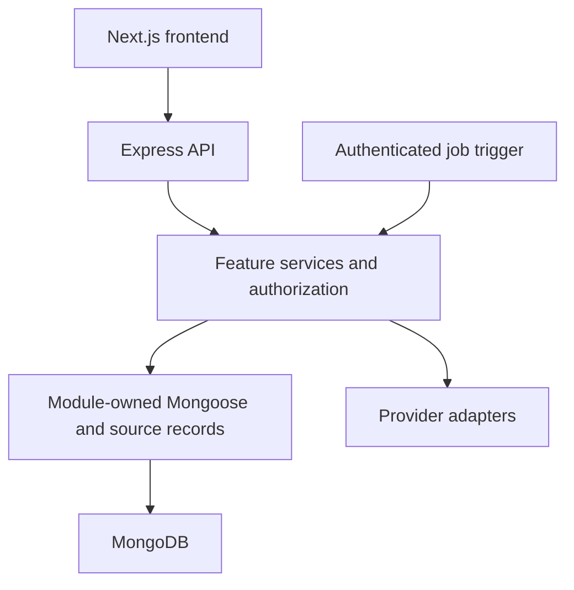

# ARADUN — Project Structure & Technical Setup

**Filename:** `06-project-structure.md`  
**Version:** 1.1.0 — final Step 6 consolidation  
**Date:** 25 October 2026  
**Approval status:** Owner-declared Step 6 completed and approved; final consolidation authorized. Source conditions, technical recommendations and unresolved implementation gates remain explicit.  
**Owner/approver:** ARADUN project owner  
**Project:** ARADUN — Technology & Digital Solutions · Build. Automate. Grow.  
**Scope:** Technical planning only. Proposed paths, operation names and scripts are specifications, not created application files or executed setup commands. No implementation code, installation, infrastructure creation, deployment or Step 7 work is included.

**Controlled update 1.1.0 — 25 October 2026:** Owner-authorized documentation-only amendment limited to the requested architecture, local-development database, solo-maintainer engineering rules and three-theme system where relevant. Unrelated requirements and unresolved gates remain unchanged. Earlier source-register versions/fingerprints and historical approval entries identify the pre-update inputs, not hashes of these revised files; current amended sections govern only these four changes. No implementation or Project Sources replacement is claimed.

## Contents

1. Authority, source verification and approval provenance
2. Preserved scope and architecture principles
3. Repository, dependencies and naming conventions
4. Complete Phase 1 structural inventory
5. Routing, layouts and rendering
6. Feature modules and ownership
7. Component architecture
8. Styles, tokens, themes and assets
9. CSS, Motion and GSAP organization
10. Database and model organization
11. Authentication and authorization
12. Server entry points and operation conventions
13. Intake, CRM and notification workflows
14. CMS, SEO, discovery and integrations
15. Environment-variable inventory
16. Dependency and version strategy
17. Development environment and conceptual scripts
18. Testing and quality structure
19. Security and privacy engineering
20. Deployment and operational readiness
21. Future extension boundaries
22. Decision register and implementation notes
23. Verification and version record
24. Technical references

Appendices: A — complete Phase 1 route map; B — 35 template bindings and all page section contracts; C — 51 component bindings; D — all 207 functional requirement mappings; E — BR/NFR/EXT requirements; F — future page inventory; G — retained commercial catalog; H — inherited decision registers; I — inherited Step 5 ADRs; J — exact Step 4 token and motion reference.

## 1. Authority, source verification and approval provenance

### 1.1 Source hierarchy

S1 is authoritative for business requirements, exact names/prices and phase qualifications; S2 for supplied page IDs and URLs; S3 for ordered sections and operational regions; S4 for design, themes, components, motion and performance; S5 for data models, indexes, backend workflows and module ownership. A later explicit owner decision supersedes only the specific decision it changes. Source A/B/R/C provenance and conditional labels remain intact.

| Ref / source | Version / status | SHA-256 |
|---|---|---|
| S1 — `01-master-requirements.md` | 0.2.0; Owner-designated reference; scoped amendment approved; open details retained | `0cf55ee4791aa6256f5035de3cc727a26dc048c581d4a55a26cc320b574cd9a6` |
| S2 — `02-pages-sitemap.md` | 1.1.0; Step 2 final consolidation; private/conditional provenance retained | `264d8bb070e003baa558742e8709f9de3506d9145a94a696b7d5593a115e9b16` |
| S3 — `03-page-sections.md` | 1.0.0; Owner-declared Step 3 approved | `a119700e79245c2a01bf10f8672a630a1969cf6c6b3c9b87bf47175c212a6a84` |
| S4 — `04-design-system-wireframes.md` | 1.0.0; Owner-declared Step 4 approved; R4 details/gates retained | `198d7025e5d707841350b07d3ff7954e285d4295e0fb4706d3312e2f01bea56d` |
| S5 — `05-database-architecture.md` | 1.0.0; Owner-declared Step 5 approved; R5 details/gates retained | `6f2a4a98c1c95182809a8597d16a4ce2495b952f952315ad435b528ec6f3dc9f` |

Source filenames are declared project names; attachment names can differ. All five were accessible. Fingerprints above identify the exact bytes used. The four supplied earlier sources match S5 Appendix G. No source file was modified. Historical statements that Step 6 has not begun are stage-history statements superseded by the current Step 6 authorization, not new blockers.

### 1.2 Chat 6 decisions and limits of approval evidence

| Reference | Evidence | Treatment |
|---|---|---|
| C6-BRIEF | Supplied Step 6 instructions in `Pasted text(4).txt` | Planning-only scope; preserve five sources; organize routes, modules, tooling and operational readiness; final file after authorization |
| C6-PROPOSAL | Visible high-level proposal | One repository/Next.js application; feature modules with internal layers; eight S5 owners; shared infrastructure; no speculative future systems |
| C6-FINAL | Owner's current final generation instruction | Declares Step 6 completed/approved and authorizes this complete document |
| R6 | Detailed specifications in this consolidation | Supplies the full structural handoff under C6-FINAL; does not claim earlier individual review of every path, dependency, variable or test |

The visible Chat 6 contains the source review and high-level proposal followed by final completion authorization. Separate intermediate approvals for the detailed tree, providers, environment names and tooling are not visible. Those details are consolidated here as R6 specifications. Existing named gates are not silently resolved by generation. No approval of a paid provider, purchase, public deployment or application implementation is inferred.

### 1.3 How to read this document

S5 schema fields, validators, relationships and indexes remain binding by reference; this document assigns their implementation homes, not replacement schemas. Appendix A maps every P1 planning item to a route, layout, component, service and storage. Appendix B retains the precise per-page ordered regions. Appendix D maps all 207 functional requirements and preserves future/conditional qualifications. Requirement IDs are copied from sources; R6 choices and local verification labels are not invented FR IDs.

## 2. Preserved scope and architecture principles

### 2.1 Scope invariants

- Eight categories, 57 unique services and 58 memberships: SVC-009 is cross-listed without another identity or canonical URL.
- Five solutions: Digital Presence, Business Automation, Business Growth, Cloud & Technology, Complete Digital Business. Earlier remembered alternative names do not override S1.
- Existing source prices, USD/English initial presentation, exact source billing qualifications and custom-quote semantics. No proposed price increases or binding automatic service-price total.
- P1: 91 public entries + 4 staff authentication entries + 27 dashboard entries = 122 pages/templates, plus 2 shared states = 124 planning items. Conditional entries remain planned but gated.
- P2: 62 added entries; P3: 28; Product Terms has one unresolved P2/P3 allocation. Total 215 inventory entries. Dynamic content instances are not a finite page-count commitment.
- Quote steps remain Service → Project → Contact → Review. Contact and consultation remain separate journeys into common intake. Get a Quote remains primary; Contact remains visible in public navigation.
- Sales stages remain New → Qualified → Discovery → Proposal Sent → Negotiation → Won / Lost. Spam, duplicate and no-response are classifications, not additional pipeline stages. Won is not Paid.
- Manual consultation requests and manual external finance operations are valid P1 baselines. Live scheduling and a payment tracker require their source decisions.
- Customer profile stays within the canonical Contact. Source catalog stays the initial writable master. No separate lead/customer/catalog database duplication.
- Three light themes: Editorial Terracotta default, Muted Slate Blue alternate and Vivid Blue alternate. No full dark mode. Inter is retained. Theme never changes business data or form state.
- No P1 client portal, checkout/payment gateway, online signing, full project suite, full page builder, configurable pipeline, general media library, AMS, tenancy or AI engine.

### 2.2 Architecture

Next.js App Router + TypeScript frontend in `aradun/frontend/`; separate Express.js + TypeScript backend in `aradun/backend/`; MongoDB + Mongoose accessed only by Express. One repository, simple feature-based backend modules, no microservices. Local development uses locally installed MongoDB; Atlas is optional later through environment configuration and production database hosting remains unselected.

Express owns API endpoints, provider callbacks, session verification, business validation, record authorization, database operations and bounded scheduled work. Next.js Server Components fetch safe DTOs from Express; browser mutations call Express. Do not duplicate business APIs in Next.js Route Handlers/Server Actions or import backend services/Mongoose into the frontend. Preserve existing public/staff page URLs. API endpoint paths are implementation contracts, not new pages.

Use the Node runtime for Express/Mongoose. No frontend database credentials, Mongoose imports or direct backend-module imports. Existing transaction, audit and outbox contracts remain unchanged.

## 3. Repository, dependencies and naming conventions

### 3.1 Repository strategy

Use one `aradun/` Git repository with `frontend/` and `backend/`. Each application has its own package.json, TypeScript configuration and environment example. Use one package manager consistently; pnpm remains recommended, not mandated. A minimal root workspace may coordinate the two applications and one lockfile; independent application lockfiles with the same manager are also valid if chosen before initialization. Do not add Turborepo, shared package graphs or orchestration infrastructure merely for this split.

Build and run the Next.js frontend and Express backend separately, with coordinated API compatibility and release checks. Source-controlled offer changes still require review; the API owns the authoritative catalog and returns public DTOs without duplicating editable catalogs.

Use the minimum necessary files, dependencies, abstractions and boilerplate. Keep feature responsibilities clear, names descriptive, code readable and manually reviewable, and documentation concise, accurate and nonduplicative. Reuse components/functions only for real repeated behavior. Do not create speculative features, empty modules, generic frameworks or pass-through layers. Preserve input validation, backend authorization, secret protection, appropriate errors and meaningful tests; reducing code size never overrides security, correctness or maintainability.

### 3.2 Structural layers and imports

| Layer | Permitted responsibility/dependencies | Forbidden shortcut |
|---|---|---|
| `frontend/src/app` | Route/layout composition, metadata, components and Express API consumers | Direct Mongoose queries, provider sends or business transitions inside page JSX |
| Module components | Domain-specific rendering and local state; safe types, validation, public DTOs, shared UI | Importing repositories, secret config or model registrations into frontend code |
| Module services | Named use cases, authorization, business rules, transaction orchestration; repositories/provider ports | Depending on React components, route layouts or another module's private model |
| Module repositories | Scoped database/source queries, indexes/projections, explicit session arguments | Accepting arbitrary browser Mongo filters or embedding UI decisions |
| Provider adapters | Email/session/storage/scheduler integration under an explicit contract | Treating provider payloads as trusted ARADUN permissions/business status |
| Shared UI/styles | Generic accessible controls, layout primitives and tokens | CRM/catalog imports, hidden business defaults, duplicate themes |
| Shared backend infrastructure | Connection lifecycle, safe logs, typed config, low-level errors | Growing into an unrestricted business-logic `utils` folder |

Use application-local `@/*` mapped to that application’s `src/*`; configure backend build/runtime resolution explicitly. Never use this alias to import across frontend/backend. Use explicit module entry files, for example `@/modules/crm/server` and `@/modules/crm/types` within the backend only; frontend consumers use HTTP DTOs. Do not install Next.js server-only markers into Express. Avoid a mixed `index.ts` barrel that re-exports server and client code. Prefer relative imports inside a small module subtree and the alias across owned boundaries. Type-only imports cannot substitute for a safe serialization boundary.

Catalog and foundational identity policy must not depend on Intake or CRM. Intake may call a CRM linking operation; CRM inquiry-handling code may use an Intake-owned repository contract. To prevent a two-way service cycle, coordinated link/conversion workflows live in `backend/src/server/workflows/` and receive explicit module operations/session context. Modules never import the coordinator. Discovery reads published Catalog/Content projections; Content does not call Discovery services. Public visibility reads use current state; later cache invalidation is a narrow infrastructure hook, not reciprocal module imports. Operations audit/rate-limit primitives do not import CRM; dashboard summary composition stays at the route/use-case composition layer.

Enforce these boundaries with ESLint restricted imports or a small import-boundary check when setup is implemented. Do not introduce dependency injection containers, a universal repository, a generic event bus or a separate package per module. Test cross-module transactions rather than merely trusting folder names.

Backend modules group routes, validation, service logic and models by feature. Keep small related functions together; controller/repository/port/coordinator files are optional only where they perform real work or preserve a demonstrated boundary. The inventory below maps responsibilities, not a mandate to create every listed file or layer. Frontend modules contain presentation and API consumers only.

### 3.3 Naming and data conventions

- Folders and ordinary files: descriptive kebab-case; React exports and domain types: PascalCase; functions/variables: camelCase. Next special filenames retain framework names.
- Components use `.tsx`; non-UI logic uses `.ts`; server files use `.server.ts` where explicit naming helps and an enforced server-only boundary. Express route files use `.routes.ts` and export only intended transport operations.
- Model exports retain S5 names; exact collection names are explicit. Examples: `contact.model.ts` exports Contact targeting `contacts`; `follow-up-task.model.ts` exports FollowUpTask targeting `tasks`.
- Test files use `.test.ts(x)` for unit/component tests and `.spec.ts` for browser workflows. Name tests for behavior, not implementation internals.
- Keep page IDs, catalog IDs, content keys, database IDs and provider IDs distinct. Validate each at its boundary. Do not rename `[leadId]` merely because the model is Inquiry.
- UTC instants, IANA timezones, validated source labels and integer minor-unit money follow S5. Missing value is not zero; unknown currency/unit is not guessed.
- Split components/services when responsibilities diverge; no arbitrary line-count threshold. Shared abstraction requires real repeated behavior, not superficial visual similarity.

## 4. Complete Phase 1 structural inventory

### 4.1 Creation timing

`I` = planned initialization foundation; `F` = add when its feature is implemented; `C` = create only after the named conditional decision; `O` = optional engineering choice. These labels are creation timing, not execution evidence. No application files have been created by this planning task.

Do not scaffold this inventory wholesale: initialization creates only I entries; F/C/O entries are a final ownership map added when real work needs them. The hierarchical inventory below combines root files, every distinct P1 route file, module service/model homes, design primitives, templates, test locations and operations documentation. Repeated data-driven pages share one route/template. Directory entries are groupings; no empty future module is required. Provider-specific files stay conditional until selection. The named service files may contain several small related operations; there is no obligation to create one file per function or placeholder test per file.

All paths below are relative to `aradun/`. Existing feature-file entries are responsibility locations, not mandatory scaffolding; create or split them only when needed. Backend input validation is authoritative; frontend DTO/form types are small explicit API-consumer contracts, never runtime imports from backend source.

- `.editorconfig` — I
- `frontend/`
  - `.env.example` — I
  - `components.json` — F
  - `next-env.d.ts` — I · Foundation; generated declarations handled by framework
  - `next.config.ts` — I
  - `package.json` — I
  - `playwright.config.ts` — F
  - `postcss.config.mjs` — I
  - `src/`
    - `app/`
      - `(auth)/`
        - `staff/`
          - `error.tsx` — F
          - `layout.tsx` — F
          - `login/`
            - `page.tsx` — F · STA-001
          - `recover/`
            - `page.tsx` — C · STA-002
          - `reset/`
            - `page.tsx` — C · STA-003
          - `verify/`
            - `page.tsx` — C · STA-004
      - `(public)/`
        - `about/`
          - `page.tsx` — F · PUB-005
        - `accessibility/`
          - `page.tsx` — C · TRU-02
        - `consultation/`
          - `page.tsx` — F · PUB-014
        - `contact/`
          - `page.tsx` — F · PUB-012
        - `cookies/`
          - `page.tsx` — C · TRU-01
        - `error.tsx` — F
        - `faq/`
          - `[slug]/`
            - `page.tsx` — F · PUB-011
          - `page.tsx` — F · PUB-010
        - `get-a-quote/`
          - `page.tsx` — F · PUB-013
        - `insights/`
          - `[slug]/`
            - `page.tsx` — F · PUB-009
          - `page.tsx` — F · PUB-008
        - `layout.tsx` — F
        - `loading.tsx` — F
        - `our-work/`
          - `[slug]/`
            - `page.tsx` — F · PUB-007
          - `page.tsx` — F · PUB-006
        - `page.tsx` — F · PUB-001
        - `pricing/`
          - `page.tsx` — F · PUB-004
        - `privacy/`
          - `page.tsx` — F · PUB-017
        - `search/`
          - `page.tsx` — F · PUB-016
        - `security/`
          - `page.tsx` — C · TRU-03
        - `services/`
          - `[slug]/`
            - `page.tsx` — F · CAT-01
          - `page.tsx` — F · PUB-002
        - `solutions/`
          - `[slug]/`
            - `page.tsx` — F · SOL-01
          - `page.tsx` — F · PUB-003
        - `terms/`
          - `page.tsx` — F · PUB-018
        - `thank-you/`
          - `page.tsx` — F · PUB-015
      - `(staff)/`
        - `dashboard/`
          - `account/`
            - `page.tsx` — F · ADM-026
          - `audit/`
            - `page.tsx` — C · ADM-025
          - `contacts/`
            - `[contactId]/`
              - `page.tsx` — F · ADM-005
            - `page.tsx` — F · ADM-004
          - `content/`
            - `articles/`
              - `[articleId]/`
                - `page.tsx` — F · ADM-015
                - `preview/`
                  - `page.tsx` — F · ADM-016
              - `new/`
                - `page.tsx` — F · ADM-014
              - `page.tsx` — F · ADM-013
            - `error.tsx` — F
            - `faqs/`
              - `[faqId]/`
                - `page.tsx` — C · ADM-022
              - `page.tsx` — C · ADM-021
            - `layout.tsx` — F
            - `page.tsx` — F · ADM-012
            - `seo/`
              - `[pageId]/`
                - `page.tsx` — F · ADM-020
              - `page.tsx` — F · ADM-019
            - `testimonials/`
              - `[testimonialId]/`
                - `page.tsx` — F · ADM-018
              - `page.tsx` — F · ADM-017
          - `customers/`
            - `[customerId]/`
              - `page.tsx` — F · ADM-011
            - `page.tsx` — F · ADM-010
          - `error.tsx` — F
          - `layout.tsx` — F
          - `leads/`
            - `[leadId]/`
              - `page.tsx` — F · ADM-003
            - `page.tsx` — F · ADM-002
          - `loading.tsx` — F
          - `not-found.tsx` — F
          - `opportunities/`
            - `[opportunityId]/`
              - `page.tsx` — F · ADM-007
            - `page.tsx` — F · ADM-006
          - `page.tsx` — F · ADM-001
          - `payments/`
            - `page.tsx` — C · ADM-027
          - `settings/`
            - `access/`
              - `[userId]/`
                - `page.tsx` — C · ADM-024
              - `page.tsx` — C · ADM-023
          - `tasks/`
            - `[taskId]/`
              - `page.tsx` — F · ADM-009
            - `page.tsx` — F · ADM-008
      - `error.tsx` — F
      - `global-error.tsx` — F
      - `layout.tsx` — I
      - `not-found.tsx` — F
      - `robots.ts` — F
      - `sitemap.ts` — F
    - `components/`
      - `analytics/`
        - `public-analytics.tsx` — F
      - `data-display/`
        - `collection-controls.tsx` — F · CMP-28 CollectionControls
        - `data-table.tsx` — F · CMP-39 DataTable
        - `page-toolbar.tsx` — F · CMP-38 PageToolbar
        - `status-badge.tsx` — F · CMP-40 StatusBadge
      - `feedback/`
        - `dialog-drawer.tsx` — F · CMP-47 DialogDrawer
        - `loading-empty-error.tsx` — F · CMP-36 LoadingEmptyError
        - `notification.tsx` — F · CMP-48 Notification
      - `forms/`
        - `choice-control.tsx` — F · CMP-30 ChoiceControl
        - `field-group.tsx` — F · CMP-29 FieldGroup
        - `form-feedback.tsx` — F · CMP-35 FormFeedback
      - `layout/`
        - `breadcrumbs.tsx` — F · CMP-06 Breadcrumbs
        - `container-section.tsx` — F · CMP-08 ContainerSection
        - `dashboard-shell.tsx` — F · CMP-37 DashboardShell
        - `mobile-navigation.tsx` — F · CMP-04 MobileNavigation
        - `site-footer.tsx` — F · CMP-05 SiteFooter
        - `site-header.tsx` — F · CMP-01 SiteHeader
      - `marketing/`
        - `bento-group.tsx` — F · CMP-16 BentoGroup
        - `conversion-cta.tsx` — F · CMP-26 ConversionCTA
        - `editorial-hero.tsx` — F · CMP-12 EditorialHero
        - `evidence-block.tsx` — F · CMP-19 EvidenceBlock
        - `process-timeline.tsx` — F · CMP-23 ProcessTimeline
        - `reading-body-toc.tsx` — F · CMP-27 ReadingBodyTOC
        - `section-heading.tsx` — F · CMP-09 SectionHeading
      - `motion/`
        - `motion-features.ts` — F
        - `motion-provider.tsx` — F
        - `reveal.tsx` — F
      - `templates/`
        - `record-detail.tsx` — F · T-DETAIL
        - `record-list.tsx` — F · T-LIST
        - `system-state.tsx` — F · T-STATE
      - `theme/`
        - `appearance-selector.tsx` — F · CMP-10 AppearanceSelector
        - `theme-bootstrap.ts` — F
        - `theme-provider.tsx` — F
      - `ui/`
        - `accordion.tsx` — F · Selective; only when actual usage needs it
        - `alert-dialog.tsx` — F · Selective; only when actual usage needs it
        - `alert.tsx` — F · Selective; only when actual usage needs it
        - `badge.tsx` — F · Selective; only when actual usage needs it
        - `button.tsx` — F · Selective; only when actual usage needs it
        - `checkbox.tsx` — F · Selective; only when actual usage needs it
        - `dialog.tsx` — F · Selective; only when actual usage needs it
        - `dropdown-menu.tsx` — F · Selective; only when actual usage needs it
        - `input.tsx` — F · Selective; only when actual usage needs it
        - `label.tsx` — F · Selective; only when actual usage needs it
        - `navigation-menu.tsx` — F · Selective; only when actual usage needs it
        - `popover.tsx` — F · Selective; only when actual usage needs it
        - `radio-group.tsx` — F · Selective; only when actual usage needs it
        - `select.tsx` — F · Selective; only when actual usage needs it
        - `sheet.tsx` — F · Selective; only when actual usage needs it
        - `skeleton.tsx` — F · Selective; only when actual usage needs it
        - `table.tsx` — F · Selective; only when actual usage needs it
        - `tabs.tsx` — F · Selective; only when actual usage needs it
        - `textarea.tsx` — F · Selective; only when actual usage needs it
    - `config/`
      - `env.public.ts` — I
      - `navigation.ts` — F
      - `page-registry.ts` — F
      - `redirects.ts` — F
      - `site.ts` — I
      - `env.server.ts` — I · Trusted API origin/server-render configuration only; no database/provider secrets
    - `instrumentation.ts` — F
    - `modules/`
      - `catalog/`
        - `components/`
          - `availability-badge.tsx` — F · CMP-18 AvailabilityBadge
          - `category-directory.tsx` — F · CMP-13 CategoryDirectory
          - `price-comparison.tsx` — F · CMP-17 PriceComparison
          - `service-card.tsx` — F · CMP-14 ServiceCard
          - `services-menu.tsx` — F · CMP-02 ServicesMenu
          - `solution-card.tsx` — F · CMP-15 SolutionCard
          - `solutions-menu.tsx` — F · CMP-03 SolutionsMenu
        - `templates/`
          - `category.tsx` — F · T-CATEGORY
          - `pricing.tsx` — F · T-PRICING
          - `service.tsx` — F · T-SERVICE
          - `services-overview.tsx` — F · T-OV-S
          - `solution.tsx` — F · T-SOLUTION
          - `solutions-overview.tsx` — F · T-OV-SOL
      - `content/`
        - `components/`
          - `article-card.tsx` — F · CMP-25 ArticleCard
          - `content-editor.tsx` — F · CMP-45 ContentEditor
          - `faq-accordion.tsx` — F · CMP-24 FAQAccordion
          - `home-hero-art.tsx` — F
          - `private-preview.tsx` — F · CMP-49 PrivatePreview
          - `project-card-gallery.tsx` — F · CMP-20 ProjectCardGallery
          - `seo-editor.tsx` — F · CMP-46 SEOEditor
          - `testimonial.tsx` — F · CMP-21 Testimonial
        - `motion/`
          - `home-hero.timeline.ts` — O · Only justified layered artwork; static fallback valid
        - `templates/`
          - `about.tsx` — F · T-ABOUT
          - `article-editor.tsx` — F · T-EDITOR
          - `article.tsx` — F · T-ARTICLE
          - `case-study.tsx` — F · T-CASE
          - `content-overview.tsx` — F · T-CONTENT
          - `faq-editor.tsx` — C · T-FAQEDIT
          - `faq.tsx` — F · T-FAQ
          - `help-article.tsx` — F · T-HELP
          - `home.tsx` — F · T-HOME
          - `insights.tsx` — F · T-INSIGHTS
          - `policy.tsx` — F · T-POLICY
          - `private-preview.tsx` — F · T-PREVIEW
          - `seo-editor.tsx` — F · T-SEOEDIT
          - `testimonial-editor.tsx` — F · T-TESTIMONIAL
          - `work.tsx` — F · T-WORK
      - `crm/`
        - `components/`
          - `activity-timeline.tsx` — F · CMP-43 ActivityTimeline
          - `pipeline-view.tsx` — F · CMP-41 PipelineView
          - `record-panel.tsx` — F · CMP-42 RecordPanel
          - `task-editor.tsx` — F · CMP-44 TaskEditor
        - `templates/`
          - `dashboard.tsx` — F · T-DASH
      - `discovery/`
        - `components/`
          - `public-search.tsx` — F · CMP-11 PublicSearch
        - `templates/`
          - `search.tsx` — F · T-SEARCH
      - `identity/`
        - `components/`
          - `security-panel.tsx` — F · CMP-50 SecurityPanel
        - `templates/`
          - `access-detail.tsx` — C · T-ACCESS
          - `account.tsx` — F · T-ACCOUNT
          - `auth.tsx` — F · T-AUTH
      - `intake/`
        - `components/`
          - `consultation-request.tsx` — F · CMP-34 ConsultationRequest
          - `contact-form.tsx` — F
          - `form-progress.tsx` — F · CMP-31 FormProgress
          - `quote-contact-step.tsx` — F
          - `quote-form.tsx` — F
          - `quote-project-step.tsx` — F
          - `quote-selection.tsx` — F · CMP-32 QuoteSelection
          - `review-summary.tsx` — F · CMP-33 ReviewSummary
        - `templates/`
          - `confirmation.tsx` — F · T-CONFIRM
          - `consultation.tsx` — F · T-CONSULT
          - `contact.tsx` — F · T-CONTACT
          - `quote.tsx` — F · T-QUOTE
      - `operations/`
        - `components/`
          - `manual-finance-panel.tsx` — C · CMP-51 ManualFinancePanel
        - `templates/`
          - `audit.tsx` — C · T-AUDIT
          - `manual-payments.tsx` — C · T-PAYMENTS
    - `proxy.ts` — O · Only if selected framework/auth adapter benefits; not authorization
    - `styles/`
      - `accessibility.css` — I
      - `globals.css` — I
      - `motion.css` — I
      - `themes.css` — I
      - `tokens.css` — I
    - `lib/`
      - `api.ts` — F · Small trusted Express API client; no business logic or database imports
  - `tests/`
    - `e2e/`
      - `accessibility.spec.ts` — F
      - `intake.spec.ts` — F
      - `public.spec.ts` — F
      - `staff.spec.ts` — F
      - `theme-motion.spec.ts` — F
    - `performance/` — F
  - `tsconfig.json` — I
  - `vitest.config.ts` — F
  - `public/`
  - `public/`
    - `brand/` — F · Approved public assets only
    - `fonts/` — F · Approved public assets only
    - `images/` — F · Approved public assets only
- `backend/`
  - `.env.example` — I
  - `package.json` — I
  - `scripts/`
    - `db/`
      - `apply-indexes.ts` — F
      - `check-indexes.ts` — F
      - `migrate.ts` — F
      - `seed-development.ts` — F
      - `migrations/` — F · Only actual numbered reviewed migrations
    - `staff/`
      - `bootstrap.ts` — F
    - `validate-content.ts` — F
  - `src/`
    - `modules/`
      - `identity/`
        - `auth.routes.ts` — C · Provider/hosting decision; exact provider handler path may differ
        - `identity.routes.ts` — F
        - `models/`
          - `staff-session.model.ts` — C
          - `staff-user.model.ts` — F
        - `policies/`
          - `record-access.server.ts` — F
          - `roles.ts` — F
        - `ports/`
          - `auth-provider.ts` — F
        - `repositories/`
          - `staff-session.repository.server.ts` — C
          - `staff-user.repository.server.ts` — F
        - `server/`
          - `access.service.server.ts` — F
          - `actor.service.server.ts` — F
          - `session.service.server.ts` — F
          - `staff-access.service.server.ts` — F
        - `server.ts` — F
        - `types.ts` — F
        - `validation/`
          - `input.schema.test.ts` — F · Only meaningful contract behavior tests
          - `input.schema.ts` — F
      - `notifications/`
        - `jobs.routes.ts` — F
        - `email-webhook.routes.ts` — C · Provider/hosting decision; exact provider handler path may differ
        - `models/`
          - `outbox-event.model.ts` — F
        - `ports/`
          - `email-provider.ts` — F
        - `repositories/`
          - `outbox-event.repository.server.ts` — F
        - `server/`
          - `delivery.service.server.ts` — F
          - `enqueue.service.server.ts` — F
          - `reconcile.service.server.ts` — F
        - `server.ts` — F
        - `templates/`
          - `assignment-alert.ts` — C · A5-11
          - `inquiry-receipt.ts` — F
          - `staff-intake-alert.ts` — F
        - `types.ts` — F
        - `validation/`
          - `input.schema.test.ts` — F · Only meaningful contract behavior tests
          - `input.schema.ts` — F
      - `content/`
        - `uploads.routes.ts` — C · Provider/hosting decision; exact provider handler path may differ
        - `content.routes.ts` — F
        - `data/`
          - `asset-manifest.ts` — F
          - `case-studies.ts` — F
          - `core-pages.ts` — F
          - `evidence.server.ts` — F · Private source proof; never public bundle
          - `faqs.ts` — F
          - `policies.ts` — F
          - `taxonomy.ts` — F
        - `models/`
          - `article.model.ts` — F
          - `faq-entry.model.ts` — C
          - `seo-override.model.ts` — F
          - `testimonial.model.ts` — F
        - `repositories/`
          - `article.repository.server.ts` — F
          - `faq-entry.repository.server.ts` — C
          - `seo-override.repository.server.ts` — F
          - `testimonial.repository.server.ts` — F
        - `server/`
          - `editorial.service.server.ts` — F
          - `faq.service.server.ts` — C
          - `public-content.service.server.ts` — F
          - `seo.service.server.ts` — F
          - `testimonials.service.server.ts` — F
        - `server.ts` — F
        - `types.ts` — F
        - `validation/`
          - `input.schema.test.ts` — F · Only meaningful contract behavior tests
          - `input.schema.ts` — F
      - `intake/`
        - `calendar-webhook.routes.ts` — C · Provider/hosting decision; exact provider handler path may differ
        - `intake.routes.ts` — F
        - `models/`
          - `booking-record.model.ts` — C
          - `inquiry.model.ts` — F
        - `repositories/`
          - `booking-record.repository.server.ts` — C
          - `inquiry.repository.server.ts` — F
        - `server/`
          - `booking.service.server.ts` — C
          - `inquiry.service.server.ts` — F
          - `receipt.service.server.ts` — F
          - `submission.service.server.ts` — F
        - `server.ts` — F
        - `types.ts` — F
        - `validation/`
          - `input.schema.test.ts` — F · Only meaningful contract behavior tests
          - `input.schema.ts` — F
      - `catalog/`
        - `data/`
          - `catalog-release.ts` — F
          - `categories.ts` — F
          - `packages.ts` — F
          - `services.ts` — F
          - `solutions.ts` — F
        - `repositories/`
          - `catalog.repository.server.ts` — F
        - `server/`
          - `catalog.service.server.ts` — F
          - `offer-snapshot.service.server.ts` — F
        - `server.ts` — F
        - `types.ts` — F
        - `validation/`
          - `input.schema.test.ts` — F · Only meaningful contract behavior tests
          - `input.schema.ts` — F
        - `catalog.routes.ts` — F · Public catalog DTO reads
      - `crm/`
        - `crm.routes.ts` — F
        - `models/`
          - `activity.model.ts` — F
          - `contact.model.ts` — F
          - `follow-up-task.model.ts` — F
          - `opportunity.model.ts` — F
        - `repositories/`
          - `activity.repository.server.ts` — F
          - `contact.repository.server.ts` — F
          - `follow-up-task.repository.server.ts` — F
          - `opportunity.repository.server.ts` — F
        - `server/`
          - `activities.service.server.ts` — F
          - `contacts.service.server.ts` — F
          - `customers.service.server.ts` — F
          - `dashboard.service.server.ts` — F
          - `inquiry-handling.service.server.ts` — F
          - `opportunities.service.server.ts` — F
          - `tasks.service.server.ts` — F
        - `server.ts` — F
        - `types.ts` — F
        - `validation/`
          - `input.schema.test.ts` — F · Only meaningful contract behavior tests
          - `input.schema.ts` — F
      - `discovery/`
        - `server/`
          - `canonical.service.server.ts` — F
          - `search.service.server.ts` — F
          - `sitemap.service.server.ts` — F
        - `server.ts` — F
        - `types.ts` — F
        - `validation/`
          - `input.schema.test.ts` — F · Only meaningful contract behavior tests
          - `input.schema.ts` — F
        - `discovery.routes.ts` — F · Published search/sitemap DTO reads
      - `operations/`
        - `models/`
          - `audit-event.model.ts` — F
          - `manual-payment-record.model.ts` — C
          - `rate-limit-bucket.model.ts` — F
        - `operations.routes.ts` — F
        - `repositories/`
          - `audit-event.repository.server.ts` — F
          - `manual-payment-record.repository.server.ts` — C
          - `rate-limit-bucket.repository.server.ts` — F
        - `server/`
          - `audit.service.server.ts` — F
          - `manual-finance.service.server.ts` — C
          - `rate-limit.service.server.ts` — F
        - `server.ts` — F
        - `types.ts` — F
        - `validation/`
          - `input.schema.test.ts` — F · Only meaningful contract behavior tests
          - `input.schema.ts` — F
    - `config/`
      - `env.server.ts` — I
      - `features.ts` — F
      - `operational-policy.server.ts` — F
      - `pipeline.ts` — F
    - `server/`
      - `db/`
        - `connection.server.ts` — F
        - `index-plan.server.ts` — F
        - `model-registry.server.ts` — F
        - `transaction.server.ts` — F
        - `value-schemas.server.ts` — F
      - `errors.ts` — F
      - `integrations/`
        - `auth/`
          - `adapter.server.ts` — F · Chosen provider only
        - `calendar/`
          - `adapter.server.ts` — C · Selected workflow only
        - `email/`
          - `adapter.server.ts` — F · Chosen provider only
        - `monitoring/`
          - `adapter.server.ts` — F · Chosen provider only
        - `storage/`
          - `adapter.server.ts` — C · Selected workflow only
      - `logging/`
        - `logger.server.ts` — F
      - `workflows/`
        - `convert-customer.server.ts` — F
        - `link-inquiry.server.ts` — F
    - `app.ts` — I · Express middleware, feature routes and safe error boundary
    - `server.ts` — I · Validated startup, listener and graceful shutdown
  - `tests/`
    - `helpers/`
      - `fake-email.ts` — F
      - `test-database.ts` — F
      - `test-identity.ts` — F
    - `integration/`
      - `access.test.ts` — F
      - `content.test.ts` — F
      - `crm.test.ts` — F
      - `database.test.ts` — F
      - `intake.test.ts` — F
      - `notifications.test.ts` — F
    - `setup.ts` — F
    - `fixtures/` — F
    - `security/` — F
  - `tsconfig.json` — I
  - `vitest.config.ts` — F
- `.github/`
  - `workflows/`
    - `ci.yml` — I
    - `deploy.yml` — C · Provider/hosting decision; exact provider handler path may differ
- `.gitignore` — I
- `.node-version` — I
- `.prettierignore` — I
- `.prettierrc.json` — I
- `README.md` — I
- `docs/`
  - `architecture/`
    - `README.md` — I
    - `environment.md` — F · Retain source authority; manual business templates require policy approval
    - `provider-selection.md` — F · Retain source authority; manual business templates require policy approval
    - `decisions/` — F · Retain source authority; manual business templates require policy approval
  - `content-publication.md` — F · Retain source authority; manual business templates require policy approval
  - `operations/`
    - `proposal-invoice-templates.md` — F · Retain source authority; manual business templates require policy approval
  - `runbooks/`
    - `access-lifecycle.md` — F
    - `backup-restore.md` — F
    - `incident-response.md` — F
    - `local-setup.md` — F
    - `notification-recovery.md` — F
    - `privacy-requests.md` — F
    - `release-rollback.md` — F
    - `search-console.md` — F
    - `secret-rotation.md` — F
  - `testing.md` — F · Retain source authority; manual business templates require policy approval
  - `sources/` — F · Retain source authority; manual business templates require policy approval
- `eslint.config.mjs` — I
- `pnpm-lock.yaml` — I
- `package.json` — O · Minimal root scripts/workspace coordination only
- `pnpm-workspace.yaml` — O · Only if the recommended two-application pnpm workspace is selected

### 4.2 Root and shared responsibilities

| Path/group | Responsibility | Timing |
|---|---|---|
| `frontend/package.json`, `backend/package.json`; selected lockfile(s) | Application dependencies and §17 scripts; optional root workspace/scripts; one package manager | I; root coordination O |
| `.node-version`, `.gitignore`, `.editorconfig` | Pinned runtime, exclude secrets/build artifacts, consistent whitespace | I |
| `frontend/next.config.ts` | Reviewed image origins, headers, redirects and supported framework options; no speculative legacy flags | I then F |
| `frontend/tsconfig.json`, `backend/tsconfig.json`, `frontend/next-env.d.ts` | Strict types/alias and framework-generated declarations; do not hand-edit generated declarations | I |
| `eslint.config.mjs`, `.prettierrc.json`, `.prettierignore` | Lint, architectural boundaries, format; source/content exceptions explicit | I |
| `frontend/postcss.config.mjs`, `frontend/src/styles/` | Selected Tailwind integration and one semantic design-token system | I |
| `frontend/components.json` | Selected shadcn setup/path conventions; added before first primitive | F |
| `frontend/.env.example`, `backend/.env.example` | Names and nonsecret explanations only; no real values or working credentials | I |
| `frontend/src/config/` (presentation) / `backend/src/config/` (API policy/secrets) | Validated server/public environment views, site/navigation/page registry, pipeline and policy configuration | I/F |
| `backend/src/server/db/` | Cached connection, transaction helper, reviewed model-registration manifest and index plan | F |
| `backend/src/server/workflows/` | Explicit use cases that coordinate module boundaries; no generic bus | F |
| `backend/src/server/integrations/` | Selected provider adapters behind narrow ports; no business master data | F/C |
| `frontend/src/instrumentation.ts`; backend startup/logger | Application-specific observability after provider choice; no raw payload capture | F |
| `frontend/src/proxy.ts` | Optional lightweight routing/session-hint optimization only; framework-version appropriate; never sole authorization | O |
| `frontend/public/` | Intentionally public optimized fonts/logo/hero/media; never private evidence, drafts, receipts or client documents | I/F |
| `backend/scripts/` | Reviewed developer/admin index, migration, seed, source-validation and bootstrap utilities | F |
| `frontend/tests/`, `backend/tests/` | Cross-module integration/E2E/security/recovery fixtures; private data synthetic | F |
| `docs/` | Source copies, ADRs, setup, selected providers and runbooks; reference sources unchanged | I/F |
| `.github/workflows/` | Required CI checks; selected deployment/release integration when hosting is chosen | I/F/C |

Tailwind configuration is CSS-first if the selected compatible major supports that approach. Do not create a legacy `tailwind.config.ts` merely because an older tutorial has one. If a later chosen integration requires a configuration file, document the actual reason and preserve token ownership.

## 5. Routing, layouts and rendering

### 5.1 Shells

| Key | Proposed layout | Scope and obligations |
|---|---|---|
| ROOT | `frontend/src/app/layout.tsx` | Document language, global styles/font, metadata base, minimal theme bootstrap; no global CRM/auth/provider data fetch |
| PUBLIC | `frontend/src/app/(public)/layout.tsx` | SiteHeader, navigation, visible Contact, search/appearance utilities, footer and skip link; simplified presentation on utility/legal pages without deleting required content |
| AUTH | `frontend/src/app/(auth)/staff/layout.tsx` | Compact staff-access shell; no marketing animation or private staff data |
| STAFF | `frontend/src/app/(staff)/dashboard/layout.tsx` | Protected navigation and DashboardShell; early access check plus independent checks in every read/action |
| CONTENT | `frontend/src/app/(staff)/dashboard/content/layout.tsx` | Shared CMS subnavigation and editor shell; no permission inherited merely from URL nesting |
| SYSTEM | Root/segment error and not-found files | Shared state recipes; recover without exposing PII/provider diagnostics |

Route groups are organizational and do not add URL segments. Retain a single root document layout; do not split into multiple root layouts simply to obtain different headers. Explicit `dashboard` and `staff` segments preserve the approved URLs. No public Staff Login navigation is added.

Appendix A is the exhaustive P1 route map. The 65 category/service entries share `frontend/src/app/(public)/services/[slug]/page.tsx`, which resolves a discriminated category-or-service record. The five solution entries share `/solutions/[slug]`. No competing dynamic sibling folder names, nested category/service URL migration or catch-all marketing page builder.

### 5.2 Route resolution, parameters and technical interfaces

All incoming route params and search params are validated. Category and service slugs share one unique namespace. Static dashboard segment `new` is reserved before dynamic article IDs; record IDs never equal static segments. Unknown/unpublished/disabled source records return the appropriate not-found result. Conditional interfaces remain unlinked and unavailable until selected; required underlying capabilities retain their provider/manual/source baseline.

The SEO editor's approved `/dashboard/content/seo/[pageId]` path is retained. A template page ID alone does not identify every article/help/case instance. The editor accepts an allowlisted `contentKey` query context for such entries, validates the key's relationship to that page/template, and delegates to the actual owning source override or content snapshot. It never treats arbitrary strings as editable URLs. This is an R6 resolution of the parameter-versus-instance issue; no additional page URL is introduced. Article SEO can also be edited in the article editor.

New testimonials/FAQs/staff entries use authorized in-list forms/dialogs or provider administration, then navigate to an existing detail path after creation. Do not invent `/new` routes absent from S2. Tasks/contacts/opportunities similarly use the specified list/detail interfaces and permitted dialogs. Preserve draft privacy even in a public-style preview layout.

Technical endpoints are not counted as business pages. Proposed `/api/jobs/notifications` runs bounded authenticated outbox processing; prefer authenticated POST. If the selected host scheduler only supports GET, select a compatible authenticated scheduler or seek an explicit documented architecture exception before implementation; do not silently change the no-state-changing-GET baseline. The authentication provider may require `/api/auth/[...auth]` or another handler; create only the selected provider's exact required route and reconcile STA recovery/MFA paths explicitly. Optional upload and calendar/email webhook handlers are gated and must be inventoried at provider selection. No blanket public REST CRUD mirror.

### 5.3 Loading, errors and caching

Root `not-found.tsx`, segment `error.tsx` and root `global-error.tsx` cover shared SYS states; there are no `/404` or `/error` business routes. Root global errors render a complete document fallback as the framework requires. Add route-level loading/error boundaries where a real asynchronous region can fail independently, especially staff lists/details, CMS and dynamic public content. Use panel-level Suspense for independent dashboard summaries. Loading is not an empty result; query failures cannot become zero metrics.

Source catalog/core content can be pre-rendered when all included data is source-controlled. Database-backed publication/SEO reads initially use current request-time state under S5 ADR-15. A cached source template must not freeze DB metadata/testimonials forever: select request-time composition for those routes or a reviewed invalidation design before caching. Private data and draft previews are never shared across users. Authentication, role changes, unpublish and evidence withdrawal must invalidate any later caches completely, including search/sitemap/related-card outputs. Do not enable experimental or version-specific global caching without a concrete contract.

### 5.4 Metadata and indexing

Metadata generation uses the same registered identity, publication eligibility and safe content service as page rendering. Canonicals preserve supplied paths; `https://aradun.com` is the proposed origin pending final www/DNS choice. Do not derive canonicals from untrusted Host headers. Maintain a reviewed redirect register for later slug changes, avoid chains and preserve stable IDs. Source metadata is overridden only through its owning allowed fields.

`frontend/src/app/sitemap.ts` includes eligible published canonical URLs; `robots.ts` expresses actual crawl policy. Search/confirmation/auth/private preview/dashboard/selection utility variants are noindex and excluded. Robots is not access control; blocked crawling is not a substitute for delivering noindex where needed. Truthful Organization, Service, Article and BreadcrumbList markup derives from approved visible content. No fabricated ratings or guaranteed search result display. Search query/filter URLs do not create new pages or unrestricted indexable variants.

## 6. Feature modules and ownership

Each module keeps server operations, validation, DTOs, components and persistence in its subtree. Subfolders listed in the inventory are added only when used. Public projections and internal data contracts are distinct. A provider adapter can be shared infrastructure; the business event remains owned by its initiating module.

| Module / path | Responsibilities and UI | Server services, validation and persistence | Dependencies and future boundary |
|---|---|---|---|
| Catalog — `frontend/src/modules/catalog` (UI) / `backend/src/modules/catalog` (API owner) | Service/category/solution/pricing templates; comparisons, availability, selected-offer context | `catalog.service.server.ts`, `offer-snapshot.service.server.ts`; source-schema validation; source repository over releases/categories/services/solutions/packages | Source config only; public safe projections; no DB catalog CRUD P1. P2 adapter migration preserves IDs/prices/URLs |
| Content — `frontend/src/modules/content` (UI) / `backend/src/modules/content` (API owner) | Public core/work/Insights/FAQ; CMS article/testimonial/SEO; conditional FAQ editor | Public/editorial/SEO services; Article/Testimonial/SeoOverride; optional FaqEntry; maintained core/case/help data | Catalog keys and Identity checks; private evidence separate; broad pages/catalog/media editors P2 |
| Discovery — `frontend/src/modules/discovery` (UI) / `backend/src/modules/discovery` (API owner) | Search result screen and shared search entry | Public search, sitemap and canonical service; bounded query validation; reads Catalog and Content projections | No search collection or second publication truth; Atlas/external search only for measured need |
| Intake — `frontend/src/modules/intake` (UI) / `backend/src/modules/intake` (API owner) | Quote steps, contact, manual consultation and receipt; staff inquiry projections through authorized interface | Type-specific input schemas; submission/reference/idempotency service; Inquiry repository/model | Catalog snapshots, Operations abuse/audit, Notifications enqueue; coordinated CRM links via workflow; no public read/update |
| CRM — `frontend/src/modules/crm` (UI) / `backend/src/modules/crm` (API owner) | Contacts/customer views, pipeline, lead handling, tasks, activity panels and summaries | Contact/Opportunity/FollowUpTask/Activity models and repositories; services for list/detail, assignment, stages, tasks and reviewed conversion | Identity + Operations; Intake through narrow contract/coordinator; company/project/campaign systems later |
| Identity — `frontend/src/modules/identity` (UI) / `backend/src/modules/identity` (API owner) | Staff login/recovery/MFA/account; conditional access UI | Actor/access/session service, policies and provider port; StaffUser, optional StaffSession | Provider verifies identity; local status/roles control ARADUN authorization; no public signup, role builder or client identity P1 |
| Notifications — `backend/src/modules/notifications` | Inline delivery-state feedback where approved; no global notification console | OutboxEvent, enqueue/claim/deliver/reconcile service, controlled email templates, provider adapter | Operations logs; constrained reads to resolve authorized message context; no campaign engine, optional assignment event uses same infrastructure |
| Operations — `frontend/src/modules/operations` (UI) / `backend/src/modules/operations` (API owner) | Audit viewer conditional, safe summary composition, conditional manual finance panel | AuditEvent/RateLimitBucket; optional ManualPaymentRecord; audit/limiter/finance services and recovery config | Low-level support does not depend on domain UI; finance scope gate; advanced admin/workflow consoles later |

Scheduling is a conditional integration owned initially by Intake under `integrations/calendar/` with BookingRecord only after D-003 promotion (P2 baseline otherwise). It is not a ninth baseline module. Theme/components are presentation infrastructure, not new business modules. Measurement is a small public adapter with consent control, not a database analytics module.

Backend source records remain the single catalog/content authority. Frontend templates obtain public projections through Express; no second editable catalog is introduced. Public asset URLs reference frontend/public or the selected asset store. Private evidence and operational policy stay backend-only.

## 7. Component architecture

### 7.1 Ownership

| Location | Contents / rule |
|---|---|
| `frontend/src/components/ui` | Selective shadcn/native primitives: button, input, label, textarea, dialog, sheet, alert-dialog, accordion, select, checkbox, radio-group, badge, table, tabs, popover/dropdown/navigation menu, skeleton/alert as used |
| `frontend/src/components/layout` | Container, Section, Breadcrumbs, public header/footer, staff shell; shell composition may consume safe navigation DTOs |
| `frontend/src/components/forms` | Labeled fields, choices, error summary, pending/success feedback; no quote/business rules |
| `frontend/src/components/feedback` | Loading, empty, error, denied and conflict treatment; contextual recovery and supplementary notifications |
| `frontend/src/components/data-display` | Generic table, toolbar, status badge and paginated collection controls; domain columns stay local |
| `frontend/src/components/marketing` | Shared editorial hero, section heading, evidence, process, CTA, reading body and optional bento composition |
| `frontend/src/modules/*/components` | Service/price cards, inquiry forms, pipeline, record panels, article/SEO editor and domain-specific lists |
| `frontend/src/modules/*/templates` | S3/S4 reusable page compositions; consume data and preserve the approved ordered regions |
| `frontend/src/components/theme`, `frontend/src/components/motion` | Small appearance provider/control and optional motion wrappers; do not wrap all content in a Client Component |

Appendix C binds every CMP-01–CMP-51 entry to a path and retains its source anatomy/variants/accessibility/motion. CMP-22 IndustryCard stays future-only. Appendix B binds all 35 P1 recipe types and every P1 page's ordered regions; template reuse does not erase unique service content.

Start with the simplest semantic component. Promote a feature component to shared only when another genuine use has the same behavior, semantics and lifecycle. Pass explicit DTO props rather than an all-purpose record plus dozens of flags. Keep form field groups and meaningful page regions separate; share primitives instead of one universal marketing/dashboard page component.

Use local React state for local interaction; a form context is reasonable across the quote's four steps. Theme context contains only appearance state. Server state stays server-owned; do not add Redux/Zustand/React Query by default. Avoid prop drilling by composing a focused subtree/context when real usage requires it, not by placing PII or every query result in global context. Table library use remains optional until actual sorting/filter complexity warrants it.

### 7.2 Required behavior

Every relevant component supports accessible labels/focus/keyboard, all three themes, long text, responsive layout and reduced motion. Preserve real loading/empty/error/success/denied/stale-conflict distinctions. No error-to-empty or unknown-to-zero conversion. Inline feedback is primary; toasts cannot be the only place a critical failure appears. Dialogs manage focus/escape/return focus and avoid silently discarding unsaved changes. Use anchors for navigation and buttons for actions.

Pipeline table/list is the P1 baseline; drag-and-drop is not required. Use explicit stage-change controls that work with keyboard/touch. Dashboard rows never receive cinematic entrances. Lists paginate on the server and retain permitted filter context. Date/time labels show timezone; monetary values retain currency and period. Won, invoiced and received remain distinct.

## 8. Styles, tokens, themes and assets

### 8.1 Files and token ownership

`frontend/src/styles/globals.css` is the single root style import: Tailwind integration, base typography and imports of `tokens.css`, `themes.css`, `motion.css`, `accessibility.css`. `tokens.css` owns geometry/type/spacing/radii/z-index and semantic defaults; `themes.css` owns only the approved theme substitutions; `motion.css` owns durations/easings/reduced-motion CSS. No independent hardcoded palettes inside components. Tailwind utilities and shadcn aliases point to the same semantic properties; exact selected-major syntax is verified at implementation.

Appendix J carries the complete S4 color, typography, layout and motion token specifications for implementation reference. These remain R4 targets, not newly measured accessibility results. Key invariants: page #F7F4EE, surface #FFFFFF, text #20201E, muted #625E58; brand #AF432D Terracotta / #3F617B Slate Blue / #0066FF Vivid Blue. Semantic success/warning/error/information do not change meaning with appearance. Inverse sections are local treatments, not a dark mode.

Use Inter only, optimized WOFF2 and actual needed weights 400–800 or measured variable subset. Preserve the S4 type scale and fluid rem limits; no viewport-only sizing or disabled zoom. Marketing max 1280px; reading 720px; commercial/form 960/640px; auth 440px; staff canvas up to 1600px. Breakpoints preserve compact 320–639, wide mobile 640–767, tablet 768–1199, desktop 1200–1535, wide desktop ≥1536. Dashboard drawer threshold may be 1024 per S4; full public header appears only when it fits. Do not assume default Tailwind `lg` means the source desktop band.

### 8.2 Appearance mechanism — R6 recommendation

Use a small device-local preference (`terracotta`, `slate-blue` or `vivid-blue`) with a guarded pre-paint bootstrap and a client selector. The server emits the default readable document; bootstrap changes only the root theme attribute before paint when storage is available. Client initialization reads the already-selected attribute and synchronizes named radio controls after hydration. If needed, suppress hydration differences only on the intentionally modified root attribute, never broadly to conceal rendering bugs. A CSP hash or nonce must authorize the small bootstrap; do not weaken script policy globally.

Storage blocked, malformed or unavailable falls back safely; in-session switching remains usable. No account record, tracking identifier or sensitive profile. No-JS fallback remains Terracotta and usable. Preserve existing storage key and valid `terracotta`/`slate-blue` preferences; add `vivid-blue`, with unknown values falling back to Terracotta. This resolves a recommended mechanism for U4-05, pending actual rendering/privacy QA; cookie-based preference remains an alternative if chosen explicitly with its cache/rendering trade-off. No unconditional client-only page render or blank theme-loading screen.

Theme change must preserve focus, URL, scroll, selected offers, filters, quote steps and form values. Neutral layout/content and actual project screenshots stay the same. Logo/hero variants have equal reserved dimensions. Keep current art until alternate is ready; do not eagerly download all large heroes. Update instantly or at most 120ms color fade; reduced motion is instant; never restart the GSAP scene for an appearance switch.

### 8.3 Assets and sample content

Approved public assets live in `frontend/public/brand`, `frontend/public/images` and `frontend/public/fonts` or the selected public asset store. `backend/src/modules/content/data/asset-manifest.ts` stores safe references and dimensions. Private rights/permission evidence lives in server-only source records or controlled private storage; it never enters `frontend/public/` or browser imports. Validate optimized SVGs, transparent edges, inverse marks, rights, alt text, formats, responsive sizes and intrinsic dimensions. Final lockup/hero layers remain source gates.

Preview/test fixtures are centralized under `backend/tests/fixtures` or `frontend/src/dev/fixtures` only if a development preview is actually needed. Mark fictional proof SAMPLE/DEMO/PLACEHOLDER visibly. Production publication rejects fictional testimonials/credentials/client outcomes; truthful concept work may publish with explicit classification. Seed utilities refuse production by default and never silently seed mock business records into live collections.

## 9. CSS, Motion and GSAP organization

| Effect owner / files | Approved use | Cleanup, accessibility and loading |
|---|---|---|
| CSS — `styles/motion.css` and component styles | Focus, color/border/underline, small hover, feedback and safe disclosures | Focus immediate; reduced-motion overrides; no extra JS library |
| Motion — `components/motion/motion-provider.tsx`, `reveal.tsx`, `motion-features.ts` | Optional selected reveals, component exit/entry, menu/dialog and quote-step continuity | Small client islands, LazyMotion/feature subset where useful; accessible static fallback; focus managed independently |
| Hero — `modules/content/components/home-hero-art.tsx`, `motion/home-hero.timeline.ts` | Optional isolated layered artwork sequence only after actual layers justify it | Dynamic import; scoped GSAP/useGSAP context; reversion on unmount/breakpoint change; static mobile/reduced mode |
| Selected process/art — local `motion/` file beside owning feature | Only an approved sequence that simpler CSS/Motion cannot reasonably express | No global GSAP import; no pinned reading or scroll takeover; pause/cleanup offscreen/hidden |

S4 motion defaults: fast 180ms, UI 220ms, enter 480ms, feature 650ms; stagger 70ms with ≤6 items and total delay ≤350ms; selected movement 16px, hero ≤24px, optional desktop parallax ≤12px. Quote transitions ≤180ms. Compact/reduced branches follow Appendix J exactly; decorative movement can be removed before weakening performance goals.

For every effect record owner, target property, trigger, reduced alternative, cleanup and loading boundary. CSS, Motion and GSAP must not concurrently own the same transform/opacity. Register plugins only inside justified feature loading; contextual callbacks must remain cleanup-safe. Clean timers, listeners and observers created outside animation context explicitly. Repeated mounts, route changes, breakpoints, hidden tabs and theme switches must not leak or double-run timelines.

Initial meaningful text and CTA remain readable without animation execution. No per-letter mandatory hero text, indefinite loops, custom cursors, scroll hijacking, global route-transition wait, shimmer everywhere, WebGL or smooth-scroll framework. Use transform/opacity; avoid layout thrashing, large filters/shadows and per-frame React state. Raster artwork is one layer unless actual source layers exist. GSAP must contribute zero route payload where unused, including normal policy/auth/dashboard screens.

## 10. Database and model organization

### 10.1 Model inventory

Each model is implemented once under its owner. S5 §§6–7 govern every field, required/default rule, enum, index, reference and lifecycle. This map does not authorize redesign or remove conditional status.

| Model | Exact collection | Model file | Schema authority | Timing | Invariant |
|---|---|---|---|---|---|
| Inquiry | inquiries | `backend/src/modules/intake/models/inquiry.model.ts` | S5 §7.1 | Baseline P1 | Public create only; scoped handling; immutable snapshots/idempotency |
| Contact | contacts | `backend/src/modules/crm/models/contact.model.ts` | S5 §7.2 | Baseline P1 | Canonical reviewed identity; embedded customer profile |
| Opportunity | opportunities | `backend/src/modules/crm/models/opportunity.model.ts` | S5 §7.3 | Baseline P1 | Exact fixed stages; owner/revision/link integrity |
| FollowUpTask | tasks | `backend/src/modules/crm/models/follow-up-task.model.ts` | S5 §7.4 | Baseline P1 | Manual target/assignee access and due timezone |
| Activity | activities | `backend/src/modules/crm/models/activity.model.ts` | S5 §7.5 | Baseline P1 | Business timeline; controlled note correction |
| Article | articles | `backend/src/modules/content/models/article.model.ts` | S5 §7.6 | Baseline P1 | Working draft/live snapshot and published-only reads |
| Testimonial | testimonials | `backend/src/modules/content/models/testimonial.model.ts` | S5 §7.7 | Baseline P1 | Private evidence; explicit publish/hide |
| SeoOverride | seoOverrides | `backend/src/modules/content/models/seo-override.model.ts` | S5 §7.8 | Baseline P1 | Source contentKey only; owned metadata delegation |
| StaffUser | staffUsers | `backend/src/modules/identity/models/staff-user.model.ts` | S5 §7.9 | Baseline P1 | Provider mapping; local current status/role/accessVersion |
| AuditEvent | auditEvents | `backend/src/modules/operations/models/audit-event.model.ts` | S5 §7.10 | Baseline P1 | Restricted append/read; redacted audit |
| OutboxEvent | outboxEvents | `backend/src/modules/notifications/models/outbox-event.model.ts` | S5 §7.11 | Baseline P1 | Unique dedupe; lease/fencing/retry |
| RateLimitBucket | rateLimitBuckets | `backend/src/modules/operations/models/rate-limit-bucket.model.ts` | S5 §7.12 | Baseline P1 | Atomic shared counters; explicit expiry plus TTL |
| StaffSession | staffSessions | `backend/src/modules/identity/models/staff-session.model.ts` | S5 §7.13 | Conditional | Only provider-required local session adapter |
| FaqEntry | faqEntries | `backend/src/modules/content/models/faq-entry.model.ts` | S5 §7.14 | Conditional | D-012 source-authoring replacement, no dual master |
| ManualPaymentRecord | paymentRecords | `backend/src/modules/operations/models/manual-payment-record.model.ts` | S5 §7.15 | Conditional | D-007 restricted external finance evidence |
| BookingRecord | bookingRecords | `backend/src/modules/intake/models/booking-record.model.ts` | S5 §7.16 | Conditional | D-003 promotion; P2 baseline otherwise |

Provider-managed auth storage remains provider-owned; inventory its actual additional schema only after selection. Never create StaffSession alongside a managed session store without a justified contract. BookingRecord has a conditional Intake integration home; P2 baseline timing is unchanged. No generic settings, roles, customers, leads, quoteRequests, services or consent collection is added to the baseline.

Install MongoDB locally and configure a local replica set (a single-member development replica set is sufficient for transaction testing; not a production availability design). A standalone server cannot exercise the approved multi-document transactions. Backend-only environment configuration uses `MONGODB_URI` (nonsecret local example: `mongodb://127.0.0.1:27017/aradun_development?replicaSet=rs0`) and the matching `MONGODB_DB_NAME`; verify the actual configured replica-set name. Bind development MongoDB to loopback and keep test databases isolated. Atlas requires no development account; moving to Atlas later changes URI/credentials/TLS/network configuration, not approved collections, fields, validation, indexes or relationships. Production provider, region, network and recovery choices remain open.

### 10.2 Connection and registration

`backend/src/server/db/connection.server.ts` validates server env, caches the connection/promise within a warm Node process and reuses a bounded pool. Clear a rejected connection promise for controlled retry; do not repeatedly connect/disconnect on every request. Each process/instance may have its own pool; budget aggregate connections against the selected MongoDB deployment and concurrency. Bounded server selection/query timeouts and intentional buffering behavior prevent hanging forms.

Each model file registers or reuses its named model on the same explicit connection, avoiding hot-reload duplicate registration. `model-registry.server.ts` is an explicit maintenance/test manifest for index and schema tools, not a giant client-importable barrel or mandatory eager import on every public page. Shared embedded schemas follow S5 contracts in `backend/src/server/db/value-schemas.server.ts` only where genuinely reused. No public DTO imports Mongoose.

`transaction.server.ts` provides a small session helper. The originating use case owns commit/abort and passes session to every participating repository. A replica-set-capable development/test MongoDB is needed for realistic transaction tests. No parallel writes inside one transaction or external calls before commit. Idempotency keys and revision compare-and-set handle retried/stale commands; duplicate-key errors become safe typed outcomes.

### 10.3 Query, validation and serialization

Zod validates transport/source contracts. Domain services enforce references, eligibility, authorization and state transitions. Mongoose protects persistence invariants; update validators alone do not replace domain checks. Build allowlisted queries/update documents server-side; never accept arbitrary Mongo operators, aggregation or sort expressions from a client. Scoped lists/counts/search use the same visibility predicate before pagination.

Use projections, bounded batched joins and lean DTO reads where appropriate. Map ObjectIds/dates/money deliberately to serializable representations; never return raw Mongoose documents, private evidence or provider payloads. S5 staff list default 25/max100, indexed date+ID or dueAt+ID keyset ordering; public offset pages bounded. No unbounded history arrays or full-collection client rendering. Contact email remains a matching candidate, not a unique automatic merge key.

### 10.4 Indexes, migrations and seeds

Preserve S5 named/compound/partial/TTL index semantics. Production automatic index creation is disabled; an explicit reviewed index plan/check/apply process runs under a separate privileged identity. Never run destructive automatic index synchronization on app startup. TTL is cleanup, not immediate session expiry, abuse expiry or permission enforcement. Optional unique values require the exact populated-value partial condition.

Numbered, reviewed migration records live in `backend/scripts/db/migrations/` with a manifest/runbook and a deployment-owned execution ledger; no new application migration collection is assumed. Each change specifies compatible schema versions, backfill, repeat-safe behavior, checks, backup and rollback/forward-fix. Use expand/backfill/verify/contract only when the actual change requires it. Test on synthetic/staging data first. Restore the source/catalog release compatible with stored snapshots.

Source catalog validation is separate from database seeding. P1 catalog remains source-controlled and is not seeded into competing collections. Development fixtures are synthetic and clearly labeled; owner bootstrap is a distinct one-time privileged script using verified provider identity, not a reusable default password. Do not ship credentials, real PII or unconditional destructive reset scripts.

## 11. Authentication and authorization

Use one supported provider/library after A5-01/D-009 selection; Auth.js and managed identity remain alternatives, not installed choices. Provider subject/issuer verification establishes identity; local StaffUser active status, roles and accessVersion establish ARADUN access. No public staff signup, domain-based auto-enrollment or provider linking solely by matching email.

`identity/server/actor.service.server.ts` obtains the trusted actor; `access.service.server.ts` enforces operation and target scope; `identity/policies/roles.ts` holds source-defined bundles, not an editable role builder. Public callers can only submit bounded intake and read published projections. Admin/Sales/Editor semantics retain S5's proposed matrix and D-013 approval gate. Sales assignment to one record must not expose all unrelated customer notes/deals. Editor gets no default CRM/finance access. My Account cannot change its own roles.

Dashboard layout may redirect unauthenticated visitors with a validated local return path, but every service/action/handler/search/count/private preview/file operation independently checks authorization. An optional request proxy is an early convenience only. Avoid an authorization dependency on an Edge-only database call. Denied responses do not confirm private record existence unnecessarily.

Session lifetime, inactivity, freshness, MFA/recovery and revocation behavior are selected with the provider. Secure HttpOnly cookies, HTTPS, appropriate SameSite/origin/CSRF controls, logout and current local status are required. Provider cookies surviving deactivation do not preserve ARADUN access. Require fresh authentication for selected sensitive operations such as role/recovery changes. Verify provider callbacks with required issuer/audience/state/nonce/PKCE or supported equivalents; never invent local crypto flows.

Bootstrap one owner via a restricted documented process; protect the last active Admin and audit changes. Minimal provisioning/offboarding is required even when ADM-023/024 UI stays conditional. Recovery/MFA STA routes remain in the plan; if provider-hosted screens differ, record explicit route reconciliation. S5 recommended mandatory production MFA remains a named unresolved decision, not silently downgraded to optional.

The auth provider remains unselected and must support the Express API boundary. Express validates identity/session and current staff status/roles/record access on every protected operation; frontend guards are navigation only. Use the selected library’s secure HttpOnly cookie/session flow, explicit trusted origins and CSRF protection for cookie-authenticated mutations; never store session secrets in localStorage. Deployment must choose a same-origin reverse proxy or explicit frontend/API origins before configuring cookie scope, callback URLs and CORS. Cross-origin credentialed requests require exact allowlisted origins (never wildcard credentials); CORS is not authorization. SSR forwards only the intended request credentials to the configured trusted API, never arbitrary destinations; private responses are not shared-cached. Trust proxy/forwarded headers only for the selected ingress topology. Provider signatures/raw bodies, body limits, safe errors and rate limits remain enforced in Express.

## 12. Server entry points and operation conventions

| Entry/layer | Use | Required behavior |
|---|---|---|
| Server Component | Page/list/detail read composition | Fetch authorized DTOs from Express; no direct database/service imports and no writes during render |
| Client Component | Forms, menus, filters, theme and selected motion | Minimum safe props/local state; no trusted price/role/actor decisions |
| Express route handler | First-party form and staff mutations | Validate, derive actor, enforce limits/authorization, invoke one use case, map safe HTTP result |
| Express route handler | Provider callbacks, authenticated scheduler, justified HTTP/download/upload interfaces | Method/auth/signature/origin and body limits, idempotency, safe status codes; reuse domain service |
| Domain service | Business invariants and coordinated writes | Named inputs, scope, transaction owner, typed errors and audit/activity effects |
| Repository | Model/source reads and writes | Allowlisted predicates/projections and session; no authority inferred from input IDs |
| Background runner | Durable delivery/reconciliation | Authenticated bounded batch, lease ownership/fencing, retry/backoff, independent failure visibility |

Use one safe result vocabulary: validation with field errors; unauthenticated; forbidden; not-found; stale-conflict; rate-limited; dependency-unavailable; unexpected. Success returns the smallest receipt/DTO and correlation/reference needed. Domain errors map to HTTP semantics where an HTTP contract exists; browser actions use typed results without leaking internal stack traces. Preserve valid form values and accessible error focus. Redirects are validated local destinations.

Mutations use command/submission keys where S5 specifies, expected revisions for concurrency, and server-derived actor/timestamps. Same key plus same payload returns the same result; same key plus different payload returns a safe conflict. Safe log correlation is distinct from user PII. Not every read needs a command key; do not add abstractions without purpose.

Apply payload bounds before expensive parsing, server schema checks, origin/CSRF policy and distributed abuse controls as appropriate. Sensitive failed/denied operations have a redacted operational audit path even if a business transaction aborts; committed business changes and their audit/activity are consistent. No writes on normal GET, metadata generation or UI render. Webhook signature verification occurs before trusting fields; raw-body handling follows the selected provider.

## 13. Intake, CRM and notification workflows

### 13.1 Public forms

`intake/components/quote-form.tsx` coordinates four local step components, selection state and review; `contact-form.tsx` and `consultation-request.tsx` retain separate field contracts. Shared `intake/validation` schemas use discriminated inquiry type and validated Catalog selection. Optional React Hook Form is a convenience, not a second authority. Never require phone/company/budget/account when the source marks it optional. Allow ordinary valid personal/business emails.

Anonymous submit: validate type-specific fields, origin/payload/abuse limits, submission key and catalog release; build trusted snapshot; commit Inquiry + OutboxEvent(s) + required audit; return safe reference. The inquiry survives a delayed email. Failed/unknown response can be safely retried with the same key; no fabricated success and no automatic new submission. A changed catalog release returns review-needed while preserving valid answers. Customer-facing receipt never reveals an existing contact or private record link. Use a minimal short-lived receipt mechanism on `/thank-you`; direct visits are not conversion evidence and a human-readable reference cannot retrieve PII. Do not persist private form bodies automatically to browser local storage; preserve them only in current in-memory form state unless a separate approved policy exists.

Attribution retains only bounded approved source/landing/referrer-host/UTM fields and defaults to Unknown. Remove sensitive query tokens/fragments and disallowed parameters. Privacy acknowledgement and optional marketing consent are separate; retain notice version/context under approved policy. Do not transmit form body or PII to analytics.

### 13.2 CRM workflows

Lead list/detail URLs resolve Intake Inquiry, with CRM handling operations through a defined contract. Identity matching is staff-reviewed; a submitted email cannot overwrite reviewed contact data. Staff can link a canonical contact, create an opportunity under exact stage/owner rules, record notes, create manual tasks and explicitly convert a Won opportunity's contact to customer. Transactions preserve links, activities and audit. A single contact supports several inquiries/opportunities. Duplicate merges, reversal/reopening and correction require reason/permission per S5 and A5-03.

Customer routes resolve the Contact ID and require the eligible customerProfile; no new Customer model. Manual tasks validate target and assignee visibility, dueAt/timezone and status; overdue is derived. No auto-created tasks or outbound reminder campaign inferred from due indicators. Conversion is retry-safe, history-preserving and independent of money. Summary metrics derive from authorized records; estimates are not revenue. Query failures show unavailable state rather than false zero totals.

### 13.3 Notifications and jobs

`notifications/server/enqueue.service.server.ts` participates in the originating transaction; `delivery.service.server.ts` claims ready OutboxEvents with lease/fencing, resolves minimal permitted context, calls the selected provider outside transactions, records acceptance and retries/reconciles bounded failures. Acknowledgement and internal alert use controlled templates/recipients, not arbitrary user email content as a relay. FR-08-01/02 reuse FR-02-09/08 capability; no duplicate emails from aliases. Assignment emails remain FR-08-03/A5-11 gated.

No in-memory timers or fire-and-forget promises as the durable scheduler. Job endpoint validates the selected scheduler credential; no public retry button. Backoff/jitter/attempt/lease values are reviewed operational config, not guessed production guarantees. Distinguish accepted, failed and unknown provider outcome; do not promise exactly-once email delivery. Prevent stale worker completion with its lease token, and reconcile uncertain acceptance before blind resend. Safe delivery-state feedback belongs on authorized records/monitoring; no new P1 notification center.

## 14. CMS, SEO, discovery and integrations

### 14.1 Source versus database ownership

| Content | Writable master in P1 | Rendering/editing boundary |
|---|---|---|
| Categories/services/solutions/packages | Catalog validated source records | Public templates and quote read same release; broad authoring remains P2 |
| Core pages, policies, portfolio/cases | Content source records | Source review/deploy; private proof excluded from public projection |
| Blog/articles/resources | Article workingDraft + publishedSnapshot | CMS explicit save/preview/publish/unpublish; public reads published snapshot only |
| Testimonials | Testimonial with private evidence | Editor curation; permission/evidence checks; fictional testimonial cannot publish |
| FAQ/help | Source records baseline | Optional FaqEntry replaces source authoring if selected; no dual writable master |
| Source-backed SEO | SeoOverride keyed by registered contentKey | Dashboard facade validates page identity and privileged indexing/canonical fields |
| Article/DB FAQ SEO | Owning content snapshot | Same editor facade delegates; no duplicate override row |
| Roles/settings/pipeline | Validated source configuration | Secrets outside source; no arbitrary key-value settings editor |

Article save does not publish. `editorial.service.server.ts` checks expected revision, structured blocks and trusted assets; publish validates a complete truthful snapshot and commits live state/audit. Unpublish consistently removes public page eligibility, search, sitemap and related slots. No scheduled publication or unrestricted HTML/MDX/script/iframe engine. Rich editor remains a dependency decision; baseline structured blocks are the persisted contract.

Testimonial edit/hide/publish follows S5 safe re-review behavior; private permission proof is omitted from all public DTOs. Case classification is genuine Client Work, ARADUN Internal Product or labeled Concept/Demo. Missing evidence removes a display slot without deleting its planned template. Source text and facts require owner review; mock layouts do not create business claims.

### 14.2 Search and publication

`discovery/server/search.service.server.ts` searches a derived safe source index and current published article text, plus optional published DB FAQ. It validates a bounded query (S5 ≤200 chars), filters/types/page size and returns safe snippets. Source index is derived, disposable and never a new writable content master. Do not query all private collections or include drafts/evidence. Staff filtering stays in authorized CRM/Content repositories, not public search.

Define deterministic type/relevance ordering, bounded per-source retrieval and combined pagination before implementation; do not claim a global total when only partial source counts are available. Small published corpus can use bounded source search plus native Mongo text; Atlas Search is a later measured relevance/scale decision. No vector/AI search required. Noindex public search results; distinguish no matches from failed retrieval.

### 14.3 Integration contracts

| Capability | Structural home / responsibility | Selection and operational gate |
|---|---|---|
| Staff auth | `backend/src/server/integrations/auth` + Identity port | Select one provider/library; recovery/MFA/session policy; exact callbacks/STA paths |
| Transactional mail | `backend/src/server/integrations/email` + Notifications | Verified sender, recipient routing, idempotency/acceptance/error mapping; no assumed free tier |
| Calendar | Conditional `backend/src/server/integrations/calendar` + Intake | Manual baseline; promote verified availability/reserve/cancel/reconcile only under D-003 |
| Assets | `backend/src/server/integrations/storage` when needed + controlled manifest | Public/private separation, rights, upload validation/scanning, backup and deletion decisions |
| GA4 | `components/analytics/public-analytics.tsx` + safe measurement contract | Consent policy first; sanitized events, saved receipt distinct from page view; absent from private/auth screens |
| Search Console | `docs/runbooks/search-console.md` and deployment config | Property ownership, sitemap and index verification; no invented recurring API integration |
| Monitoring | `instrumentation.ts` + redacted server logger | Error/uptime/outbox alert owner, scrub payloads/tokens; independent of DB outage |
| Scheduler | Protected technical handler + Notifications runner | Hosting job frequency/runtime/auth/retry suitability verified; no unbounded work |

No external CRM, webhook network, payment provider, campaign service or workflow platform is introduced by adapter folders. Optional provider webhooks and uploads bring security checks in their first release, even if broader integration/media administration is P2.

## 15. Environment-variable inventory

Application ownership: `frontend/.env.local` contains frontend URLs/render/analytics configuration only; `backend/.env` contains MongoDB, identity/session, email, storage, calendar, job and limiter secrets. Both are ignored by Git; their `.env.example` files contain names/nonsecret examples only. Express loads and validates its environment explicitly (it does not inherit Next.js env loading). `ALLOWED_ORIGINS` is enforced by Express; existing `APP_URL` denotes the frontend origin. `API_BASE_URL` is a trusted frontend-server target; `NEXT_PUBLIC_API_BASE_URL` is public only when needed. Shared nonsecret release/site settings may be supplied to both applications; credentials never are.

Names below are proposed R6 application contracts, not credentials or claims that any account exists. Selected SDKs may require exact vendor-specific names; adapt in one place and update `.env.example`/provider ADR. Do not configure every competing provider. Values are validated by `backend/src/config/env.server.ts`; `env.public.ts` exports only an allowlist. Fail safely on missing required runtime values; build-only steps should not contact production DB merely to render a configuration error.

Legend: D = local development, S = isolated staging/preview, P = production. R = required when the feature runs; C = conditional; O = optional. “Server” means no browser serialization even when the value is not a secret. Public build-time variables require rebuilding to change; prefer a safe server-derived public projection where useful. No secret has a `NEXT_PUBLIC_` prefix.

| Variable | Purpose | Need / environments | Exposure / secret | Configuration owner |
|---|---|---|---|---|
| `NODE_ENV` | Framework execution mode | Framework-managed D/S/P; production build mode may also be used in preview | Server; no | Runtime, not repurposed as deployment tier |
| `APP_ENV` | Explicit development/staging/production behavior | R D/S/P | Server; no | Local env/deployment project |
| `APP_URL` | Validated actual origin for links/origin policy | R D/S/P | Server; no; safe derived origin allowed | Local/deployment config |
| `CANONICAL_SITE_URL` | Approved public canonical origin | R S/P; production indexing only on P | Public-safe derived value; no | Deployment config; default proposal https://aradun.com |
| `ALLOWED_ORIGINS` | Explicit trusted first-party origins | R public writes in D/S/P | Server; no | Reviewed environment config; no wildcard credential origins |
| `API_BASE_URL` | Trusted Express base URL for Next.js server-side requests | R D/S/P | Frontend server; no credentials in URL | Environment config; never derived from arbitrary request input |
| `NEXT_PUBLIC_API_BASE_URL` | Public API URL only if browser uses a separate origin; relative proxy path otherwise | C D/S/P | Public; never secret | Match selected deployment topology |
| `PORT` | Express listening port | R backend D/S/P | Backend; no | Host environment; local port distinct from Next.js |
| `MONGODB_URI` | Local development replica-set URI; selected deployment URI later | R DB features D/S/P | Backend only; secret | backend/.env or deployment secret store; never frontend |
| `MONGODB_DB_NAME` | Explicit isolated database target | R D/S/P | Server; no | Environment config; distinct synthetic/test/live datasets |
| `MONGODB_MAX_POOL_SIZE` | Deployment-specific pool budget | C override D/S/P after load review | Server; no | Operational configuration; validate positive bounds |
| `AUTH_PROVIDER` | Selected auth adapter key | R auth D/S/P | Server; no | Provider ADR/config |
| `AUTH_SECRET` | Provider/library session/signing secret if required | C selected adapter D/S/P | Backend; secret | Secret store; separate per environment |
| `AUTH_ISSUER_URL` | Trusted identity issuer | C selected provider D/S/P | Server; no | Verified provider config |
| `AUTH_CLIENT_ID` | Identity application identifier | C provider D/S/P | Server by default; public-safe only if provider requires | Provider config |
| `AUTH_CLIENT_SECRET` | Confidential auth client credential | C provider D/S/P | Backend; secret | Secret store |
| `AUTH_WEBHOOK_SECRET` | Verification credential if auth webhook chosen | C D/S/P | Backend; secret | Provider secret store |
| `EMAIL_PROVIDER` | Selected transactional adapter | R notification feature D/S/P | Server; no | Config; local fake/controlled sink permitted |
| `EMAIL_API_KEY` | Selected provider send credential | C live sending S/P and opt-in D | Backend; secret | Secret store; restricted send scope |
| `EMAIL_FROM` | Verified sender identity | R live sending S/P | Server; not secret | Verified domain/provider config |
| `EMAIL_REPLY_TO` | Approved working reply mailbox | C live sending | Server; not secret | Operational config; selected hello@ must be verified |
| `EMAIL_SANDBOX_RECIPIENT` | Nonproduction delivery override | R when S/D uses real provider | Server; private contact | Nonproduction config; prevent real customer sends |
| `EMAIL_WEBHOOK_SECRET` | Signed delivery callback verification | C selected callback S/P | Backend; secret | Provider secret store |
| `JOB_TRIGGER_SECRET` | Authenticate bounded notification worker trigger | R scheduler S/P; local test equivalent | Server; secret | Scheduler/deployment secret store |
| `RATE_LIMIT_HASH_SECRET` | Keyed pseudonymous limiter identifiers | R shared abuse limiter | Backend; secret | Secret store; rotation/migration documented |
| `STORAGE_PROVIDER` | Selected optional asset adapter | C uploads/private hosted assets D/S/P | Server; no | Storage ADR/config |
| `STORAGE_BUCKET` | Environment-specific asset container | C storage D/S/P | Server; no | Deployment config |
| `STORAGE_REGION` | Selected storage region | C provider | Server; no | Region/privacy decision |
| `STORAGE_ENDPOINT` | Approved service endpoint when required | C provider | Server; no | Allowlisted config, never user input |
| `STORAGE_ACCESS_KEY_ID` | Storage identity when static credentials are required | C; prefer supported workload identity | Server; credential identifier | Secret store |
| `STORAGE_SECRET_ACCESS_KEY` | Matching storage credential | C static credential strategy | Backend; secret | Secret store; separate public/private privileges |
| `PUBLIC_ASSET_BASE_URL` | Approved public asset origin | C external public asset hosting | Public-safe derived value; no | Config + image-origin allowlist |
| `MONITORING_DSN` | Selected error ingestion endpoint | C provider S/P | Server default; public DSN separately allowlisted if needed | Monitoring config; DSN semantics provider-specific |
| `MONITORING_AUTH_TOKEN` | Release/source-map upload authorization | C CI only | Secret; never runtime browser | CI secret store |
| `RELEASE_ID` | Source/release correlation | R release S/P | Server; public-safe if intentionally surfaced | CI-generated immutable identifier |
| `LOG_LEVEL` | Bounded structured log verbosity | O D/S/P | Server; no | Config; production never logs raw bodies |
| `NEXT_PUBLIC_GA_MEASUREMENT_ID` | Public GA4 property identifier | C public analytics after consent setup | Browser; not secret | Build config; separate nonproduction property/disabled default |
| `ANALYTICS_ENABLED` | Environment-level analytics switch | R explicit S/P setting | Server with safe boolean projection; no | Production off until policy/config verified; preview off |
| `PRIVACY_NOTICE_VERSION` | Current approved notice reference | R before public intake launch | Public-safe; no | Reviewed configuration/source release |
| `MARKETING_NOTICE_VERSION` | Optional opt-in notice version | C marketing opt-in enabled | Public-safe; no | Reviewed policy configuration |
| `CALENDAR_PROVIDER` | Selected scheduling adapter | C D-003 promotion/P2 | Server; no | Scheduling ADR |
| `CALENDAR_ID` | Authorized calendar identity | C live scheduling | Server; private operational value | Provider config |
| `CALENDAR_CLIENT_ID`, `CALENDAR_CLIENT_SECRET` | OAuth integration identity/credential if selected | C integrated calendar | Server; client secret secret | Provider app + secret store |
| `CALENDAR_REFRESH_TOKEN` | Dedicated account token only if chosen auth model requires it | C live integration | Backend; secret | Secret store; no visitor tokens in source/env |
| `CALENDAR_WEBHOOK_SECRET` | Provider-specific callback verification if supported/required | C integration | Backend; secret | Provider secret store; never assume generic signing support |
| `BOOKING_URL` | Approved external scheduler URL if that mode selected | C external mode | Public-safe; no | Source/deployment config; linkage still decision |

Provider account identifiers, exact SDK env names, token rotation and webhook scheme must be documented after selection. Do not invent universal calendar credentials or assume one refresh token works for multi-user integrations. Source-controlled settings hold role bundles, pipeline, active feature gates, allowed catalog relationships, notification staff IDs and bounded operational policies; avoid duplicating these into arbitrary environment flags. Retention periods, session timeouts, RPO/RTO and job schedules remain explicit policy choices rather than invented numbers.

Local secrets live in ignored environment files; CI/deployment uses encrypted secret stores. Separate staging/production auth applications, DB credentials, buckets, mail recipients, analytics and scheduler credentials. Database migration/backup credentials are separately scoped operational secrets, never the ordinary app's elevated credentials. Preview code from untrusted contributions must not receive production secrets.

## 16. Dependency and version strategy

### 16.1 Version policy

Select a mutually supported stable Next.js/React/Express/Node/TypeScript/Tailwind/Mongoose combination during authorized initialization. Use a supported Node LTS line accepted by the chosen framework, Mongoose and host; pin exact patch in runtime/CI and record compatibility in an ADR. A documentation site's displayed latest version is not an installation decision. No package versions or commands are claimed as installed/tested here.

Use the chosen lockfile layout consistently and frozen installs for both applications in CI. Review major upgrades separately, include migration notes, representative tests and rollback. Patch security issues promptly under a risk-based review; avoid blind forced dependency upgrades. Do not install both modern `motion` and a legacy duplicate Motion package. shadcn is selected source components/tooling, not justification to add every primitive and dependency.

| Category / dependency | Purpose and required timing | Alternative / maintenance cost | Recommendation and compatibility gate |
|---|---|---|---|
| `next`, `react`, `react-dom` | Core application; initialization | Separate SPA/API contradicts baseline without approval | Required; mutually compatible stable versions |
| `typescript`, React/Node type packages | Strict compile-time contracts; initialization | JavaScript loses approved type guarantees | Required; align versions/runtime |
| `tailwindcss`, selected PostCSS integration | Utility styling mapped to S4 tokens; initialization | CSS Modules possible locally, not replacing approved stack | Required; selected-major config, no duplicate legacy plugin |
| shadcn CLI/source primitives | Accessible foundation when first component is built | Native controls where sufficient; full suite adds unused code | Selective; inspect generated dependencies and keyboard behavior |
| Primitive dependencies / `clsx`, `tailwind-merge`, `class-variance-authority` | Only what chosen shadcn/components actually use | Simple native class composition | Retain generated necessities; avoid parallel variant systems |
| One icon set, e.g. `lucide-react` | Consistent optional UI icons | Inline owned SVG/native text | Optional; tree-shaken named imports, accessible names |
| `mongoose` | S5 models/queries; database slice | Native driver would require explicit architecture change | Required; compatible Node/MongoDB, Express backend only |
| `zod` | Runtime source/input/environment validation | Hand validation is harder to keep consistent | Required direction; safe client subset, no Mongoose import |
| `server-only` | Optional Next.js frontend server-helper import boundary | Not an Express runtime dependency | Restrict frontend/backend imports with lint/config; backend secrets and models stay in backend |
| `express` | Backend HTTP routing and middleware | Required separate backend | Select supported compatible version at initialization |
| `react-hook-form`, `@hookform/resolvers` | Optional complex quote/editor form ergonomics | React/native form/action state | R6 recommend only if it simplifies real field arrays/errors; server validation remains authoritative |
| Selected authentication SDK/library | Identity/session/recovery/MFA | Auth.js or one managed service | Required capability, provider gated; no competing auth SDKs |
| `motion` | Selective React animation | CSS for simpler effects | Approved, add with first justified animation; measure lazy features |
| `gsap`, optionally `@gsap/react` | Isolated coordinated artwork and cleanup | Static art or Motion | Approved selective scope; add only with justified layered asset; verify current license/terms |
| Selected transactional-email SDK | Controlled sending and acceptance mapping | Standard HTTP adapter or SMTP library if provider requires | One adapter; provider gated; no duplicate send path |
| `@react-email/*` or template library | Optional maintainable HTML mail components | Small escaped reviewed templates | Optional; avoid heavy abstraction for two templates; rendering and escaping tests |
| Search dependency | No separate baseline search package | Mongo native text + bounded source search; Atlas later | Add no search SaaS/vector client by default |
| Storage SDK | Only chosen upload/private asset workflow | Controlled public files initially | Conditional; rights/security/backups before uploads |
| Rich editor package | Accessible structured article editing | Simple structured-block form | Unselected; compare keyboard behavior, schema round-trip, sanitation, bundle/license; no arbitrary runtime MDX |
| `vitest` | Unit and Node service tests | Node test runner/Jest | R6 recommendation; compatible TS/React config |
| Testing Library + DOM environment | Interactive component behavior | Browser-only tests for complex flows | R6 recommendation for actual controls, not snapshots of every component |
| `@playwright/test` | Browser critical-path, auth and responsive verification | Manual checks alone insufficient for regression | R6 recommendation; isolated authenticated contexts and deterministic fixtures |
| `@axe-core/playwright` | Automated accessibility diagnostics | Manual review still required | R6 recommendation; never claim WCAG compliance from score |
| Test MongoDB replica set | Real transactional integration checks | Local/CI disposable replica set; Atlas optional later | Required testing capability; no assumption standalone mock tests transactions |
| `eslint`, Next-compatible config | Framework checks, restricted imports | Alternate lint stack requires review | Required quality tool; standalone lint script, not obsolete framework command |
| `prettier` | Consistent formatting | Existing documented formatter if selected | R6 recommendation; avoid conflicting format rules |
| Selected monitoring SDK | Redacted errors/release correlation | Host-native telemetry plus independent uptime checks | Required monitoring capability, vendor unselected; server/browser boundaries explicit |
| Bundle analysis / Lighthouse tooling | Measure representative routes and assets | Browser profiling plus host field metrics | Development/CI only when used; selected-build compatible analyzer |
| Security/abuse packages | Only justified challenge/headers/provider needs | Node crypto, framework controls, Mongo limiter baseline | No mandatory Redis, WAF SDK, queue engine or generic security middleware stack |

Authentication/provider/editor choices are gates, not silent purchases or installations. No Nest, microservices, headless CMS, global state library, query-cache framework, queue platform, Docker/Kubernetes requirement or extra animation engine is introduced. A local test DB container is optional test infrastructure, not a production architecture change.

## 17. Development environment and conceptual scripts

### 17.1 Initial setup specification

Initialization creates the minimal framework/config/root shell, documentation references, environment schema and CI skeleton. Feature files are added in their implementation slices. Record OS/runtime/package-manager versions; install from the selected lockfile, use isolated development DB/provider sandbox, validate configuration and start both local applications against locally installed replica-set MongoDB. No real setup commands were executed as part of Step 6.

TypeScript strict mode is required. Recommend `noUncheckedIndexedAccess` and `exactOptionalPropertyTypes` where adopted consistently; validate third-party integration types rather than blanket casts. Source validation, type checking and runtime validation solve different problems. Path aliases must work in test tooling. ESLint should reject accidental server imports, unsafe broad casts where material, and hook/accessibility regressions. Format ignores generated/build/assets appropriately.

| Proposed script name | Conceptual behavior | Safeguards |
|---|---|---|
| `dev` | Start Next.js in frontend/ and Express in backend/ (two terminals or a minimal root script) | Development env only; no live mail by default |
| `build` | Build frontend and compile backend separately with source/config validation | No production side effects during render/build |
| `start` | Start each selected frontend/backend production artifact in its application directory | Host-specific startup may replace command; env validated |
| `lint` | Standalone ESLint checks including import boundaries | No obsolete assumed `next lint` dependency |
| `format`, `format:check` | Apply/check agreed formatting | No formatting generated/vendor assets unnecessarily |
| `typecheck` | TypeScript checks without emitting app output | Include generated framework types as required by selected version |
| `validate:content` | Catalog/page registry/asset/reference/price/placeholder consistency | No network mutation or fake production content |
| `test`, `test:watch` | Fast unit/service tests | Synthetic fixtures, predictable clock where needed |
| `test:components` | Interactive component behavior | Actual semantics/focus/error states |
| `test:integration` | Mongo transactions, auth scope, publication/outbox tests | Dedicated replica set/test DB; fail on production target |
| `test:e2e` | Browser critical flows on a built test environment | Isolated users, controlled email, no live customer messages |
| `test:a11y` | Automated diagnostic flows plus documented manual matrix | All three themes/reduced motion; no conformance claim from automation |
| `analyze` | Inspect route/chunk payloads | Compatible build analyzer; no provider secret export |
| `db:indexes:check` | Compare expected versus actual indexes | Read-only default |
| `db:indexes:apply` | Apply an explicit reviewed index change set | Separate credentials/environment confirmation; never blind drop/sync |
| `db:migrate` | Execute one reviewed migration under recorded release | Backup/checks/idempotency and rollback plan |
| `db:seed:dev` | Load clearly labeled synthetic development fixtures | Refuse live/unknown targets; no real PII |
| `staff:bootstrap` | Provision verified initial owner mapping once | Privileged one-time run, audit, no public registration/default password |
| `check` | Aggregate agreed lint/type/source/unit/integration/build gates | Broader browser checks separate if CI parallelizes them |

Do not add every script before its target exists. Script names are documentation contracts for later tasks, not completed files or a Step 7 backlog. Dependency updates are small reviewed changes with compatibility/security notes. Keep ADR/source changes in the same review as behavior changes; never silently rewrite approved requirements in a code commit.

## 18. Testing and quality structure

### 18.1 Test locations and coverage

| Level / location | Meaningful coverage | Acceptance evidence |
|---|---|---|
| Colocated `validation/*.test.ts` | Type-specific quote/contact/consultation inputs, catalog key/price/unit validation, allowlisted filters and malicious fields | Valid edge cases accepted; malformed/untrusted fields rejected without dropping valid state |
| Colocated `server/*.test.ts` | Pure transitions, permission decisions, price snapshot construction, retry/backoff policy, safe DTOs | Business invariants independent of UI implementation |
| `backend/tests/integration/intake.test.ts` | Concurrent same-key submissions, changed payload, commit/unknown response, email delay | One durable inquiry/result; no false success; no duplicate queued alias alerts |
| `backend/tests/integration/crm.test.ts` | Reviewed links, contact merge, opportunity transitions, task scope, conversion/reversal, stale revisions | Atomic relationships/history, no duplicated customer identity, Won independent of money |
| `backend/tests/integration/content.test.ts` | Draft/private preview, publish/unpublish, evidence withdrawal, SEO ownership and reserved slug behavior | No draft leak; all public discovery surfaces agree with current state |
| `backend/tests/integration/access.test.ts` | Missing/suspended/changed-role sessions, guessed IDs, unassigned linked records, counts/search/files | Denied access at server boundary, not just hidden controls |
| `backend/tests/integration/notifications.test.ts` | Claim contention, lease expiry/fencing, temporary/permanent/unknown provider outcome | Bounded retries, safe reconciliation, no external send inside transaction |
| `backend/tests/integration/database.test.ts` | Required fields/references, optional unique partial indexes, TTL logic, transaction abort and projections | Real selected Mongo behavior; no reliance on eventual TTL for access expiry |
| `frontend/tests/e2e/public.spec.ts` | Exact public navigation, 57 services/8 categories/5 solutions, search, meaningful not-found | Published links work; one canonical SVC-009; no future menus |
| `frontend/tests/e2e/intake.spec.ts` | Quote all four steps/back/edit, custom selection, contact/manual consultation, duplicate submit and failure recovery | Input/focus preserved; saved reference accurate; manual request never says booked |
| `frontend/tests/e2e/staff.spec.ts` | Login/logout, scoped lead handling/tasks/conversion and content publish/preview | Correct account/role/record separation and honest states |
| `frontend/tests/e2e/accessibility.spec.ts` | Keyboard menus/dialogs, labels/errors, all three themes, focus, reduced motion | Automated findings plus manual screen-reader/zoom/touch review |
| `frontend/tests/e2e/theme-motion.spec.ts` | First paint/storage failure, theme switch mid-form, JS failure, repeated navigation/GSAP cleanup | No hydration/flash/state loss, no hidden essential content or leaked effects |
| `backend/tests/security/` | NoSQL injection/mass assignment, stored XSS, CSRF/origin, limiter races, safe redirects, upload/webhook negatives if selected | Denials safe, inputs bounded, no secrets/PII leaks |
| `frontend/tests/performance/` and release evidence | Representative builds, route payloads, query plans, mobile interaction/loading | Meets reviewed budgets or documented remediation before release |
| Recovery runbook evidence | Isolated restore, compatible source/migrations, suppression ledger, outbox reconciliation | Demonstrated restore, not merely backup enabled |

Unit tests use narrow fake provider ports; integration tests use real disposable Mongo transactions and indexes. E2E uses a controlled identity/mail environment, not production credentials or flaky internet dependencies. Mock auth cannot be the only proof of provider callback/session behavior; verify the selected adapter in staging too. Avoid tests that merely repeat field declarations or snapshots that approve inaccessible markup. Deterministic tests check behavior and failure cases.

### 18.2 UI/performance acceptance

Preserve S4 field targets p75 LCP ≤2.5s, INP ≤200ms, CLS ≤0.1. Prelaunch lab results are proxies, not field proof. S4 provisional transfer guardrails remain: hero ≤250KB compact/≤450KB large, initial fonts ≤150KB, incremental public motion ≤60KB compressed on routes using it, initial marketing transfer ≤1MB before lazy below-fold/optional third-party work. Zero GSAP payload where unused. Final budgets remain D-020/U4-06 and must be measured against actual builds/assets.

Check widths 320, 375/390, 768, 1024, 1280, 1440 and wide desktop, long names and realistic private datasets. Verify 200% text resize/400% page zoom, keyboard/screen-reader, coarse pointer, forced colors, storage disabled, slow/failing network and reduced motion. Lighthouse Performance 90+/Accessibility 95+ remain aspirations, not guarantees or conformance. Prefer removing decorative cost before weakening interaction quality. Tables/history/queries stay bounded; measured pool concurrency and timeout behavior belong to deployment QA.

No application tests have run in this document task. Section 23 reports document consistency checks only.

## 19. Security and privacy engineering

| Control | Structural responsibility | Required validation |
|---|---|---|
| Server-only secrets/data | `backend/src/config/env.server.ts`, `server/`, module server/model files | Client bundle/source-map inspection; no secret `NEXT_PUBLIC_` values |
| Auth and record access | Identity policy plus every service/repository predicate | Negative tests for actions, lists, counts, previews, files and job contexts |
| CSRF/origin/cookies | Auth adapter + transport entry checks | Trusted origins, no credential wildcard, secure cookies, no state-changing public GET |
| NoSQL injection/mass assignment | Zod input + server-built repositories | Reject operators/prototype keys/arbitrary query objects; target/actor derived safely |
| Stored XSS | Structured editorial contracts and safe renderer | No backend/scripts/runtime MDX/unreviewed HTML; validate links/asset protocols and render escaping |
| Abuse/spam | Operations limiter + provider ingress control if selected | Distributed atomic counters; bounded requests/payloads; accessible challenge only if needed |
| Uploads/private assets | Conditional storage adapter and authorization | Size/type/content allowlist, quarantine/scanning choice, rights, safe filenames, signed URL expiry; never trust MIME alone |
| SSRF | Controlled asset registry/approved origins | No arbitrary remote-image proxy or user-supplied fetch URL |
| Webhooks | Selected adapter signature/raw-body/timestamp checks | Spoof/replay/duplicate/unknown event tests; provider-specific scheme |
| Audit and safe logging | AuditEvent + independent redacted operational logger | Business audit consistent with commit; restricted read; no raw messages/passwords/tokens in diffs |
| Concurrency | S5 revision/unique key/transaction/lease contracts | Duplicate and stale updates cannot silently overwrite or double-convert |
| Security headers | Reviewed Next/hosting header config | CSP with permitted theme bootstrap/providers, frame policy, nosniff/referrer/permissions, HTTPS/HSTS after domain readiness |
| Backup/restore | Selected MongoDB/media plan + recovery runbook | Separate restore privilege, tested RPO/RTO, deletion suppression and delivery reconciliation |
| Dependencies | Lockfile, CI review, update policy | Supported versions, license fit, vulnerability triage; no forced upgrades hiding breakage |

Logs use correlation IDs and limited actor/target metadata; application audit is not immutable against a DB administrator. Activity timelines are business-readable and distinct from restricted audit. Limit error detail for public callers. Authentication routes and private screens do not emit marketing analytics. Minimize personal data at collection; do not accept cards, government IDs, health records, passwords or client secrets via public inquiry forms.

D-014 selects actual jurisdiction/retention/consent behavior. Keep privacy notice and optional marketing opt-in distinct, record actual notice versions and support correction/deletion requests through a documented verified process. Archive is not erasure. S5 immutable submitted snapshots prevent ordinary edits but still support separately authorized redaction. Address copied notes/snapshots, queued mail, provider copies and backups. Recovery must apply the restricted deletion/suppression ledger before restored data becomes public or sends resume; final ledger format/retention remains A5-13.

No invented retention durations, universal legal compliance claim, certification or guaranteed security. Configure TTL only after actual policy approval; do not retain abuse identifiers indefinitely. Protect incoming support/evidence assets according to classification, not just extension. A P1 upload/webhook immediately inherits its security obligations despite a later general media/integration phase.

## 20. Deployment and operational readiness

### 20.1 Hosting choice and environment isolation

Recommend Next.js-capable frontend hosting and a Node-capable Express backend host; Vercel is a candidate, not a selected plan or purchased account. Another Node host is valid if it meets frontend SSR and backend runtime/MongoDB connectivity, scheduled bounded jobs, logs, secrets, preview protection and rollback requirements. No Kubernetes or separate service fleet is needed. Check provider budget, region, function duration/concurrency, scheduler method/frequency and outbound network restrictions against actual workloads before locking deployment (A5-08).

Use independent development, protected staging/preview and production credentials/data. Preview is noindex and protected, not merely an obscure URL; it uses synthetic data and controlled email. Never allow a preview scheduler to process production outbox records. Preview origins are explicitly allowed for that environment. App/database region choice considers latency, actual user/data obligations and cost; no assumed location selection. Production MongoDB access uses TLS, restricted network path and least-privilege app credentials; avoid casual broad IP allowlists.

### 20.2 CI/CD and release controls

A proposed GitHub Actions CI workflow runs frozen install, source/registry validation, lint, types, meaningful unit/integration tests and build. Browser/accessibility critical flows run against the built isolated environment. Separate jobs can parallelize independent checks; security/environment prerequisites remain ordered. Untrusted PRs receive no privileged secrets. Required status checks protect the release branch; exact branch/approval policy belongs to repository setup.

Deployment can use selected host Git integration or a narrowly scoped deployment workflow, not two competing production deploy mechanisms. Attach release ID, env validation and migration/index compatibility evidence. A predeploy migration is explicit, reviewed and backward-compatible with rollback; do not mutate DB from build hooks by surprise. Run health/smoke checks after deployment without exposing a public diagnostic page or adding an unapproved route. Disable/contain a bad release and restore the previous compatible artifact when needed; application rollback does not undo data automatically.

### 20.3 Operational checklist and owners

| Responsibility | Required before launch | Owner/evidence |
|---|---|---|
| Domain/DNS | Canonical host, redirects, TLS, existing mail DNS preserved and verified | Owner/developer; actual domain config review |
| Mail | Working hello@ sending/receiving, selected sender authentication and recipient routing | Owner/developer; staging delivery and failure test |
| Auth | Verified staff provisioning, MFA/recovery decision, last-admin recovery and revocation | Owner/Admin; provider and local access tests |
| Database | Network/credentials, indexes, bounds, selected backup capability | Developer; query/index checks and restore evidence |
| Job delivery | Authenticated scheduler, bounded leases, retry/uncertain outcome reconciliation | Developer; monitor/alert and replay test |
| Observability | Error/uptime alert destination, correlation/redaction, failure owner | Owner/developer; independent outage alert test |
| Content | All enabled routes substantive, accurate catalog/units/availability, genuine proof, cleared placeholders | Owner/editor; publication checklist |
| Accessibility/performance | All three themes, full critical flows and representative production-build measurements | Developer; recorded devices/configurations/results |
| Privacy | Actual notice/consent, retention/deletion policy and restoration suppression | Owner with appropriate review; documented operating process |
| Backup/recovery | Chosen RPO/RTO, database/media/source/config recovery, outbox reconciliation | Owner/developer; isolated restore exercise |
| Rollback | Previous artifact retained, compatible data/index plan, scheduler containment procedure | Developer; release/runbook review |

Runbooks cover setup, access bootstrap/offboarding, incident response, outbox recovery, privacy requests, backup restore, release rollback, provider rotation and Search Console verification. Do not imply paid backup/uptime features are available on an unselected free plan. Keep media and source/config backup coverage explicit, not just MongoDB backup. Production source maps and telemetry must not expose secrets or unrestricted private payloads.

## 21. Future extension boundaries

These are extension points, not folders/collections to create now. Appendix F preserves every future page ID, exact URL and source phase. Conditional product/industry/AMS routes remain unlinked during P1.

| Future capability | Structural extension | Required boundary when separately approved |
|---|---|---|
| Broader catalog/CMS authoring | Catalog/Content repository adapter migration to S5 candidate collections | One writable master at cutover; preserve IDs/URLs/prices/snapshots, validate parity and rollback |
| Client portal | New portal module/layout and verified client grants | Own-record access, no email-only staff/client linking, private files/caches isolated |
| Project delivery | New delivery module with project/task/milestone/membership ownership | Keep CRM follow-up tasks distinct from delivery tasks; protect contractor commercial context |
| Proposals/contracts | New sales-document module tied to opportunity/customer | Exact immutable version approval/signature, genuine external status, no silent sending |
| Billing/payments | New finance module/provider adapters | Verified transactions, precise amounts, idempotent callbacks, reconciliation and explicit finance permissions |
| Advanced CRM | Extend CRM with companies, communication and segmentation where approved | Controlled identity migration and consent; no duplicate contact master |
| Workflow automation | Durable workflow module with bounded triggers/steps | Reuse reliable event semantics; no uncontrolled loops, duplicate campaigns or eligibility bypass |
| External integrations | Selected connection/mapping/receipt stores and adapters | Explicit system of record, scopes, conflict/deletion policy and disconnect behavior |
| AI features | Separate bounded provider/use-case integration | Authorized context, evaluation, cost limits and human review; no autonomous business commitments |
| Insurance AMS | Separately approved agency domain/product | Do not merge ARADUN service customers with policyholders; agency authorization and carrier truth remain separate |
| Multi-organization | Explicit tenant/membership migration across every affected layer | Tenant-aware queries/indexes/jobs/search/files/cache/integrations and negative isolation tests before onboarding |

No speculative `tenantId` on every P1 schema or empty portal/finance/AI/AMS directories. Stable source IDs, explicit repositories, audited changes and narrow provider contracts support later migration. A future AMS may be single-agency; tenancy is a separate decision. Extract a service only for a measured independent runtime, scaling, regulatory or release requirement with owner approval.

## 22. Decision register and implementation notes

### 22.1 Inherited decisions

Appendix H retains the complete D/O/U/U4 registers and S5 A5 gates. Appendix I preserves all 20 S5 ADRs. Current completion supersedes historical stage wording only. D-008 is resolved by article-versus-broad-CMS scope; D-019 by full P1 planning; D-022 palette portion by S4; D-025 requires reliability with the first implemented feature. O-03 historical URL reconciliation remains unresolved; exact supplied URLs are preserved without claiming verification against unavailable older sources.

| Decision group | Current treatment | Resolve before |
|---|---|---|
| A5-01/02, D-009/013 | Auth provider/session/MFA and permissions/publishing policy remain unselected/proposed | Protected workflow implementation/production access |
| A5-03, D-011 | Shared contact/inquiry/opportunity and embedded customer baseline; detailed corrections need review | CRM mutation implementation |
| A5-04, U-03 | Article working draft/current published snapshot recommendation retained | Editor implementation |
| A5-05, D-012 | Source FAQ and controlled assets; optional authoring/uploads gated | Related module activation |
| A5-06/07, D-003/007 | Manual consultation/external finance baseline | Live scheduling/manual tracker activation |
| A5-08, D-020 | Hosting/providers/budget/load/region/recovery unselected | Deployment lock/procurement |
| A5-09/13, D-014 | Notice/consent/retention and recovery suppression policy open | Public collection/analytics, retention jobs and restore process |
| A5-10, D-002/004 | Original prices retained; ambiguous units/scopes/readiness not invented | Public offer publication |
| A5-11 | Assignment alerts proposed; common outbox if enabled | Sending assignment mail |
| A5-12, O-03 | Preserve exact current URLs; older historical reconciliation incomplete | Claiming historic route verification/change |
| A5-14, O-05 | Conditional UI allocation does not negate required underlying capability | Conditional page/menu implementation |
| U4-01/02/03/06 | Production vectors/header/hero layers/final payload budgets require actual QA | Final visual implementation/release |

### 22.2 R6 specifications and remaining implementation choices

| Local decision | This consolidation specifies | Remaining validation |
|---|---|---|
| Repository/layers | Single application; eight owner modules; route composition, server services and repositories | Enforce imports against real code; no current repository implementation exists |
| Paths/layouts | Full Appendix A mapping and complete file inventory | Provider-specific callback/recovery reconciliation after selection |
| Package manager | pnpm recommended; single lockfile | Record exact supported manager/runtime versions at initialization |
| Test tools | Vitest, Testing Library, Playwright and axe recommended | Verify compatible versions and actual CI Mongo replica-set setup |
| Theme first paint | Guarded local preference/bootstrap recommended | CSP/hydration/storage failure/asset loading/privacy QA; alternative explicitly recorded if chosen |
| SEO instance identity | Approved `[pageId]` plus validated contentKey context | Permission/ownership/reserved-key tests; no arbitrary override target |
| Shared workflows | Explicit coordinator prevents Intake↔CRM service cycle | Transaction consistency and scoped repository contracts in implementation |
| Scheduler endpoint | Authenticated bounded job adapter, POST preference | Selected host scheduling method/auth/runtime; record any justified method exception |
| Dependencies/env | Capability inventory and proposed names; no vendor selection implied | Exact SDK names/license/version/cost/support before installation |
| CI/release | Checks, isolated previews, one deployment mechanism, compatible rollback | Hosting/repo approval configuration and actual recovery evidence |

These R6 specifications complete the requested handoff without inventing separate earlier approvals. A later task can refine filenames/implementation details while preserving ownership and traceability; significant scope/schema/provider/route changes require an explicit recorded decision. Source conditions cannot be erased by marking a task complete.

### 22.3 Later task contract — no Step 7 task list

When implementation is separately authorized, each task must cite approved requirement and page IDs, exact scope, dependencies, affected files/modules, behavior, acceptance criteria, security/accessibility/performance checks, meaningful tests, out-of-scope items and reporting expectations. Inspect existing code/conventions first; preserve unrelated work. Report actual changes and checks, not planned checks as passed. This is a future task-format constraint, not a generated roadmap or permission to implement the platform.

## 23. Verification and version record

**1.1.0 · 25 October 2026 — Controlled amendment:** Applied only affected portions of the four owner-requested changes and their direct cross-references; all unrelated content retained.

| Check | Document result / qualification |
|---|---|
| Source identity | Five readable sources; exact versions/fingerprints recorded; four supplied source fingerprints match S5 Appendix G |
| Inventory consistency | 215 exact ID/name/URL/phase/status records match S1, S2 and S5 |
| P1 route coverage | 124/124 mapped: 122 pages/templates + 2 states; 54 distinct page.tsx paths through reuse; all referenced service/template paths in inventory |
| Public/auth/dashboard split | 91 public + 4 staff auth + 27 dashboard + 2 states; conditions retained |
| Section contracts | Every P1 URL, blueprint and ordered region matches S3 and S4; all 124 included in Appendix B |
| Template/component coverage | 35/35 P1 recipes and 51/51 CMP contracts mapped; future IndustryCard not added to P1 inventory |
| Catalog | 57 service pages, 8 categories, 5 solutions; 58 memberships/cross-list rule retained; source service/solution pricing copied without alteration |
| Model coverage | 12/12 baseline + 4/4 conditional contracts have exact model/collection/path/schema references; no schema redesign |
| Functional traceability | 207/207 S1 FR IDs preserved once in Appendix D with phase, route/workflow, module, component/service, storage, security and timing |
| Additional requirements | 8 BR + 15 NFR + 6 EXT source records retained with acceptance criteria and structural homes |
| Future scope | 91/91 non-P1 entries retained; no premature route/module creation; conditional phase/feature qualifications preserved |
| Decision continuity | Inherited D/O/U/U4, A5 and 20 S5 ADRs retained; R6 choices distinguished from earlier individual approval evidence |
| Setup/security/operations | Environment/dependency/version/script inventories; access/privacy, test and deployment/recovery responsibilities specified; provider gates explicit |
| Scope boundary | Markdown planning deliverable only; no app implementation, installs, production setup, deployment or Step 7 task generation |

Checks above inspect specifications and generated Markdown. They do not demonstrate a running application, working provider, tested accessibility, secure deployment, query performance or successful disaster recovery. All conditional items retain their gates. The route registry and mappings preserve all approved identities; no missing P1 structural home was detected by the document audit.

| Version | Date | Approval/status | Change |
|---|---|---|---|
| 1.0.0 | 24 October 2026 | Owner-declared Step 6 completed/approved; final consolidation authorized | Full route/file/module/model/component/motion/config/testing/security/deployment specification and source traceability; R6 detail provenance and all unresolved gates retained |

**Final boundary:** Step 6 documentation is complete under the owner's final instruction. No application source, executable schema, dependency installation, production infrastructure or deployment was created. Step 7 has not begun.

## 24. Technical references

The project documents are the source of business/design/data requirements. The following official references were checked on 24 October 2026 for framework conventions; they do not select package versions or override project scope. Recheck actual selected versions before implementation.

- [Next.js project structure](https://nextjs.org/docs/app/getting-started/project-structure): route groups, file conventions and optional `src` organization.
- [Next.js authentication](https://nextjs.org/docs/app/guides/authentication): authorization near the data boundary and appropriate authentication-library use.
- [Next.js installation](https://nextjs.org/docs/app/getting-started/installation): selected-version runtime/setup requirements and independent tooling checks.
- [Mongoose with Next.js](https://mongoosejs.com/docs/nextjs.html): Node runtime compatibility and Edge limitation.
- [Tailwind theme variables](https://tailwindcss.com/docs/theme): selected-major semantic token integration.
- [Motion bundle reduction](https://motion.dev/docs/react-reduce-bundle-size): feature loading options.
- [Motion accessibility](https://motion.dev/docs/react-accessibility): reduced-motion preferences and custom behavior.
- [GSAP with React](https://gsap.com/resources/React/): scoped effects and cleanup.

## Appendix A. Complete Phase 1 route, layout and backend map

Every one of the 124 P1 inventory entries is below. S2/S5 phase and source status are retained. ROOT wraps every shell. Public eligibility, staff policy and conditional gates apply independently of rendering. Service filenames are proposed R6 implementation locations; models/data remain the exact S5 allocation. The structural registry itself is source-controlled.

| Page ID | Page | Exact supplied URL/state | Phase/status | Access | Route file | Layout | Main template | Owner/module | Read or submission service | Models/source | Requirement IDs | Activation |
|---|---|---|---|---|---|---|---|---|---|---|---|---|
| PUB-001 | Home | `/` | P1 / A | Public | `frontend/src/app/(public)/page.tsx` | PUBLIC | T-HOME → `frontend/src/modules/content/templates/home.tsx` | Presentation / Content | `backend/src/modules/content/server/public-content.service.server.ts` | Source core/policy data + seoOverrides; published slots as needed | FR-01-02, FR-01-07 | P1 feature slice; standard scoped/public policy |
| PUB-002 | Services | `/services` | P1 / A | Public | `frontend/src/app/(public)/services/page.tsx` | PUBLIC | T-OV-S → `frontend/src/modules/catalog/templates/services-overview.tsx` | Catalog / Content | `backend/src/modules/catalog/server/catalog.service.server.ts` | Source catalog + seoOverrides; no P1 catalog collection | FR-01-03, FR-01-04, FR-04-01, FR-04-03 | P1 feature slice; standard scoped/public policy |
| PUB-003 | Solutions | `/solutions` | P1 / A | Public | `frontend/src/app/(public)/solutions/page.tsx` | PUBLIC | T-OV-SOL → `frontend/src/modules/catalog/templates/solutions-overview.tsx` | Catalog / Content | `backend/src/modules/catalog/server/catalog.service.server.ts` | Source catalog + seoOverrides; no P1 catalog collection | FR-01-05 | P1 feature slice; standard scoped/public policy |
| PUB-004 | Pricing & Packages | `/pricing` | P1 / A | Public | `frontend/src/app/(public)/pricing/page.tsx` | PUBLIC | T-PRICING → `frontend/src/modules/catalog/templates/pricing.tsx` | Catalog / Content | `backend/src/modules/catalog/server/catalog.service.server.ts` | Source catalog + seoOverrides; no P1 catalog collection | FR-01-06, FR-04-02 | P1 feature slice; standard scoped/public policy |
| PUB-005 | About ARADUN | `/about` | P1 / A | Public | `frontend/src/app/(public)/about/page.tsx` | PUBLIC | T-ABOUT → `frontend/src/modules/content/templates/about.tsx` | Presentation / Content | `backend/src/modules/content/server/public-content.service.server.ts` | Source core/policy data + seoOverrides; published slots as needed | FR-01-08, FR-01-11 | P1 feature slice; standard scoped/public policy |
| PUB-006 | Our Work | `/our-work` | P1 / A | Public | `frontend/src/app/(public)/our-work/page.tsx` | PUBLIC | T-WORK → `frontend/src/modules/content/templates/work.tsx` | Content | `backend/src/modules/content/server/public-content.service.server.ts` | Source case studies + seoOverrides | FR-01-10 | P1 feature slice; standard scoped/public policy |
| PUB-007 | Case Study / Project Detail | `/our-work/[slug]` | P1 / A | Public | `frontend/src/app/(public)/our-work/[slug]/page.tsx` | PUBLIC | T-CASE → `frontend/src/modules/content/templates/case-study.tsx` | Content | `backend/src/modules/content/server/public-content.service.server.ts` | Source case studies + seoOverrides | FR-01-07, FR-01-10 | P1 feature slice; standard scoped/public policy |
| PUB-008 | Insights & Resources | `/insights` | P1 / A | Public | `frontend/src/app/(public)/insights/page.tsx` | PUBLIC | T-INSIGHTS → `frontend/src/modules/content/templates/insights.tsx` | Content | `backend/src/modules/content/server/public-content.service.server.ts` | articles + source taxonomies | FR-01-12, FR-04-06, FR-04-08 | P1 feature slice; standard scoped/public policy |
| PUB-009 | Article / Resource Detail | `/insights/[slug]` | P1 / A | Public | `frontend/src/app/(public)/insights/[slug]/page.tsx` | PUBLIC | T-ARTICLE → `frontend/src/modules/content/templates/article.tsx` | Content | `backend/src/modules/content/server/public-content.service.server.ts` | articles + source taxonomies | FR-01-12, FR-04-06, FR-04-08 | P1 feature slice; standard scoped/public policy |
| PUB-010 | FAQs & Help | `/faq` | P1 / A | Public | `frontend/src/app/(public)/faq/page.tsx` | PUBLIC | T-FAQ → `frontend/src/modules/content/templates/faq.tsx` | Content / Discovery | `backend/src/modules/content/server/public-content.service.server.ts` | Source FAQ/help; faqEntries conditional | FR-01-13, FR-01-14 | P1 feature slice; standard scoped/public policy |
| PUB-011 | Detailed Help Article | `/faq/[slug]` | P1 / A | Public | `frontend/src/app/(public)/faq/[slug]/page.tsx` | PUBLIC | T-HELP → `frontend/src/modules/content/templates/help-article.tsx` | Content / Discovery | `backend/src/modules/content/server/public-content.service.server.ts` | Source FAQ/help; faqEntries conditional | FR-01-13, FR-01-14 | P1 feature slice; standard scoped/public policy |
| PUB-012 | Contact | `/contact` | P1 / A | Public | `frontend/src/app/(public)/contact/page.tsx` | PUBLIC | T-CONTACT → `frontend/src/modules/intake/templates/contact.tsx` | Intake | `backend/src/modules/intake/server/submission.service.server.ts` | inquiries/outboxEvents/rateLimitBuckets/auditEvents | FR-01-09, FR-02-04 | P1 feature slice; standard scoped/public policy |
| PUB-013 | Get a Quote | `/get-a-quote` | P1 / A | Public | `frontend/src/app/(public)/get-a-quote/page.tsx` | PUBLIC | T-QUOTE → `frontend/src/modules/intake/templates/quote.tsx` | Intake | `backend/src/modules/intake/server/submission.service.server.ts` | inquiries/outboxEvents/rateLimitBuckets/auditEvents | FR-01-07, FR-02-01, FR-02-02, FR-02-03, FR-02-07 | P1 feature slice; standard scoped/public policy |
| PUB-014 | Consultation | `/consultation` | P1 / A | Public | `frontend/src/app/(public)/consultation/page.tsx` | PUBLIC | T-CONSULT → `frontend/src/modules/intake/templates/consultation.tsx` | Intake | `backend/src/modules/intake/server/submission.service.server.ts` | inquiries/outboxEvents/rateLimitBuckets/auditEvents | FR-02-05 | P1 feature slice; standard scoped/public policy |
| PUB-015 | Inquiry Confirmation | `/thank-you` | P1 / A | Public | `frontend/src/app/(public)/thank-you/page.tsx` | PUBLIC | T-CONFIRM → `frontend/src/modules/intake/templates/confirmation.tsx` | Intake | `backend/src/modules/intake/server/receipt.service.server.ts` | inquiries/outboxEvents/rateLimitBuckets/auditEvents | FR-02-06, FR-02-07 | P1 feature slice; standard scoped/public policy |
| PUB-016 | Search Results | `/search` | P1 / A | Public | `frontend/src/app/(public)/search/page.tsx` | PUBLIC | T-SEARCH → `frontend/src/modules/discovery/templates/search.tsx` | Discovery | `backend/src/modules/discovery/server/search.service.server.ts` | Published source index + articles; conditional faqEntries | FR-01-14 | P1 feature slice; standard scoped/public policy |
| PUB-017 | Privacy Policy | `/privacy` | P1 / A | Public | `frontend/src/app/(public)/privacy/page.tsx` | PUBLIC | T-POLICY → `frontend/src/modules/content/templates/policy.tsx` | Presentation / Content | `backend/src/modules/content/server/public-content.service.server.ts` | Source core/policy data + seoOverrides; published slots as needed | FR-14-08 | P1 feature slice; standard scoped/public policy |
| PUB-018 | Website Terms | `/terms` | P1 / A | Public | `frontend/src/app/(public)/terms/page.tsx` | PUBLIC | T-POLICY → `frontend/src/modules/content/templates/policy.tsx` | Presentation / Content | `backend/src/modules/content/server/public-content.service.server.ts` | Source core/policy data + seoOverrides; published slots as needed | Shared cross-cutting rules | P1 feature slice; standard scoped/public policy |
| CAT-01 | Web & Software Development | `/services/web-software-development` | P1 / A | Public | `frontend/src/app/(public)/services/[slug]/page.tsx` | PUBLIC | T-CATEGORY → `frontend/src/modules/catalog/templates/category.tsx` | Catalog / Content | `backend/src/modules/catalog/server/catalog.service.server.ts` | Source catalog + seoOverrides; no P1 catalog collection | FR-01-03, FR-01-04, FR-01-06, FR-01-07, FR-04-01, FR-04-02, FR-04-03 | P1 feature slice; standard scoped/public policy |
| CAT-02 | Mobile App Development | `/services/mobile-app-development` | P1 / A | Public | `frontend/src/app/(public)/services/[slug]/page.tsx` | PUBLIC | T-CATEGORY → `frontend/src/modules/catalog/templates/category.tsx` | Catalog / Content | `backend/src/modules/catalog/server/catalog.service.server.ts` | Source catalog + seoOverrides; no P1 catalog collection | FR-01-03, FR-01-04, FR-01-06, FR-01-07, FR-04-01, FR-04-02, FR-04-03 | P1 feature slice; standard scoped/public policy |
| CAT-03 | AI Automation & CRM | `/services/ai-automation-crm` | P1 / A | Public | `frontend/src/app/(public)/services/[slug]/page.tsx` | PUBLIC | T-CATEGORY → `frontend/src/modules/catalog/templates/category.tsx` | Catalog / Content | `backend/src/modules/catalog/server/catalog.service.server.ts` | Source catalog + seoOverrides; no P1 catalog collection | FR-01-03, FR-01-04, FR-01-06, FR-01-07, FR-04-01, FR-04-02, FR-04-03 | P1 feature slice; standard scoped/public policy |
| CAT-04 | Digital Marketing | `/services/digital-marketing` | P1 / A | Public | `frontend/src/app/(public)/services/[slug]/page.tsx` | PUBLIC | T-CATEGORY → `frontend/src/modules/catalog/templates/category.tsx` | Catalog / Content | `backend/src/modules/catalog/server/catalog.service.server.ts` | Source catalog + seoOverrides; no P1 catalog collection | FR-01-03, FR-01-04, FR-01-06, FR-01-07, FR-04-01, FR-04-02, FR-04-03 | P1 feature slice; standard scoped/public policy |
| CAT-05 | Cloud & DevOps | `/services/cloud-devops` | P1 / A | Public | `frontend/src/app/(public)/services/[slug]/page.tsx` | PUBLIC | T-CATEGORY → `frontend/src/modules/catalog/templates/category.tsx` | Catalog / Content | `backend/src/modules/catalog/server/catalog.service.server.ts` | Source catalog + seoOverrides; no P1 catalog collection | FR-01-03, FR-01-04, FR-01-06, FR-01-07, FR-04-01, FR-04-02, FR-04-03 | P1 feature slice; standard scoped/public policy |
| CAT-06 | Cybersecurity | `/services/cybersecurity` | P1 / A | Public | `frontend/src/app/(public)/services/[slug]/page.tsx` | PUBLIC | T-CATEGORY → `frontend/src/modules/catalog/templates/category.tsx` | Catalog / Content | `backend/src/modules/catalog/server/catalog.service.server.ts` | Source catalog + seoOverrides; no P1 catalog collection | FR-01-03, FR-01-04, FR-01-06, FR-01-07, FR-04-01, FR-04-02, FR-04-03 | P1 feature slice; standard scoped/public policy |
| CAT-07 | UI/UX, Graphic Design & Branding | `/services/design-branding` | P1 / A | Public | `frontend/src/app/(public)/services/[slug]/page.tsx` | PUBLIC | T-CATEGORY → `frontend/src/modules/catalog/templates/category.tsx` | Catalog / Content | `backend/src/modules/catalog/server/catalog.service.server.ts` | Source catalog + seoOverrides; no P1 catalog collection | FR-01-03, FR-01-04, FR-01-06, FR-01-07, FR-04-01, FR-04-02, FR-04-03 | P1 feature slice; standard scoped/public policy |
| CAT-08 | Video Editing & Production | `/services/video-editing-production` | P1 / A | Public | `frontend/src/app/(public)/services/[slug]/page.tsx` | PUBLIC | T-CATEGORY → `frontend/src/modules/catalog/templates/category.tsx` | Catalog / Content | `backend/src/modules/catalog/server/catalog.service.server.ts` | Source catalog + seoOverrides; no P1 catalog collection | FR-01-03, FR-01-04, FR-01-06, FR-01-07, FR-04-01, FR-04-02, FR-04-03 | P1 feature slice; standard scoped/public policy |
| PUB-S001 | Business Website Development | `/services/business-website-development` | P1 / A | Public | `frontend/src/app/(public)/services/[slug]/page.tsx` | PUBLIC | T-SERVICE → `frontend/src/modules/catalog/templates/service.tsx` | Catalog / Content | `backend/src/modules/catalog/server/catalog.service.server.ts` | Source catalog + seoOverrides; no P1 catalog collection | FR-01-04, FR-01-06, FR-01-07, FR-02-01, FR-02-02, FR-02-03, FR-04-01, FR-04-02, FR-04-03 | P1 feature slice; standard scoped/public policy |
| PUB-S002 | E-commerce Website Development | `/services/ecommerce-website-development` | P1 / A | Public | `frontend/src/app/(public)/services/[slug]/page.tsx` | PUBLIC | T-SERVICE → `frontend/src/modules/catalog/templates/service.tsx` | Catalog / Content | `backend/src/modules/catalog/server/catalog.service.server.ts` | Source catalog + seoOverrides; no P1 catalog collection | FR-01-04, FR-01-06, FR-01-07, FR-02-01, FR-02-02, FR-02-03, FR-04-01, FR-04-02, FR-04-03 | P1 feature slice; standard scoped/public policy |
| PUB-S003 | Custom Web Application | `/services/custom-web-application` | P1 / A | Public | `frontend/src/app/(public)/services/[slug]/page.tsx` | PUBLIC | T-SERVICE → `frontend/src/modules/catalog/templates/service.tsx` | Catalog / Content | `backend/src/modules/catalog/server/catalog.service.server.ts` | Source catalog + seoOverrides; no P1 catalog collection | FR-01-04, FR-01-06, FR-01-07, FR-02-01, FR-02-02, FR-02-03, FR-04-01, FR-04-02, FR-04-03 | P1 feature slice; standard scoped/public policy |
| PUB-S004 | Website Redesign | `/services/website-redesign` | P1 / A | Public | `frontend/src/app/(public)/services/[slug]/page.tsx` | PUBLIC | T-SERVICE → `frontend/src/modules/catalog/templates/service.tsx` | Catalog / Content | `backend/src/modules/catalog/server/catalog.service.server.ts` | Source catalog + seoOverrides; no P1 catalog collection | FR-01-04, FR-01-06, FR-01-07, FR-02-01, FR-02-02, FR-02-03, FR-04-01, FR-04-02, FR-04-03 | P1 feature slice; standard scoped/public policy |
| PUB-S005 | Website Maintenance | `/services/website-maintenance` | P1 / A | Public | `frontend/src/app/(public)/services/[slug]/page.tsx` | PUBLIC | T-SERVICE → `frontend/src/modules/catalog/templates/service.tsx` | Catalog / Content | `backend/src/modules/catalog/server/catalog.service.server.ts` | Source catalog + seoOverrides; no P1 catalog collection | FR-01-04, FR-01-06, FR-01-07, FR-02-01, FR-02-02, FR-02-03, FR-04-01, FR-04-02, FR-04-03 | P1 feature slice; standard scoped/public policy |
| PUB-S006 | Business Mobile App | `/services/business-mobile-app` | P1 / A | Public | `frontend/src/app/(public)/services/[slug]/page.tsx` | PUBLIC | T-SERVICE → `frontend/src/modules/catalog/templates/service.tsx` | Catalog / Content | `backend/src/modules/catalog/server/catalog.service.server.ts` | Source catalog + seoOverrides; no P1 catalog collection | FR-01-04, FR-01-06, FR-01-07, FR-02-01, FR-02-02, FR-02-03, FR-04-01, FR-04-02, FR-04-03 | P1 feature slice; standard scoped/public policy |
| PUB-S007 | E-commerce Mobile App | `/services/ecommerce-mobile-app` | P1 / A | Public | `frontend/src/app/(public)/services/[slug]/page.tsx` | PUBLIC | T-SERVICE → `frontend/src/modules/catalog/templates/service.tsx` | Catalog / Content | `backend/src/modules/catalog/server/catalog.service.server.ts` | Source catalog + seoOverrides; no P1 catalog collection | FR-01-04, FR-01-06, FR-01-07, FR-02-01, FR-02-02, FR-02-03, FR-04-01, FR-04-02, FR-04-03 | P1 feature slice; standard scoped/public policy |
| PUB-S008 | Custom Mobile App | `/services/custom-mobile-app` | P1 / A | Public | `frontend/src/app/(public)/services/[slug]/page.tsx` | PUBLIC | T-SERVICE → `frontend/src/modules/catalog/templates/service.tsx` | Catalog / Content | `backend/src/modules/catalog/server/catalog.service.server.ts` | Source catalog + seoOverrides; no P1 catalog collection | FR-01-04, FR-01-06, FR-01-07, FR-02-01, FR-02-02, FR-02-03, FR-04-01, FR-04-02, FR-04-03 | P1 feature slice; standard scoped/public policy |
| PUB-S009 | Mobile App UI/UX Design | `/services/mobile-app-ui-ux-design` | P1 / A | Public | `frontend/src/app/(public)/services/[slug]/page.tsx` | PUBLIC | T-SERVICE → `frontend/src/modules/catalog/templates/service.tsx` | Catalog / Content | `backend/src/modules/catalog/server/catalog.service.server.ts` | Source catalog + seoOverrides; no P1 catalog collection | FR-01-04, FR-01-06, FR-01-07, FR-02-01, FR-02-02, FR-02-03, FR-04-01, FR-04-02, FR-04-03 | P1 feature slice; standard scoped/public policy |
| PUB-S010 | Mobile App Maintenance | `/services/mobile-app-maintenance` | P1 / A | Public | `frontend/src/app/(public)/services/[slug]/page.tsx` | PUBLIC | T-SERVICE → `frontend/src/modules/catalog/templates/service.tsx` | Catalog / Content | `backend/src/modules/catalog/server/catalog.service.server.ts` | Source catalog + seoOverrides; no P1 catalog collection | FR-01-04, FR-01-06, FR-01-07, FR-02-01, FR-02-02, FR-02-03, FR-04-01, FR-04-02, FR-04-03 | P1 feature slice; standard scoped/public policy |
| PUB-S011 | Workflow Automation | `/services/workflow-automation` | P1 / A | Public | `frontend/src/app/(public)/services/[slug]/page.tsx` | PUBLIC | T-SERVICE → `frontend/src/modules/catalog/templates/service.tsx` | Catalog / Content | `backend/src/modules/catalog/server/catalog.service.server.ts` | Source catalog + seoOverrides; no P1 catalog collection | FR-01-04, FR-01-06, FR-01-07, FR-02-01, FR-02-02, FR-02-03, FR-04-01, FR-04-02, FR-04-03 | P1 feature slice; standard scoped/public policy |
| PUB-S012 | CRM Setup & Customization | `/services/crm-setup-customization` | P1 / A | Public | `frontend/src/app/(public)/services/[slug]/page.tsx` | PUBLIC | T-SERVICE → `frontend/src/modules/catalog/templates/service.tsx` | Catalog / Content | `backend/src/modules/catalog/server/catalog.service.server.ts` | Source catalog + seoOverrides; no P1 catalog collection | FR-01-04, FR-01-06, FR-01-07, FR-02-01, FR-02-02, FR-02-03, FR-04-01, FR-04-02, FR-04-03 | P1 feature slice; standard scoped/public policy |
| PUB-S013 | Lead Follow-up Automation | `/services/lead-follow-up-automation` | P1 / A | Public | `frontend/src/app/(public)/services/[slug]/page.tsx` | PUBLIC | T-SERVICE → `frontend/src/modules/catalog/templates/service.tsx` | Catalog / Content | `backend/src/modules/catalog/server/catalog.service.server.ts` | Source catalog + seoOverrides; no P1 catalog collection | FR-01-04, FR-01-06, FR-01-07, FR-02-01, FR-02-02, FR-02-03, FR-04-01, FR-04-02, FR-04-03 | P1 feature slice; standard scoped/public policy |
| PUB-S014 | AI Chatbot | `/services/ai-chatbot` | P1 / A | Public | `frontend/src/app/(public)/services/[slug]/page.tsx` | PUBLIC | T-SERVICE → `frontend/src/modules/catalog/templates/service.tsx` | Catalog / Content | `backend/src/modules/catalog/server/catalog.service.server.ts` | Source catalog + seoOverrides; no P1 catalog collection | FR-01-04, FR-01-06, FR-01-07, FR-02-01, FR-02-02, FR-02-03, FR-04-01, FR-04-02, FR-04-03 | P1 feature slice; standard scoped/public policy |
| PUB-S015 | AI Integrations | `/services/ai-integrations` | P1 / A | Public | `frontend/src/app/(public)/services/[slug]/page.tsx` | PUBLIC | T-SERVICE → `frontend/src/modules/catalog/templates/service.tsx` | Catalog / Content | `backend/src/modules/catalog/server/catalog.service.server.ts` | Source catalog + seoOverrides; no P1 catalog collection | FR-01-04, FR-01-06, FR-01-07, FR-02-01, FR-02-02, FR-02-03, FR-04-01, FR-04-02, FR-04-03 | P1 feature slice; standard scoped/public policy |
| PUB-S016 | AI Voice Agent | `/services/ai-voice-agent` | P1 / A | Public | `frontend/src/app/(public)/services/[slug]/page.tsx` | PUBLIC | T-SERVICE → `frontend/src/modules/catalog/templates/service.tsx` | Catalog / Content | `backend/src/modules/catalog/server/catalog.service.server.ts` | Source catalog + seoOverrides; no P1 catalog collection | FR-01-04, FR-01-06, FR-01-07, FR-02-01, FR-02-02, FR-02-03, FR-04-01, FR-04-02, FR-04-03 | P1 feature slice; standard scoped/public policy |
| PUB-S017 | Automation Maintenance | `/services/automation-maintenance` | P1 / A | Public | `frontend/src/app/(public)/services/[slug]/page.tsx` | PUBLIC | T-SERVICE → `frontend/src/modules/catalog/templates/service.tsx` | Catalog / Content | `backend/src/modules/catalog/server/catalog.service.server.ts` | Source catalog + seoOverrides; no P1 catalog collection | FR-01-04, FR-01-06, FR-01-07, FR-02-01, FR-02-02, FR-02-03, FR-04-01, FR-04-02, FR-04-03 | P1 feature slice; standard scoped/public policy |
| PUB-S018 | SEO Services | `/services/seo-services` | P1 / A | Public | `frontend/src/app/(public)/services/[slug]/page.tsx` | PUBLIC | T-SERVICE → `frontend/src/modules/catalog/templates/service.tsx` | Catalog / Content | `backend/src/modules/catalog/server/catalog.service.server.ts` | Source catalog + seoOverrides; no P1 catalog collection | FR-01-04, FR-01-06, FR-01-07, FR-02-01, FR-02-02, FR-02-03, FR-04-01, FR-04-02, FR-04-03 | P1 feature slice; standard scoped/public policy |
| PUB-S019 | Google Ads Management | `/services/google-ads-management` | P1 / A | Public | `frontend/src/app/(public)/services/[slug]/page.tsx` | PUBLIC | T-SERVICE → `frontend/src/modules/catalog/templates/service.tsx` | Catalog / Content | `backend/src/modules/catalog/server/catalog.service.server.ts` | Source catalog + seoOverrides; no P1 catalog collection | FR-01-04, FR-01-06, FR-01-07, FR-02-01, FR-02-02, FR-02-03, FR-04-01, FR-04-02, FR-04-03 | P1 feature slice; standard scoped/public policy |
| PUB-S020 | Social Media Management | `/services/social-media-management` | P1 / A | Public | `frontend/src/app/(public)/services/[slug]/page.tsx` | PUBLIC | T-SERVICE → `frontend/src/modules/catalog/templates/service.tsx` | Catalog / Content | `backend/src/modules/catalog/server/catalog.service.server.ts` | Source catalog + seoOverrides; no P1 catalog collection | FR-01-04, FR-01-06, FR-01-07, FR-02-01, FR-02-02, FR-02-03, FR-04-01, FR-04-02, FR-04-03 | P1 feature slice; standard scoped/public policy |
| PUB-S021 | Meta Ads Management | `/services/meta-ads-management` | P1 / A | Public | `frontend/src/app/(public)/services/[slug]/page.tsx` | PUBLIC | T-SERVICE → `frontend/src/modules/catalog/templates/service.tsx` | Catalog / Content | `backend/src/modules/catalog/server/catalog.service.server.ts` | Source catalog + seoOverrides; no P1 catalog collection | FR-01-04, FR-01-06, FR-01-07, FR-02-01, FR-02-02, FR-02-03, FR-04-01, FR-04-02, FR-04-03 | P1 feature slice; standard scoped/public policy |
| PUB-S022 | Content Marketing | `/services/content-marketing` | P1 / A | Public | `frontend/src/app/(public)/services/[slug]/page.tsx` | PUBLIC | T-SERVICE → `frontend/src/modules/catalog/templates/service.tsx` | Catalog / Content | `backend/src/modules/catalog/server/catalog.service.server.ts` | Source catalog + seoOverrides; no P1 catalog collection | FR-01-04, FR-01-06, FR-01-07, FR-02-01, FR-02-02, FR-02-03, FR-04-01, FR-04-02, FR-04-03 | P1 feature slice; standard scoped/public policy |
| PUB-S023 | Email Marketing | `/services/email-marketing` | P1 / A | Public | `frontend/src/app/(public)/services/[slug]/page.tsx` | PUBLIC | T-SERVICE → `frontend/src/modules/catalog/templates/service.tsx` | Catalog / Content | `backend/src/modules/catalog/server/catalog.service.server.ts` | Source catalog + seoOverrides; no P1 catalog collection | FR-01-04, FR-01-06, FR-01-07, FR-02-01, FR-02-02, FR-02-03, FR-04-01, FR-04-02, FR-04-03 | P1 feature slice; standard scoped/public policy |
| PUB-S024 | Local SEO / Google Business Profile | `/services/local-seo-google-business-profile` | P1 / A | Public | `frontend/src/app/(public)/services/[slug]/page.tsx` | PUBLIC | T-SERVICE → `frontend/src/modules/catalog/templates/service.tsx` | Catalog / Content | `backend/src/modules/catalog/server/catalog.service.server.ts` | Source catalog + seoOverrides; no P1 catalog collection | FR-01-04, FR-01-06, FR-01-07, FR-02-01, FR-02-02, FR-02-03, FR-04-01, FR-04-02, FR-04-03 | P1 feature slice; standard scoped/public policy |
| PUB-S025 | Conversion Rate Optimization & Analytics | `/services/conversion-rate-optimization-analytics` | P1 / A | Public | `frontend/src/app/(public)/services/[slug]/page.tsx` | PUBLIC | T-SERVICE → `frontend/src/modules/catalog/templates/service.tsx` | Catalog / Content | `backend/src/modules/catalog/server/catalog.service.server.ts` | Source catalog + seoOverrides; no P1 catalog collection | FR-01-04, FR-01-06, FR-01-07, FR-02-01, FR-02-02, FR-02-03, FR-04-01, FR-04-02, FR-04-03 | P1 feature slice; standard scoped/public policy |
| PUB-S026 | Digital Marketing Consulting | `/services/digital-marketing-consulting` | P1 / A | Public | `frontend/src/app/(public)/services/[slug]/page.tsx` | PUBLIC | T-SERVICE → `frontend/src/modules/catalog/templates/service.tsx` | Catalog / Content | `backend/src/modules/catalog/server/catalog.service.server.ts` | Source catalog + seoOverrides; no P1 catalog collection | FR-01-04, FR-01-06, FR-01-07, FR-02-01, FR-02-02, FR-02-03, FR-04-01, FR-04-02, FR-04-03 | P1 feature slice; standard scoped/public policy |
| PUB-S027 | Cloud Infrastructure Setup | `/services/cloud-infrastructure-setup` | P1 / A | Public | `frontend/src/app/(public)/services/[slug]/page.tsx` | PUBLIC | T-SERVICE → `frontend/src/modules/catalog/templates/service.tsx` | Catalog / Content | `backend/src/modules/catalog/server/catalog.service.server.ts` | Source catalog + seoOverrides; no P1 catalog collection | FR-01-04, FR-01-06, FR-01-07, FR-02-01, FR-02-02, FR-02-03, FR-04-01, FR-04-02, FR-04-03 | P1 feature slice; standard scoped/public policy |
| PUB-S028 | Application Deployment | `/services/application-deployment` | P1 / A | Public | `frontend/src/app/(public)/services/[slug]/page.tsx` | PUBLIC | T-SERVICE → `frontend/src/modules/catalog/templates/service.tsx` | Catalog / Content | `backend/src/modules/catalog/server/catalog.service.server.ts` | Source catalog + seoOverrides; no P1 catalog collection | FR-01-04, FR-01-06, FR-01-07, FR-02-01, FR-02-02, FR-02-03, FR-04-01, FR-04-02, FR-04-03 | P1 feature slice; standard scoped/public policy |
| PUB-S029 | CI/CD Pipeline Setup | `/services/ci-cd-pipeline-setup` | P1 / A | Public | `frontend/src/app/(public)/services/[slug]/page.tsx` | PUBLIC | T-SERVICE → `frontend/src/modules/catalog/templates/service.tsx` | Catalog / Content | `backend/src/modules/catalog/server/catalog.service.server.ts` | Source catalog + seoOverrides; no P1 catalog collection | FR-01-04, FR-01-06, FR-01-07, FR-02-01, FR-02-02, FR-02-03, FR-04-01, FR-04-02, FR-04-03 | P1 feature slice; standard scoped/public policy |
| PUB-S030 | Docker Containerization | `/services/docker-containerization` | P1 / A | Public | `frontend/src/app/(public)/services/[slug]/page.tsx` | PUBLIC | T-SERVICE → `frontend/src/modules/catalog/templates/service.tsx` | Catalog / Content | `backend/src/modules/catalog/server/catalog.service.server.ts` | Source catalog + seoOverrides; no P1 catalog collection | FR-01-04, FR-01-06, FR-01-07, FR-02-01, FR-02-02, FR-02-03, FR-04-01, FR-04-02, FR-04-03 | P1 feature slice; standard scoped/public policy |
| PUB-S031 | Infrastructure as Code | `/services/infrastructure-as-code` | P1 / A | Public | `frontend/src/app/(public)/services/[slug]/page.tsx` | PUBLIC | T-SERVICE → `frontend/src/modules/catalog/templates/service.tsx` | Catalog / Content | `backend/src/modules/catalog/server/catalog.service.server.ts` | Source catalog + seoOverrides; no P1 catalog collection | FR-01-04, FR-01-06, FR-01-07, FR-02-01, FR-02-02, FR-02-03, FR-04-01, FR-04-02, FR-04-03 | P1 feature slice; standard scoped/public policy |
| PUB-S032 | Monitoring & Observability | `/services/monitoring-observability` | P1 / A | Public | `frontend/src/app/(public)/services/[slug]/page.tsx` | PUBLIC | T-SERVICE → `frontend/src/modules/catalog/templates/service.tsx` | Catalog / Content | `backend/src/modules/catalog/server/catalog.service.server.ts` | Source catalog + seoOverrides; no P1 catalog collection | FR-01-04, FR-01-06, FR-01-07, FR-02-01, FR-02-02, FR-02-03, FR-04-01, FR-04-02, FR-04-03 | P1 feature slice; standard scoped/public policy |
| PUB-S033 | Cloud Security & Backup | `/services/cloud-security-backup` | P1 / A | Public | `frontend/src/app/(public)/services/[slug]/page.tsx` | PUBLIC | T-SERVICE → `frontend/src/modules/catalog/templates/service.tsx` | Catalog / Content | `backend/src/modules/catalog/server/catalog.service.server.ts` | Source catalog + seoOverrides; no P1 catalog collection | FR-01-04, FR-01-06, FR-01-07, FR-02-01, FR-02-02, FR-02-03, FR-04-01, FR-04-02, FR-04-03 | P1 feature slice; standard scoped/public policy |
| PUB-S034 | Managed Cloud Services | `/services/managed-cloud-services` | P1 / A | Public | `frontend/src/app/(public)/services/[slug]/page.tsx` | PUBLIC | T-SERVICE → `frontend/src/modules/catalog/templates/service.tsx` | Catalog / Content | `backend/src/modules/catalog/server/catalog.service.server.ts` | Source catalog + seoOverrides; no P1 catalog collection | FR-01-04, FR-01-06, FR-01-07, FR-02-01, FR-02-02, FR-02-03, FR-04-01, FR-04-02, FR-04-03 | P1 feature slice; standard scoped/public policy |
| PUB-S035 | Web Application Security Assessment | `/services/web-application-security-assessment` | P1 / A | Public | `frontend/src/app/(public)/services/[slug]/page.tsx` | PUBLIC | T-SERVICE → `frontend/src/modules/catalog/templates/service.tsx` | Catalog / Content | `backend/src/modules/catalog/server/catalog.service.server.ts` | Source catalog + seoOverrides; no P1 catalog collection | FR-01-04, FR-01-06, FR-01-07, FR-02-01, FR-02-02, FR-02-03, FR-04-01, FR-04-02, FR-04-03 | P1 feature slice; standard scoped/public policy |
| PUB-S036 | Vulnerability Assessment / Penetration Testing | `/services/vulnerability-assessment-penetration-testing` | P1 / A | Public | `frontend/src/app/(public)/services/[slug]/page.tsx` | PUBLIC | T-SERVICE → `frontend/src/modules/catalog/templates/service.tsx` | Catalog / Content | `backend/src/modules/catalog/server/catalog.service.server.ts` | Source catalog + seoOverrides; no P1 catalog collection | FR-01-04, FR-01-06, FR-01-07, FR-02-01, FR-02-02, FR-02-03, FR-04-01, FR-04-02, FR-04-03 | P1 feature slice; standard scoped/public policy |
| PUB-S037 | Cloud Security Assessment | `/services/cloud-security-assessment` | P1 / A | Public | `frontend/src/app/(public)/services/[slug]/page.tsx` | PUBLIC | T-SERVICE → `frontend/src/modules/catalog/templates/service.tsx` | Catalog / Content | `backend/src/modules/catalog/server/catalog.service.server.ts` | Source catalog + seoOverrides; no P1 catalog collection | FR-01-04, FR-01-06, FR-01-07, FR-02-01, FR-02-02, FR-02-03, FR-04-01, FR-04-02, FR-04-03 | P1 feature slice; standard scoped/public policy |
| PUB-S038 | Security Hardening | `/services/security-hardening` | P1 / A | Public | `frontend/src/app/(public)/services/[slug]/page.tsx` | PUBLIC | T-SERVICE → `frontend/src/modules/catalog/templates/service.tsx` | Catalog / Content | `backend/src/modules/catalog/server/catalog.service.server.ts` | Source catalog + seoOverrides; no P1 catalog collection | FR-01-04, FR-01-06, FR-01-07, FR-02-01, FR-02-02, FR-02-03, FR-04-01, FR-04-02, FR-04-03 | P1 feature slice; standard scoped/public policy |
| PUB-S039 | Identity & Access / Email Security | `/services/identity-access-email-security` | P1 / A | Public | `frontend/src/app/(public)/services/[slug]/page.tsx` | PUBLIC | T-SERVICE → `frontend/src/modules/catalog/templates/service.tsx` | Catalog / Content | `backend/src/modules/catalog/server/catalog.service.server.ts` | Source catalog + seoOverrides; no P1 catalog collection | FR-01-04, FR-01-06, FR-01-07, FR-02-01, FR-02-02, FR-02-03, FR-04-01, FR-04-02, FR-04-03 | P1 feature slice; standard scoped/public policy |
| PUB-S040 | Security Awareness Training | `/services/security-awareness-training` | P1 / A | Public | `frontend/src/app/(public)/services/[slug]/page.tsx` | PUBLIC | T-SERVICE → `frontend/src/modules/catalog/templates/service.tsx` | Catalog / Content | `backend/src/modules/catalog/server/catalog.service.server.ts` | Source catalog + seoOverrides; no P1 catalog collection | FR-01-04, FR-01-06, FR-01-07, FR-02-01, FR-02-02, FR-02-03, FR-04-01, FR-04-02, FR-04-03 | P1 feature slice; standard scoped/public policy |
| PUB-S041 | Compliance Readiness | `/services/compliance-readiness` | P1 / A | Public | `frontend/src/app/(public)/services/[slug]/page.tsx` | PUBLIC | T-SERVICE → `frontend/src/modules/catalog/templates/service.tsx` | Catalog / Content | `backend/src/modules/catalog/server/catalog.service.server.ts` | Source catalog + seoOverrides; no P1 catalog collection | FR-01-04, FR-01-06, FR-01-07, FR-02-01, FR-02-02, FR-02-03, FR-04-01, FR-04-02, FR-04-03 | P1 feature slice; standard scoped/public policy |
| PUB-S042 | Managed Security Services | `/services/managed-security-services` | P1 / A | Public | `frontend/src/app/(public)/services/[slug]/page.tsx` | PUBLIC | T-SERVICE → `frontend/src/modules/catalog/templates/service.tsx` | Catalog / Content | `backend/src/modules/catalog/server/catalog.service.server.ts` | Source catalog + seoOverrides; no P1 catalog collection | FR-01-04, FR-01-06, FR-01-07, FR-02-01, FR-02-02, FR-02-03, FR-04-01, FR-04-02, FR-04-03 | P1 feature slice; standard scoped/public policy |
| PUB-S043 | Website UI/UX Design | `/services/website-ui-ux-design` | P1 / A | Public | `frontend/src/app/(public)/services/[slug]/page.tsx` | PUBLIC | T-SERVICE → `frontend/src/modules/catalog/templates/service.tsx` | Catalog / Content | `backend/src/modules/catalog/server/catalog.service.server.ts` | Source catalog + seoOverrides; no P1 catalog collection | FR-01-04, FR-01-06, FR-01-07, FR-02-01, FR-02-02, FR-02-03, FR-04-01, FR-04-02, FR-04-03 | P1 feature slice; standard scoped/public policy |
| PUB-S044 | SaaS Dashboard UI/UX | `/services/saas-dashboard-ui-ux` | P1 / A | Public | `frontend/src/app/(public)/services/[slug]/page.tsx` | PUBLIC | T-SERVICE → `frontend/src/modules/catalog/templates/service.tsx` | Catalog / Content | `backend/src/modules/catalog/server/catalog.service.server.ts` | Source catalog + seoOverrides; no P1 catalog collection | FR-01-04, FR-01-06, FR-01-07, FR-02-01, FR-02-02, FR-02-03, FR-04-01, FR-04-02, FR-04-03 | P1 feature slice; standard scoped/public policy |
| PUB-S045 | Logo & Brand Identity | `/services/logo-brand-identity` | P1 / A | Public | `frontend/src/app/(public)/services/[slug]/page.tsx` | PUBLIC | T-SERVICE → `frontend/src/modules/catalog/templates/service.tsx` | Catalog / Content | `backend/src/modules/catalog/server/catalog.service.server.ts` | Source catalog + seoOverrides; no P1 catalog collection | FR-01-04, FR-01-06, FR-01-07, FR-02-01, FR-02-02, FR-02-03, FR-04-01, FR-04-02, FR-04-03 | P1 feature slice; standard scoped/public policy |
| PUB-S046 | Graphic Design | `/services/graphic-design` | P1 / A | Public | `frontend/src/app/(public)/services/[slug]/page.tsx` | PUBLIC | T-SERVICE → `frontend/src/modules/catalog/templates/service.tsx` | Catalog / Content | `backend/src/modules/catalog/server/catalog.service.server.ts` | Source catalog + seoOverrides; no P1 catalog collection | FR-01-04, FR-01-06, FR-01-07, FR-02-01, FR-02-02, FR-02-03, FR-04-01, FR-04-02, FR-04-03 | P1 feature slice; standard scoped/public policy |
| PUB-S047 | Landing Page Design | `/services/landing-page-design` | P1 / A | Public | `frontend/src/app/(public)/services/[slug]/page.tsx` | PUBLIC | T-SERVICE → `frontend/src/modules/catalog/templates/service.tsx` | Catalog / Content | `backend/src/modules/catalog/server/catalog.service.server.ts` | Source catalog + seoOverrides; no P1 catalog collection | FR-01-04, FR-01-06, FR-01-07, FR-02-01, FR-02-02, FR-02-03, FR-04-01, FR-04-02, FR-04-03 | P1 feature slice; standard scoped/public policy |
| PUB-S048 | UX Audit | `/services/ux-audit` | P1 / A | Public | `frontend/src/app/(public)/services/[slug]/page.tsx` | PUBLIC | T-SERVICE → `frontend/src/modules/catalog/templates/service.tsx` | Catalog / Content | `backend/src/modules/catalog/server/catalog.service.server.ts` | Source catalog + seoOverrides; no P1 catalog collection | FR-01-04, FR-01-06, FR-01-07, FR-02-01, FR-02-02, FR-02-03, FR-04-01, FR-04-02, FR-04-03 | P1 feature slice; standard scoped/public policy |
| PUB-S049 | Monthly Design Support | `/services/monthly-design-support` | P1 / A | Public | `frontend/src/app/(public)/services/[slug]/page.tsx` | PUBLIC | T-SERVICE → `frontend/src/modules/catalog/templates/service.tsx` | Catalog / Content | `backend/src/modules/catalog/server/catalog.service.server.ts` | Source catalog + seoOverrides; no P1 catalog collection | FR-01-04, FR-01-06, FR-01-07, FR-02-01, FR-02-02, FR-02-03, FR-04-01, FR-04-02, FR-04-03 | P1 feature slice; standard scoped/public policy |
| PUB-S050 | Short-form Video Editing | `/services/short-form-video-editing` | P1 / A | Public | `frontend/src/app/(public)/services/[slug]/page.tsx` | PUBLIC | T-SERVICE → `frontend/src/modules/catalog/templates/service.tsx` | Catalog / Content | `backend/src/modules/catalog/server/catalog.service.server.ts` | Source catalog + seoOverrides; no P1 catalog collection | FR-01-04, FR-01-06, FR-01-07, FR-02-01, FR-02-02, FR-02-03, FR-04-01, FR-04-02, FR-04-03 | P1 feature slice; standard scoped/public policy |
| PUB-S051 | YouTube Video Editing | `/services/youtube-video-editing` | P1 / A | Public | `frontend/src/app/(public)/services/[slug]/page.tsx` | PUBLIC | T-SERVICE → `frontend/src/modules/catalog/templates/service.tsx` | Catalog / Content | `backend/src/modules/catalog/server/catalog.service.server.ts` | Source catalog + seoOverrides; no P1 catalog collection | FR-01-04, FR-01-06, FR-01-07, FR-02-01, FR-02-02, FR-02-03, FR-04-01, FR-04-02, FR-04-03 | P1 feature slice; standard scoped/public policy |
| PUB-S052 | Promotional / Ad Video | `/services/promotional-ad-video` | P1 / A | Public | `frontend/src/app/(public)/services/[slug]/page.tsx` | PUBLIC | T-SERVICE → `frontend/src/modules/catalog/templates/service.tsx` | Catalog / Content | `backend/src/modules/catalog/server/catalog.service.server.ts` | Source catalog + seoOverrides; no P1 catalog collection | FR-01-04, FR-01-06, FR-01-07, FR-02-01, FR-02-02, FR-02-03, FR-04-01, FR-04-02, FR-04-03 | P1 feature slice; standard scoped/public policy |
| PUB-S053 | Corporate Video Production | `/services/corporate-video-production` | P1 / A | Public | `frontend/src/app/(public)/services/[slug]/page.tsx` | PUBLIC | T-SERVICE → `frontend/src/modules/catalog/templates/service.tsx` | Catalog / Content | `backend/src/modules/catalog/server/catalog.service.server.ts` | Source catalog + seoOverrides; no P1 catalog collection | FR-01-04, FR-01-06, FR-01-07, FR-02-01, FR-02-02, FR-02-03, FR-04-01, FR-04-02, FR-04-03 | P1 feature slice; standard scoped/public policy |
| PUB-S054 | Motion Graphics | `/services/motion-graphics` | P1 / A | Public | `frontend/src/app/(public)/services/[slug]/page.tsx` | PUBLIC | T-SERVICE → `frontend/src/modules/catalog/templates/service.tsx` | Catalog / Content | `backend/src/modules/catalog/server/catalog.service.server.ts` | Source catalog + seoOverrides; no P1 catalog collection | FR-01-04, FR-01-06, FR-01-07, FR-02-01, FR-02-02, FR-02-03, FR-04-01, FR-04-02, FR-04-03 | P1 feature slice; standard scoped/public policy |
| PUB-S055 | Podcast Editing | `/services/podcast-editing` | P1 / A | Public | `frontend/src/app/(public)/services/[slug]/page.tsx` | PUBLIC | T-SERVICE → `frontend/src/modules/catalog/templates/service.tsx` | Catalog / Content | `backend/src/modules/catalog/server/catalog.service.server.ts` | Source catalog + seoOverrides; no P1 catalog collection | FR-01-04, FR-01-06, FR-01-07, FR-02-01, FR-02-02, FR-02-03, FR-04-01, FR-04-02, FR-04-03 | P1 feature slice; standard scoped/public policy |
| PUB-S056 | Captions / Subtitles | `/services/captions-subtitles` | P1 / A | Public | `frontend/src/app/(public)/services/[slug]/page.tsx` | PUBLIC | T-SERVICE → `frontend/src/modules/catalog/templates/service.tsx` | Catalog / Content | `backend/src/modules/catalog/server/catalog.service.server.ts` | Source catalog + seoOverrides; no P1 catalog collection | FR-01-04, FR-01-06, FR-01-07, FR-02-01, FR-02-02, FR-02-03, FR-04-01, FR-04-02, FR-04-03 | P1 feature slice; standard scoped/public policy |
| PUB-S057 | Monthly Video Editing | `/services/monthly-video-editing` | P1 / A | Public | `frontend/src/app/(public)/services/[slug]/page.tsx` | PUBLIC | T-SERVICE → `frontend/src/modules/catalog/templates/service.tsx` | Catalog / Content | `backend/src/modules/catalog/server/catalog.service.server.ts` | Source catalog + seoOverrides; no P1 catalog collection | FR-01-04, FR-01-06, FR-01-07, FR-02-01, FR-02-02, FR-02-03, FR-04-01, FR-04-02, FR-04-03 | P1 feature slice; standard scoped/public policy |
| SOL-01 | Digital Presence | `/solutions/digital-presence` | P1 / A | Public | `frontend/src/app/(public)/solutions/[slug]/page.tsx` | PUBLIC | T-SOLUTION → `frontend/src/modules/catalog/templates/solution.tsx` | Catalog / Content | `backend/src/modules/catalog/server/catalog.service.server.ts` | Source catalog + seoOverrides; no P1 catalog collection | FR-01-05, FR-01-06, FR-01-07, FR-02-01, FR-02-02, FR-02-03, FR-04-02 | P1 feature slice; standard scoped/public policy |
| SOL-02 | Business Automation | `/solutions/business-automation` | P1 / A | Public | `frontend/src/app/(public)/solutions/[slug]/page.tsx` | PUBLIC | T-SOLUTION → `frontend/src/modules/catalog/templates/solution.tsx` | Catalog / Content | `backend/src/modules/catalog/server/catalog.service.server.ts` | Source catalog + seoOverrides; no P1 catalog collection | FR-01-05, FR-01-06, FR-01-07, FR-02-01, FR-02-02, FR-02-03, FR-04-02 | P1 feature slice; standard scoped/public policy |
| SOL-03 | Business Growth | `/solutions/business-growth` | P1 / A | Public | `frontend/src/app/(public)/solutions/[slug]/page.tsx` | PUBLIC | T-SOLUTION → `frontend/src/modules/catalog/templates/solution.tsx` | Catalog / Content | `backend/src/modules/catalog/server/catalog.service.server.ts` | Source catalog + seoOverrides; no P1 catalog collection | FR-01-05, FR-01-06, FR-01-07, FR-02-01, FR-02-02, FR-02-03, FR-04-02 | P1 feature slice; standard scoped/public policy |
| SOL-04 | Cloud & Technology | `/solutions/cloud-technology` | P1 / A | Public | `frontend/src/app/(public)/solutions/[slug]/page.tsx` | PUBLIC | T-SOLUTION → `frontend/src/modules/catalog/templates/solution.tsx` | Catalog / Content | `backend/src/modules/catalog/server/catalog.service.server.ts` | Source catalog + seoOverrides; no P1 catalog collection | FR-01-05, FR-01-06, FR-01-07, FR-02-01, FR-02-02, FR-02-03, FR-04-02 | P1 feature slice; standard scoped/public policy |
| SOL-05 | Complete Digital Business | `/solutions/complete-digital-business` | P1 / A | Public | `frontend/src/app/(public)/solutions/[slug]/page.tsx` | PUBLIC | T-SOLUTION → `frontend/src/modules/catalog/templates/solution.tsx` | Catalog / Content | `backend/src/modules/catalog/server/catalog.service.server.ts` | Source catalog + seoOverrides; no P1 catalog collection | FR-01-05, FR-01-06, FR-01-07, FR-02-01, FR-02-02, FR-02-03, FR-04-02 | P1 feature slice; standard scoped/public policy |
| TRU-01 | Cookie Information | `/cookies` | P1 conditional / C | Public | `frontend/src/app/(public)/cookies/page.tsx` | PUBLIC | T-POLICY → `frontend/src/modules/content/templates/policy.tsx` | Presentation / Content | `backend/src/modules/content/server/public-content.service.server.ts` | Source core/policy data + seoOverrides; published slots as needed | FR-14-08 | Conditional: preserve source gate; no menu until selected |
| TRU-02 | Accessibility Statement | `/accessibility` | P1 conditional / C | Public | `frontend/src/app/(public)/accessibility/page.tsx` | PUBLIC | T-POLICY → `frontend/src/modules/content/templates/policy.tsx` | Presentation / Content | `backend/src/modules/content/server/public-content.service.server.ts` | Source core/policy data + seoOverrides; published slots as needed | Shared cross-cutting rules | Conditional: preserve source gate; no menu until selected |
| TRU-03 | Responsible Disclosure | `/security` | P1 conditional / C | Public | `frontend/src/app/(public)/security/page.tsx` | PUBLIC | T-POLICY → `frontend/src/modules/content/templates/policy.tsx` | Presentation / Content | `backend/src/modules/content/server/public-content.service.server.ts` | Source core/policy data + seoOverrides; published slots as needed | Shared cross-cutting rules | Conditional: preserve source gate; no menu until selected |
| SYS-01 | Page Not Found | `Requested nonexistent URL; no dedicated /404 route` | P1 / A | Public | `frontend/src/app/not-found.tsx` | SYSTEM | T-STATE → `frontend/src/components/templates/system-state.tsx` | Presentation / Operations | `No business service; safe error/not-found boundary` | No dedicated collection; redacted monitoring for errors | Shared cross-cutting rules | P1 feature slice; standard scoped/public policy |
| SYS-02 | Recoverable Error | `Affected route; no dedicated /error route` | P1 / A | Public | `frontend/src/app/error.tsx + frontend/src/app/global-error.tsx` | SYSTEM | T-STATE → `frontend/src/components/templates/system-state.tsx` | Presentation / Operations | `No business service; safe error/not-found boundary` | No dedicated collection; redacted monitoring for errors | Shared cross-cutting rules | P1 feature slice; standard scoped/public policy |
| STA-001 | Staff Sign In | `/staff/login` | P1 / B | Authentication gateway; no business data | `frontend/src/app/(auth)/staff/login/page.tsx` | AUTH | T-AUTH → `frontend/src/modules/identity/templates/auth.tsx` | Identity | `backend/src/modules/identity/server/session.service.server.ts` | staffUsers + chosen provider/session adapter | FR-09-01, FR-14-04 | P1 feature slice; standard scoped/public policy |
| STA-002 | Staff Access Recovery | `/staff/recover` | P1 provider/policy conditional / C | Authentication gateway; no business data | `frontend/src/app/(auth)/staff/recover/page.tsx` | AUTH | T-AUTH → `frontend/src/modules/identity/templates/auth.tsx` | Identity | `backend/src/modules/identity/server/session.service.server.ts` | staffUsers + chosen provider/session adapter | FR-14-04 | Conditional: preserve source gate; no menu until selected |
| STA-003 | Staff Recovery Completion | `/staff/reset` | P1 provider/policy conditional / C | Authentication gateway; no business data | `frontend/src/app/(auth)/staff/reset/page.tsx` | AUTH | T-AUTH → `frontend/src/modules/identity/templates/auth.tsx` | Identity | `backend/src/modules/identity/server/session.service.server.ts` | staffUsers + chosen provider/session adapter | FR-14-04 | Conditional: preserve source gate; no menu until selected |
| STA-004 | Staff Verification / MFA | `/staff/verify` | P1 provider/policy conditional / C | Authentication gateway; no business data | `frontend/src/app/(auth)/staff/verify/page.tsx` | AUTH | T-AUTH → `frontend/src/modules/identity/templates/auth.tsx` | Identity | `backend/src/modules/identity/server/session.service.server.ts` | staffUsers + chosen provider/session adapter | FR-14-04, FR-14-10 | Conditional: preserve source gate; no menu until selected |
| ADM-001 | Dashboard Overview | `/dashboard` | P1 / B | Private staff; server-authorized role and record scope | `frontend/src/app/(staff)/dashboard/page.tsx` | STAFF | T-DASH → `frontend/src/modules/crm/templates/dashboard.tsx` | CRM / Operations | `backend/src/modules/crm/server/dashboard.service.server.ts` | Scoped aggregates over existing CRM records | FR-09-02, FR-10-04 | P1 feature slice; standard scoped/public policy |
| ADM-002 | Leads & Inquiries | `/dashboard/leads` | P1 / B | Private staff; server-authorized role and record scope | `frontend/src/app/(staff)/dashboard/leads/page.tsx` | STAFF | T-LIST → `frontend/src/components/templates/record-list.tsx` | Intake / CRM | `backend/src/modules/intake/server/inquiry.service.server.ts` | inquiries + scoped linked activities/contacts/opportunities/tasks | FR-02-06, FR-09-03, FR-09-05 | P1 feature slice; standard scoped/public policy |
| ADM-003 | Lead Detail | `/dashboard/leads/[leadId]` | P1 / B | Private staff; server-authorized role and record scope | `frontend/src/app/(staff)/dashboard/leads/[leadId]/page.tsx` | STAFF | T-DETAIL → `frontend/src/components/templates/record-detail.tsx` | Intake / CRM | `backend/src/modules/intake/server/inquiry.service.server.ts` | inquiries + scoped linked activities/contacts/opportunities/tasks | FR-02-07, FR-02-10, FR-02-11, FR-02-12, FR-02-13, FR-09-04, FR-09-06, FR-09-08 | P1 feature slice; standard scoped/public policy |
| ADM-004 | Contacts | `/dashboard/contacts` | P1 / B | Private staff; server-authorized role and record scope | `frontend/src/app/(staff)/dashboard/contacts/page.tsx` | STAFF | T-LIST → `frontend/src/components/templates/record-list.tsx` | CRM | `backend/src/modules/crm/server/contacts.service.server.ts` | contacts + linked record queries | FR-03-01 | P1 feature slice; standard scoped/public policy |
| ADM-005 | Contact Detail | `/dashboard/contacts/[contactId]` | P1 / B | Private staff; server-authorized role and record scope | `frontend/src/app/(staff)/dashboard/contacts/[contactId]/page.tsx` | STAFF | T-DETAIL → `frontend/src/components/templates/record-detail.tsx` | CRM | `backend/src/modules/crm/server/contacts.service.server.ts` | contacts + linked record queries | FR-02-12, FR-03-01 | P1 feature slice; standard scoped/public policy |
| ADM-006 | Sales Pipeline | `/dashboard/opportunities` | P1 / B | Private staff; server-authorized role and record scope | `frontend/src/app/(staff)/dashboard/opportunities/page.tsx` | STAFF | T-LIST → `frontend/src/components/templates/record-list.tsx` | CRM | `backend/src/modules/crm/server/opportunities.service.server.ts` | opportunities/activities/tasks/auditEvents | FR-03-05 | P1 feature slice; standard scoped/public policy |
| ADM-007 | Opportunity Detail | `/dashboard/opportunities/[opportunityId]` | P1 / B | Private staff; server-authorized role and record scope | `frontend/src/app/(staff)/dashboard/opportunities/[opportunityId]/page.tsx` | STAFF | T-DETAIL → `frontend/src/components/templates/record-detail.tsx` | CRM | `backend/src/modules/crm/server/opportunities.service.server.ts` | opportunities/activities/tasks/auditEvents | FR-02-10, FR-02-11, FR-02-12, FR-03-03, FR-03-05 | P1 feature slice; standard scoped/public policy |
| ADM-008 | Follow-up Tasks | `/dashboard/tasks` | P1 / B | Private staff; server-authorized role and record scope | `frontend/src/app/(staff)/dashboard/tasks/page.tsx` | STAFF | T-LIST → `frontend/src/components/templates/record-list.tsx` | CRM | `backend/src/modules/crm/server/tasks.service.server.ts` | tasks/activities/auditEvents | FR-03-06 | P1 feature slice; standard scoped/public policy |
| ADM-009 | Task Detail | `/dashboard/tasks/[taskId]` | P1 / B | Private staff; server-authorized role and record scope | `frontend/src/app/(staff)/dashboard/tasks/[taskId]/page.tsx` | STAFF | T-DETAIL → `frontend/src/components/templates/record-detail.tsx` | CRM | `backend/src/modules/crm/server/tasks.service.server.ts` | tasks/activities/auditEvents | FR-03-06 | P1 feature slice; standard scoped/public policy |
| ADM-010 | Customers | `/dashboard/customers` | P1 / B | Private staff; server-authorized role and record scope | `frontend/src/app/(staff)/dashboard/customers/page.tsx` | STAFF | T-LIST → `frontend/src/components/templates/record-list.tsx` | CRM | `backend/src/modules/crm/server/customers.service.server.ts` | contacts + linked record queries | FR-03-02, FR-03-03 | P1 feature slice; standard scoped/public policy |
| ADM-011 | Customer Detail | `/dashboard/customers/[customerId]` | P1 / B | Private staff; server-authorized role and record scope | `frontend/src/app/(staff)/dashboard/customers/[customerId]/page.tsx` | STAFF | T-DETAIL → `frontend/src/components/templates/record-detail.tsx` | CRM | `backend/src/modules/crm/server/customers.service.server.ts` | contacts + linked record queries | FR-03-02, FR-03-03 | P1 feature slice; standard scoped/public policy |
| ADM-012 | Content Overview | `/dashboard/content` | P1 / B | Private staff; server-authorized role and record scope | `frontend/src/app/(staff)/dashboard/content/page.tsx` | STAFF + CONTENT | T-CONTENT → `frontend/src/modules/content/templates/content-overview.tsx` | Content | `backend/src/modules/content/server/editorial.service.server.ts` | Permission-scoped counts over articles/testimonials/metadata | FR-01-11, FR-04-06, FR-04-08 | P1 feature slice; standard scoped/public policy |
| ADM-013 | Articles & Resources | `/dashboard/content/articles` | P1 / B | Private staff; server-authorized role and record scope | `frontend/src/app/(staff)/dashboard/content/articles/page.tsx` | STAFF + CONTENT | T-LIST → `frontend/src/components/templates/record-list.tsx` | Content | `backend/src/modules/content/server/editorial.service.server.ts` | articles/auditEvents | FR-04-06 | P1 feature slice; standard scoped/public policy |
| ADM-014 | Create Article | `/dashboard/content/articles/new` | P1 / B | Private staff; server-authorized role and record scope | `frontend/src/app/(staff)/dashboard/content/articles/new/page.tsx` | STAFF + CONTENT | T-EDITOR → `frontend/src/modules/content/templates/article-editor.tsx` | Content | `backend/src/modules/content/server/editorial.service.server.ts` | articles/auditEvents | FR-04-06 | P1 feature slice; standard scoped/public policy |
| ADM-015 | Article Editor | `/dashboard/content/articles/[articleId]` | P1 / B | Private staff; server-authorized role and record scope | `frontend/src/app/(staff)/dashboard/content/articles/[articleId]/page.tsx` | STAFF + CONTENT | T-EDITOR → `frontend/src/modules/content/templates/article-editor.tsx` | Content | `backend/src/modules/content/server/editorial.service.server.ts` | articles/auditEvents | FR-04-06, FR-04-08 | P1 feature slice; standard scoped/public policy |
| ADM-016 | Article Preview | `/dashboard/content/articles/[articleId]/preview` | P1 / B | Private staff; server-authorized role and record scope | `frontend/src/app/(staff)/dashboard/content/articles/[articleId]/preview/page.tsx` | STAFF + CONTENT | T-PREVIEW → `frontend/src/modules/content/templates/private-preview.tsx` | Content | `backend/src/modules/content/server/editorial.service.server.ts` | articles/auditEvents | FR-04-06 | P1 feature slice; standard scoped/public policy |
| ADM-017 | Testimonials & Reviews | `/dashboard/content/testimonials` | P1 / B | Private staff; server-authorized role and record scope | `frontend/src/app/(staff)/dashboard/content/testimonials/page.tsx` | STAFF + CONTENT | T-LIST → `frontend/src/components/templates/record-list.tsx` | Content | `backend/src/modules/content/server/testimonials.service.server.ts` | testimonials/auditEvents | FR-01-11 | P1 feature slice; standard scoped/public policy |
| ADM-018 | Testimonial Editor | `/dashboard/content/testimonials/[testimonialId]` | P1 / B | Private staff; server-authorized role and record scope | `frontend/src/app/(staff)/dashboard/content/testimonials/[testimonialId]/page.tsx` | STAFF + CONTENT | T-TESTIMONIAL → `frontend/src/modules/content/templates/testimonial-editor.tsx` | Content | `backend/src/modules/content/server/testimonials.service.server.ts` | testimonials/auditEvents | FR-01-11 | P1 feature slice; standard scoped/public policy |
| ADM-019 | SEO Metadata | `/dashboard/content/seo` | P1 / B | Private staff; server-authorized role and record scope | `frontend/src/app/(staff)/dashboard/content/seo/page.tsx` | STAFF + CONTENT | T-LIST → `frontend/src/components/templates/record-list.tsx` | Content / Discovery | `backend/src/modules/content/server/seo.service.server.ts` | seoOverrides or metadata in owning article/FAQ snapshot | FR-04-08 | P1 feature slice; standard scoped/public policy |
| ADM-020 | SEO Metadata Editor | `/dashboard/content/seo/[pageId]` | P1 / B | Private staff; server-authorized role and record scope | `frontend/src/app/(staff)/dashboard/content/seo/[pageId]/page.tsx` | STAFF + CONTENT | T-SEOEDIT → `frontend/src/modules/content/templates/seo-editor.tsx` | Content / Discovery | `backend/src/modules/content/server/seo.service.server.ts` | seoOverrides or metadata in owning article/FAQ snapshot | FR-04-08 | P1 feature slice; standard scoped/public policy |
| ADM-021 | FAQs & Help Management | `/dashboard/content/faqs` | P1 conditional / C | Private staff; server-authorized role and record scope | `frontend/src/app/(staff)/dashboard/content/faqs/page.tsx` | STAFF + CONTENT | T-LIST → `frontend/src/components/templates/record-list.tsx` | Content conditional | `backend/src/modules/content/server/faq.service.server.ts` | faqEntries only if selected | FR-01-13 | Conditional: preserve source gate; no menu until selected |
| ADM-022 | FAQ / Help Editor | `/dashboard/content/faqs/[faqId]` | P1 conditional / C | Private staff; server-authorized role and record scope | `frontend/src/app/(staff)/dashboard/content/faqs/[faqId]/page.tsx` | STAFF + CONTENT | T-FAQEDIT → `frontend/src/modules/content/templates/faq-editor.tsx` | Content conditional | `backend/src/modules/content/server/faq.service.server.ts` | faqEntries only if selected | FR-01-13 | Conditional: preserve source gate; no menu until selected |
| ADM-023 | Staff Access Administration | `/dashboard/settings/access` | P1 conditional / C | Private staff; server-authorized role and record scope | `frontend/src/app/(staff)/dashboard/settings/access/page.tsx` | STAFF | T-LIST → `frontend/src/components/templates/record-list.tsx` | Identity conditional UI | `backend/src/modules/identity/server/staff-access.service.server.ts` | staffUsers/provider/auditEvents | FR-09-07, FR-14-03, FR-14-04 | Conditional: preserve source gate; no menu until selected |
| ADM-024 | Staff Access Detail | `/dashboard/settings/access/[userId]` | P1 conditional / C | Private staff; server-authorized role and record scope | `frontend/src/app/(staff)/dashboard/settings/access/[userId]/page.tsx` | STAFF | T-ACCESS → `frontend/src/modules/identity/templates/access-detail.tsx` | Identity conditional UI | `backend/src/modules/identity/server/staff-access.service.server.ts` | staffUsers/provider/auditEvents | FR-09-07, FR-14-03 | Conditional: preserve source gate; no menu until selected |
| ADM-025 | Audit Log Viewer | `/dashboard/audit` | P1 conditional / C | Private staff; server-authorized role and record scope | `frontend/src/app/(staff)/dashboard/audit/page.tsx` | STAFF | T-AUDIT → `frontend/src/modules/operations/templates/audit.tsx` | Operations conditional UI | `backend/src/modules/operations/server/audit.service.server.ts` | auditEvents | FR-09-13 | Conditional: preserve source gate; no menu until selected |
| ADM-026 | My Account & Security | `/dashboard/account` | P1 / B | Private staff; server-authorized role and record scope | `frontend/src/app/(staff)/dashboard/account/page.tsx` | STAFF | T-ACCOUNT → `frontend/src/modules/identity/templates/account.tsx` | Identity | `backend/src/modules/identity/server/session.service.server.ts` | staffUsers + chosen provider/session adapter | FR-09-01, FR-14-04, FR-14-10 | P1 feature slice; standard scoped/public policy |
| ADM-027 | Manual Payment Tracker | `/dashboard/payments` | P1 conditional / C | Private staff; server-authorized role and record scope | `frontend/src/app/(staff)/dashboard/payments/page.tsx` | STAFF | T-PAYMENTS → `frontend/src/modules/operations/templates/manual-payments.tsx` | Finance conditional | `backend/src/modules/operations/server/manual-finance.service.server.ts` | paymentRecords only if D-007 selected | FR-07-02 | Conditional: preserve source gate; no menu until selected |

## Appendix B. Template bindings and exact page-region contracts

All 35 S3/S4 recipes retain ordered regions, data states and responsive/accessibility/motion behavior. A shared list/detail template is a structural wrapper; module-specific record panels/columns supply semantics. Conditional variants are not enabled by template existence. The blueprint/order text below is copied from S4 and checked against S3.

| Source recipe | Template location | P1 page IDs | Behavior authority |
|---|---|---|---|
| T-HOME | `frontend/src/modules/content/templates/home.tsx` | PUB-001 | S3 §3 and S4 §9 exact recipe; shared §7 state rules |
| T-OV-S | `frontend/src/modules/catalog/templates/services-overview.tsx` | PUB-002 | S3 §3 and S4 §9 exact recipe; shared §7 state rules |
| T-CATEGORY | `frontend/src/modules/catalog/templates/category.tsx` | CAT-01, CAT-02, CAT-03, CAT-04, CAT-05, CAT-06, CAT-07, CAT-08 | S3 §3 and S4 §9 exact recipe; shared §7 state rules |
| T-SERVICE | `frontend/src/modules/catalog/templates/service.tsx` | PUB-S001, PUB-S002, PUB-S003, PUB-S004, PUB-S005, PUB-S006, PUB-S007, PUB-S008, PUB-S009, PUB-S010, PUB-S011, PUB-S012, PUB-S013, PUB-S014, PUB-S015, PUB-S016, PUB-S017, PUB-S018, PUB-S019, PUB-S020, PUB-S021, PUB-S022, PUB-S023, PUB-S024, PUB-S025, PUB-S026, PUB-S027, PUB-S028, PUB-S029, PUB-S030, PUB-S031, PUB-S032, PUB-S033, PUB-S034, PUB-S035, PUB-S036, PUB-S037, PUB-S038, PUB-S039, PUB-S040, PUB-S041, PUB-S042, PUB-S043, PUB-S044, PUB-S045, PUB-S046, PUB-S047, PUB-S048, PUB-S049, PUB-S050, PUB-S051, PUB-S052, PUB-S053, PUB-S054, PUB-S055, PUB-S056, PUB-S057 | S3 §3 and S4 §9 exact recipe; shared §7 state rules |
| T-OV-SOL | `frontend/src/modules/catalog/templates/solutions-overview.tsx` | PUB-003 | S3 §3 and S4 §9 exact recipe; shared §7 state rules |
| T-SOLUTION | `frontend/src/modules/catalog/templates/solution.tsx` | SOL-01, SOL-02, SOL-03, SOL-04, SOL-05 | S3 §3 and S4 §9 exact recipe; shared §7 state rules |
| T-PRICING | `frontend/src/modules/catalog/templates/pricing.tsx` | PUB-004 | S3 §3 and S4 §9 exact recipe; shared §7 state rules |
| T-ABOUT | `frontend/src/modules/content/templates/about.tsx` | PUB-005 | S3 §3 and S4 §9 exact recipe; shared §7 state rules |
| T-WORK | `frontend/src/modules/content/templates/work.tsx` | PUB-006 | S3 §3 and S4 §9 exact recipe; shared §7 state rules |
| T-CASE | `frontend/src/modules/content/templates/case-study.tsx` | PUB-007 | S3 §3 and S4 §9 exact recipe; shared §7 state rules |
| T-INSIGHTS | `frontend/src/modules/content/templates/insights.tsx` | PUB-008 | S3 §3 and S4 §9 exact recipe; shared §7 state rules |
| T-ARTICLE | `frontend/src/modules/content/templates/article.tsx` | PUB-009 | S3 §3 and S4 §9 exact recipe; shared §7 state rules |
| T-FAQ | `frontend/src/modules/content/templates/faq.tsx` | PUB-010 | S3 §3 and S4 §9 exact recipe; shared §7 state rules |
| T-HELP | `frontend/src/modules/content/templates/help-article.tsx` | PUB-011 | S3 §3 and S4 §9 exact recipe; shared §7 state rules |
| T-CONTACT | `frontend/src/modules/intake/templates/contact.tsx` | PUB-012 | S3 §3 and S4 §9 exact recipe; shared §7 state rules |
| T-QUOTE | `frontend/src/modules/intake/templates/quote.tsx` | PUB-013 | S3 §3 and S4 §9 exact recipe; shared §7 state rules |
| T-CONSULT | `frontend/src/modules/intake/templates/consultation.tsx` | PUB-014 | S3 §3 and S4 §9 exact recipe; shared §7 state rules |
| T-CONFIRM | `frontend/src/modules/intake/templates/confirmation.tsx` | PUB-015 | S3 §3 and S4 §9 exact recipe; shared §7 state rules |
| T-SEARCH | `frontend/src/modules/discovery/templates/search.tsx` | PUB-016 | S3 §3 and S4 §9 exact recipe; shared §7 state rules |
| T-POLICY | `frontend/src/modules/content/templates/policy.tsx` | PUB-017, PUB-018, TRU-01, TRU-02, TRU-03 | S3 §3 and S4 §9 exact recipe; shared §7 state rules |
| T-STATE | `frontend/src/components/templates/system-state.tsx` | SYS-01, SYS-02 | S3 §3 and S4 §9 exact recipe; shared §7 state rules |
| T-AUTH | `frontend/src/modules/identity/templates/auth.tsx` | STA-001, STA-002, STA-003, STA-004 | S3 §3 and S4 §9 exact recipe; shared §7 state rules |
| T-DASH | `frontend/src/modules/crm/templates/dashboard.tsx` | ADM-001 | S3 §3 and S4 §9 exact recipe; shared §7 state rules |
| T-LIST | `frontend/src/components/templates/record-list.tsx` | ADM-002, ADM-004, ADM-006, ADM-008, ADM-010, ADM-013, ADM-017, ADM-019, ADM-021, ADM-023 | S3 §3 and S4 §9 exact recipe; shared §7 state rules |
| T-DETAIL | `frontend/src/components/templates/record-detail.tsx` | ADM-003, ADM-005, ADM-007, ADM-009, ADM-011 | S3 §3 and S4 §9 exact recipe; shared §7 state rules |
| T-CONTENT | `frontend/src/modules/content/templates/content-overview.tsx` | ADM-012 | S3 §3 and S4 §9 exact recipe; shared §7 state rules |
| T-EDITOR | `frontend/src/modules/content/templates/article-editor.tsx` | ADM-014, ADM-015 | S3 §3 and S4 §9 exact recipe; shared §7 state rules |
| T-PREVIEW | `frontend/src/modules/content/templates/private-preview.tsx` | ADM-016 | S3 §3 and S4 §9 exact recipe; shared §7 state rules |
| T-TESTIMONIAL | `frontend/src/modules/content/templates/testimonial-editor.tsx` | ADM-018 | S3 §3 and S4 §9 exact recipe; shared §7 state rules |
| T-SEOEDIT | `frontend/src/modules/content/templates/seo-editor.tsx` | ADM-020 | S3 §3 and S4 §9 exact recipe; shared §7 state rules |
| T-FAQEDIT | `frontend/src/modules/content/templates/faq-editor.tsx` | ADM-022 | S3 §3 and S4 §9 exact recipe; shared §7 state rules |
| T-ACCESS | `frontend/src/modules/identity/templates/access-detail.tsx` | ADM-024 | S3 §3 and S4 §9 exact recipe; shared §7 state rules |
| T-AUDIT | `frontend/src/modules/operations/templates/audit.tsx` | ADM-025 | S3 §3 and S4 §9 exact recipe; shared §7 state rules |
| T-ACCOUNT | `frontend/src/modules/identity/templates/account.tsx` | ADM-026 | S3 §3 and S4 §9 exact recipe; shared §7 state rules |
| T-PAYMENTS | `frontend/src/modules/operations/templates/manual-payments.tsx` | ADM-027 | S3 §3 and S4 §9 exact recipe; shared §7 state rules |

### PUB-001 — Home

`/` · P1 / A · T-HOME

**Blueprint:** T-HOME; **11** planned sections/UI regions.

**Order:** 1. Hero and value proposition → 2. Eight service categories → 3. Five business solutions → 4. Selected work and case studies → 5. Why work with ARADUN → 6. How we work → 7. Starting prices and engagement options → 8. Client feedback → 9. Insights and resources → 10. Frequently asked questions → 11. Final project invitation.

**Page-specific content and decisions:** Eight core sections plus three evidence-dependent sections (4, 8, 9): published page may show 8–11. Industry relevance belongs within solution/audience content; technology evidence belongs within capabilities/work, not separate long homepage walls. Preserve all planned sections even when evidence display is deferred.

**Step 4 visual binding:** T-HOME in §9 supplies desktop/tablet/mobile placement, component anatomy, CTA/trust positions, accessibility and motion. Apply this page’s exact source specialization above in all three themes; no new section or route.

### PUB-002 — Services

`/services` · P1 / A · T-OV-S

**Blueprint:** T-OV-S; **6** planned sections/UI regions.

**Order:** 1. Hero: Find the right services for your business → 2. Category directory: Explore our expertise → 3. Help choosing: Start with what you want to achieve → 4. Engagement options: Choose the engagement that fits → 5. Buyer questions: Before choosing a service → 6. Closing invitation: Tell us what you need.

**Step 4 visual binding:** T-OV-S in §9 supplies desktop/tablet/mobile placement, component anatomy, CTA/trust positions, accessibility and motion. Apply this page’s exact source specialization above in all three themes; no new section or route.

### PUB-003 — Solutions

`/solutions` · P1 / A · T-OV-SOL

**Blueprint:** T-OV-SOL; **6** planned sections/UI regions.

**Order:** 1. Hero: Find a solution around your business goals → 2. Five solutions: What would you like to improve? → 3. Selection guide: Choose your starting point → 4. Engagement approach: From your goals to an agreed scope → 5. FAQs: Before choosing a solution → 6. Closing CTA: Let’s identify the right approach.

**Page-specific content and decisions:** Selection mapping: professional online presence → SOL-01; repetitive administration → SOL-02; coordinated marketing → SOL-03; deployment/infrastructure improvements → SOL-04; connected needs across business → SOL-05.

**Step 4 visual binding:** T-OV-SOL in §9 supplies desktop/tablet/mobile placement, component anatomy, CTA/trust positions, accessibility and motion. Apply this page’s exact source specialization above in all three themes; no new section or route.

### PUB-004 — Pricing & Packages

`/pricing` · P1 / A · T-PRICING

**Blueprint:** T-PRICING; **8** planned sections/UI regions.

**Order:** 1. Hero: Understand your options before you start → 2. Pricing models: How engagements are priced → 3. Solution pricing: Compare business solutions → 4. Individual services: Need a specific service? → 5. Combined/custom: Build a scope around your needs → 6. Cost/payment expectations: What affects your quote? → 7. Pricing FAQs → 8. Final CTA: Get a quote for your requirements.

**Page-specific content and decisions:** Preserve source payment planning guidance: Starter projects 50% deposit/50% before final handoff; Professional 40/30/30 at agreed milestones; Enterprise custom; retainers monthly in advance with cancellation governed by agreement. Retainer source guidance generally 30 days and no unused-hour rollover unless agreed is not a new universal promise. No new refund terms or public checkout.

**Step 4 visual binding:** T-PRICING in §9 supplies desktop/tablet/mobile placement, component anatomy, CTA/trust positions, accessibility and motion. Apply this page’s exact source specialization above in all three themes; no new section or route.

### PUB-005 — About ARADUN

`/about` · P1 / A · T-ABOUT

**Blueprint:** T-ABOUT; **6** planned sections/UI regions.

**Order:** 1. Introduction: Technology & Digital Solutions for businesses → 2. Purpose and direction → 3. People behind ARADUN → 4. How we work → 5. Evidence of our work → 6. Start a conversation.

**Page-specific content and decisions:** No separate founder/team pages. Technology logos describe real use, not partnership. Narrative/public origin wording remains D-001.

**Step 4 visual binding:** T-ABOUT in §9 supplies desktop/tablet/mobile placement, component anatomy, CTA/trust positions, accessibility and motion. Apply this page’s exact source specialization above in all three themes; no new section or route.

### PUB-006 — Our Work

`/our-work` · P1 / A · T-WORK

**Blueprint:** T-WORK; **4** planned sections/UI regions.

**Order:** 1. Hero: Explore our work → 2. Browse controls → 3. Project collection → 4. Similar project invitation.

**Page-specific content and decisions:** Empty collection is honestly explained; no-match filters offer reset. Do not fabricate projects to meet a count.

**Step 4 visual binding:** T-WORK in §9 supplies desktop/tablet/mobile placement, component anatomy, CTA/trust positions, accessibility and motion. Apply this page’s exact source specialization above in all three themes; no new section or route.

### PUB-007 — Case Study / Project Detail

`/our-work/[slug]` · P1 / A · T-CASE

**Blueprint:** T-CASE; **7** planned sections/UI regions.

**Order:** 1. Project introduction → 2. Problem and constraints → 3. Scope and contribution → 4. Approach and key decisions → 5. Delivered work → 6. Outcomes and evidence → 7. Related services and next step.

**Page-specific content and decisions:** Classify Client Work, ARADUN Internal Product or Concept/Demo. Never present concept outcomes as measured client results.

**Step 4 visual binding:** T-CASE in §9 supplies desktop/tablet/mobile placement, component anatomy, CTA/trust positions, accessibility and motion. Apply this page’s exact source specialization above in all three themes; no new section or route.

### PUB-008 — Insights & Resources

`/insights` · P1 / A · T-INSIGHTS

**Blueprint:** T-INSIGHTS; **4** planned sections/UI regions.

**Order:** 1. Hero: Practical guidance for your digital decisions → 2. Topic navigation → 3. Article/resource collection → 4. Need practical help?.

**Step 4 visual binding:** T-INSIGHTS in §9 supplies desktop/tablet/mobile placement, component anatomy, CTA/trust positions, accessibility and motion. Apply this page’s exact source specialization above in all three themes; no new section or route.

### PUB-009 — Article / Resource Detail

`/insights/[slug]` · P1 / A · T-ARTICLE

**Blueprint:** T-ARTICLE; **6** planned sections/UI regions.

**Order:** 1. Article header → 2. Key takeaway and contents → 3. Main article → 4. Practical resource → 5. Related reading and services → 6. Contextual next step.

**Step 4 visual binding:** T-ARTICLE in §9 supplies desktop/tablet/mobile placement, component anatomy, CTA/trust positions, accessibility and motion. Apply this page’s exact source specialization above in all three themes; no new section or route.

### PUB-010 — FAQs & Help

`/faq` · P1 / A · T-FAQ

**Blueprint:** T-FAQ; **4** planned sections/UI regions.

**Order:** 1. Introduction and search: How can we help? → 2. Question categories → 3. Questions and answers → 4. Still need help?.

**Step 4 visual binding:** T-FAQ in §9 supplies desktop/tablet/mobile placement, component anatomy, CTA/trust positions, accessibility and motion. Apply this page’s exact source specialization above in all three themes; no new section or route.

### PUB-011 — Detailed Help Article

`/faq/[slug]` · P1 / A · T-HELP

**Blueprint:** T-HELP; **5** planned sections/UI regions.

**Order:** 1. Question and immediate answer → 2. When this applies → 3. Explanation or steps → 4. Related answers and offers → 5. Further help.

**Step 4 visual binding:** T-HELP in §9 supplies desktop/tablet/mobile placement, component anatomy, CTA/trust positions, accessibility and motion. Apply this page’s exact source specialization above in all three themes; no new section or route.

### PUB-012 — Contact

`/contact` · P1 / A · T-CONTACT

**Blueprint:** T-CONTACT; **4** planned sections/UI regions.

**Order:** 1. Hero: How can we help? → 2. Contact form → 3. Contact details → 4. What happens next.

**Step 4 visual binding:** T-CONTACT in §9 supplies desktop/tablet/mobile placement, component anatomy, CTA/trust positions, accessibility and motion. Apply this page’s exact source specialization above in all three themes; no new section or route.

### PUB-013 — Get a Quote

`/get-a-quote` · P1 / A · T-QUOTE

**Blueprint:** T-QUOTE; **4** planned sections/UI regions.

**Order:** 1. Introduction: Tell us about your project → 2. Progress and form → 3. Contextual guidance → 4. Privacy and assistance.

**Page-specific content and decisions:** Step 1: service(s), solution/package or Custom/Not sure. Step 2: required brief description, optional budget/timeline. Step 3: required name/email, optional company/website. Step 4: editable summary, indicative context, applicable privacy acknowledgement and submit. Accept personal/business emails; no account. Preserve selections, edits and safe retries. Optional marketing consent is separate.

**Step 4 visual binding:** T-QUOTE in §9 supplies desktop/tablet/mobile placement, component anatomy, CTA/trust positions, accessibility and motion. Apply this page’s exact source specialization above in all three themes; no new section or route.

### PUB-014 — Consultation

`/consultation` · P1 / A · T-CONSULT

**Blueprint:** T-CONSULT; **4** planned sections/UI regions.

**Order:** 1. Hero: Discuss your goals with ARADUN → 2. What to expect → 3. Request/scheduling area → 4. Preparation and alternatives.

**Page-specific content and decisions:** D-003: requested Google Calendar scheduling direction is recorded; documents still use manual P1 requests. Manual preferred time/timezone is pending staff confirmation. Live mode shows provider availability/timezone and confirmed appointment details, with unavailable-slot/loading failure fallback; phase, external-link versus integration, CRM linkage and account capability remain unresolved. Same public route, no invented internal appointment promotion.

**Step 4 visual binding:** T-CONSULT in §9 supplies desktop/tablet/mobile placement, component anatomy, CTA/trust positions, accessibility and motion. Apply this page’s exact source specialization above in all three themes; no new section or route.

### PUB-015 — Inquiry Confirmation

`/thank-you` · P1 / A · T-CONFIRM

**Blueprint:** T-CONFIRM; **3** planned sections/UI regions.

**Order:** 1. Accurate confirmation → 2. What happens next → 3. Useful continuation.

**Page-specific content and decisions:** Direct URL visits cannot prove submission or trigger a conversion. Reference alone grants no record access. Notification delay does not require resubmission of an already saved inquiry.

**Step 4 visual binding:** T-CONFIRM in §9 supplies desktop/tablet/mobile placement, component anatomy, CTA/trust positions, accessibility and motion. Apply this page’s exact source specialization above in all three themes; no new section or route.

### PUB-016 — Search Results

`/search` · P1 / A · T-SEARCH

**Blueprint:** T-SEARCH; **3** planned sections/UI regions.

**Order:** 1. Search controls → 2. Results → 3. Recovery and continuation.

**Step 4 visual binding:** T-SEARCH in §9 supplies desktop/tablet/mobile placement, component anatomy, CTA/trust positions, accessibility and motion. Apply this page’s exact source specialization above in all three themes; no new section or route.

### PUB-017 — Privacy Policy

`/privacy` · P1 / A · T-POLICY

**Blueprint:** T-POLICY; **4** planned sections/UI regions.

**Order:** 1. Title and dates → 2. Contents navigation → 3. Policy body → 4. Questions/reporting route.

**Page-specific content and decisions:** Body order: responsible business/contact; collected information; purposes; providers/sharing; retention; applicable choices/request process; factual security description; cookies/embeds; updates. Match actual providers and data handling.

**Step 4 visual binding:** T-POLICY in §9 supplies desktop/tablet/mobile placement, component anatomy, CTA/trust positions, accessibility and motion. Apply this page’s exact source specialization above in all three themes; no new section or route.

### PUB-018 — Website Terms

`/terms` · P1 / A · T-POLICY

**Blueprint:** T-POLICY; **4** planned sections/UI regions.

**Order:** 1. Title and dates → 2. Contents navigation → 3. Policy body → 4. Questions/reporting route.

**Page-specific content and decisions:** Body order: operator/scope; acceptable use; content/IP; indicative services/prices; external links; distinction from client agreements; applicable terms; contact/updates. Final wording depends on actual operating entity/policies.

**Step 4 visual binding:** T-POLICY in §9 supplies desktop/tablet/mobile placement, component anatomy, CTA/trust positions, accessibility and motion. Apply this page’s exact source specialization above in all three themes; no new section or route.

### CAT-01 — Web & Software Development

`/services/web-software-development` · P1 / A · T-CATEGORY

**Blueprint:** T-CATEGORY; **7** planned sections/UI regions.

**Order:** 1. Category hero → 2. Services in this category → 3. Which service fits your need? → 4. Relevant work and capability evidence → 5. How engagements work → 6. Category FAQs → 7. Next step.

**Page-specific content and decisions:** Owners and product teams; Websites and software built around your business needs. Compare business website/e-commerce/custom application and redesign/maintenance; explain content and existing-site inputs. Related solutions: SOL-01, SOL-05.

**Step 4 visual binding:** T-CATEGORY in §9 supplies desktop/tablet/mobile placement, component anatomy, CTA/trust positions, accessibility and motion. Apply this page’s exact source specialization above in all three themes; no new section or route.

### CAT-02 — Mobile App Development

`/services/mobile-app-development` · P1 / A · T-CATEGORY

**Blueprint:** T-CATEGORY; **7** planned sections/UI regions.

**Order:** 1. Category hero → 2. Services in this category → 3. Which service fits your need? → 4. Relevant work and capability evidence → 5. How engagements work → 6. Category FAQs → 7. Next step.

**Page-specific content and decisions:** Founders and product owners; Mobile experiences for your customers and team. Compare business/e-commerce/custom apps and design/development; explain backend and release responsibilities. Related solutions: SOL-05.

**Step 4 visual binding:** T-CATEGORY in §9 supplies desktop/tablet/mobile placement, component anatomy, CTA/trust positions, accessibility and motion. Apply this page’s exact source specialization above in all three themes; no new section or route.

### CAT-03 — AI Automation & CRM

`/services/ai-automation-crm` · P1 / A · T-CATEGORY

**Blueprint:** T-CATEGORY; **7** planned sections/UI regions.

**Order:** 1. Category hero → 2. Services in this category → 3. Which service fits your need? → 4. Relevant work and capability evidence → 5. How engagements work → 6. Category FAQs → 7. Next step.

**Page-specific content and decisions:** Operations and sales leaders; Connect your tools and reduce repetitive work. Compare CRM/workflow/follow-up and chatbot/voice; explain dependencies and human handoff. Related solutions: SOL-02.

**Step 4 visual binding:** T-CATEGORY in §9 supplies desktop/tablet/mobile placement, component anatomy, CTA/trust positions, accessibility and motion. Apply this page’s exact source specialization above in all three themes; no new section or route.

### CAT-04 — Digital Marketing

`/services/digital-marketing` · P1 / A · T-CATEGORY

**Blueprint:** T-CATEGORY; **7** planned sections/UI regions.

**Order:** 1. Category hero → 2. Services in this category → 3. Which service fits your need? → 4. Relevant work and capability evidence → 5. How engagements work → 6. Category FAQs → 7. Next step.

**Page-specific content and decisions:** Owners and marketers; Connect discovery, engagement, and conversion. Compare organic/paid, management/production; separate ad spend and external costs. Related solutions: SOL-03.

**Step 4 visual binding:** T-CATEGORY in §9 supplies desktop/tablet/mobile placement, component anatomy, CTA/trust positions, accessibility and motion. Apply this page’s exact source specialization above in all three themes; no new section or route.

### CAT-05 — Cloud & DevOps

`/services/cloud-devops` · P1 / A · T-CATEGORY

**Blueprint:** T-CATEGORY; **7** planned sections/UI regions.

**Order:** 1. Category hero → 2. Services in this category → 3. Which service fits your need? → 4. Relevant work and capability evidence → 5. How engagements work → 6. Category FAQs → 7. Next step.

**Page-specific content and decisions:** Technical founders and engineers; Improve how your applications are deployed and operated. Compare setup/deployment/ongoing management; clarify ownership, bills and responsibilities. Related solutions: SOL-04.

**Step 4 visual binding:** T-CATEGORY in §9 supplies desktop/tablet/mobile placement, component anatomy, CTA/trust positions, accessibility and motion. Apply this page’s exact source specialization above in all three themes; no new section or route.

### CAT-06 — Cybersecurity

`/services/cybersecurity` · P1 / A · T-CATEGORY

**Blueprint:** T-CATEGORY; **7** planned sections/UI regions.

**Order:** 1. Category hero → 2. Services in this category → 3. Which service fits your need? → 4. Relevant work and capability evidence → 5. How engagements work → 6. Category FAQs → 7. Next step.

**Page-specific content and decisions:** Technical and risk stakeholders; Understand risks and strengthen your systems. Compare assessment/remediation/ongoing services; explain authorized scope, reporting limits and qualified delivery. Related solutions: SOL-04.

**Step 4 visual binding:** T-CATEGORY in §9 supplies desktop/tablet/mobile placement, component anatomy, CTA/trust positions, accessibility and motion. Apply this page’s exact source specialization above in all three themes; no new section or route.

### CAT-07 — UI/UX, Graphic Design & Branding

`/services/design-branding` · P1 / A · T-CATEGORY

**Blueprint:** T-CATEGORY; **7** planned sections/UI regions.

**Order:** 1. Category hero → 2. Services in this category → 3. Which service fits your need? → 4. Relevant work and capability evidence → 5. How engagements work → 6. Category FAQs → 7. Next step.

**Page-specific content and decisions:** Founders, product owners and marketers; Design clear experiences and consistent brand communication. Compare product design/branding/graphics and design/implementation; explain assets and review. Related solutions: SOL-01, SOL-05.

**Step 4 visual binding:** T-CATEGORY in §9 supplies desktop/tablet/mobile placement, component anatomy, CTA/trust positions, accessibility and motion. Apply this page’s exact source specialization above in all three themes; no new section or route.

### CAT-08 — Video Editing & Production

`/services/video-editing-production` · P1 / A · T-CATEGORY

**Blueprint:** T-CATEGORY; **7** planned sections/UI regions.

**Order:** 1. Category hero → 2. Services in this category → 3. Which service fits your need? → 4. Relevant work and capability evidence → 5. How engagements work → 6. Category FAQs → 7. Next step.

**Page-specific content and decisions:** Marketers and creators; Turn your message into effective video content. Compare supplied-footage editing/production, short/long form, motion graphics/captions and recurring work. Related solutions: SOL-03.

**Step 4 visual binding:** T-CATEGORY in §9 supplies desktop/tablet/mobile placement, component anatomy, CTA/trust positions, accessibility and motion. Apply this page’s exact source specialization above in all three themes; no new section or route.

### PUB-S001 — Business Website Development

`/services/business-website-development` · P1 / A · T-SERVICE

**Blueprint:** T-SERVICE; **9** planned sections/UI regions.

**Order:** 1. Hero: [Service name] for [business need] → 2. Fit and outcomes: When this service makes sense → 3. Scope: What the engagement can cover → 4. Evidence: See relevant work → 5. Commercial options: Packages and starting prices → 6. Delivery: How the work progresses → 7. Related services and solutions → 8. Service FAQs → 9. Final CTA: Discuss your [service] requirements.

**Page-specific content and decisions:** Variation: **Project**. Specific scope: Page structure, content responsibilities, forms, editing and handoff. Distinguishing FAQ: **Who supplies the website content?** Existing indicative USD pricing: **$699+ / $1,499+**. These are content topics, not invented package inclusions. Use the category audience, narrowed to this named need; related-service links should address actual dependencies and complementary work. Suggested contextual links: PUB-S043, PUB-S045, PUB-S005, SOL-01. Select only genuinely relevant links from this set; do not imply compulsory bundling.

**Step 4 visual binding:** T-SERVICE in §9 supplies desktop/tablet/mobile placement, component anatomy, CTA/trust positions, accessibility and motion. Apply this page’s exact source specialization above in all three themes; no new section or route.

### PUB-S002 — E-commerce Website Development

`/services/ecommerce-website-development` · P1 / A · T-SERVICE

**Blueprint:** T-SERVICE; **9** planned sections/UI regions.

**Order:** 1. Hero: [Service name] for [business need] → 2. Fit and outcomes: When this service makes sense → 3. Scope: What the engagement can cover → 4. Evidence: See relevant work → 5. Commercial options: Packages and starting prices → 6. Delivery: How the work progresses → 7. Related services and solutions → 8. Service FAQs → 9. Final CTA: Discuss your [service] requirements.

**Page-specific content and decisions:** Variation: **Project**. Specific scope: Catalog, checkout, shipping/tax requirements, integrations and store administration. Distinguishing FAQ: **Are payment-provider charges included?** Existing indicative USD pricing: **$999+ / $2,499+**. These are content topics, not invented package inclusions. Use the category audience, narrowed to this named need; related-service links should address actual dependencies and complementary work. Suggested contextual links: PUB-S007, PUB-S018, PUB-S005, SOL-01. Select only genuinely relevant links from this set; do not imply compulsory bundling.

**Step 4 visual binding:** T-SERVICE in §9 supplies desktop/tablet/mobile placement, component anatomy, CTA/trust positions, accessibility and motion. Apply this page’s exact source specialization above in all three themes; no new section or route.

### PUB-S003 — Custom Web Application

`/services/custom-web-application` · P1 / A · T-SERVICE

**Blueprint:** T-SERVICE; **9** planned sections/UI regions.

**Order:** 1. Hero: [Service name] for [business need] → 2. Fit and outcomes: When this service makes sense → 3. Scope: What the engagement can cover → 4. Evidence: See relevant work → 5. Commercial options: Packages and starting prices → 6. Delivery: How the work progresses → 7. Related services and solutions → 8. Service FAQs → 9. Final CTA: Discuss your [service] requirements.

**Page-specific content and decisions:** Variation: **Custom**. Specific scope: Users, workflows, roles, integrations, acceptance criteria and discovery. Distinguishing FAQ: **How will you estimate a custom application?** Existing indicative USD pricing: **Custom quote**. These are content topics, not invented package inclusions. Use the category audience, narrowed to this named need; related-service links should address actual dependencies and complementary work. Suggested contextual links: PUB-S044, PUB-S015, PUB-S028, SOL-01. Select only genuinely relevant links from this set; do not imply compulsory bundling.

**Step 4 visual binding:** T-SERVICE in §9 supplies desktop/tablet/mobile placement, component anatomy, CTA/trust positions, accessibility and motion. Apply this page’s exact source specialization above in all three themes; no new section or route.

### PUB-S004 — Website Redesign

`/services/website-redesign` · P1 / A · T-SERVICE

**Blueprint:** T-SERVICE; **9** planned sections/UI regions.

**Order:** 1. Hero: [Service name] for [business need] → 2. Fit and outcomes: When this service makes sense → 3. Scope: What the engagement can cover → 4. Evidence: See relevant work → 5. Commercial options: Packages and starting prices → 6. Delivery: How the work progresses → 7. Related services and solutions → 8. Service FAQs → 9. Final CTA: Discuss your [service] requirements.

**Page-specific content and decisions:** Variation: **Project**. Specific scope: Existing-site review, content migration, URL continuity and cutover responsibilities. Distinguishing FAQ: **Can existing content and URLs be retained?** Existing indicative USD pricing: **$399+ / $999+**. These are content topics, not invented package inclusions. Use the category audience, narrowed to this named need; related-service links should address actual dependencies and complementary work. Suggested contextual links: PUB-S048, PUB-S043, PUB-S005, SOL-01. Select only genuinely relevant links from this set; do not imply compulsory bundling.

**Step 4 visual binding:** T-SERVICE in §9 supplies desktop/tablet/mobile placement, component anatomy, CTA/trust positions, accessibility and motion. Apply this page’s exact source specialization above in all three themes; no new section or route.

### PUB-S005 — Website Maintenance

`/services/website-maintenance` · P1 / A · T-SERVICE

**Blueprint:** T-SERVICE; **9** planned sections/UI regions.

**Order:** 1. Hero: [Service name] for [business need] → 2. Fit and outcomes: When this service makes sense → 3. Scope: What the engagement can cover → 4. Evidence: See relevant work → 5. Commercial options: Packages and starting prices → 6. Delivery: How the work progresses → 7. Related services and solutions → 8. Service FAQs → 9. Final CTA: Discuss your [service] requirements.

**Page-specific content and decisions:** Variation: **Ongoing**. Specific scope: Covered systems, routine work, request limits and out-of-scope changes. Distinguishing FAQ: **What counts as maintenance versus new development?** Existing indicative USD pricing: **$49 / $99 / $199+ per month**. These are content topics, not invented package inclusions. Use the category audience, narrowed to this named need; related-service links should address actual dependencies and complementary work. Suggested contextual links: PUB-S004, PUB-S032, PUB-S035, SOL-01. Select only genuinely relevant links from this set; do not imply compulsory bundling.

**Step 4 visual binding:** T-SERVICE in §9 supplies desktop/tablet/mobile placement, component anatomy, CTA/trust positions, accessibility and motion. Apply this page’s exact source specialization above in all three themes; no new section or route.

### PUB-S006 — Business Mobile App

`/services/business-mobile-app` · P1 / A · T-SERVICE

**Blueprint:** T-SERVICE; **9** planned sections/UI regions.

**Order:** 1. Hero: [Service name] for [business need] → 2. Fit and outcomes: When this service makes sense → 3. Scope: What the engagement can cover → 4. Evidence: See relevant work → 5. Commercial options: Packages and starting prices → 6. Delivery: How the work progresses → 7. Related services and solutions → 8. Service FAQs → 9. Final CTA: Discuss your [service] requirements.

**Page-specific content and decisions:** Variation: **Project**. Specific scope: Business workflows, supported devices, backend dependencies and release responsibilities. Distinguishing FAQ: **Does the app need a separate backend?** Existing indicative USD pricing: **$1,999+ / $4,999+**. These are content topics, not invented package inclusions. Use the category audience, narrowed to this named need; related-service links should address actual dependencies and complementary work. Suggested contextual links: PUB-S009, PUB-S003, PUB-S010, SOL-05. Select only genuinely relevant links from this set; do not imply compulsory bundling.

**Step 4 visual binding:** T-SERVICE in §9 supplies desktop/tablet/mobile placement, component anatomy, CTA/trust positions, accessibility and motion. Apply this page’s exact source specialization above in all three themes; no new section or route.

### PUB-S007 — E-commerce Mobile App

`/services/ecommerce-mobile-app` · P1 / A · T-SERVICE

**Blueprint:** T-SERVICE; **9** planned sections/UI regions.

**Order:** 1. Hero: [Service name] for [business need] → 2. Fit and outcomes: When this service makes sense → 3. Scope: What the engagement can cover → 4. Evidence: See relevant work → 5. Commercial options: Packages and starting prices → 6. Delivery: How the work progresses → 7. Related services and solutions → 8. Service FAQs → 9. Final CTA: Discuss your [service] requirements.

**Page-specific content and decisions:** Variation: **Project**. Specific scope: Store integration, catalog, orders, accounts and payment dependencies. Distinguishing FAQ: **Can it connect to our existing store?** Existing indicative USD pricing: **$2,499+ / $5,999+**. These are content topics, not invented package inclusions. Use the category audience, narrowed to this named need; related-service links should address actual dependencies and complementary work. Suggested contextual links: PUB-S002, PUB-S009, PUB-S010, SOL-05. Select only genuinely relevant links from this set; do not imply compulsory bundling.

**Step 4 visual binding:** T-SERVICE in §9 supplies desktop/tablet/mobile placement, component anatomy, CTA/trust positions, accessibility and motion. Apply this page’s exact source specialization above in all three themes; no new section or route.

### PUB-S008 — Custom Mobile App

`/services/custom-mobile-app` · P1 / A · T-SERVICE

**Blueprint:** T-SERVICE; **9** planned sections/UI regions.

**Order:** 1. Hero: [Service name] for [business need] → 2. Fit and outcomes: When this service makes sense → 3. Scope: What the engagement can cover → 4. Evidence: See relevant work → 5. Commercial options: Packages and starting prices → 6. Delivery: How the work progresses → 7. Related services and solutions → 8. Service FAQs → 9. Final CTA: Discuss your [service] requirements.

**Page-specific content and decisions:** Variation: **Custom**. Specific scope: Product requirements, device capabilities, integrations and release planning. Distinguishing FAQ: **What information is needed to scope the app?** Existing indicative USD pricing: **Custom quote**. These are content topics, not invented package inclusions. Use the category audience, narrowed to this named need; related-service links should address actual dependencies and complementary work. Suggested contextual links: PUB-S009, PUB-S015, PUB-S010, SOL-05. Select only genuinely relevant links from this set; do not imply compulsory bundling.

**Step 4 visual binding:** T-SERVICE in §9 supplies desktop/tablet/mobile placement, component anatomy, CTA/trust positions, accessibility and motion. Apply this page’s exact source specialization above in all three themes; no new section or route.

### PUB-S009 — Mobile App UI/UX Design

`/services/mobile-app-ui-ux-design` · P1 / A · T-SERVICE

**Blueprint:** T-SERVICE; **9** planned sections/UI regions.

**Order:** 1. Hero: [Service name] for [business need] → 2. Fit and outcomes: When this service makes sense → 3. Scope: What the engagement can cover → 4. Evidence: See relevant work → 5. Commercial options: Packages and starting prices → 6. Delivery: How the work progresses → 7. Related services and solutions → 8. Service FAQs → 9. Final CTA: Discuss your [service] requirements.

**Page-specific content and decisions:** Variation: **Design/media**. Specific scope: User flows, screens, interaction states, prototype and developer handoff. Distinguishing FAQ: **Does the design package include app development?** Existing indicative USD pricing: **$299+ / $899+ (cross-listed under Design)**. These are content topics, not invented package inclusions. Use the category audience, narrowed to this named need; related-service links should address actual dependencies and complementary work. Suggested contextual links: PUB-S006, PUB-S008, PUB-S044, SOL-05. Select only genuinely relevant links from this set; do not imply compulsory bundling. Cross-listed in CAT-02 and CAT-07 using this one canonical page; do not create a duplicate UI/UX service route.

**Step 4 visual binding:** T-SERVICE in §9 supplies desktop/tablet/mobile placement, component anatomy, CTA/trust positions, accessibility and motion. Apply this page’s exact source specialization above in all three themes; no new section or route.

### PUB-S010 — Mobile App Maintenance

`/services/mobile-app-maintenance` · P1 / A · T-SERVICE

**Blueprint:** T-SERVICE; **9** planned sections/UI regions.

**Order:** 1. Hero: [Service name] for [business need] → 2. Fit and outcomes: When this service makes sense → 3. Scope: What the engagement can cover → 4. Evidence: See relevant work → 5. Commercial options: Packages and starting prices → 6. Delivery: How the work progresses → 7. Related services and solutions → 8. Service FAQs → 9. Final CTA: Discuss your [service] requirements.

**Page-specific content and decisions:** Variation: **Ongoing**. Specific scope: Supported app versions, defects, compatibility work and release assistance. Distinguishing FAQ: **Are new features included?** Existing indicative USD pricing: **$99 / $249 / $499+ per month**. These are content topics, not invented package inclusions. Use the category audience, narrowed to this named need; related-service links should address actual dependencies and complementary work. Suggested contextual links: PUB-S006, PUB-S008, PUB-S032, SOL-05. Select only genuinely relevant links from this set; do not imply compulsory bundling.

**Step 4 visual binding:** T-SERVICE in §9 supplies desktop/tablet/mobile placement, component anatomy, CTA/trust positions, accessibility and motion. Apply this page’s exact source specialization above in all three themes; no new section or route.

### PUB-S011 — Workflow Automation

`/services/workflow-automation` · P1 / A · T-SERVICE

**Blueprint:** T-SERVICE; **9** planned sections/UI regions.

**Order:** 1. Hero: [Service name] for [business need] → 2. Fit and outcomes: When this service makes sense → 3. Scope: What the engagement can cover → 4. Evidence: See relevant work → 5. Commercial options: Packages and starting prices → 6. Delivery: How the work progresses → 7. Related services and solutions → 8. Service FAQs → 9. Final CTA: Discuss your [service] requirements.

**Page-specific content and decisions:** Variation: **Project**. Specific scope: Triggers, actions, connected systems, exceptions and handoff. Distinguishing FAQ: **What happens if an automated step fails?** Existing indicative USD pricing: **$299+ / $899+**. These are content topics, not invented package inclusions. Use the category audience, narrowed to this named need; related-service links should address actual dependencies and complementary work. Suggested contextual links: PUB-S012, PUB-S013, PUB-S017, SOL-02. Select only genuinely relevant links from this set; do not imply compulsory bundling.

**Step 4 visual binding:** T-SERVICE in §9 supplies desktop/tablet/mobile placement, component anatomy, CTA/trust positions, accessibility and motion. Apply this page’s exact source specialization above in all three themes; no new section or route.

### PUB-S012 — CRM Setup & Customization

`/services/crm-setup-customization` · P1 / A · T-SERVICE

**Blueprint:** T-SERVICE; **9** planned sections/UI regions.

**Order:** 1. Hero: [Service name] for [business need] → 2. Fit and outcomes: When this service makes sense → 3. Scope: What the engagement can cover → 4. Evidence: See relevant work → 5. Commercial options: Packages and starting prices → 6. Delivery: How the work progresses → 7. Related services and solutions → 8. Service FAQs → 9. Final CTA: Discuss your [service] requirements.

**Page-specific content and decisions:** Variation: **Project**. Specific scope: Pipelines, fields, migration boundaries, access and user orientation. Distinguishing FAQ: **Can existing customer records be imported?** Existing indicative USD pricing: **$399+ / $1,199+**. These are content topics, not invented package inclusions. Use the category audience, narrowed to this named need; related-service links should address actual dependencies and complementary work. Suggested contextual links: PUB-S011, PUB-S013, PUB-S017, SOL-02. Select only genuinely relevant links from this set; do not imply compulsory bundling.

**Step 4 visual binding:** T-SERVICE in §9 supplies desktop/tablet/mobile placement, component anatomy, CTA/trust positions, accessibility and motion. Apply this page’s exact source specialization above in all three themes; no new section or route.

### PUB-S013 — Lead Follow-up Automation

`/services/lead-follow-up-automation` · P1 / A · T-SERVICE

**Blueprint:** T-SERVICE; **9** planned sections/UI regions.

**Order:** 1. Hero: [Service name] for [business need] → 2. Fit and outcomes: When this service makes sense → 3. Scope: What the engagement can cover → 4. Evidence: See relevant work → 5. Commercial options: Packages and starting prices → 6. Delivery: How the work progresses → 7. Related services and solutions → 8. Service FAQs → 9. Final CTA: Discuss your [service] requirements.

**Page-specific content and decisions:** Variation: **Project**. Specific scope: Follow-up triggers, channels, message approvals, stop conditions and staff handoff. Distinguishing FAQ: **When does automated follow-up stop?** Existing indicative USD pricing: **$349+ / $999+**. These are content topics, not invented package inclusions. Use the category audience, narrowed to this named need; related-service links should address actual dependencies and complementary work. Suggested contextual links: PUB-S012, PUB-S023, PUB-S017, SOL-02. Select only genuinely relevant links from this set; do not imply compulsory bundling.

**Step 4 visual binding:** T-SERVICE in §9 supplies desktop/tablet/mobile placement, component anatomy, CTA/trust positions, accessibility and motion. Apply this page’s exact source specialization above in all three themes; no new section or route.

### PUB-S014 — AI Chatbot

`/services/ai-chatbot` · P1 / A · T-SERVICE

**Blueprint:** T-SERVICE; **9** planned sections/UI regions.

**Order:** 1. Hero: [Service name] for [business need] → 2. Fit and outcomes: When this service makes sense → 3. Scope: What the engagement can cover → 4. Evidence: See relevant work → 5. Commercial options: Packages and starting prices → 6. Delivery: How the work progresses → 7. Related services and solutions → 8. Service FAQs → 9. Final CTA: Discuss your [service] requirements.

**Page-specific content and decisions:** Variation: **Project**. Specific scope: Approved knowledge, supported tasks, uncertainty, escalation and usage costs. Distinguishing FAQ: **What happens when the chatbot cannot answer?** Existing indicative USD pricing: **$499+ / $1,499+**. These are content topics, not invented package inclusions. Use the category audience, narrowed to this named need; related-service links should address actual dependencies and complementary work. Suggested contextual links: PUB-S015, PUB-S011, PUB-S017, SOL-02. Select only genuinely relevant links from this set; do not imply compulsory bundling.

**Step 4 visual binding:** T-SERVICE in §9 supplies desktop/tablet/mobile placement, component anatomy, CTA/trust positions, accessibility and motion. Apply this page’s exact source specialization above in all three themes; no new section or route.

### PUB-S015 — AI Integrations

`/services/ai-integrations` · P1 / A · T-SERVICE

**Blueprint:** T-SERVICE; **9** planned sections/UI regions.

**Order:** 1. Hero: [Service name] for [business need] → 2. Fit and outcomes: When this service makes sense → 3. Scope: What the engagement can cover → 4. Evidence: See relevant work → 5. Commercial options: Packages and starting prices → 6. Delivery: How the work progresses → 7. Related services and solutions → 8. Service FAQs → 9. Final CTA: Discuss your [service] requirements.

**Page-specific content and decisions:** Variation: **Custom**. Specific scope: Intended AI task, connected systems, data boundaries, evaluation and usage costs. Distinguishing FAQ: **What data will the AI provider receive?** Existing indicative USD pricing: **$799+ / $2,499+**. These are content topics, not invented package inclusions. Use the category audience, narrowed to this named need; related-service links should address actual dependencies and complementary work. Suggested contextual links: PUB-S011, PUB-S014, PUB-S017, SOL-02. Select only genuinely relevant links from this set; do not imply compulsory bundling.

**Step 4 visual binding:** T-SERVICE in §9 supplies desktop/tablet/mobile placement, component anatomy, CTA/trust positions, accessibility and motion. Apply this page’s exact source specialization above in all three themes; no new section or route.

### PUB-S016 — AI Voice Agent

`/services/ai-voice-agent` · P1 / A · T-SERVICE

**Blueprint:** T-SERVICE; **9** planned sections/UI regions.

**Order:** 1. Hero: [Service name] for [business need] → 2. Fit and outcomes: When this service makes sense → 3. Scope: What the engagement can cover → 4. Evidence: See relevant work → 5. Commercial options: Packages and starting prices → 6. Delivery: How the work progresses → 7. Related services and solutions → 8. Service FAQs → 9. Final CTA: Discuss your [service] requirements.

**Page-specific content and decisions:** Variation: **Custom**. Specific scope: Call purposes, supported interactions, disclosure, escalation and telephony costs. Distinguishing FAQ: **Can calls transfer to a person?** Existing indicative USD pricing: **$799+ / $2,499+**. These are content topics, not invented package inclusions. Use the category audience, narrowed to this named need; related-service links should address actual dependencies and complementary work. Suggested contextual links: PUB-S012, PUB-S013, PUB-S017, SOL-02. Select only genuinely relevant links from this set; do not imply compulsory bundling.

**Step 4 visual binding:** T-SERVICE in §9 supplies desktop/tablet/mobile placement, component anatomy, CTA/trust positions, accessibility and motion. Apply this page’s exact source specialization above in all three themes; no new section or route.

### PUB-S017 — Automation Maintenance

`/services/automation-maintenance` · P1 / A · T-SERVICE

**Blueprint:** T-SERVICE; **9** planned sections/UI regions.

**Order:** 1. Hero: [Service name] for [business need] → 2. Fit and outcomes: When this service makes sense → 3. Scope: What the engagement can cover → 4. Evidence: See relevant work → 5. Commercial options: Packages and starting prices → 6. Delivery: How the work progresses → 7. Related services and solutions → 8. Service FAQs → 9. Final CTA: Discuss your [service] requirements.

**Page-specific content and decisions:** Variation: **Ongoing**. Specific scope: Monitored workflows, failure investigation, dependency changes and update limits. Distinguishing FAQ: **Are new automations included?** Existing indicative USD pricing: **$99 / $249 / $599+ per month**. These are content topics, not invented package inclusions. Use the category audience, narrowed to this named need; related-service links should address actual dependencies and complementary work. Suggested contextual links: PUB-S011, PUB-S012, PUB-S015, SOL-02. Select only genuinely relevant links from this set; do not imply compulsory bundling.

**Step 4 visual binding:** T-SERVICE in §9 supplies desktop/tablet/mobile placement, component anatomy, CTA/trust positions, accessibility and motion. Apply this page’s exact source specialization above in all three themes; no new section or route.

### PUB-S018 — SEO Services

`/services/seo-services` · P1 / A · T-SERVICE

**Blueprint:** T-SERVICE; **9** planned sections/UI regions.

**Order:** 1. Hero: [Service name] for [business need] → 2. Fit and outcomes: When this service makes sense → 3. Scope: What the engagement can cover → 4. Evidence: See relevant work → 5. Commercial options: Packages and starting prices → 6. Delivery: How the work progresses → 7. Related services and solutions → 8. Service FAQs → 9. Final CTA: Discuss your [service] requirements.

**Page-specific content and decisions:** Variation: **Ongoing**. Specific scope: Technical/content priorities, approved implementation scope and reporting. Distinguishing FAQ: **How will progress be measured?** Existing indicative USD pricing: **$299 / $699 per month**. These are content topics, not invented package inclusions. Use the category audience, narrowed to this named need; related-service links should address actual dependencies and complementary work. Suggested contextual links: PUB-S022, PUB-S024, PUB-S025, SOL-03. Select only genuinely relevant links from this set; do not imply compulsory bundling.

**Step 4 visual binding:** T-SERVICE in §9 supplies desktop/tablet/mobile placement, component anatomy, CTA/trust positions, accessibility and motion. Apply this page’s exact source specialization above in all three themes; no new section or route.

### PUB-S019 — Google Ads Management

`/services/google-ads-management` · P1 / A · T-SERVICE

**Blueprint:** T-SERVICE; **9** planned sections/UI regions.

**Order:** 1. Hero: [Service name] for [business need] → 2. Fit and outcomes: When this service makes sense → 3. Scope: What the engagement can cover → 4. Evidence: See relevant work → 5. Commercial options: Packages and starting prices → 6. Delivery: How the work progresses → 7. Related services and solutions → 8. Service FAQs → 9. Final CTA: Discuss your [service] requirements.

**Page-specific content and decisions:** Variation: **Ongoing**. Specific scope: Account access, campaign scope, tracking, management fee, setup and separate ad spend. Distinguishing FAQ: **How much of the payment goes to advertising?** Existing indicative USD pricing: **$249 / $599 per month (setup and ad spend separate)**. These are content topics, not invented package inclusions. Use the category audience, narrowed to this named need; related-service links should address actual dependencies and complementary work. Suggested contextual links: PUB-S047, PUB-S025, PUB-S052, SOL-03. Select only genuinely relevant links from this set; do not imply compulsory bundling.

**Step 4 visual binding:** T-SERVICE in §9 supplies desktop/tablet/mobile placement, component anatomy, CTA/trust positions, accessibility and motion. Apply this page’s exact source specialization above in all three themes; no new section or route.

### PUB-S020 — Social Media Management

`/services/social-media-management` · P1 / A · T-SERVICE

**Blueprint:** T-SERVICE; **9** planned sections/UI regions.

**Order:** 1. Hero: [Service name] for [business need] → 2. Fit and outcomes: When this service makes sense → 3. Scope: What the engagement can cover → 4. Evidence: See relevant work → 5. Commercial options: Packages and starting prices → 6. Delivery: How the work progresses → 7. Related services and solutions → 8. Service FAQs → 9. Final CTA: Discuss your [service] requirements.

**Page-specific content and decisions:** Variation: **Ongoing**. Specific scope: Platforms, content responsibilities, approval and community-management boundaries. Distinguishing FAQ: **Who approves posts before publication?** Existing indicative USD pricing: **$299 / $699 per month**. These are content topics, not invented package inclusions. Use the category audience, narrowed to this named need; related-service links should address actual dependencies and complementary work. Suggested contextual links: PUB-S022, PUB-S046, PUB-S050, SOL-03. Select only genuinely relevant links from this set; do not imply compulsory bundling.

**Step 4 visual binding:** T-SERVICE in §9 supplies desktop/tablet/mobile placement, component anatomy, CTA/trust positions, accessibility and motion. Apply this page’s exact source specialization above in all three themes; no new section or route.

### PUB-S021 — Meta Ads Management

`/services/meta-ads-management` · P1 / A · T-SERVICE

**Blueprint:** T-SERVICE; **9** planned sections/UI regions.

**Order:** 1. Hero: [Service name] for [business need] → 2. Fit and outcomes: When this service makes sense → 3. Scope: What the engagement can cover → 4. Evidence: See relevant work → 5. Commercial options: Packages and starting prices → 6. Delivery: How the work progresses → 7. Related services and solutions → 8. Service FAQs → 9. Final CTA: Discuss your [service] requirements.

**Page-specific content and decisions:** Variation: **Ongoing**. Specific scope: Campaign scope, audiences, creative responsibilities, tracking and separate ad spend. Distinguishing FAQ: **Is creative production included?** Existing indicative USD pricing: **$249 / $599 per month (ad spend separate)**. These are content topics, not invented package inclusions. Use the category audience, narrowed to this named need; related-service links should address actual dependencies and complementary work. Suggested contextual links: PUB-S046, PUB-S047, PUB-S052, SOL-03. Select only genuinely relevant links from this set; do not imply compulsory bundling.

**Step 4 visual binding:** T-SERVICE in §9 supplies desktop/tablet/mobile placement, component anatomy, CTA/trust positions, accessibility and motion. Apply this page’s exact source specialization above in all three themes; no new section or route.

### PUB-S022 — Content Marketing

`/services/content-marketing` · P1 / A · T-SERVICE

**Blueprint:** T-SERVICE; **9** planned sections/UI regions.

**Order:** 1. Hero: [Service name] for [business need] → 2. Fit and outcomes: When this service makes sense → 3. Scope: What the engagement can cover → 4. Evidence: See relevant work → 5. Commercial options: Packages and starting prices → 6. Delivery: How the work progresses → 7. Related services and solutions → 8. Service FAQs → 9. Final CTA: Discuss your [service] requirements.

**Page-specific content and decisions:** Variation: **Project**. Specific scope: Audience, formats, research, writing, review and distribution boundaries. Distinguishing FAQ: **Which content formats are covered?** Existing indicative USD pricing: **$199+ / $599+**. These are content topics, not invented package inclusions. Use the category audience, narrowed to this named need; related-service links should address actual dependencies and complementary work. Suggested contextual links: PUB-S018, PUB-S023, PUB-S020, SOL-03. Select only genuinely relevant links from this set; do not imply compulsory bundling.

**Step 4 visual binding:** T-SERVICE in §9 supplies desktop/tablet/mobile placement, component anatomy, CTA/trust positions, accessibility and motion. Apply this page’s exact source specialization above in all three themes; no new section or route.

### PUB-S023 — Email Marketing

`/services/email-marketing` · P1 / A · T-SERVICE

**Blueprint:** T-SERVICE; **9** planned sections/UI regions.

**Order:** 1. Hero: [Service name] for [business need] → 2. Fit and outcomes: When this service makes sense → 3. Scope: What the engagement can cover → 4. Evidence: See relevant work → 5. Commercial options: Packages and starting prices → 6. Delivery: How the work progresses → 7. Related services and solutions → 8. Service FAQs → 9. Final CTA: Discuss your [service] requirements.

**Page-specific content and decisions:** Variation: **Project**. Specific scope: Campaign or workflow scope, subscriber data, templates, testing and platform costs. Distinguishing FAQ: **Do you manage campaigns, automations, or both?** Existing indicative USD pricing: **$249+ / $699+**. These are content topics, not invented package inclusions. Use the category audience, narrowed to this named need; related-service links should address actual dependencies and complementary work. Suggested contextual links: PUB-S013, PUB-S022, PUB-S012, SOL-03. Select only genuinely relevant links from this set; do not imply compulsory bundling.

**Step 4 visual binding:** T-SERVICE in §9 supplies desktop/tablet/mobile placement, component anatomy, CTA/trust positions, accessibility and motion. Apply this page’s exact source specialization above in all three themes; no new section or route.

### PUB-S024 — Local SEO / Google Business Profile

`/services/local-seo-google-business-profile` · P1 / A · T-SERVICE

**Blueprint:** T-SERVICE; **9** planned sections/UI regions.

**Order:** 1. Hero: [Service name] for [business need] → 2. Fit and outcomes: When this service makes sense → 3. Scope: What the engagement can cover → 4. Evidence: See relevant work → 5. Commercial options: Packages and starting prices → 6. Delivery: How the work progresses → 7. Related services and solutions → 8. Service FAQs → 9. Final CTA: Discuss your [service] requirements.

**Page-specific content and decisions:** Variation: **Project**. Specific scope: Business/location details, profile work, local content and owner access. Distinguishing FAQ: **Can you help with an existing business profile?** Existing indicative USD pricing: **$199+ / $499+**. These are content topics, not invented package inclusions. Use the category audience, narrowed to this named need; related-service links should address actual dependencies and complementary work. Suggested contextual links: PUB-S001, PUB-S018, PUB-S022, SOL-03. Select only genuinely relevant links from this set; do not imply compulsory bundling.

**Step 4 visual binding:** T-SERVICE in §9 supplies desktop/tablet/mobile placement, component anatomy, CTA/trust positions, accessibility and motion. Apply this page’s exact source specialization above in all three themes; no new section or route.

### PUB-S025 — Conversion Rate Optimization & Analytics

`/services/conversion-rate-optimization-analytics` · P1 / A · T-SERVICE

**Blueprint:** T-SERVICE; **9** planned sections/UI regions.

**Order:** 1. Hero: [Service name] for [business need] → 2. Fit and outcomes: When this service makes sense → 3. Scope: What the engagement can cover → 4. Evidence: See relevant work → 5. Commercial options: Packages and starting prices → 6. Delivery: How the work progresses → 7. Related services and solutions → 8. Service FAQs → 9. Final CTA: Discuss your [service] requirements.

**Page-specific content and decisions:** Variation: **Assessment**. Specific scope: Measurement review, journey friction, hypotheses, recommendations and testing dependencies. Distinguishing FAQ: **Is there enough traffic to run meaningful tests?** Existing indicative USD pricing: **$299+ / $899+**. These are content topics, not invented package inclusions. Use the category audience, narrowed to this named need; related-service links should address actual dependencies and complementary work. Suggested contextual links: PUB-S048, PUB-S047, PUB-S019, SOL-03. Select only genuinely relevant links from this set; do not imply compulsory bundling.

**Step 4 visual binding:** T-SERVICE in §9 supplies desktop/tablet/mobile placement, component anatomy, CTA/trust positions, accessibility and motion. Apply this page’s exact source specialization above in all three themes; no new section or route.

### PUB-S026 — Digital Marketing Consulting

`/services/digital-marketing-consulting` · P1 / A · T-SERVICE

**Blueprint:** T-SERVICE; **9** planned sections/UI regions.

**Order:** 1. Hero: [Service name] for [business need] → 2. Fit and outcomes: When this service makes sense → 3. Scope: What the engagement can cover → 4. Evidence: See relevant work → 5. Commercial options: Packages and starting prices → 6. Delivery: How the work progresses → 7. Related services and solutions → 8. Service FAQs → 9. Final CTA: Discuss your [service] requirements.

**Page-specific content and decisions:** Variation: **Assessment**. Specific scope: Goals, channel review, priorities, recommendations and engagement format. Distinguishing FAQ: **Does consulting include implementation?** Existing indicative USD pricing: **$149+ / $499+**. These are content topics, not invented package inclusions. Use the category audience, narrowed to this named need; related-service links should address actual dependencies and complementary work. Suggested contextual links: PUB-S018, PUB-S019, PUB-S025, SOL-03. Select only genuinely relevant links from this set; do not imply compulsory bundling.

**Step 4 visual binding:** T-SERVICE in §9 supplies desktop/tablet/mobile placement, component anatomy, CTA/trust positions, accessibility and motion. Apply this page’s exact source specialization above in all three themes; no new section or route.

### PUB-S027 — Cloud Infrastructure Setup

`/services/cloud-infrastructure-setup` · P1 / A · T-SERVICE

**Blueprint:** T-SERVICE; **9** planned sections/UI regions.

**Order:** 1. Hero: [Service name] for [business need] → 2. Fit and outcomes: When this service makes sense → 3. Scope: What the engagement can cover → 4. Evidence: See relevant work → 5. Commercial options: Packages and starting prices → 6. Delivery: How the work progresses → 7. Related services and solutions → 8. Service FAQs → 9. Final CTA: Discuss your [service] requirements.

**Page-specific content and decisions:** Variation: **Project**. Specific scope: Environments, access, infrastructure scope, documentation and provider charges. Distinguishing FAQ: **Who owns the cloud account?** Existing indicative USD pricing: **$399+ / $1,299+**. These are content topics, not invented package inclusions. Use the category audience, narrowed to this named need; related-service links should address actual dependencies and complementary work. Suggested contextual links: PUB-S028, PUB-S031, PUB-S034, SOL-04. Select only genuinely relevant links from this set; do not imply compulsory bundling.

**Step 4 visual binding:** T-SERVICE in §9 supplies desktop/tablet/mobile placement, component anatomy, CTA/trust positions, accessibility and motion. Apply this page’s exact source specialization above in all three themes; no new section or route.

### PUB-S028 — Application Deployment

`/services/application-deployment` · P1 / A · T-SERVICE

**Blueprint:** T-SERVICE; **9** planned sections/UI regions.

**Order:** 1. Hero: [Service name] for [business need] → 2. Fit and outcomes: When this service makes sense → 3. Scope: What the engagement can cover → 4. Evidence: See relevant work → 5. Commercial options: Packages and starting prices → 6. Delivery: How the work progresses → 7. Related services and solutions → 8. Service FAQs → 9. Final CTA: Discuss your [service] requirements.

**Page-specific content and decisions:** Variation: **Project**. Specific scope: Application readiness, target environment, configuration, deployment checks and handoff. Distinguishing FAQ: **What access and application files are required?** Existing indicative USD pricing: **$199+ / $599+**. These are content topics, not invented package inclusions. Use the category audience, narrowed to this named need; related-service links should address actual dependencies and complementary work. Suggested contextual links: PUB-S029, PUB-S030, PUB-S032, SOL-04. Select only genuinely relevant links from this set; do not imply compulsory bundling.

**Step 4 visual binding:** T-SERVICE in §9 supplies desktop/tablet/mobile placement, component anatomy, CTA/trust positions, accessibility and motion. Apply this page’s exact source specialization above in all three themes; no new section or route.

### PUB-S029 — CI/CD Pipeline Setup

`/services/ci-cd-pipeline-setup` · P1 / A · T-SERVICE

**Blueprint:** T-SERVICE; **9** planned sections/UI regions.

**Order:** 1. Hero: [Service name] for [business need] → 2. Fit and outcomes: When this service makes sense → 3. Scope: What the engagement can cover → 4. Evidence: See relevant work → 5. Commercial options: Packages and starting prices → 6. Delivery: How the work progresses → 7. Related services and solutions → 8. Service FAQs → 9. Final CTA: Discuss your [service] requirements.

**Page-specific content and decisions:** Variation: **Project**. Specific scope: Build/test/release stages, permissions, approvals and rollback responsibilities. Distinguishing FAQ: **Which repositories and environments are covered?** Existing indicative USD pricing: **$299+ / $899+**. These are content topics, not invented package inclusions. Use the category audience, narrowed to this named need; related-service links should address actual dependencies and complementary work. Suggested contextual links: PUB-S028, PUB-S031, PUB-S032, SOL-04. Select only genuinely relevant links from this set; do not imply compulsory bundling.

**Step 4 visual binding:** T-SERVICE in §9 supplies desktop/tablet/mobile placement, component anatomy, CTA/trust positions, accessibility and motion. Apply this page’s exact source specialization above in all three themes; no new section or route.

### PUB-S030 — Docker Containerization

`/services/docker-containerization` · P1 / A · T-SERVICE

**Blueprint:** T-SERVICE; **9** planned sections/UI regions.

**Order:** 1. Hero: [Service name] for [business need] → 2. Fit and outcomes: When this service makes sense → 3. Scope: What the engagement can cover → 4. Evidence: See relevant work → 5. Commercial options: Packages and starting prices → 6. Delivery: How the work progresses → 7. Related services and solutions → 8. Service FAQs → 9. Final CTA: Discuss your [service] requirements.

**Page-specific content and decisions:** Variation: **Project**. Specific scope: Application packaging, configuration, local operation and documentation. Distinguishing FAQ: **Does containerization also include cloud deployment?** Existing indicative USD pricing: **$249+ / $699+**. These are content topics, not invented package inclusions. Use the category audience, narrowed to this named need; related-service links should address actual dependencies and complementary work. Suggested contextual links: PUB-S028, PUB-S029, PUB-S031, SOL-04. Select only genuinely relevant links from this set; do not imply compulsory bundling.

**Step 4 visual binding:** T-SERVICE in §9 supplies desktop/tablet/mobile placement, component anatomy, CTA/trust positions, accessibility and motion. Apply this page’s exact source specialization above in all three themes; no new section or route.

### PUB-S031 — Infrastructure as Code

`/services/infrastructure-as-code` · P1 / A · T-SERVICE

**Blueprint:** T-SERVICE; **9** planned sections/UI regions.

**Order:** 1. Hero: [Service name] for [business need] → 2. Fit and outcomes: When this service makes sense → 3. Scope: What the engagement can cover → 4. Evidence: See relevant work → 5. Commercial options: Packages and starting prices → 6. Delivery: How the work progresses → 7. Related services and solutions → 8. Service FAQs → 9. Final CTA: Discuss your [service] requirements.

**Page-specific content and decisions:** Variation: **Project**. Specific scope: Managed resources, ownership, state handling and change workflow. Distinguishing FAQ: **Can existing infrastructure be brought under management?** Existing indicative USD pricing: **$399+ / $1,199+**. These are content topics, not invented package inclusions. Use the category audience, narrowed to this named need; related-service links should address actual dependencies and complementary work. Suggested contextual links: PUB-S027, PUB-S029, PUB-S034, SOL-04. Select only genuinely relevant links from this set; do not imply compulsory bundling.

**Step 4 visual binding:** T-SERVICE in §9 supplies desktop/tablet/mobile placement, component anatomy, CTA/trust positions, accessibility and motion. Apply this page’s exact source specialization above in all three themes; no new section or route.

### PUB-S032 — Monitoring & Observability

`/services/monitoring-observability` · P1 / A · T-SERVICE

**Blueprint:** T-SERVICE; **9** planned sections/UI regions.

**Order:** 1. Hero: [Service name] for [business need] → 2. Fit and outcomes: When this service makes sense → 3. Scope: What the engagement can cover → 4. Evidence: See relevant work → 5. Commercial options: Packages and starting prices → 6. Delivery: How the work progresses → 7. Related services and solutions → 8. Service FAQs → 9. Final CTA: Discuss your [service] requirements.

**Page-specific content and decisions:** Variation: **Project**. Specific scope: Logs, metrics, alerts, dashboards and operational ownership. Distinguishing FAQ: **Who responds when an alert fires?** Existing indicative USD pricing: **$249+ / $799+**. These are content topics, not invented package inclusions. Use the category audience, narrowed to this named need; related-service links should address actual dependencies and complementary work. Suggested contextual links: PUB-S028, PUB-S033, PUB-S034, SOL-04. Select only genuinely relevant links from this set; do not imply compulsory bundling.

**Step 4 visual binding:** T-SERVICE in §9 supplies desktop/tablet/mobile placement, component anatomy, CTA/trust positions, accessibility and motion. Apply this page’s exact source specialization above in all three themes; no new section or route.

### PUB-S033 — Cloud Security & Backup

`/services/cloud-security-backup` · P1 / A · T-SERVICE

**Blueprint:** T-SERVICE; **9** planned sections/UI regions.

**Order:** 1. Hero: [Service name] for [business need] → 2. Fit and outcomes: When this service makes sense → 3. Scope: What the engagement can cover → 4. Evidence: See relevant work → 5. Commercial options: Packages and starting prices → 6. Delivery: How the work progresses → 7. Related services and solutions → 8. Service FAQs → 9. Final CTA: Discuss your [service] requirements.

**Page-specific content and decisions:** Variation: **Project**. Specific scope: Access, configuration, backup scope, retention decisions and recovery verification. Distinguishing FAQ: **Is restoration testing included in the agreed scope?** Existing indicative USD pricing: **$349+ / $999+**. These are content topics, not invented package inclusions. Use the category audience, narrowed to this named need; related-service links should address actual dependencies and complementary work. Suggested contextual links: PUB-S032, PUB-S038, PUB-S034, SOL-04. Select only genuinely relevant links from this set; do not imply compulsory bundling.

**Step 4 visual binding:** T-SERVICE in §9 supplies desktop/tablet/mobile placement, component anatomy, CTA/trust positions, accessibility and motion. Apply this page’s exact source specialization above in all three themes; no new section or route.

### PUB-S034 — Managed Cloud Services

`/services/managed-cloud-services` · P1 / A · T-SERVICE

**Blueprint:** T-SERVICE; **9** planned sections/UI regions.

**Order:** 1. Hero: [Service name] for [business need] → 2. Fit and outcomes: When this service makes sense → 3. Scope: What the engagement can cover → 4. Evidence: See relevant work → 5. Commercial options: Packages and starting prices → 6. Delivery: How the work progresses → 7. Related services and solutions → 8. Service FAQs → 9. Final CTA: Discuss your [service] requirements.

**Page-specific content and decisions:** Variation: **Ongoing**. Specific scope: Managed assets, routine operations, reporting, response arrangements and exclusions. Distinguishing FAQ: **Are cloud-provider bills separate?** Existing indicative USD pricing: **$99 / $299 / $799+ per month**. These are content topics, not invented package inclusions. Use the category audience, narrowed to this named need; related-service links should address actual dependencies and complementary work. Suggested contextual links: PUB-S027, PUB-S032, PUB-S037, SOL-04. Select only genuinely relevant links from this set; do not imply compulsory bundling.

**Step 4 visual binding:** T-SERVICE in §9 supplies desktop/tablet/mobile placement, component anatomy, CTA/trust positions, accessibility and motion. Apply this page’s exact source specialization above in all three themes; no new section or route.

### PUB-S035 — Web Application Security Assessment

`/services/web-application-security-assessment` · P1 / A · T-SERVICE

**Blueprint:** T-SERVICE; **9** planned sections/UI regions.

**Order:** 1. Hero: [Service name] for [business need] → 2. Fit and outcomes: When this service makes sense → 3. Scope: What the engagement can cover → 4. Evidence: See relevant work → 5. Commercial options: Packages and starting prices → 6. Delivery: How the work progresses → 7. Related services and solutions → 8. Service FAQs → 9. Final CTA: Discuss your [service] requirements.

**Page-specific content and decisions:** Variation: **Assessment**. Specific scope: Authorized application boundaries, review approach, findings and remediation options. Distinguishing FAQ: **Does the engagement include fixing findings?** Existing indicative USD pricing: **$299+ / $899+**. These are content topics, not invented package inclusions. Use the category audience, narrowed to this named need; related-service links should address actual dependencies and complementary work. Suggested contextual links: PUB-S036, PUB-S038, PUB-S042, SOL-04. Select only genuinely relevant links from this set; do not imply compulsory bundling.

**Step 4 visual binding:** T-SERVICE in §9 supplies desktop/tablet/mobile placement, component anatomy, CTA/trust positions, accessibility and motion. Apply this page’s exact source specialization above in all three themes; no new section or route.

### PUB-S036 — Vulnerability Assessment / Penetration Testing

`/services/vulnerability-assessment-penetration-testing` · P1 / A · T-SERVICE

**Blueprint:** T-SERVICE; **9** planned sections/UI regions.

**Order:** 1. Hero: [Service name] for [business need] → 2. Fit and outcomes: When this service makes sense → 3. Scope: What the engagement can cover → 4. Evidence: See relevant work → 5. Commercial options: Packages and starting prices → 6. Delivery: How the work progresses → 7. Related services and solutions → 8. Service FAQs → 9. Final CTA: Discuss your [service] requirements.

**Page-specific content and decisions:** Variation: **Assessment + custom**. Specific scope: Written authorization, targets, testing boundaries, reporting and retest options. Distinguishing FAQ: **What permission is required before testing?** Existing indicative USD pricing: **Custom quote**. These are content topics, not invented package inclusions. Use the category audience, narrowed to this named need; related-service links should address actual dependencies and complementary work. Suggested contextual links: PUB-S035, PUB-S038, PUB-S042, SOL-04. Select only genuinely relevant links from this set; do not imply compulsory bundling.

**Step 4 visual binding:** T-SERVICE in §9 supplies desktop/tablet/mobile placement, component anatomy, CTA/trust positions, accessibility and motion. Apply this page’s exact source specialization above in all three themes; no new section or route.

### PUB-S037 — Cloud Security Assessment

`/services/cloud-security-assessment` · P1 / A · T-SERVICE

**Blueprint:** T-SERVICE; **9** planned sections/UI regions.

**Order:** 1. Hero: [Service name] for [business need] → 2. Fit and outcomes: When this service makes sense → 3. Scope: What the engagement can cover → 4. Evidence: See relevant work → 5. Commercial options: Packages and starting prices → 6. Delivery: How the work progresses → 7. Related services and solutions → 8. Service FAQs → 9. Final CTA: Discuss your [service] requirements.

**Page-specific content and decisions:** Variation: **Assessment**. Specific scope: Accounts/services reviewed, access arrangements, findings and priorities. Distinguishing FAQ: **Which cloud environments are assessed?** Existing indicative USD pricing: **$399+ / $1,299+**. These are content topics, not invented package inclusions. Use the category audience, narrowed to this named need; related-service links should address actual dependencies and complementary work. Suggested contextual links: PUB-S027, PUB-S038, PUB-S042, SOL-04. Select only genuinely relevant links from this set; do not imply compulsory bundling.

**Step 4 visual binding:** T-SERVICE in §9 supplies desktop/tablet/mobile placement, component anatomy, CTA/trust positions, accessibility and motion. Apply this page’s exact source specialization above in all three themes; no new section or route.

### PUB-S038 — Security Hardening

`/services/security-hardening` · P1 / A · T-SERVICE

**Blueprint:** T-SERVICE; **9** planned sections/UI regions.

**Order:** 1. Hero: [Service name] for [business need] → 2. Fit and outcomes: When this service makes sense → 3. Scope: What the engagement can cover → 4. Evidence: See relevant work → 5. Commercial options: Packages and starting prices → 6. Delivery: How the work progresses → 7. Related services and solutions → 8. Service FAQs → 9. Final CTA: Discuss your [service] requirements.

**Page-specific content and decisions:** Variation: **Project**. Specific scope: Approved configuration changes, compatibility checks, rollback and handoff. Distinguishing FAQ: **Could changes affect existing applications?** Existing indicative USD pricing: **$249+ / $999+**. These are content topics, not invented package inclusions. Use the category audience, narrowed to this named need; related-service links should address actual dependencies and complementary work. Suggested contextual links: PUB-S033, PUB-S035, PUB-S042, SOL-04. Select only genuinely relevant links from this set; do not imply compulsory bundling.

**Step 4 visual binding:** T-SERVICE in §9 supplies desktop/tablet/mobile placement, component anatomy, CTA/trust positions, accessibility and motion. Apply this page’s exact source specialization above in all three themes; no new section or route.

### PUB-S039 — Identity & Access / Email Security

`/services/identity-access-email-security` · P1 / A · T-SERVICE

**Blueprint:** T-SERVICE; **9** planned sections/UI regions.

**Order:** 1. Hero: [Service name] for [business need] → 2. Fit and outcomes: When this service makes sense → 3. Scope: What the engagement can cover → 4. Evidence: See relevant work → 5. Commercial options: Packages and starting prices → 6. Delivery: How the work progresses → 7. Related services and solutions → 8. Service FAQs → 9. Final CTA: Discuss your [service] requirements.

**Page-specific content and decisions:** Variation: **Project**. Specific scope: Identity/email environment, account controls, policies and rollout boundaries. Distinguishing FAQ: **Which systems and user accounts are included?** Existing indicative USD pricing: **$199+ / $699+**. These are content topics, not invented package inclusions. Use the category audience, narrowed to this named need; related-service links should address actual dependencies and complementary work. Suggested contextual links: PUB-S040, PUB-S038, PUB-S042, SOL-04. Select only genuinely relevant links from this set; do not imply compulsory bundling.

**Step 4 visual binding:** T-SERVICE in §9 supplies desktop/tablet/mobile placement, component anatomy, CTA/trust positions, accessibility and motion. Apply this page’s exact source specialization above in all three themes; no new section or route.

### PUB-S040 — Security Awareness Training

`/services/security-awareness-training` · P1 / A · T-SERVICE

**Blueprint:** T-SERVICE; **9** planned sections/UI regions.

**Order:** 1. Hero: [Service name] for [business need] → 2. Fit and outcomes: When this service makes sense → 3. Scope: What the engagement can cover → 4. Evidence: See relevant work → 5. Commercial options: Packages and starting prices → 6. Delivery: How the work progresses → 7. Related services and solutions → 8. Service FAQs → 9. Final CTA: Discuss your [service] requirements.

**Page-specific content and decisions:** Variation: **Project**. Specific scope: Audience, topics, delivery format, materials and assessment options. Distinguishing FAQ: **Can training reflect our team’s work?** Existing indicative USD pricing: **$199+ / $599+**. These are content topics, not invented package inclusions. Use the category audience, narrowed to this named need; related-service links should address actual dependencies and complementary work. Suggested contextual links: PUB-S039, PUB-S041, PUB-S042, SOL-04. Select only genuinely relevant links from this set; do not imply compulsory bundling.

**Step 4 visual binding:** T-SERVICE in §9 supplies desktop/tablet/mobile placement, component anatomy, CTA/trust positions, accessibility and motion. Apply this page’s exact source specialization above in all three themes; no new section or route.

### PUB-S041 — Compliance Readiness

`/services/compliance-readiness` · P1 / A · T-SERVICE

**Blueprint:** T-SERVICE; **9** planned sections/UI regions.

**Order:** 1. Hero: [Service name] for [business need] → 2. Fit and outcomes: When this service makes sense → 3. Scope: What the engagement can cover → 4. Evidence: See relevant work → 5. Commercial options: Packages and starting prices → 6. Delivery: How the work progresses → 7. Related services and solutions → 8. Service FAQs → 9. Final CTA: Discuss your [service] requirements.

**Page-specific content and decisions:** Variation: **Assessment + custom**. Specific scope: Selected framework, readiness gaps, evidence preparation and responsibility boundaries. Distinguishing FAQ: **Is this certification or readiness assistance?** Existing indicative USD pricing: **Custom quote**. These are content topics, not invented package inclusions. Use the category audience, narrowed to this named need; related-service links should address actual dependencies and complementary work. Suggested contextual links: PUB-S035, PUB-S037, PUB-S040, SOL-04. Select only genuinely relevant links from this set; do not imply compulsory bundling.

**Step 4 visual binding:** T-SERVICE in §9 supplies desktop/tablet/mobile placement, component anatomy, CTA/trust positions, accessibility and motion. Apply this page’s exact source specialization above in all three themes; no new section or route.

### PUB-S042 — Managed Security Services

`/services/managed-security-services` · P1 / A · T-SERVICE

**Blueprint:** T-SERVICE; **9** planned sections/UI regions.

**Order:** 1. Hero: [Service name] for [business need] → 2. Fit and outcomes: When this service makes sense → 3. Scope: What the engagement can cover → 4. Evidence: See relevant work → 5. Commercial options: Packages and starting prices → 6. Delivery: How the work progresses → 7. Related services and solutions → 8. Service FAQs → 9. Final CTA: Discuss your [service] requirements.

**Page-specific content and decisions:** Variation: **Ongoing**. Specific scope: Covered systems, monitoring responsibilities, escalation and service-hour boundaries. Distinguishing FAQ: **What response coverage is actually provided?** Existing indicative USD pricing: **$149 / $399 / $999+ per month**. These are content topics, not invented package inclusions. Use the category audience, narrowed to this named need; related-service links should address actual dependencies and complementary work. Suggested contextual links: PUB-S035, PUB-S037, PUB-S038, SOL-04. Select only genuinely relevant links from this set; do not imply compulsory bundling.

**Step 4 visual binding:** T-SERVICE in §9 supplies desktop/tablet/mobile placement, component anatomy, CTA/trust positions, accessibility and motion. Apply this page’s exact source specialization above in all three themes; no new section or route.

### PUB-S043 — Website UI/UX Design

`/services/website-ui-ux-design` · P1 / A · T-SERVICE

**Blueprint:** T-SERVICE; **9** planned sections/UI regions.

**Order:** 1. Hero: [Service name] for [business need] → 2. Fit and outcomes: When this service makes sense → 3. Scope: What the engagement can cover → 4. Evidence: See relevant work → 5. Commercial options: Packages and starting prices → 6. Delivery: How the work progresses → 7. Related services and solutions → 8. Service FAQs → 9. Final CTA: Discuss your [service] requirements.

**Page-specific content and decisions:** Variation: **Design/media**. Specific scope: Page types, responsive states, prototype and handoff. Distinguishing FAQ: **Does this include a working website?** Existing indicative USD pricing: **$299+ / $899+**. These are content topics, not invented package inclusions. Use the category audience, narrowed to this named need; related-service links should address actual dependencies and complementary work. Suggested contextual links: PUB-S001, PUB-S004, PUB-S048, SOL-01. Select only genuinely relevant links from this set; do not imply compulsory bundling.

**Step 4 visual binding:** T-SERVICE in §9 supplies desktop/tablet/mobile placement, component anatomy, CTA/trust positions, accessibility and motion. Apply this page’s exact source specialization above in all three themes; no new section or route.

### PUB-S044 — SaaS Dashboard UI/UX

`/services/saas-dashboard-ui-ux` · P1 / A · T-SERVICE

**Blueprint:** T-SERVICE; **9** planned sections/UI regions.

**Order:** 1. Hero: [Service name] for [business need] → 2. Fit and outcomes: When this service makes sense → 3. Scope: What the engagement can cover → 4. Evidence: See relevant work → 5. Commercial options: Packages and starting prices → 6. Delivery: How the work progresses → 7. Related services and solutions → 8. Service FAQs → 9. Final CTA: Discuss your [service] requirements.

**Page-specific content and decisions:** Variation: **Design/media**. Specific scope: Roles, workflows, tables, forms and loading/empty/error states. Distinguishing FAQ: **How are complex user roles represented?** Existing indicative USD pricing: **$499+ / $1,499+**. These are content topics, not invented package inclusions. Use the category audience, narrowed to this named need; related-service links should address actual dependencies and complementary work. Suggested contextual links: PUB-S003, PUB-S009, PUB-S048, SOL-01. Select only genuinely relevant links from this set; do not imply compulsory bundling.

**Step 4 visual binding:** T-SERVICE in §9 supplies desktop/tablet/mobile placement, component anatomy, CTA/trust positions, accessibility and motion. Apply this page’s exact source specialization above in all three themes; no new section or route.

### PUB-S045 — Logo & Brand Identity

`/services/logo-brand-identity` · P1 / A · T-SERVICE

**Blueprint:** T-SERVICE; **9** planned sections/UI regions.

**Order:** 1. Hero: [Service name] for [business need] → 2. Fit and outcomes: When this service makes sense → 3. Scope: What the engagement can cover → 4. Evidence: See relevant work → 5. Commercial options: Packages and starting prices → 6. Delivery: How the work progresses → 7. Related services and solutions → 8. Service FAQs → 9. Final CTA: Discuss your [service] requirements.

**Page-specific content and decisions:** Variation: **Design/media**. Specific scope: Brief, identity assets, review process, file formats and usage guidance. Distinguishing FAQ: **Which final files will we receive?** Existing indicative USD pricing: **$149+ / $599+**. These are content topics, not invented package inclusions. Use the category audience, narrowed to this named need; related-service links should address actual dependencies and complementary work. Suggested contextual links: PUB-S043, PUB-S046, PUB-S022, SOL-01. Select only genuinely relevant links from this set; do not imply compulsory bundling.

**Step 4 visual binding:** T-SERVICE in §9 supplies desktop/tablet/mobile placement, component anatomy, CTA/trust positions, accessibility and motion. Apply this page’s exact source specialization above in all three themes; no new section or route.

### PUB-S046 — Graphic Design

`/services/graphic-design` · P1 / A · T-SERVICE

**Blueprint:** T-SERVICE; **9** planned sections/UI regions.

**Order:** 1. Hero: [Service name] for [business need] → 2. Fit and outcomes: When this service makes sense → 3. Scope: What the engagement can cover → 4. Evidence: See relevant work → 5. Commercial options: Packages and starting prices → 6. Delivery: How the work progresses → 7. Related services and solutions → 8. Service FAQs → 9. Final CTA: Discuss your [service] requirements.

**Page-specific content and decisions:** Variation: **Design/media**. Specific scope: Asset types, formats, source material, reviews and delivery. Distinguishing FAQ: **Are editable source files included?** Existing indicative USD pricing: **$49+ / $249+**. These are content topics, not invented package inclusions. Use the category audience, narrowed to this named need; related-service links should address actual dependencies and complementary work. Suggested contextual links: PUB-S020, PUB-S021, PUB-S045, SOL-01. Select only genuinely relevant links from this set; do not imply compulsory bundling.

**Step 4 visual binding:** T-SERVICE in §9 supplies desktop/tablet/mobile placement, component anatomy, CTA/trust positions, accessibility and motion. Apply this page’s exact source specialization above in all three themes; no new section or route.

### PUB-S047 — Landing Page Design

`/services/landing-page-design` · P1 / A · T-SERVICE

**Blueprint:** T-SERVICE; **9** planned sections/UI regions.

**Order:** 1. Hero: [Service name] for [business need] → 2. Fit and outcomes: When this service makes sense → 3. Scope: What the engagement can cover → 4. Evidence: See relevant work → 5. Commercial options: Packages and starting prices → 6. Delivery: How the work progresses → 7. Related services and solutions → 8. Service FAQs → 9. Final CTA: Discuss your [service] requirements.

**Page-specific content and decisions:** Variation: **Design/media**. Specific scope: Campaign goal, content hierarchy, conversion flow and responsive design. Distinguishing FAQ: **Who supplies the copy and implements the page?** Existing indicative USD pricing: **$199+ / $599+**. These are content topics, not invented package inclusions. Use the category audience, narrowed to this named need; related-service links should address actual dependencies and complementary work. Suggested contextual links: PUB-S019, PUB-S025, PUB-S022, SOL-01. Select only genuinely relevant links from this set; do not imply compulsory bundling.

**Step 4 visual binding:** T-SERVICE in §9 supplies desktop/tablet/mobile placement, component anatomy, CTA/trust positions, accessibility and motion. Apply this page’s exact source specialization above in all three themes; no new section or route.

### PUB-S048 — UX Audit

`/services/ux-audit` · P1 / A · T-SERVICE

**Blueprint:** T-SERVICE; **9** planned sections/UI regions.

**Order:** 1. Hero: [Service name] for [business need] → 2. Fit and outcomes: When this service makes sense → 3. Scope: What the engagement can cover → 4. Evidence: See relevant work → 5. Commercial options: Packages and starting prices → 6. Delivery: How the work progresses → 7. Related services and solutions → 8. Service FAQs → 9. Final CTA: Discuss your [service] requirements.

**Page-specific content and decisions:** Variation: **Assessment**. Specific scope: Journeys reviewed, evidence, findings, severity and recommendations. Distinguishing FAQ: **Does the audit include redesign work?** Existing indicative USD pricing: **$199+ / $799+**. These are content topics, not invented package inclusions. Use the category audience, narrowed to this named need; related-service links should address actual dependencies and complementary work. Suggested contextual links: PUB-S043, PUB-S044, PUB-S025, SOL-01. Select only genuinely relevant links from this set; do not imply compulsory bundling.

**Step 4 visual binding:** T-SERVICE in §9 supplies desktop/tablet/mobile placement, component anatomy, CTA/trust positions, accessibility and motion. Apply this page’s exact source specialization above in all three themes; no new section or route.

### PUB-S049 — Monthly Design Support

`/services/monthly-design-support` · P1 / A · T-SERVICE

**Blueprint:** T-SERVICE; **9** planned sections/UI regions.

**Order:** 1. Hero: [Service name] for [business need] → 2. Fit and outcomes: When this service makes sense → 3. Scope: What the engagement can cover → 4. Evidence: See relevant work → 5. Commercial options: Packages and starting prices → 6. Delivery: How the work progresses → 7. Related services and solutions → 8. Service FAQs → 9. Final CTA: Discuss your [service] requirements.

**Page-specific content and decisions:** Variation: **Ongoing**. Specific scope: Request workflow, agreed capacity, priorities, reviews and exclusions. Distinguishing FAQ: **How are simultaneous requests handled?** Existing indicative USD pricing: **$149 / $399 / $899+ per month**. These are content topics, not invented package inclusions. Use the category audience, narrowed to this named need; related-service links should address actual dependencies and complementary work. Suggested contextual links: PUB-S043, PUB-S046, PUB-S047, SOL-01. Select only genuinely relevant links from this set; do not imply compulsory bundling.

**Step 4 visual binding:** T-SERVICE in §9 supplies desktop/tablet/mobile placement, component anatomy, CTA/trust positions, accessibility and motion. Apply this page’s exact source specialization above in all three themes; no new section or route.

### PUB-S050 — Short-form Video Editing

`/services/short-form-video-editing` · P1 / A · T-SERVICE

**Blueprint:** T-SERVICE; **9** planned sections/UI regions.

**Order:** 1. Hero: [Service name] for [business need] → 2. Fit and outcomes: When this service makes sense → 3. Scope: What the engagement can cover → 4. Evidence: See relevant work → 5. Commercial options: Packages and starting prices → 6. Delivery: How the work progresses → 7. Related services and solutions → 8. Service FAQs → 9. Final CTA: Discuss your [service] requirements.

**Page-specific content and decisions:** Variation: **Design/media**. Specific scope: Supplied footage, target format, pacing, captions and exports. Distinguishing FAQ: **What footage should we provide?** Existing indicative USD pricing: **$39+ / $199+**. These are content topics, not invented package inclusions. Use the category audience, narrowed to this named need; related-service links should address actual dependencies and complementary work. Suggested contextual links: PUB-S020, PUB-S021, PUB-S056, SOL-03. Select only genuinely relevant links from this set; do not imply compulsory bundling.

**Step 4 visual binding:** T-SERVICE in §9 supplies desktop/tablet/mobile placement, component anatomy, CTA/trust positions, accessibility and motion. Apply this page’s exact source specialization above in all three themes; no new section or route.

### PUB-S051 — YouTube Video Editing

`/services/youtube-video-editing` · P1 / A · T-SERVICE

**Blueprint:** T-SERVICE; **9** planned sections/UI regions.

**Order:** 1. Hero: [Service name] for [business need] → 2. Fit and outcomes: When this service makes sense → 3. Scope: What the engagement can cover → 4. Evidence: See relevant work → 5. Commercial options: Packages and starting prices → 6. Delivery: How the work progresses → 7. Related services and solutions → 8. Service FAQs → 9. Final CTA: Discuss your [service] requirements.

**Page-specific content and decisions:** Variation: **Design/media**. Specific scope: Source footage, style, audio, graphics and agreed output length. Distinguishing FAQ: **Are thumbnails or publishing included?** Existing indicative USD pricing: **$99+ / $349+**. These are content topics, not invented package inclusions. Use the category audience, narrowed to this named need; related-service links should address actual dependencies and complementary work. Suggested contextual links: PUB-S055, PUB-S054, PUB-S056, SOL-03. Select only genuinely relevant links from this set; do not imply compulsory bundling.

**Step 4 visual binding:** T-SERVICE in §9 supplies desktop/tablet/mobile placement, component anatomy, CTA/trust positions, accessibility and motion. Apply this page’s exact source specialization above in all three themes; no new section or route.

### PUB-S052 — Promotional / Ad Video

`/services/promotional-ad-video` · P1 / A · T-SERVICE

**Blueprint:** T-SERVICE; **9** planned sections/UI regions.

**Order:** 1. Hero: [Service name] for [business need] → 2. Fit and outcomes: When this service makes sense → 3. Scope: What the engagement can cover → 4. Evidence: See relevant work → 5. Commercial options: Packages and starting prices → 6. Delivery: How the work progresses → 7. Related services and solutions → 8. Service FAQs → 9. Final CTA: Discuss your [service] requirements.

**Page-specific content and decisions:** Variation: **Design/media**. Specific scope: Campaign brief, message, supplied/produced assets, variants and usage rights. Distinguishing FAQ: **Does the quote include filming or only editing?** Existing indicative USD pricing: **$149+ / $499+**. These are content topics, not invented package inclusions. Use the category audience, narrowed to this named need; related-service links should address actual dependencies and complementary work. Suggested contextual links: PUB-S021, PUB-S047, PUB-S054, SOL-03. Select only genuinely relevant links from this set; do not imply compulsory bundling.

**Step 4 visual binding:** T-SERVICE in §9 supplies desktop/tablet/mobile placement, component anatomy, CTA/trust positions, accessibility and motion. Apply this page’s exact source specialization above in all three themes; no new section or route.

### PUB-S053 — Corporate Video Production

`/services/corporate-video-production` · P1 / A · T-SERVICE

**Blueprint:** T-SERVICE; **9** planned sections/UI regions.

**Order:** 1. Hero: [Service name] for [business need] → 2. Fit and outcomes: When this service makes sense → 3. Scope: What the engagement can cover → 4. Evidence: See relevant work → 5. Commercial options: Packages and starting prices → 6. Delivery: How the work progresses → 7. Related services and solutions → 8. Service FAQs → 9. Final CTA: Discuss your [service] requirements.

**Page-specific content and decisions:** Variation: **Design/media**. Specific scope: Pre-production, filming arrangements, location responsibilities, editing and expenses. Distinguishing FAQ: **Where can production take place?** Existing indicative USD pricing: **$249+ / $899+**. These are content topics, not invented package inclusions. Use the category audience, narrowed to this named need; related-service links should address actual dependencies and complementary work. Suggested contextual links: PUB-S022, PUB-S052, PUB-S056, SOL-03. Select only genuinely relevant links from this set; do not imply compulsory bundling.

**Step 4 visual binding:** T-SERVICE in §9 supplies desktop/tablet/mobile placement, component anatomy, CTA/trust positions, accessibility and motion. Apply this page’s exact source specialization above in all three themes; no new section or route.

### PUB-S054 — Motion Graphics

`/services/motion-graphics` · P1 / A · T-SERVICE

**Blueprint:** T-SERVICE; **9** planned sections/UI regions.

**Order:** 1. Hero: [Service name] for [business need] → 2. Fit and outcomes: When this service makes sense → 3. Scope: What the engagement can cover → 4. Evidence: See relevant work → 5. Commercial options: Packages and starting prices → 6. Delivery: How the work progresses → 7. Related services and solutions → 8. Service FAQs → 9. Final CTA: Discuss your [service] requirements.

**Page-specific content and decisions:** Variation: **Design/media**. Specific scope: Script/storyboard, visual assets, animation scope, reviews and exports. Distinguishing FAQ: **Do we need to supply a storyboard?** Existing indicative USD pricing: **$199+ / $699+**. These are content topics, not invented package inclusions. Use the category audience, narrowed to this named need; related-service links should address actual dependencies and complementary work. Suggested contextual links: PUB-S052, PUB-S051, PUB-S046, SOL-03. Select only genuinely relevant links from this set; do not imply compulsory bundling.

**Step 4 visual binding:** T-SERVICE in §9 supplies desktop/tablet/mobile placement, component anatomy, CTA/trust positions, accessibility and motion. Apply this page’s exact source specialization above in all three themes; no new section or route.

### PUB-S055 — Podcast Editing

`/services/podcast-editing` · P1 / A · T-SERVICE

**Blueprint:** T-SERVICE; **9** planned sections/UI regions.

**Order:** 1. Hero: [Service name] for [business need] → 2. Fit and outcomes: When this service makes sense → 3. Scope: What the engagement can cover → 4. Evidence: See relevant work → 5. Commercial options: Packages and starting prices → 6. Delivery: How the work progresses → 7. Related services and solutions → 8. Service FAQs → 9. Final CTA: Discuss your [service] requirements.

**Page-specific content and decisions:** Variation: **Design/media**. Specific scope: Audio/video source, cleanup, episode structure and output formats. Distinguishing FAQ: **Are clips and distribution included?** Existing indicative USD pricing: **$149+ / $499+**. These are content topics, not invented package inclusions. Use the category audience, narrowed to this named need; related-service links should address actual dependencies and complementary work. Suggested contextual links: PUB-S022, PUB-S050, PUB-S056, SOL-03. Select only genuinely relevant links from this set; do not imply compulsory bundling.

**Step 4 visual binding:** T-SERVICE in §9 supplies desktop/tablet/mobile placement, component anatomy, CTA/trust positions, accessibility and motion. Apply this page’s exact source specialization above in all three themes; no new section or route.

### PUB-S056 — Captions / Subtitles

`/services/captions-subtitles` · P1 / A · T-SERVICE

**Blueprint:** T-SERVICE; **9** planned sections/UI regions.

**Order:** 1. Hero: [Service name] for [business need] → 2. Fit and outcomes: When this service makes sense → 3. Scope: What the engagement can cover → 4. Evidence: See relevant work → 5. Commercial options: Packages and starting prices → 6. Delivery: How the work progresses → 7. Related services and solutions → 8. Service FAQs → 9. Final CTA: Discuss your [service] requirements.

**Page-specific content and decisions:** Variation: **Design/media**. Specific scope: Source language, transcription/translation boundaries, timing, review and format. Distinguishing FAQ: **Is translation included?** Existing indicative USD pricing: **$29+ / $149+**. These are content topics, not invented package inclusions. Use the category audience, narrowed to this named need; related-service links should address actual dependencies and complementary work. Suggested contextual links: PUB-S050, PUB-S051, PUB-S055, SOL-03. Select only genuinely relevant links from this set; do not imply compulsory bundling.

**Step 4 visual binding:** T-SERVICE in §9 supplies desktop/tablet/mobile placement, component anatomy, CTA/trust positions, accessibility and motion. Apply this page’s exact source specialization above in all three themes; no new section or route.

### PUB-S057 — Monthly Video Editing

`/services/monthly-video-editing` · P1 / A · T-SERVICE

**Blueprint:** T-SERVICE; **9** planned sections/UI regions.

**Order:** 1. Hero: [Service name] for [business need] → 2. Fit and outcomes: When this service makes sense → 3. Scope: What the engagement can cover → 4. Evidence: See relevant work → 5. Commercial options: Packages and starting prices → 6. Delivery: How the work progresses → 7. Related services and solutions → 8. Service FAQs → 9. Final CTA: Discuss your [service] requirements.

**Page-specific content and decisions:** Variation: **Ongoing**. Specific scope: Workload, source-footage limits, output formats, priorities and revisions. Distinguishing FAQ: **How many deliverables does the agreed plan cover?** Existing indicative USD pricing: **$199 / $599 / $1,499+**. These are content topics, not invented package inclusions. Use the category audience, narrowed to this named need; related-service links should address actual dependencies and complementary work. Suggested contextual links: PUB-S050, PUB-S051, PUB-S055, SOL-03. Select only genuinely relevant links from this set; do not imply compulsory bundling.

**Step 4 visual binding:** T-SERVICE in §9 supplies desktop/tablet/mobile placement, component anatomy, CTA/trust positions, accessibility and motion. Apply this page’s exact source specialization above in all three themes; no new section or route.

### SOL-01 — Digital Presence

`/solutions/digital-presence` · P1 / A · T-SOLUTION

**Blueprint:** T-SOLUTION; **9** planned sections/UI regions.

**Order:** 1. Hero: [Solution] for [business need] → 2. Fit and outcomes: Is this the right solution for you? → 3. Scope: How the services work together → 4. Packages: Compare your engagement options → 5. Delivery: How we approach the work → 6. Evidence: Explore relevant work → 7. Related options: Other ways we can help → 8. Solution FAQs → 9. Final CTA: Discuss your [solution] requirements.

**Page-specific content and decisions:** Build a clear, professional digital presence. Audience: new businesses/SMBs. Address missing/outdated websites, unclear messaging, inconsistent presentation and inquiry journeys. Explain potential website design/development, relevant brand assets, content responsibilities and inquiry paths. Process: goals/assets → scope/content → design/build → review → launch/handoff. Evidence: actual website contribution/usability. FAQs: existing branding; who supplies content; hosting and maintenance. Link PUB-S001, PUB-S004, PUB-S043, PUB-S045, PUB-S005.

**Step 4 visual binding:** T-SOLUTION in §9 supplies desktop/tablet/mobile placement, component anatomy, CTA/trust positions, accessibility and motion. Apply this page’s exact source specialization above in all three themes; no new section or route.

### SOL-02 — Business Automation

`/solutions/business-automation` · P1 / A · T-SOLUTION

**Blueprint:** T-SOLUTION; **9** planned sections/UI regions.

**Order:** 1. Hero: [Solution] for [business need] → 2. Fit and outcomes: Is this the right solution for you? → 3. Scope: How the services work together → 4. Packages: Compare your engagement options → 5. Delivery: How we approach the work → 6. Evidence: Explore relevant work → 7. Related options: Other ways we can help → 8. Solution FAQs → 9. Final CTA: Discuss your [solution] requirements.

**Page-specific content and decisions:** Connect your workflows and reduce repetitive administration. Audience: owners/operations/sales. Address repeated entry, disconnected tools and missed follow-ups. Explain workflow mapping, CRM configuration, integrations, automated steps, exceptions and staff handoff. Process: map → rules/responsibilities → configure/connect → normal/failure tests → orientation/handoff. Evidence: actual workflow with human intervention. FAQs: keep current CRM; failures; subscriptions. Link PUB-S011, PUB-S012, PUB-S013, PUB-S015, PUB-S017. AI is not required for every automation.

**Step 4 visual binding:** T-SOLUTION in §9 supplies desktop/tablet/mobile placement, component anatomy, CTA/trust positions, accessibility and motion. Apply this page’s exact source specialization above in all three themes; no new section or route.

### SOL-03 — Business Growth

`/solutions/business-growth` · P1 / A · T-SOLUTION

**Blueprint:** T-SOLUTION; **9** planned sections/UI regions.

**Order:** 1. Hero: [Solution] for [business need] → 2. Fit and outcomes: Is this the right solution for you? → 3. Scope: How the services work together → 4. Packages: Compare your engagement options → 5. Delivery: How we approach the work → 6. Evidence: Explore relevant work → 7. Related options: Other ways we can help → 8. Solution FAQs → 9. Final CTA: Discuss your [solution] requirements.

**Page-specific content and decisions:** Build a coordinated approach to digital growth. Audience: owners/marketing leaders. Address fragmented activity, inconsistent content and weak measurement. Explain selected channels, approvals, recurring workload, reporting and campaign responsibilities. Process: objectives/baseline → channel priorities → prepare → operate/measure → review. Evidence: permitted campaign with documented context. FAQs: included channels; separate ad spend; progress review. Link PUB-S018–PUB-S022 and PUB-S025. Do not promise rankings, lead quantities or revenue.

**Step 4 visual binding:** T-SOLUTION in §9 supplies desktop/tablet/mobile placement, component anatomy, CTA/trust positions, accessibility and motion. Apply this page’s exact source specialization above in all three themes; no new section or route.

### SOL-04 — Cloud & Technology

`/solutions/cloud-technology` · P1 / A · T-SOLUTION

**Blueprint:** T-SOLUTION; **9** planned sections/UI regions.

**Order:** 1. Hero: [Solution] for [business need] → 2. Fit and outcomes: Is this the right solution for you? → 3. Scope: How the services work together → 4. Packages: Compare your engagement options → 5. Delivery: How we approach the work → 6. Evidence: Explore relevant work → 7. Related options: Other ways we can help → 8. Solution FAQs → 9. Final CTA: Discuss your [solution] requirements.

**Page-specific content and decisions:** Create a clearer foundation for deployment and operations. Audience: technical founders/engineers. Address inconsistent deployments, unclear environments and limited visibility. Explain relevant setup, pipelines, monitoring, backup and documentation with client boundaries. Process: environment review → target scope → changes → verify deployment/recovery → handoff/separate management. Evidence: sanitized genuine implementation artifacts. FAQs: account ownership; provider charges; monitoring/response. Link PUB-S027–PUB-S029, PUB-S032–PUB-S034.

**Step 4 visual binding:** T-SOLUTION in §9 supplies desktop/tablet/mobile placement, component anatomy, CTA/trust positions, accessibility and motion. Apply this page’s exact source specialization above in all three themes; no new section or route.

### SOL-05 — Complete Digital Business

`/solutions/complete-digital-business` · P1 / A · T-SOLUTION

**Blueprint:** T-SOLUTION; **9** planned sections/UI regions.

**Order:** 1. Hero: [Solution] for [business need] → 2. Fit and outcomes: Is this the right solution for you? → 3. Scope: How the services work together → 4. Packages: Compare your engagement options → 5. Delivery: How we approach the work → 6. Evidence: Explore relevant work → 7. Related options: Other ways we can help → 8. Solution FAQs → 9. Final CTA: Discuss your [solution] requirements.

**Page-specific content and decisions:** Plan connected digital improvements around your business. Audience: organizations with connected needs. Explain priorities, selected workstreams, dependencies, phased delivery, responsibilities and acceptance. Process: priorities → workstreams → scope/milestones → incremental delivery/review → handoff/optional support. All three tiers remain Custom quote; define differences before publication. FAQs: staged delivery; existing tools; whether all services are included. Complete means agreed coordinated scope, not automatic inclusion of all 57 services. Link SOL-01–SOL-04 and relevant constituent services. Do not combine separate examples into a fictional integrated client engagement.

**Step 4 visual binding:** T-SOLUTION in §9 supplies desktop/tablet/mobile placement, component anatomy, CTA/trust positions, accessibility and motion. Apply this page’s exact source specialization above in all three themes; no new section or route.

### TRU-01 — Cookie Information

`/cookies` · P1 conditional / C · T-POLICY

**Blueprint:** T-POLICY; **4** planned sections/UI regions.

**Order:** 1. Title and dates → 2. Contents navigation → 3. Policy body → 4. Questions/reporting route.

**Page-specific content and decisions:** Conditional body: actual technologies/providers; purposes/categories; durations; supported controls; changing choices; privacy/contact links. May be incorporated into Privacy by approved choice.

**Step 4 visual binding:** T-POLICY in §9 supplies desktop/tablet/mobile placement, component anatomy, CTA/trust positions, accessibility and motion. Apply this page’s exact source specialization above in all three themes; no new section or route.

### TRU-02 — Accessibility Statement

`/accessibility` · P1 conditional / C · T-POLICY

**Blueprint:** T-POLICY; **4** planned sections/UI regions.

**Order:** 1. Title and dates → 2. Contents navigation → 3. Policy body → 4. Questions/reporting route.

**Page-specific content and decisions:** Conditional body: accessibility approach; actual evaluated scope; known limitations; alternatives; barrier reporting; review date. No unsupported certification claim.

**Step 4 visual binding:** T-POLICY in §9 supplies desktop/tablet/mobile placement, component anatomy, CTA/trust positions, accessibility and motion. Apply this page’s exact source specialization above in all three themes; no new section or route.

### TRU-03 — Responsible Disclosure

`/security` · P1 conditional / C · T-POLICY

**Blueprint:** T-POLICY; **4** planned sections/UI regions.

**Order:** 1. Title and dates → 2. Contents navigation → 3. Policy body → 4. Questions/reporting route.

**Page-specific content and decisions:** Conditional body: covered systems; actual reporting channel; useful report details; approved research boundaries; handling; disclosure coordination. Do not invent authorization, rewards, deadlines or legal protections.

**Step 4 visual binding:** T-POLICY in §9 supplies desktop/tablet/mobile placement, component anatomy, CTA/trust positions, accessibility and motion. Apply this page’s exact source specialization above in all three themes; no new section or route.

### SYS-01 — Page Not Found

`Requested nonexistent URL; no dedicated /404 route` · P1 / A · T-STATE

**Blueprint:** T-STATE; **3** planned sections/UI regions.

**Order:** 1. Clear state heading → 2. Accurate explanation → 3. Recovery choices.

**Page-specific content and decisions:** Suggested heading: We couldn’t find that page. Render at the requested nonexistent URL; preserve true 404 behavior.

**Step 4 visual binding:** T-STATE in §9 supplies desktop/tablet/mobile placement, component anatomy, CTA/trust positions, accessibility and motion. Apply this page’s exact source specialization above in all three themes; no new section or route.

### SYS-02 — Recoverable Error

`Affected route; no dedicated /error route` · P1 / A · T-STATE

**Blueprint:** T-STATE; **3** planned sections/UI regions.

**Order:** 1. Clear state heading → 2. Accurate explanation → 3. Recovery choices.

**Page-specific content and decisions:** Explain what could not load/complete, whether action state is known, and safe retry. Render at affected route; no new /error URL.

**Step 4 visual binding:** T-STATE in §9 supplies desktop/tablet/mobile placement, component anatomy, CTA/trust positions, accessibility and motion. Apply this page’s exact source specialization above in all three themes; no new section or route.

### STA-001 — Staff Sign In

`/staff/login` · P1 / B · T-AUTH

**Blueprint:** T-AUTH; **3** planned sections/UI regions.

**Order:** 1. Identity and purpose → 2. Provider-supported controls → 3. Help, recovery or completion.

**Page-specific content and decisions:** Sign In, progress/generic errors, recovery link and session-expiry guidance. Provisioned accounts only; no public staff signup.

**Step 4 operational detail:** Sign In submits provisioned staff credentials/provider identity. Show pending, generic invalid credentials, provider failure and expired-session recovery. Success returns only to a safe permitted local destination; recovery link never offers public staff registration.

**Desktop / tablet / mobile:** Apply the three explicit T-AUTH compositions in §9 and the staff shell in §8 (authentication uses its separate centered shell). Field and row priorities above specialize those layouts; source region order remains unchanged.

**Permissions, states and interaction:** Source Access/role boundaries plus D-013 govern reading and each action. Inherit the task-specific empty/loading/error/success and conflict/expired-session states in §8/§12; do not show inaccessible records during loading. Field errors are associated with labels, table headers and controls are keyboard accessible, changes announce a concise result. No business action depends on animation; CSS essential feedback only unless the optional pipeline view is selected.

### STA-002 — Staff Access Recovery

`/staff/recover` · P1 provider/policy conditional / C · T-AUTH

**Blueprint:** T-AUTH; **3** planned sections/UI regions.

**Order:** 1. Identity and purpose → 2. Provider-supported controls → 3. Help, recovery or completion.

**Page-specific content and decisions:** Request Recovery; neutral account-existence response, throttling and retry.

**Step 4 operational detail:** Recovery accepts the supported identifier, returns the same neutral acknowledgement for existing/nonexisting identities, and exposes retry/throttle guidance without account enumeration. Success means instructions requested, not proof of mail delivery.

**Desktop / tablet / mobile:** Apply the three explicit T-AUTH compositions in §9 and the staff shell in §8 (authentication uses its separate centered shell). Field and row priorities above specialize those layouts; source region order remains unchanged.

**Permissions, states and interaction:** Source Access/role boundaries plus D-013 govern reading and each action. Inherit the task-specific empty/loading/error/success and conflict/expired-session states in §8/§12; do not show inaccessible records during loading. Field errors are associated with labels, table headers and controls are keyboard accessible, changes announce a concise result. No business action depends on animation; CSS essential feedback only unless the optional pipeline view is selected.

### STA-003 — Staff Recovery Completion

`/staff/reset` · P1 provider/policy conditional / C · T-AUTH

**Blueprint:** T-AUTH; **3** planned sections/UI regions.

**Order:** 1. Identity and purpose → 2. Provider-supported controls → 3. Help, recovery or completion.

**Page-specific content and decisions:** Complete provider-supported recovery; handle expired/invalid link and restart; completion returns to Sign In.

**Step 4 operational detail:** Reset form starts only with supported valid reset context. Invalid/expired token state offers restart; confirmation/strength rules follow provider. Save success returns to sign-in; do not echo tokens or log them in analytics.

**Desktop / tablet / mobile:** Apply the three explicit T-AUTH compositions in §9 and the staff shell in §8 (authentication uses its separate centered shell). Field and row priorities above specialize those layouts; source region order remains unchanged.

**Permissions, states and interaction:** Source Access/role boundaries plus D-013 govern reading and each action. Inherit the task-specific empty/loading/error/success and conflict/expired-session states in §8/§12; do not show inaccessible records during loading. Field errors are associated with labels, table headers and controls are keyboard accessible, changes announce a concise result. No business action depends on animation; CSS essential feedback only unless the optional pipeline view is selected.

### STA-004 — Staff Verification / MFA

`/staff/verify` · P1 provider/policy conditional / C · T-AUTH

**Blueprint:** T-AUTH; **3** planned sections/UI regions.

**Order:** 1. Identity and purpose → 2. Provider-supported controls → 3. Help, recovery or completion.

**Page-specific content and decisions:** Verify supported challenge; invalid/expired/limited retry and approved alternative/recovery. Provider and mandatory MFA remain open.

**Step 4 operational detail:** Verification shows the supported challenge and available recovery method. Label one-time-code input; allow paste/autofill; expose invalid, expired, limited-retry and recovery states. Production MFA choice remains D-009.

**Desktop / tablet / mobile:** Apply the three explicit T-AUTH compositions in §9 and the staff shell in §8 (authentication uses its separate centered shell). Field and row priorities above specialize those layouts; source region order remains unchanged.

**Permissions, states and interaction:** Source Access/role boundaries plus D-013 govern reading and each action. Inherit the task-specific empty/loading/error/success and conflict/expired-session states in §8/§12; do not show inaccessible records during loading. Field errors are associated with labels, table headers and controls are keyboard accessible, changes announce a concise result. No business action depends on animation; CSS essential feedback only unless the optional pipeline view is selected.

### ADM-001 — Dashboard Overview

`/dashboard` · P1 / B · T-DASH

**Blueprint:** T-DASH; **6** planned sections/UI regions.

**Order:** 1. Heading and scope → 2. Operational summary → 3. Inquiries needing review → 4. Pipeline summary → 5. Follow-up priorities → 6. Recent activity and shortcuts.

**Page-specific content and decisions:** Authorized staff only; open inquiry/opportunity/task, complete permitted tasks. New dashboard explains how data arrives; failure of one panel should permit retry without hiding all usable panels.

**Step 4 operational detail:** Operational summary shows authorized inquiries/status and due/overdue counts; inquiry rows reference/type/date/owner; pipeline includes stage and labeled estimated value; task rows title/owner/due/record; activity includes actor/time/action. Clicking a summary uses permitted existing list filters, not new reporting pages.

**Desktop / tablet / mobile:** Apply the three explicit T-DASH compositions in §9 and the staff shell in §8 (authentication uses its separate centered shell). Field and row priorities above specialize those layouts; source region order remains unchanged.

**Permissions, states and interaction:** Source Access/role boundaries plus D-013 govern reading and each action. Inherit the task-specific empty/loading/error/success and conflict/expired-session states in §8/§12; do not show inaccessible records during loading. Field errors are associated with labels, table headers and controls are keyboard accessible, changes announce a concise result. No business action depends on animation; CSS essential feedback only unless the optional pipeline view is selected.

### ADM-002 — Leads & Inquiries

`/dashboard/leads` · P1 / B · T-LIST

**Blueprint:** T-LIST; **4** planned sections/UI regions.

**Order:** 1. Heading and relevant action → 2. Search and filters → 3. Results table/list → 4. Pagination and feedback.

**Page-specific content and decisions:** Columns: reference, person, inquiry type, requested service/solution, owner, received date, relevant status. Filters: type, owner, date, status. Open Inquiry.

**Step 4 operational detail:** Table columns: reference, person, inquiry type, selected offer, owner, created date, status. Filters: type, owner, date, status. Primary action opens the selected inquiry; no invented manual lead-create page. Empty collection explains capture sources; no-match offers Reset.

**Desktop / tablet / mobile:** Apply the three explicit T-LIST compositions in §9 and the staff shell in §8 (authentication uses its separate centered shell). Field and row priorities above specialize those layouts; source region order remains unchanged.

**Permissions, states and interaction:** Source Access/role boundaries plus D-013 govern reading and each action. Inherit the task-specific empty/loading/error/success and conflict/expired-session states in §8/§12; do not show inaccessible records during loading. Field errors are associated with labels, table headers and controls are keyboard accessible, changes announce a concise result. No business action depends on animation; CSS essential feedback only unless the optional pipeline view is selected.

### ADM-003 — Lead Detail

`/dashboard/leads/[leadId]` · P1 / B · T-DETAIL

**Blueprint:** T-DETAIL; **5** planned sections/UI regions.

**Order:** 1. Identity and status → 2. Core information → 3. Linked records and context → 4. Notes, activity or tasks → 5. Actions and feedback.

**Page-specific content and decisions:** Original message, contact, offer/package snapshot, budget/timeline if supplied, source, owner, notes, activity, linked opportunity/tasks. Assign; note; create follow-up; qualify/link opportunity under D-011.

**Step 4 operational detail:** Core panel preserves submitted contact, original message, selected offer/price snapshot, optional budget/timeline and source/UTM context. Staff controls assign owner, classify/qualify, add note and follow-up task; linked opportunity/contact and activity follow. Conversion/duplicate decisions are reviewed under D-011.

**Desktop / tablet / mobile:** Apply the three explicit T-DETAIL compositions in §9 and the staff shell in §8 (authentication uses its separate centered shell). Field and row priorities above specialize those layouts; source region order remains unchanged.

**Permissions, states and interaction:** Source Access/role boundaries plus D-013 govern reading and each action. Inherit the task-specific empty/loading/error/success and conflict/expired-session states in §8/§12; do not show inaccessible records during loading. Field errors are associated with labels, table headers and controls are keyboard accessible, changes announce a concise result. No business action depends on animation; CSS essential feedback only unless the optional pipeline view is selected.

### ADM-004 — Contacts

`/dashboard/contacts` · P1 / B · T-LIST

**Blueprint:** T-LIST; **4** planned sections/UI regions.

**Order:** 1. Heading and relevant action → 2. Search and filters → 3. Results table/list → 4. Pagination and feedback.

**Page-specific content and decisions:** Name/email, supplied company text, available contact details and relationship indicators. Search name/email/company; Open Contact. Company text does not introduce P2 company entities.

**Step 4 operational detail:** Contact table: name, email, company text, useful contact detail and linked-record context. Search/open is primary. Company text is not a P2 company entity. No-match/reset differs from no saved contacts.

**Desktop / tablet / mobile:** Apply the three explicit T-LIST compositions in §9 and the staff shell in §8 (authentication uses its separate centered shell). Field and row priorities above specialize those layouts; source region order remains unchanged.

**Permissions, states and interaction:** Source Access/role boundaries plus D-013 govern reading and each action. Inherit the task-specific empty/loading/error/success and conflict/expired-session states in §8/§12; do not show inaccessible records during loading. Field errors are associated with labels, table headers and controls are keyboard accessible, changes announce a concise result. No business action depends on animation; CSS essential feedback only unless the optional pipeline view is selected.

### ADM-005 — Contact Detail

`/dashboard/contacts/[contactId]` · P1 / B · T-DETAIL

**Blueprint:** T-DETAIL; **5** planned sections/UI regions.

**Order:** 1. Identity and status → 2. Core information → 3. Linked records and context → 4. Notes, activity or tasks → 5. Actions and feedback.

**Page-specific content and decisions:** Contact facts, linked inquiries/opportunities/customer relationship and permitted activity. Correct permitted details; open linked records. Staff-reviewed duplicate handling, no unsafe auto-merge.

**Step 4 operational detail:** Show contact identity, communication facts, linked inquiries/opportunities/customer classification and history. Permitted updates preserve relationships; suspected duplicate presents reviewed resolution, no silent merge. Company is a text fact until P2.

**Desktop / tablet / mobile:** Apply the three explicit T-DETAIL compositions in §9 and the staff shell in §8 (authentication uses its separate centered shell). Field and row priorities above specialize those layouts; source region order remains unchanged.

**Permissions, states and interaction:** Source Access/role boundaries plus D-013 govern reading and each action. Inherit the task-specific empty/loading/error/success and conflict/expired-session states in §8/§12; do not show inaccessible records during loading. Field errors are associated with labels, table headers and controls are keyboard accessible, changes announce a concise result. No business action depends on animation; CSS essential feedback only unless the optional pipeline view is selected.

### ADM-006 — Sales Pipeline

`/dashboard/opportunities` · P1 / B · T-LIST

**Blueprint:** T-LIST; **4** planned sections/UI regions.

**Order:** 1. Heading and relevant action → 2. Search and filters → 3. Results table/list → 4. Pagination and feedback.

**Page-specific content and decisions:** Fixed-stage summary and opportunity table: identity/contact/stage/owner/estimated value and currency/latest activity. Stage/owner filters; open or authorized update. Drag-and-drop not required.

**Step 4 operational detail:** Region 3 contains the fixed stage summary and operational opportunity table: identity, contact, stage, owner, estimated amount/currency and latest activity. Filters stage/owner. Optional board uses the same source data: desktop stage columns with local scroll; tablet/mobile stage selector and list. Every card offers a keyboard-operable Move to stage action; drag-and-drop is neither required nor sufficient. No configurable pipeline, forecasts or invented stage. Empty stage differs from fetch failure.

**Desktop / tablet / mobile:** Apply the three explicit T-LIST compositions in §9 and the staff shell in §8 (authentication uses its separate centered shell). Field and row priorities above specialize those layouts; source region order remains unchanged.

**Permissions, states and interaction:** Source Access/role boundaries plus D-013 govern reading and each action. Inherit the task-specific empty/loading/error/success and conflict/expired-session states in §8/§12; do not show inaccessible records during loading. Field errors are associated with labels, table headers and controls are keyboard accessible, changes announce a concise result. No business action depends on animation; CSS essential feedback only unless the optional pipeline view is selected.

### ADM-007 — Opportunity Detail

`/dashboard/opportunities/[opportunityId]` · P1 / B · T-DETAIL

**Blueprint:** T-DETAIL; **5** planned sections/UI regions.

**Order:** 1. Identity and status → 2. Core information → 3. Linked records and context → 4. Notes, activity or tasks → 5. Actions and feedback.

**Page-specific content and decisions:** Inquiry/contact, scope summary, fixed stage, owner, estimated value, notes, stage history and tasks. Update stage/owner/value; task; staff-confirmed customer conversion when appropriate.

**Step 4 operational detail:** Show inquiry/contact, scope, stage, owner, estimated amount/currency; related records, stage history, notes and tasks. Stage change exposes exact new stage and records result. Won/Lost remains opportunity state; reviewed customer conversion does not claim payment. Confirmation addresses specific conversion/correction effects.

**Desktop / tablet / mobile:** Apply the three explicit T-DETAIL compositions in §9 and the staff shell in §8 (authentication uses its separate centered shell). Field and row priorities above specialize those layouts; source region order remains unchanged.

**Permissions, states and interaction:** Source Access/role boundaries plus D-013 govern reading and each action. Inherit the task-specific empty/loading/error/success and conflict/expired-session states in §8/§12; do not show inaccessible records during loading. Field errors are associated with labels, table headers and controls are keyboard accessible, changes announce a concise result. No business action depends on animation; CSS essential feedback only unless the optional pipeline view is selected.

### ADM-008 — Follow-up Tasks

`/dashboard/tasks` · P1 / B · T-LIST

**Blueprint:** T-LIST; **4** planned sections/UI regions.

**Order:** 1. Heading and relevant action → 2. Search and filters → 3. Results table/list → 4. Pagination and feedback.

**Page-specific content and decisions:** Task title, linked record, owner, due time/timezone, status. Due/overdue/completed/owner filters. Create using in-page form; open; complete.

**Step 4 operational detail:** Task table: title, linked record, owner, due date/timezone, status. Filters due/overdue/completed/owner; in-page Create Task supports title, owner, due and record. Completion updates row and announces result; no automated external reminder campaign.

**Desktop / tablet / mobile:** Apply the three explicit T-LIST compositions in §9 and the staff shell in §8 (authentication uses its separate centered shell). Field and row priorities above specialize those layouts; source region order remains unchanged.

**Permissions, states and interaction:** Source Access/role boundaries plus D-013 govern reading and each action. Inherit the task-specific empty/loading/error/success and conflict/expired-session states in §8/§12; do not show inaccessible records during loading. Field errors are associated with labels, table headers and controls are keyboard accessible, changes announce a concise result. No business action depends on animation; CSS essential feedback only unless the optional pipeline view is selected.

### ADM-009 — Task Detail

`/dashboard/tasks/[taskId]` · P1 / B · T-DETAIL

**Blueprint:** T-DETAIL; **5** planned sections/UI regions.

**Order:** 1. Identity and status → 2. Core information → 3. Linked records and context → 4. Notes, activity or tasks → 5. Actions and feedback.

**Page-specific content and decisions:** Title, notes, owner, due date, status, inquiry/opportunity/customer link and completion information. Save; mark complete.

**Step 4 operational detail:** Task detail exposes title/notes, owner, due/timezone, status, linked record and completion context. Save and Mark complete are distinct actions. Incomplete fields, unavailable related record, stale update and successful completion have explicit states.

**Desktop / tablet / mobile:** Apply the three explicit T-DETAIL compositions in §9 and the staff shell in §8 (authentication uses its separate centered shell). Field and row priorities above specialize those layouts; source region order remains unchanged.

**Permissions, states and interaction:** Source Access/role boundaries plus D-013 govern reading and each action. Inherit the task-specific empty/loading/error/success and conflict/expired-session states in §8/§12; do not show inaccessible records during loading. Field errors are associated with labels, table headers and controls are keyboard accessible, changes announce a concise result. No business action depends on animation; CSS essential feedback only unless the optional pipeline view is selected.

### ADM-010 — Customers

`/dashboard/customers` · P1 / B · T-LIST

**Blueprint:** T-LIST; **4** planned sections/UI regions.

**Order:** 1. Heading and relevant action → 2. Search and filters → 3. Results table/list → 4. Pagination and feedback.

**Page-specific content and decisions:** Customer identity/contact details, conversion information and relevant opportunity context. Search identity/contact; Open Customer.

**Step 4 operational detail:** Customer list shows identity/contact and reviewed conversion context; search/open supports sales follow-up. No invoices, portal credentials or paid badges inferred from classification. Empty explains that reviewed conversion creates customer context.

**Desktop / tablet / mobile:** Apply the three explicit T-LIST compositions in §9 and the staff shell in §8 (authentication uses its separate centered shell). Field and row priorities above specialize those layouts; source region order remains unchanged.

**Permissions, states and interaction:** Source Access/role boundaries plus D-013 govern reading and each action. Inherit the task-specific empty/loading/error/success and conflict/expired-session states in §8/§12; do not show inaccessible records during loading. Field errors are associated with labels, table headers and controls are keyboard accessible, changes announce a concise result. No business action depends on animation; CSS essential feedback only unless the optional pipeline view is selected.

### ADM-011 — Customer Detail

`/dashboard/customers/[customerId]` · P1 / B · T-DETAIL

**Blueprint:** T-DETAIL; **5** planned sections/UI regions.

**Order:** 1. Identity and status → 2. Core information → 3. Linked records and context → 4. Notes, activity or tasks → 5. Actions and feedback.

**Page-specific content and decisions:** Contact facts, conversion context, inquiries, opportunities, notes and tasks. Review history; correct permitted facts; follow-up. Customer classification does not imply paid.

**Step 4 operational detail:** Customer detail shows facts/conversion context and related inquiries, opportunities, notes and tasks. Each relationship respects record permissions. Correcting classification retains history; customer identity alone is not evidence of a sale receipt.

**Desktop / tablet / mobile:** Apply the three explicit T-DETAIL compositions in §9 and the staff shell in §8 (authentication uses its separate centered shell). Field and row priorities above specialize those layouts; source region order remains unchanged.

**Permissions, states and interaction:** Source Access/role boundaries plus D-013 govern reading and each action. Inherit the task-specific empty/loading/error/success and conflict/expired-session states in §8/§12; do not show inaccessible records during loading. Field errors are associated with labels, table headers and controls are keyboard accessible, changes announce a concise result. No business action depends on animation; CSS essential feedback only unless the optional pipeline view is selected.

### ADM-012 — Content Overview

`/dashboard/content` · P1 / B · T-CONTENT

**Blueprint:** T-CONTENT; **4** planned sections/UI regions.

**Order:** 1. Heading → 2. Permitted modules → 3. Publication summaries → 4. Recent edits.

**Page-specific content and decisions:** Article/SEO/testimonial modules and conditional FAQ module only; content-only users receive no sales data.

**Step 4 operational detail:** Module cards: Articles, Testimonials, SEO and FAQs only if its authoring UI is selected. Summaries are real authorized draft/published counts; recent edits show title/type/status/time. No page-builder, catalog editor, media library or sales-data module inferred.

**Desktop / tablet / mobile:** Apply the three explicit T-CONTENT compositions in §9 and the staff shell in §8 (authentication uses its separate centered shell). Field and row priorities above specialize those layouts; source region order remains unchanged.

**Permissions, states and interaction:** Source Access/role boundaries plus D-013 govern reading and each action. Inherit the task-specific empty/loading/error/success and conflict/expired-session states in §8/§12; do not show inaccessible records during loading. Field errors are associated with labels, table headers and controls are keyboard accessible, changes announce a concise result. No business action depends on animation; CSS essential feedback only unless the optional pipeline view is selected.

### ADM-013 — Articles & Resources

`/dashboard/content/articles` · P1 / B · T-LIST

**Blueprint:** T-LIST; **4** planned sections/UI regions.

**Order:** 1. Heading and relevant action → 2. Search and filters → 3. Results table/list → 4. Pagination and feedback.

**Page-specific content and decisions:** Title, type/topic where supported, status, author, modified/publication dates. Search/status/category filters; Create Article, Edit, Preview.

**Step 4 operational detail:** Article table: title, type/topic, publication status, author, modified and publication dates. Search/status/category filters; New Article, Edit and private Preview where a saved record exists. Empty offers first draft without inventing public content.

**Desktop / tablet / mobile:** Apply the three explicit T-LIST compositions in §9 and the staff shell in §8 (authentication uses its separate centered shell). Field and row priorities above specialize those layouts; source region order remains unchanged.

**Permissions, states and interaction:** Source Access/role boundaries plus D-013 govern reading and each action. Inherit the task-specific empty/loading/error/success and conflict/expired-session states in §8/§12; do not show inaccessible records during loading. Field errors are associated with labels, table headers and controls are keyboard accessible, changes announce a concise result. No business action depends on animation; CSS essential feedback only unless the optional pipeline view is selected.

### ADM-014 — Create Article

`/dashboard/content/articles/new` · P1 / B · T-EDITOR

**Blueprint:** T-EDITOR; **6** planned sections/UI regions.

**Order:** 1. Identity → 2. Summary and body → 3. Images and assets → 4. Classification and author → 5. SEO metadata → 6. Save and publication.

**Page-specific content and decisions:** Required content fields follow approved article definition; create a draft and then continue into saved editor. No claim of scheduled publishing or broad page builder.

**Step 4 operational detail:** New Article uses all six editor groups; Save Draft creates a real saved identity before Preview. Title/slug/body/asset alt/classification/SEO are reviewed; draft can be incomplete where policy permits, while publication checks are stricter. Publication permission remains D-013.

**Desktop / tablet / mobile:** Apply the three explicit T-EDITOR compositions in §9 and the staff shell in §8 (authentication uses its separate centered shell). Field and row priorities above specialize those layouts; source region order remains unchanged.

**Permissions, states and interaction:** Source Access/role boundaries plus D-013 govern reading and each action. Inherit the task-specific empty/loading/error/success and conflict/expired-session states in §8/§12; do not show inaccessible records during loading. Field errors are associated with labels, table headers and controls are keyboard accessible, changes announce a concise result. No business action depends on animation; CSS essential feedback only unless the optional pipeline view is selected.

### ADM-015 — Article Editor

`/dashboard/content/articles/[articleId]` · P1 / B · T-EDITOR

**Blueprint:** T-EDITOR; **6** planned sections/UI regions.

**Order:** 1. Identity → 2. Summary and body → 3. Images and assets → 4. Classification and author → 5. SEO metadata → 6. Save and publication.

**Page-specific content and decisions:** Save Draft, Preview, authorized Publish/Unpublish. Distinguish editing live content from saving a separate draft; exact behavior remains review item U-03.

**Step 4 operational detail:** Existing Article offers Save Draft or clearly named save behavior, private Preview, authorized Publish and Unpublish. Display current public state and last saved state separately. U-03 must decide whether editing a live item updates it immediately or creates an unpublished revision; no hidden assumption or scheduled publishing.

**Desktop / tablet / mobile:** Apply the three explicit T-EDITOR compositions in §9 and the staff shell in §8 (authentication uses its separate centered shell). Field and row priorities above specialize those layouts; source region order remains unchanged.

**Permissions, states and interaction:** Source Access/role boundaries plus D-013 govern reading and each action. Inherit the task-specific empty/loading/error/success and conflict/expired-session states in §8/§12; do not show inaccessible records during loading. Field errors are associated with labels, table headers and controls are keyboard accessible, changes announce a concise result. No business action depends on animation; CSS essential feedback only unless the optional pipeline view is selected.

### ADM-016 — Article Preview

`/dashboard/content/articles/[articleId]/preview` · P1 / B · T-PREVIEW

**Blueprint:** T-PREVIEW; **3** planned sections/UI regions.

**Order:** 1. Private-preview notice → 2. Rendered article → 3. Return/publication controls.

**Page-specific content and decisions:** Authorized editors only, even with guessed URL. Render actual article layout and return to editor.

**Step 4 operational detail:** Private Preview renders the actual article template, notice and Return to Editor. Only permitted staff can read it or draft assets. Missing/forbidden draft gives safe return; showing preview never makes it public. Publish appears only with explicit permission.

**Desktop / tablet / mobile:** Apply the three explicit T-PREVIEW compositions in §9 and the staff shell in §8 (authentication uses its separate centered shell). Field and row priorities above specialize those layouts; source region order remains unchanged.

**Permissions, states and interaction:** Source Access/role boundaries plus D-013 govern reading and each action. Inherit the task-specific empty/loading/error/success and conflict/expired-session states in §8/§12; do not show inaccessible records during loading. Field errors are associated with labels, table headers and controls are keyboard accessible, changes announce a concise result. No business action depends on animation; CSS essential feedback only unless the optional pipeline view is selected.

### ADM-017 — Testimonials & Reviews

`/dashboard/content/testimonials` · P1 / B · T-LIST

**Blueprint:** T-LIST; **4** planned sections/UI regions.

**Order:** 1. Heading and relevant action → 2. Search and filters → 3. Results table/list → 4. Pagination and feedback.

**Page-specific content and decisions:** Attribution/excerpt, engagement context, permission/evidence readiness and visibility. Create via in-page form; edit. Genuine permission required.

**Step 4 operational detail:** Testimonial table: attribution, excerpt, engagement context, permission readiness and visibility. In-page create/edit starts private; detail uses ADM-018. Missing permission blocks public publication, not the ability to retain a private pending record when allowed.

**Desktop / tablet / mobile:** Apply the three explicit T-LIST compositions in §9 and the staff shell in §8 (authentication uses its separate centered shell). Field and row priorities above specialize those layouts; source region order remains unchanged.

**Permissions, states and interaction:** Source Access/role boundaries plus D-013 govern reading and each action. Inherit the task-specific empty/loading/error/success and conflict/expired-session states in §8/§12; do not show inaccessible records during loading. Field errors are associated with labels, table headers and controls are keyboard accessible, changes announce a concise result. No business action depends on animation; CSS essential feedback only unless the optional pipeline view is selected.

### ADM-018 — Testimonial Editor

`/dashboard/content/testimonials/[testimonialId]` · P1 / B · T-TESTIMONIAL

**Blueprint:** T-TESTIMONIAL; **5** planned sections/UI regions.

**Order:** 1. Attribution → 2. Quotation → 3. Evidence and permission → 4. Context and preview → 5. Publication actions.

**Page-specific content and decisions:** Actual permitted quote/attribution/source and related work. Save, Publish, Hide; prevent preview fiction from becoming genuine public proof.

**Step 4 operational detail:** Attribution/quote/source permission/context/preview precede Save, Publish or Hide. Source evidence stays private; preview shows permitted public attribution only. Explain genuine review readiness and any validation issue directly beside publication controls.

**Desktop / tablet / mobile:** Apply the three explicit T-TESTIMONIAL compositions in §9 and the staff shell in §8 (authentication uses its separate centered shell). Field and row priorities above specialize those layouts; source region order remains unchanged.

**Permissions, states and interaction:** Source Access/role boundaries plus D-013 govern reading and each action. Inherit the task-specific empty/loading/error/success and conflict/expired-session states in §8/§12; do not show inaccessible records during loading. Field errors are associated with labels, table headers and controls are keyboard accessible, changes announce a concise result. No business action depends on animation; CSS essential feedback only unless the optional pipeline view is selected.

### ADM-019 — SEO Metadata

`/dashboard/content/seo` · P1 / B · T-LIST

**Blueprint:** T-LIST; **4** planned sections/UI regions.

**Order:** 1. Heading and relevant action → 2. Search and filters → 3. Results table/list → 4. Pagination and feedback.

**Page-specific content and decisions:** Page name, route, content type, title and indexing status. Search/type filter; open metadata editor.

**Step 4 operational detail:** SEO list: page name, route, type, title and index state. Search and type filter; open metadata record. Only approved editable public metadata listed; a private page is not made public by a checkbox.

**Desktop / tablet / mobile:** Apply the three explicit T-LIST compositions in §9 and the staff shell in §8 (authentication uses its separate centered shell). Field and row priorities above specialize those layouts; source region order remains unchanged.

**Permissions, states and interaction:** Source Access/role boundaries plus D-013 govern reading and each action. Inherit the task-specific empty/loading/error/success and conflict/expired-session states in §8/§12; do not show inaccessible records during loading. Field errors are associated with labels, table headers and controls are keyboard accessible, changes announce a concise result. No business action depends on animation; CSS essential feedback only unless the optional pipeline view is selected.

### ADM-020 — SEO Metadata Editor

`/dashboard/content/seo/[pageId]` · P1 / B · T-SEOEDIT

**Blueprint:** T-SEOEDIT; **5** planned sections/UI regions.

**Order:** 1. Page identity → 2. Search metadata → 3. Canonical and index controls → 4. Social metadata and preview → 5. Save controls.

**Page-specific content and decisions:** Editing metadata grants no general body/page-builder or private-record access. Protected pages cannot become public/indexable through these controls.

**Step 4 operational detail:** Metadata editor shows stable page/route identity, title/description, restricted canonical/index rules, social fields/illustrative preview and Save. It does not edit page sections or service pricing. Invalid protected-page indexing is rejected, with useful field error.

**Desktop / tablet / mobile:** Apply the three explicit T-SEOEDIT compositions in §9 and the staff shell in §8 (authentication uses its separate centered shell). Field and row priorities above specialize those layouts; source region order remains unchanged.

**Permissions, states and interaction:** Source Access/role boundaries plus D-013 govern reading and each action. Inherit the task-specific empty/loading/error/success and conflict/expired-session states in §8/§12; do not show inaccessible records during loading. Field errors are associated with labels, table headers and controls are keyboard accessible, changes announce a concise result. No business action depends on animation; CSS essential feedback only unless the optional pipeline view is selected.

### ADM-021 — FAQs & Help Management

`/dashboard/content/faqs` · P1 conditional / C · T-LIST

**Blueprint:** T-LIST; **4** planned sections/UI regions.

**Order:** 1. Heading and relevant action → 2. Search and filters → 3. Results table/list → 4. Pagination and feedback.

**Page-specific content and decisions:** Conditional FAQ authoring UI: question/title, short/detailed type, category, publication state and modification date. In-page create; edit.

**Step 4 operational detail:** Conditional FAQ/help list: question/title, type, category, visibility and modified date. Search/filter; permitted in-page create and edit link. Underlying public FAQ/help remains required even if alternative authoring replaces this UI.

**Desktop / tablet / mobile:** Apply the three explicit T-LIST compositions in §9 and the staff shell in §8 (authentication uses its separate centered shell). Field and row priorities above specialize those layouts; source region order remains unchanged.

**Permissions, states and interaction:** Source Access/role boundaries plus D-013 govern reading and each action. Inherit the task-specific empty/loading/error/success and conflict/expired-session states in §8/§12; do not show inaccessible records during loading. Field errors are associated with labels, table headers and controls are keyboard accessible, changes announce a concise result. No business action depends on animation; CSS essential feedback only unless the optional pipeline view is selected.

### ADM-022 — FAQ / Help Editor

`/dashboard/content/faqs/[faqId]` · P1 conditional / C · T-FAQEDIT

**Blueprint:** T-FAQEDIT; **5** planned sections/UI regions.

**Order:** 1. Identity and type → 2. Answer/body → 3. Category and related links → 4. Metadata and preview → 5. Publication actions.

**Page-specific content and decisions:** Conditional FAQ/help authoring UI; approved support/commercial wording and related links. Save, Publish, Hide.

**Step 4 operational detail:** Conditional FAQ/help editor distinguishes short FAQ from long help; question, body, category/related links, metadata/preview, save/publish/hide. Avoid duplicating the same article in FAQ and Insights. Public presentation follows matching template.

**Desktop / tablet / mobile:** Apply the three explicit T-FAQEDIT compositions in §9 and the staff shell in §8 (authentication uses its separate centered shell). Field and row priorities above specialize those layouts; source region order remains unchanged.

**Permissions, states and interaction:** Source Access/role boundaries plus D-013 govern reading and each action. Inherit the task-specific empty/loading/error/success and conflict/expired-session states in §8/§12; do not show inaccessible records during loading. Field errors are associated with labels, table headers and controls are keyboard accessible, changes announce a concise result. No business action depends on animation; CSS essential feedback only unless the optional pipeline view is selected.

### ADM-023 — Staff Access Administration

`/dashboard/settings/access` · P1 conditional / C · T-LIST

**Blueprint:** T-LIST; **4** planned sections/UI regions.

**Order:** 1. Heading and relevant action → 2. Search and filters → 3. Results table/list → 4. Pagination and feedback.

**Page-specific content and decisions:** Admin-only staff identity, approved role and access status. Search/status filters. Provision through selected process; open staff access. Conditional provider-vs-app UI choice.

**Step 4 operational detail:** Conditional administrator access list shows staff identity, approved role and account status with search/filter/provisioning only if provider supports it. Provisioning is private, no public signup. If provider console is selected, retain required access lifecycle there.

**Desktop / tablet / mobile:** Apply the three explicit T-LIST compositions in §9 and the staff shell in §8 (authentication uses its separate centered shell). Field and row priorities above specialize those layouts; source region order remains unchanged.

**Permissions, states and interaction:** Source Access/role boundaries plus D-013 govern reading and each action. Inherit the task-specific empty/loading/error/success and conflict/expired-session states in §8/§12; do not show inaccessible records during loading. Field errors are associated with labels, table headers and controls are keyboard accessible, changes announce a concise result. No business action depends on animation; CSS essential feedback only unless the optional pipeline view is selected.

### ADM-024 — Staff Access Detail

`/dashboard/settings/access/[userId]` · P1 conditional / C · T-ACCESS

**Blueprint:** T-ACCESS; **4** planned sections/UI regions.

**Order:** 1. Staff identity and status → 2. Assigned permissions → 3. Supported access controls → 4. Confirmation and history.

**Page-specific content and decisions:** Admin-only role changes/revocation; show target/consequences; no advanced permission builder implied.

**Step 4 operational detail:** Conditional administrator detail shows target staff identity, role/scope, supported controls and history. Revoke/change confirmation names target and effect, handles last-required-admin safeguards, and reflects authoritative outcome; no arbitrary permissions builder.

**Desktop / tablet / mobile:** Apply the three explicit T-ACCESS compositions in §9 and the staff shell in §8 (authentication uses its separate centered shell). Field and row priorities above specialize those layouts; source region order remains unchanged.

**Permissions, states and interaction:** Source Access/role boundaries plus D-013 govern reading and each action. Inherit the task-specific empty/loading/error/success and conflict/expired-session states in §8/§12; do not show inaccessible records during loading. Field errors are associated with labels, table headers and controls are keyboard accessible, changes announce a concise result. No business action depends on animation; CSS essential feedback only unless the optional pipeline view is selected.

### ADM-025 — Audit Log Viewer

`/dashboard/audit` · P1 conditional / C · T-AUDIT

**Blueprint:** T-AUDIT; **4** planned sections/UI regions.

**Order:** 1. Scope explanation → 2. Filters → 3. Events and detail → 4. Pagination and recovery.

**Page-specific content and decisions:** Conditional read-only viewer for authorized admin/reviewer. Logging itself is required from first release even if viewer is not selected.

**Step 4 operational detail:** Conditional audit viewer filters date, actor, action and record. Event rows show time, actor, action, record and permitted summary; expand safely. Read-only, no delete/edit. Backend logging remains required if this viewer is deferred.

**Desktop / tablet / mobile:** Apply the three explicit T-AUDIT compositions in §9 and the staff shell in §8 (authentication uses its separate centered shell). Field and row priorities above specialize those layouts; source region order remains unchanged.

**Permissions, states and interaction:** Source Access/role boundaries plus D-013 govern reading and each action. Inherit the task-specific empty/loading/error/success and conflict/expired-session states in §8/§12; do not show inaccessible records during loading. Field errors are associated with labels, table headers and controls are keyboard accessible, changes announce a concise result. No business action depends on animation; CSS essential feedback only unless the optional pipeline view is selected.

### ADM-026 — My Account & Security

`/dashboard/account` · P1 / B · T-ACCOUNT

**Blueprint:** T-ACCOUNT; **4** planned sections/UI regions.

**Order:** 1. Own profile → 2. Sign-in and MFA → 3. Session and recovery → 4. Actions and feedback.

**Page-specific content and decisions:** Every signed-in staff member sees only own account. Exact session/security/recovery controls depend on provider; no self-granted roles.

**Step 4 operational detail:** Own profile and provider-supported security/MFA/session/recovery controls. Save profile, reauthenticate for sensitive changes, Sign Out. No editing own role or seeing other staff private data. Provider unsupported state is honest, not a broken decorative switch.

**Desktop / tablet / mobile:** Apply the three explicit T-ACCOUNT compositions in §9 and the staff shell in §8 (authentication uses its separate centered shell). Field and row priorities above specialize those layouts; source region order remains unchanged.

**Permissions, states and interaction:** Source Access/role boundaries plus D-013 govern reading and each action. Inherit the task-specific empty/loading/error/success and conflict/expired-session states in §8/§12; do not show inaccessible records during loading. Field errors are associated with labels, table headers and controls are keyboard accessible, changes announce a concise result. No business action depends on animation; CSS essential feedback only unless the optional pipeline view is selected.

### ADM-027 — Manual Payment Tracker

`/dashboard/payments` · P1 conditional / C · T-PAYMENTS

**Blueprint:** T-PAYMENTS; **5** planned sections/UI regions.

**Order:** 1. Scope/status explanation → 2. Filters → 3. Records → 4. Entry/correction form → 5. Reconciliation feedback.

**Page-specific content and decisions:** Conditional D-007 interface for owner/authorized finance. Manual externally handled financial records, not a gateway or full invoice suite. Verified correction history required.

**Step 4 operational detail:** Conditional limited manual finance: expected/invoiced/received statuses, actual amount/currency, linked customer/opportunity, external reference, dates and verification context. In-page entry/correction and history only; prevent duplicate external entries and show unreconciled versus confirmed. No gateway, checkout or full invoice subsystem.

**Desktop / tablet / mobile:** Apply the three explicit T-PAYMENTS compositions in §9 and the staff shell in §8 (authentication uses its separate centered shell). Field and row priorities above specialize those layouts; source region order remains unchanged.

**Permissions, states and interaction:** Source Access/role boundaries plus D-013 govern reading and each action. Inherit the task-specific empty/loading/error/success and conflict/expired-session states in §8/§12; do not show inaccessible records during loading. Field errors are associated with labels, table headers and controls are keyboard accessible, changes announce a concise result. No business action depends on animation; CSS essential feedback only unless the optional pipeline view is selected.

## Appendix C. Complete component ownership map

Source component contracts copied from S4 §6 with an R6 file home. Primitive composition may share a file initially where responsibility stays clear. IndustryCard is explicitly future-only. Full source semantics are retained; no fictional proof or new feature follows from a component name.

| Component ID/name | Proposed file | Creation scope | Purpose/anatomy | Variants/reuse | Responsive/accessibility | Foundation/motion |
|---|---|---|---|---|---|---|
| CMP-01 SiteHeader | `frontend/src/components/layout/site-header.tsx` | P1 as used | Logo; nav; Search; Appearance; quote action | Public pages; simplified task shell when appropriate | Collapse before crowding; skip link; current page; visible Contact; no public Staff Login | Custom shell + accessible navigation primitive; CSS state feedback |
| CMP-02 ServicesMenu | `frontend/src/modules/catalog/components/services-menu.tsx` | P1 as used | All Services; eight category groups; optional published featured links | Desktop panel/mobile disclosures | Click/keyboard reachable; links remain links; Escape/return focus; do not expose 57 top-level items | Selective NavigationMenu/Popover; CSS or Motion opacity |
| CMP-03 SolutionsMenu | `frontend/src/modules/catalog/components/solutions-menu.tsx` | P1 as used | All Solutions; five exact solution links | Desktop/mobile | Full names wrap; no hover-only trigger | Same primitive family as CMP-02 |
| CMP-04 MobileNavigation | `frontend/src/components/layout/mobile-navigation.tsx` | P1 as used | Logo/close; ordered links; nested disclosures; utilities | Public compact layouts | Modal focus containment if drawer; scrollable inside viewport; restore focus; close on navigation | Sheet/Dialog + Accordion; optional Motion 220ms |
| CMP-05 SiteFooter | `frontend/src/components/layout/site-footer.tsx` | P1 as used | Service/solution/company/resource groups; policies; real contacts | Public standard; compact utility | Stack groups; labels remain visible; no invented destinations or inactive future links | Custom; static |
| CMP-06 Breadcrumbs | `frontend/src/components/layout/breadcrumbs.tsx` | P1 as used | Ordered parent path and current label | Catalog, solutions, work/content details; private context | Named nav; current item text; wrap, don't truncate meaningful parent names | Custom semantic list; static |
| CMP-07 ButtonLink | `frontend/src/components/ui/button.tsx` | P1 as used | Text; optional icon; optional progress | Primary, secondary outline, quiet, destructive; links vs actions | Anchor for navigation; button for action; no nested controls; visible pending label | shadcn Button styling; CSS 180ms |
| CMP-08 ContainerSection | `frontend/src/components/layout/container-section.tsx` | P1 as used | Bounded width; section heading/content slots | Marketing, reading, form, app | Semantic section only with meaning; logical heading order; mobile gutters | Custom; no automatic animation wrapper |
| CMP-09 SectionHeading | `frontend/src/components/marketing/section-heading.tsx` | P1 as used | Eyebrow optional; H2; support; related link | Split/stacked | Meaning before typography; link wraps below on mobile | Custom; selective content entrance |
| CMP-10 AppearanceSelector | `frontend/src/components/theme/appearance-selector.tsx` | P1 as used | Name; selected radio options; swatches/check | Header/mobile; optional footer | Named values, keyboard selection, persistent focus; swatch not only label | Popover + RadioGroup; instant/CSS 120ms |
| CMP-11 PublicSearch | `frontend/src/modules/discovery/components/public-search.tsx` | P1 as used | Query label/input; submit; type/query context | Header entry; search page; FAQ discovery | Standard submit fallback; no assumption of autocomplete; accessible results status | Input/Button; CSS only |
| CMP-12 EditorialHero | `frontend/src/components/marketing/editorial-hero.tsx` | P1 as used | Descriptor; H1; support; two actions; artwork | Home; category/service/solution compact variants | Text/CTA before art; meaningful content rendered initially; art alt empty if decorative | Custom; Motion text optional; independent GSAP art only if justified |
| CMP-13 CategoryDirectory | `frontend/src/modules/catalog/components/category-directory.tsx` | P1 as used | Number/icon; name; short explanation; link | Eight-category ruled grid or compact directory | 4→2→1 columns; full names; hover supplements focus | Custom; CSS underline/border |
| CMP-14 ServiceCard | `frontend/src/modules/catalog/components/service-card.tsx` | P1 as used | Name; need/scope; price/unit; availability; action | Project, custom, ongoing, assessment, design/media | Never separate price from period; actual status not color alone | Custom; CSS hover ≤2px optional |
| CMP-15 SolutionCard | `frontend/src/modules/catalog/components/solution-card.tsx` | P1 as used | Exact name; business need; starting/custom cue; link | Five solutions; grid/list | 3+2 desktop or list; no unsupported inclusions; equal discovery | Custom; CSS |
| CMP-16 BentoGroup | `frontend/src/components/marketing/bento-group.tsx` | P1 as used | Ordered related offer/work units with varied spans | Selected marketing regions only | DOM order consistent; no hover-dependent disclosure; all units stack | Custom composition of existing cards; CSS/Motion selected children |
| CMP-17 PriceComparison | `frontend/src/modules/catalog/components/price-comparison.tsx` | P1 as used | Tier/fit; price/unit; approved inclusions; exclusions; quote | Service tiers, solution tiers, compact Home starting rows | Stacked labeled cards or scrollable table with header relationships; no invented checkmarks | Custom table/cards; static |
| CMP-18 AvailabilityBadge | `frontend/src/modules/catalog/components/availability-badge.tsx` | P1 as used | Text + optional icon + help | Available, specialist-led, coming-soon | Actual owner-approved status; no purchase action for unavailable service | Badge; CSS state only |
| CMP-19 EvidenceBlock | `frontend/src/components/marketing/evidence-block.tsx` | P1 as used | Classification; permitted artifact; context; source-supported result | Client work/internal/demo | Visible classification; no fabricated count; gracefully omit absent evidence | Custom; selected image reveal optional |
| CMP-20 ProjectCardGallery | `frontend/src/modules/content/components/project-card-gallery.tsx` | P1 as used | Image; project title; classification; contribution; link | Work list, Home, offer evidence, case gallery | Captions always visible; aspect reserved; optional gallery controls keyboard accessible | Custom; CSS or Motion ≤1.02 image scale |
| CMP-21 Testimonial | `frontend/src/modules/content/components/testimonial.tsx` | P1 as used | Actual quote; attribution; engagement link | One quote/grid, never required carousel | Permission recorded privately; sample label in previews; no auto-rotation | Custom blockquote; static |
| CMP-22 IndustryCard | `frontend/src/modules/industry/components/industry-card.tsx` | Future only; do not create P1 | Sector name; problem; relevant offer link | Future IND pages only | No false expertise; long names wrap; no P1 industry route promotion | Custom; CSS |
| CMP-23 ProcessTimeline | `frontend/src/components/marketing/process-timeline.tsx` | P1 as used | Number; step title; short responsibility/result | Home five steps; scoped service/solution process | Semantic ordered list; desktop horizontal only if readable; mobile vertical | Custom; optional one-time line reveal |
| CMP-24 FAQAccordion | `frontend/src/modules/content/components/faq-accordion.tsx` | P1 as used | Question button; answer; relevant help link | Home, offers, hub | Expanded state, keyboard, content reachable; no forced one-open rule | Accordion; CSS height transition only measured safe or instant |
| CMP-25 ArticleCard | `frontend/src/modules/content/components/article-card.tsx` | P1 as used | Title; excerpt; topic; genuine metadata; optional image | Insights/Home/related | Heading/link hierarchy; no placeholder dates; published content only | Custom; CSS |
| CMP-26 ConversionCTA | `frontend/src/components/marketing/conversion-cta.tsx` | P1 as used | Task-focused heading; brief; quote; secondary help | Final commercial sections | One dominant action; skip on legal/auth/error/confirmation | Custom; optional subtle entrance |
| CMP-27 ReadingBodyTOC | `frontend/src/components/marketing/reading-body-toc.tsx` | P1 as used | Headings; paragraphs; lists; figures; contents links | Article/help/policy/case narrative | 720px measure; anchor focus/offset; tables locally scroll; no prose clipping | Custom typography; static |
| CMP-28 CollectionControls | `frontend/src/components/data-display/collection-controls.tsx` | P1 as used | Search/filter/reset; result count; pagination | Public work/content/search; staff lists | URL/query context retained where appropriate; no results ≠ error; labels not placeholder-only | Select/Input/Button; CSS |
| CMP-29 FieldGroup | `frontend/src/components/forms/field-group.tsx` | P1 as used | Visible label; input; optional marker; help; error | Text/email/URL/textarea; contact/quote/editors | Label association, autocomplete when appropriate, error description, preserve input | Label/Input/Textarea; CSS focus only |
| CMP-30 ChoiceControl | `frontend/src/components/forms/choice-control.tsx` | P1 as used | Label; select/radio/checkbox; help | Services, tiers, consent, filters | Native first when sufficient; correct keyboard and selected semantics; no disabled mystery values | Native or Select/RadioGroup/Checkbox; CSS |
| CMP-31 FormProgress | `frontend/src/modules/intake/components/form-progress.tsx` | P1 as used | Step name; current/total; completed edit links | Four-step quote | Current step announced; back never submits; progress not color-only | Custom semantic step list; optional Motion ≤180ms |
| CMP-32 QuoteSelection | `frontend/src/modules/intake/components/quote-selection.tsx` | P1 as used | Search/category selection; chosen items; custom option | Multi-service and solution/tier context | Service identity preserved; remove/edit reachable; no binding automatic total | Custom composition; CSS |
| CMP-33 ReviewSummary | `frontend/src/modules/intake/components/review-summary.tsx` | P1 as used | Labeled answers; edit-step links; submission action | Quote review; consequential changes | No mandatory re-entry; clear acknowledgement; protect PII | Custom; static |
| CMP-34 ConsultationRequest | `frontend/src/modules/intake/components/consultation-request.tsx` | P1 as used | Topic; name/email; preferred time/timezone; state | Manual default; conditional live scheduler | Accurate timezone and request-versus-booked distinction; accessible provider fallback | Custom form; provider UI only when approved |
| CMP-35 FormFeedback | `frontend/src/components/forms/form-feedback.tsx` | P1 as used | Error summary; field links; pending; saved reference | All forms | Focus summary on failed submit; status announcement on success; no duplicate retry after save | Alert + inline status; CSS spinner optional |
| CMP-36 LoadingEmptyError | `frontend/src/components/feedback/loading-empty-error.tsx` | P1 as used | Reserved skeleton/progress; explanation; recovery | Collections, panels, details | No infinite shimmer; error not shown as empty; preserve filters/entered data | Skeleton/Alert; reduced motion static |
| CMP-37 DashboardShell | `frontend/src/components/layout/dashboard-shell.tsx` | P1 as used | Sidebar; top bar; breadcrumb; page content; account | All ADM pages | Role-scoped navigation, skip links, drawer on compact; no public data leakage | Custom + Sheet; menu transition only |
| CMP-38 PageToolbar | `frontend/src/components/data-display/page-toolbar.tsx` | P1 as used | Title/status; primary action; optional filters | Lists, record/editor pages | Wrap; secondary actions grouped; no sticky action covering fields | Custom/Button/DropdownMenu; CSS |
| CMP-39 DataTable | `frontend/src/components/data-display/data-table.tsx` | P1 as used | Caption; column headers; rows; actions; pagination | Operational/content/finance lists | Sort announced only if implemented; mobile summary or labeled local horizontal scroll; no invented bulk/export tools | Semantic table + selective table primitive; no row entrance cascade |
| CMP-40 StatusBadge | `frontend/src/components/data-display/status-badge.tsx` | P1 as used | Label/icon + state token | Lead/task/content/payment | Never status by color alone; Won ≠ Paid; draft ≠ published | Badge; static |
| CMP-41 PipelineView | `frontend/src/modules/crm/components/pipeline-view.tsx` | P1 as used | Fixed-stage summaries; opportunity list; stage action | ADM-006; future compatible board | Table baseline; board optional view of same data; keyboard Move to stage action; dragging never sole method | Custom; Motion only optional small relocation |
| CMP-42 RecordPanel | `frontend/src/modules/crm/components/record-panel.tsx` | P1 as used | Identity; labeled facts; links; notes/history/actions | Leads/contacts/opportunities/tasks/customers | Safe missing values; source order; sensitive sections permission-limited | Custom/Card/Tabs only when useful; static |
| CMP-43 ActivityTimeline | `frontend/src/modules/crm/components/activity-timeline.tsx` | P1 as used | Time; actor; action; relevant link | Record history/audit | Real history; timezone clear; private notes distinct from external communication | Custom semantic list; static |
| CMP-44 TaskEditor | `frontend/src/modules/crm/components/task-editor.tsx` | P1 as used | Title; owner; due date/timezone; status; linked record | In-page task create/detail | Visible date format/timezone, validation, completion feedback | Form/Dialog as needed; essential feedback only |
| CMP-45 ContentEditor | `frontend/src/modules/content/components/content-editor.tsx` | P1 as used | Identity; body; assets; classification; SEO; publication | Article/FAQ/testimonial variants | Label editor toolbar; heading structure; keyboard workflow; clear unsaved/saved state | Accessible editor choice unresolved; reuse form primitives |
| CMP-46 SEOEditor | `frontend/src/modules/content/components/seo-editor.tsx` | P1 as used | Page identity; metadata; canonical/index restrictions; preview | ADM-020, article panel | Preview illustrative, not Google guarantee; no publicizing private routes | Custom form; static |
| CMP-47 DialogDrawer | `frontend/src/components/feedback/dialog-drawer.tsx` | P1 as used | Title; context; fields or confirmation; actions | Forms, row detail, navigation, dangerous action | Focus trapping when modal, Escape where safe, return focus, scroll constraints, unsaved-change handling | Dialog/Sheet/AlertDialog; CSS/Motion 180–220ms |
| CMP-48 Notification | `frontend/src/components/feedback/notification.tsx` | P1 as used | Short result; optional recovery action | Inline first, toast supplementary | Polite status; errors persistent and contextual; no critical message only in disappearing toast | Alert/Toast primitive; CSS fade optional |
| CMP-49 PrivatePreview | `frontend/src/modules/content/components/private-preview.tsx` | P1 as used | Protected notice; public-style article; return | ADM-016 | Noindex + actual authorization; no leak via draft assets; keyboard return | Reuse reading template; static |
| CMP-50 SecurityPanel | `frontend/src/modules/identity/components/security-panel.tsx` | P1 as used | Identity/MFA/session state; supported actions | Auth/account/access | Paste/password managers allowed; provider-supported recovery; no self-granted role | Provider + custom framing; no cinematic motion |
| CMP-51 ManualFinancePanel | `frontend/src/modules/operations/components/manual-finance-panel.tsx` | Conditional D-007 | Amount/currency; external reference; verified state; history | Conditional ADM-027 | Expected/invoiced/received separate; permission restricted; correction confirms target | Custom table/form; no checkout animation |

## Appendix D. Complete 207-functional-requirement structural traceability

Every source FR ID appears once in this matrix with its exact capability, phase, page/workflow allocation, storage/security and approval qualification carried from S5. Source S1 acceptance criteria remain authoritative. Appendix A resolves physical routes/layouts/components/services per page; this matrix also gives explicit homes for capabilities without a page. A future-page mention in a P1 row never promotes that page. “Feature slice” is creation timing, not a Step 7 task or implementation authorization. Aliases share one service.

| Requirement | Capability | Source phase | Source page/workflow allocation | Structural module/home | P1 route/layout strategy | Main component/template or cross-cutting responsibility | Server service / operational path | Models / non-DB source | Security | Planned implementation timing | Source approval qualification |
|---|---|---|---|---|---|---|---|---|---|---|---|
| FR-01-01 | Responsive website (desktop/tablet/mobile) | P1. | Capability / no extra page: All introduced public routes: responsive layouts and usable states; no separate page. | frontend/src/components + frontend/src/app/(public); backend/src/modules/catalog | Cross-cutting/no new P1 route; existing layout/workflow | catalog/server/catalog + offer-snapshot; source catalog registry | catalog/server/catalog + offer-snapshot; source catalog registry | Source pageRegistry/core content; no dedicated collection | Published public DTO only | P1 relevant feature slice; retain approval gate | Confirmed concept; detailed acceptance criteria proposed for review. |
| FR-01-02 | Professional homepage | P1. | Page(s): PUB-001 | frontend/src/components + frontend/src/app/(public); backend/src/modules/catalog | `frontend/src/app/(public)/page.tsx` / PUBLIC | T-HOME | `backend/src/modules/content/server/public-content.service.server.ts` | Source pageRegistry/core content; no dedicated collection | Published public DTO only | P1 relevant feature slice; retain approval gate | Confirmed concept; detailed acceptance criteria proposed for review. |
| FR-01-03 | Mega menu and dropdown navigation | P1. | Page(s): PUB-002, CAT-01, CAT-02, CAT-03, CAT-04, CAT-05, CAT-06, CAT-07, CAT-08 | frontend/src/components + frontend/src/app/(public); backend/src/modules/catalog | `frontend/src/app/(public)/services/page.tsx`; `frontend/src/app/(public)/services/[slug]/page.tsx` / PUBLIC | T-OV-S, T-CATEGORY | `backend/src/modules/catalog/server/catalog.service.server.ts` | Source pageRegistry/core content; no dedicated collection | Published public DTO only | P1 relevant feature slice; retain approval gate | Confirmed grouped navigation; mega-menu presentation detail proposed. |
| FR-01-04 | Service categories and individual pages | P1. | Page(s): PUB-002, CAT-01, CAT-02, CAT-03, CAT-04, CAT-05, CAT-06, CAT-07, CAT-08, PUB-S001, PUB-S002, PUB-S003, PUB-S004, PUB-S005, PUB-S006, PUB-S007, PUB-S008, PUB-S009, PUB-S010, PUB-S011, PUB-S012, PUB-S013, PUB-S014, PUB-S015, PUB-S016, PUB-S017, PUB-S018, PUB-S019, PUB-S020, PUB-S021, PUB-S022, PUB-S023, PUB-S024, PUB-S025, PUB-S026, PUB-S027, PUB-S028, PUB-S029, PUB-S030, PUB-S031, PUB-S032, PUB-S033, PUB-S034, PUB-S035, PUB-S036, PUB-S037, PUB-S038, PUB-S039, PUB-S040, PUB-S041, PUB-S042, PUB-S043, PUB-S044, PUB-S045, PUB-S046, PUB-S047, PUB-S048, PUB-S049, PUB-S050, PUB-S051, PUB-S052, PUB-S053, PUB-S054, PUB-S055, PUB-S056, PUB-S057, IND-00, IND-01, IND-02, IND-03, IND-04, IND-05, IND-06, IND-07, IND-08, IND-09, IND-10 | backend/src/modules/catalog | `frontend/src/app/(public)/services/page.tsx`; `frontend/src/app/(public)/services/[slug]/page.tsx` / PUBLIC | T-OV-S, T-CATEGORY, T-SERVICE | `backend/src/modules/catalog/server/catalog.service.server.ts` | Validated source catalog; inquiries.offerSnapshot | Reviewed source changes; server resolves selections | P1 relevant feature slice; retain approval gate | Confirmed concept; detailed acceptance criteria proposed for review. |
| FR-01-05 | Solutions and service bundles | P1. | Page(s): PUB-003, SOL-01, SOL-02, SOL-03, SOL-04, SOL-05, IND-00, IND-01, IND-02, IND-03, IND-04, IND-05, IND-06, IND-07, IND-08, IND-09, IND-10 | backend/src/modules/catalog | `frontend/src/app/(public)/solutions/page.tsx`; `frontend/src/app/(public)/solutions/[slug]/page.tsx` / PUBLIC | T-OV-SOL, T-SOLUTION | `backend/src/modules/catalog/server/catalog.service.server.ts` | Validated source catalog; inquiries.offerSnapshot | Reviewed source changes; server resolves selections | P1 relevant feature slice; retain approval gate | Confirmed concept; detailed acceptance criteria proposed for review. |
| FR-01-06 | Service package and pricing comparison | P1. | Page(s): PUB-004, CAT-01, CAT-02, CAT-03, CAT-04, CAT-05, CAT-06, CAT-07, CAT-08, PUB-S001, PUB-S002, PUB-S003, PUB-S004, PUB-S005, PUB-S006, PUB-S007, PUB-S008, PUB-S009, PUB-S010, PUB-S011, PUB-S012, PUB-S013, PUB-S014, PUB-S015, PUB-S016, PUB-S017, PUB-S018, PUB-S019, PUB-S020, PUB-S021, PUB-S022, PUB-S023, PUB-S024, PUB-S025, PUB-S026, PUB-S027, PUB-S028, PUB-S029, PUB-S030, PUB-S031, PUB-S032, PUB-S033, PUB-S034, PUB-S035, PUB-S036, PUB-S037, PUB-S038, PUB-S039, PUB-S040, PUB-S041, PUB-S042, PUB-S043, PUB-S044, PUB-S045, PUB-S046, PUB-S047, PUB-S048, PUB-S049, PUB-S050, PUB-S051, PUB-S052, PUB-S053, PUB-S054, PUB-S055, PUB-S056, PUB-S057, SOL-01, SOL-02, SOL-03, SOL-04, SOL-05 | backend/src/modules/catalog | `frontend/src/app/(public)/pricing/page.tsx`; `frontend/src/app/(public)/services/[slug]/page.tsx`; `frontend/src/app/(public)/solutions/[slug]/page.tsx` / PUBLIC | T-PRICING, T-CATEGORY, T-SERVICE, T-SOLUTION | `backend/src/modules/catalog/server/catalog.service.server.ts` | Validated source catalog; inquiries.offerSnapshot | Reviewed source changes; server resolves selections | P1 relevant feature slice; retain approval gate | Confirmed concept; detailed acceptance criteria proposed for review. |
| FR-01-07 | Dynamic call-to-action buttons | P1. | Page(s): PUB-001, PUB-007, PUB-013, CAT-01, CAT-02, CAT-03, CAT-04, CAT-05, CAT-06, CAT-07, CAT-08, PUB-S001, PUB-S002, PUB-S003, PUB-S004, PUB-S005, PUB-S006, PUB-S007, PUB-S008, PUB-S009, PUB-S010, PUB-S011, PUB-S012, PUB-S013, PUB-S014, PUB-S015, PUB-S016, PUB-S017, PUB-S018, PUB-S019, PUB-S020, PUB-S021, PUB-S022, PUB-S023, PUB-S024, PUB-S025, PUB-S026, PUB-S027, PUB-S028, PUB-S029, PUB-S030, PUB-S031, PUB-S032, PUB-S033, PUB-S034, PUB-S035, PUB-S036, PUB-S037, PUB-S038, PUB-S039, PUB-S040, PUB-S041, PUB-S042, PUB-S043, PUB-S044, PUB-S045, PUB-S046, PUB-S047, PUB-S048, PUB-S049, PUB-S050, PUB-S051, PUB-S052, PUB-S053, PUB-S054, PUB-S055, PUB-S056, PUB-S057, SOL-01, SOL-02, SOL-03, SOL-04, SOL-05, IND-00, IND-01, IND-02, IND-03, IND-04, IND-05, IND-06, IND-07, IND-08, IND-09, IND-10 | frontend/src/components + frontend/src/app/(public); backend/src/modules/catalog | `frontend/src/app/(public)/page.tsx`; `frontend/src/app/(public)/our-work/[slug]/page.tsx`; `frontend/src/app/(public)/get-a-quote/page.tsx`; `frontend/src/app/(public)/services/[slug]/page.tsx`; `frontend/src/app/(public)/solutions/[slug]/page.tsx` / PUBLIC | T-HOME, T-CASE, T-QUOTE, T-CATEGORY, T-SERVICE, T-SOLUTION | `backend/src/modules/content/server/public-content.service.server.ts`; `backend/src/modules/intake/server/submission.service.server.ts`; `backend/src/modules/catalog/server/catalog.service.server.ts` | Source pageRegistry/core content; no dedicated collection | Published public DTO only | P1 relevant feature slice; retain approval gate | Confirmed concept; detailed acceptance criteria proposed for review. |
| FR-01-08 | About, team, mission and company information | P1. | Page(s): PUB-005 | frontend/src/components + frontend/src/app/(public); backend/src/modules/catalog | `frontend/src/app/(public)/about/page.tsx` / PUBLIC | T-ABOUT | `backend/src/modules/content/server/public-content.service.server.ts` | Source pageRegistry/core content; no dedicated collection | Published public DTO only | P1 relevant feature slice; retain approval gate | Confirmed concept; detailed acceptance criteria proposed for review. |
| FR-01-09 | Contact page and inquiry form | P1. | Page(s): PUB-012 | backend/src/modules/intake | `frontend/src/app/(public)/contact/page.tsx` / PUBLIC | T-CONTACT | `backend/src/modules/intake/server/submission.service.server.ts` | inquiries, outboxEvents, auditEvents, rateLimitBuckets | Anonymous create only; protected staff handling | P1 relevant feature slice; retain approval gate | Confirmed concept; detailed acceptance criteria proposed for review. |
| FR-01-10 | Portfolio and case studies | P1. | Page(s): PUB-006, PUB-007 | backend/src/modules/content | `frontend/src/app/(public)/our-work/page.tsx`; `frontend/src/app/(public)/our-work/[slug]/page.tsx` / PUBLIC | T-WORK, T-CASE | `backend/src/modules/content/server/public-content.service.server.ts` | Source caseStudy records and seoOverrides | Published safe projection; private proof excluded | P1 relevant feature slice; retain approval gate | Confirmed concept; detailed acceptance criteria proposed for review. |
| FR-01-11 | Testimonials and client reviews | P1. | Page(s): PUB-005, ADM-012, ADM-017, ADM-018 | backend/src/modules/content | `frontend/src/app/(public)/about/page.tsx`; `frontend/src/app/(staff)/dashboard/content/page.tsx`; `frontend/src/app/(staff)/dashboard/content/testimonials/page.tsx`; `frontend/src/app/(staff)/dashboard/content/testimonials/[testimonialId]/page.tsx` / PUBLIC, STAFF + CONTENT | T-ABOUT, T-CONTENT, T-LIST, T-TESTIMONIAL | `backend/src/modules/content/server/public-content.service.server.ts`; `backend/src/modules/content/server/editorial.service.server.ts`; `backend/src/modules/content/server/testimonials.service.server.ts` | testimonials, auditEvents | Editor/Admin; public projection excludes evidence | P1 relevant feature slice; retain approval gate | Confirmed concept; detailed acceptance criteria proposed for review. |
| FR-01-12 | Blog, articles and resource center | P1. | Page(s): PUB-008, PUB-009 | backend/src/modules/content | `frontend/src/app/(public)/insights/page.tsx`; `frontend/src/app/(public)/insights/[slug]/page.tsx` / PUBLIC | T-INSIGHTS, T-ARTICLE | `backend/src/modules/content/server/public-content.service.server.ts` | articles, auditEvents | Editor/Admin; public published only; preview protected | P1 relevant feature slice; retain approval gate | Confirmed concept; detailed acceptance criteria proposed for review. |
| FR-01-13 | FAQ and knowledge base | P1. | Page(s): PUB-010, PUB-011, ADM-021, ADM-022 | backend/src/modules/content | `frontend/src/app/(public)/faq/page.tsx`; `frontend/src/app/(public)/faq/[slug]/page.tsx`; `frontend/src/app/(staff)/dashboard/content/faqs/page.tsx`; `frontend/src/app/(staff)/dashboard/content/faqs/[faqId]/page.tsx` / PUBLIC, STAFF + CONTENT | T-FAQ, T-HELP, T-LIST, T-FAQEDIT | `backend/src/modules/content/server/public-content.service.server.ts`; `backend/src/modules/content/server/faq.service.server.ts` | Source FAQ/help; faqEntries only if editor selected | Published public answers; authoring controlled | P1 relevant feature slice; retain approval gate | Confirmed concept; detailed acceptance criteria proposed for review. |
| FR-01-14 | Website search | P1. | Page(s): PUB-010, PUB-011, PUB-016 | backend/src/modules/discovery | `frontend/src/app/(public)/faq/page.tsx`; `frontend/src/app/(public)/faq/[slug]/page.tsx`; `frontend/src/app/(public)/search/page.tsx` / PUBLIC | T-FAQ, T-HELP, T-SEARCH | `backend/src/modules/content/server/public-content.service.server.ts`; `backend/src/modules/discovery/server/search.service.server.ts` | Source public index + articles; conditional faqEntries | Public published only; no CRM/draft index | P1 relevant feature slice; retain approval gate | Confirmed concept; detailed acceptance criteria proposed for review. |
| FR-01-15 | Multi-language website | P3. | Capability / no extra page: P3 conditional translations of existing public pages; locale list and route prefix unresolved. Do not publish empty language variants. | backend/src/modules/content; backend/src/modules/discovery | Cross-cutting/no new P1 route; future source pages retained in Appendix F | discovery/server/search + sitemap + canonical; published Content/Catalog projections | discovery/server/search + sitemap + canonical; published Content/Catalog projections | Future localized content/profile/search adapters | Public only approved published data | Future only; no P1 implementation | Conditional future candidate; phase and detail proposed for owner approval. |
| FR-01-16 | Multi-currency pricing display | P3. | Capability / no extra page: P3 conditional display capability on existing pricing/offer pages; no currency-specific page duplicates. | backend/src/modules/content; backend/src/modules/discovery | Cross-cutting/no new P1 route; future source pages retained in Appendix F | discovery/server/search + sitemap + canonical; published Content/Catalog projections | discovery/server/search + sitemap + canonical; published Content/Catalog projections | Future localized content/profile/search adapters | Public only approved published data | Future only; no P1 implementation | Conditional future candidate; phase and detail proposed for owner approval. |
| FR-01-17 | Personalized website content | P3. | Capability / no extra page: P3 conditional personalization within existing public pages; default content remains available. | backend/src/modules/content; backend/src/modules/discovery | Cross-cutting/no new P1 route; future source pages retained in Appendix F | discovery/server/search + sitemap + canonical; published Content/Catalog projections | discovery/server/search + sitemap + canonical; published Content/Catalog projections | Future localized content/profile/search adapters | Public only approved published data | Future only; no P1 implementation | Conditional future candidate; phase and detail proposed for owner approval. |
| FR-01-18 | AI-powered website search | P3. | Capability / no extra page: P3 conditional enhancement of PUB-016; ordinary search remains available. | backend/src/modules/content; backend/src/modules/discovery | `frontend/src/app/(public)/search/page.tsx` / PUBLIC | T-SEARCH | `backend/src/modules/discovery/server/search.service.server.ts` | Future localized content/profile/search adapters | Public only approved published data | Future only; no P1 implementation | Conditional future candidate; phase and detail proposed for owner approval. |
| FR-02-01 | Unified multi-step quote request | P1. | Page(s): PUB-013, PUB-S001, PUB-S002, PUB-S003, PUB-S004, PUB-S005, PUB-S006, PUB-S007, PUB-S008, PUB-S009, PUB-S010, PUB-S011, PUB-S012, PUB-S013, PUB-S014, PUB-S015, PUB-S016, PUB-S017, PUB-S018, PUB-S019, PUB-S020, PUB-S021, PUB-S022, PUB-S023, PUB-S024, PUB-S025, PUB-S026, PUB-S027, PUB-S028, PUB-S029, PUB-S030, PUB-S031, PUB-S032, PUB-S033, PUB-S034, PUB-S035, PUB-S036, PUB-S037, PUB-S038, PUB-S039, PUB-S040, PUB-S041, PUB-S042, PUB-S043, PUB-S044, PUB-S045, PUB-S046, PUB-S047, PUB-S048, PUB-S049, PUB-S050, PUB-S051, PUB-S052, PUB-S053, PUB-S054, PUB-S055, PUB-S056, PUB-S057, SOL-01, SOL-02, SOL-03, SOL-04, SOL-05 | backend/src/modules/intake; backend/src/modules/catalog | `frontend/src/app/(public)/get-a-quote/page.tsx`; `frontend/src/app/(public)/services/[slug]/page.tsx`; `frontend/src/app/(public)/solutions/[slug]/page.tsx` / PUBLIC | T-QUOTE, T-SERVICE, T-SOLUTION | `backend/src/modules/intake/server/submission.service.server.ts`; `backend/src/modules/catalog/server/catalog.service.server.ts` | inquiries, outboxEvents, auditEvents, rateLimitBuckets; source catalog | Anonymous validated create; no browser-authoritative price | P1 relevant feature slice; retain approval gate | Confirmed concept; detailed acceptance criteria proposed for review. |
| FR-02-02 | Multi-service selection | P1. | Page(s): PUB-013, PUB-S001, PUB-S002, PUB-S003, PUB-S004, PUB-S005, PUB-S006, PUB-S007, PUB-S008, PUB-S009, PUB-S010, PUB-S011, PUB-S012, PUB-S013, PUB-S014, PUB-S015, PUB-S016, PUB-S017, PUB-S018, PUB-S019, PUB-S020, PUB-S021, PUB-S022, PUB-S023, PUB-S024, PUB-S025, PUB-S026, PUB-S027, PUB-S028, PUB-S029, PUB-S030, PUB-S031, PUB-S032, PUB-S033, PUB-S034, PUB-S035, PUB-S036, PUB-S037, PUB-S038, PUB-S039, PUB-S040, PUB-S041, PUB-S042, PUB-S043, PUB-S044, PUB-S045, PUB-S046, PUB-S047, PUB-S048, PUB-S049, PUB-S050, PUB-S051, PUB-S052, PUB-S053, PUB-S054, PUB-S055, PUB-S056, PUB-S057, SOL-01, SOL-02, SOL-03, SOL-04, SOL-05 | backend/src/modules/intake; backend/src/modules/catalog | `frontend/src/app/(public)/get-a-quote/page.tsx`; `frontend/src/app/(public)/services/[slug]/page.tsx`; `frontend/src/app/(public)/solutions/[slug]/page.tsx` / PUBLIC | T-QUOTE, T-SERVICE, T-SOLUTION | `backend/src/modules/intake/server/submission.service.server.ts`; `backend/src/modules/catalog/server/catalog.service.server.ts` | inquiries, outboxEvents, auditEvents, rateLimitBuckets; source catalog | Anonymous validated create; no browser-authoritative price | P1 relevant feature slice; retain approval gate | Confirmed concept; detailed acceptance criteria proposed for review. |
| FR-02-03 | Package selection with starting prices | P1. | Page(s): PUB-013, PUB-S001, PUB-S002, PUB-S003, PUB-S004, PUB-S005, PUB-S006, PUB-S007, PUB-S008, PUB-S009, PUB-S010, PUB-S011, PUB-S012, PUB-S013, PUB-S014, PUB-S015, PUB-S016, PUB-S017, PUB-S018, PUB-S019, PUB-S020, PUB-S021, PUB-S022, PUB-S023, PUB-S024, PUB-S025, PUB-S026, PUB-S027, PUB-S028, PUB-S029, PUB-S030, PUB-S031, PUB-S032, PUB-S033, PUB-S034, PUB-S035, PUB-S036, PUB-S037, PUB-S038, PUB-S039, PUB-S040, PUB-S041, PUB-S042, PUB-S043, PUB-S044, PUB-S045, PUB-S046, PUB-S047, PUB-S048, PUB-S049, PUB-S050, PUB-S051, PUB-S052, PUB-S053, PUB-S054, PUB-S055, PUB-S056, PUB-S057, SOL-01, SOL-02, SOL-03, SOL-04, SOL-05 | backend/src/modules/intake; backend/src/modules/catalog | `frontend/src/app/(public)/get-a-quote/page.tsx`; `frontend/src/app/(public)/services/[slug]/page.tsx`; `frontend/src/app/(public)/solutions/[slug]/page.tsx` / PUBLIC | T-QUOTE, T-SERVICE, T-SOLUTION | `backend/src/modules/intake/server/submission.service.server.ts`; `backend/src/modules/catalog/server/catalog.service.server.ts` | inquiries, outboxEvents, auditEvents, rateLimitBuckets; source catalog | Anonymous validated create; no browser-authoritative price | P1 relevant feature slice; retain approval gate | Confirmed concept; detailed acceptance criteria proposed for review. |
| FR-02-04 | General contact form | P1. | Page(s): PUB-012, PRD-01 | backend/src/modules/intake | `frontend/src/app/(public)/contact/page.tsx` / PUBLIC | T-CONTACT | `backend/src/modules/intake/server/submission.service.server.ts` | inquiries, outboxEvents, auditEvents, rateLimitBuckets | Anonymous create only; protected staff handling | P1 relevant feature slice; retain approval gate | Confirmed concept; detailed acceptance criteria proposed for review. |
| FR-02-05 | Consultation request form | P1. | Page(s): PUB-014 | backend/src/modules/intake | `frontend/src/app/(public)/consultation/page.tsx` / PUBLIC | T-CONSULT | `backend/src/modules/intake/server/submission.service.server.ts` | inquiries, outboxEvents | Anonymous validated create; staff confirms actual arrangement | P1 relevant feature slice; retain approval gate | Confirmed concept; detailed acceptance criteria proposed for review. |
| FR-02-06 | Lead database | P1. | Page(s): PUB-015, PRD-01, ADM-002 | backend/src/modules/intake; backend/src/modules/crm | `frontend/src/app/(public)/thank-you/page.tsx`; `frontend/src/app/(staff)/dashboard/leads/page.tsx` / PUBLIC, STAFF | T-CONFIRM, T-LIST | `backend/src/modules/intake/server/receipt.service.server.ts`; `backend/src/modules/intake/server/inquiry.service.server.ts` | inquiries, contacts, opportunities | Authorized staff only for reads/handling | P1 relevant feature slice; retain approval gate | Confirmed concept; detailed acceptance criteria proposed for review. |
| FR-02-07 | Automatic lead reference number | P1. | Page(s): PUB-013, PUB-015, ADM-003 | backend/src/modules/intake | `frontend/src/app/(public)/get-a-quote/page.tsx`; `frontend/src/app/(public)/thank-you/page.tsx`; `frontend/src/app/(staff)/dashboard/leads/[leadId]/page.tsx` / PUBLIC, STAFF | T-QUOTE, T-CONFIRM, T-DETAIL | `backend/src/modules/intake/server/submission.service.server.ts`; `backend/src/modules/intake/server/receipt.service.server.ts`; `backend/src/modules/intake/server/inquiry.service.server.ts` | inquiries | Reference is not read authorization | P1 relevant feature slice; retain approval gate | Confirmed concept; detailed acceptance criteria proposed for review. |
| FR-02-08 | Customer confirmation email | P1. | Capability / no extra page: Saved inquiry acknowledgement email; PUB-015 is on-screen confirmation. No standalone email page. | backend/src/modules/notifications | `frontend/src/app/(public)/thank-you/page.tsx` / PUBLIC | T-CONFIRM | `backend/src/modules/intake/server/receipt.service.server.ts` | outboxEvents linked to inquiries | System send to submitted address after validated intake | P1 relevant feature slice; retain approval gate | Confirmed concept; detailed acceptance criteria proposed for review. |
| FR-02-09 | Internal lead notification | P1. | Capability / no extra page: Saved-inquiry staff alert links to ADM-003; no duplicate notification subsystem. | backend/src/modules/notifications | `frontend/src/app/(staff)/dashboard/leads/[leadId]/page.tsx` / STAFF | T-DETAIL | `backend/src/modules/intake/server/inquiry.service.server.ts` | outboxEvents linked to inquiries and staffUsers | Only configured active authorized recipients | P1 relevant feature slice; retain approval gate | Confirmed concept; detailed acceptance criteria proposed for review. |
| FR-02-10 | Lead status management | P1. | Page(s): ADM-003, ADM-007 | backend/src/modules/crm | `frontend/src/app/(staff)/dashboard/leads/[leadId]/page.tsx`; `frontend/src/app/(staff)/dashboard/opportunities/[opportunityId]/page.tsx` / STAFF | T-DETAIL | `backend/src/modules/intake/server/inquiry.service.server.ts`; `backend/src/modules/crm/server/opportunities.service.server.ts` | inquiries, opportunities, activities, auditEvents | Scoped staff command with revision check | P1 relevant feature slice; retain approval gate | Confirmed status tracking; inquiry/opportunity mapping requires D-011 resolution. |
| FR-02-11 | Lead assignment | P1. | Page(s): ADM-003, ADM-007 | backend/src/modules/crm | `frontend/src/app/(staff)/dashboard/leads/[leadId]/page.tsx`; `frontend/src/app/(staff)/dashboard/opportunities/[opportunityId]/page.tsx` / STAFF | T-DETAIL | `backend/src/modules/intake/server/inquiry.service.server.ts`; `backend/src/modules/crm/server/opportunities.service.server.ts` | inquiries, opportunities, staffUsers, activities, auditEvents | Eligible assignee and record access; Admin reassignment default | P1 relevant feature slice; retain approval gate | Confirmed concept; detailed acceptance criteria proposed for review. |
| FR-02-12 | Lead notes and activity history | P1. | Page(s): ADM-003, ADM-005, ADM-007 | backend/src/modules/crm | `frontend/src/app/(staff)/dashboard/leads/[leadId]/page.tsx`; `frontend/src/app/(staff)/dashboard/contacts/[contactId]/page.tsx`; `frontend/src/app/(staff)/dashboard/opportunities/[opportunityId]/page.tsx` / STAFF | T-DETAIL | `backend/src/modules/intake/server/inquiry.service.server.ts`; `backend/src/modules/crm/server/contacts.service.server.ts`; `backend/src/modules/crm/server/opportunities.service.server.ts` | activities, auditEvents | Target-scoped internal timeline; note correction policy | P1 relevant feature slice; retain approval gate | Confirmed concept; detailed acceptance criteria proposed for review. |
| FR-02-13 | Lead source tracking | P1. | Page(s): ADM-003 | backend/src/modules/intake | `frontend/src/app/(staff)/dashboard/leads/[leadId]/page.tsx` / STAFF | T-DETAIL | `backend/src/modules/intake/server/inquiry.service.server.ts` | inquiries.attribution | Private CRM source; no PII analytics | P1 relevant feature slice; retain approval gate | Confirmed concept; detailed acceptance criteria proposed for review. |
| FR-02-14 | Calendar appointment booking | P2 baseline; P1 proposed, pending D-003. | Page(s): EXP-031 | backend/src/modules/intake (conditional calendar adapter) | Cross-cutting/no new P1 route; future source pages retained in Appendix F | intake/server/booking + calendar adapter only after D-003; manual baseline uses submission | intake/server/booking + calendar adapter only after D-003; manual baseline uses submission | inquiries; conditional bookingRecords and verified callback ledger | Provider verification and staff/public scoped actions | P1 prerequisite only when introduced; full source phase retained | Decision required — S1/S2 P2; S3 proposes P1; Google Calendar booking scope/phase unresolved (D-003). |
| FR-02-15 | Automated follow-up sequences | P2. | Page(s): EXP-027, EXP-028 | Future Sales domain; do not create P1 folder; Future Automation domain; do not create P1 folder | Cross-cutting/no new P1 route; future source pages retained in Appendix F | Future domain design under S5 §16; no active P1 service | Future domain design under S5 §16; no active P1 service | proposals/documentVersions/workflowDefinitions/Runs; later aiSuggestions | Scoped staff/client plus explicit human approval | Future only; no P1 implementation | Proposed catalog requirement; detailed scope and phase require approval. |
| FR-02-16 | Proposal generation | P2. | Page(s): EXP-005, EXP-006 | Future Sales domain; do not create P1 folder; Future Automation domain; do not create P1 folder | Cross-cutting/no new P1 route; future source pages retained in Appendix F | Future domain design under S5 §16; no active P1 service | Future domain design under S5 §16; no active P1 service | proposals/documentVersions/workflowDefinitions/Runs; later aiSuggestions | Scoped staff/client plus explicit human approval | Future only; no P1 implementation | Proposed catalog requirement; detailed scope and phase require approval. |
| FR-02-17 | Proposal approval and e-signature | P2. | Page(s): EXP-006, EXP-008, CLI-005, CLI-007 | Future Sales domain; do not create P1 folder; Future Automation domain; do not create P1 folder | Cross-cutting/no new P1 route; future source pages retained in Appendix F | Future domain design under S5 §16; no active P1 service | Future domain design under S5 §16; no active P1 service | proposals/documentVersions/workflowDefinitions/Runs; later aiSuggestions | Scoped staff/client plus explicit human approval | Future only; no P1 implementation | Proposed catalog requirement; detailed scope and phase require approval. |
| FR-02-18 | AI lead qualification | P3. | Capability / no extra page: P3 conditional advisory panel within ADM-003 / ADM-007; reuse FR-12-03. | Future Sales domain; do not create P1 folder; Future Automation domain; do not create P1 folder | `frontend/src/app/(staff)/dashboard/leads/[leadId]/page.tsx`; `frontend/src/app/(staff)/dashboard/opportunities/[opportunityId]/page.tsx` / STAFF | T-DETAIL | `backend/src/modules/intake/server/inquiry.service.server.ts`; `backend/src/modules/crm/server/opportunities.service.server.ts` | proposals/documentVersions/workflowDefinitions/Runs; later aiSuggestions | Scoped staff/client plus explicit human approval | Future only; no P1 implementation | Conditional future candidate; phase and detail proposed for owner approval. |
| FR-02-19 | AI sales assistant | P3. | Capability / no extra page: P3 conditional staff assistance within authorized lead/contact/opportunity views; no autonomous external commitments. | Future Sales domain; do not create P1 folder; Future Automation domain; do not create P1 folder | Cross-cutting/no new P1 route; future source pages retained in Appendix F | Future domain design under S5 §16; no active P1 service | Future domain design under S5 §16; no active P1 service | proposals/documentVersions/workflowDefinitions/Runs; later aiSuggestions | Scoped staff/client plus explicit human approval | Future only; no P1 implementation | Conditional future candidate; phase and detail proposed for owner approval. |
| FR-02-20 | Lead scoring and sales forecasting | P3. | Page(s): ADV-001 | Future Sales domain; do not create P1 folder; Future Automation domain; do not create P1 folder | Cross-cutting/no new P1 route; future source pages retained in Appendix F | Future domain design under S5 §16; no active P1 service | Future domain design under S5 §16; no active P1 service | proposals/documentVersions/workflowDefinitions/Runs; later aiSuggestions | Scoped staff/client plus explicit human approval | Future only; no P1 implementation | Conditional future candidate; phase and detail proposed for owner approval. |
| FR-03-01 | Contacts database | P1. | Page(s): ADM-004, ADM-005 | backend/src/modules/crm | `frontend/src/app/(staff)/dashboard/contacts/page.tsx`; `frontend/src/app/(staff)/dashboard/contacts/[contactId]/page.tsx` / STAFF | T-LIST, T-DETAIL | `backend/src/modules/crm/server/contacts.service.server.ts` | contacts, inquiries, activities | Scoped staff; no unsafe email auto-merge | P1 relevant feature slice; retain approval gate | Confirmed concept; detailed acceptance criteria proposed for review. |
| FR-03-02 | Basic customer profile | P1. | Page(s): ADM-010, ADM-011 | backend/src/modules/crm | `frontend/src/app/(staff)/dashboard/customers/page.tsx`; `frontend/src/app/(staff)/dashboard/customers/[customerId]/page.tsx` / STAFF | T-LIST, T-DETAIL | `backend/src/modules/crm/server/customers.service.server.ts` | contacts.customerProfile, opportunities, activities, auditEvents | Staff-confirmed conversion; Admin correction | P1 relevant feature slice; retain approval gate | Confirmed concept; detailed acceptance criteria proposed for review. |
| FR-03-03 | Lead-to-customer conversion | P1. | Page(s): ADM-007, ADM-010, ADM-011 | backend/src/modules/crm | `frontend/src/app/(staff)/dashboard/opportunities/[opportunityId]/page.tsx`; `frontend/src/app/(staff)/dashboard/customers/page.tsx`; `frontend/src/app/(staff)/dashboard/customers/[customerId]/page.tsx` / STAFF | T-DETAIL, T-LIST | `backend/src/modules/crm/server/opportunities.service.server.ts`; `backend/src/modules/crm/server/customers.service.server.ts` | contacts.customerProfile, opportunities, activities, auditEvents | Staff-confirmed conversion; Admin correction | P1 relevant feature slice; retain approval gate | Confirmed concept; detailed acceptance criteria proposed for review. |
| FR-03-04 | Company/organization records | P2. | Page(s): EXP-001, EXP-002 | backend/src/modules/crm | Cross-cutting/no new P1 route; future source pages retained in Appendix F | crm/server/contacts + opportunities + tasks + activities + customers + dashboard; Intake handling contract | crm/server/contacts + opportunities + tasks + activities + customers + dashboard; Intake handling contract | companies/communicationEvents/segments; future analytics/AI/pipeline config | Record/client/tenant policy as introduced | Future only; no P1 implementation | Proposed catalog requirement; detailed scope and phase require approval. |
| FR-03-05 | Sales opportunity pipeline | P1. | Page(s): ADM-006, ADM-007 | backend/src/modules/crm | `frontend/src/app/(staff)/dashboard/opportunities/page.tsx`; `frontend/src/app/(staff)/dashboard/opportunities/[opportunityId]/page.tsx` / STAFF | T-LIST, T-DETAIL | `backend/src/modules/crm/server/opportunities.service.server.ts` | opportunities, activities, tasks, auditEvents | Record-scoped authorized staff | P1 relevant feature slice; retain approval gate | Confirmed concept; detailed acceptance criteria proposed for review. |
| FR-03-06 | Follow-up tasks and reminders | P1. | Page(s): ADM-008, ADM-009 | backend/src/modules/crm | `frontend/src/app/(staff)/dashboard/tasks/page.tsx`; `frontend/src/app/(staff)/dashboard/tasks/[taskId]/page.tsx` / STAFF | T-LIST, T-DETAIL | `backend/src/modules/crm/server/tasks.service.server.ts` | tasks, activities, auditEvents | Authorized manual creation/completion only | P1 relevant feature slice; retain approval gate | Confirmed concept; detailed acceptance criteria proposed for review. |
| FR-03-07 | Communication timeline | P2. | Capability / no extra page: P2 timeline tab within ADM-005 / ADM-011; imported communication must be scoped. | backend/src/modules/crm | `frontend/src/app/(staff)/dashboard/contacts/[contactId]/page.tsx`; `frontend/src/app/(staff)/dashboard/customers/[customerId]/page.tsx` / STAFF | T-DETAIL | `backend/src/modules/crm/server/contacts.service.server.ts`; `backend/src/modules/crm/server/customers.service.server.ts` | companies/communicationEvents/segments; future analytics/AI/pipeline config | Record/client/tenant policy as introduced | Future only; no P1 implementation | Proposed catalog requirement; detailed scope and phase require approval. |
| FR-03-08 | Customer tags and segmentation | P2. | Capability / no extra page: P2 tagging/segmentation controls within ADM-004 / ADM-010; no duplicate contact store. | backend/src/modules/crm | `frontend/src/app/(staff)/dashboard/contacts/page.tsx`; `frontend/src/app/(staff)/dashboard/customers/page.tsx` / STAFF | T-LIST | `backend/src/modules/crm/server/contacts.service.server.ts`; `backend/src/modules/crm/server/customers.service.server.ts` | companies/communicationEvents/segments; future analytics/AI/pipeline config | Record/client/tenant policy as introduced | Future only; no P1 implementation | Proposed catalog requirement; detailed scope and phase require approval. |
| FR-03-09 | Email integration | P2. | Page(s): EXP-030 | backend/src/modules/crm | Cross-cutting/no new P1 route; future source pages retained in Appendix F | crm/server/contacts + opportunities + tasks + activities + customers + dashboard; Intake handling contract | crm/server/contacts + opportunities + tasks + activities + customers + dashboard; Intake handling contract | companies/communicationEvents/segments; future analytics/AI/pipeline config | Record/client/tenant policy as introduced | Future only; no P1 implementation | Proposed catalog requirement; detailed scope and phase require approval. |
| FR-03-10 | Deal and revenue forecasting | P3. | Page(s): ADV-001 | backend/src/modules/crm | Cross-cutting/no new P1 route; future source pages retained in Appendix F | crm/server/contacts + opportunities + tasks + activities + customers + dashboard; Intake handling contract | crm/server/contacts + opportunities + tasks + activities + customers + dashboard; Intake handling contract | companies/communicationEvents/segments; future analytics/AI/pipeline config | Record/client/tenant policy as introduced | Future only; no P1 implementation | Conditional future candidate; phase and detail proposed for owner approval. |
| FR-03-11 | Customer lifetime value tracking | P3. | Page(s): ADV-001 | backend/src/modules/crm | Cross-cutting/no new P1 route; future source pages retained in Appendix F | crm/server/contacts + opportunities + tasks + activities + customers + dashboard; Intake handling contract | crm/server/contacts + opportunities + tasks + activities + customers + dashboard; Intake handling contract | companies/communicationEvents/segments; future analytics/AI/pipeline config | Record/client/tenant policy as introduced | Future only; no P1 implementation | Conditional future candidate; phase and detail proposed for owner approval. |
| FR-03-12 | AI CRM assistant | P3. | Capability / no extra page: P3 conditional advisory panel within authorized CRM records; reuse FR-12-09. | backend/src/modules/crm | Cross-cutting/no new P1 route; future source pages retained in Appendix F | crm/server/contacts + opportunities + tasks + activities + customers + dashboard; Intake handling contract | crm/server/contacts + opportunities + tasks + activities + customers + dashboard; Intake handling contract | companies/communicationEvents/segments; future analytics/AI/pipeline config | Record/client/tenant policy as introduced | Future only; no P1 implementation | Conditional future candidate; phase and detail proposed for owner approval. |
| FR-03-13 | Customer health scoring | P3. | Page(s): ADV-001 | backend/src/modules/crm | Cross-cutting/no new P1 route; future source pages retained in Appendix F | crm/server/contacts + opportunities + tasks + activities + customers + dashboard; Intake handling contract | crm/server/contacts + opportunities + tasks + activities + customers + dashboard; Intake handling contract | companies/communicationEvents/segments; future analytics/AI/pipeline config | Record/client/tenant policy as introduced | Future only; no P1 implementation | Conditional future candidate; phase and detail proposed for owner approval. |
| FR-03-14 | Multiple customizable pipelines | P3. | Capability / no extra page: P3 conditional configuration within ADM-006; retain fixed P1 pipeline until approved. | backend/src/modules/crm | `frontend/src/app/(staff)/dashboard/opportunities/page.tsx` / STAFF | T-LIST | `backend/src/modules/crm/server/opportunities.service.server.ts` | companies/communicationEvents/segments; future analytics/AI/pipeline config | Record/client/tenant policy as introduced | Future only; no P1 implementation | Conditional future candidate; phase and detail proposed for owner approval. |
| FR-04-01 | Centralized service catalog | P1. | Page(s): PUB-002, CAT-01, CAT-02, CAT-03, CAT-04, CAT-05, CAT-06, CAT-07, CAT-08, PUB-S001, PUB-S002, PUB-S003, PUB-S004, PUB-S005, PUB-S006, PUB-S007, PUB-S008, PUB-S009, PUB-S010, PUB-S011, PUB-S012, PUB-S013, PUB-S014, PUB-S015, PUB-S016, PUB-S017, PUB-S018, PUB-S019, PUB-S020, PUB-S021, PUB-S022, PUB-S023, PUB-S024, PUB-S025, PUB-S026, PUB-S027, PUB-S028, PUB-S029, PUB-S030, PUB-S031, PUB-S032, PUB-S033, PUB-S034, PUB-S035, PUB-S036, PUB-S037, PUB-S038, PUB-S039, PUB-S040, PUB-S041, PUB-S042, PUB-S043, PUB-S044, PUB-S045, PUB-S046, PUB-S047, PUB-S048, PUB-S049, PUB-S050, PUB-S051, PUB-S052, PUB-S053, PUB-S054, PUB-S055, PUB-S056, PUB-S057 | backend/src/modules/catalog | `frontend/src/app/(public)/services/page.tsx`; `frontend/src/app/(public)/services/[slug]/page.tsx` / PUBLIC | T-OV-S, T-CATEGORY, T-SERVICE | `backend/src/modules/catalog/server/catalog.service.server.ts` | Validated source catalog; inquiries.offerSnapshot | Reviewed source changes; server resolves selections | P1 relevant feature slice; retain approval gate | Confirmed concept; detailed acceptance criteria proposed for review. |
| FR-04-02 | Centralized pricing/package data | P1. | Page(s): PUB-004, CAT-01, CAT-02, CAT-03, CAT-04, CAT-05, CAT-06, CAT-07, CAT-08, PUB-S001, PUB-S002, PUB-S003, PUB-S004, PUB-S005, PUB-S006, PUB-S007, PUB-S008, PUB-S009, PUB-S010, PUB-S011, PUB-S012, PUB-S013, PUB-S014, PUB-S015, PUB-S016, PUB-S017, PUB-S018, PUB-S019, PUB-S020, PUB-S021, PUB-S022, PUB-S023, PUB-S024, PUB-S025, PUB-S026, PUB-S027, PUB-S028, PUB-S029, PUB-S030, PUB-S031, PUB-S032, PUB-S033, PUB-S034, PUB-S035, PUB-S036, PUB-S037, PUB-S038, PUB-S039, PUB-S040, PUB-S041, PUB-S042, PUB-S043, PUB-S044, PUB-S045, PUB-S046, PUB-S047, PUB-S048, PUB-S049, PUB-S050, PUB-S051, PUB-S052, PUB-S053, PUB-S054, PUB-S055, PUB-S056, PUB-S057, SOL-01, SOL-02, SOL-03, SOL-04, SOL-05, EXP-018 | backend/src/modules/catalog | `frontend/src/app/(public)/pricing/page.tsx`; `frontend/src/app/(public)/services/[slug]/page.tsx`; `frontend/src/app/(public)/solutions/[slug]/page.tsx` / PUBLIC | T-PRICING, T-CATEGORY, T-SERVICE, T-SOLUTION | `backend/src/modules/catalog/server/catalog.service.server.ts` | Validated source catalog; inquiries.offerSnapshot | Reviewed source changes; server resolves selections | P1 relevant feature slice; retain approval gate | Confirmed concept; detailed acceptance criteria proposed for review. |
| FR-04-03 | Service availability management | P1. | Page(s): PUB-002, CAT-01, CAT-02, CAT-03, CAT-04, CAT-05, CAT-06, CAT-07, CAT-08, PUB-S001, PUB-S002, PUB-S003, PUB-S004, PUB-S005, PUB-S006, PUB-S007, PUB-S008, PUB-S009, PUB-S010, PUB-S011, PUB-S012, PUB-S013, PUB-S014, PUB-S015, PUB-S016, PUB-S017, PUB-S018, PUB-S019, PUB-S020, PUB-S021, PUB-S022, PUB-S023, PUB-S024, PUB-S025, PUB-S026, PUB-S027, PUB-S028, PUB-S029, PUB-S030, PUB-S031, PUB-S032, PUB-S033, PUB-S034, PUB-S035, PUB-S036, PUB-S037, PUB-S038, PUB-S039, PUB-S040, PUB-S041, PUB-S042, PUB-S043, PUB-S044, PUB-S045, PUB-S046, PUB-S047, PUB-S048, PUB-S049, PUB-S050, PUB-S051, PUB-S052, PUB-S053, PUB-S054, PUB-S055, PUB-S056, PUB-S057 | backend/src/modules/catalog | `frontend/src/app/(public)/services/page.tsx`; `frontend/src/app/(public)/services/[slug]/page.tsx` / PUBLIC | T-OV-S, T-CATEGORY, T-SERVICE | `backend/src/modules/catalog/server/catalog.service.server.ts` | Validated source catalog; inquiries.offerSnapshot | Reviewed source changes; server resolves selections | P1 relevant feature slice; retain approval gate | Confirmed concept; detailed acceptance criteria proposed for review. |
| FR-04-04 | Admin service editor | P2. | Page(s): EXP-016, EXP-017 | backend/src/modules/content | Cross-cutting/no new P1 route; future source pages retained in Appendix F | content/server/public-content + editorial + testimonials + seo; optional faq | content/server/public-content + editorial + testimonials + seo; optional faq | Source catalog to services/packages/pageContent/mediaAssets/contentRevisions when approved | Scoped editor/publisher; safe content | Future only; no P1 implementation | Proposed catalog requirement; detailed scope and phase require approval. |
| FR-04-05 | Dynamic page management | P2. | Page(s): EXP-018, EXP-019, EXP-020 | backend/src/modules/content | Cross-cutting/no new P1 route; future source pages retained in Appendix F | content/server/public-content + editorial + testimonials + seo; optional faq | content/server/public-content + editorial + testimonials + seo; optional faq | Source catalog to services/packages/pageContent/mediaAssets/contentRevisions when approved | Scoped editor/publisher; safe content | Future only; no P1 implementation | Proposed catalog requirement; detailed scope and phase require approval. |
| FR-04-06 | Blog/article management | P1. | Page(s): PUB-008, PUB-009, ADM-012, ADM-013, ADM-014, ADM-015, ADM-016 | backend/src/modules/content | `frontend/src/app/(public)/insights/page.tsx`; `frontend/src/app/(public)/insights/[slug]/page.tsx`; `frontend/src/app/(staff)/dashboard/content/page.tsx`; `frontend/src/app/(staff)/dashboard/content/articles/page.tsx`; `frontend/src/app/(staff)/dashboard/content/articles/new/page.tsx`; `frontend/src/app/(staff)/dashboard/content/articles/[articleId]/page.tsx`; `frontend/src/app/(staff)/dashboard/content/articles/[articleId]/preview/page.tsx` / PUBLIC, STAFF + CONTENT | T-INSIGHTS, T-ARTICLE, T-CONTENT, T-LIST, T-EDITOR, T-PREVIEW | `backend/src/modules/content/server/public-content.service.server.ts`; `backend/src/modules/content/server/editorial.service.server.ts` | articles, auditEvents | Editor/Admin; public published only; preview protected | P1 relevant feature slice; retain approval gate | Confirmed concept; detailed acceptance criteria proposed for review. |
| FR-04-07 | Media library | P2. | Page(s): EXP-021 | backend/src/modules/content | Cross-cutting/no new P1 route; future source pages retained in Appendix F | content/server/public-content + editorial + testimonials + seo; optional faq | content/server/public-content + editorial + testimonials + seo; optional faq | Source catalog to services/packages/pageContent/mediaAssets/contentRevisions when approved | Scoped editor/publisher; safe content | Future only; no P1 implementation | Proposed catalog requirement; detailed scope and phase require approval. |
| FR-04-08 | SEO metadata editor | P1. | Page(s): PUB-008, PUB-009, ADM-012, ADM-015, ADM-019, ADM-020 | backend/src/modules/content; backend/src/modules/discovery | `frontend/src/app/(public)/insights/page.tsx`; `frontend/src/app/(public)/insights/[slug]/page.tsx`; `frontend/src/app/(staff)/dashboard/content/page.tsx`; `frontend/src/app/(staff)/dashboard/content/articles/[articleId]/page.tsx`; `frontend/src/app/(staff)/dashboard/content/seo/page.tsx`; `frontend/src/app/(staff)/dashboard/content/seo/[pageId]/page.tsx` / PUBLIC, STAFF + CONTENT | T-INSIGHTS, T-ARTICLE, T-CONTENT, T-EDITOR, T-LIST, T-SEOEDIT | `backend/src/modules/content/server/public-content.service.server.ts`; `backend/src/modules/content/server/editorial.service.server.ts`; `backend/src/modules/content/server/seo.service.server.ts` | seoOverrides; articles snapshot SEO; optional faqEntries snapshot SEO | Editor permitted metadata; Admin indexing exceptions | P1 relevant feature slice; retain approval gate | Confirmed concept; detailed acceptance criteria proposed for review. |
| FR-04-09 | Reusable content blocks | P2. | Page(s): EXP-020 | backend/src/modules/content | Cross-cutting/no new P1 route; future source pages retained in Appendix F | content/server/public-content + editorial + testimonials + seo; optional faq | content/server/public-content + editorial + testimonials + seo; optional faq | Source catalog to services/packages/pageContent/mediaAssets/contentRevisions when approved | Scoped editor/publisher; safe content | Future only; no P1 implementation | Proposed catalog requirement; detailed scope and phase require approval. |
| FR-04-10 | Draft and publish workflow | P2. | Page(s): EXP-017, EXP-018, EXP-020 | backend/src/modules/content | Cross-cutting/no new P1 route; future source pages retained in Appendix F | content/server/public-content + editorial + testimonials + seo; optional faq | content/server/public-content + editorial + testimonials + seo; optional faq | Source catalog to services/packages/pageContent/mediaAssets/contentRevisions when approved | Scoped editor/publisher; safe content | Future only; no P1 implementation | Proposed P2 for general content only; article draft/publish is explicitly confirmed P1 under FR-04-06 (D-008). |
| FR-04-11 | Content version history | P2. | Page(s): EXP-017, EXP-020 | backend/src/modules/content | Cross-cutting/no new P1 route; future source pages retained in Appendix F | content/server/public-content + editorial + testimonials + seo; optional faq | content/server/public-content + editorial + testimonials + seo; optional faq | Source catalog to services/packages/pageContent/mediaAssets/contentRevisions when approved | Scoped editor/publisher; safe content | Future only; no P1 implementation | Proposed catalog requirement; detailed scope and phase require approval. |
| FR-04-12 | Scheduled publishing | P3. | Capability / no extra page: P3 scheduling controls within existing authorized content editors; no separate public page. | backend/src/modules/content | Cross-cutting/no new P1 route; future source pages retained in Appendix F | content/server/public-content + editorial + testimonials + seo; optional faq | content/server/public-content + editorial + testimonials + seo; optional faq | Source catalog to services/packages/pageContent/mediaAssets/contentRevisions when approved | Scoped editor/publisher; safe content | Future only; no P1 implementation | Conditional future candidate; phase and detail proposed for owner approval. |
| FR-04-13 | Multi-language content management | P3. | Capability / no extra page: P3 translation controls within content editors; route/localization decisions remain open. | backend/src/modules/content | Cross-cutting/no new P1 route; future source pages retained in Appendix F | content/server/public-content + editorial + testimonials + seo; optional faq | content/server/public-content + editorial + testimonials + seo; optional faq | Source catalog to services/packages/pageContent/mediaAssets/contentRevisions when approved | Scoped editor/publisher; safe content | Future only; no P1 implementation | Conditional future candidate; phase and detail proposed for owner approval. |
| FR-04-14 | AI-assisted content drafting | P3. | Capability / no extra page: P3 human-reviewed drafting within ADM-015 and approved editors; reuse FR-12-07. | backend/src/modules/content | `frontend/src/app/(staff)/dashboard/content/articles/[articleId]/page.tsx` / STAFF + CONTENT | T-EDITOR | `backend/src/modules/content/server/editorial.service.server.ts` | Source catalog to services/packages/pageContent/mediaAssets/contentRevisions when approved | Scoped editor/publisher; safe content | Future only; no P1 implementation | Conditional future candidate; phase and detail proposed for owner approval. |
| FR-04-15 | Visual page builder | P3. | Capability / no extra page: P3 conditional visual editing in EXP-020; no automatic launch page builder. | backend/src/modules/content | Cross-cutting/no new P1 route; future source pages retained in Appendix F | content/server/public-content + editorial + testimonials + seo; optional faq | content/server/public-content + editorial + testimonials + seo; optional faq | Source catalog to services/packages/pageContent/mediaAssets/contentRevisions when approved | Scoped editor/publisher; safe content | Future only; no P1 implementation | Conditional future candidate; phase and detail proposed for owner approval. |
| FR-05-01 | Client registration and login | P2. | Page(s): CLI-A01, CLI-A02, CLI-A03, CLI-A04, CLI-014 | Future Portal domain; do not create P1 folder | Cross-cutting/no new P1 route; future source pages retained in Appendix F | Future domain design under S5 §16; no active P1 service | Future domain design under S5 §16; no active P1 service | clientIdentities/clientAccessGrants/projects/documentVersions/invoices/supportTickets/notifications; subscriptions later | Own client records only; internal notes excluded | Future only; no P1 implementation | Proposed catalog requirement; detailed scope and phase require approval. |
| FR-05-02 | Client dashboard | P2. | Page(s): CLI-001 | Future Portal domain; do not create P1 folder | Cross-cutting/no new P1 route; future source pages retained in Appendix F | Future domain design under S5 §16; no active P1 service | Future domain design under S5 §16; no active P1 service | clientIdentities/clientAccessGrants/projects/documentVersions/invoices/supportTickets/notifications; subscriptions later | Own client records only; internal notes excluded | Future only; no P1 implementation | Proposed catalog requirement; detailed scope and phase require approval. |
| FR-05-03 | Project status tracking | P2. | Page(s): CLI-002, CLI-003 | Future Portal domain; do not create P1 folder | Cross-cutting/no new P1 route; future source pages retained in Appendix F | Future domain design under S5 §16; no active P1 service | Future domain design under S5 §16; no active P1 service | clientIdentities/clientAccessGrants/projects/documentVersions/invoices/supportTickets/notifications; subscriptions later | Own client records only; internal notes excluded | Future only; no P1 implementation | Proposed catalog requirement; detailed scope and phase require approval. |
| FR-05-04 | View proposals and contracts | P2. | Page(s): CLI-004, CLI-005, CLI-006, CLI-007 | Future Portal domain; do not create P1 folder | Cross-cutting/no new P1 route; future source pages retained in Appendix F | Future domain design under S5 §16; no active P1 service | Future domain design under S5 §16; no active P1 service | clientIdentities/clientAccessGrants/projects/documentVersions/invoices/supportTickets/notifications; subscriptions later | Own client records only; internal notes excluded | Future only; no P1 implementation | Proposed catalog requirement; detailed scope and phase require approval. |
| FR-05-05 | View invoices and payments | P2. | Page(s): CLI-008, CLI-009 | Future Portal domain; do not create P1 folder | Cross-cutting/no new P1 route; future source pages retained in Appendix F | Future domain design under S5 §16; no active P1 service | Future domain design under S5 §16; no active P1 service | clientIdentities/clientAccessGrants/projects/documentVersions/invoices/supportTickets/notifications; subscriptions later | Own client records only; internal notes excluded | Future only; no P1 implementation | Proposed catalog requirement; detailed scope and phase require approval. |
| FR-05-06 | Upload/download project files | P2. | Page(s): CLI-003 | Future Portal domain; do not create P1 folder | Cross-cutting/no new P1 route; future source pages retained in Appendix F | Future domain design under S5 §16; no active P1 service | Future domain design under S5 §16; no active P1 service | clientIdentities/clientAccessGrants/projects/documentVersions/invoices/supportTickets/notifications; subscriptions later | Own client records only; internal notes excluded | Future only; no P1 implementation | Proposed catalog requirement; detailed scope and phase require approval. |
| FR-05-07 | Submit project requirements | P2. | Page(s): EXP-004, CLI-003 | Future Portal domain; do not create P1 folder | Cross-cutting/no new P1 route; future source pages retained in Appendix F | Future domain design under S5 §16; no active P1 service | Future domain design under S5 §16; no active P1 service | clientIdentities/clientAccessGrants/projects/documentVersions/invoices/supportTickets/notifications; subscriptions later | Own client records only; internal notes excluded | Future only; no P1 implementation | Proposed catalog requirement; detailed scope and phase require approval. |
| FR-05-08 | Approve designs and deliverables | P2. | Page(s): CLI-003 | Future Portal domain; do not create P1 folder | Cross-cutting/no new P1 route; future source pages retained in Appendix F | Future domain design under S5 §16; no active P1 service | Future domain design under S5 §16; no active P1 service | clientIdentities/clientAccessGrants/projects/documentVersions/invoices/supportTickets/notifications; subscriptions later | Own client records only; internal notes excluded | Future only; no P1 implementation | Proposed catalog requirement; detailed scope and phase require approval. |
| FR-05-09 | Request project changes | P2. | Page(s): EXP-004, CLI-003 | Future Portal domain; do not create P1 folder | Cross-cutting/no new P1 route; future source pages retained in Appendix F | Future domain design under S5 §16; no active P1 service | Future domain design under S5 §16; no active P1 service | clientIdentities/clientAccessGrants/projects/documentVersions/invoices/supportTickets/notifications; subscriptions later | Own client records only; internal notes excluded | Future only; no P1 implementation | Proposed catalog requirement; detailed scope and phase require approval. |
| FR-05-10 | Message project manager | P2. | Page(s): EXP-004, EXP-015, CLI-003 | Future Portal domain; do not create P1 folder | Cross-cutting/no new P1 route; future source pages retained in Appendix F | Future domain design under S5 §16; no active P1 service | Future domain design under S5 §16; no active P1 service | clientIdentities/clientAccessGrants/projects/documentVersions/invoices/supportTickets/notifications; subscriptions later | Own client records only; internal notes excluded | Future only; no P1 implementation | Proposed catalog requirement; detailed scope and phase require approval. |
| FR-05-11 | Submit support tickets | P2. | Page(s): EXP-014, EXP-015, CLI-010, CLI-011, CLI-012 | Future Portal domain; do not create P1 folder | Cross-cutting/no new P1 route; future source pages retained in Appendix F | Future domain design under S5 §16; no active P1 service | Future domain design under S5 §16; no active P1 service | clientIdentities/clientAccessGrants/projects/documentVersions/invoices/supportTickets/notifications; subscriptions later | Own client records only; internal notes excluded | Future only; no P1 implementation | Proposed catalog requirement; detailed scope and phase require approval. |
| FR-05-12 | Client notifications | P2. | Page(s): CLI-013 | Future Portal domain; do not create P1 folder | Cross-cutting/no new P1 route; future source pages retained in Appendix F | Future domain design under S5 §16; no active P1 service | Future domain design under S5 §16; no active P1 service | clientIdentities/clientAccessGrants/projects/documentVersions/invoices/supportTickets/notifications; subscriptions later | Own client records only; internal notes excluded | Future only; no P1 implementation | Proposed catalog requirement; detailed scope and phase require approval. |
| FR-05-13 | Subscription management | P3. | Page(s): CLI-015, CLI-016 | Future Portal domain; do not create P1 folder | Cross-cutting/no new P1 route; future source pages retained in Appendix F | Future domain design under S5 §16; no active P1 service | Future domain design under S5 §16; no active P1 service | clientIdentities/clientAccessGrants/projects/documentVersions/invoices/supportTickets/notifications; subscriptions later | Own client records only; internal notes excluded | Future only; no P1 implementation | Conditional future candidate; phase and detail proposed for owner approval. |
| FR-05-14 | AI client support assistant | P3. | Capability / no extra page: P3 conditional assistant within CLI-010 / CLI-012; only client-permitted context. | Future Portal domain; do not create P1 folder | Cross-cutting/no new P1 route; future source pages retained in Appendix F | Future domain design under S5 §16; no active P1 service | Future domain design under S5 §16; no active P1 service | clientIdentities/clientAccessGrants/projects/documentVersions/invoices/supportTickets/notifications; subscriptions later | Own client records only; internal notes excluded | Future only; no P1 implementation | Conditional future candidate; phase and detail proposed for owner approval. |
| FR-06-01 | Project creation from accepted proposal | P2. | Page(s): EXP-003 | Future Delivery domain; do not create P1 folder | Cross-cutting/no new P1 route; future source pages retained in Appendix F | Future domain design under S5 §16; no active P1 service | Future domain design under S5 §16; no active P1 service | projects/projectTasks/milestones/memberships/files/reviews/changeRequests/timeEntries; capacity later | Project-scoped team/client; contractor commercial limits | Future only; no P1 implementation | Proposed catalog requirement; detailed scope and phase require approval. |
| FR-06-02 | Project dashboard | P2. | Page(s): EXP-003 | Future Delivery domain; do not create P1 folder | Cross-cutting/no new P1 route; future source pages retained in Appendix F | Future domain design under S5 §16; no active P1 service | Future domain design under S5 §16; no active P1 service | projects/projectTasks/milestones/memberships/files/reviews/changeRequests/timeEntries; capacity later | Project-scoped team/client; contractor commercial limits | Future only; no P1 implementation | Proposed catalog requirement; detailed scope and phase require approval. |
| FR-06-03 | Task and subtask management | P2. | Page(s): EXP-004 | Future Delivery domain; do not create P1 folder | Cross-cutting/no new P1 route; future source pages retained in Appendix F | Future domain design under S5 §16; no active P1 service | Future domain design under S5 §16; no active P1 service | projects/projectTasks/milestones/memberships/files/reviews/changeRequests/timeEntries; capacity later | Project-scoped team/client; contractor commercial limits | Future only; no P1 implementation | Proposed catalog requirement; detailed scope and phase require approval. |
| FR-06-04 | Team assignment | P2. | Page(s): EXP-004, EXP-023 | Future Delivery domain; do not create P1 folder | Cross-cutting/no new P1 route; future source pages retained in Appendix F | Future domain design under S5 §16; no active P1 service | Future domain design under S5 §16; no active P1 service | projects/projectTasks/milestones/memberships/files/reviews/changeRequests/timeEntries; capacity later | Project-scoped team/client; contractor commercial limits | Future only; no P1 implementation | Proposed catalog requirement; detailed scope and phase require approval. |
| FR-06-05 | Project milestones | P2. | Page(s): EXP-004 | Future Delivery domain; do not create P1 folder | Cross-cutting/no new P1 route; future source pages retained in Appendix F | Future domain design under S5 §16; no active P1 service | Future domain design under S5 §16; no active P1 service | projects/projectTasks/milestones/memberships/files/reviews/changeRequests/timeEntries; capacity later | Project-scoped team/client; contractor commercial limits | Future only; no P1 implementation | Proposed catalog requirement; detailed scope and phase require approval. |
| FR-06-06 | Kanban board | P2. | Page(s): EXP-004 | Future Delivery domain; do not create P1 folder | Cross-cutting/no new P1 route; future source pages retained in Appendix F | Future domain design under S5 §16; no active P1 service | Future domain design under S5 §16; no active P1 service | projects/projectTasks/milestones/memberships/files/reviews/changeRequests/timeEntries; capacity later | Project-scoped team/client; contractor commercial limits | Future only; no P1 implementation | Proposed catalog requirement; detailed scope and phase require approval. |
| FR-06-07 | Project files and documentation | P2. | Page(s): EXP-004 | Future Delivery domain; do not create P1 folder | Cross-cutting/no new P1 route; future source pages retained in Appendix F | Future domain design under S5 §16; no active P1 service | Future domain design under S5 §16; no active P1 service | projects/projectTasks/milestones/memberships/files/reviews/changeRequests/timeEntries; capacity later | Project-scoped team/client; contractor commercial limits | Future only; no P1 implementation | Proposed catalog requirement; detailed scope and phase require approval. |
| FR-06-08 | Deadline and progress tracking | P2. | Page(s): EXP-004 | Future Delivery domain; do not create P1 folder | Cross-cutting/no new P1 route; future source pages retained in Appendix F | Future domain design under S5 §16; no active P1 service | Future domain design under S5 §16; no active P1 service | projects/projectTasks/milestones/memberships/files/reviews/changeRequests/timeEntries; capacity later | Project-scoped team/client; contractor commercial limits | Future only; no P1 implementation | Proposed catalog requirement; detailed scope and phase require approval. |
| FR-06-09 | Client review and approval | P2. | Page(s): EXP-004 | Future Delivery domain; do not create P1 folder | Cross-cutting/no new P1 route; future source pages retained in Appendix F | Future domain design under S5 §16; no active P1 service | Future domain design under S5 §16; no active P1 service | projects/projectTasks/milestones/memberships/files/reviews/changeRequests/timeEntries; capacity later | Project-scoped team/client; contractor commercial limits | Future only; no P1 implementation | Proposed catalog requirement; detailed scope and phase require approval. |
| FR-06-10 | Time tracking | P2. | Page(s): EXP-004 | Future Delivery domain; do not create P1 folder | Cross-cutting/no new P1 route; future source pages retained in Appendix F | Future domain design under S5 §16; no active P1 service | Future domain design under S5 §16; no active P1 service | projects/projectTasks/milestones/memberships/files/reviews/changeRequests/timeEntries; capacity later | Project-scoped team/client; contractor commercial limits | Future only; no P1 implementation | Proposed catalog requirement; detailed scope and phase require approval. |
| FR-06-11 | Project profitability tracking | P3. | Page(s): ADV-001 | Future Delivery domain; do not create P1 folder | Cross-cutting/no new P1 route; future source pages retained in Appendix F | Future domain design under S5 §16; no active P1 service | Future domain design under S5 §16; no active P1 service | projects/projectTasks/milestones/memberships/files/reviews/changeRequests/timeEntries; capacity later | Project-scoped team/client; contractor commercial limits | Future only; no P1 implementation | Conditional future candidate; phase and detail proposed for owner approval. |
| FR-06-12 | Resource and capacity planning | P3. | Page(s): ADV-004 | Future Delivery domain; do not create P1 folder | Cross-cutting/no new P1 route; future source pages retained in Appendix F | Future domain design under S5 §16; no active P1 service | Future domain design under S5 §16; no active P1 service | projects/projectTasks/milestones/memberships/files/reviews/changeRequests/timeEntries; capacity later | Project-scoped team/client; contractor commercial limits | Future only; no P1 implementation | Conditional future candidate; phase and detail proposed for owner approval. |
| FR-06-13 | Gantt chart | P3. | Capability / no extra page: P3 conditional timeline/Gantt view within EXP-004; accessible alternative required. | Future Delivery domain; do not create P1 folder | Cross-cutting/no new P1 route; future source pages retained in Appendix F | Future domain design under S5 §16; no active P1 service | Future domain design under S5 §16; no active P1 service | projects/projectTasks/milestones/memberships/files/reviews/changeRequests/timeEntries; capacity later | Project-scoped team/client; contractor commercial limits | Future only; no P1 implementation | Conditional future candidate; phase and detail proposed for owner approval. |
| FR-06-14 | Automated project creation | P3. | Capability / no extra page: P3 conditional event-driven project creation behind EXP-003; distinguish P2 onboarding actions from fully automated creation. | Future Delivery domain; do not create P1 folder | Cross-cutting/no new P1 route; future source pages retained in Appendix F | Future domain design under S5 §16; no active P1 service | Future domain design under S5 §16; no active P1 service | projects/projectTasks/milestones/memberships/files/reviews/changeRequests/timeEntries; capacity later | Project-scoped team/client; contractor commercial limits | Future only; no P1 implementation | Conditional future candidate; phase and detail proposed for owner approval. |
| FR-06-15 | AI project progress summaries | P3. | Capability / no extra page: P3 reviewed project-summary panel within EXP-004; reuse FR-12-10. | Future Delivery domain; do not create P1 folder | Cross-cutting/no new P1 route; future source pages retained in Appendix F | Future domain design under S5 §16; no active P1 service | Future domain design under S5 §16; no active P1 service | projects/projectTasks/milestones/memberships/files/reviews/changeRequests/timeEntries; capacity later | Project-scoped team/client; contractor commercial limits | Future only; no P1 implementation | Conditional future candidate; phase and detail proposed for owner approval. |
| FR-07-01 | Proposal and invoice templates | P1. | Page(s): EXP-005, EXP-006 | backend/src/modules/operations | Cross-cutting/no new P1 route; existing layout/workflow | docs/operations/proposal-invoice-templates.md; external manual operations; no P1 invoice engine | docs/operations/proposal-invoice-templates.md; external manual operations; no P1 invoice engine | Version-controlled/manual business templates; no P1 collection | Authorized business use; truthful policy review | P1 relevant feature slice; retain approval gate | Confirmed concept; detailed acceptance criteria proposed for review. |
| FR-07-02 | Manual payment tracking | P1 proposed; implementation location pending D-007. | Page(s): ADM-027 | backend/src/modules/operations; Future Finance domain; do not create P1 folder | `frontend/src/app/(staff)/dashboard/payments/page.tsx` / STAFF | T-PAYMENTS | `backend/src/modules/operations/server/manual-finance.service.server.ts` | External ledger baseline; paymentRecords conditional | Explicit finance permission; audited correction | P1 relevant feature slice; retain approval gate | Decision required — S2 proposes P1; external manual process versus dashboard feature unresolved (D-007). |
| FR-07-03 | Client billing profiles | P2. | Page(s): EXP-011, CLI-014 | Future Finance domain; do not create P1 folder | Cross-cutting/no new P1 route; future source pages retained in Appendix F | Future domain design under S5 §16; no active P1 service | Future domain design under S5 §16; no active P1 service | billingProfiles/invoices/paymentTransactions/contracts/subscriptions; reports/expenses later | Explicit finance/client billing scope | Future only; no P1 implementation | Proposed catalog requirement; detailed scope and phase require approval. |
| FR-07-04 | Automated invoice generation | P2. | Page(s): EXP-009, EXP-010 | Future Finance domain; do not create P1 folder | Cross-cutting/no new P1 route; future source pages retained in Appendix F | Future domain design under S5 §16; no active P1 service | Future domain design under S5 §16; no active P1 service | billingProfiles/invoices/paymentTransactions/contracts/subscriptions; reports/expenses later | Explicit finance/client billing scope | Future only; no P1 implementation | Proposed catalog requirement; detailed scope and phase require approval. |
| FR-07-05 | Online payment gateway | P2. | Page(s): EXP-010, CLI-009 | Future Finance domain; do not create P1 folder | Cross-cutting/no new P1 route; future source pages retained in Appendix F | Future domain design under S5 §16; no active P1 service | Future domain design under S5 §16; no active P1 service | billingProfiles/invoices/paymentTransactions/contracts/subscriptions; reports/expenses later | Explicit finance/client billing scope | Future only; no P1 implementation | Proposed catalog requirement; detailed scope and phase require approval. |
| FR-07-06 | Deposit and milestone payments | P2. | Page(s): EXP-010 | Future Finance domain; do not create P1 folder | Cross-cutting/no new P1 route; future source pages retained in Appendix F | Future domain design under S5 §16; no active P1 service | Future domain design under S5 §16; no active P1 service | billingProfiles/invoices/paymentTransactions/contracts/subscriptions; reports/expenses later | Explicit finance/client billing scope | Future only; no P1 implementation | Proposed catalog requirement; detailed scope and phase require approval. |
| FR-07-07 | Recurring subscriptions | P2. | Page(s): EXP-012, EXP-013, CLI-016 | Future Finance domain; do not create P1 folder | Cross-cutting/no new P1 route; future source pages retained in Appendix F | Future domain design under S5 §16; no active P1 service | Future domain design under S5 §16; no active P1 service | billingProfiles/invoices/paymentTransactions/contracts/subscriptions; reports/expenses later | Explicit finance/client billing scope | Future only; no P1 implementation | Proposed catalog requirement; detailed scope and phase require approval. |
| FR-07-08 | Payment reminders | P2. | Page(s): EXP-010 | Future Finance domain; do not create P1 folder | Cross-cutting/no new P1 route; future source pages retained in Appendix F | Future domain design under S5 §16; no active P1 service | Future domain design under S5 §16; no active P1 service | billingProfiles/invoices/paymentTransactions/contracts/subscriptions; reports/expenses later | Explicit finance/client billing scope | Future only; no P1 implementation | Proposed catalog requirement; detailed scope and phase require approval. |
| FR-07-09 | Contract and SOW management | P2. | Page(s): EXP-007, EXP-008, CLI-007 | Future Finance domain; do not create P1 folder | Cross-cutting/no new P1 route; future source pages retained in Appendix F | Future domain design under S5 §16; no active P1 service | Future domain design under S5 §16; no active P1 service | billingProfiles/invoices/paymentTransactions/contracts/subscriptions; reports/expenses later | Explicit finance/client billing scope | Future only; no P1 implementation | Proposed catalog requirement; detailed scope and phase require approval. |
| FR-07-10 | Refund and cancellation management | P2. | Page(s): EXP-010, EXP-013 | Future Finance domain; do not create P1 folder | Cross-cutting/no new P1 route; future source pages retained in Appendix F | Future domain design under S5 §16; no active P1 service | Future domain design under S5 §16; no active P1 service | billingProfiles/invoices/paymentTransactions/contracts/subscriptions; reports/expenses later | Explicit finance/client billing scope | Future only; no P1 implementation | Proposed catalog requirement; detailed scope and phase require approval. |
| FR-07-11 | Financial reporting | P3. | Page(s): ADV-001 | Future Finance domain; do not create P1 folder | Cross-cutting/no new P1 route; future source pages retained in Appendix F | Future domain design under S5 §16; no active P1 service | Future domain design under S5 §16; no active P1 service | billingProfiles/invoices/paymentTransactions/contracts/subscriptions; reports/expenses later | Explicit finance/client billing scope | Future only; no P1 implementation | Conditional future candidate; phase and detail proposed for owner approval. |
| FR-07-12 | Multi-currency invoicing | P3. | Capability / no extra page: P3 conditional invoice-currency behavior within EXP-010 / CLI-009; no duplicate currency routes. | Future Finance domain; do not create P1 folder | Cross-cutting/no new P1 route; future source pages retained in Appendix F | Future domain design under S5 §16; no active P1 service | Future domain design under S5 §16; no active P1 service | billingProfiles/invoices/paymentTransactions/contracts/subscriptions; reports/expenses later | Explicit finance/client billing scope | Future only; no P1 implementation | Conditional future candidate; phase and detail proposed for owner approval. |
| FR-07-13 | Expense tracking | P3. | Page(s): ADV-003 | Future Finance domain; do not create P1 folder | Cross-cutting/no new P1 route; future source pages retained in Appendix F | Future domain design under S5 §16; no active P1 service | Future domain design under S5 §16; no active P1 service | billingProfiles/invoices/paymentTransactions/contracts/subscriptions; reports/expenses later | Explicit finance/client billing scope | Future only; no P1 implementation | Conditional future candidate; phase and detail proposed for owner approval. |
| FR-07-14 | Revenue and profit forecasting | P3. | Page(s): ADV-001 | Future Finance domain; do not create P1 folder | Cross-cutting/no new P1 route; future source pages retained in Appendix F | Future domain design under S5 §16; no active P1 service | Future domain design under S5 §16; no active P1 service | billingProfiles/invoices/paymentTransactions/contracts/subscriptions; reports/expenses later | Explicit finance/client billing scope | Future only; no P1 implementation | Conditional future candidate; phase and detail proposed for owner approval. |
| FR-08-01 | New lead email notification | P1. | Capability / no extra page: Alias of FR-02-09: one new-lead staff email pathway. | backend/src/modules/notifications | Cross-cutting/no new P1 route; existing layout/workflow | notifications/server/enqueue + delivery + reconcile; OutboxEvent; templates | notifications/server/enqueue + delivery + reconcile; OutboxEvent; templates | outboxEvents linked to inquiries and staffUsers | Only configured active authorized recipients | P1 relevant feature slice; retain approval gate | Confirmed concept; detailed acceptance criteria proposed for review. |
| FR-08-02 | Customer quote confirmation | P1. | Capability / no extra page: Alias of FR-02-08: one customer quote acknowledgement pathway. | backend/src/modules/notifications | Cross-cutting/no new P1 route; existing layout/workflow | notifications/server/enqueue + delivery + reconcile; OutboxEvent; templates | notifications/server/enqueue + delivery + reconcile; OutboxEvent; templates | outboxEvents linked to inquiries | System send to submitted address after validated intake | P1 relevant feature slice; retain approval gate | Confirmed concept; detailed acceptance criteria proposed for review. |
| FR-08-03 | Lead assignment notifications | P1. | Capability / no extra page: Proposed P1 assignment alert from lead/opportunity changes; no P1 global notification-center requirement. | backend/src/modules/notifications | Cross-cutting/no new P1 route; existing layout/workflow | notifications/server/enqueue + delivery + reconcile; OutboxEvent; templates | notifications/server/enqueue + delivery + reconcile; OutboxEvent; templates | outboxEvents if selected; activities/auditEvents | Current eligible owner, recheck before send | P1 relevant feature slice; retain approval gate | Proposed P1 specific assignment notification; general staff alerts are confirmed. |
| FR-08-04 | Event-based workflow triggers | P2. | Page(s): EXP-027, EXP-028 | Future Automation domain; do not create P1 folder | Cross-cutting/no new P1 route; future source pages retained in Appendix F | Future domain design under S5 §16; no active P1 service | Future domain design under S5 §16; no active P1 service | workflowDefinitions/Runs/Steps, integrationConnections/webhookReceipts | Service identity cannot bypass user/record/consent policy | Future only; no P1 implementation | Proposed catalog requirement; detailed scope and phase require approval. |
| FR-08-05 | Automated lead follow-up | P2. | Page(s): EXP-027, EXP-028 | Future Automation domain; do not create P1 folder | Cross-cutting/no new P1 route; future source pages retained in Appendix F | Future domain design under S5 §16; no active P1 service | Future domain design under S5 §16; no active P1 service | workflowDefinitions/Runs/Steps, integrationConnections/webhookReceipts | Service identity cannot bypass user/record/consent policy | Future only; no P1 implementation | Proposed catalog requirement; detailed scope and phase require approval. |
| FR-08-06 | Email and SMS sequences | P2. | Page(s): EXP-027, EXP-028 | Future Automation domain; do not create P1 folder | Cross-cutting/no new P1 route; future source pages retained in Appendix F | Future domain design under S5 §16; no active P1 service | Future domain design under S5 §16; no active P1 service | workflowDefinitions/Runs/Steps, integrationConnections/webhookReceipts | Service identity cannot bypass user/record/consent policy | Future only; no P1 implementation | Proposed catalog requirement; detailed scope and phase require approval. |
| FR-08-07 | Scheduled tasks and reminders | P2. | Page(s): EXP-027, EXP-028 | Future Automation domain; do not create P1 folder | Cross-cutting/no new P1 route; future source pages retained in Appendix F | Future domain design under S5 §16; no active P1 service | Future domain design under S5 §16; no active P1 service | workflowDefinitions/Runs/Steps, integrationConnections/webhookReceipts | Service identity cannot bypass user/record/consent policy | Future only; no P1 implementation | Proposed catalog requirement; detailed scope and phase require approval. |
| FR-08-08 | CRM pipeline automation | P2. | Page(s): EXP-027, EXP-028 | Future Automation domain; do not create P1 folder | Cross-cutting/no new P1 route; future source pages retained in Appendix F | Future domain design under S5 §16; no active P1 service | Future domain design under S5 §16; no active P1 service | workflowDefinitions/Runs/Steps, integrationConnections/webhookReceipts | Service identity cannot bypass user/record/consent policy | Future only; no P1 implementation | Proposed catalog requirement; detailed scope and phase require approval. |
| FR-08-09 | Invoice and payment automation | P2. | Page(s): EXP-027, EXP-028 | Future Automation domain; do not create P1 folder | Cross-cutting/no new P1 route; future source pages retained in Appendix F | Future domain design under S5 §16; no active P1 service | Future domain design under S5 §16; no active P1 service | workflowDefinitions/Runs/Steps, integrationConnections/webhookReceipts | Service identity cannot bypass user/record/consent policy | Future only; no P1 implementation | Proposed catalog requirement; detailed scope and phase require approval. |
| FR-08-10 | Project onboarding automation | P2. | Page(s): EXP-027, EXP-028 | Future Automation domain; do not create P1 folder | Cross-cutting/no new P1 route; future source pages retained in Appendix F | Future domain design under S5 §16; no active P1 service | Future domain design under S5 §16; no active P1 service | workflowDefinitions/Runs/Steps, integrationConnections/webhookReceipts | Service identity cannot bypass user/record/consent policy | Future only; no P1 implementation | Proposed catalog requirement; detailed scope and phase require approval. |
| FR-08-11 | Webhook management | P2. | Page(s): EXP-030 | Future Automation domain; do not create P1 folder | Cross-cutting/no new P1 route; future source pages retained in Appendix F | Future domain design under S5 §16; no active P1 service | Future domain design under S5 §16; no active P1 service | workflowDefinitions/Runs/Steps, integrationConnections/webhookReceipts | Service identity cannot bypass user/record/consent policy | Future only; no P1 implementation | Proposed catalog requirement; detailed scope and phase require approval. |
| FR-08-12 | Visual workflow builder | P3. | Capability / no extra page: P3 conditional visual builder within EXP-028; no automatic P2 graphical workflow engine. | Future Automation domain; do not create P1 folder | Cross-cutting/no new P1 route; future source pages retained in Appendix F | Future domain design under S5 §16; no active P1 service | Future domain design under S5 §16; no active P1 service | workflowDefinitions/Runs/Steps, integrationConnections/webhookReceipts | Service identity cannot bypass user/record/consent policy | Future only; no P1 implementation | Conditional future candidate; phase and detail proposed for owner approval. |
| FR-08-13 | Conditional branching workflows | P3. | Capability / no extra page: P3 conditional branching in EXP-028; rules must be bounded and validated. | Future Automation domain; do not create P1 folder | Cross-cutting/no new P1 route; future source pages retained in Appendix F | Future domain design under S5 §16; no active P1 service | Future domain design under S5 §16; no active P1 service | workflowDefinitions/Runs/Steps, integrationConnections/webhookReceipts | Service identity cannot bypass user/record/consent policy | Future only; no P1 implementation | Conditional future candidate; phase and detail proposed for owner approval. |
| FR-08-14 | AI-driven automation | P3. | Capability / no extra page: P3 conditional AI workflow steps in EXP-028 with approved safeguards. | Future Automation domain; do not create P1 folder | Cross-cutting/no new P1 route; future source pages retained in Appendix F | Future domain design under S5 §16; no active P1 service | Future domain design under S5 §16; no active P1 service | workflowDefinitions/Runs/Steps, integrationConnections/webhookReceipts | Service identity cannot bypass user/record/consent policy | Future only; no P1 implementation | Conditional future candidate; phase and detail proposed for owner approval. |
| FR-08-15 | Workflow execution logs and retries | P3 advanced console; basic reliability from P1 onward. | Page(s): ADV-005 | backend/src/modules/operations; Future Automation domain; do not create P1 folder | Cross-cutting/no new P1 route; future source pages retained in Appendix F | operations/server/audit + rate-limit; logging/config; backup/incident/release runbooks | operations/server/audit + rate-limit; logging/config; backup/incident/release runbooks | P1 outboxEvents/auditEvents; future workflowRuns/Steps | System retries; authorized recovery | P1 prerequisite only when introduced; full source phase retained | Conditional P3 advanced console; basic logging/retries required with every first-release workflow/integration (D-025). |
| FR-09-01 | Secure staff login/logout | P1. | Page(s): STA-001, ADM-026 | backend/src/modules/identity | `frontend/src/app/(auth)/staff/login/page.tsx`; `frontend/src/app/(staff)/dashboard/account/page.tsx` / AUTH, STAFF | T-AUTH, T-ACCOUNT | `backend/src/modules/identity/server/session.service.server.ts` | staffUsers + provider sessions; staffSessions only if chosen | Verified staff identity; no public signup | P1 relevant feature slice; retain approval gate | Confirmed concept; detailed acceptance criteria proposed for review. |
| FR-09-02 | Admin dashboard overview | P1. | Page(s): ADM-001 | backend/src/modules/crm; backend/src/modules/operations | `frontend/src/app/(staff)/dashboard/page.tsx` / STAFF | T-DASH | `backend/src/modules/crm/server/dashboard.service.server.ts` | Read-only aggregates over inquiries/opportunities/contacts/tasks/activities | Same record predicate as lists | P1 relevant feature slice; retain approval gate | Confirmed concept; detailed acceptance criteria proposed for review. |
| FR-09-03 | Lead management table | P1. | Page(s): ADM-002 | backend/src/modules/crm | `frontend/src/app/(staff)/dashboard/leads/page.tsx` / STAFF | T-LIST | `backend/src/modules/intake/server/inquiry.service.server.ts` | inquiries with scoped linked contacts/opportunities/tasks/activities | Authenticated record/field projection | P1 relevant feature slice; retain approval gate | Confirmed concept; detailed acceptance criteria proposed for review. |
| FR-09-04 | Lead detail pages | P1. | Page(s): ADM-003 | backend/src/modules/crm | `frontend/src/app/(staff)/dashboard/leads/[leadId]/page.tsx` / STAFF | T-DETAIL | `backend/src/modules/intake/server/inquiry.service.server.ts` | inquiries with scoped linked contacts/opportunities/tasks/activities | Authenticated record/field projection | P1 relevant feature slice; retain approval gate | Confirmed concept; detailed acceptance criteria proposed for review. |
| FR-09-05 | Search and filtering | P1. | Page(s): ADM-002 | backend/src/modules/crm | `frontend/src/app/(staff)/dashboard/leads/page.tsx` / STAFF | T-LIST | `backend/src/modules/intake/server/inquiry.service.server.ts` | inquiries with scoped linked contacts/opportunities/tasks/activities | Authenticated record/field projection | P1 relevant feature slice; retain approval gate | Confirmed concept; detailed acceptance criteria proposed for review. |
| FR-09-06 | Lead status and assignment | P1. | Page(s): ADM-003 | backend/src/modules/crm | `frontend/src/app/(staff)/dashboard/leads/[leadId]/page.tsx` / STAFF | T-DETAIL | `backend/src/modules/intake/server/inquiry.service.server.ts` | inquiries, opportunities, staffUsers, activities, auditEvents | Eligible assignee and record access; Admin reassignment default | P1 relevant feature slice; retain approval gate | Confirmed concept; detailed acceptance criteria proposed for review. |
| FR-09-07 | Basic user roles and permissions | P1. | Page(s): ADM-023, ADM-024 | backend/src/modules/identity | `frontend/src/app/(staff)/dashboard/settings/access/page.tsx`; `frontend/src/app/(staff)/dashboard/settings/access/[userId]/page.tsx` / STAFF | T-LIST, T-ACCESS | `backend/src/modules/identity/server/staff-access.service.server.ts` | staffUsers + source permission bundles | Server operation and record authorization | P1 relevant feature slice; retain approval gate | Confirmed concept; detailed acceptance criteria proposed for review. |
| FR-09-08 | Internal activity history | P1. | Page(s): ADM-003 | backend/src/modules/crm | `frontend/src/app/(staff)/dashboard/leads/[leadId]/page.tsx` / STAFF | T-DETAIL | `backend/src/modules/intake/server/inquiry.service.server.ts` | activities, auditEvents | Target-scoped internal timeline; note correction policy | P1 relevant feature slice; retain approval gate | Confirmed concept; detailed acceptance criteria proposed for review. |
| FR-09-09 | Team management | P2. | Page(s): EXP-022, EXP-023 | Future Administration domain; do not create P1 folder | Cross-cutting/no new P1 route; future source pages retained in Appendix F | Future domain design under S5 §16; no active P1 service | Future domain design under S5 §16; no active P1 service | departments/teamMemberships/notifications; roleDefinitions/organizations/preferences later | Admin or explicitly delegated scope; tenant isolation if introduced | Future only; no P1 implementation | Proposed catalog requirement; detailed scope and phase require approval. |
| FR-09-10 | Department management | P2. | Page(s): EXP-024 | Future Administration domain; do not create P1 folder | Cross-cutting/no new P1 route; future source pages retained in Appendix F | Future domain design under S5 §16; no active P1 service | Future domain design under S5 §16; no active P1 service | departments/teamMemberships/notifications; roleDefinitions/organizations/preferences later | Admin or explicitly delegated scope; tenant isolation if introduced | Future only; no P1 implementation | Proposed catalog requirement; detailed scope and phase require approval. |
| FR-09-11 | Staff performance dashboard | P2. | Page(s): EXP-026 | Future Administration domain; do not create P1 folder | Cross-cutting/no new P1 route; future source pages retained in Appendix F | Future domain design under S5 §16; no active P1 service | Future domain design under S5 §16; no active P1 service | departments/teamMemberships/notifications; roleDefinitions/organizations/preferences later | Admin or explicitly delegated scope; tenant isolation if introduced | Future only; no P1 implementation | Proposed catalog requirement; detailed scope and phase require approval. |
| FR-09-12 | Global admin notifications | P2. | Page(s): EXP-025 | Future Administration domain; do not create P1 folder | Cross-cutting/no new P1 route; future source pages retained in Appendix F | Future domain design under S5 §16; no active P1 service | Future domain design under S5 §16; no active P1 service | departments/teamMemberships/notifications; roleDefinitions/organizations/preferences later | Admin or explicitly delegated scope; tenant isolation if introduced | Future only; no P1 implementation | Proposed catalog requirement; detailed scope and phase require approval. |
| FR-09-13 | Audit logs | P1. | Page(s): ADM-025 | backend/src/modules/operations | `frontend/src/app/(staff)/dashboard/audit/page.tsx` / STAFF | T-AUDIT | `backend/src/modules/operations/server/audit.service.server.ts` | auditEvents | Restricted append/read; no ordinary edit/delete | P1 relevant feature slice; retain approval gate | Confirmed concept; detailed acceptance criteria proposed for review. |
| FR-09-14 | Advanced permission builder | P3. | Page(s): ADV-006 | Future Administration domain; do not create P1 folder | Cross-cutting/no new P1 route; future source pages retained in Appendix F | Future domain design under S5 §16; no active P1 service | Future domain design under S5 §16; no active P1 service | departments/teamMemberships/notifications; roleDefinitions/organizations/preferences later | Admin or explicitly delegated scope; tenant isolation if introduced | Future only; no P1 implementation | Conditional future candidate; phase and detail proposed for owner approval. |
| FR-09-15 | Customizable dashboard widgets | P3. | Capability / no extra page: P3 conditional customization of ADM-001 widgets using already authorized data. | Future Administration domain; do not create P1 folder | `frontend/src/app/(staff)/dashboard/page.tsx` / STAFF | T-DASH | `backend/src/modules/crm/server/dashboard.service.server.ts` | departments/teamMemberships/notifications; roleDefinitions/organizations/preferences later | Admin or explicitly delegated scope; tenant isolation if introduced | Future only; no P1 implementation | Conditional future candidate; phase and detail proposed for owner approval. |
| FR-09-16 | Multi-organization management | P3. | Page(s): ADV-007, ADV-008 | Future Administration domain; do not create P1 folder | Cross-cutting/no new P1 route; future source pages retained in Appendix F | Future domain design under S5 §16; no active P1 service | Future domain design under S5 §16; no active P1 service | departments/teamMemberships/notifications; roleDefinitions/organizations/preferences later | Admin or explicitly delegated scope; tenant isolation if introduced | Future only; no P1 implementation | Conditional future candidate; phase and detail proposed for owner approval. |
| FR-10-01 | Google Analytics 4 | P1. | Capability / no extra page: External GA4 setup/analysis; approved public analytics only; no new P1 dashboard report page. | frontend/src/components/analytics + docs/runbooks/search-console.md | Cross-cutting/no new P1 route; existing layout/workflow | components/analytics/public-analytics + consent/config; Search Console runbook | components/analytics/public-analytics + consent/config; Search Console runbook | GA4/Search Console configuration; inquiry receipt; no event warehouse | Consent-aware public telemetry; no PII/private pages | P1 relevant feature slice; retain approval gate | Confirmed concept; detailed acceptance criteria proposed for review. |
| FR-10-02 | Google Search Console | P1. | Capability / no extra page: External Search Console property and indexing workflow; no user-facing application page. | frontend/src/components/analytics + docs/runbooks/search-console.md | Cross-cutting/no new P1 route; existing layout/workflow | components/analytics/public-analytics + consent/config; Search Console runbook | components/analytics/public-analytics + consent/config; Search Console runbook | GA4/Search Console configuration; inquiry receipt; no event warehouse | Consent-aware public telemetry; no PII/private pages | P1 relevant feature slice; retain approval gate | Confirmed concept; detailed acceptance criteria proposed for review. |
| FR-10-03 | Quote conversion tracking | P1. | Capability / no extra page: Quote conversion instrumentation after durable save; direct PUB-015 visits never create conversion evidence. | frontend/src/components/analytics + docs/runbooks/search-console.md | `frontend/src/app/(public)/thank-you/page.tsx` / PUBLIC | T-CONFIRM | `backend/src/modules/intake/server/receipt.service.server.ts` | GA4/Search Console configuration; inquiry receipt; no event warehouse | Consent-aware public telemetry; no PII/private pages | P1 relevant feature slice; retain approval gate | Confirmed concept; detailed acceptance criteria proposed for review. |
| FR-10-04 | Lead count and status summary | P1. | Page(s): ADM-001 | backend/src/modules/crm; backend/src/modules/operations | `frontend/src/app/(staff)/dashboard/page.tsx` / STAFF | T-DASH | `backend/src/modules/crm/server/dashboard.service.server.ts` | Read-only aggregates over inquiries/opportunities/contacts/tasks/activities | Same record predicate as lists | P1 relevant feature slice; retain approval gate | Confirmed concept; detailed acceptance criteria proposed for review. |
| FR-10-05 | Lead source attribution | P2. | Page(s): EXP-026 | Future Analytics domain; do not create P1 folder | Cross-cutting/no new P1 route; future source pages retained in Appendix F | Future domain design under S5 §16; no active P1 service | Future domain design under S5 §16; no active P1 service | Operational aggregates; reportDefinitions/Snapshots only when needed | Record-scoped aggregates; no estimated→actual revenue substitution | Future only; no P1 implementation | Proposed catalog requirement; detailed scope and phase require approval. |
| FR-10-06 | Sales funnel reporting | P2. | Page(s): EXP-026 | Future Analytics domain; do not create P1 folder | Cross-cutting/no new P1 route; future source pages retained in Appendix F | Future domain design under S5 §16; no active P1 service | Future domain design under S5 §16; no active P1 service | Operational aggregates; reportDefinitions/Snapshots only when needed | Record-scoped aggregates; no estimated→actual revenue substitution | Future only; no P1 implementation | Proposed catalog requirement; detailed scope and phase require approval. |
| FR-10-07 | Revenue reporting | P2. | Page(s): EXP-026 | Future Analytics domain; do not create P1 folder | Cross-cutting/no new P1 route; future source pages retained in Appendix F | Future domain design under S5 §16; no active P1 service | Future domain design under S5 §16; no active P1 service | Operational aggregates; reportDefinitions/Snapshots only when needed | Record-scoped aggregates; no estimated→actual revenue substitution | Future only; no P1 implementation | Proposed catalog requirement; detailed scope and phase require approval. |
| FR-10-08 | Service popularity analytics | P2. | Page(s): EXP-026 | Future Analytics domain; do not create P1 folder | Cross-cutting/no new P1 route; future source pages retained in Appendix F | Future domain design under S5 §16; no active P1 service | Future domain design under S5 §16; no active P1 service | Operational aggregates; reportDefinitions/Snapshots only when needed | Record-scoped aggregates; no estimated→actual revenue substitution | Future only; no P1 implementation | Proposed catalog requirement; detailed scope and phase require approval. |
| FR-10-09 | Customer acquisition cost | P2. | Page(s): EXP-026 | Future Analytics domain; do not create P1 folder | Cross-cutting/no new P1 route; future source pages retained in Appendix F | Future domain design under S5 §16; no active P1 service | Future domain design under S5 §16; no active P1 service | Operational aggregates; reportDefinitions/Snapshots only when needed | Record-scoped aggregates; no estimated→actual revenue substitution | Future only; no P1 implementation | Proposed catalog requirement; detailed scope and phase require approval. |
| FR-10-10 | Team performance reports | P2. | Page(s): EXP-026 | Future Analytics domain; do not create P1 folder | Cross-cutting/no new P1 route; future source pages retained in Appendix F | Future domain design under S5 §16; no active P1 service | Future domain design under S5 §16; no active P1 service | Operational aggregates; reportDefinitions/Snapshots only when needed | Record-scoped aggregates; no estimated→actual revenue substitution | Future only; no P1 implementation | Proposed catalog requirement; detailed scope and phase require approval. |
| FR-10-11 | Custom report builder | P3. | Page(s): ADV-002 | Future Analytics domain; do not create P1 folder | Cross-cutting/no new P1 route; future source pages retained in Appendix F | Future domain design under S5 §16; no active P1 service | Future domain design under S5 §16; no active P1 service | Operational aggregates; reportDefinitions/Snapshots only when needed | Record-scoped aggregates; no estimated→actual revenue substitution | Future only; no P1 implementation | Conditional future candidate; phase and detail proposed for owner approval. |
| FR-10-12 | AI business insights | P3. | Page(s): ADV-001 | Future Analytics domain; do not create P1 folder | Cross-cutting/no new P1 route; future source pages retained in Appendix F | Future domain design under S5 §16; no active P1 service | Future domain design under S5 §16; no active P1 service | Operational aggregates; reportDefinitions/Snapshots only when needed | Record-scoped aggregates; no estimated→actual revenue substitution | Future only; no P1 implementation | Conditional future candidate; phase and detail proposed for owner approval. |
| FR-10-13 | Predictive analytics | P3. | Page(s): ADV-001 | Future Analytics domain; do not create P1 folder | Cross-cutting/no new P1 route; future source pages retained in Appendix F | Future domain design under S5 §16; no active P1 service | Future domain design under S5 §16; no active P1 service | Operational aggregates; reportDefinitions/Snapshots only when needed | Record-scoped aggregates; no estimated→actual revenue substitution | Future only; no P1 implementation | Conditional future candidate; phase and detail proposed for owner approval. |
| FR-11-01 | Transactional email provider | P1. | Capability / no extra page: Transactional provider integration; email templates and operational retry visibility; no public route. | backend/src/modules/notifications | Cross-cutting/no new P1 route; existing layout/workflow | notifications/server/enqueue + delivery + reconcile; OutboxEvent; templates | notifications/server/enqueue + delivery + reconcile; OutboxEvent; templates | outboxEvents; verified provider/domain config | Server-only key; minimized payload | P1 relevant feature slice; retain approval gate | Confirmed concept; detailed acceptance criteria proposed for review. |
| FR-11-02 | Analytics integrations | P1. | Capability / no extra page: Controlled analytics integration behind approved public routes; no PII in event payloads. | frontend/src/components/analytics + docs/runbooks/search-console.md | Cross-cutting/no new P1 route; existing layout/workflow | components/analytics/public-analytics + consent/config; Search Console runbook | components/analytics/public-analytics + consent/config; Search Console runbook | GA4/Search Console configuration; inquiry receipt; no event warehouse | Consent-aware public telemetry; no PII/private pages | P1 relevant feature slice; retain approval gate | Confirmed concept; detailed acceptance criteria proposed for review. |
| FR-11-03 | GoHighLevel CRM | P2. | Page(s): EXP-029, EXP-030 | Future Integrations domain; do not create P1 folder | Cross-cutting/no new P1 route; future source pages retained in Appendix F | Future domain design under S5 §16; no active P1 service | Future domain design under S5 §16; no active P1 service | integrationConnections/externalMappings/webhookReceipts; apiClients/listings later | Approved account/scopes, signed callbacks, least privilege | Future only; no P1 implementation | Proposed catalog requirement; detailed scope and phase require approval. |
| FR-11-04 | Google Calendar | P2 baseline; P1 proposed, pending D-003. | Page(s): EXP-029, EXP-030, EXP-031 | backend/src/modules/intake (conditional calendar adapter) | Cross-cutting/no new P1 route; future source pages retained in Appendix F | intake/server/booking + calendar adapter only after D-003; manual baseline uses submission | intake/server/booking + calendar adapter only after D-003; manual baseline uses submission | inquiries; conditional bookingRecords and verified callback ledger | Provider verification and staff/public scoped actions | P1 prerequisite only when introduced; full source phase retained | Decision required — baseline P2; P1 external or integrated booking remains under review (D-003). |
| FR-11-05 | ClickSend SMS | P2. | Page(s): EXP-029, EXP-030 | Future Integrations domain; do not create P1 folder | Cross-cutting/no new P1 route; future source pages retained in Appendix F | Future domain design under S5 §16; no active P1 service | Future domain design under S5 §16; no active P1 service | integrationConnections/externalMappings/webhookReceipts; apiClients/listings later | Approved account/scopes, signed callbacks, least privilege | Future only; no P1 implementation | Proposed catalog requirement; detailed scope and phase require approval. |
| FR-11-06 | Payment providers | P2. | Page(s): EXP-029, EXP-030 | Future Integrations domain; do not create P1 folder | Cross-cutting/no new P1 route; future source pages retained in Appendix F | Future domain design under S5 §16; no active P1 service | Future domain design under S5 §16; no active P1 service | integrationConnections/externalMappings/webhookReceipts; apiClients/listings later | Approved account/scopes, signed callbacks, least privilege | Future only; no P1 implementation | Proposed catalog requirement; detailed scope and phase require approval. |
| FR-11-07 | Google Drive / cloud storage | P2. | Page(s): EXP-029, EXP-030 | Future Integrations domain; do not create P1 folder | Cross-cutting/no new P1 route; future source pages retained in Appendix F | Future domain design under S5 §16; no active P1 service | Future domain design under S5 §16; no active P1 service | integrationConnections/externalMappings/webhookReceipts; apiClients/listings later | Approved account/scopes, signed callbacks, least privilege | Future only; no P1 implementation | Proposed catalog requirement; detailed scope and phase require approval. |
| FR-11-08 | Slack / Microsoft Teams | P2. | Page(s): EXP-029, EXP-030 | Future Integrations domain; do not create P1 folder | Cross-cutting/no new P1 route; future source pages retained in Appendix F | Future domain design under S5 §16; no active P1 service | Future domain design under S5 §16; no active P1 service | integrationConnections/externalMappings/webhookReceipts; apiClients/listings later | Approved account/scopes, signed callbacks, least privilege | Future only; no P1 implementation | Proposed catalog requirement; detailed scope and phase require approval. |
| FR-11-09 | Zapier / Make / n8n | P2. | Page(s): EXP-029, EXP-030 | Future Integrations domain; do not create P1 folder | Cross-cutting/no new P1 route; future source pages retained in Appendix F | Future domain design under S5 §16; no active P1 service | Future domain design under S5 §16; no active P1 service | integrationConnections/externalMappings/webhookReceipts; apiClients/listings later | Approved account/scopes, signed callbacks, least privilege | Future only; no P1 implementation | Proposed catalog requirement; detailed scope and phase require approval. |
| FR-11-10 | Accounting software | P2. | Page(s): EXP-029, EXP-030 | Future Integrations domain; do not create P1 folder | Cross-cutting/no new P1 route; future source pages retained in Appendix F | Future domain design under S5 §16; no active P1 service | Future domain design under S5 §16; no active P1 service | integrationConnections/externalMappings/webhookReceipts; apiClients/listings later | Approved account/scopes, signed callbacks, least privilege | Future only; no P1 implementation | Proposed catalog requirement; detailed scope and phase require approval. |
| FR-11-11 | WhatsApp Business Platform | P2. | Page(s): EXP-029, EXP-030 | Future Integrations domain; do not create P1 folder | Cross-cutting/no new P1 route; future source pages retained in Appendix F | Future domain design under S5 §16; no active P1 service | Future domain design under S5 §16; no active P1 service | integrationConnections/externalMappings/webhookReceipts; apiClients/listings later | Approved account/scopes, signed callbacks, least privilege | Future only; no P1 implementation | Proposed catalog requirement; detailed scope and phase require approval. |
| FR-11-12 | GitHub integration | P3. | Capability / no extra page: P3 conditional GitHub adapter using EXP-030; ordinary Git and CI infrastructure already accompanies launch. | Future Integrations domain; do not create P1 folder | Cross-cutting/no new P1 route; future source pages retained in Appendix F | Future domain design under S5 §16; no active P1 service | Future domain design under S5 §16; no active P1 service | integrationConnections/externalMappings/webhookReceipts; apiClients/listings later | Approved account/scopes, signed callbacks, least privilege | Future only; no P1 implementation | Conditional future candidate; phase and detail proposed for owner approval. |
| FR-11-13 | Public developer API | P3. | Page(s): ADV-010 | Future Integrations domain; do not create P1 folder | Cross-cutting/no new P1 route; future source pages retained in Appendix F | Future domain design under S5 §16; no active P1 service | Future domain design under S5 §16; no active P1 service | integrationConnections/externalMappings/webhookReceipts; apiClients/listings later | Approved account/scopes, signed callbacks, least privilege | Future only; no P1 implementation | Conditional future candidate; phase and detail proposed for owner approval. |
| FR-11-14 | Integration marketplace | P3. | Page(s): ADV-011 | Future Integrations domain; do not create P1 folder | Cross-cutting/no new P1 route; future source pages retained in Appendix F | Future domain design under S5 §16; no active P1 service | Future domain design under S5 §16; no active P1 service | integrationConnections/externalMappings/webhookReceipts; apiClients/listings later | Approved account/scopes, signed callbacks, least privilege | Future only; no P1 implementation | Conditional future candidate; phase and detail proposed for owner approval. |
| FR-12-01 | Website AI chatbot | P2. | Capability / no extra page: P2 proposed assistant in existing public pages, with human contact fallback; not a dedicated page. | Future AI domain; do not create P1 folder | Cross-cutting/no new P1 route; future source pages retained in Appendix F | Future domain design under S5 §16; no active P1 service | Future domain design under S5 §16; no active P1 service | aiJobs/aiEvaluations/aiSuggestions; reuse relevant CRM/content/delivery records | Permission-constrained inputs; human review of consequential output | Future only; no P1 implementation | Proposed catalog requirement; detailed scope and phase require approval. |
| FR-12-02 | AI FAQ assistant | P2. | Capability / no extra page: P2 proposed FAQ assistant in PUB-010 / PUB-011; no unsupported policy answers. | Future AI domain; do not create P1 folder | `frontend/src/app/(public)/faq/page.tsx`; `frontend/src/app/(public)/faq/[slug]/page.tsx` / PUBLIC | T-FAQ, T-HELP | `backend/src/modules/content/server/public-content.service.server.ts` | aiJobs/aiEvaluations/aiSuggestions; reuse relevant CRM/content/delivery records | Permission-constrained inputs; human review of consequential output | Future only; no P1 implementation | Proposed catalog requirement; detailed scope and phase require approval. |
| FR-12-03 | AI lead qualification | P3. | Capability / no extra page: Same advisory capability as FR-02-18 within authorized CRM views. | Future AI domain; do not create P1 folder | Cross-cutting/no new P1 route; future source pages retained in Appendix F | Future domain design under S5 §16; no active P1 service | Future domain design under S5 §16; no active P1 service | aiJobs/aiEvaluations/aiSuggestions; reuse relevant CRM/content/delivery records | Permission-constrained inputs; human review of consequential output | Future only; no P1 implementation | Conditional future candidate; phase and detail proposed for owner approval. |
| FR-12-04 | AI quote scope assistant | P3. | Capability / no extra page: P3 conditional scope-question assistance in ADM-003 / ADM-007; no binding automated public quote. | Future AI domain; do not create P1 folder | `frontend/src/app/(staff)/dashboard/leads/[leadId]/page.tsx`; `frontend/src/app/(staff)/dashboard/opportunities/[opportunityId]/page.tsx` / STAFF | T-DETAIL | `backend/src/modules/intake/server/inquiry.service.server.ts`; `backend/src/modules/crm/server/opportunities.service.server.ts` | aiJobs/aiEvaluations/aiSuggestions; reuse relevant CRM/content/delivery records | Permission-constrained inputs; human review of consequential output | Future only; no P1 implementation | Conditional future candidate; phase and detail proposed for owner approval. |
| FR-12-05 | AI proposal drafting | P3. | Capability / no extra page: P3 conditional reviewed drafting in EXP-006; no automatic sending or signing. | Future AI domain; do not create P1 folder | Cross-cutting/no new P1 route; future source pages retained in Appendix F | Future domain design under S5 §16; no active P1 service | Future domain design under S5 §16; no active P1 service | aiJobs/aiEvaluations/aiSuggestions; reuse relevant CRM/content/delivery records | Permission-constrained inputs; human review of consequential output | Future only; no P1 implementation | Conditional future candidate; phase and detail proposed for owner approval. |
| FR-12-06 | AI customer support | P3. | Capability / no extra page: P3 conditional staff support drafts in EXP-015; no autonomous refunds or account changes. | Future AI domain; do not create P1 folder | Cross-cutting/no new P1 route; future source pages retained in Appendix F | Future domain design under S5 §16; no active P1 service | Future domain design under S5 §16; no active P1 service | aiJobs/aiEvaluations/aiSuggestions; reuse relevant CRM/content/delivery records | Permission-constrained inputs; human review of consequential output | Future only; no P1 implementation | Conditional future candidate; phase and detail proposed for owner approval. |
| FR-12-07 | AI content generation | P3. | Capability / no extra page: Same human-reviewed drafting capability as FR-04-14. | Future AI domain; do not create P1 folder | Cross-cutting/no new P1 route; future source pages retained in Appendix F | Future domain design under S5 §16; no active P1 service | Future domain design under S5 §16; no active P1 service | aiJobs/aiEvaluations/aiSuggestions; reuse relevant CRM/content/delivery records | Permission-constrained inputs; human review of consequential output | Future only; no P1 implementation | Conditional future candidate; phase and detail proposed for owner approval. |
| FR-12-08 | AI workflow suggestions | P3. | Capability / no extra page: P3 conditional non-executing suggestions in EXP-028; activation remains controlled. | Future AI domain; do not create P1 folder | Cross-cutting/no new P1 route; future source pages retained in Appendix F | Future domain design under S5 §16; no active P1 service | Future domain design under S5 §16; no active P1 service | aiJobs/aiEvaluations/aiSuggestions; reuse relevant CRM/content/delivery records | Permission-constrained inputs; human review of consequential output | Future only; no P1 implementation | Conditional future candidate; phase and detail proposed for owner approval. |
| FR-12-09 | AI CRM insights | P3. | Capability / no extra page: Same authorized advisory foundation as FR-03-12; source/time scope remains visible. | Future AI domain; do not create P1 folder | Cross-cutting/no new P1 route; future source pages retained in Appendix F | Future domain design under S5 §16; no active P1 service | Future domain design under S5 §16; no active P1 service | aiJobs/aiEvaluations/aiSuggestions; reuse relevant CRM/content/delivery records | Permission-constrained inputs; human review of consequential output | Future only; no P1 implementation | Conditional future candidate; phase and detail proposed for owner approval. |
| FR-12-10 | AI project management assistant | P3. | Capability / no extra page: Same reviewed project-assistance foundation as FR-06-15. | Future AI domain; do not create P1 folder | Cross-cutting/no new P1 route; future source pages retained in Appendix F | Future domain design under S5 §16; no active P1 service | Future domain design under S5 §16; no active P1 service | aiJobs/aiEvaluations/aiSuggestions; reuse relevant CRM/content/delivery records | Permission-constrained inputs; human review of consequential output | Future only; no P1 implementation | Conditional future candidate; phase and detail proposed for owner approval. |
| FR-12-11 | AI voice agent | P3. | Capability / no extra page: P3 conditional voice interaction/integration only after approved use case; no standalone website page presumed. | Future AI domain; do not create P1 folder | Cross-cutting/no new P1 route; future source pages retained in Appendix F | Future domain design under S5 §16; no active P1 service | Future domain design under S5 §16; no active P1 service | aiJobs/aiEvaluations/aiSuggestions; reuse relevant CRM/content/delivery records | Permission-constrained inputs; human review of consequential output | Future only; no P1 implementation | Conditional future candidate; phase and detail proposed for owner approval. |
| FR-13-01 | Agency dashboard | P3. | Page(s): AMS-001 | Future AMS domain; do not create P1 folder | Cross-cutting/no new P1 route; future source pages retained in Appendix F | Future domain design under S5 §16; no active P1 service | Future domain design under S5 §16; no active P1 service | agencyCustomers/households/policies/carriers/workflows/commissions/documents/requests/integrations | Agency-specific least privilege; tenancy only if approved | Future only; no P1 implementation | Conditional future candidate; phase and detail proposed for owner approval. |
| FR-13-02 | Customer and household records | P3. | Page(s): AMS-002, AMS-003 | Future AMS domain; do not create P1 folder | Cross-cutting/no new P1 route; future source pages retained in Appendix F | Future domain design under S5 §16; no active P1 service | Future domain design under S5 §16; no active P1 service | agencyCustomers/households/policies/carriers/workflows/commissions/documents/requests/integrations | Agency-specific least privilege; tenancy only if approved | Future only; no P1 implementation | Conditional future candidate; phase and detail proposed for owner approval. |
| FR-13-03 | Policy records and renewal dates | P3. | Page(s): AMS-004, AMS-005 | Future AMS domain; do not create P1 folder | Cross-cutting/no new P1 route; future source pages retained in Appendix F | Future domain design under S5 §16; no active P1 service | Future domain design under S5 §16; no active P1 service | agencyCustomers/households/policies/carriers/workflows/commissions/documents/requests/integrations | Agency-specific least privilege; tenancy only if approved | Future only; no P1 implementation | Conditional future candidate; phase and detail proposed for owner approval. |
| FR-13-04 | Carrier/company directory | P3. | Page(s): AMS-006 | Future AMS domain; do not create P1 folder | Cross-cutting/no new P1 route; future source pages retained in Appendix F | Future domain design under S5 §16; no active P1 service | Future domain design under S5 §16; no active P1 service | agencyCustomers/households/policies/carriers/workflows/commissions/documents/requests/integrations | Agency-specific least privilege; tenancy only if approved | Future only; no P1 implementation | Conditional future candidate; phase and detail proposed for owner approval. |
| FR-13-05 | Quote and policy workflow tracking | P3. | Page(s): AMS-007, AMS-008 | Future AMS domain; do not create P1 folder | Cross-cutting/no new P1 route; future source pages retained in Appendix F | Future domain design under S5 §16; no active P1 service | Future domain design under S5 §16; no active P1 service | agencyCustomers/households/policies/carriers/workflows/commissions/documents/requests/integrations | Agency-specific least privilege; tenancy only if approved | Future only; no P1 implementation | Conditional future candidate; phase and detail proposed for owner approval. |
| FR-13-06 | Renewal reminders | P3. | Page(s): AMS-004, AMS-005 | Future AMS domain; do not create P1 folder | Cross-cutting/no new P1 route; future source pages retained in Appendix F | Future domain design under S5 §16; no active P1 service | Future domain design under S5 §16; no active P1 service | agencyCustomers/households/policies/carriers/workflows/commissions/documents/requests/integrations | Agency-specific least privilege; tenancy only if approved | Future only; no P1 implementation | Conditional future candidate; phase and detail proposed for owner approval. |
| FR-13-07 | Commission tracking | P3. | Page(s): AMS-009 | Future AMS domain; do not create P1 folder | Cross-cutting/no new P1 route; future source pages retained in Appendix F | Future domain design under S5 §16; no active P1 service | Future domain design under S5 §16; no active P1 service | agencyCustomers/households/policies/carriers/workflows/commissions/documents/requests/integrations | Agency-specific least privilege; tenancy only if approved | Future only; no P1 implementation | Conditional future candidate; phase and detail proposed for owner approval. |
| FR-13-08 | Document management | P3. | Page(s): AMS-005, AMS-010 | Future AMS domain; do not create P1 folder | Cross-cutting/no new P1 route; future source pages retained in Appendix F | Future domain design under S5 §16; no active P1 service | Future domain design under S5 §16; no active P1 service | agencyCustomers/households/policies/carriers/workflows/commissions/documents/requests/integrations | Agency-specific least privilege; tenancy only if approved | Future only; no P1 implementation | Conditional future candidate; phase and detail proposed for owner approval. |
| FR-13-09 | Agent assignment | P3. | Page(s): AMS-003 | Future AMS domain; do not create P1 folder | Cross-cutting/no new P1 route; future source pages retained in Appendix F | Future domain design under S5 §16; no active P1 service | Future domain design under S5 §16; no active P1 service | agencyCustomers/households/policies/carriers/workflows/commissions/documents/requests/integrations | Agency-specific least privilege; tenancy only if approved | Future only; no P1 implementation | Conditional future candidate; phase and detail proposed for owner approval. |
| FR-13-10 | Claims/service request tracking | P3. | Page(s): AMS-011, AMS-012 | Future AMS domain; do not create P1 folder | Cross-cutting/no new P1 route; future source pages retained in Appendix F | Future domain design under S5 §16; no active P1 service | Future domain design under S5 §16; no active P1 service | agencyCustomers/households/policies/carriers/workflows/commissions/documents/requests/integrations | Agency-specific least privilege; tenancy only if approved | Future only; no P1 implementation | Conditional future candidate; phase and detail proposed for owner approval. |
| FR-13-11 | Carrier integration adapters | P3. | Page(s): AMS-013 | Future AMS domain; do not create P1 folder | Cross-cutting/no new P1 route; future source pages retained in Appendix F | Future domain design under S5 §16; no active P1 service | Future domain design under S5 §16; no active P1 service | agencyCustomers/households/policies/carriers/workflows/commissions/documents/requests/integrations | Agency-specific least privilege; tenancy only if approved | Future only; no P1 implementation | Conditional future candidate; phase and detail proposed for owner approval. |
| FR-13-12 | Compliance and audit controls | P3. | Page(s): AMS-014 | Future AMS domain; do not create P1 folder | Cross-cutting/no new P1 route; future source pages retained in Appendix F | Future domain design under S5 §16; no active P1 service | Future domain design under S5 §16; no active P1 service | agencyCustomers/households/policies/carriers/workflows/commissions/documents/requests/integrations | Agency-specific least privilege; tenancy only if approved | Future only; no P1 implementation | Conditional future candidate; phase and detail proposed for owner approval. |
| FR-13-13 | Agency-specific reporting | P3. | Page(s): AMS-015 | Future AMS domain; do not create P1 folder | Cross-cutting/no new P1 route; future source pages retained in Appendix F | Future domain design under S5 §16; no active P1 service | Future domain design under S5 §16; no active P1 service | agencyCustomers/households/policies/carriers/workflows/commissions/documents/requests/integrations | Agency-specific least privilege; tenancy only if approved | Future only; no P1 implementation | Conditional future candidate; phase and detail proposed for owner approval. |
| FR-14-01 | HTTPS and secure configuration | P1. | Capability / no extra page: HTTPS, environment/secret and header controls across application; no public security-control page required. | backend/src/modules/operations | Cross-cutting/no new P1 route; existing layout/workflow | operations/server/audit + rate-limit; logging/config; backup/incident/release runbooks | operations/server/audit + rate-limit; logging/config; backup/incident/release runbooks | Deployment/secret configuration; no dedicated collection | Least privilege and server-only secrets | P1 relevant feature slice; retain approval gate | Confirmed concept; detailed acceptance criteria proposed for review. |
| FR-14-02 | Server-side input validation | P1. | Capability / no extra page: Server validation on every introduced action/query; no page of its own. | backend/src/modules/*/server + validation | Cross-cutting/no new P1 route; existing layout/workflow | Each owned validation schema and server use case; scoped repository | Each owned validation schema and server use case; scoped repository | Zod/Mongoose contracts for all mutable records | Validation plus permission; no raw query/update input | P1 relevant feature slice; retain approval gate | Confirmed concept; detailed acceptance criteria proposed for review. |
| FR-14-03 | Role-based authorization | P1. | Page(s): ADM-023, ADM-024 | backend/src/modules/identity | `frontend/src/app/(staff)/dashboard/settings/access/page.tsx`; `frontend/src/app/(staff)/dashboard/settings/access/[userId]/page.tsx` / STAFF | T-LIST, T-ACCESS | `backend/src/modules/identity/server/staff-access.service.server.ts` | staffUsers + source permission bundles | Server operation and record authorization | P1 relevant feature slice; retain approval gate | Confirmed concept; detailed acceptance criteria proposed for review. |
| FR-14-04 | Secure staff authentication | P1. | Page(s): STA-001, STA-002, STA-003, STA-004, ADM-023, ADM-026 | backend/src/modules/identity | `frontend/src/app/(auth)/staff/login/page.tsx`; `frontend/src/app/(auth)/staff/recover/page.tsx`; `frontend/src/app/(auth)/staff/reset/page.tsx`; `frontend/src/app/(auth)/staff/verify/page.tsx`; `frontend/src/app/(staff)/dashboard/settings/access/page.tsx`; `frontend/src/app/(staff)/dashboard/account/page.tsx` / AUTH, STAFF | T-AUTH, T-LIST, T-ACCOUNT | `backend/src/modules/identity/server/session.service.server.ts`; `backend/src/modules/identity/server/staff-access.service.server.ts` | staffUsers + provider sessions; staffSessions only if chosen | Verified staff identity; no public signup | P1 relevant feature slice; retain approval gate | Confirmed concept; detailed acceptance criteria proposed for review. |
| FR-14-05 | Rate limiting and spam protection | P1. | Capability / no extra page: Server-enforced anti-abuse controls on forms/auth/APIs from first release; accessible recovery. | backend/src/modules/operations | Cross-cutting/no new P1 route; existing layout/workflow | operations/server/audit + rate-limit; logging/config; backup/incident/release runbooks | operations/server/audit + rate-limit; logging/config; backup/incident/release runbooks | rateLimitBuckets + ingress controls | Atomic shared limits; trusted proxy inputs | P1 relevant feature slice; retain approval gate | Confirmed concept; detailed acceptance criteria proposed for review. |
| FR-14-06 | Database backups | P1. | Capability / no extra page: Protected backup and restore operations; provider/operator workflow, not a required custom dashboard page. | backend/src/modules/operations | Cross-cutting/no new P1 route; existing layout/workflow | operations/server/audit + rate-limit; logging/config; backup/incident/release runbooks | operations/server/audit + rate-limit; logging/config; backup/incident/release runbooks | Atlas/media/config backups; controlled recovery records | Restricted recovery identity | P1 relevant feature slice; retain approval gate | Confirmed concept; detailed acceptance criteria proposed for review. |
| FR-14-07 | Error logging and monitoring | P1. | Capability / no extra page: Operational logging/monitoring from launch; external tooling or appropriate protected context, not gated on ADV-009. | backend/src/modules/operations | Cross-cutting/no new P1 route; existing layout/workflow | operations/server/audit + rate-limit; logging/config; backup/incident/release runbooks | operations/server/audit + rate-limit; logging/config; backup/incident/release runbooks | Redacted monitoring service + auditEvents/outboxEvents | Authorized maintainers only | P1 relevant feature slice; retain approval gate | Confirmed concept; detailed acceptance criteria proposed for review. |
| FR-14-08 | Privacy and consent handling | P1. | Page(s): PUB-017, TRU-01 | backend/src/config/ + docs/runbooks/privacy-requests.md; backend/src/modules/intake | `frontend/src/app/(public)/privacy/page.tsx`; `frontend/src/app/(public)/cookies/page.tsx` / PUBLIC | T-POLICY | `backend/src/modules/content/server/public-content.service.server.ts` | inquiries.consent; operational deletion/retention process | Verified privacy request handling; approved retention | P1 relevant feature slice; retain approval gate | Confirmed concept; detailed acceptance criteria proposed for review. |
| FR-14-09 | Automated deployment and testing | P1. | Capability / no extra page: CI, verification, staging, deployment and rollback infrastructure; no end-user page. | .github/workflows + tests + scripts | Cross-cutting/no new P1 route; existing layout/workflow | CI checks + tests + source validation; release runbook | CI checks + tests + source validation; release runbook | Git/CI/deployment configuration; no app collection | Scoped secrets and release access | P1 relevant feature slice; retain approval gate | Confirmed concept; detailed acceptance criteria proposed for review. |
| FR-14-10 | Multi-factor authentication for staff | P1. | Page(s): STA-004, ADM-026 | backend/src/modules/identity | `frontend/src/app/(auth)/staff/verify/page.tsx`; `frontend/src/app/(staff)/dashboard/account/page.tsx` / AUTH, STAFF | T-AUTH, T-ACCOUNT | `backend/src/modules/identity/server/session.service.server.ts` | Provider assurance + staffUsers policy; optional staffSessions | MFA verified by provider, never client boolean | P1 relevant feature slice; retain approval gate | Decision required — S2 P1 mandatory wording conflicts with S1 if-available wording (D-009). |
| FR-14-11 | File upload security | P2 baseline; P1 prerequisite if uploads introduced. | Page(s): EXP-021 | backend/src/server/integrations/storage + backend/src/modules/content; backend/src/modules/identity + backend/src/modules/operations | Cross-cutting/no new P1 route; future source pages retained in Appendix F | controlled asset manifest baseline; conditional secure storage adapter | controlled asset manifest baseline; conditional secure storage adapter | Controlled object storage; references; future mediaAssets | Private download authorization; no active uploads executed | P1 prerequisite only when introduced; full source phase retained | Required when uploads begin; baseline P2, but P1 if the selected article-image workflow includes uploads (D-012). |
| FR-14-12 | Webhook signature verification | P2 baseline; accompanies first webhook. | Page(s): EXP-030 | Future Integrations domain; do not create P1 folder; backend/src/modules/identity + backend/src/modules/operations | Cross-cutting/no new P1 route; future source pages retained in Appendix F | Future domain design under S5 §16; no active P1 service | Future domain design under S5 §16; no active P1 service | Provider verification + event receipt store when introduced | Reject spoof/replay; server secret verification | P1 prerequisite only when introduced; full source phase retained | Required from first webhook introduction; baseline P2, earlier if an approved P1 integration needs it. |
| FR-14-13 | API key management | P2 integration management; P1 secret protection. | Page(s): EXP-030, ADV-010 | backend/src/modules/operations; Future Integrations domain; do not create P1 folder | Cross-cutting/no new P1 route; future source pages retained in Appendix F | operations/server/audit + rate-limit; logging/config; backup/incident/release runbooks | operations/server/audit + rate-limit; logging/config; backup/incident/release runbooks | P1 secret store; future integrationConnections/apiCredentials | Server-only least privilege | P1 prerequisite only when introduced; full source phase retained | Advanced integration-key management proposed P2; secure server-side credential handling is already required P1. |
| FR-14-14 | Advanced security audit dashboard | P3. | Page(s): ADV-009 | backend/src/modules/identity + backend/src/modules/operations; Future Platform domain; do not create P1 folder | Cross-cutting/no new P1 route; future source pages retained in Appendix F | Future domain design under S5 §16; no active P1 service | Future domain design under S5 §16; no active P1 service | auditEvents plus future security views/tenant organizations | Platform/tenant isolation with negative tests | Future only; no P1 implementation | Conditional future candidate; phase and detail proposed for owner approval. |
| FR-14-15 | Multi-tenant data isolation | P3. | Page(s): ADV-007, ADV-008 | backend/src/modules/identity + backend/src/modules/operations; Future Platform domain; do not create P1 folder | Cross-cutting/no new P1 route; future source pages retained in Appendix F | Future domain design under S5 §16; no active P1 service | Future domain design under S5 §16; no active P1 service | auditEvents plus future security views/tenant organizations | Platform/tenant isolation with negative tests | Future only; no P1 implementation | Conditional future candidate; phase and detail proposed for owner approval. |

## Appendix E. Business, quality and extension requirements

All eight BR, fifteen NFR and six EXT records are retained from S5 Appendix D. Source-local section references in the retained architecture column refer to S5. The new structural-home column connects them to this specification; source acceptance criteria are unchanged.

| ID | Requirement | Phase | S5 architecture allocation | Exact source acceptance criteria | Source status/authority | Step 6 structural home |
|---|---|---|---|---|---|---|
| BR-001 | Truthful business identity and messaging | P1 and ongoing. | Source identity/copy/publicSettings; §8; no new collection, verified facts only. | Name/descriptor/tagline are consistent; public facts are owner-approved; unsupported credentials and results are absent; proposed mission/story wording is reviewed before publication. | Confirmed truthfulness principle, proposed consolidated wording; S1 §§1/9/10, S3, S7. | Content data + config/site; publication review |
| BR-002 | Catalog and commercial consistency | P1 and ongoing. | Catalog source + inquiries snapshots; §§6–9, Appendix A; immutable selected terms. | 57 unique service identities and five solutions are maintained; source prices remain until approved changes; scope/billing units are defined before publishing offers; browser-submitted prices never override server values. | Confirmed concept; S1 §§4–5/12; detailed package scope unresolved. | Catalog source validation + Intake snapshots |
| BR-003 | Operational contact readiness | P1 launch gate. | Provider/public configuration; §15; tested hello@ mailbox and approved recipients before launch. | hello@aradun.com is configured and tested for sending/receiving before live use; staff notification destination is selected; published phone/social links are checked; additional uncreated addresses are not advertised. | Email address explicitly confirmed; setup pending; S7, S1 §13. | Email adapter + operational config + launch checklist |
| BR-004 | Evidence and placeholder governance | P1 and every release. | Source evidence/asset metadata, testimonials.evidence; §§8,10; private proof, demo production checks. | Client/internal/concept labels are accurate; testimonial permissions and measurable claims are reviewed; sample content is centralized and unmistakably labeled in previews; launch check replaces/removes unapproved placeholders; genuine labeled demos may remain public. | Confirmed principle; S1, S5, S7 project instructions. | Content evidence + fixture isolation + publication checks |
| BR-005 | Delivery capability and service availability | P1 and ongoing. | Catalog availability approval; §§8–9; intake checks existing allowed state. | Each launch offer has approved availability and an accountable delivery approach; cybersecurity authorization is required; unavailable capabilities are not presented as immediate services; broader catalog identity remains intact. | Confirmed principle; service-by-service readiness unresolved; S1 §§4/13. | Catalog availability + owner review |
| BR-006 | Commercial and delivery controls | P1 manual operations; P2 system support. | Manual templates/external process P1; conditional payment tracker; P2 document/finance models §16. | Proposals/agreements state deliverables, exclusions, revisions, timing, fees, third-party costs and support; project changes require recorded agreement; payment and acceptance evidence are distinguished; actual legal/tax review precedes use of jurisdiction-specific terms. | Confirmed operational direction; policy details unresolved; S1 §11, S4. | docs/operations manual process; conditional finance |
| BR-007 | Product and internal-platform separation | P1 planning boundary; P2/P3 only after product approval. | Separate future products/AMS ownership and collection domains; §16; no automatic tenancy. | Each product has stated owner, audience, readiness, scope, phase and business model before development; AMS remains a separate domain; no source example is portrayed as an existing product without verification. | Owner-stated dual business intent; proposed boundary; S1 §7, S6, S7. | Future domain boundaries §21 |
| BR-008 | Planning and implementation governance | All phases. | §§1,18 approval/task governance; no app collection or Step 6 work. | Each task states scope/dependencies/affected modules/behavior/acceptance/security/accessibility/performance/tests/out-of-scope items; existing conventions are inspected; changes/results/assumptions are reported; significant architecture changes require approval; this draft alone authorizes no implementation. | Confirmed process; S7 project instructions. | docs/sources + ADRs + task contract §22.3 |
| NFR-001 | Search visibility and indexing | P1 and ongoing. | Page registry, owning SEO, publication-state queries; §10; private routes protected/noindex. | Appropriate SSR/SSG, metadata, canonical URLs, sitemap and robots are configured; truthful Organization/Service/BreadcrumbList/Article structured data used where appropriate; private routes require authorization and are noindexed; unpublished content excluded; redirects preserve approved changes; production indexing and previews tested; thin placeholder pages not published. | Confirmed concept; S1 §10; S6 clarifications. | Discovery metadata/sitemap + page registry |
| NFR-002 | Accessibility and usable interaction states | P1 and each introduced feature. | S3/S4 states and safe operation result contracts; §§10,12,18; no dedicated collection. | Semantic structure, keyboard navigation, focus, labels, contrast, status announcements and reduced-motion behavior are checked; loading/empty/error/success states exist; responsive controls are usable; automated checks are supplemented with manual critical-flow review; no unsupported accessibility certification claim. | Confirmed principle; S1 §9, S6; detailed test matrix proposed. | components/styles + frontend/tests/e2e/accessibility |
| NFR-003 | Performance and bounded workload | P1 and ongoing. | Indexes/limits/pools/DTOs and rendering; §14; targets measured later. | Target p75 field Core Web Vitals of LCP ≤2.5s, INP ≤200ms, CLS ≤0.1 as in S1; pre-launch lab checks are a proxy, not claimed field results; images/fonts/JS/cache strategy reviewed; queries/pagination/uploads bounded; API/search load and response targets approved before capacity signoff. | Existing CWV targets confirmed; scale budgets unresolved; S1 §10, S6. | bounded repositories + frontend/tests/performance + motion/assets |
| NFR-004 | Data lifecycle, backups and recovery | P1 and each new data domain. | §13 retention/redaction/backups/recovery; no assumed legal period; approved deletion ledger. | Retention/deletion rules and backup coverage approved; restore test completed; recovery point/time targets explicitly chosen; audit needs and legitimate retention constraints addressed; stale copies and third-party data considered; no invented uptime/recovery guarantee. | Confirmed backup/privacy direction; detailed policy proposed; S1 §§6/12/13. | privacy and backup-restore runbooks |
| NFR-005 | Authorization and data isolation | P1 staff boundaries; P2 client boundaries; P3 tenant boundaries if approved. | staffUsers + scoped service predicates; §11; future client grants and tenant isolation §16. | Backend checks cover reads/mutations/search/files/exports/jobs; negative access tests pass; internal notes remain private; offboarding revokes access; future tenant isolation includes caches and integrations; UI hiding alone is insufficient. | Confirmed principle; exact roles proposed; S1 §12, S2. | Identity policies + scoped services/repositories |
| NFR-006 | Reliable events, retries and duplicate prevention | P1 notifications; every later integration when introduced. | Unique inquiry/command/outbox keys, transactions/leases; §§7,9,14; uncertain delivery reconciled. | Unique IDs/references and idempotency rules are tested; inquiry save/notification scheduling is failure-safe; retry/backoff/dead-letter or equivalent failure handling defined; manual recovery is possible; webhooks and financial actions deduplicated; advanced P3 workflow UI is not a prerequisite for basic reliability. | Confirmed principle; implementation choice later; S1 §§6/12, S2 automation clarification. | Intake/Notifications transactions and outbox |
| NFR-007 | Privacy-conscious analytics and consent | P1 and ongoing. | inquiries attribution/consent + public GA4 adapter; §§13,15; no PII or private session recording. | No names/emails/phones/message bodies sent to analytics; URLs/UTMs are handled to avoid PII leakage; required consent behavior is determined for actual jurisdictions/tools; public notices match reality; sensitive forms/private pages are excluded from any later session recording by default. | Confirmed PII/consent principle; legal implementation unresolved; S1 §§6/10, S6. | public analytics + consent/source sanitation |
| NFR-008 | Production security and observability | P1 and ongoing. | Server config, auditEvents, redacted independent monitoring; §13. | HTTPS and appropriate header policy checked; secrets separated by environment; logs redact sensitive values; errors have correlation; uptime/error alerts route to a responsible person; dependency/security update process and incident response steps documented; WAF/provider tooling only added when justified. | Confirmed principles; tools/targets unselected; S1 §12/13, S6. | Operations/logger/instrumentation + incident runbook |
| NFR-009 | Verification, release and rollback | P1 and all releases. | CI, release/migration/rollback contracts; §§14,18; no test-pass claim before implementation. | Lint/type/build pass; critical validation/auth/inquiry/idempotency paths have meaningful tests; key user flows and responsive/accessibility checks pass; future billing/isolation tests accompany those modules; staging and production are separate; rollback/data-change plan exists; release result is documented. | Confirmed principle; exact tools/test cases later; S1 §12/13, S6. | CI/tests/scripts + release rollback |
| NFR-010 | Maintainable modular monolith | P1 and ongoing. | Named modules, server services/data helpers; §2; no unnecessary generic frameworks. | UI/business/persistence/integration responsibilities separated; runtime validation and clear types/names used; errors handled consistently; unnecessary abstraction/services avoided; architectural decisions and setup documented; the separate Express backend is approved; no microservices or speculative layers. | Confirmed constraint; S1 §12, S3, S7. | all module boundaries + restricted imports |
| NFR-011 | Search and publication visibility | P1 and broader CMS later. | Single publication predicate, fresh DB reads, search/sitemap ownership; §10. | Publication changes update discovery surfaces according to defined invalidation behavior; private content never enters public indexes; invalid/deleted links receive defined responses; title/slug changes preserve approved redirect policy. | Proposed explicit acceptance clarification of confirmed search/CMS; S1 amendment, S2, R. | Content publication + Discovery current reads |
| NFR-012 | Monetary and temporal integrity | P1 money/date fields and every later module. | Money/UTC/IANA contracts, historical snapshots; §6; provider slot confirmation for booking. | Money uses integer minor units or appropriate precise decimals; currency/period retained; quoted snapshots immutable; dates stored consistently and displayed clearly; daylight-saving/timezone behavior verified for booking; no floating-point rounding surprises in finance. | Confirmed architectural direction plus proposed clarification; S1 §12, S6. | S5 Money/UTC/IANA contracts + Catalog/Intake snapshots + date/currency formatters |
| NFR-013 | AI evaluation and bounded action | P2 limited assistants; P3 advanced features, all proposed. | §16 future AI jobs/evaluations, permitted sources and human review; no P1 AI engine. | Data/retention/provider policy approved; source permissions enforced; untrusted content cannot override tool permissions; outputs evaluated on representative cases; unsupported claims/uncertainty handled; cost/rate limits and fallback exist; external commitments and high-impact changes require approved human control. | Proposed supporting safeguards for retained AI features; S1 future architecture, S2, R. | Future AI domain and bounded provider access; no P1 engine |
| NFR-014 | Accessible error recovery and confirmation | P1 and ongoing. | §§9,12 safe receipt/error/retry contracts; S3/S4 accessible UI states preserved. | Field errors are associated with controls; safe entered data retained appropriately; submission state is clear; success only after save; retry safe; missing pages show useful navigation; no stack traces/credentials/private details in responses. | Confirmed engineering principle with S6 clarification; S7, R. | typed service errors + accessible form/feedback/receipt components |
| NFR-015 | Integration ownership and reconciliation | P2 integrations; P1 if synchronized booking is approved. | §15 adapters/system-of-record; §16 externalMappings/webhookReceipts at first integration. | Mapping/direction/identity/conflict/deletion/consent rules documented; test sync handles duplicates, retries and provider outages; disconnect/revoke works; reconciliation failures are visible; no external system bypasses ARADUN access controls. | Proposed explicit integration boundary; S1 §7/12, S3, R. | selected integration adapters + explicit source-of-truth/reconciliation contracts |
| EXT-001 | Industries content capability | Proposed P1 directory/selected substantive content or P2 expansion; owner decision required. | Source industry pages retain S2 P2 proposed gate; future industryContent, no empty P1 pages. | Approved industry list retained; no unsupported specialization/client claims; pages provide distinct useful content; service links are valid; thin placeholders not published; navigation/routes decided in Step 2. | Owner-proposed addition; phase/publication scope unresolved; S6/S7. | Future industry module; S2 P2 allocation and source gate retained |
| EXT-002 | Products catalog and readiness | Proposed P1 structure only if useful truthful content exists; actual products independently phased. | Future products/readiness content, §16; source P2 page allocation; no invented product. | Product identity/ownership/status and available actions approved; screenshots reflect actual state or clearly labeled concepts; pricing/integrations/security claims verified; no fake products to fill cards; no implied portal/subscription implementation. | Owner intent; proposed website capability; S6/S7. | Future product/readiness module; no P1 product system |
| EXT-003 | Product demo and information inquiries | Follows approved product publication; P1/P2 decision required. | Existing inquiries extended with approved product context when publication selected; no separate CRM. | Product and inquiry type retained; form/acknowledgement accurately reflects demo availability; no duplicate CRM module; PII and notification controls reused; successful submission distinguished from completed demo/booking. | Proposed addition; S6, R. | Intake extension only after product publication approval |
| EXT-004 | Related content and featured selections | Proposed P1 simple maintained references; broader CMS editing follows its approved phase. | Validated related ID arrays in catalog/content; §§8,10; only published eligible targets. | Links only expose approved published content; unpublished targets disappear gracefully; featured selections are intentional; no duplicate source records; layout decisions deferred. | Existing related-content direction strengthened by S6; proposed details. | Catalog/Content maintained related references and publication checks |
| EXT-005 | Supplemental analytics and webmaster tools | Proposed optional P1 setup/P2 expansion; not a mandatory new platform. | Optional external tools/events D-021; §15; no extra P1 analytics collection required. | Each event has an explicit meaning and data policy; clicks/submissions/bookings are distinct; no PII; dashboards do not claim bookings from link clicks; session recording remains separately approved and excluded from sensitive forms/private pages by default. | Proposed; S6, R. | Optional public analytics config; D-021 approval |
| EXT-006 | Public trust and product policy extensions | P1 actual privacy/cookie needs; P2/P3 product-specific policies as introduced. | Source policy registry/content and actual privacy configuration; §§8,13; PRD-02 timing retained. | Policies reflect actual entity/providers/data practices; applicability reviewed; website terms and client agreements distinguished; no copied false compliance claims; final routes belong to Step 2. | Confirmed accurate-policy principle; extra documents proposed; S1 §11, S6. | Content policy registry + actual privacy configuration; future Product Terms gate |

## Appendix F. Future page inventory — preservation only

All 91 non-P1 entries retain their supplied URLs and phase/gates. No route file is created or enabled for these by this plan. Later module/layout design requires its own approval. Source S5 backend notes are retained for continuity.

| Page ID | Page | Exact supplied URL | Phase | Status | Access | FR references | Future owner | Data direction | Retained S5 notes |
|---|---|---|---|---|---|---|---|---|---|
| IND-00 | Industries | `/industries` | P2 proposed; P1 only by explicit promotion | C | Public | FR-01-04, FR-01-05, FR-01-07 | Future public content | Source content then approved industryContent/products | §16 source phase/readiness; product inquiry uses common intake; no product build implied |
| IND-01 | Insurance & Financial Services | `/industries/insurance-financial-services` | P2 proposed; P1 only by explicit promotion | C | Public | FR-01-04, FR-01-05, FR-01-07 | Future public content | Source content then approved industryContent/products | §16 source phase/readiness; product inquiry uses common intake; no product build implied |
| IND-02 | Healthcare & Medical | `/industries/healthcare-medical` | P2 proposed; P1 only by explicit promotion | C | Public | FR-01-04, FR-01-05, FR-01-07 | Future public content | Source content then approved industryContent/products | §16 source phase/readiness; product inquiry uses common intake; no product build implied |
| IND-03 | Education | `/industries/education` | P2 proposed; P1 only by explicit promotion | C | Public | FR-01-04, FR-01-05, FR-01-07 | Future public content | Source content then approved industryContent/products | §16 source phase/readiness; product inquiry uses common intake; no product build implied |
| IND-04 | Real Estate | `/industries/real-estate` | P2 proposed; P1 only by explicit promotion | C | Public | FR-01-04, FR-01-05, FR-01-07 | Future public content | Source content then approved industryContent/products | §16 source phase/readiness; product inquiry uses common intake; no product build implied |
| IND-05 | Construction & Home Services | `/industries/construction-home-services` | P2 proposed; P1 only by explicit promotion | C | Public | FR-01-04, FR-01-05, FR-01-07 | Future public content | Source content then approved industryContent/products | §16 source phase/readiness; product inquiry uses common intake; no product build implied |
| IND-06 | E-commerce & Retail | `/industries/ecommerce-retail` | P2 proposed; P1 only by explicit promotion | C | Public | FR-01-04, FR-01-05, FR-01-07 | Future public content | Source content then approved industryContent/products | §16 source phase/readiness; product inquiry uses common intake; no product build implied |
| IND-07 | Marketplaces | `/industries/marketplaces` | P2 proposed; P1 only by explicit promotion | C | Public | FR-01-04, FR-01-05, FR-01-07 | Future public content | Source content then approved industryContent/products | §16 source phase/readiness; product inquiry uses common intake; no product build implied |
| IND-08 | Restaurants & Hospitality | `/industries/restaurants-hospitality` | P2 proposed; P1 only by explicit promotion | C | Public | FR-01-04, FR-01-05, FR-01-07 | Future public content | Source content then approved industryContent/products | §16 source phase/readiness; product inquiry uses common intake; no product build implied |
| IND-09 | Professional Services | `/industries/professional-services` | P2 proposed; P1 only by explicit promotion | C | Public | FR-01-04, FR-01-05, FR-01-07 | Future public content | Source content then approved industryContent/products | §16 source phase/readiness; product inquiry uses common intake; no product build implied |
| IND-10 | Startups & SaaS | `/industries/startups-saas` | P2 proposed; P1 only by explicit promotion | C | Public | FR-01-04, FR-01-05, FR-01-07 | Future public content | Source content then approved industryContent/products | §16 source phase/readiness; product inquiry uses common intake; no product build implied |
| PRD-00 | Products | `/products` | P2 proposed; P1 only by explicit publication approval | C | Public | Shared cross-cutting rules | Future public content | Source content then approved industryContent/products | §16 source phase/readiness; product inquiry uses common intake; no product build implied |
| PRD-01 | Product Detail | `/products/[slug]` | P2 proposed; P1 only by explicit publication approval | C | Public | FR-02-04, FR-02-06 | Future public content | Source content then approved industryContent/products | §16 source phase/readiness; product inquiry uses common intake; no product build implied |
| EXP-001 | Companies | `/dashboard/companies` | P2 proposed | R | Private staff; server-authorized role and record scope | FR-03-04 | Future staff expansion | §16 corresponding CRM/CMS/delivery/finance/integration domains | P2 source qualifications; reused stable IDs; exact per-feature map in Appendix C |
| EXP-002 | Company Detail | `/dashboard/companies/[companyId]` | P2 proposed | R | Private staff; server-authorized role and record scope | FR-03-04 | Future staff expansion | §16 corresponding CRM/CMS/delivery/finance/integration domains | P2 source qualifications; reused stable IDs; exact per-feature map in Appendix C |
| EXP-003 | Projects | `/dashboard/projects` | P2 proposed | R | Private staff; server-authorized role and record scope | FR-06-01, FR-06-02 | Future staff expansion | §16 corresponding CRM/CMS/delivery/finance/integration domains | P2 source qualifications; reused stable IDs; exact per-feature map in Appendix C |
| EXP-004 | Project Detail | `/dashboard/projects/[projectId]` | P2 proposed | R | Private staff; server-authorized role and record scope | FR-05-07, FR-05-09, FR-05-10, FR-06-03, FR-06-04, FR-06-05, FR-06-06, FR-06-07, FR-06-08, FR-06-09, FR-06-10 | Future staff expansion | §16 corresponding CRM/CMS/delivery/finance/integration domains | P2 source qualifications; reused stable IDs; exact per-feature map in Appendix C |
| EXP-005 | Proposals | `/dashboard/proposals` | P2 proposed | R | Private staff; server-authorized role and record scope | FR-02-16, FR-07-01 | Future staff expansion | §16 corresponding CRM/CMS/delivery/finance/integration domains | P2 source qualifications; reused stable IDs; exact per-feature map in Appendix C |
| EXP-006 | Proposal Detail / Editor | `/dashboard/proposals/[proposalId]` | P2 proposed | R | Private staff; server-authorized role and record scope | FR-02-16, FR-02-17, FR-07-01 | Future staff expansion | §16 corresponding CRM/CMS/delivery/finance/integration domains | P2 source qualifications; reused stable IDs; exact per-feature map in Appendix C |
| EXP-007 | Contracts & SOWs | `/dashboard/contracts` | P2 proposed | R | Private staff; server-authorized role and record scope | FR-07-09 | Future staff expansion | §16 corresponding CRM/CMS/delivery/finance/integration domains | P2 source qualifications; reused stable IDs; exact per-feature map in Appendix C |
| EXP-008 | Contract Detail | `/dashboard/contracts/[contractId]` | P2 proposed | R | Private staff; server-authorized role and record scope | FR-02-17, FR-07-09 | Future staff expansion | §16 corresponding CRM/CMS/delivery/finance/integration domains | P2 source qualifications; reused stable IDs; exact per-feature map in Appendix C |
| EXP-009 | Invoices | `/dashboard/invoices` | P2 proposed | R | Private staff; server-authorized role and record scope | FR-07-04 | Future staff expansion | §16 corresponding CRM/CMS/delivery/finance/integration domains | P2 source qualifications; reused stable IDs; exact per-feature map in Appendix C |
| EXP-010 | Invoice Detail | `/dashboard/invoices/[invoiceId]` | P2 proposed | R | Private staff; server-authorized role and record scope | FR-07-04, FR-07-05, FR-07-06, FR-07-08, FR-07-10 | Future staff expansion | §16 corresponding CRM/CMS/delivery/finance/integration domains | P2 source qualifications; reused stable IDs; exact per-feature map in Appendix C |
| EXP-011 | Billing Profiles | `/dashboard/billing-profiles` | P2 proposed | R | Private staff; server-authorized role and record scope | FR-07-03 | Future staff expansion | §16 corresponding CRM/CMS/delivery/finance/integration domains | P2 source qualifications; reused stable IDs; exact per-feature map in Appendix C |
| EXP-012 | Recurring Billing | `/dashboard/subscriptions` | P2 proposed | R | Private staff; server-authorized role and record scope | FR-07-07 | Future staff expansion | §16 corresponding CRM/CMS/delivery/finance/integration domains | P2 source qualifications; reused stable IDs; exact per-feature map in Appendix C |
| EXP-013 | Subscription Detail | `/dashboard/subscriptions/[subscriptionId]` | P2 proposed | R | Private staff; server-authorized role and record scope | FR-07-07, FR-07-10 | Future staff expansion | §16 corresponding CRM/CMS/delivery/finance/integration domains | P2 source qualifications; reused stable IDs; exact per-feature map in Appendix C |
| EXP-014 | Support Tickets | `/dashboard/support` | P2 proposed | R | Private staff; server-authorized role and record scope | FR-05-11 | Future staff expansion | §16 corresponding CRM/CMS/delivery/finance/integration domains | P2 source qualifications; reused stable IDs; exact per-feature map in Appendix C |
| EXP-015 | Support Ticket Detail | `/dashboard/support/[ticketId]` | P2 proposed | R | Private staff; server-authorized role and record scope | FR-05-10, FR-05-11 | Future staff expansion | §16 corresponding CRM/CMS/delivery/finance/integration domains | P2 source qualifications; reused stable IDs; exact per-feature map in Appendix C |
| EXP-016 | Service Catalog Editor | `/dashboard/content/services` | P2 proposed | R | Private staff; server-authorized role and record scope | FR-04-04 | Future staff expansion | §16 corresponding CRM/CMS/delivery/finance/integration domains | P2 source qualifications; reused stable IDs; exact per-feature map in Appendix C |
| EXP-017 | Service / Package Editor | `/dashboard/content/services/[serviceId]` | P2 proposed | R | Private staff; server-authorized role and record scope | FR-04-04, FR-04-10, FR-04-11 | Future staff expansion | §16 corresponding CRM/CMS/delivery/finance/integration domains | P2 source qualifications; reused stable IDs; exact per-feature map in Appendix C |
| EXP-018 | Solution / Package Management | `/dashboard/content/solutions` | P2 proposed | R | Private staff; server-authorized role and record scope | FR-04-02, FR-04-05, FR-04-10 | Future staff expansion | §16 corresponding CRM/CMS/delivery/finance/integration domains | P2 source qualifications; reused stable IDs; exact per-feature map in Appendix C |
| EXP-019 | Website Page Management | `/dashboard/content/pages` | P2 proposed | R | Private staff; server-authorized role and record scope | FR-04-05 | Future staff expansion | §16 corresponding CRM/CMS/delivery/finance/integration domains | P2 source qualifications; reused stable IDs; exact per-feature map in Appendix C |
| EXP-020 | Website Page Editor | `/dashboard/content/pages/[pageId]` | P2 proposed | R | Private staff; server-authorized role and record scope | FR-04-05, FR-04-09, FR-04-10, FR-04-11 | Future staff expansion | §16 corresponding CRM/CMS/delivery/finance/integration domains | P2 source qualifications; reused stable IDs; exact per-feature map in Appendix C |
| EXP-021 | Media Library | `/dashboard/content/media` | P2 proposed | R | Private staff; server-authorized role and record scope | FR-04-07, FR-14-11 | Future staff expansion | §16 corresponding CRM/CMS/delivery/finance/integration domains | P2 source qualifications; reused stable IDs; exact per-feature map in Appendix C |
| EXP-022 | Team Management | `/dashboard/team` | P2 proposed | R | Private staff; server-authorized role and record scope | FR-09-09 | Future staff expansion | §16 corresponding CRM/CMS/delivery/finance/integration domains | P2 source qualifications; reused stable IDs; exact per-feature map in Appendix C |
| EXP-023 | Team Member Detail | `/dashboard/team/[memberId]` | P2 proposed | R | Private staff; server-authorized role and record scope | FR-06-04, FR-09-09 | Future staff expansion | §16 corresponding CRM/CMS/delivery/finance/integration domains | P2 source qualifications; reused stable IDs; exact per-feature map in Appendix C |
| EXP-024 | Departments | `/dashboard/departments` | P2 proposed | R | Private staff; server-authorized role and record scope | FR-09-10 | Future staff expansion | §16 corresponding CRM/CMS/delivery/finance/integration domains | P2 source qualifications; reused stable IDs; exact per-feature map in Appendix C |
| EXP-025 | Staff Notifications | `/dashboard/notifications` | P2 proposed | R | Private staff; server-authorized role and record scope | FR-09-12 | Future staff expansion | §16 corresponding CRM/CMS/delivery/finance/integration domains | P2 source qualifications; reused stable IDs; exact per-feature map in Appendix C |
| EXP-026 | Reports | `/dashboard/reports` | P2 proposed | R | Private staff; server-authorized role and record scope | FR-09-11, FR-10-05, FR-10-06, FR-10-07, FR-10-08, FR-10-09, FR-10-10 | Future staff expansion | §16 corresponding CRM/CMS/delivery/finance/integration domains | P2 source qualifications; reused stable IDs; exact per-feature map in Appendix C |
| EXP-027 | Automation Rules | `/dashboard/automations` | P2 proposed | R | Private staff; server-authorized role and record scope | FR-02-15, FR-08-04, FR-08-05, FR-08-06, FR-08-07, FR-08-08, FR-08-09, FR-08-10 | Future staff expansion | §16 corresponding CRM/CMS/delivery/finance/integration domains | P2 source qualifications; reused stable IDs; exact per-feature map in Appendix C |
| EXP-028 | Automation Rule Detail | `/dashboard/automations/[automationId]` | P2 proposed | R | Private staff; server-authorized role and record scope | FR-02-15, FR-08-04, FR-08-05, FR-08-06, FR-08-07, FR-08-08, FR-08-09, FR-08-10 | Future staff expansion | §16 corresponding CRM/CMS/delivery/finance/integration domains | P2 source qualifications; reused stable IDs; exact per-feature map in Appendix C |
| EXP-029 | Integrations | `/dashboard/integrations` | P2 proposed | R | Private staff; server-authorized role and record scope | FR-11-03, FR-11-04, FR-11-05, FR-11-06, FR-11-07, FR-11-08, FR-11-09, FR-11-10, FR-11-11 | Future staff expansion | §16 corresponding CRM/CMS/delivery/finance/integration domains | P2 source qualifications; reused stable IDs; exact per-feature map in Appendix C |
| EXP-030 | Integration Detail | `/dashboard/integrations/[integrationKey]` | P2 proposed | R | Private staff; server-authorized role and record scope | FR-03-09, FR-08-11, FR-11-03, FR-11-04, FR-11-05, FR-11-06, FR-11-07, FR-11-08, FR-11-09, FR-11-10, FR-11-11, FR-14-12, FR-14-13 | Future staff expansion | §16 corresponding CRM/CMS/delivery/finance/integration domains | P2 source qualifications; reused stable IDs; exact per-feature map in Appendix C |
| EXP-031 | Appointments | `/dashboard/appointments` | P2 baseline; P1 only if D-003 explicitly resolved | C | Private staff; server-authorized role and record scope | FR-02-14, FR-11-04 | Future staff expansion | §16 corresponding CRM/CMS/delivery/finance/integration domains | P2 source qualifications; reused stable IDs; exact per-feature map in Appendix C |
| CLI-A01 | Client Sign In | `/client/login` | P2 conditional | C | Authentication gateway; no client business data | FR-05-01 | Future Portal | §16 client grants + scoped project/document/billing/support records | P2/P3 source allocation; client own-record authorization; no P1 portal |
| CLI-A02 | Client Access Recovery | `/client/recover` | P2 conditional | C | Authentication gateway; no client business data | FR-05-01 | Future Portal | §16 client grants + scoped project/document/billing/support records | P2/P3 source allocation; client own-record authorization; no P1 portal |
| CLI-A03 | Client Recovery Completion | `/client/reset` | P2 conditional | C | Authentication gateway; no client business data | FR-05-01 | Future Portal | §16 client grants + scoped project/document/billing/support records | P2/P3 source allocation; client own-record authorization; no P1 portal |
| CLI-A04 | Client Account Activation | `/client/activate` | P2 conditional | C | Authentication gateway; no client business data | FR-05-01 | Future Portal | §16 client grants + scoped project/document/billing/support records | P2/P3 source allocation; client own-record authorization; no P1 portal |
| CLI-001 | Client Overview | `/portal` | P2 proposed | R | Private client; own permitted client/project records only | FR-05-02 | Future Portal | §16 client grants + scoped project/document/billing/support records | P2/P3 source allocation; client own-record authorization; no P1 portal |
| CLI-002 | My Projects | `/portal/projects` | P2 proposed | R | Private client; own permitted client/project records only | FR-05-03 | Future Portal | §16 client grants + scoped project/document/billing/support records | P2/P3 source allocation; client own-record authorization; no P1 portal |
| CLI-003 | Project Workspace | `/portal/projects/[projectId]` | P2 proposed | R | Private client; own permitted client/project records only | FR-05-03, FR-05-06, FR-05-07, FR-05-08, FR-05-09, FR-05-10 | Future Portal | §16 client grants + scoped project/document/billing/support records | P2/P3 source allocation; client own-record authorization; no P1 portal |
| CLI-004 | My Proposals | `/portal/proposals` | P2 proposed | R | Private client; own permitted client/project records only | FR-05-04 | Future Portal | §16 client grants + scoped project/document/billing/support records | P2/P3 source allocation; client own-record authorization; no P1 portal |
| CLI-005 | Proposal Review | `/portal/proposals/[proposalId]` | P2 proposed | R | Private client; own permitted client/project records only | FR-02-17, FR-05-04 | Future Portal | §16 client grants + scoped project/document/billing/support records | P2/P3 source allocation; client own-record authorization; no P1 portal |
| CLI-006 | My Contracts | `/portal/contracts` | P2 proposed | R | Private client; own permitted client/project records only | FR-05-04 | Future Portal | §16 client grants + scoped project/document/billing/support records | P2/P3 source allocation; client own-record authorization; no P1 portal |
| CLI-007 | Contract Review | `/portal/contracts/[contractId]` | P2 proposed | R | Private client; own permitted client/project records only | FR-02-17, FR-05-04, FR-07-09 | Future Portal | §16 client grants + scoped project/document/billing/support records | P2/P3 source allocation; client own-record authorization; no P1 portal |
| CLI-008 | My Invoices | `/portal/invoices` | P2 proposed | R | Private client; own permitted client/project records only | FR-05-05 | Future Portal | §16 client grants + scoped project/document/billing/support records | P2/P3 source allocation; client own-record authorization; no P1 portal |
| CLI-009 | Invoice & Payment Detail | `/portal/invoices/[invoiceId]` | P2 proposed | R | Private client; own permitted client/project records only | FR-05-05, FR-07-05 | Future Portal | §16 client grants + scoped project/document/billing/support records | P2/P3 source allocation; client own-record authorization; no P1 portal |
| CLI-010 | Support | `/portal/support` | P2 proposed | R | Private client; own permitted client/project records only | FR-05-11 | Future Portal | §16 client grants + scoped project/document/billing/support records | P2/P3 source allocation; client own-record authorization; no P1 portal |
| CLI-011 | New Support Ticket | `/portal/support/new` | P2 proposed | R | Private client; own permitted client/project records only | FR-05-11 | Future Portal | §16 client grants + scoped project/document/billing/support records | P2/P3 source allocation; client own-record authorization; no P1 portal |
| CLI-012 | Support Ticket Detail | `/portal/support/[ticketId]` | P2 proposed | R | Private client; own permitted client/project records only | FR-05-11 | Future Portal | §16 client grants + scoped project/document/billing/support records | P2/P3 source allocation; client own-record authorization; no P1 portal |
| CLI-013 | Client Notifications | `/portal/notifications` | P2 proposed | R | Private client; own permitted client/project records only | FR-05-12 | Future Portal | §16 client grants + scoped project/document/billing/support records | P2/P3 source allocation; client own-record authorization; no P1 portal |
| CLI-014 | Client Account & Billing Details | `/portal/account` | P2 proposed | R | Private client; own permitted client/project records only | FR-05-01, FR-07-03 | Future Portal | §16 client grants + scoped project/document/billing/support records | P2/P3 source allocation; client own-record authorization; no P1 portal |
| ADV-001 | Advanced Reports & Forecasts | `/dashboard/reports/advanced` | P3 conditional | C | Private staff; additional feature and role gates | FR-02-20, FR-03-10, FR-03-11, FR-03-13, FR-06-11, FR-07-11, FR-07-14, FR-10-12, FR-10-13 | Future Platform | §16 reporting/permission/org/API/automation domains | P3 conditional; data isolation and bounded reports; no P1 implementation |
| ADV-002 | Custom Report Builder | `/dashboard/reports/custom` | P3 conditional | C | Private staff; additional feature and role gates | FR-10-11 | Future Platform | §16 reporting/permission/org/API/automation domains | P3 conditional; data isolation and bounded reports; no P1 implementation |
| ADV-003 | Expenses | `/dashboard/expenses` | P3 conditional | C | Private staff; additional feature and role gates | FR-07-13 | Future Platform | §16 reporting/permission/org/API/automation domains | P3 conditional; data isolation and bounded reports; no P1 implementation |
| ADV-004 | Capacity Planning | `/dashboard/capacity` | P3 conditional | C | Private staff; additional feature and role gates | FR-06-12 | Future Platform | §16 reporting/permission/org/API/automation domains | P3 conditional; data isolation and bounded reports; no P1 implementation |
| ADV-005 | Workflow Execution History | `/dashboard/automations/executions` | P3 conditional | C | Private staff; additional feature and role gates | FR-08-15 | Future Platform | §16 reporting/permission/org/API/automation domains | P3 conditional; data isolation and bounded reports; no P1 implementation |
| ADV-006 | Permission Builder | `/dashboard/settings/permissions` | P3 conditional | C | Private staff; additional feature and role gates | FR-09-14 | Future Platform | §16 reporting/permission/org/API/automation domains | P3 conditional; data isolation and bounded reports; no P1 implementation |
| ADV-007 | Organizations | `/dashboard/organizations` | P3 conditional | C | Private staff; additional feature and role gates | FR-09-16, FR-14-15 | Future Platform | §16 reporting/permission/org/API/automation domains | P3 conditional; data isolation and bounded reports; no P1 implementation |
| ADV-008 | Organization Detail | `/dashboard/organizations/[organizationId]` | P3 conditional | C | Private staff; additional feature and role gates | FR-09-16, FR-14-15 | Future Platform | §16 reporting/permission/org/API/automation domains | P3 conditional; data isolation and bounded reports; no P1 implementation |
| ADV-009 | Security Audit Dashboard | `/dashboard/security` | P3 conditional | C | Private staff; additional feature and role gates | FR-14-14 | Future Platform | §16 reporting/permission/org/API/automation domains | P3 conditional; data isolation and bounded reports; no P1 implementation |
| ADV-010 | Developer API Access | `/dashboard/integrations/api-access` | P3 conditional | C | Private staff; additional feature and role gates | FR-11-13, FR-14-13 | Future Platform | §16 reporting/permission/org/API/automation domains | P3 conditional; data isolation and bounded reports; no P1 implementation |
| ADV-011 | Integration Marketplace | `/dashboard/integrations/marketplace` | P3 conditional | C | Private staff; additional feature and role gates | FR-11-14 | Future Platform | §16 reporting/permission/org/API/automation domains | P3 conditional; data isolation and bounded reports; no P1 implementation |
| CLI-015 | My Subscriptions | `/portal/subscriptions` | P3 conditional | C | Private client; own permitted subscriptions only | FR-05-13 | Future Portal | §16 client grants + scoped project/document/billing/support records | P2/P3 source allocation; client own-record authorization; no P1 portal |
| CLI-016 | Subscription Management | `/portal/subscriptions/[subscriptionId]` | P3 conditional | C | Private client; own permitted subscriptions only | FR-05-13, FR-07-07 | Future Portal | §16 client grants + scoped project/document/billing/support records | P2/P3 source allocation; client own-record authorization; no P1 portal |
| AMS-001 | Agency Overview | `/ams` | P3 conditional; separate AMS-GATE | C | Private agency; agency and record authorization; tenant isolation only if selected | FR-13-01 | Future AMS | §16 agency domain collections | P3 conditional product scope; agency isolation and carrier truth |
| AMS-002 | Agency Customers & Households | `/ams/customers` | P3 conditional; separate AMS-GATE | C | Private agency; agency and record authorization; tenant isolation only if selected | FR-13-02 | Future AMS | §16 agency domain collections | P3 conditional product scope; agency isolation and carrier truth |
| AMS-003 | Agency Customer Detail | `/ams/customers/[customerId]` | P3 conditional; separate AMS-GATE | C | Private agency; agency and record authorization; tenant isolation only if selected | FR-13-02, FR-13-09 | Future AMS | §16 agency domain collections | P3 conditional product scope; agency isolation and carrier truth |
| AMS-004 | Policies & Renewals | `/ams/policies` | P3 conditional; separate AMS-GATE | C | Private agency; agency and record authorization; tenant isolation only if selected | FR-13-03, FR-13-06 | Future AMS | §16 agency domain collections | P3 conditional product scope; agency isolation and carrier truth |
| AMS-005 | Policy Detail | `/ams/policies/[policyId]` | P3 conditional; separate AMS-GATE | C | Private agency; agency and record authorization; tenant isolation only if selected | FR-13-03, FR-13-06, FR-13-08 | Future AMS | §16 agency domain collections | P3 conditional product scope; agency isolation and carrier truth |
| AMS-006 | Carriers / Companies | `/ams/carriers` | P3 conditional; separate AMS-GATE | C | Private agency; agency and record authorization; tenant isolation only if selected | FR-13-04 | Future AMS | §16 agency domain collections | P3 conditional product scope; agency isolation and carrier truth |
| AMS-007 | Quote & Policy Workflows | `/ams/workflows` | P3 conditional; separate AMS-GATE | C | Private agency; agency and record authorization; tenant isolation only if selected | FR-13-05 | Future AMS | §16 agency domain collections | P3 conditional product scope; agency isolation and carrier truth |
| AMS-008 | Agency Workflow Detail | `/ams/workflows/[workflowId]` | P3 conditional; separate AMS-GATE | C | Private agency; agency and record authorization; tenant isolation only if selected | FR-13-05 | Future AMS | §16 agency domain collections | P3 conditional product scope; agency isolation and carrier truth |
| AMS-009 | Commissions | `/ams/commissions` | P3 conditional; separate AMS-GATE | C | Private agency; agency and record authorization; tenant isolation only if selected | FR-13-07 | Future AMS | §16 agency domain collections | P3 conditional product scope; agency isolation and carrier truth |
| AMS-010 | Agency Documents | `/ams/documents` | P3 conditional; separate AMS-GATE | C | Private agency; agency and record authorization; tenant isolation only if selected | FR-13-08 | Future AMS | §16 agency domain collections | P3 conditional product scope; agency isolation and carrier truth |
| AMS-011 | Claims & Service Requests | `/ams/service-requests` | P3 conditional; separate AMS-GATE | C | Private agency; agency and record authorization; tenant isolation only if selected | FR-13-10 | Future AMS | §16 agency domain collections | P3 conditional product scope; agency isolation and carrier truth |
| AMS-012 | Agency Service Request Detail | `/ams/service-requests/[requestId]` | P3 conditional; separate AMS-GATE | C | Private agency; agency and record authorization; tenant isolation only if selected | FR-13-10 | Future AMS | §16 agency domain collections | P3 conditional product scope; agency isolation and carrier truth |
| AMS-013 | Agency Integrations | `/ams/integrations` | P3 conditional; separate AMS-GATE | C | Private agency; agency and record authorization; tenant isolation only if selected | FR-13-11 | Future AMS | §16 agency domain collections | P3 conditional product scope; agency isolation and carrier truth |
| AMS-014 | Agency Audit & Compliance Controls | `/ams/audit` | P3 conditional; separate AMS-GATE | C | Private agency; agency and record authorization; tenant isolation only if selected | FR-13-12 | Future AMS | §16 agency domain collections | P3 conditional product scope; agency isolation and carrier truth |
| AMS-015 | Agency Reports | `/ams/reports` | P3 conditional; separate AMS-GATE | C | Private agency; agency and record authorization; tenant isolation only if selected | FR-13-13 | Future AMS | §16 agency domain collections | P3 conditional product scope; agency isolation and carrier truth |
| PRD-02 | Product Terms | `/products/[slug]/terms` | P2/P3 follows approved product release | C | Public | Shared cross-cutting rules | Future public content | Source content then approved industryContent/products | §16 source phase/readiness; product inquiry uses common intake; no product build implied |

## Appendix G. Preserved commercial catalog and pricing

The following exact source service/solution tables and qualifications are retained from S5 Appendix A, originally S1 §§4–5. Source wording that IDs are proposed reflects historical provenance; current source IDs are preserved throughout this document. No package scope, unit, availability or price increase is inferred. All offer display and intake share the same validated Catalog release.

### Source section 4. Services and existing pricing

The following source-preserved catalog has **58 category entries representing 57 unique services**. Mobile App UI/UX Design is one service cross-listed in Mobile and Design. Stable `SVC-###` identifiers below are proposed documentation IDs, not approved URLs or database schemas. They distinguish catalog entries from functional requirement IDs.

Prices are existing indicative public display values from S1. Proposed increases are isolated in the decision register and are not applied here. Two-price entries represent **Starter / Professional**, as stated in S1. Three-price recurring entries preserve the source order; exact tier names and limits still need confirmation. Unless explicitly monthly, amounts must be assigned a confirmed billing unit during package review. Package scope, revision count, delivery estimate, and individual availability remain unresolved for every service unless separately approved.

#### A. Web & Software Development (5)

| Service ID | Service | Existing indicative prices |
|---|---|---|
| SVC-001 | Business Website Development | $699+ / $1,499+ |
| SVC-002 | E-commerce Website Development | $999+ / $2,499+ |
| SVC-003 | Custom Web Application | Custom quote |
| SVC-004 | Website Redesign | $399+ / $999+ |
| SVC-005 | Website Maintenance | $49 / $99 / $199+ per month |

#### B. Mobile App Development (5)

| Service ID | Service | Existing indicative prices |
|---|---|---|
| SVC-006 | Business Mobile App | $1,999+ / $4,999+ |
| SVC-007 | E-commerce Mobile App | $2,499+ / $5,999+ |
| SVC-008 | Custom Mobile App | Custom quote |
| SVC-009 | Mobile App UI/UX Design | $299+ / $899+ (cross-listed under Design) |
| SVC-010 | Mobile App Maintenance | $99 / $249 / $499+ per month |

#### C. AI Automation & CRM (7)

| Service ID | Service | Existing indicative prices |
|---|---|---|
| SVC-011 | Workflow Automation | $299+ / $899+ |
| SVC-012 | CRM Setup & Customization | $399+ / $1,199+ |
| SVC-013 | Lead Follow-up Automation | $349+ / $999+ |
| SVC-014 | AI Chatbot | $499+ / $1,499+ |
| SVC-015 | AI Integrations | $799+ / $2,499+ |
| SVC-016 | AI Voice Agent | $799+ / $2,499+ |
| SVC-017 | Automation Maintenance | $99 / $249 / $599+ per month |

#### D. Digital Marketing (9)

| Service ID | Service | Existing indicative prices |
|---|---|---|
| SVC-018 | SEO Services | $299 / $699 per month |
| SVC-019 | Google Ads Management | $249 / $599 per month (setup and ad spend separate) |
| SVC-020 | Social Media Management | $299 / $699 per month |
| SVC-021 | Meta Ads Management | $249 / $599 per month (ad spend separate) |
| SVC-022 | Content Marketing | $199+ / $599+ |
| SVC-023 | Email Marketing | $249+ / $699+ |
| SVC-024 | Local SEO / Google Business Profile | $199+ / $499+ |
| SVC-025 | Conversion Rate Optimization & Analytics | $299+ / $899+ |
| SVC-026 | Digital Marketing Consulting | $149+ / $499+ |

#### E. Cloud & DevOps (8)

| Service ID | Service | Existing indicative prices |
|---|---|---|
| SVC-027 | Cloud Infrastructure Setup | $399+ / $1,299+ |
| SVC-028 | Application Deployment | $199+ / $599+ |
| SVC-029 | CI/CD Pipeline Setup | $299+ / $899+ |
| SVC-030 | Docker Containerization | $249+ / $699+ |
| SVC-031 | Infrastructure as Code | $399+ / $1,199+ |
| SVC-032 | Monitoring & Observability | $249+ / $799+ |
| SVC-033 | Cloud Security & Backup | $349+ / $999+ |
| SVC-034 | Managed Cloud Services | $99 / $299 / $799+ per month |

#### F. Cybersecurity (8)

| Service ID | Service | Existing indicative prices |
|---|---|---|
| SVC-035 | Web Application Security Assessment | $299+ / $899+ |
| SVC-036 | Vulnerability Assessment / Penetration Testing | Custom quote |
| SVC-037 | Cloud Security Assessment | $399+ / $1,299+ |
| SVC-038 | Security Hardening | $249+ / $999+ |
| SVC-039 | Identity & Access / Email Security | $199+ / $699+ |
| SVC-040 | Security Awareness Training | $199+ / $599+ |
| SVC-041 | Compliance Readiness | Custom quote |
| SVC-042 | Managed Security Services | $149 / $399 / $999+ per month |

#### G. UI/UX, Graphic Design & Branding (8 category entries)

| Service ID | Service | Existing indicative prices |
|---|---|---|
| SVC-043 | Website UI/UX Design | $299+ / $899+ |
| SVC-009 | Mobile App UI/UX Design | $299+ / $899+ (same service as Mobile category) |
| SVC-044 | SaaS Dashboard UI/UX | $499+ / $1,499+ |
| SVC-045 | Logo & Brand Identity | $149+ / $599+ |
| SVC-046 | Graphic Design | $49+ / $249+ |
| SVC-047 | Landing Page Design | $199+ / $599+ |
| SVC-048 | UX Audit | $199+ / $799+ |
| SVC-049 | Monthly Design Support | $149 / $399 / $899+ per month |

#### H. Video Editing & Production (8)

| Service ID | Service | Existing indicative prices |
|---|---|---|
| SVC-050 | Short-form Video Editing | $39+ / $199+ |
| SVC-051 | YouTube Video Editing | $99+ / $349+ |
| SVC-052 | Promotional / Ad Video | $149+ / $499+ |
| SVC-053 | Corporate Video Production | $249+ / $899+ |
| SVC-054 | Motion Graphics | $199+ / $699+ |
| SVC-055 | Podcast Editing | $149+ / $499+ |
| SVC-056 | Captions / Subtitles | $29+ / $149+ |
| SVC-057 | Monthly Video Editing | $199 / $599 / $1,499+ |

### Source section 5. Business solutions and packages

| ID | Solution | Starter | Professional | Enterprise |
|---|---|---|---|---|
| SOL-001 | Digital Presence | From $899/project | From $2,499/project | Custom |
| SOL-002 | Business Automation | From $699/project | From $2,499/project | Custom |
| SOL-003 | Business Growth | From $399/month | From $999/month | Custom |
| SOL-004 | Cloud & Technology | From $499/project | From $1,999/project | Custom |
| SOL-005 | Complete Digital Business | Custom | Custom | Custom |

Names/prices are confirmed concepts from S1 §5. Exact included services, quantities, exclusions, revisions, timelines, setup fees, recurring costs, and upgrade/maintenance rules are not fully specified in the supplied sources. Do not infer a bundle's contractual scope from its name. Each solution must have one maintained package definition and enter the unified quote flow. Existing canonical solution URLs in S1 remain reference constraints; final page inventory belongs to Step 2.

## Appendix H. Inherited source decision registers

This appendix retains source decision text verbatim for continuity, including historical stage-boundary language. Current C6-FINAL supersedes only completion timing; S4 three-theme amendment supersedes the older palette. Source-local section references remain source-local. Nothing here invents provider/permission/commercial approvals.

The following S4 §15 source register text is retained for decision continuity. Source-local section numbers are not this document’s section numbers. The current Step 5 completion instruction supersedes only historical stage-boundary statements; it does not resolve remaining facts/providers/policies. S4 C4-01/02 supersedes old palette wording in D-022.

### Source 15.1 Preserved source registers

These source registers are retained in full. They record unsettled facts, workflows, permissions and future scope, not an incomplete Step 4 inventory. **Current override:** D-022’s old navy/teal palette is superseded by C4-01/02; Inter, eight categories, five solutions, Get a Quote, exact supplied routes and approved architecture remain. Source statements about earlier stage completion are historical. C4-FINAL authorizes this consolidation without silently resolving other gates.

The owner's Step 3 approval is a planning approval. It does not supply missing package commitments, business facts, integration credentials or role policies. The following source registers are preserved, including entries already resolved by scope. A recorded issue is not automatically a blocker to planning unrelated pages.

#### Source register 9.1 Source consolidation register — O-01–O-07

| ID | Source issue | Source treatment |
|---|---|---|
| O-01 | Historical master draft metadata conflicted with owner designation of approval. | Resolved for document authority in the paired v0.2.0/v1.1.0 revision; retain historical draft provenance and substantive unresolved decisions. |
| O-02 | Earlier individual private-route reviews were absent from the original visible chat. | The 23 October owner instruction includes all P1 private pages in planning. Retain B/R/C provenance and review permissions, workflows and conditional interfaces during their section planning; do not claim missing historical approvals. |
| O-03 | Master instructs preserving previous S1 URLs but does not reproduce the complete original list. | All routes here remain proposed exact spellings pending reconciliation. Do not claim `/our-work`, solution slugs or other routes were verified against unavailable S1 text. Do not substitute `/work` or `/legal` silently. |
| O-04 | Exact role/record permissions and client identity provisioning are not finalized. | Listed users define intended responsibility only; D-013 and FR-05-01 must settle enforcement and invitation/public-registration decisions. |
| O-05 | P1 FAQ authoring, staff-admin UI, audit viewer and manual payment location are not all confirmed pages. | C rows remain optional interface allocations. Required public FAQ, access revocation, logging and business tracking must still be satisfied through the approved alternative. |
| O-06 | No approved content-instance list for cases/articles/help/products exists. | Repeatable templates are complete; actual record titles, quantities and content IDs belong to later approved content work. Do not fill gaps with fictional proof. |
| O-07 | Product/industry scope, AMS deployment boundary and full P2/P3 allocations remain conditional. | Preserve source gates and proposed phases. Do not expose future navigation or implement all candidates because they appear in a sitemap. |

**Current completion note:** O-01's document authority resolution remains settled. For O-02, this final owner instruction approves the completed Step 3 inventory and P1 page planning; it does not invent an earlier private-route approval or resolve D-013 permissions. O-03–O-07 keep their specific remaining decisions.

#### Source register 9.2 Master decision register — D-001–D-025

| ID | Issue and current evidence | Recommendation / decision required |
|---|---|---|
| D-001 | Mission/vision/positioning, supporting theme and founder-origin wording are proposed refinements. | Approve final public wording and substantiate differentiators. Keep brand/descriptor/tagline unchanged. Verify literal Arabic wording before factual publication. |
| D-002 | S3 proposes three price increases; S1 retains original prices. | Decide the price table below; retain originals meanwhile. |
| D-003 | S1/S2 place Calendar booking in P2; S3 recommends P1; owner requests Google Calendar but asks to confirm phases. | Choose manual request, external booking page, or integrated booking; decide P1/P2; verify account capability and CRM linkage. Existing P1 baseline is manual request. |
| D-004 | Service and solution prices are known, but full package scope/units/availability are not. | Approve per-offer deliverables, revisions, limits, timing, exclusions and recurring/setup charges. Clarify monthly-video billing period. Confirm available/specialist-led/coming-soon for each launch offer. |
| D-005 | Support/revision/warranty/refund/cancellation and exact commercial terms incomplete. | Approve policies within actual capacity and legal context; preserve existing payment schedule guidance until changed. |
| D-006 | Industries/Products and optional Careers/Technologies pages proposed, not in approved original navigation. | Decide capability scope and phase now; route/navigation/detail design later. Avoid empty product/industry pages. Careers only with a real recruitment need; technology information can live in relevant content. |
| D-007 | S2 lists P1 manual payment tracking; S1 has manual invoicing without payment portal. | Choose external ledger versus limited staff tracker; either must distinguish expected, invoiced and received money. No gateway/public checkout in P1. |
| D-008 | S2 lists general draft/publish as P2 but explicitly approves article draft/publish in P1. | Resolve by scope: article workflow P1; broader page/service content workflows P2. No new approval needed to retain the explicit article amendment. |
| D-009 | S2 marks staff MFA P1; S1 says if available. | Recommend mandatory production staff MFA; confirm provider/recovery policy. Keep conflict visible until selected. |
| D-010 | P1 source capture versus P2 attribution reports. | Keep inquiry-level UTM/referrer/landing data in P1; decide whether launch needs any aggregate source report beyond source visibility/basic summaries. |
| D-011 | Inquiry/contact/opportunity/customer linking, duplicate merges and conversion corrections incomplete. | Recommend one contact with multiple inquiries/opportunities; staff-reviewed merges and reversible classification changes with history. Approve exact behavior. |
| D-012 | P1 articles need featured images; FAQs/help authoring unspecified; full media library is P2. | Choose controlled asset references versus a minimal upload path. If uploads start P1, file security starts P1 too. Choose FAQ/help authoring permissions/workflow without assuming full CMS. |
| D-013 | Exact roles, data visibility and publishing rights incomplete. | Approve minimal Admin/Sales/Editor permissions and manager need; define staff provisioning/offboarding and assignment visibility. |
| D-014 | Actual jurisdictions, tracking/embeds, retention, consent and deletion processes unknown. | Review actual data practices and applicable obligations; choose cookie/consent implementation and retention rules before launch. No blanket compliance claim. |
| D-015 | S6 describes an initial existing Insurance AMS; current confirmed plan is future AMS. | Confirm actual product inventory/readiness. Keep AMS as future separate module/product until specifically approved; product marketing does not authorize building it. |
| D-016 | S1 groups AMS/advanced systems under P2; S2 and proposed structure place many in P3. | Approve the three-phase matrix requirement by requirement. Multi-organization/SaaS, marketplace, advanced AI and AMS remain conditional. |
| D-017 | GHL/external CRM and other integrations can duplicate ARADUN data. | Select system of record and sync direction per integration; approve vendors/credentials/access before implementation. |
| D-018 | Business entity/legal setup, street address, payment eligibility and mail readiness not fully established. | Record verified facts and actual account readiness. hello@aradun.com is selected but not operational yet. Do not publish uncreated sales/support inboxes or unverified offices. |
| D-019 | Priority countries, industries and delivery resources remain to confirm; the owner has selected full Phase 1 page planning rather than a reduced service subset. | Plan all 57 service detail pages in P1 (23 October amendment). Acquisition priority and verified delivery readiness remain separate decisions; additional S6 industries remain candidates. |
| D-020 | Operating budget, providers, load, recovery targets, uptime ownership and implementation timeline unresolved. | Select cost/scale/recovery expectations before architecture signoff; re-estimate expanded scope. |
| D-021 | Additional analytics events, Bing tools and session/behavior tooling proposed. | Retain core GA4/Search Console; approve optional events/tools separately with explicit meaning/privacy controls. |
| D-022 | S6 proposes six categories, new primary CTA, /work and /legal routes, blue palette, and broad headless CMS. | Preserve eight categories, five solutions, Get a Quote, existing URLs, navy/teal+Inter and approved stack. Review alternatives explicitly in the relevant stage. |
| D-023 | Portfolio/article quantity suggestions conflict and may add launch burden. | Use real readiness and quality to set targets; do not mandate building an AMS or several large demos just to launch. |
| D-024 | S6 omits solution/pricing/CRM details, calls testimonials later and claims Stage 10 complete. | Treat as supplemental reference; omissions do not remove requirements; P1 testimonial amendment wins; no current stage completion inferred. |
| D-025 | S2 places advanced workflow logs/retries P3 although S1 requires reliability earlier. | Basic failure logging/retries/idempotency accompany each feature immediately. Only the advanced workflow console is P3. |

#### Source register 9.3 Price alternatives remain unapproved

| Service | Existing Starter | Proposed Starter | Existing Professional | Proposed Professional |
|---|---|---|---|---|
| E-commerce Website Development | $999+ | $1,499+ | $2,499+ | $2,999+ |
| Business Mobile App | $1,999+ | $2,999+ | $4,999+ | $6,999+ |
| E-commerce Mobile App | $2,499+ | $3,999+ | $5,999+ | $8,999+ |

D-008 is already resolved by scope: article draft/publish P1; general content workflow P2. D-019's reduced first-publication planning limit is superseded by the owner: all 57 service pages are planned in P1. D-022 alternatives do not replace approved identity/navigation/stack. D-024 does not defer P1 testimonials or erase CRM/pricing. D-025 requires basic reliability with each feature rather than postponing it to the advanced P3 console. All other undecided details remain as stated.

#### Source register 9.4 Section-planning handoff items

| ID | Unresolved detail | Affected content/regions | Treatment in this file |
| --- | --- | --- | --- |
| U-01 | Final verified public copy and evidence inventory | Home, About, work, testimony, service/solution proof and articles | Headings/topic directions are supplied; do not invent business facts. No mandatory count of fabricated work or testimonials. |
| U-02 | Detailed future workflow and feature decisions | P2/P3 and Product Terms | Every route has a high-level blueprint; source proposed/conditional status remains. No claim of earlier individual advanced-page approval. |
| U-03 | Editing live article versus separate unpublished revision behavior | ADM-015/016 and public article visibility | Clearly distinguish draft/save/publish; decide exact editorial behavior before interaction design relies on it. No scheduled publishing assumed. |
| U-04 | Actual contact/mail operational readiness | Contact, all inquiry flows and confirmation notifications | hello@aradun.com is selected but source says not yet operational. Use verified working channels at release; no invented sales/support mailboxes. |
| U-05 | Final content instance titles/quantities and publication scheduling | Case studies, articles, help and products | Templates included in full; no unapproved record count or filler content added. |
| U-06 | Package units, limits and truthful delivery availability | All service and solution price/scope sections | Retain source prices and scope prompts; D-004 governs publication of exact package commitments. |

### Source 15.2 Step 4-specific remaining decisions

| ID | Remaining detail | Settled now | Required later / owner |
|---|---|---|---|
| U4-01 | Production logo masters | Folded-A identity; same geometry in terracotta/slate/vivid-blue; charcoal light-surface wordmark | Owner/designer supplies or validates exact vector geometry, export rights, small-size fidelity, transparent edge quality and inverse variant |
| U4-02 | Final header lockup | Spacious original editorial header; no oversized busy logo | Owner/designer chooses compact symbol-plus-wordmark versus original text wordmark after actual header fit; symbol remains available for other brand uses |
| U4-03 | Exact hero media and independent layers | Original matte geometric composition, technology meaning elsewhere, static mobile/reduced fallback | Designer prepares final optimized art/crops; decide whether layers justify GSAP. Raster concept is not an editable layered asset |
| U4-04 | Detailed design provenance | Owner declared Step 4 approved; core direction and all three themes explicit | Token sizes, detailed compositions and motion timings in this consolidation are R4 specifications, not fabricated earlier individual approvals; refine by measured QA without changing approved business scope |
| U4-05 | Theme preference mechanism | Terracotta initial default, explicit visitor choice, same content/layout, logo changes too | Developer selects small safe preference storage compatible with privacy/SSR; blocked-storage behavior and no-flash first paint tested. No sensitive preference profile or extra account required |
| U4-06 | Final performance/payload budgets | Source field goals and aspirational Lighthouse targets; optional motion removable | Owner/developer confirms provisional §13 budgets against real assets, route build and devices; provider/load/recovery D-020 remains |
| U4-07 | Dependency versions and foundational controls | Approved stack; CSS first; Motion and selective GSAP supported | Developer verifies compatible versions, current license/terms and chosen primitives before installation; paid plugins require separate justified approval |
| U4-08 | Article editor/assets/live editing | P1 article workflow and protected preview complete in plan | D-012/U-03 choose editor, minimal image workflow and live-revision semantics; no full media library inferred |
| U4-09 | Publication evidence/copy | All source page slots and exact catalog preserved | Owner/editor verifies actual work, quotes, images, service readiness, package units, contact operations, policies and final copy before publication |
| U4-10 | Accessibility and motion validation | Semantic/control/reduced-motion contracts specified | Developer/designer tests actual product with representative assistive-tech/keyboard/mobile conditions; final tweaks follow evidence |

**Settled exclusions:** A full dark mode is not approved by the three light themes. No third palette, new logo geometry, full CMS, client portal, checkout, configurable pipeline, paid motion plugin, WebGL or autonomous AI system is introduced. Do not list these as silently approved “future implementation tasks”; they require their own existing source phase/gate or new authorization.

### Step 5 focused A5 decision register

| ID | Decision | Current recommendation / valid baseline | Required before |
|---|---|---|---|
| A5-01 | Provider/library and session details | Provider identity, local staff access; session collection only if required | Auth installation and recovery/MFA implementation |
| A5-02 | Exact permission/publish matrix D-013 | §11 recommended Admin/Sales/Editor; no separate Manager unless needed | Any protected production workflow |
| A5-03 | Identity/merge/conversion D-011 | Reviewed contact links, embedded customer profile, reversible audited correction | CRM mutation implementation |
| A5-04 | Live article edit U-03 | Working draft + current published snapshot, explicit Publish | Article editor implementation |
| A5-05 | FAQ authoring and media D-012 | Source FAQ/help + controlled asset references baseline; conditional schemas ready | Related editor/upload implementation |
| A5-06 | Booking D-003 | Manual request P1; provider-confirmed integrated mode only after selection | Any live slot/booking claim |
| A5-07 | Payment tracker D-007 | External ledger baseline; conditional limited tracker specified | ADM-027 implementation |
| A5-08 | Operational budget/load/provider/region/recovery D-020 | Next.js frontend + Express backend; local MongoDB development, production host unselected; bounded jobs/pools; no numeric recovery/uptime claim | Deployment architecture lock and procurement |
| A5-09 | Retention/privacy/consent D-014 | Data minimization, explicit policy-version context, redaction process | Public analytics/forms and retention TTL enablement |
| A5-10 | Catalog commercial readiness D-002/D-004 | Retain original prices; unknown units/scopes/readiness remain explicit | Public offer publication |
| A5-11 | Specific assignment alerts FR-08-03 | Shared outbox if selected; no new notification center | Enabling assignment emails |
| A5-12 | URL history O-03 | Preserve all supplied S2 exact URLs | Claiming historical URL reconciliation or changing routes |
| A5-13 | Recovery/suppression operational ledger | Minimal restricted restoration-safe deletion record; format/retention pending | Production backup/deletion process |
| A5-14 | Conditional interface selection | Keep all conditional page plans; required capabilities have valid alternate process | Implementing conditional menus/pages |

The source D-001–D-025, O-01–O-07, U-01–U-06 and U4-01–U4-10 registers are preserved in Appendix F. D-008 is settled by scope (article publication P1, broader CMS P2); D-019 full 57-service P1 planning supersedes reduced subset; D-022 palette portion superseded by S4 three-theme decisions; D-025 basic reliability accompanies first feature release. Other source qualifications remain. This document does not newly approve business facts, legal terms, provider eligibility or all future phase implementations.

## Appendix I. Inherited Step 5 architecture decisions

Source ADR-01–ADR-20 preserved unchanged. References to source sections/technical reference IDs are S5-local. R6 structural choices above implement these boundaries without redesigning their schemas or resolving their gates.

Status vocabulary: **Baseline** = existing approved stack/requirement; **R5** = detailed consolidation recommendation consistent with current planning approval; **Gate** = unresolved choice requiring explicit selection before related implementation. Each ADR records alternatives, tradeoffs and reconsideration trigger.

| ADR | Decision and context | Alternatives / reason / tradeoff | Risk and reconsideration trigger | Status |
|---|---|---|---|---|
| ADR-01 | MongoDB + Mongoose through Express; local development, Atlas optional later | Relational PostgreSQL/Prisma superseded by owner; document modeling suits owned snapshots while independent records use refs | Application must enforce relationships/transactions; reconsider only with explicit stack approval and demonstrated constraint | Baseline |
| ADR-02 | One feature-based Express.js + TypeScript backend on Node, separate from the Next.js frontend | Owner-approved separation in one aradun/ repository; no NestJS or microservices | Coordinate frontend/API compatibility and releases; keep the backend modular and simple | Baseline |
| ADR-03 | Thin actions/handlers; server services and scoped data access | Component-level ad hoc queries are simpler initially but spread policy; generic repository framework is unnecessary | Helpers can be bypassed if conventions weak; enforce server imports/review/tests [T1] | Baseline + R5 boundary details |
| ADR-04 | Catalog/core pages/portfolio in validated source; limited CMS in MongoDB | All-database catalog enables editing but broad editor belongs P2; all-source articles would omit approved CMS | Deployment needed for offer edits; migrate when approved authoring volume requires it | R5, carries C5-02 |
| ADR-05 | Typed inquiries unify three public conversion paths | Separate stores duplicate identity/history/notifications | Type-specific validation must stay clear; split only if distinct retention/workload requires it without breaking CRM linkage | R5 |
| ADR-06 | Customer profile embedded in canonical contact | Separate customer collection duplicates identity at P1 scale; organization account may later justify separation | Several people per purchasing company needs P2 organization/account migration; D-011 correction rules retained | R5 / D-011 gate |
| ADR-07 | Small owned values embedded; independent/growing records referenced | Embed everything causes unbounded histories; normalize everything adds joins | Application referential integrity and merge complexity; reconsider based on actual access patterns | R5 |
| ADR-08 | Original inquiry offer snapshot is immutable in routine operations | Live catalog lookup would rewrite historical context; full price-version service excessive P1 | Snapshot PII/retention must allow controlled redaction; reconsider formal quote versioning in P2 | Baseline + R5 fields |
| ADR-09 | Article working draft plus one public snapshot | Editing live record risks accidental publishing; full revision history is P2 | Doubles bounded current body, no historic restore UI; choose U-03 explicitly before implementation | R5 / U-03 gate |
| ADR-10 | Provider/library identity with local staff authorization | Custom passwords/MFA rejected; Auth.js and managed providers remain options | Vendor cost/recovery/revocation dependence; select provider after D-009/013/020 | Gate |
| ADR-11 | Published-only source index + Mongo text queries initially | Atlas Search/external search useful later; no AI/vector requirement | Simple ranking/merged pagination limits; upgrade for proven scale/relevance need | R5 |
| ADR-12 | Transactional outbox with bounded scheduled worker | Sending before save loses consistency; fire-and-forget loses work; large queue engine unnecessary initially | Duplicate/uncertain external delivery remains possible; use dedupe/leases/reconciliation; managed queue if workload demands | Baseline reliability + R5 mechanism |
| ADR-13 | Shared Mongo limiter as minimal baseline | Process memory fails across instances; managed Redis/WAF can substitute later | Database abuse pressure; ingress protection and threshold tuning required; replace adapter when volume warrants | R5 / thresholds gate |
| ADR-14 | Source-defined roles/settings and fixed pipeline | Editable role/stage/settings builders add unapproved surface | Changes require reviewed deployment; add editors only with approved operational need | Baseline boundary + R5 |
| ADR-15 | Request-time published database reads initially; private data uncached across users | Broad shared caching increases invalidation/withdrawal risk | More read load; introduce measured cache only with precise publication/access invalidation | R5 |
| ADR-16 | Controlled asset references; uploads conditional | Full media library is P2; arbitrary URLs risk SSRF/private leaks | Editor convenience limited; add secure minimal upload if D-012 selects it | Gate with baseline fallback |
| ADR-17 | Manual consultation and external finance baseline | Live booking/payment tracker are candidates; checkout is P2 | Manual operations require owner process; promote only explicit D-003/D-007 decision | Baseline / gates |
| ADR-18 | No P1 tenancy/AMS/AI engine | Empty future collections and organization framework add complexity | Later migration needed; revisit at separately approved product/tenant scope | Baseline |
| ADR-19 | Next.js frontend and Node-capable Express hosting; isolated environments; production MongoDB hosting unselected | Long-running host viable if cost/capability demands; Kubernetes unnecessary | Scheduler/runtime/pool/backup limits depend on vendor; select actual plan and test before release | Gate |
| ADR-20 | Local theme preference without business database | Account/profile storage unnecessary for device choice | First-paint mechanism must preserve caching/privacy; select U4-05 with real render QA | Baseline capability + mechanism gate |

## Appendix J. Exact design-token and motion reference

The following S4 specifications are retained for technical mapping. Source numbering/references are local to S4; these are R4 design targets and provisional budgets, not newly measured results. §8–9 above assign their file/module homes.

### S4 colors, typography and layout

### 3.1 Semantic colors

Values below are **R4 implementation-ready design targets** derived from the approved direction, not claims of exact pixel sampling from generated images. Use opaque colors for functional text/controls; decorative artwork may have natural tonal variation. Theme changes only affect the theme-dependent roles.

| CSS custom-property name | Terracotta default | Slate-blue alternate | Vivid Blue alternate | Role |
|---|---|---|---|---|
| `--color-page` | `#F7F4EE` | same | same | Main editorial background |
| `--color-surface` | `#FFFFFF` | same | same | Forms, cards, dialogs, dashboard panels |
| `--color-surface-subtle` | `#EFEAE2` | same | same | Quiet section/panel distinction |
| `--color-text` | `#20201E` | same | same | Headings and primary body text |
| `--color-text-muted` | `#625E58` | same | same | Supporting copy and metadata |
| `--color-text-inverse` | `#F7F4EE` | same | same | Text on charcoal surfaces |
| `--color-border-subtle` | `#D8D2C8` | same | same | Decorative dividers; not sufficient alone to identify inputs |
| `--color-border-control` | `#817A70` | same | same | Necessary control outlines on light surfaces |
| `--color-brand` | `#AF432D` | `#3F617B` | `#0066FF` | Primary buttons and accent identity |
| `--color-brand-hover` | `#963823` | `#344F65` | `#0057DB` | Hover on primary controls |
| `--color-brand-active` | `#7B2E1D` | `#293F51` | `#0047B3` | Pressed state |
| `--color-brand-soft` | `#F5E7E1` | `#E7EDF2` | `#EAF1FF` | Selected pale fill; pair with brand text and explicit indicator |
| `--color-on-brand` | `#FFFFFF` | same | `#FFFFFF` | Text/icons on brand fill |
| `--color-focus` | `#AF432D` | `#3F617B` | `#0066FF` | Focus outline on neutral light surfaces |
| `--color-surface-inverse` | `#20201E` | same | same | Occasional final CTA/footer, not a site-wide dark theme |
| `--color-link-inverse` | `#F2C3B6` | `#C4DAEB` | `#BFD7FF` | Links/focus accent within dark surfaces |
| `--color-disabled-bg` | `#E5E0D8` | same | same | Disabled control background |
| `--color-disabled-text` | `#625E58` | same | same | Disabled label, plus actual disabled semantics |
| `--color-selection-bg` | `#F5E7E1` | `#E7EDF2` | `#EAF1FF` | Text/row selection surface, with charcoal text |

| Semantic state | Foreground/icon | Background | Meaning and treatment |
|---|---|---|---|
| Success | `#24613B` | `#EDF7EF` | Saved/completed/verified; text label and suitable icon |
| Warning | `#805300` | `#FFF4D6` | Attention needed; never mistaken for an error or success |
| Error/destructive | `#A12622` | `#FCEDEB` | Specific invalid/failed/destructive state; label and help |
| Information | `#315F7A` | `#EDF4F8` | Neutral explanation; not a promise or a theme-selection indicator |

State colors are stable across themes. Status meaning must not depend on accent hue. Terracotta buttons and error messages need different words/icons/context even though both are warm colors. Highlighting a pipeline stage is not proof of success or payment.

### 3.2 Pairing rules and contrast

Normal text must reach 4.5:1; qualifying large text 3:1. Required non-text control boundaries/state indicators must reach 3:1 against adjacent colors. These are checks on actual pairings, not a palette-wide accessibility certification. See technical references W1–W3. The calculated opaque-pair results appear in §16; translucent overlays, photographs, hover, selected and focus states need implementation checks as well.

Use charcoal/muted text on light surfaces; white on primary brand buttons; inverse text on charcoal. Body links are underlined, including on hover/focus, so color is not the only distinction. Decorative pale borders may remain subtle; form borders use the stronger control token. A two-layer focus treatment uses a 2px surface-colored gap plus a 2px contrasting outline; inverse sections use a light outline. Focus is immediate, never delayed by transition. Do not place low-contrast muted text over artwork or treat a logo exemption as permission for illegible navigation.

**Vivid Blue contrast finding — 25 October 2026:** Approved token values are retained. White on `#0066FF` is 4.83:1; white on hover `#0057DB` is 6.20:1 and active `#0047B3` is 8.23:1 (normal-text pass). `#0066FF` normal text on page `#F7F4EE` is **4.40:1**, on subtle surface `#EFEAE2` **4.04:1**, and on brand-soft/selection `#EAF1FF` **4.26:1**: these fail 4.5:1, although each exceeds 3:1 for qualifying large text/non-text indicators. Do not use those failing combinations for normal-size links or selected labels. Necessary correction remains an explicit component-use decision: recommend existing charcoal text plus underline/blue indicator, or owner-approved use of existing `#0057DB` for those text roles (5.65:1, 5.18:1, 5.47:1 respectively). No token value is changed and this recommendation is not silently adopted. Charcoal on `#EAF1FF` is 14.40:1; inverse link `#BFD7FF` on charcoal is 11.17:1. Test real component backgrounds, focus gaps, states and opacity before release; underlining alone does not fix insufficient text/background contrast.

### 3.3 Theme-switching contract — DS-THEME-01

The owner-approved theme capability is additive to the existing scope, with no new route or change to business data. All three choices are light themes. Default to **Editorial Terracotta** when no valid saved preference exists. **Muted Slate Blue** and **Vivid Blue** are equal-function alternates. A full dark mode and automatic day/night switching are not approved.

| Concern | Required behavior |
|---|---|
| Control | Compact Appearance control in header utilities; on narrow layouts in mobile menu; optional footer duplicate uses same state. Labels Editorial Terracotta, Muted Slate Blue and Vivid Blue, selected checkmark and accessible radio-group semantics. Swatches alone are insufficient. |
| Preference | Remember only the user's theme choice on the current device/browser. Retain existing storage key and saved `terracotta`/`slate-blue` values; the Slate Blue label becomes Muted Slate Blue without changing its stored value. Add `vivid-blue`; unknown values fall back to Terracotta. Do not reset valid existing preferences. Storage unavailable/invalid: use current-session choice and safe default without failing the page. No cross-device account preference or marketing profiling implied. |
| Scope | Apply throughout the public site. Reuse compatible tokens in staff UI; placement/persistence sharing for staff is a consolidated recommendation, not a new settings module. |
| What changes | Accent controls/links/selected states, logo symbol, approved decorative theme artwork. Neutral typography, layout, real project screenshots, semantic statuses and data remain stable. |
| Rendering | Consistent initial theme, no visible wrong-theme flash or hydration mismatch. Keep static content server-rendered. Final storage/initial-render mechanism belongs to later implementation design. |
| Safety | No reload, scroll jump, loss of entered form values, changed pricing, altered quote context or reset of filter/step. Keep keyboard focus on the control and announce the selected theme briefly. |
| Assets | Equal intrinsic dimensions for logo/hero variants; reserve layout. Avoid downloading all large hero assets eagerly. Keep current valid asset visible while an alternate loads; failure must not leave a blank hero. |
| Motion | Instant token update or at most a 120ms color fade; no full-screen wipe or hero timeline restart. Reduced motion uses immediate change. |
| QA | All three themes across public templates, forms, dialogs and shared states; refresh, navigation, storage failure, zoom and keyboard tests. Check production SVG fills and text against actual surfaces. Include legacy saved preferences, all six directed theme-switch pairs, unchanged URL/scroll/focus/form state and the Vivid Blue contrast limitations in §3.2. |

## 4. Typography

### 4.1 Font system

Retain **Inter** for display, body and UI. A single family supports editorial impact without a second font dependency. Use 400 regular, 500 medium, 600 semibold, 700 bold and 800 extra-bold where needed; only ship actual used weights or a measured variable subset. No assumed Manrope replacement or invented exact font extraction from mockups. Use a sensible system sans fallback, with matched metrics where supported. Monetary/table numbers use tabular figures; long IDs wrap or have an explicitly named copy action if justified.

| Token | Mobile <768px | Tablet 768–1199px | Desktop ≥1200px | Weight / line-height / tracking |
|---|---:|---:|---:|---|
| `--type-display` | 44–64px | 68–88px | 88–112px | 800 / 1.02 / −0.035em |
| `--type-h1` | 36–44px | 48–56px | 56–64px | 700 / 1.08 / −0.025em |
| `--type-h2` | 28–32px | 34–40px | 40–48px | 700 / 1.15 / −0.02em |
| `--type-h3` | 22–24px | 24–28px | 28–32px | 600–700 / 1.25 / −0.01em |
| `--type-h4` | 18–20px | 20px | 20–22px | 600 / 1.35 / normal |
| `--type-lead` | 18px | 20px | 22–24px | 400 / 1.5 / normal |
| `--type-body` | 16px | 16–18px | 18px marketing; 16px app | 400 / 1.6 / normal |
| `--type-ui` | 16px controls | 14–16px | 14–16px | 500 / 1.4 / normal |
| `--type-small` | 14px | 14px | 14px | 400 / 1.5 / normal |
| `--type-eyebrow` | 12px | 12px | 12px | 600 / 1.5 / 0.12em; short labels only |

Fluid type must interpolate between these bounds with rem-based limits; do not tie size entirely to viewport units or prevent browser zoom. The display token is reserved for the homepage/selected marketing hero, not every heading or dashboard page. A 320px viewport must allow the longest word “Automate.” to fit or scale within the bounded mobile treatment; never crop it. Prefer 44–48px at the narrowest widths. Test actual glyph widths, 200% text resize and 400% page zoom.

One meaningful H1 per page. The Home tagline may be its H1 if the nearby descriptor/support clearly explains the offering. Source draft H1 alternatives remain copy options, not a reason to render two H1s. Section H2s and card H3s follow semantic hierarchy independently of font size. Avoid font-weight-driven heading misuse.

Paragraphs aim for 55–75 characters per line with a 720px reading container. Hero supporting copy is roughly 34–46 characters wide. Left-align paragraphs and long headings. Center only brief confirmation/status text where useful. No justified paragraphs. On wide Home hero, intentional three-line tagline is retained; other headings wrap naturally. Never hardcode line breaks that produce a single tiny word or hide meaning on mobile.

### 4.2 Font delivery and editorial quality

Use self-hosted optimized WOFF2 via the approved framework's font facilities where appropriate; preload only the critical family/style subset, reserve fallback metrics and avoid render-blocking third-party font CSS. Font-loading details and licenses are verified at implementation. No unnecessary italic/display families. Check layout after font load, missing-font fallback, long labels, real article titles and translated-length stress strings without introducing unapproved multilingual routes. Avoid faux bold and ultra-light body copy.

## 5. Layout, responsive behavior and design tokens

### 5.1 Breakpoints and containers

Breakpoints are R4 layout specifications; content fit overrides an arbitrary device name. Values are CSS pixels at default zoom. Tailwind's configured breakpoint mapping must reflect these names consistently; do not assume its default `lg` equals the proposed desktop threshold.

| Band | Range | Grid / gutters | Navigation / content behavior |
|---|---|---|---|
| Compact | 320–639px | 4 columns; 16px gutters; 16px grid gap | Single-column reading; stacked forms; drawer navigation |
| Wide mobile | 640–767px | 4 columns; 24px gutters; 20px gap | Two short cards where labels fit; no squeezed comparisons |
| Tablet | 768–1199px | 8 columns; 32px gutters; 24px gap | Two-column collections; mobile/compact header; no hover dependency |
| Desktop | 1200–1535px | 12 columns; 40px outer minimum; 24–32px gap | Full header only when all items plus utilities fit; 1280px max container |
| Wide desktop | ≥1536px | 12 columns within 1280px max; centered | Whitespace grows; paragraphs and controls do not stretch indefinitely |

Marketing container max 1280px; compact commercial/form container 960px; article/policy text 720px; single-task form 640px; authentication form 440px. Staff working canvas may extend to 1600px for meaningful tables, with 256px sidebar and 24/32px inner gutters. Content never depends on fixed viewport height; hero is content-sized, not compulsory 100vh. Avoid page-level horizontal scrolling.

Public header target height 80px desktop, 64px compact. Full navigation may remain collapsed between 1200 and 1280px if the logo, theme and search controls crowd labels. Do not remove Contact, shorten approved names silently or shrink targets to make it fit. Staff top bar 64px; tablet/sidebar below 1024px becomes drawer; wider compact sidebars are optional only if labels remain understandable.

### 5.2 Spacing and dimensions

| Token family | Values / application |
|---|---|
| Spacing scale | `--space-1` 4px; 2=8px; 3=12px; 4=16px; 5=20px; 6=24px; 8=32px; 10=40px; 12=48px; 16=64px; 20=80px; 24=96px; 28=112px; 32=128px |
| Section padding block | 48px mobile; 64px tablet; 88–96px desktop. Major hero 56/72/96px. Compact utility sections 32/40/48px. |
| Section heading → content | 24/32/40px by compact/tablet/desktop |
| Heading → support copy | 12–16px; support → main actions 24–32px |
| Card/panel padding | 20px mobile; 24px tablet; 32px desktop feature; 16–24px dashboard |
| Field group gap | 20–24px; label → control 8px; control → help/error 6–8px |
| Inline action gap | 12–16px; allow wrap with maintained reading order |
| Buttons | Primary 48px min height desktop, 48px compact; compact app actions 40px visual height with ≥44px touch hit area where possible; horizontal padding 20–24px |
| Inputs/select triggers | 48px public forms; 44px app default; textarea minimum 144px, user-resizable vertically |
| Table rows | 56px default, 48px compact desktop only; variable height for wrapped meaningful text |
| Icon sizes | 16px inline, 20px controls, 24px navigation, 32px selected service illustrations; hit target larger than glyph |
| Touch target | Project default ≥44×44px; true narrow exceptions follow §12, never icon-size-only hitboxes |
| Radius | 0px editorial rows; 4px buttons/inputs; 8px panels/cards; 12px dialogs; full only badges/avatars |
| Borders | 1px normal; 2px selected/focus treatment where necessary |
| Elevation | Base none; hover subtle 0 4px 16px charcoal at 6%; popover 0 12px 32px at 12%; modal 0 20px 64px at 18%. No floating-shadow overload. |
| Overlay | Charcoal at 40% for modal scrim; contrast tested on dialog itself, not through background |
| Z-index scale | base 0; local overlay 10; sticky 20; navigation/popover 30; modal backdrop 40; modal 50; toast 60. Portals/stacking contexts audited; no arbitrary 99999. |

Whitespace supports scanning; it must not inflate short utility pages. No mandatory card height that clips a long service name or translated-length stress text. Images have fixed aspect-ratio reservations where appropriate (project previews 16:10, editorial thumbnails 3:2) with a deliberate crop; full technical screenshots use contain/zoomable detail where warranted.

### 5.3 Composition and responsive interaction

Home hero uses a 7/5 text/art split on desktop, with a balanced 6/6 permitted when actual headline fit benefits; text is first in source and visual reading order. Tablet narrows art or stacks below the text before copy becomes cramped. Mobile puts heading, explanation and both actions before art. Decorative sculpture can be smaller, cropped only decoratively, or omitted on very small screens; core meaning cannot disappear with it.

Use selective asymmetric work showcases and short supporting sidebars. Keep source section order in the DOM; responsive repositioning must not make focus/read order confusing. Eight Home service categories use a ruled 4×2 desktop grid, 2×4 tablet and 1×8 narrow mobile. Five solutions use a deliberate 3+2 arrangement or editorial list, not five unreadable columns. Pricing is compared in accessible tables/cards; preserve units and exclusions with every price.

Bento treatments are optional presentations inside existing service/solution/work regions, not additional sections. At most one expressive bento arrangement per ordinary marketing page. Order, labels and links remain visible without hover; all eight categories and five solutions retain fair discoverability. Mobile becomes a normal ordered stack. No uneven visual priority implying unapproved service availability.

### 5.4 Mapping to Tailwind and shadcn/ui

Use semantic CSS custom properties as the color/state source of truth and expose them through the selected Tailwind version's theme configuration. Map shadcn background, foreground, primary, primary-foreground, muted, border, ring, destructive and sidebar roles to these semantic tokens. Never distribute raw terracotta/slate/vivid-blue HEX strings across components or store separate duplicated theme pages. Typography, radii, spacing and z-index use named scales.

Tailwind's current theme-variable approach supports utility generation from design tokens; exact syntax/version is selected during initialization, not frozen by this design document (technical ref T1). shadcn primitives supply interaction foundations, not an unreviewed visual template. Style the same buttons/fields across public forms and staff UI, with density variants rather than another design system. No code is included here.

### S4 motion contract

### 7.1 Principles and ownership

Motion expresses response, sequence and spatial continuity. The original editorial composition remains legible as a still page. Every decorative effect is optional; business-critical actions never wait for it. No scroll hijacking, forced smooth-scroll library, custom cursor, mandatory splash screen, typewriter-delayed headline, autoplay testimonial carousel, persistent particle field or unapproved WebGL. Do not animate every section.

| Level | Use | Allowed scope |
|---|---|---|
| L1 Essential feedback | Focus, selected state, loading, validation, menu open/closed | Broadly used; the state change is essential, animation itself usually optional |
| L2 Refined content | Small hero/selected evidence entrances; menu/component continuity | Selected public areas; dashboard only when task clarity improves |
| L3 Cinematic | Coordinated layered hero or selected future case storytelling | Few justified public areas only; static fallback required; mobile and reduced-motion simplification |

CSS/Tailwind owns colors, borders, focus, underlines and simple control transitions. Motion owns React-local entrance/exit and layout transitions where useful. GSAP owns an explicitly isolated complex timeline/artwork region only when simpler tools cannot express it cleanly. Never let Motion, GSAP and CSS transitions write the same element's transform/opacity concurrently. Prefer separate sibling regions, not nested transforms whose combined movement becomes confusing. Document owner/property/cleanup per effect.

### 7.2 Motion tokens

| Token | Default | Compact/reduced behavior |
|---|---|---|
| `--motion-instant` | 0ms focus, validation placement, urgent state | Always immediate |
| `--motion-fast` | 180ms control response | 120–180ms color only; 0ms reduced if appropriate |
| `--motion-ui` | 220ms menus/dialogs | 180ms compact; instant reduced |
| `--motion-enter` | 480ms selected content | 300ms compact if used; instant or ≤120ms opacity reduced |
| `--motion-feature` | 650ms larger coordinated decorative entrance | Disable L3 on compact; static reduced |
| `--motion-stagger` | 70ms, no more than six items; total delay ≤350ms | 40ms maximum or none; none reduced |
| `--motion-ease-out` | cubic-bezier(0.22, 1, 0.36, 1) | Same for allowed fades |
| `--motion-ease-ui` | cubic-bezier(0.2, 0, 0, 1) | Same or instant |
| `--motion-distance` | 16px selected content; hero art up to 24px | 8px compact; 0px reduced |
| `--motion-hover-y` | −2px maximum | 0px coarse pointer/reduced |
| `--motion-hover-scale` | Up to 1.02 images; buttons never need scaling | 1 compact/reduced |
| `--motion-parallax` | Optional decorative displacement ≤12px desktop | Off tablet/mobile/reduced |
| `--motion-theme` | 0–120ms color only | Immediate reduced; no full-page fade |

These values refine the brief's suggested ranges. An animation can end earlier after interruption and must not queue behind repeated input. Enter effects run once per relevant mount/first viewport entry, not on every scroll reversal. Typical trigger is first useful visibility around 15–25% of the region; do not hide content indefinitely when trigger calculation fails. Exit animations never trap focus or delay submitting/navigation. No animated counters for unverified numbers.

### 7.3 Animation-to-component mapping

| Area / component | Effect and purpose | Owner | Desktop | Mobile | Reduced-motion alternative | Risk / classification |
|---|---|---|---|---|---|---|
| Primary/secondary actions CMP-07 | Color/border feedback identifies interaction | CSS | 180ms | Same without hover reliance | Instant | Low; feedback essential, tween optional |
| Body/nav links | Underline/color clarifies click target | CSS | Short underline transition | Persistent readable affordance | Instant underline | Low; essential affordance |
| Keyboard focus | High-contrast outline | CSS | Immediate | Immediate with external keyboard | Same | Low; essential |
| Appearance CMP-10 | Accent update preserves visual continuity | CSS | ≤120ms; logo swap fixed box | Same | Instant | Low; selection essential, fade optional |
| Desktop menus CMP-02/03 | Small panel opacity/≤6px movement | CSS or Motion, choose one | 180–220ms | Replaced by mobile menu | Instant panel | Low; menu state essential |
| Mobile menu CMP-04 | Drawer continuity, clear opening | Motion or CSS, choose one | Compact-header only | 220ms; no bounce | Instant | Medium focus/scroll risk; animation optional |
| Home hero text CMP-12 | Small line-group entrance reinforces hierarchy | Motion | Optional 480ms; no per-letter splitting required | Shorter or none | Fully visible text | Medium LCP/readability risk; decorative |
| Home hero art CMP-12 | Coordinated plane entrance only if separate layers exist | GSAP only when justified | Optional 650ms isolated timeline | Static art | Static art | Medium/high payload risk; decorative |
| Selected section headings | Subtle opacity/16px entrance | Motion | Only 2–3 chosen regions per page | 0–8px or static | Static | Low/medium; decorative |
| Service/solution rows CMP-13/15 | Border/arrow emphasis | CSS | ≤2px arrow movement | No motion required | Color/underline | Low; optional |
| Bento/image hover CMP-16/20 | Focus attention within reserved frame | CSS or Motion | ≤1.02 scale, clipped frame | Static | Static | Medium if many images; decorative |
| Case-gallery reveal | Small image entrance with caption already visible | Motion | Once, reserved aspect | Static/short fade | Static | Medium; decorative |
| Process CMP-23 | Optional connector progress | CSS simple or GSAP for approved coordinated sequence | No pinned reading; list remains visible | Vertical static list | Static | Medium; decorative |
| Decorative parallax | Tiny spatial depth on artwork only | GSAP within same art owner | ≤12px; stop offscreen | Off | Off | High relative to benefit; optional and removable |
| Background movement | None by default; optional short one-shot accent | CSS or art owner | Ends, no indefinite loop | Off | Off | High for large paint areas; decorative |
| Quote step CMP-31 | Explain forward/backward flow | Motion if used | 150–180ms subtle fade; focus new heading | Same or instant | Instant with focus | Medium focus/input risk; state essential |
| FAQ CMP-24 | Open/close answer | CSS or primitive transition | 180ms bounded; no page jump | Same | Instant | Low; disclosure essential |
| Form submit CMP-35 | Pending label and progress | CSS | Spinner only while pending | Same | Static pending indicator | Low; status essential |
| Loading skeleton CMP-36 | Reserved geometry | CSS | Static default; no perpetual shimmer | Static | Static | Low; feedback essential |
| Dialog/drawer CMP-47 | Local context change | Motion or CSS | 180–220ms | Full-width sheet if appropriate | Instant | Medium; focus semantics essential |
| Toast CMP-48 | Brief supplementary confirmation | CSS | Short fade | Same | Instant | Low; never sole essential feedback |
| Pipeline CMP-41 | Optional relocation continuity | Motion only if board chosen | ≤180ms; table always viable | Stage control/list | Instant update + announcement | Medium; no drag-only action |
| Dashboard tables/editors | No cinematic entrance or scroll effects | CSS | Immediate task content | Immediate | Same | Low; essential task clarity |
| Route navigation | Standard navigation and loading status | Framework/CSS | No blocking page transition | Same | Same | Avoid artificial waits; essential |

### 7.4 Performance and lifecycle safeguards

Load GSAP only with regions that need it; do not put its import in the global layout. Motion is not needed for CSS-only controls; use a measured feature subset/lazy feature loading when useful (M2). Keep client boundaries small and static content server-rendered (N1). A shared client header may justify small Motion usage, but it never justifies shipping GSAP to policy/auth/dashboard pages.

Respect the user's reduced-motion setting across CSS, Motion and GSAP. Motion's global reduced-motion setting can suppress transform/layout motion but does not automatically suppress every opacity/background effect; explicitly handle custom decorative loops and use the hook for bespoke decisions (M1). GSAP media conditions should rebuild/revert only their own region when conditions change (G2). Lower-powered/coarse-pointer devices receive the simpler static presentation without unreliable device-brand sniffing.

Prefer transform/opacity, reserve dimensions, avoid animating layout properties, large blur, shadows over large areas or filters. Do not permanently add will-change everywhere. No layout reads/writes in per-frame React state loops. Pause/dispose work offscreen and in hidden tabs where applicable. If artwork is a single raster image, animate it as one subtle layer or leave it static; do not assume its pictured parts are independently animatable.

In future React integration use scoped GSAP context/useGSAP cleanup and explicitly clean timers/listeners/observers created outside that scope. Context-safe callbacks or equivalent ownership prevent delayed handlers leaking animations; verify repeated mount/unmount and dependency changes (G1). Do not reset the whole hero timeline on a theme change. No paid plugin, extra animation framework, WebGL engine or heavyweight smooth-scroll dependency without a justified approved requirement. Version/license checks occur before installation.

---

End of `06-project-structure.md` v1.0.0. Step 7 requires a separate explicit instruction.
