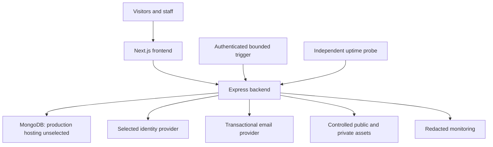

# ARADUN — Deployment, Infrastructure & Operations

**Filename:** `11-deployment-operations.md`  
**Version:** 1.1.0 — complete Step 11 specification for owner review  
**Date:** 25 October 2026  
**Owner/approver:** ARADUN project owner  
**Approval status:** Document preparation authorized by the supplied Step 11 brief. Inherited requirements retain their original qualifications. New infrastructure selections, budgets, numerical operating policies and procedures are **R11 recommendations, pending approval**. This document does not approve a provider purchase or production change.  
**Execution status:** Planning and source-consistency review only. No application code, deployments, DNS changes, cloud resources, subscriptions, live account checks or application tests were performed. No backup, mailbox or alert is claimed operational.  
**Identity:** ARADUN — Technology & Digital Solutions · **Build. Automate. Grow.**

**Controlled update 1.1.0 — 25 October 2026:** Owner-authorized documentation-only amendment limited to the requested architecture, local-development database, solo-maintainer engineering rules and three-theme system where relevant. Unrelated requirements and unresolved gates remain unchanged. Earlier source-register versions/fingerprints and historical approval entries identify the pre-update inputs, not hashes of these revised files; current amended sections govern only these four changes. No implementation or Project Sources replacement is claimed.

**Reading guide:** §§1–3 establish scope and hosting choices; §§4–13 specify environments, DNS, mail, database, security, delivery and storage; §§14–19 cover quality, monitoring, recovery, incidents, SEO and privacy; §§20–24 provide budgets, decisions, launch procedures, maintenance and Codex prompts; §§25–27 and Appendices A–D contain traceability, unresolved gates, references and preserved inventories. Read the decision register before executing any provider-specific procedure.

## 1. Authority, source review and interpretation

### 1.1 Source register

All eight core files and the two supplementary files were supplied and available. References below use their logical filenames; the supplied master has a `(1)` filename suffix, which does not establish a newer version. Its internal version is authoritative. Appendix D fingerprints the exact supplied bytes.

| Ref | Document | Internal version | Authority used in Step 11 |
|---|---|---|---|
| S1 | `01-master-requirements.md` | 0.2.0 | Business scope, 207 FR records, BR/NFR/EXT records, phase qualifications, D decisions |
| S2 | `02-pages-sitemap.md` | 1.1.0 | Exact page identities, supplied routes, navigation, access and indexing |
| S3 | `03-page-sections.md` | 1.0.0 | Forms, confirmation truth, page regions and publication behavior |
| S4 | `04-design-system-wireframes.md` | 1.0.0 | Three themes, assets, CSS/Motion/GSAP, accessibility and performance |
| S5 | `05-database-architecture.md` | 1.0.0 | Models, transactions, outbox, permissions, visibility and recovery |
| S6 | `06-project-structure.md` | 1.0.0 | Repository/modules, environment contracts, scripts and deployment boundaries |
| S7 | `07-development-roadmap.md` | 1.0.0 | M00–M14 milestones and exact task IDs |
| S8 | `08-implementation-guide.md` | 1.0.0 | Codex workflow, release authorization, evidence, rollback and handoff |
| S9 | `09-content-assets.md` | 1.0.0 | Content readiness, asset rights, CMS mapping and publication checks |
| S10 | `10-testing-qa.md` | 1.0.0 | QA cases, command bundles, severity, recovery and go/no-go |

S1 governs business scope; each later approved source governs its topic without silently resolving inherited gates. S9/S10 approval statements do not convert editorial drafts, R10 policies or unresolved provider decisions into independently approved facts. Historical statements such as “Step 11 has not begun” are stage history, not a conflict with this request. No source files are modified.

**Status vocabulary:** inherited baseline = supplied requirement, retaining its original approval qualification; R11 = new recommendation; pending gate = decision needed before dependent implementation; conditional = enabled only after its source gate; not verified = operational evidence unavailable. Section numbers and checklist steps are document locators, not invented requirement/task IDs.

### 1.2 Scope that infrastructure must support

- Full P1 planning inventory: **91 public entries + 4 staff authentication entries + 27 dashboard entries = 122 pages/templates**, plus two shared system states = **124 items**. Content-detail templates can have multiple real instances; 122 is not the ultimate URL count.
- Eight service categories, 57 unique services and 58 memberships; SVC-009 is cross-listed with one identity and canonical URL. Five solutions remain **Digital Presence, Business Automation, Business Growth, Cloud & Technology, Complete Digital Business**. Original prices remain unchanged.
- Sales pipeline: **New → Qualified → Discovery → Proposal Sent → Negotiation → Won / Lost**. Customer conversion is separate, staff-confirmed and does not mean paid.
- All three intake journeys persist to the shared inquiry workflow. Manual consultation remains the baseline. Live scheduling requires D-003; external finance remains baseline unless D-007 selects the limited tracker.
- Three light themes: Editorial Terracotta default, Muted Slate Blue alternate and Vivid Blue alternate. Theme preference never changes business state.
- P2 has 62 additional inventory entries; P3 has 28; Product Terms retains one cross-phase entry. All 215 source inventory records remain preserved in their sources. No client portal, checkout, campaign engine, general CMS, scheduled publishing, AMS, tenancy or AI infrastructure is promoted into P1.

### 1.3 Material tensions preserved

| Topic | Required treatment |
|---|---|
| GA4 and Search Console | Confirmed source direction in S1 §9.2 and S5 §15. Actual property, access, consent and deployment are unconfigured/unverified. Do not reopen provider direction as if no choice existed; additional analytics remains D-021. |
| Authentication | Architecture is approved; vendor, MFA/session details and permission matrix remain D-009/D-013/A5-01/02. No assumed Auth.js installation. |
| Scheduled operations | Durable notification retries already belong to P1. This does not authorize automated sales reminders or scheduled publishing. |
| CMS uploads | Controlled asset references are baseline; minimal uploads need D-012/M08-07. Full media library remains P2. |
| Route history | Preserve supplied S2 routes. O-03 older historical URL reconciliation remains unresolved; no claim of parity with unavailable older material. |
| Palette and page counts | S4 supersedes only the older palette direction; full P1 inventory supersedes the former 38-page subset. |
| Provider details | Current public documentation informs R11 recommendations; it neither proves account eligibility nor overrides source architecture. Reverify at procurement. |

## 2. Approved architecture and deployment boundaries

### 2.1 Technical foundation

| Layer | Preserved technology/contract | Deployment implication |
|---|---|---|
| Application | Next.js App Router + TypeScript frontend; Express.js + TypeScript backend with feature modules | One repository, frontend/ and backend/ build/runtime targets; coordinated API-compatible releases |
| Styling/UI | Tailwind CSS, selective shadcn/ui, Inter and S4 tokens | Build-time CSS; licensed optimized fonts; no separate UI service |
| Motion | CSS for simple effects; Motion for React selectively; GSAP only justified regions | No global GSAP, essential content visible without animation, reduced-motion branch |
| Server boundary | Server Components fetch Express DTOs; Express handlers own validation/session/business operations | Enforce authorization in every use case/data path; not only middleware/layout |
| Data | MongoDB + Mongoose through Express (local development; Atlas optional later); Zod validation | Node runtime for DB operations, transaction-capable deployment, controlled indexes |
| Identity | Selected supported provider/library + local `staffUsers` | Provider verifies identity; ARADUN owns active status, roles and record access |
| Notifications | `outboxEvents`, atomic intake commit, bounded authenticated trigger | Durable at-least-once processing; acceptance/uncertainty reconciliation |
| Abuse controls | Shared `rateLimitBuckets` plus appropriate ingress bounds | No process-memory-only protection across instances |
| Catalog/core content | Validated version-controlled records | Release changes preserve IDs/prices/routes; no catalog seeding overwrite |
| Limited CMS | Articles, testimonials and SEO overrides in MongoDB | Fresh publication checks, protected drafts; no broad headless CMS |
| Media | Controlled asset references; bytes outside MongoDB | Public files distinct from private draft/evidence assets |
| Measurement | GA4 and Search Console | Public-only consent-aware events; no private-route tracking |
| Engineering | GitHub Actions direction; one package manager; pnpm/root lockfile recommended, not yet selected | Compatible versions pinned at M01, actual scripts inspected before use |

Modules remain **Catalog, Content, Discovery, Intake, CRM, Identity, Notifications, Operations**. `backend/src/server/workflows/` coordinates cross-module transactions as specified by S6. Keep `frontend/src/config/` (presentation) / `backend/src/config/` (API policy/secrets), `backend/src/server/`, module `server/` and model boundaries server-only. Do not add microservices, Kubernetes, Redis, an event bus or a general workflow product merely to deploy this application.

The scheduler invokes bounded work in the Express backend; no additional worker service is required. CDN/static assets can be globally distributed while initial application writes and the database remain in one selected region.

### 2.2 Data inventory preservation

Baseline collections: `inquiries`, `contacts`, `opportunities`, `tasks`, `activities`, `articles`, `testimonials`, `seoOverrides`, `staffUsers`, `auditEvents`, `outboxEvents`, `rateLimitBuckets`. Conditional collections: `staffSessions` only if the provider needs local sessions; `faqEntries` for selected FAQ authoring; `paymentRecords` for D-007; `bookingRecords` for D-003 promotion. Preserve S5 field, revision, index, expiry and relationship contracts. Customer is a profile on Contact, not a copied collection. Backups include every actually deployed collection and any documented provider-owned persistence.

## 3. Hosting evaluation and initial recommendation

### 3.1 Capability comparison

Controlled-update boundary: evaluate frontend and backend hosting separately or as two processes on one suitable host. Vercel entries describe the Next.js frontend candidate; they do not select Express hosting. Managed Node/container/VPS options must account for both applications, isolated secrets and ingress routing. Production database hosting is unselected; Atlas-specific comparisons below are optional historical candidates, not development requirements or procurement decisions.

All prices in this document are USD planning inputs. Regional billing, tax, seats, limits and commercial eligibility require verification. Official references are listed in §27.

| Option | Next.js and background work | Security/performance/scaling | Solo maintenance and lock-in | Recurring cost treatment |
|---|---|---|---|---|
| Vercel commercial plan | Next.js frontend SSR, images and previews; separately validate an Express backend host | Managed TLS/CDN/deployments; inspect frontend limits; database pools/egress belong to the Express host; static IP add-on available | Lowest framework deployment effort; moderate reliance on platform cache, scheduler and deployment behavior | Published Pro base $20/month plus seats/usage/add-ons as applicable; static egress adds $100/month/project plus transfer [W1–W4] |
| Managed Node host, Render candidate | Next.js frontend and Express backend as separate Node processes/services; bounded backend cron invocation | Host manages platform/TLS; application owns cache, runtime sizing and process drain; documented outbound ranges can restrict Atlas access | Low-to-moderate effort; portable Node build; more Next configuration QA than Vercel | Use a $15–40/month production compute **allowance**, not a verified Render quote; staging/cron/workspace/bandwidth extra [W5–W7] |
| Managed container host | Runs a compatible Node artifact; may offer scheduled jobs | Image/runtime security and ingress/timeouts need validation; scaling requires pool and cache coordination | Moderate effort; standard container is portable but adapter features vary | Obtain region-specific compute, build, registry, scheduler and egress quote; no assumed free production tier |
| VPS, e.g. DigitalOcean | Full Node support, host cron; no framework restrictions beyond runtime | Owner handles OS patches, firewall, TLS, reverse proxy, process restart and recovery; single VM is a failure point | Highest operational responsibility; low application lock-in, greater operator dependence | R11 compute allowance $12–30/month for sizing discussion; backups/monitoring/operator time extra; advertised entry tiers are not capacity proof [W8] |
| Static-only hosting | Cannot provide the required Next.js SSR plus Express API runtime | Suitable only for static assets | The approved Express backend still requires Node hosting | Rejected as the sole full-platform host |
| Edge-only runtime | Mongoose compatibility is not established by Node compatibility marketing | Must demonstrate exact APIs and DB behavior | Unnecessary adapter risk for this launch | Not the initial recommendation |

**R11 primary recommendation:** choose a paid managed Node service, with Render as the first candidate to validate, separate frontend/backend runtime targets with minimal initial capacity, and a separately selected production MongoDB deployment in a compatible region, protected staging, and a small scheduled trigger. This keeps the approved managed Node direction, offers a documented outbound-network option and avoids assuming a low Vercel base price covers restricted database access. This is an engineering judgment, **not a provider approval**. Render documents full Next.js server deployment and region-specific outbound ranges [W5, W6]. Shared outbound ranges are not a private network or identity boundary; TLS and database credentials remain essential.

**R11 alternative:** Vercel Pro if its framework convenience is worth the complete networking/preview/usage budget. Its Static IPs use shared infrastructure, unlike dedicated Secure Compute; do not describe them as private connectivity [W3]. A production and a separate staging project may each incur the add-on. Do not default Atlas to `0.0.0.0/0` to hide this cost. If neither candidate meets the approved network policy and budget, stop at the selection gate and compare another managed Node host.

For initial launch, retain the current verified DNS host where practical. Namecheap BasicDNS is sufficient if it is actually authoritative and supports the selected records. Cloudflare DNS is an alternative; registrar transfer is unnecessary. CDN/WAF proxying is a separate choice, not a consequence of selecting DNS.

### 3.2 Provider acceptance checklist — M00-02

The auth provider remains unselected and must support the Express API boundary. Express validates identity/session and current staff status/roles/record access on every protected operation; frontend guards are navigation only. Use the selected library’s secure HttpOnly cookie/session flow, explicit trusted origins and CSRF protection for cookie-authenticated mutations; never store session secrets in localStorage. Deployment must choose a same-origin reverse proxy or explicit frontend/API origins before configuring cookie scope, callback URLs and CORS. Cross-origin credentialed requests require exact allowlisted origins (never wildcard credentials); CORS is not authorization. SSR forwards only the intended request credentials to the configured trusted API, never arbitrary destinations; private responses are not shared-cached. Trust proxy/forwarded headers only for the selected ingress topology. Provider signatures/raw bodies, body limits, safe errors and rate limits remain enforced in Express.

Before selection, record actual region and plan; commercial/country/payment eligibility; account owner; MFA/recovery; runtime and build limits; request body/time limits; Next.js SSR/streaming/image and Express API support; trusted forwarded headers; egress ranges or private access; preview protection and secret isolation; scheduling method/frequency; log retention/export; deploy approval/rollback; support and spending controls. Validate cold/warm requests, process restart, connection reuse, callback URLs and a small synthetic transaction in staging. No static export of this application.

Choose region using actual visitor/staff latency, selected MongoDB hosting availability, backup location, processing obligations and cost. Do not assume Atlanta, Bangladesh or any particular region is required by the business. Record app, DB, backup, identity, mail and storage processing locations together.

## 4. Environment architecture, configuration and secrets

### 4.1 Isolation matrix

| Environment | App/URL | Database and credentials | Integrations | Restrictions |
|---|---|---|---|---|
| Local development | Local origin, no public production routing | Locally installed MongoDB configured as a transaction-capable replica set | Fake email sink; selected auth sandbox; no production analytics | Ignored local secrets, synthetic fixtures, no live prospect sends |
| Automated test | Ephemeral build/runner URL | Unique disposable DB per job; restricted test principal | Deterministic doubles; real sandbox tests separately | Assert allowed host/database before reset; no production secrets; remove fixtures after run |
| Protected preview | Host-generated origin | Nonproduction database/credentials scoped to preview or read-only synthetic data | Send disabled/sink; analytics off; scheduler off by default | Access protection plus noindex; untrusted PRs receive no privileged tokens |
| Stable staging | Protected provider URL or separately approved staging subdomain | Separate nonproduction MongoDB deployment/credentials; provider unselected, no live data | Stable auth callback and controlled mail recipient; test-only scheduler | Release rehearsal, real-provider sandbox tests, synthetic data only |
| Production | Proposed `https://aradun.com`, decision pending | Dedicated production project, DB and runtime principal | Approved production apps/senders/assets/GA4 | Explicit release authorization, no development seed or test reset |

The URL examples describe environments, not newly approved public pages. A separate production hosting project/account boundary is recommended where it prevents accidental secret inheritance. Nonproduction dev/test databases can share a nonproduction cluster with separate credentials and test namespaces; never share a runtime principal with production. Region or project isolation alone does not replace database authorization.

`NODE_ENV=production` can describe staging builds; use **`APP_ENV`** to distinguish deployment tier. Fail startup/runtime validation on inconsistent origins, database targets or required configuration. Test tools additionally enforce a positive allowlist of nonproduction targets; a suffix check alone is insufficient. CI should not have production URI access during normal validation/build.

### 4.2 Environment contract

Appendix A reproduces the complete S6 §15 variable inventory. Keep exact proposed names until selected SDK requirements are reconciled through one adapter and ADR. Required groups are origin/canonical/allowed origins, database/pool, selected identity, email/sandbox, scheduler/limiter, release/monitoring, analytics and notice versions. Storage/calendar variables remain conditional.

- `APP_URL` is the actual environment origin; `CANONICAL_SITE_URL` is the approved public origin. No canonical derived from arbitrary Host headers.
- `MONGODB_URI` and `MONGODB_DB_NAME` must resolve to the approved environment target. Credentials are never printed while validating.
- `NEXT_PUBLIC_GA_MEASUREMENT_ID` is a public identifier; **no secret** may use `NEXT_PUBLIC_`. Public build-time values are embedded and need a suitable rebuild to change [W9]. Do not promote a staging bundle with stale public config.
- `EMAIL_SANDBOX_RECIPIENT` is mandatory for nonproduction real-provider tests; enforce the override server-side. Nonproduction has no implicit send permission.
- `JOB_TRIGGER_SECRET` authenticates only the bounded worker. If Vercel is selected, adapt its documented `CRON_SECRET` explicitly; do not create two inconsistent values or a public query-string secret.
- `MONITORING_AUTH_TOKEN` is CI-only for private source-map upload. Do not expose it with a browser DSN.
- Notice versions refer to reviewed policies, not fabricated legal approval. Conditional configuration is required only when that feature is enabled.

Application ownership: `frontend/.env.local` contains frontend URLs/render/analytics configuration only; `backend/.env` contains MongoDB, identity/session, email, storage, calendar, job and limiter secrets. Both are ignored by Git; their `.env.example` files contain names/nonsecret examples only. Express loads and validates its environment explicitly (it does not inherit Next.js env loading). `ALLOWED_ORIGINS` is enforced by Express; existing `APP_URL` denotes the frontend origin. `API_BASE_URL` is a trusted frontend-server target; `NEXT_PUBLIC_API_BASE_URL` is public only when needed. Shared nonsecret release/site settings may be supplied to both applications; credentials never are.

### 4.3 Secret lifecycle and access

Store operational secrets in the chosen encrypted provider store and a controlled recovery vault; `.env.example` contains names/descriptions only. Keep separate runtime, migration, backup/restore and CI identities. Prefer scoped, short-lived workload credentials when supported. Document owner, purpose, environment, permitted operations, last rotation and recovery location without values.

Rotation procedure: identify dependencies and acceptance tests → create replacement privately → configure consumer/scheduler with controlled overlap if supported → test → revoke old credential → verify old access fails → record revision/time. For suspected compromise, revoke immediately and accept controlled interruption if necessary. A rollback must never restore a compromised secret. Auth-key rotation may end sessions; plan staff reauthentication. Limiter-key rotation must not permit an abuse reset unnoticed. Never paste secrets into Codex prompts, tickets, logs or progress files.

## 5. Domain, DNS and HTTPS operations

### 5.1 Responsibilities

| Service | What it controls | ARADUN status |
|---|---|---|
| Registrar | Domain registration, renewal, transfer lock and nameserver delegation | `aradun.com` purchased through Namecheap, per owner brief; current account/expiry not inspected |
| Authoritative DNS host | Published A/AAAA/CNAME/MX/TXT records | Actual nameservers not verified; keep current host unless change is approved |
| Web host | Running application, domain binding, TLS and redirects | Unselected |
| Mailbox host | Human inbox, sending/replies and mailbox security | Unselected; `hello@aradun.com` is the approved address |
| Transactional sender | Application notifications and delivery evidence | Unselected; separate from human mailbox |

Buying a domain does not create web hosting or an inbox. Editing Namecheap host records has no effect if another provider is authoritative [W10]. Nameserver changes do not automatically copy existing records [W11].

### 5.2 DNS worksheet — no invented live values

| Purpose | Name | Type | Value source / validation |
|---|---|---|---|
| Root application | `@` | Provider-required A, or supported ALIAS/flattening | Exact domain setup output from selected host; do not guess an IP |
| IPv6 | `@` or approved host | AAAA only if instructed | Verify destination serves correct application/TLS; remove conflicting obsolete value only by reviewed change |
| www | `www` | Usually CNAME | Exact host target; configure HTTP redirect separately |
| Domain ownership | Provider-issued name | TXT/CNAME | Exact unique verification token; avoid duplicate hostname suffix |
| Human mail delivery | Provider-specified name, often `@` | MX | Mailbox provider targets and priorities; preserve existing until migration approved |
| SPF | Exact sending domain | TXT | One merged policy for that domain from all legitimate sending services |
| DKIM | Provider selector under `_domainkey` | TXT/CNAME | Provider-issued public key/target; private key remains provider-owned |
| DMARC | `_dmarc` or applicable sending subdomain | TXT | Approved policy and verified reporting destination |
| Search Console verification | Provider-issued scope | TXT or approved alternative | Actual property token, no fabricated value |
| Certificate authority policy | Relevant host | CAA if used | Confirm it allows the chosen certificate issuer before restricting |
| DNSSEC | Registrar DS + DNS signing configuration | Provider-specific | Coordinate migration; never leave a stale DS chain |

A record maps a name to IPv4; CNAME aliases a hostname, not an entire URL and not an HTTP redirect; TXT holds verification/policy data; MX routes inbound mail. Avoid ordinary apex CNAME conflicts with MX/TXT; use only the selected DNS provider's supported apex mechanism.

### 5.3 Approved-change runbook

1. Verify account control, current authoritative nameservers, zone export, existing website/mail records, DNSSEC/DS, domain expiry and billing. Capture redacted evidence and rollback values.
2. Choose canonical `https://aradun.com` as R11 recommendation; `www` redirects to it. Preserve S2 paths, valid query context and a consistent no-trailing-slash policy. Do not redirect arbitrary request hosts.
3. Prefer changing only required web records. If migrating nameservers, prepare the full destination zone first, including mail and verification records; verify against export. Coordinate DNSSEC following provider instructions [W12].
4. Plan a quiet change window. Lower relevant TTL ahead of time if justified and supported; existing cached TTLs still apply. Do not promise instant propagation or a fixed global completion time.
5. Bind both domain variants at the host; add only issued DNS values. Complete ownership verification and certificate issuance. Do not announce launch before the approved release and TLS work.
6. Check authoritative responses and multiple recursive resolvers, root/www HTTP and HTTPS, certificate names/expiry, redirect loops and mixed content. Test inbound/outbound mail again.
7. Re-enable/configure DNSSEC correctly after any migration, restore sensible TTLs, retain the previous zone during the propagation window and record effective state.

If web routing fails, compare authoritative records, stale/conflicting A/AAAA/CNAME, proxy state, host domain binding, DNSSEC and certificate validation. If mail fails, check MX and provider routing before changing web records. Roll back only the failed change; do not overwrite unrelated services. DNS rollback is also subject to caching.

Managed host TLS is preferred; verify automatic renewal and alerting. Enforce HTTPS; choose HSTS only after all relevant hosts are verified. Do not enable preload or `includeSubDomains` blindly. If a proxy is selected, require verified TLS to origin and test redirects, client IP trust and cache exclusions; avoid Flexible TLS and cache-everything rules on private/dynamic traffic.

Enable registrar MFA, transfer lock and renewal protection with valid billing and an independent recovery contact. R11 renewal checks at 60/30/7 days before expiry are reminders to configure only when separately authorized; no automation is created here. Keep recovery access usable during an `aradun.com` mail outage.

## 6. Business mail and transactional notifications

### 6.1 Provider choices

| Need | Candidates | R11 recommendation and selection test |
|---|---|---|
| Human `hello@aradun.com` mailbox | Google Workspace; Microsoft 365; Namecheap Private Email or Zoho Mail | Evaluate one Google Workspace seat first for a straightforward business inbox; compare budget alternatives. Verify country/billing, MFA/recovery, sending limits, aliases, delegation and export. No mailbox assumed purchased. |
| Transactional sender | Resend or Postmark, already source examples | Evaluate Resend first for developer fit and low launch volume; compare Postmark delivery/support needs. Verify domain authentication, idempotency window, retry/error behavior, event retention and account eligibility. |
| Independent incident contact | Owner-designated existing external inbox/channel | Must be tested and accessible if ARADUN domain or mailbox is down; do not invent an address. |

A forwarding alias is not automatically a full inbox with authenticated send-as. Confirm hello@ can receive, send and reply from the selected identity. Use named operator access/delegation where supported rather than sharing one password. Google Workspace does not by itself approve integrated Calendar booking; D-003 remains open.

### 6.2 Setup and verification

Inventory existing mail first. Create the approved mailbox only under a later authorized setup task. Verify domain ownership, apply provider-issued MX, and configure SPF/DKIM/DMARC for every actual sending domain. Keep one SPF policy per domain; merge senders correctly and check lookup constraints. Multiple DKIM selectors can support different providers. DMARC requires alignment, not merely three records existing [W13]. Start with an approved monitoring policy, review legitimate senders, then move toward quarantine/reject without breaking real mail. The reporting address must exist and have a defined owner/retention policy.

R11 recommends a dedicated application sending subdomain/identity if supported, with `Reply-To` pointing to verified hello@. Exact names remain a provider decision. Separate sender reputation and permissions from staff mail. Never put the visitor's email in the From header. Controlled staff alerts may use a validated reply route, but do not expose arbitrary relay capability. Test send/receive/reply, message authentication headers, Gmail and another mailbox destination, bounce behavior and spam placement. Provider acceptance is not proof of inbox delivery.

### 6.3 Delivery contract and failure response

Contact, quote and manual consultation commit an Inquiry and the intended acknowledgement/staff-alert outbox set in one transaction. Return saved success after commit even if email is delayed. Source FR-02-08/09 and FR-08-01/02 share this workflow; do not double-send aliases. Assignment-specific email is conditional FR-08-03/M07-09.

| Observed condition | Operator/application behavior |
|---|---|
| Temporary rate limit/outage | Keep committed inquiry; bounded retry with jitter/provider delay; monitor backlog |
| Invalid sender/configuration | Pause affected sending, correct verified configuration, test controlled recipient, resume eligible existing events |
| Permanent recipient rejection/hard bounce | Mark verified outcome, stop automatic retry for that event; staff reviews contact through permitted channels |
| Timeout after possible acceptance | Mark `uncertain`; reconcile provider ID/idempotency evidence; no blind resend |
| Signed delivery/bounce callback available | Validate actual provider protocol, replay and event identity; update truthful delivery state |
| No callback chosen | Use provider console/reconciliation evidence; leave delivery unknown rather than claiming delivered |
| Mailbox inaccessible | Protect/recover account; use independent incident destination; CRM remains the inquiry source of truth |

Do not roll back the application solely to resend accepted email. Use minimal escaped templates with saved reference and protected staff link; no full private form body, customer history or arbitrary attachment. Suppress ineligible/deleted recipient work before sending. Provider failover is a reviewed adapter change with acceptance reconciliation, not automatic dual sending. Marketing campaigns remain deferred.

## 7. MongoDB production architecture — hosting unselected

### 7.1 Organization, tier and privileges

Production MongoDB hosting is not selected. Local development uses locally installed replica-set MongoDB; CI uses a disposable replica set and synthetic fixtures. Atlas may be chosen later through backend environment and connection/security configuration without schema redesign. If Atlas is selected, the retained R11 candidate guidance below applies to separate production/nonproduction projects; it does not mandate Atlas. Avoid test suites that simulate transactions on an unsupported standalone database.

If Atlas is selected for production, the retained R11 candidate recommendation is a **Dedicated tier supporting configurable Cloud Backup/PIT recovery**, with M10 as the initial sizing candidate, subject to workload tests. A Flex launch is a lower-cost alternative only if its limited recovery window, shared capacity and other supported capabilities satisfy the owner's chosen targets. Current documentation says Flex snapshots are daily, start after 24 hours, retain eight snapshots and do not support custom schedules or on-demand snapshots [W14]. The retained Atlas Free comparison is optional future evaluation only; development now uses local MongoDB. Do not assume managed backup coverage [W15].

| Identity | Scope |
|---|---|
| Runtime app | Required read/write operations on ARADUN's environment database only; no project ownership or schema administration |
| Migration/index operator | Temporary reviewed schema/index permissions on exact target; distinct secret |
| Backup/restore operator | Selected provider's minimum supported control-plane permissions; not embedded in app |
| Observer | Read-only metadata/metrics; private data access only when necessary and authorized |
| Human Atlas administrator | Named account, MFA and recovery; tightly restricted membership |

Where built-in runtime roles allow more writes than application policy, document the residual risk and test restrictive custom roles where support/complexity permits. Application append-only audit policy is not database-administrator immutability. Atlas control-plane roles and database users are separate. Some tier operations require broad project privileges; record the actual minimum and isolate those credentials.

### 7.2 Connectivity and pools

Require TLS and certificate verification. Use provider-issued URI through secret storage, restricted network entries and the correct DB name. Allow only actual host egress ranges or approved private networking. Operator access should be temporary/narrow where practical. Public ingress IPs of a website are not its outbound DB IPs. Builds should not need production data; no build-time staff/CRM query or mutation.

Reuse one bounded Mongoose connection/promise per warm Node process. Budget aggregate connections across live instances, overlapping deployments, staging where relevant, monitoring and operator sessions. A pool limit per function is not a global limit. R11 capacity worksheet: observed maximum instances × per-instance pool cap + driver/topology and administrative headroom must fit the measured tier limit. Record actual measurements; do not set arbitrary high caps.

Choose bounded server-selection, query and request deadlines with a coherent order so DB failures return before the hosting request expires. Disable/limit buffering behavior that can make forms hang silently. Maintain source page bounds: public search default 20/max 50; staff lists default 25/max 100 under R5. Verify indexed permission filters, date+ID pagination and capped histories. No broad population, unbounded regex or load-all-records UI.

### 7.3 Indexes, migrations and production data

1. Review S5 exact indexes, unique/partial/TTL semantics and the relevant S7 task. Compare expected and actual definitions read-only.
2. For a change, identify duplicates, stale schema versions, collection sizes and lock/load implications. Record bounded migration, checkpoint, expected counts and compatible application versions.
3. Verify a usable recovery point. Flex cannot supply an on-demand snapshot; obtain a supported consistent recovery artifact or postpone the change. Do not assume a naive dump during writes is transaction-consistent.
4. Apply only the approved index/migration with the separate operator identity in the approved window. No automatic destructive `syncIndexes`, build-hook migration or runtime schema reset.
5. Validate unique-key races, transaction aborts, counts, sampled references and query plans. If verification fails, contain the change and use the reviewed recovery path.

Prefer expand → migrate → verify → switch reads → contract in a later compatible release. Keep both schemas readable during rollback windows. Do not overwrite CMS edits on deployment. Production seed is limited to approved, reviewed necessary initialization; synthetic samples stay in nonproduction. Source catalog stays in source. `db:seed:dev` must refuse production. TTL cleanup is eventual; session expiry, limiter windows and eligibility are checked by application logic. Never TTL-delete pending outbox work.

### 7.4 Monitoring and cost

Track storage/index growth, connections, query duration, scanned/returned ratio, transaction errors, CPU/memory where exposed and backup freshness. Revisit tier only after query/pool/batch optimization. Alert on nearing tier limits; estimate growth from observed daily bytes and retention, not page count. Record backup, transfer, restore-test and temporary-cluster charges separately. DB autoscaling is a budgeted decision with min/max bounds, not permission for unbounded spend.

## 8. Staff authentication and production access

Retain provider/library identity plus local `staffUsers` and conditional `staffSessions`. Auth.js and managed services remain alternatives. Select one at M00-02/A5-01; do not introduce an assumed provider in this file.

Production configuration must establish exact issuer/audience/client identity, trusted callback/logout origins, HTTPS cookies with HttpOnly/Secure/appropriate SameSite, safe local return URLs, verified session handling, logout/revocation and provider-supported recovery. Test provider callback protections applicable to its protocol. A verified email alone cannot create staff access. No open registration or default administrator password.

Local active status, roles, `accessVersion` and record scope remain enforced at every sensitive operation, including lists, counts, search, assets, previews and Actions. Provider session validity does not override deactivation. D-013 must resolve Admin/Sales/Editor scope and Editor publish permission before protected workflows launch. Infrastructure operators are not automatically business-data administrators.

R11 recommends MFA for all production staff, strongest available method for privileged accounts, and fresh authentication for access/MFA/recovery changes. For owner review, propose 8-hour maximum application session, 30-minute inactivity timeout and 15-minute fresh-auth window for sensitive changes, **subject to provider support and usability review**. These are new proposed policies, not source defaults. Do not implement competing custom authentication to force them.

Bootstrap: verify owner identity out of band → run approved one-time `staff:bootstrap` operation → test local permissions/MFA → record audit provenance → disable bootstrap path. Protect the last active Admin. Store recovery codes securely outside the same mailbox/account failure boundary; nominate an authorized backup operator or document lack of cover. Test recovery without exposing codes.

Offboarding: revoke local status first, revoke provider sessions and infrastructure memberships, rotate any shared secrets, reassign open work through approved policy and verify an already-signed-in browser is denied. Keep required audit without unnecessary personal content. Provider-owned recovery screens that differ from STA routes require explicit route reconciliation, not silent deletion. See S10 QA-AUTH-01–04.

## 9. Application hardening and privacy boundaries

| Control | Required deployment behavior | Evidence before launch |
|---|---|---|
| HTTPS/cookies | Enforced HTTPS, correct trusted proxy/origin behavior, secure session settings | Actual root/www/callback/private-route tests |
| CSP | Restrict actual scripts, styles, images, fonts, connections and frames; compatible approved theme bootstrap | Report-only rehearsal then tested enforcement; no blanket weakening for appearance |
| Other headers | Appropriate frame restriction, nosniff, referrer and permissions policy; deliberate HSTS | Inspect responses at application and proxy; no conflicting duplicate policies |
| Actions/handlers | Strict input schema, server-built queries, authorization, CSRF/origin protection where applicable | Cross-origin, mass-assignment, guessed-ID and stale-role negatives |
| Public errors | Safe actionable message and correlation ID | No stack trace, URI, token, internal record or provider diagnostic leakage |
| XSS/SSRF | Escaped output, structured editorial renderer, allowlisted link/asset protocols and hosts | Malicious stored content/remote asset rejection; no runtime MDX |
| Spam/rate limiting | Shared atomic counters, bounded body/query sizes, correct forwarded-client trust | Multi-instance race and real-user retry tests; honest failure if write limiter unavailable |
| Secrets/dependencies | Pinned compatible versions, secret scanning, reviewed vulnerabilities, scoped CI | Client bundle/log/source-map audit and triaged dependency evidence |
| Uploads/callbacks | Actual selected provider security from first introduction | Spoof, replay, unsafe MIME/content, object-scope and expiry tests |
| Private caching | No shared CDN/public cache for session/CRM/draft/private file responses | Anonymous/second-user cache probes, no analytics on private routes |
| Audit/logging | Restricted audit trail plus independent redacted operational diagnostics | Success/failure correlation, no full form/email/provider payload logging |

Select CSP strategy with actual framework rendering. A stable hashed theme bootstrap may suit cached static pages; request nonces may affect dynamic rendering/cache policy. Validate the chosen Next.js version rather than assuming either fits every route. Remote image hosts and private-image optimization must not bypass asset authorization. Disable telemetry session replay by default; adding it requires D-021/D-014 review.

R11 request-body and upload limits are recorded in §13; exact runtime/framework/proxy limits must agree. Bot challenge tooling is optional after demonstrated abuse and accessibility review. No extra Redis/WAF product is automatically approved. Never trust arbitrary forwarding headers for client identity.

Privacy operations follow D-014: verify requester through an appropriate minimal process, locate all related snapshots/notes/outbox/evidence/provider copies, approve correction/erasure/retention outcome, apply authorized changes and record limited evidence. Archive is not erasure. Maintain a restricted restoration-safe suppression ledger outside the backup point being restored; choose its format/access/retention before launch. No generic retention number establishes legal compliance. Keep confidential incident and privacy evidence outside the source repository.

## 10. Git, CI/CD and release controls

### 10.1 Simple solo workflow

Use one private Git repository, short-lived task branches and `main` as the reviewed integration branch. Small PRs reference source requirement IDs and S7 tasks, explain behavior and include actual checks. Self-review is acceptable for a solo developer; independent owner acceptance remains required at the source milestones. Protect `main` with applicable checks and disallow routine force-push. Avoid inventing a multi-team approval bureaucracy.

R11 recommends **one production deployment mechanism**: a GitHub Actions release workflow invoking the selected host after an explicit production authorization checkpoint. Turn off competing automatic production deploys on merge. Host-native preview integration may remain separate. If host-native production promotion is selected instead, disable CI deployment and retain the same authorization/evidence checks. Verify private-repository plan support for rules/environments; where a reviewer gate is unavailable, use a documented manual authorized promotion and deploy credential restriction, not a claimed protection that is absent.

### 10.2 Pipeline specification

| Stage | Work | Failure behavior |
|---|---|---|
| PR validation | Frozen install, source/content/route checks, format, lint, types, unit/component and relevant real-DB integration | Block merge; untrusted code gets no production or privileged sandbox secrets |
| Built test application | Production build using test configuration; critical E2E/a11y with synthetic fixture DB | Preserve redacted report; no flaky critical result counted as pass |
| Trusted staging | Deploy candidate, actual sandbox identity/mail/job tests, changed-flow checks | Block release; previous production unaffected |
| Release qualification | S10 V-RELEASE once per candidate, UAT, security/privacy, assets, recovery and rollback | M13 remains incomplete until evidence/gates close |
| Release authorization | Exact commit/artifact/config, migration actions, production window, smoke recipients and rollback owner | No production action without matching owner authorization |
| Production release | Approved compatible index/migration operation separately, deploy exact candidate | Abort on failed prerequisites; no hidden migration in build |
| Verification | S10 QA-REL-01/V-LIVE, domain/mail/jobs/alerts and controlled records | Contain and rollback according to §17 |

Use least-privilege GitHub job permissions and restricted deployment credentials; pin external actions to reviewed immutable revisions where practical. Use separate test DBs for concurrent jobs. Never run untrusted pull-request code with privileged secrets through a trusted workflow shortcut. Cancel superseded nonproduction jobs; serialize production changes and migrations. CI caches exclude `.env`, private data and secret-bearing logs.

A release manifest records commit, artifact/build digest, lockfile/runtime, source document fingerprints, configuration revision identifiers, migration/index versions, selected feature gates, test evidence and owner approval. Public and server config must match the tested artifact. Rebuilding the same commit with different values is a different candidate needing relevant verification.

## 11. Build, runtime and health verification

Pin a mutually supported stable Next/React/Node/Mongoose combination at initialization; use a supported Node LTS accepted by the chosen host. Match exact supported patch across local, CI and production where the host permits; record host-managed differences. Do not select versions from the fact that a documentation page displays “latest.” Use one package manager/lockfile. pnpm remains R6's recommendation.

The following are **future command contracts**, not executed commands or proof that scripts exist:

| Purpose | Contract after repository inspection |
|---|---|
| Install | Frozen installation with selected manager; e.g. `pnpm install --frozen-lockfile` only if pnpm selected |
| Basic checks | `lint`, `typecheck`, `format:check`, `validate:content`, `test`, `build` |
| Data/flows | `test:integration`, read-only `db:indexes:check`, `test:components`, `test:e2e`, `test:a11y` as applicable |
| Performance | `analyze` plus actual chosen Lighthouse/load/query tooling; no invented test script |
| Managed Node start | Existing `start` script serving the built Node application; host port/interface per verified provider |
| Mutations | `db:indexes:apply`, `db:migrate`, `staff:bootstrap` only as separately approved operations; never verification defaults |

S10 V-BASE, V-DATA, V-UI, V-FLOW, V-PERF and V-RELEASE remain the test bundles. Missing scripts are Blocked/Not run, not invented success. Build must not send email, seed live data, bootstrap users or require production private records.

For managed Node, verify complete artifact/static files, image processing dependencies, memory, request streaming, proxy buffering, startup, termination/drain and restart behavior. For multiple instances later, verify coordinated cache invalidation, action/build compatibility and load balancing before scaling. Next.js self-hosting documents additional caching and deployment coordination responsibilities [W9]. If Vercel hosts the frontend, Mongoose still stays in the separately hosted Express backend; validate that backend host’s duration/body/memory limits. Do not treat ephemeral local filesystem as persistent media storage.

Health uses three separate signals: (1) external existing public route returns expected content/TLS; (2) host process readiness; (3) authenticated/internal bounded DB/worker check with no PII. Avoid public database diagnostics or a new public page. If a host requires a technical health route, record its method/auth/output in M01-04/S6 operation documentation before implementing it. A successful Home response alone does not prove intake health.

Failed build: keep current production, inspect redacted logs, correct source/config, rerun affected checks. Failed startup/readiness: stop promotion and restore last compatible artifact. Runtime dependency outage: apply explicit degraded behavior; do not report fake empty CMS/CRM data or false saved form success.

## 12. Background tasks and scheduled operations

### 12.1 Minimum justified work

| Operation | P1 treatment | Implementation owner |
|---|---|---|
| Transactional mail dispatch/retry and expired lease recovery | Required by approved durable outbox | M06-02/03/06; Notifications |
| Failed/uncertain delivery reconciliation | Required procedure; provider evidence/manual review where necessary | M06-02; M13-03/04 |
| Session/limiter expiry cleanup | DB TTL after policy selected; application independently checks expiry | M02-04/05, M03 |
| Approved retention/asset orphan cleanup | Bounded reviewed operation after D-014/D-012, initially manual where sufficient | Operations/Content; not arbitrary deletion cron |
| Backups | Selected database/provider schedule, not application request loop | M02-05/M13-03 |
| Due/overdue task display | Query-derived manual task status | M07-04; no outbound reminder scheduler |
| Scheduled publication, campaigns, recurring sales reminders, billing automation | Deferred source phases | No P1 infrastructure |

R11 proposes one notification schedule every **5 minutes**, batch limit **20 events**, job budget **45 seconds**, maximum **5 automatic send attempts**, and retry delays approximately **1/5/15/60 minutes with jitter**, respecting provider rate limits. These are reviewable initial settings, not approved requirements or delivery guarantees. Measure actual latency and provider limits before adopting. A lease must exceed the selected maximum operation time with margin or be safely renewed; fence completion with its token. Size batch/timeouts so incomplete work can resume; do not promise every 20-event batch finishes in 45 seconds.

Authenticate the trigger independently of browser cookies, use constant-time secret verification where appropriate, reject missing/invalid credentials, cap work and log aggregate counts/duration/correlation only. Prefer POST as S6 specifies. If Vercel Cron is selected, its documented GET invocation requires an explicit narrow method exception: secret-bearing authorization header, no public link, no cache, no cookie authority, bounded idempotent behavior. Alternatively select a scheduler that calls POST. Its `CRON_SECRET` contract and best-effort duplicate/missed invocation behavior must be tested [W4]. No Redis is needed merely because provider examples mention it; S5 Mongo leases/dedupe remain the mechanism.

Preserve S6 §5's proposed technical endpoint `/api/jobs/notifications`; it is not a new business page. Use the selected environment's exact nonredirecting endpoint. Any provider-specific adapter or method change must be recorded rather than silently renaming the interface.

### 12.2 Worker/recovery sequence

1. Validate environment/trigger and start deadline; claim due eligible event atomically with lease/token.
2. Recheck source deletion, recipient eligibility, current assignment if applicable and controlled template version.
3. Send outside any DB transaction, reusing stable provider idempotency key where supported.
4. Record provider acceptance as `sent`/accepted, **not delivered**; use verified delivery evidence separately.
5. Record temporary failure as retry, permanent failure as failed, uncertain acceptance as uncertain; cap automatic attempts. Do not expire pending/retry work just to reduce storage.
6. Fence updates; stale workers cannot overwrite new lease outcomes. Next trigger handles missed schedules; safe concurrency may process different records.
7. Alert on backlog/failed/uncertain states and heartbeat absence. Review uncertain events before retrying; manual retry retains original event identity.

Pausing scheduler invocations does not stop already running sends. Emergency containment also blocks dispatch/egress or revokes sending credentials as appropriate, then accounts for in-flight acceptance. Keep scheduler paused through restore until suppression and reconciliation pass. No application startup timer, `after()` callback or fire-and-forget promise substitutes for durable retry scheduling.

## 13. File storage, media delivery and lifecycle

### 13.1 Smallest suitable storage

| Asset class | Baseline location | Alternative and gate |
|---|---|---|
| Approved logos/icons/service art | Versioned public static files and asset manifest | CDN/object storage when size or update workflow justifies |
| Blog/work screenshots and optimized public images | Controlled reviewed public assets referenced by key | Object store/managed media if D-012 selects uploads |
| Private draft images, testimonial permission, original licensed masters | Restricted operational store or authenticated private object storage | Never public repo folder/CDN; exact store/access/backup decision required |
| Runtime uploads | None by default | Minimal secure CMS path only under M08-07; no general media library |
| Public form attachments | Out of scope | No upload infrastructure added to intake |

Git/public files are simple for small approved assets but require deployment for changes and enlarge artifacts. S3-compatible storage offers portable object access/versioning but needs IAM, lifecycle and delivery configuration. Managed media such as Cloudinary simplifies transformations but adds provider pricing/lock-in. Provider-specific blob storage integrates easily but requires exact private-access/backup verification. Choose one only when required. Do not store binaries in MongoDB or use the app filesystem for durable uploads.

### 13.2 Asset controls

Preserve S9 asset manifest/AssetRef keys, visibility, alt text, dimensions, MIME, rights status and private provenance. Only verified rights or honestly permitted demo assets publish; pending assets do not. Source-approved logos/technical icons need reviewed SVG, not arbitrary uploaded active content. Use responsive AVIF/WebP where suitable, preserve dimensions and usable crop, retain original masters securely and load only the current large theme variant eagerly. S4 transfer limits in §14 govern delivered assets.

If uploads are selected, R11 proposes raster JPEG/PNG/WebP input, **5 MiB per image** and **20 megapixels decoded** as initial review limits, with lower transformed delivery sizes. Reject oversized/decompression-risk files before costly processing where possible; enforce dimensions/resource deadlines during decoding. Disallow user SVG/HTML/script archives and arbitrary URL fetches initially. Validate magic bytes/actual decode as well as declared MIME, strip unnecessary metadata, generate opaque object keys and apply authenticated ownership checks. Scanner/quarantine policy must be selected; no image pipeline is called malware-proof.

Use direct scoped uploads only if the selected architecture supports them; otherwise align host body limits. A signed upload/download URL is short-lived, scoped and not logged. Private assets are never made public merely to work with an image optimizer. Limit read/write/delete permissions per environment/prefix/container. Publication explicitly promotes approved assets to public eligibility; withdrawn private material requires access removal and any relevant CDN purge, recognizing already downloaded copies cannot be recalled.

Lifecycle: upload/review → record rights/metadata → controlled publication → reference-aware replacement → quarantine unreferenced candidates → reviewed deletion after approved grace period. No orphan deletion based solely on one failed DB query. Enable/version backup as approved and test asset-plus-manifest recovery; versioning alone is not an independent backup. Public static files are recovered with the exact source/artifact; private evidence and uploaded bytes need separate recovery coverage.

## 14. Performance, caching and scaling

### 14.1 Preserved measurement contract

| Measure | Source target/status | Operational verification |
|---|---|---|
| LCP | ≤2.5s at p75 field | Lab proxy before launch; representative field cohorts after sufficient traffic |
| INP | ≤200ms at p75 field | Real interactions; Lighthouse TBT is not field INP |
| CLS | ≤0.1 at p75 field | Image/font/theme shifts and later field sample |
| Lighthouse | Performance 90+ / Accessibility 95+ aspirations | Repeatable configuration, median/range and manual accessibility; no certification claim |
| Hero | ≤250KB compact / ≤450KB large, provisional | Actual optimized transferred variants |
| Initial fonts | ≤150KB, provisional | Necessary Inter weights/subsets and fallback behavior |
| Incremental motion JS | ≤60KB compressed on using routes, provisional | Actual route delta; zero GSAP on unused routes |
| Initial marketing transfer | ≤1MB before lazy below-fold/optional third-party work, provisional | Include framework, CSS, scripts, fonts and initial imagery |
| API/DB/load | Numeric budgets not approved | D-020 worksheet with expected load, dataset, p95 latency/error and connection targets before capacity acceptance |

Keep U4-06/D-020 final budget decisions explicit. S10 QA-PERF-01–03 governs production-build testing: Home, service, pricing, quote, article, search, staff list and editor; all three themes where behavior differs; three repeat runs per condition recommended by R10. Record build, tool/browser, network/CPU, viewport, cache state, sample size and all results. Do not imply field performance is measured before users exist.

### 14.2 Cache policy by data class

| Data/response | Initial policy | Invalidation/recovery constraint |
|---|---|---|
| Versioned static assets | Long-lived immutable caching only for content-addressed/versioned files | New URL on change; keep rollback assets available |
| Source-controlled catalog/core content | Build/deployment caching where appropriate | Release registry/source version is authoritative; compose dynamic slots separately |
| Database-published content/SEO override | S5 request-time eligibility with request-local memoization | Unpublish/withdraw immediately removes eligibility; no blanket stale shared cache |
| Staff/session/CRM/draft/private asset | No shared public/CDN caching | Every authorized read remains scoped; prevent stale private response reuse across users |
| Search/receipt/quote utility | Bounded uncached/fresh behavior as appropriate | No receipt PII or private query cached publicly; indexing rules independent |
| Jobs/mutations/callbacks | Never CDN-cache | Exactly scoped verification, idempotency and current state |

A CDN does not justify caching every HTML response. Later public shared caching requires an explicit invalidation/publication gate and negative leak tests. Keep image origins bounded and font/asset regions sensible. Optional scripts must not block navigation or saving. Remove decorative weight before weakening targets; static fallback is valid for unjustified GSAP.

### 14.3 Capacity and growth procedure

Before launch, approve expected daily inquiries, peak requests, staff concurrency, article count, private history size, image volume, retention and mail fan-out. Measure with representative synthetic data. Record baseline CPU/memory, p95 server/DB response, error rate and connection use. R11 warning thresholds: review sustained resource use above 70% of a known limit and urgent saturation near 85%; tune to the selected provider and actual metric. These are proposed investigation triggers, not performance promises.

First optimize queries/indexes, pagination, image sizes and client bundles; then raise instance/tier within approved budget. Add a second instance only after proving cache/action/deploy coordination and connection capacity. Add managed queues or search infrastructure only for demonstrated need and approval. Do not introduce active-active writes, multi-region DB or Kubernetes preemptively. Reevaluate costs, backup time and recovery target whenever tier/region/storage materially changes.

## 15. Monitoring, logging and alert ownership

### 15.1 Essential launch visibility

Use frontend/backend host and database metrics plus one error service and an independent uptime check. Sentry is a candidate, not selected; native host errors may satisfy part of the requirement if redaction, retention and alert testing meet it. R11 recommends disabling session replay and using sampled errors with release/environment tags. Optional tracing/APM, paid status pages and advanced dashboards can wait for demonstrated need.

| Signal | Initial R11 trigger, pending tuning | Severity and first action |
|---|---|---|
| Public availability/TLS | Probe every 5 minutes; investigate two consecutive failures, second location if available | S1; inspect host/DNS/certificate/release, invoke rollback if release-caused |
| Private data leak/secret exposure | Any credible evidence | S0; contain affected access and revoke compromised credentials |
| Intake persistence | Any confirmed false-success/data-loss case; repeated save errors | S0 for loss/false success; otherwise S1; protect writes and investigate DB/limiter |
| Server/API failures | Sustained unexpected failures; percentage only with meaningful sample count | S1 if critical flow unavailable; correlate release and dependency status |
| Outbox backlog | Oldest eligible pending event >15 minutes under proposed 5-minute schedule | S1 if systemic; check heartbeat/provider/credentials; do not duplicate inquiries |
| Outbox uncertainty/bounces | Any uncertain event for review; repeated permanent configuration failures | S2 isolated; S1 widespread; reconcile acceptance and recipient eligibility |
| Scheduler | No successful heartbeat for 15 minutes under proposed schedule | S1; authenticate test trigger, inspect host/path/timeouts/leases |
| Auth/access | Unexpected sign-in/recovery failures, deactivation bypass or unusual denial spike | S0 for bypass; S1 for staff lockout; protect last-Admin recovery |
| Database | Connection saturation, timeouts, transaction errors, growth beyond selected thresholds | S1 for impact; review pool/index/host region and tier |
| Backup/restore | Expected backup missing or recovery-point lag exceeds selected RPO | S1; stop risky changes, investigate and prove new usable recovery point |
| Storage | Usage nearing budget/limit, unauthorized public exposure, failed required asset delivery | S0 exposure; S1 critical failure; S2 bounded broken asset |
| Deploy/CI | Failed production deploy or config/migration drift | S1 if users affected; preserve known-good release and logs |
| Performance | Repeatable regression against approved budget, later field deterioration | S2 normally; S1 if critical interaction unusable |
| Billing/renewal | R11 50/75/90% spend notifications; domain/certificate expiry window | S2 early warning, S1 imminent service loss; owner reviews before suspension |

Thresholds must be approved/tuned before claiming coverage. At low volume, one failure matters more than a noisy percentage. Do not send notifications for every harmless validation error. Distinguish failed user input from platform failure and denied access from successful intrusion.

### 15.2 Destinations, operator cover and response

Primary responder: designated ARADUN developer. Business decision/communications owner: project owner. Backup responder and exact alert destinations remain unresolved under D-020. Use an owner-designated channel independent of ARADUN's host, database and mail domain; hello@ can be a secondary destination once verified. Do not make the only alert depend on the broken application sending its own email.

R11 proposes acknowledgement within 30 minutes **during declared operator coverage** for S0/S1, immediate containment work once acknowledged, and a documented escalation if no acknowledgement. Off-hours response is not guaranteed by a solo developer. Before launch, record actual availability and backup arrangements; choose a longer RTO or outside support if coverage cannot meet the recovery target. No 24/7 promise is made.

Test a synthetic host/app/database/outbox alert in staging and verify actual human receipt, redaction, route to the right owner and recovery-clear notification. Test independent availability when the app DB is unavailable. A configured notification rule is not delivered-alert evidence (QA-OPS-01).

### 15.3 Log schema and proposed retention

Use timestamp in UTC, environment, release ID, severity, operation category, opaque correlation ID, safe outcome/error code and bounded duration. Restricted actor/record references are included only when needed. Do not log authorization headers, cookies, tokens, connection strings, form bodies, email addresses, private search strings, full URLs with sensitive parameters or raw webhook payloads. Redact before external export; sanitize browser breadcrumbs too. Operational diagnostics and business audit have different access and purposes.

| Record type | R11 proposed retention for review | Guardrail |
|---|---|---|
| Redacted runtime/error logs | 14 days searchable | Longer retention needs purpose/cost review; provider free tier may be shorter |
| Aggregate uptime/availability | 90 days | No personal payloads; enough trend context |
| Release manifests and redacted QA evidence | 12 months | Private reports restricted; raw customer traces excluded |
| Business audit, CRM records and provider mail payloads | D-014 decision required; no default imposed here | Do not use log retention as business-data retention |
| Terminal outbox/abuse/session data | Policy selected with S5 contracts | Never delete unresolved delivery solely to meet storage target |

Select provider plans that actually support approved retention. These proposals are operational starting points, not legal determinations. Logs retained by a provider outside ARADUN's controls must appear in the privacy/vendor inventory.

## 16. Backup and disaster recovery

### 16.1 Proposed objectives and retention

**RPO** is the maximum acceptable loss of committed data measured back from the disruption. **RTO** is the target elapsed time to restore the agreed critical service after disruption/detection as explicitly defined in the approved policy; define the starting clock rather than hiding detection/coverage delay.

| Scenario | R11 target for approval | Necessary capability and limitation |
|---|---|---|
| Recommended production profile | DB RPO ≤1 hour; critical intake/staff RTO ≤4 hours including detection under agreed coverage | Dedicated backup/PIT capability, verified recovery-point lag, available operator and tested restore/cutover |
| Budget Flex alternative | DB RPO ≤24 hours under healthy daily backups; RTO ≤1 business day under declared cover | Owner explicitly accepts potential day's inquiries lost; daily snapshot age/lag monitored; not suitable if 1-hour RPO is required |
| Compatible application rollback | Target ≤30 minutes after decision/operator availability | Prior artifact/config retained and data compatible; not a full disaster RTO |
| Source/public assets | Recover exact approved release; no approved deployed source intentionally lost | Remote Git + independent encrypted export/artifact recovery |
| Uploaded/private assets | Proposed RPO ≤24 hours, RTO ≤1 business day | Selected backup/version policy and rights/manifest restore test; tighter requirement if essential to critical service |
| Credential/domain/provider compromise | No universal numeric promise | Recovery depends on provider account access; record tested containment and account-recovery limits |

Targets are not achieved or approved by writing this file. If a restore exceeds the selected RTO, improve the procedure/capability or request an explicit revised target before launch. A source control backup is not a database backup; a successful snapshot status is not restore proof.

R11 recommended Dedicated policy: continuous/PIT recovery window **7 days**, daily snapshots **14 days**, weekly snapshots **4 weeks**, subject to selected tier/region support and privacy approval. The operator must prove at least the approved 1-hour recoverable point. Flex's fixed eight-daily-snapshot policy is a different profile; do not write a custom retention promise onto it. Consider a separately protected recoverable copy for account/region loss if supported and budget-approved; document residual regional/account risk if omitted. MongoDB describes PIT and regional snapshot copies as distinct capabilities [W16, W17].

### 16.2 Recovery coverage matrix

| Item | Recoverable source | Verification |
|---|---|---|
| MongoDB records/indexes | Selected supported snapshots/PIT and reviewed migrations | Isolated restore, counts, unique indexes, schema/transaction checks |
| Source/catalog/public static assets | Reviewed remote Git, release artifact and encrypted independent export | Rebuild/redeploy same release; content/route/asset hashes |
| CMS uploads/private evidence | Selected object/version backup plus metadata/rights manifest | Sample private and public asset read, access and reference integrity |
| App/host configuration | Versioned nonsecret settings + provider configuration export/checklist | Recreate environment without guessing values |
| Secrets | Controlled vault/recovery procedures, provider reissue if needed | Authorized recovery without logging values; rotate when compromise suspected |
| Staff identity/session | Provider recovery + local staff state + current offboarding record | No reactivated terminated user; fresh login and current local permissions |
| Domain/DNS | Registrar recovery, zone export and verified delegation/DS state | Root/www/mail/verification and TLS all valid |
| Deletion/suppression ledger | Restricted store independent of restored DB snapshot | Erased records and ineligible mail stay suppressed |
| Email acceptance evidence | Provider IDs/event history + retained terminal evidence | No blind resend of accepted/restored jobs |

Use separate recovery permissions and restrict backup download/export. Encrypt backups in transit and at rest using supported provider controls. Store recovery instructions outside the affected host. Routine QA uses synthetic data only. A necessary authorized real-data disaster recovery restore is a restricted recovery operation with exposure controls, not permission to reuse production data for development/test fixtures.

### 16.3 Isolated restore runbook — M13-03 / QA-REC-01

1. Identify incident/exercise authorization, target recovery time, recovery point and compatible app/catalog/schema/media versions. Record clock start and last known good committed data.
2. Contain production writes if required; pause scheduler and block sends, accounting for in-flight work. Preserve forensic/reconciliation evidence and current DB state where safe.
3. Create the authorized isolated recovery target with no public access, no outbound live mail, distinct credentials and no automatic scheduler. For rehearsal, use synthetic representative data.
4. Restore supported snapshot/PIT, required assets and compatible configuration/source. Never overwrite the original production target as the first experiment.
5. Verify expected collections, indexes, record counts, unique references, revisions and links. Test Inquiry/Outbox atomicity, contact/customer consistency and publication predicates with appropriate controlled records.
6. Apply current deletion/suppression ledger and current staff revocations before any exposure. Review withdrawn content/evidence and asset permissions that changed after the backup point.
7. Reconcile restored outbox against provider acceptance/terminal state and eligibility. Mark acknowledged work appropriately; quarantine uncertain work for review. Check idempotency-provider retention limits rather than assuming keys remain valid forever.
8. Establish data gap: list recoverable/potentially lost committed operations by safe references/time window. Do not invent missing lead bodies from analytics. Owner decides controlled reconciliation using legitimate evidence.
9. Validate restricted staff access, public content/search/sitemap parity, asset access and honest intake behavior. Run controlled sends only after reconciliation and explicit resume decision.
10. Approve cutover to recovered target; switch app configuration, verify smoke/monitoring, resume jobs deliberately and observe backlog. Keep old target protected until disposition is authorized.
11. Record actual RPO/RTO, snapshot lag, restored counts, gaps, failures, operator times and next improvement. Securely remove temporary recovery resources after evidence/retention approval.

Repeat a synthetic end-to-end restore before launch and quarterly thereafter as R11 proposal, plus after material schema, backup provider, asset-store or region changes. Record tests of mailbox/domain/config recovery separately; a DB drill does not prove those accounts recover.

## 17. Rollback and incident response

### 17.1 Detection and containment

Use S10 severity: **S0** private exposure, secrets, corruption/loss or uncontrolled effects; **S1** broken intake/auth/publication/conversion or failed recovery/critical accessibility; **S2** bounded problem with usable workaround; **S3** cosmetic. S0/S1 block release. A lower-severity exception needs impact, workaround, owner, due date and explicit acceptance; it cannot hide missing required scope.

Rollback triggers include unauthorized access/cache leakage, repeated failed intake, false success, corrupt writes, incompatible schema, unusable staff access, publication exposure and persistent release-caused runtime failure. Record the observed trigger and affected release; a third-party outage may require containment/fallback rather than rolling back unrelated code.

### 17.2 Application-only rollback

1. Halt further promotions; preserve redacted logs/release/config identifiers and notify the authorized incident owner through the approved channel.
2. Identify last known-good artifact and whether it can read/write the current schema, indexes and source catalog. If not, do not deploy it blindly; use the data-recovery path or a safe forward fix.
3. Stop affected writes/sending if needed. Account for running jobs and external provider outcomes.
4. Restore compatible artifact and noncompromised config through the single selected deployment mechanism. Keep necessary expanded indexes/fields; code rollback does not revert DB state.
5. Verify domain/TLS, access/denial, controlled intake/reference, publication and outbox status; monitor before resuming paused traffic/jobs.
6. Record outcome, legitimate data committed during the failed release, any required reconciliation and remaining defects. Do not “fix” a failed smoke test by deleting unrelated records.

Destructive migration reversal is not automatic. For corruption or incompatible data, preserve current state and follow §16.3. Prefer forward repair when reverting would discard legitimate data and a reviewed safe repair exists. Never run a down migration just because an application release was reverted. Secrets exposed in the failed release stay revoked even if the code is rolled back.

### 17.3 Incident-specific actions

| Incident | First containment | Restoration/check |
|---|---|---|
| Host unavailable | Inspect independent probe/provider status; avoid uncontrolled redeploys | Restore compatible artifact/provider service; DNS failover only with prepared alternate and authorization |
| DB unavailable | Honest intake failure, preserve retry key/input locally as designed, pause dispatch | Restore connectivity/credentials/tier or isolated recovery; do not accept unsaved requests as successful |
| Accidental deletion | Stop related writes/jobs; preserve current evidence | Restore into isolation, selectively reconcile approved data; reapply privacy suppression |
| Credential compromise | Revoke/rotate affected keys and sessions; restrict access | Patch cause, inspect access/audit, verify no leaked copies and no rollback to old secret |
| Email outage/duplicate risk | Keep durable leads; pause unsafe dispatch | Reconcile acceptance, fix credentials/provider, resume eligible original events |
| DNS/mail outage | Inspect authoritative zone/delegation/DS/account | Restore reviewed records and TLS; test mail and both web hosts |
| Unauthorized publication | Remove eligibility and public access, purge applicable cache/assets | Verify page/search/sitemap/related slots; inspect permissions and publish evidence |

The developer leads technical containment; the owner approves business-impact decisions and external communication. Prepare factual updates with affected capability/time, known impact, current action and next update; do not speculate or expose private records. Customer/regulatory communication requires the applicable authorized decision and appropriate review; this document neither sends messages nor invents jurisdictional deadlines.

R11 proposes a short post-incident review within two working days after stabilization: timeline, root cause/contributors, data/mail effect, target versus actual recovery, detection gaps, specific corrective tasks, owner and due dates. Update the relevant runbook/ADR/QA case rather than adding a generic monitoring checklist with no owner.

## 18. Production SEO and domain readiness

R11 retains S2's proposed **`https://aradun.com`** canonical origin. Choose root versus www explicitly before domain binding. Preserve every exact supplied route, especially the shared flat `/services/[slug]` resolver for disjoint category/service slugs. Do not switch to nested category/service URLs or `/work`/`/legal` alternatives without approved source change.

| Surface | Required production behavior |
|---|---|
| Canonical public pages | Accurate self-canonical, substantive approved content, real slug and correct HTTPS host |
| SVC-009 | One canonical service URL despite two category memberships |
| `/get-a-quote`, `/thank-you`, `/search` | Noindex and excluded from sitemap under S10; tracking/context does not create indexable variants |
| Staff auth/dashboard/private preview/files | Protected as required, noindex/excluded; robots is not access control |
| Staging/preview | Access-protected and noindex headers/metadata; no production sitemap submission |
| Draft/unpublished/withdrawn/disabled | No public eligibility or sitemap/search result; truthful not-found/denied behavior |
| Dynamic article/help/case pages | Real approved instances; no literal bracket routes in sitemap; template availability does not invent content count |

Validate HTTP→HTTPS and secondary host→canonical redirects without loops or long chains; preserve approved safe query context. A CNAME alone does not redirect the browser. Check metadata, titles, H1, OG assets, structured data and internal links in rendered production output. Organization/Service/Article/BreadcrumbList reflect actual visible facts; no fabricated rating, certification or office. No new locale/country routes/hreflang or unsupported rich-result promise.

Search Console: owner controls the chosen property, exact verification record is recorded, minimum necessary user access is granted and the actual canonical sitemap is submitted after launch. Inspect verification, URL status and indexing coverage as they become available; submission is not immediate indexing/ranking evidence. Run broken-link/redirect checks against all enabled routes and real content instances. Preserve O-03 historical uncertainty. On production release verify global noindex is absent from eligible public pages while private/utility exclusions remain.

## 19. Analytics and privacy operations

GA4 and Search Console are confirmed direction, not already configured accounts. Set owner/admin access, property/data stream, timezone and retention deliberately; R11 recommends Asia/Dhaka for the team's reporting convenience unless the owner chooses another reporting timezone. Store data timestamps in UTC as S5 requires. Billing currency remains USD; report timezone does not alter user-selected consultation timezone.

`ANALYTICS_ENABLED` remains off in preview and until production notice/consent decisions are ready. Use one implementation path, not duplicate hardcoded tags plus a tag manager. A tag manager or another analytics vendor is not automatically required. Public measurements distinguish CTA click, form start, saved inquiry, consultation request and provider-verified booking only if promoted. The saved-inquiry event follows authoritative persistence and deduplicated receipt handling; a direct `/thank-you` visit or email delivery is not conversion proof.

Inspect actual event URLs/parameters: exclude names, emails, phones, messages, receipt/recovery tokens, internal record IDs and private search. Sanitize approved UTMs/referrers; do not copy full incoming query strings blindly. No analytics in staff/auth/private preview or restricted records. Analytics failure/blocked consent must not prevent browsing or submission. Do not use server-side measurement to bypass rejected consent.

D-014 must establish actual jurisdictions, applicable consent mode, policy wording, retention, withdrawal and provider processing. For a conservative proposed implementation, keep nonessential tracking off until required choice is made; honor rejection/withdrawal and test prior to third-party requests. Consent Mode behavior, including any requests before consent, requires actual review; do not equate a banner with legal compliance. Keep cookie controls accessible, distinguish necessary theme/security preferences from marketing tracking and document real cookie/storage use.

R11 proposes reviewing GA4 retention settings at setup and choosing the shortest supported setting meeting approved reporting needs. Do not set a universal legal duration. Review provider access quarterly and remove former operators. Additional events, session replay, ad pixels, heatmaps, embedded tracking and attribution reports retain D-021/D-014 and future-phase gates. No advertising platform is introduced by this infrastructure plan.

## 20. Cost framework and budget scenarios

### 20.1 Verified public anchors versus estimates

Public references were checked on **24 October 2026**. These are informational snapshots, not quotes, purchases or future guarantees. Recheck currency, region, commitment, tax, seats, account eligibility and selected features at approval.

| Component | Public anchor / uncertainty | Planning implication |
|---|---|---|
| Vercel | Pro base displayed $20/month; usage/seat/add-on billing; Hobby noncommercial restriction [W1, W2] | Do not budget commercial ARADUN on Hobby |
| Vercel restricted egress | Static IPs displayed $100/month/project plus private transfer [W3] | Add to base; separate staging project may add another charge |
| Vercel schedule | Pro supports minute-level interval; Hobby daily minimum [W4] | Job frequency and commercial plan must both fit |
| Managed Node | Render public pricing page did not expose a complete parseable compute quote during this review [W7] | R11 amounts below are allowances; capture actual plan/workspace/bandwidth price before buying |
| Render cron | Published minimum $1/month per cron service plus active compute [W7] | Short schedule is not necessarily free |
| Atlas | Published Free $0, Flex starts $0.011/hour up to $30/month; Dedicated starts $56.94/month [W15] | Dedicated backup/storage/transfer and region can add cost; no current M2/M5/serverless plan assumption |
| Business mailbox | Workspace standard Starter example $7/user/month annual commitment or $8.40 flexible [W18] | Country/tax/commitment can differ; avoid promotional price as renewal budget |
| Transactional mail | Resend Free 3,000/month and 100/day; Pro displayed $20/month for 50,000 with overages [W19] | Two emails per inquiry plus retries/other events consume quota; monthly quota alone is insufficient |
| Domain | Namecheap lists .com renewal $18.48; announced $19.98 from 1 November 2026, before stated extra fees [W20] | Use an allowance around $20–25/year; actual ARADUN renewal date/bill unknown |
| Storage/monitoring/identity | Provider/plan unselected | Include allowance; free tier only if features, privacy and commercial terms satisfy launch |
| Analytics/DNS | Core GA4/Search Console and retained basic DNS may have no incremental subscription | Verify selected account/features; optional paid tools/add-ons excluded unless budgeted |

An email budget estimates **inquiries × (prospect acknowledgement + number of staff recipients) + retries + approved extra events**. Do not assume 3,000 emails means 3,000 inquiries. Consider per-day caps and provider acceptance/abuse protections. No marketing mailing list cost belongs to P1 transactional volume.

### 20.2 Illustrative monthly allowances

The retained figures are historical optional Atlas-hosted scenarios, not a selected production budget. Re-price frontend and Express compute together or separately once hosting is chosen; these totals do not establish the cost of the updated split runtime. Local development requires no Atlas subscription.

These ranges are **budget envelopes**, not exact provider prices or guaranteed bills. They include nonproduction/recovery overhead separately. Zero is conditional on verified included/free capability, not an assertion that a required capability is absent.

| Expense | Budget launch: managed Node + Flex, weaker recovery | Recommended launch: managed Node + Dedicated | Growth: same architecture, higher capacity |
|---|---:|---:|---:|
| Production web compute | $15–30 | $25–50 | $50–150 |
| Protected staging/preview compute | $0–10 | $10–25 | $20–60 |
| Bounded scheduler | $1–3 | $1–5 | $3–15 |
| Atlas database | $8–30 | $60–100 | $100–300 |
| Backup/export/restore-test allowance | $0–5 | $5–20 | $15–60 |
| Human mailbox seats | $7–9 | $7–18 | $14–36 |
| Transactional email | $0–20 | $0–20 | $20–90 |
| Public/private storage and delivery | $0–5 | $0–10 | $5–40 |
| Error/uptime monitoring | $0–15 | $0–30 | $15–60 |
| Identity/MFA provider allowance | $0–25 | $0–25 | $0–75 |
| Core analytics/basic DNS | $0 | $0 | $0 |
| Usage/temporary recovery contingency | $10–20 | $20–40 | $40–100 |
| **Monthly allowance total** | **$41–172** | **$128–343** | **$282–986** |
| Domain annual allowance | $20–25 | $20–25 | $20–25 |
| **Annual total: 12 × monthly + domain** | **$512–2,089** | **$1,556–4,141** | **$3,404–11,857** |

The budget profile is an alternative only if the owner accepts its recovery and capacity limits and all mandatory security/access/monitoring gates still pass. It is not the recommended production CRM recovery profile. Growth does not approve P2 features. Obtain actual quotes to narrow these deliberately broad ranges. Taxes, currency conversion/card charges, paid support, labor, ad spend and one-time setup are excluded; necessary add-ons not covered by an allowance must be added before approval.

For a Vercel frontend, price the separate Express runtime and its selected database egress in addition to the frontend plan; the historical one-runtime comparison below is not a complete updated quote. A single production project's published base plus Static IPs is **$120/month before usage, transfer and other services**. Separate paid staging/networking can increase it. Determine which runtime actually needs database egress; do not charge a frontend for direct MongoDB access it must not have. No cloud credit or trial discount is assumed in annual totals.

### 20.3 Spending controls

Set owner-approved monthly ceiling and 50/75/90% warnings; clarify whether each provider offers alerts or a genuine enforceable cap. A hard cap can stop intake; do not let it silently discard durable writes. Limit maximum autoscaling, preview lifetime, build churn, log volume, image transformations and batch rates. Review bill by component monthly and after traffic/region changes. Remove abandoned nonproduction resources only after confirming no recovery/evidence dependency. Track annual renewal/commitment dates separately from monthly cash flow.

## 21. Infrastructure decision register

All recommendations below are **pending owner approval** unless the inherited choice column says otherwise. No new source D/A5/task IDs are created. Record eventual decisions in the existing `DECISIONS.md` and relevant `docs/architecture/decisions/` ADR, with approver/date/evidence and dependent task.

| Decision / inherited gate | Inherited approved choice | Alternatives / R11 recommendation | Reason, cost and risk | Due / status |
|---|---|---|---|---|
| Hosting — D-020/A5-08 | Managed Node-capable Next direction; no vendor | Recommend paid managed Node, Render first validation; Vercel commercial alternative; VPS third | Runtime portability and restricted egress cost; validate self-hosted Next behavior | M00-02; pending |
| DNS — D-020 | Registrar Namecheap; actual DNS host unknown | Retain verified authoritative DNS; Namecheap BasicDNS if current; Cloudflare alternative | Least change; migrations can break mail/DNSSEC | Before domain changes; pending |
| Canonical origin | S2 proposes root HTTPS | Recommend `https://aradun.com`, www redirect | Consistent routes/canonicals; verify existing history | M10-02/M14-02; pending |
| Mailbox — D-018 | `hello@aradun.com` selected | Evaluate Google Workspace; Microsoft/Namecheap/Zoho alternatives | Real inbox/MFA/recovery; per-user cost and account support | Before M06 live mail/M14; pending |
| Transactional email — FR-11-01/A5-08 | Capability required; vendor open | Evaluate Resend versus Postmark | Durable delivery evidence/idempotency; daily quota/reputation risk | M00-02/M06-02; pending |
| MongoDB production hosting/tier/region — D-020 | Local development; production provider unselected; Atlas optional | If Atlas is selected, Dedicated M10 candidate; Flex only budget/recovery exception | Backup/PIT, latency, pooled connections, transfer costs | M00-02/M02-01; pending |
| Network access — A5-08 | Restricted database access/TLS | Host documented outbound ranges or approved private/static egress | Shared ranges are not private identity; Vercel add-on cost | Before runtime connection; pending |
| Identity — D-009/013/A5-01/02 | Supported provider/library + local staff authorization | Provider-managed MFA/recovery preferred; Auth.js valid alternative after evaluation | One adapter; session/revocation/price and route compatibility | Before M03; pending |
| File storage — D-012/A5-05 | Controlled assets; no full media library | Public versioned files; private store as needed; optional S3-compatible or managed media | Minimize subscriptions; private evidence and recovery still required | M08-05/07; pending |
| Monitoring — FR-14-07/D-020 | Error/uptime required | Host/database + one redacted error service + independent probe | Avoid duplicate platforms; free limits/alert delivery must be tested | M01-04; pending |
| Analytics — FR-10-01/02,D-014/021 | GA4 and Search Console direction | Configure those; additional tools off | Consent, event correctness and script performance | M10; configuration/policy pending |
| Backup retention/RPO/RTO — A5-08/09/13 | Backup + tested recovery required | Recommended profile §16; budget alternative explicitly weaker | Provider capability, data-loss tolerance, operator cover and cost | M00 decision; M13 proof; pending |
| CI/deployment — FR-14-09/NFR-009 | GitHub Actions direction; explicit production approval | Single CI deployment mechanism after release authorization | Prevent bypass/races; validate repo plan capabilities | M01-04; pending details |
| Scheduler — ADR-12/A5-08 | Durable bounded outbox required | One 5-minute POST trigger proposed; narrow Vercel GET exception only if approved | Quotas, overlap, authentication and uncertain acceptance | M06-02; pending |
| Retention/consent — D-014 | Data minimization and controlled lifecycle | Approve class-specific policy and restricted suppression store | Deletion/backup consistency, provider storage and jurisdiction | Before public collection; pending |
| Access cover/alerts — D-020 | Incident owner required | Developer primary, owner business lead, nominated backup | Solo availability limits recovery promise | M13/M14; identities/contact details pending |

Approval of this document's structure does not select every recommendation in this table. Resolve the choices needed for each implementation slice; unrelated planning can continue. Do not ask for procurement approval until the concrete plan, quote, access and recovery implications are reviewable.

## 22. Deployment runbook and launch checklist

### 22.1 Dependency-ordered execution

This is the future execution procedure. **All steps are Not run.** The planning task authorizes none of the live actions. S7 task ownership remains unchanged. “Rollback” means containment/recovery for that step, not indiscriminate undo.

| Step / S7 owner | Prerequisites and action | Expected evidence | Abort/rollback consideration |
|---|---|---|---|
| 1. Accounts/decisions — M00-02/03 | Approve provider/network/region/budget/auth/privacy/recovery choices; verify owners, billing, MFA and fallback contact | Completed decision register, scoped access, real quotes | No resources or procurement while required selections unresolved |
| 2. Repository — M01-01/03/04 | Approved source baseline, actual repository inspected; configure one manager/lockfile and required CI | Reproducible checks; deliberate failing check blocks | Preserve existing work; no secret exposure or live deploy on merge |
| 3. Nonproduction host — M01-02/04 | Chosen provider and setup authorization; protected staging, Node runtime, origins and noindex | Protected app starts using synthetic configuration | Disable exposed preview; revoke any leaked key |
| 4. MongoDB — M02-01/05 | Local development replica set; separately selected production host/network and permissions | Isolated targets, transaction test, exact indexes, recovery policy | No broad network shortcut; rollback config, not data reset |
| 5. Environment — M01-02 | Exact provider values available privately | Validated required groups; negative prod-target tests; redacted revision manifest | Fail closed on missing/mismatched values |
| 6. Identity — M03-01–05 | A5-01/02 and D-009/013 chosen | Actual sandbox sign-in/recovery/MFA, authorization, offboarding and bootstrap tests | Remove invalid callbacks/provisioning; keep last-Admin recovery |
| 7. Mail — M06-02/06 | Working hello@, verified sender, allowed test recipients | Send/receive/reply/authentication; failure/bounce/uncertain tests | Pause sending; preserve saved inquiries/outbox |
| 8. Storage — M08-05, conditional M08-07 | Controlled assets/rights; optional provider selection | Public/private separation, valid dimensions/rights, backup/read tests | Deny exposure; keep previous approved asset/reference |
| 9. Build/flow tests — M06/M07/M08/M13-01 | Implemented required scope and synthetic fixtures | S10 relevant bundles, real DB/provider evidence, all three themes | Fix failure; no waiver of critical missing workflow |
| 10. Release preview — M13-01/05 | Candidate commit/config locked | Full route/content UAT, clean production build in protected staging | Reject candidate without changing production |
| 11. Security/privacy — M13-02 | Selected controls/policies and actual provider paths | QA-AUTH/SEC/PRIV evidence, secret/dependency triage, no S0/S1 | No-go for leak, unresolved permission or policy gate |
| 12. Performance/accessibility — M12-04/M13-01 | Representative assets/data/build | QA-PERF/A11Y/UI results, final budget dispositions | Remove optional cost/fix barriers; do not fake field pass |
| 13. Recovery/alerts — M13-03/04 | Approved objectives/retention/owner; configured nonproduction rehearsal | Isolated restore/suppression/outbox reconciliation, rollback and alert receipt | No-go if restore or alert fails |
| 14. Domain plan — M13-05/M14-01 | Zone inventory, canonical decision, mail/DNSSEC preservation, exact host instructions | Reviewed DNS diff, rollback values and domain/TLS sequence | No DNS change under planning authorization |
| 15. Production authorization — M14-01 | M13 complete; exact candidate, config, migration and live smoke plan | Owner authorizes release/window/actions/recipients and rollback owner | Missing or mismatched authorization stops production action |
| 16. Production preparation — M14-01/02 | Authorized accounts/resources/secret references; recovery point | Correct live DB/identity/mail/storage/network, bootstrap and monitor setup | Stop if target differs; no test fixtures seeded into production |
| 17. Deploy/domain/TLS — M14-02 | Approved compatible migration/index plan and previous artifact | Exact release active; issued DNS values applied as authorized; HTTPS/root/www/mail verified | Contain/restore compatible artifact; DNS revert only relevant change |
| 18. SEO/analytics — M14-03 | Approved production domain and policies | Canonical/robots/sitemap, Search Console verification/submission, sanitized consent-aware events | Correct accidental global noindex/PII; keep private exclusions |
| 19. Controlled smoke — M14-03 | Authorized records/users/recipients and cleanup policy | QA-REL-01 actual saved inquiry/staff/mail/job/access/publication results | Blocking failure triggers §17; no real prospect tests |
| 20. Backup/monitor verification — M14-03/04 | Live configured backup and independent telemetry | First usable recovery point, schedule status, real alert routing, release tags | Do not claim backup before first usable snapshot; pause risky changes |
| 21. Launch acceptance — M14-04 | Smoke/recovery/alerts passed; owner reviews actual outcome | Recorded launch status, limitations, observation ownership and maintenance calendar | Remain in controlled stabilization or rollback if blocking issue |

Pre-launch authorization (step 15) precedes any live deployment/DNS action. Post-launch acceptance (step 21) records the actual result; it is not retroactive permission. DNS/TLS preparation may require host verification before cutover, so keep traffic on the previous destination until the approved candidate and certificate are ready. Do not expose an unfinished production application merely to satisfy certificate verification.

### 22.2 Concrete live smoke checklist — QA-REL-01

- [ ] Verify release/artifact/config ID and correct production DB target without displaying secrets; inspect TLS and canonical redirects.
- [ ] Check Home, navigation, representative category/service/solution/pricing/article/help/work/legal pages, all three themes, missing-page behavior and selected conditional navigation. Full inventory evidence already exists from M13; live smoke adds actual-host proof.
- [ ] Submit one approved quote, contact and manual consultation using designated noncustomer recipients. Verify saved reference, one inquiry/event set, authorized staff visibility and actual intended email; manual consultation says pending confirmation.
- [ ] Check a controlled staff task and approved CRM conversion scenario, denied second actor, logout and local revocation. No unrelated customer changes.
- [ ] Verify designated draft/private preview and approved publication/withdrawal scenario, public search/sitemap parity and private assets. Do not publish fake testimonial proof for testing.
- [ ] Verify authenticated scheduler, invalid-trigger denial, heartbeat/backlog and independent alert delivery. Confirm provider acceptance versus delivered state honestly.
- [ ] Inspect no-consent/consent analytics requests and saved-event deduplication; direct thank-you visit is not a saved conversion.
- [ ] Verify hello@ send/receive/reply and sender authentication after DNS changes; confirm Search Console actual property status.
- [ ] Archive/redact only identified smoke records according to approved procedure, retaining required audit and delivery evidence.
- [ ] Observe the owner-agreed stabilization window; R11 proposes focused checks in the first two hours, next operating day and first week, subject to actual cover.

### 22.3 Final go/no-go

**Go requires** full selected P1 scope, every source/conditional gate resolved for enabled behavior, truthful content and policy readiness, tested identity/access/intake/CRM/publication, acceptable quality/performance evidence, real backup/restore/rollback/alert evidence, valid domain/mail, and exact production authorization. S9 CR-01–17 and S10 §10 remain binding. All 57 services remain in build scope; unsupported price units, availability or claims cannot be waved through as cosmetic.

**No-go** for missing required evidence, unresolved S0/S1, private data leak, false success, untested critical path, unsafe rollback, restore outside the approved target, unprotected preview, production-data test target, unknown provider access/ownership, failed mailbox, or missing authorization. Lack of field traffic is a measurement limitation handled by lab proxies plus postlaunch measurement, not a reason to invent a pass. Lower-severity accepted issues need documented scope, owner and remediation deadline.

## 23. Ongoing maintenance for one developer

The following schedule is R11 proposed operating work, not a created automation or support contract. Incident work takes precedence. Adjust cadence to actual load while retaining required controls.

| Cadence | Practical work | Suggested active time / evidence |
|---|---|---|
| Each operating day | Check critical alerts, new intake versus outbox failures, oldest backlog, auth lockouts, backup freshness and unexpected billing | 5–10 minutes; resolve/assign exceptions rather than write a daily report |
| Weekly | Triage dependencies/security advisories; review failed/uncertain mail, blocked tasks, recent deploy/errors, public broken links and backup job history | 30–45 minutes; small issue list with owners |
| Monthly | Review actual invoices/limits, storage/log retention, stale previews, provider permissions, domain/TLS/mail authentication, content/offer freshness and representative performance | 60–90 minutes; budget/access/change notes |
| Quarterly | Synthetic full restore/rollback/notification reconciliation; recovery-account test; complete access/vendor/consent review; capacity review | 2–4 hours depending on restore; measured recovery evidence |
| Each release | Relevant QA, compatible migration/recovery point, exact authorization, smoke and observation | Included in release task, not optional maintenance |
| Material provider/schema/region/security change | Revalidate affected access, data transfer, backup, pool, callback, cache, pricing and rollback contracts | Targeted rehearsal before production |
| Before renewals/expiry | Verify billing, recovery contacts and certificate/domain expiry | Owner-confirmed dates; no assumed auto-renew success |

Patch process: assess exposure and actual vulnerability applicability, create a small update branch, review compatibility/lockfile, test affected flows, stage and release through the same controls. R11 triage goal for actively exploited/exposed critical issues is same operating day with immediate containment when needed; do not wait for the monthly review. Routine updates weekly and major upgrades in separately scoped work. Never use blind force-upgrade as a security fix.

Maintain a compact operations register: provider/account owner and renewal, environment configuration references, last backup/restore, last release/rollback test, alert destination/cover, unresolved risk and spend. Use existing `PROGRESS.md`, `DECISIONS.md`, `docs/runbooks/`, `docs/architecture/` and S10's recommended `docs/qa/` where adopted. Record what actually ran and failed; no perpetual “all green” checklist without evidence.

## 24. Codex implementation handoff

### 24.1 Required execution discipline

Read S1–S8 and relevant S9–S11 sections, exact S7 task and S10 QA cases before each task. Inspect existing repository, scripts, versions and Git state. Choose one small authorized slice; preserve source IDs/routes/modules/schemas. Check decisions and prerequisites before proposing configuration. Keep future-phase and unselected conditional features disabled.

Planning approval does not authorize live infrastructure. Before production/provider/DNS changes, prepare the exact reviewable diff, target account/environment, cost, required permissions, tests, expected impact and recovery plan; request approval if that exact action is not already authorized. Respect existing session authorization rather than repeatedly asking for the same approved action. Never print secrets, invent environment values or CLI flags, or treat a proposal as executed. Stop only the blocked dependent slice and state what is missing; report actual changes/results and update progress.

### 24.2 Reusable task prompts

These are instructions for later use, not application code and not execution performed now. Replace bracketed fields with real selected task inputs.

**Local environment — M01-01/02/03**

> Prepare the authorized local foundation for ARADUN. Read S6 §§3,15–18, S8 §5, S10 §3/§9 and S11 §4/§11. Inspect the existing repository and one selected lockfile first. Confirm exact supported runtime/manager and a positively allowlisted synthetic Mongo target with transaction support. Implement only the approved local setup/configuration/test slice. Keep production credentials unavailable and email in a sink. Run the applicable existing checks, report actual results and blockers, and update PROGRESS.md. Do not provision external resources or initialize over existing work without authorization.

**Hosting configuration — M00-02/M01-04**

> Prepare the [selected provider/plan/region] configuration for the Next.js frontend and separate Express backend. Verify the approved decision, actual current provider documentation, Next.js SSR/image support, Express runtime/API support, backend database egress, preview protection, build/start behavior, costs and rollback. Produce the proposed nonsecret configuration and target-specific change summary first. Within authorized scope, validate in protected nonproduction. Do not change live hosting/DNS or purchase services unless this exact setup is authorized. Record provider limits and remaining capability tests.

**MongoDB — M02-01/05**

> Use S5 schemas/indexes, S6 models and S11 §7/§16 for [authorized local or selected production MongoDB environment]. Confirm project/cluster/database/role/network privately, existing state and recovery prerequisites. Separate runtime from index/migration privilege. First perform read-only comparison; prepare only the approved index/migration change with preconditions, bounded batches, compatibility and recovery plan. Execute mutations only on the authorized target. Verify transactions, uniqueness and query plans with synthetic nonproduction data; never run a test reset or development seed on production.

**CI/CD — M01-04**

> Implement the approved single release mechanism in the existing repository. Read actual package scripts and S10 command bundles. Add applicable lint/type/content/unit/real-DB/build/browser gates with isolated fixtures, restricted job permissions and no privileged secrets to untrusted PRs. Prove a deliberate failed check blocks promotion. Separate staging and production credentials, serialize production changes and retain exact artifact/config evidence. Do not enable unattended production deployment on merge. Report repository-plan limitations rather than claiming unavailable protections.

**Preview/staging — M01-04/M13-04**

> Prepare and verify the approved candidate in protected staging using distinct DB/auth/email/storage origins and synthetic data. Verify access protection, noindex, disabled production analytics, callback/origin isolation, controlled mail and test-only scheduler. Confirm preview cannot reach production data or send to prospects. Exercise actual selected providers and bounded outbox failure/lease cases. Record candidate identity and S10 evidence; no production promotion.

**Production readiness review — M13-01–05**

> Review ARADUN [candidate commit/config] against S7 M13, S9 CR-01–17, S10 V-RELEASE/go-no-go and S11 §§14–22. Reconcile all 124 P1 planning items and enabled conditional branches, source requirements, providers, mailbox, privacy, exact routes, security/accessibility/performance and recovery evidence. Distinguish Passed, Failed, Blocked, Not run and approved N/A. Produce the concrete release dossier with compatible rollback and named owner. Do not deploy. Identify every remaining blocker and the exact decision or test needed.

**Production deployment — M14-01–03**

> Deploy only the exact owner-authorized [release/config] to [verified production target] within [approved window/actions]. Confirm approval covers live infrastructure/DNS/migration steps and designated smoke users/recipients. Recheck recovery point, compatibility, credentials privately and prior artifact before changes. Follow S11 §22; execute only the authorized compatible operations. Verify actual TLS/domain/mail, intake/staff/publication/jobs/monitoring/SEO and controlled conversion events. Contain/rollback on blocking failure. Report actual results, data/reconciliation effects and remaining limits; do not claim success from build alone.

**Rollback — M13-04/M14**

> Investigate [failed release] using redacted evidence. Identify authorized rollback scope, last known-good artifact, current schema/config and in-flight provider effects. If compatible, contain affected operations, restore the artifact and rerun S10 QA-REC-02/QA-REL-01 checks. If incompatible or corrupt, stop automatic reversal and prepare the isolated recovery plan. Never restore compromised secrets, blindly resend outbox work, erase new legitimate inquiries or run unapproved destructive down migrations. Record actual outcome and progress.

**Incident investigation — M14-04/NFR-008**

> Investigate [observed incident] read-only first using release/correlation/metric evidence. Classify S0–S3, affected capability and data scope without exposing secrets/PII. Separate hypotheses from confirmed findings. Prepare the smallest containment/recovery action, its authorization requirement and validation; execute only already-authorized actions. Respect provider and production boundaries. No customer/public messages without authorization. Record timeline, actual restored service, measured recovery, residual risks and corrective tasks in the existing operations process.

## 25. Requirement and milestone traceability

Appendix B is generated from S7's exact source requirement rows. It retains original requirement name, source phase, owning task IDs and approval language, and adds the Step 11 infrastructure dependency/verification mapping. These are source IDs, not invented new requirements. Appendix C preserves all 124 P1 supplied route/state entries for release reconciliation. Full future requirements remain in S1/S7/S10 for exclusion review; they are not redeployed by this document.

| Infrastructure work | Primary existing milestone/task ownership | Step 11 verification |
|---|---|---|
| Provider, runtime, budget, region, recovery decisions | M00-02; policy M00-03 | §21 completed with real plan capabilities and approval |
| Environment/secret/test/CI foundation | M01-01–04 | §4/§10/§11; QA-SEC-05, QA-OPS-01 |
| MongoDB, audit, limiter, indexes/migrations | M02-01–05 | §7/§9; S10 database/security cases |
| Staff identity/session/recovery/access | M03-01–05 | §8; QA-AUTH-01–04 |
| Durable intake and email | M06-01–07 | §6/§12; S10 intake/notification cases |
| Optional live calendar | M06-08/09 only if D-003 promoted | Selected provider security/reconciliation tests; otherwise deferred |
| CRM consistency/manual task operations | M07-00–08; assignment mail M07-09 conditional | Private access, data/recovery and outbox invariants |
| Controlled content/assets/visibility | M08-01–05/08; M08-06/07 conditional | §13/§18; private/public parity and rights evidence |
| Complete public content/readiness | M09-01–10 | Full source route/content coverage, S9 readiness |
| Search/SEO/GA4/Search Console | M10-01–04 | §18/§19; QA-SEO, QA-MEASURE-01 |
| Dashboard/external finance/conditional admin | M11-01–06 with gates | Existing scope/access and truthful failure states |
| Assets/motion/accessibility/performance | M12-01–04 | §14 plus S10 UI/A11Y/PERF evidence |
| Release regression/security/recovery/rehearsal/dossier | M13-01–05 | §§15–17/§22; QA-REC-01/02 and QA-OPS-01 |
| Authorization/deployment/verification/stabilization | M14-01–04 | §22 actual release evidence and §23 handoff |

No milestone is marked completed here. New operational thresholds are R11 pending proposals within existing task ownership; they do not silently revise source acceptance criteria.

## 26. Unresolved decisions and final consistency audit

### 26.1 What must still be decided or supplied

1. Hosting/networking/region and actual recurring budget, provider/account eligibility, current DNS/registrar state and canonical-host approval — D-020/A5-08.
2. Identity provider, exact role/record/publish permissions, session/MFA/recovery policy and designated owner/backup access — A5-01/02, D-009/013.
3. Working hello@ mailbox, sender/provider, verified DNS/authentication and actual alert recipient independent of ARADUN — D-018/D-020.
4. Production MongoDB provider/tier (Atlas optional), achievable RPO/RTO, backup retention/region, recoverable media and suppression-ledger location, operator cover — A5-08/09/13, D-014/020.
5. Conditional FAQ editor, upload/private evidence workflow, live Calendar and manual payment tracker — D-012/003/007. Baselines remain valid; conditional plans remain preserved.
6. Real workload/capacity/pool/latency assumptions, job schedule/attempt limits, notification quotas, ingress policy and final asset budgets — D-020/U4-06.
7. Jurisdictions/entity facts, notices/consent/cookie behavior, retention/deletion/vendor processing and GA4 configuration — D-014/018/021. No new legal facts inferred.
8. Existing business publication gates: commercial units/scopes/availability including SVC-057, policies, real proof and asset rights, actual initial content instances — D-002/004/005/019/023 and S9 readiness.
9. Source historical route gap O-03 remains; exact supplied URL parity can be verified, unseen older parity cannot.
10. Specific runtime/package/test-tool versions, repository-plan controls, provider callback routes and command syntax — verified during authorized implementation rather than invented in this file.

### 26.2 Audit outcome and limits

| Audit area | Document result | Operational result |
|---|---|---|
| Required sources | All ten supplied files present; internal versions recorded and fingerprints retained | No claim of unseen later version |
| Architecture | S1/S5/S6/S8 stack, modules, source/CMS split and Node boundary preserved | Not implemented/tested |
| Phase scope | Full P1 counts and route register preserved; conditional gates explicit | No conditional feature activated |
| Data/security | Existing models/index authority, local authorization, isolation, outbox and privacy recovery retained | No live credentials, network or schema inspected |
| Milestones/QA | Existing M00–M14/task ownership and S10 release/recovery gates retained | No application/QA/milestone marked passed |
| Domain/email | Namecheap/domain/hello@ context covered; records supplied only by future selected provider | No live records or mailbox assumed |
| Provider/cost | Current official references distinguish facts, estimates and recommendations | No quote/account purchase or budget approved |
| Recovery/operations | Proposed objectives, restore/rollback, alert/cover and maintenance actionable | No backups/alerts/restore configured or proven |
| SEO/content/privacy | Exact routes/indexing, factual publication and GA4/Search Console direction retained | No content published or analytics enabled |
| Future phases | Exclusions and conditional first-feature security retained | No Step 12 or application code generated |

The automated document audit checks source IDs/task IDs, exact route rows, variable inventory, source hashes and budget arithmetic. It is not a security audit of a running system, provider account verification, legal approval or production readiness certification. Document review can be complete while launch decisions remain pending.

### 26.3 Version and approval record

| Version | Date | Change | Approval |
|---|---|---|---|
| 1.0.0 | 24 October 2026 | Complete Step 11 deployment/operations specification, source registers, current provider research, proposed costs/recovery and actionable runbooks | Preparation authorized; R11 choices and final owner acceptance pending |

Future updates must record selected decision, affected source/task/QA references, verified current provider capability and approval date. Preserve evidence of actual execution separately from this planning specification.

## 27. Official external references and verification notes

External references support technical/provider statements, not ARADUN business approval. Accessed 24 October 2026; reverify when implementing. Provider examples are alternatives unless §21 records a later approval. All prices exclude unverified local taxes/fees/eligibility. No third-party comparison site is used as technical authority.

| Ref | Official reference | Use and limitation |
|---|---|---|
| W1 | [Vercel pricing](https://vercel.com/pricing), [Pro billing](https://vercel.com/docs/plans/pro-plan) | Base plan/usage/add-ons; actual quote required |
| W2 | [Vercel Hobby](https://vercel.com/docs/plans/hobby) | Personal noncommercial restriction |
| W3 | [Vercel Static IPs](https://vercel.com/docs/networking/static-ips) | Shared static egress, per-project price, environment/build caveats; not dedicated private network |
| W4 | [Cron usage](https://vercel.com/docs/cron-jobs/usage-and-pricing), [Cron management](https://vercel.com/docs/cron-jobs/manage-cron-jobs) | Plan cadence, authentication, missed/duplicate execution and pause behavior |
| W5 | [Render Next.js deployment](https://render.com/docs/deploy-nextjs-app) | Full Node web service versus static export; example manager is not ARADUN's selected manager |
| W6 | [Render outbound IPs](https://render.com/docs/outbound-ip-addresses) | Region-specific ranges; verify actual selected service ranges |
| W7 | [Render pricing](https://render.com/pricing), [Cron jobs](https://render.com/docs/cronjobs) | Actual compute quote still required; cron minimum/compute billing |
| W8 | [DigitalOcean Droplet pricing](https://www.digitalocean.com/pricing/droplets) | VPS comparison; advertised minimum is not application sizing proof |
| W9 | [Next.js self-hosting](https://nextjs.org/docs/app/guides/self-hosting) | Runtime, environment, cache and deployment compatibility responsibilities |
| W10 | [Namecheap host record location](https://www.namecheap.com/support/knowledgebase/article.aspx/434/2237/how-do-i-set-up-host-records-for-a-domain/) | Edit records at actual authoritative provider |
| W11 | [Namecheap nameserver changes](https://www.namecheap.com/support/knowledgebase/article.aspx/767/10/how-to-change-dns-for-a-domain/) | Preserve existing records during migration; propagation is not immediate |
| W12 | [Cloudflare DNS migration troubleshooting](https://developers.cloudflare.com/dns/zone-setups/full-setup/troubleshooting/) | Delegation and DNSSEC/DS coordination if Cloudflare selected |
| W13 | [Google sender guidelines](https://support.google.com/mail/answer/81126?hl=en) | Authentication/alignment/delivery guidance; not guaranteed inbox placement |
| W14 | [Atlas Flex backups](https://www.mongodb.com/docs/atlas/backup/cloud-backup/flex-cluster-backup/) | Daily/eight-snapshot limits and location restrictions |
| W15 | [MongoDB pricing](https://www.mongodb.com/pricing), [Backup overview](https://www.mongodb.com/docs/atlas/backup-restore-cluster/) | Tier pricing/capability; region/usage/backup costs verified at selection |
| W16 | [Atlas backup architecture](https://www.mongodb.com/docs/atlas/architecture/current/backups/) | Snapshot/PIT distinctions and recovery design |
| W17 | [Regional snapshot copies](https://www.mongodb.com/docs/atlas/backup/cloud-backup/snapshot-distribution/) | Optional regional recovery; not enabled by this plan |
| W18 | [Workspace billing plans](https://knowledge.workspace.google.com/admin/billing/compare-flexible-and-annual-fixed-term-payment-plans) | Standard Starter rates/commitment; regional checkout authoritative |
| W19 | [Resend pricing](https://resend.com/pricing), [Pricing explanation](https://resend.com/docs/knowledge-base/what-is-resend-pricing) | Transactional caps and overages; selected account approval still needed |
| W20 | [Namecheap .com pricing](https://www.namecheap.com/domains/registration/gtld/com/), [1 November change](https://www.namecheap.com/support/knowledgebase/article.aspx/10840/2201/com-price-change-november-1-2026/) | Distinguishes present renewal listing from announced future price |

The hosting recommendation is an inference from these capabilities plus ARADUN's solo-maintenance, network and recovery constraints. It is not a provider benchmark. Technical controls not assigned a new external reference are inherited from S5/S6/S8/S10 or explicitly R11 procedures for later validation.

## Appendix A. Complete inherited environment-variable inventory

The following is the exact S6 §15 table. Names remain proposed application contracts; no values are supplied. D/S/P mean development/staging/production. Automated tests use the nonproduction equivalent with independent target checks. SDK-specific aliases are recorded only after provider selection. §4 governs isolation and secret handling; this table does not activate conditional integrations.

| Variable | Purpose | Need / environments | Exposure / secret | Configuration owner |
|---|---|---|---|---|
| `NODE_ENV` | Framework execution mode | Framework-managed D/S/P; production build mode may also be used in preview | Server; no | Runtime, not repurposed as deployment tier |
| `APP_ENV` | Explicit development/staging/production behavior | R D/S/P | Server; no | Local env/deployment project |
| `APP_URL` | Validated actual origin for links/origin policy | R D/S/P | Server; no; safe derived origin allowed | Local/deployment config |
| `CANONICAL_SITE_URL` | Approved public canonical origin | R S/P; production indexing only on P | Public-safe derived value; no | Deployment config; default proposal https://aradun.com |
| `ALLOWED_ORIGINS` | Explicit trusted first-party origins | R public writes in D/S/P | Server; no | Reviewed environment config; no wildcard credential origins |
| `API_BASE_URL` | Trusted Express base URL for Next.js server-side requests | R D/S/P | Frontend server; no credentials in URL | Environment config; never derived from arbitrary request input |
| `NEXT_PUBLIC_API_BASE_URL` | Public API URL only if browser uses a separate origin; relative proxy path otherwise | C D/S/P | Public; never secret | Match selected deployment topology |
| `PORT` | Express listening port | R backend D/S/P | Backend; no | Host environment; local port distinct from Next.js |
| `MONGODB_URI` | Local development replica-set URI; selected deployment URI later | R DB features D/S/P | Backend only; secret | backend/.env or deployment secret store; never frontend |
| `MONGODB_DB_NAME` | Explicit isolated database target | R D/S/P | Server; no | Environment config; distinct synthetic/test/live datasets |
| `MONGODB_MAX_POOL_SIZE` | Deployment-specific pool budget | C override D/S/P after load review | Server; no | Operational configuration; validate positive bounds |
| `AUTH_PROVIDER` | Selected auth adapter key | R auth D/S/P | Server; no | Provider ADR/config |
| `AUTH_SECRET` | Provider/library session/signing secret if required | C selected adapter D/S/P | Backend; secret | Secret store; separate per environment |
| `AUTH_ISSUER_URL` | Trusted identity issuer | C selected provider D/S/P | Server; no | Verified provider config |
| `AUTH_CLIENT_ID` | Identity application identifier | C provider D/S/P | Server by default; public-safe only if provider requires | Provider config |
| `AUTH_CLIENT_SECRET` | Confidential auth client credential | C provider D/S/P | Backend; secret | Secret store |
| `AUTH_WEBHOOK_SECRET` | Verification credential if auth webhook chosen | C D/S/P | Backend; secret | Provider secret store |
| `EMAIL_PROVIDER` | Selected transactional adapter | R notification feature D/S/P | Server; no | Config; local fake/controlled sink permitted |
| `EMAIL_API_KEY` | Selected provider send credential | C live sending S/P and opt-in D | Backend; secret | Secret store; restricted send scope |
| `EMAIL_FROM` | Verified sender identity | R live sending S/P | Server; not secret | Verified domain/provider config |
| `EMAIL_REPLY_TO` | Approved working reply mailbox | C live sending | Server; not secret | Operational config; selected hello@ must be verified |
| `EMAIL_SANDBOX_RECIPIENT` | Nonproduction delivery override | R when S/D uses real provider | Server; private contact | Nonproduction config; prevent real customer sends |
| `EMAIL_WEBHOOK_SECRET` | Signed delivery callback verification | C selected callback S/P | Backend; secret | Provider secret store |
| `JOB_TRIGGER_SECRET` | Authenticate bounded notification worker trigger | R scheduler S/P; local test equivalent | Server; secret | Scheduler/deployment secret store |
| `RATE_LIMIT_HASH_SECRET` | Keyed pseudonymous limiter identifiers | R shared abuse limiter | Backend; secret | Secret store; rotation/migration documented |
| `STORAGE_PROVIDER` | Selected optional asset adapter | C uploads/private hosted assets D/S/P | Server; no | Storage ADR/config |
| `STORAGE_BUCKET` | Environment-specific asset container | C storage D/S/P | Server; no | Deployment config |
| `STORAGE_REGION` | Selected storage region | C provider | Server; no | Region/privacy decision |
| `STORAGE_ENDPOINT` | Approved service endpoint when required | C provider | Server; no | Allowlisted config, never user input |
| `STORAGE_ACCESS_KEY_ID` | Storage identity when static credentials are required | C; prefer supported workload identity | Server; credential identifier | Secret store |
| `STORAGE_SECRET_ACCESS_KEY` | Matching storage credential | C static credential strategy | Backend; secret | Secret store; separate public/private privileges |
| `PUBLIC_ASSET_BASE_URL` | Approved public asset origin | C external public asset hosting | Public-safe derived value; no | Config + image-origin allowlist |
| `MONITORING_DSN` | Selected error ingestion endpoint | C provider S/P | Server default; public DSN separately allowlisted if needed | Monitoring config; DSN semantics provider-specific |
| `MONITORING_AUTH_TOKEN` | Release/source-map upload authorization | C CI only | Secret; never runtime browser | CI secret store |
| `RELEASE_ID` | Source/release correlation | R release S/P | Server; public-safe if intentionally surfaced | CI-generated immutable identifier |
| `LOG_LEVEL` | Bounded structured log verbosity | O D/S/P | Server; no | Config; production never logs raw bodies |
| `NEXT_PUBLIC_GA_MEASUREMENT_ID` | Public GA4 property identifier | C public analytics after consent setup | Browser; not secret | Build config; separate nonproduction property/disabled default |
| `ANALYTICS_ENABLED` | Environment-level analytics switch | R explicit S/P setting | Server with safe boolean projection; no | Production off until policy/config verified; preview off |
| `PRIVACY_NOTICE_VERSION` | Current approved notice reference | R before public intake launch | Public-safe; no | Reviewed configuration/source release |
| `MARKETING_NOTICE_VERSION` | Optional opt-in notice version | C marketing opt-in enabled | Public-safe; no | Reviewed policy configuration |
| `CALENDAR_PROVIDER` | Selected scheduling adapter | C D-003 promotion/P2 | Server; no | Scheduling ADR |
| `CALENDAR_ID` | Authorized calendar identity | C live scheduling | Server; private operational value | Provider config |
| `CALENDAR_CLIENT_ID`, `CALENDAR_CLIENT_SECRET` | OAuth integration identity/credential if selected | C integrated calendar | Server; client secret secret | Provider app + secret store |
| `CALENDAR_REFRESH_TOKEN` | Dedicated account token only if chosen auth model requires it | C live integration | Backend; secret | Secret store; no visitor tokens in source/env |
| `CALENDAR_WEBHOOK_SECRET` | Provider-specific callback verification if supported/required | C integration | Backend; secret | Provider secret store; never assume generic signing support |
| `BOOKING_URL` | Approved external scheduler URL if that mode selected | C external mode | Public-safe; no | Source/deployment config; linkage still decision |

## Appendix B. Infrastructure requirement traceability

Requirement identities, phase text, task IDs and source approval wording below are extracted from S7 §16, which carries S1 acceptance. S5/S6/S8 refine implementation; S10 supplies verification. Each requirement retains its source acceptance in S1/S7; this table adds deployment dependencies without replacing that acceptance. All R11 implementation choices remain pending; execution is Not run. Milestone is the task prefix (for example M13-03 belongs to M13). NFR controls apply across affected tasks even where S7 lists principal owners only.

| Source requirement | Phase / source treatment | Relevant module | Exact roadmap tasks | Source / Step 11 location | Deployment dependency | Verification method | Source approval / R11 status |
|---|---|---|---|---|---|---|---|
| FR-01-04 — Service categories and individual pages | P1. P1 baseline/ongoing within source qualification | Catalog / Content / Discovery | M05-01, M05-03, M05-04, M09-02, M09-03, M09-04, M09-05, M09-06 | S2 routes; S5 §§8,10; S9 §§16–21; S11 §§2,13–14,18 | Versioned catalog/approved assets, fresh public eligibility, private cache separation | QA-CMS-01–09, QA-SEO-02, QA-ASSET-01, QA-CONTENT-01/02 as applicable | Confirmed concept; detailed acceptance criteria proposed for review. R11 pending; execution Not run. |
| FR-01-14 — Website search | P1. P1 baseline/ongoing within source qualification | Catalog / Content / Discovery | M10-01 | S2 routes; S5 §§8,10; S9 §§16–21; S11 §§2,13–14,18 | Versioned catalog/approved assets, fresh public eligibility, private cache separation | QA-CMS-01–09, QA-SEO-02, QA-ASSET-01, QA-CONTENT-01/02 as applicable | Confirmed concept; detailed acceptance criteria proposed for review. R11 pending; execution Not run. |
| FR-02-06 — Lead database | P1. P1 baseline/ongoing within source qualification | Intake / Notifications / Operations | M02-01, M06-01, M06-03, M07-01 | S5 §§7.11,9,14–15; S6 §13; S11 §§6–7,12,16 | Atomic DB transaction, unique keys, verified sender, authenticated bounded schedule | S10 intake/notification cases; QA-DB-02/03, QA-REC-01, QA-OPS-01 | Confirmed concept; detailed acceptance criteria proposed for review. R11 pending; execution Not run. |
| FR-02-07 — Automatic lead reference number | P1. P1 baseline/ongoing within source qualification | Intake / Notifications / Operations | M06-01, M06-03 | S5 §§7.11,9,14–15; S6 §13; S11 §§6–7,12,16 | Atomic DB transaction, unique keys, verified sender, authenticated bounded schedule | S10 intake/notification cases; QA-DB-02/03, QA-REC-01, QA-OPS-01 | Confirmed concept; detailed acceptance criteria proposed for review. R11 pending; execution Not run. |
| FR-02-08 — Customer confirmation email | P1. P1 baseline/ongoing within source qualification | Intake / Notifications / Operations | M06-02, M06-03, M06-06 | S5 §§7.11,9,14–15; S6 §13; S11 §§6–7,12,16 | Atomic DB transaction, unique keys, verified sender, authenticated bounded schedule | S10 intake/notification cases; QA-DB-02/03, QA-REC-01, QA-OPS-01 | Confirmed concept; detailed acceptance criteria proposed for review. R11 pending; execution Not run. |
| FR-02-09 — Internal lead notification | P1. P1 baseline/ongoing within source qualification | Intake / Notifications / Operations | M06-02, M06-03, M06-06 | S5 §§7.11,9,14–15; S6 §13; S11 §§6–7,12,16 | Atomic DB transaction, unique keys, verified sender, authenticated bounded schedule | S10 intake/notification cases; QA-DB-02/03, QA-REC-01, QA-OPS-01 | Confirmed concept; detailed acceptance criteria proposed for review. R11 pending; execution Not run. |
| FR-02-13 — Lead source tracking | P1. P1 baseline/ongoing within source qualification | Intake / Discovery | M06-01, M07-02 | S1 §9.2; S5 §15; S6 §§14–15; S11 §19 | Consent/notice policy, isolated GA4 config, authoritative saved receipt | QA-PRIV-03, QA-MEASURE-01; actual network payload and dedupe checks | Confirmed concept; detailed acceptance criteria proposed for review. R11 pending; execution Not run. |
| FR-02-14 — Calendar appointment booking | P2 baseline; P1 proposed, pending D-003. P2 baseline; conditional P1 only after D-003 | Intake / conditional scheduling adapter | M06-08, M06-09 | S5 §15; S7 M06-08/09; S11 §§1,6,12,21 | D-003 explicit P1 promotion; otherwise manual baseline and no booking infra | Conditional S10 booking/callback tests only if selected; exclusion otherwise | Decision required — S1/S2 P2; S3 proposes P1; Google Calendar booking scope/phase unresolved (D-003). R11 pending; execution Not run. |
| FR-04-01 — Centralized service catalog | P1. P1 baseline/ongoing within source qualification | Catalog / Content / Discovery | M05-01, M05-03 | S2 routes; S5 §§8,10; S9 §§16–21; S11 §§2,13–14,18 | Versioned catalog/approved assets, fresh public eligibility, private cache separation | QA-CMS-01–09, QA-SEO-02, QA-ASSET-01, QA-CONTENT-01/02 as applicable | Confirmed concept; detailed acceptance criteria proposed for review. R11 pending; execution Not run. |
| FR-04-02 — Centralized pricing/package data | P1. P1 baseline/ongoing within source qualification | Catalog / Content / Discovery | M05-01, M05-02 | S2 routes; S5 §§8,10; S9 §§16–21; S11 §§2,13–14,18 | Versioned catalog/approved assets, fresh public eligibility, private cache separation | QA-CMS-01–09, QA-SEO-02, QA-ASSET-01, QA-CONTENT-01/02 as applicable | Confirmed concept; detailed acceptance criteria proposed for review. R11 pending; execution Not run. |
| FR-04-06 — Blog/article management | P1. P1 baseline/ongoing within source qualification | Catalog / Content / Discovery | M08-01, M08-02 | S2 routes; S5 §§8,10; S9 §§16–21; S11 §§2,13–14,18 | Versioned catalog/approved assets, fresh public eligibility, private cache separation | QA-CMS-01–09, QA-SEO-02, QA-ASSET-01, QA-CONTENT-01/02 as applicable | Confirmed concept; detailed acceptance criteria proposed for review. R11 pending; execution Not run. |
| FR-04-08 — SEO metadata editor | P1. P1 baseline/ongoing within source qualification | Discovery / Content | M08-04, M10-02 | S2 §§8–9; S5 §10; S9 §14; S11 §§5,18 | Canonical domain/TLS, publication policy, actual Search Console access | QA-SEO-01–04, QA-MEASURE-01; deployed crawl/property evidence | Confirmed concept; detailed acceptance criteria proposed for review. R11 pending; execution Not run. |
| FR-04-10 — Draft and publish workflow | P2. P1 article slice in FR-04-06; broader workflow deferred P2 | Catalog / Content / Discovery | M08-01 | S2 routes; S5 §§8,10; S9 §§16–21; S11 §§2,13–14,18 | Versioned catalog/approved assets, fresh public eligibility, private cache separation | QA-CMS-01–09, QA-SEO-02, QA-ASSET-01, QA-CONTENT-01/02 as applicable | Proposed P2 for general content only; article draft/publish is explicitly confirmed P1 under FR-04-06 (D-008). R11 pending; execution Not run. |
| FR-04-12 — Scheduled publishing | P3. Deferred; no P1 implementation | Future scope / exclusion review | M00-01, M13-01 | S1 phase; S5 §16; S7 §18; S11 §§1–2,12 | No P1 feature activation; ordinary CI, manual due display and isolation remain required | M00-01/M13-01 exclusion review; no future-feature execution claimed | Conditional future candidate; phase and detail proposed for owner approval. R11 pending; execution Not run. |
| FR-08-01 — New lead email notification | P1. P1 baseline/ongoing within source qualification | Intake / Notifications / Operations | M06-02, M06-06 | S5 §§7.11,9,14–15; S6 §13; S11 §§6–7,12,16 | Atomic DB transaction, unique keys, verified sender, authenticated bounded schedule | S10 intake/notification cases; QA-DB-02/03, QA-REC-01, QA-OPS-01 | Confirmed concept; detailed acceptance criteria proposed for review. R11 pending; execution Not run. |
| FR-08-02 — Customer quote confirmation | P1. P1 baseline/ongoing within source qualification | Intake / Notifications / Operations | M06-02, M06-06 | S5 §§7.11,9,14–15; S6 §13; S11 §§6–7,12,16 | Atomic DB transaction, unique keys, verified sender, authenticated bounded schedule | S10 intake/notification cases; QA-DB-02/03, QA-REC-01, QA-OPS-01 | Confirmed concept; detailed acceptance criteria proposed for review. R11 pending; execution Not run. |
| FR-08-03 — Lead assignment notifications | P1. P1 qualified/proposed; named gate retained | Intake / Notifications / Operations | M07-09 | S5 §§7.11,9,14–15; S6 §13; S11 §§6–7,12,16 | Atomic DB transaction, unique keys, verified sender, authenticated bounded schedule | S10 intake/notification cases; QA-DB-02/03, QA-REC-01, QA-OPS-01 | Proposed P1 specific assignment notification; general staff alerts are confirmed. R11 pending; execution Not run. |
| FR-08-07 — Scheduled tasks and reminders | P2. Deferred; no P1 implementation | Future scope / exclusion review | M00-01, M13-01 | S1 phase; S5 §16; S7 §18; S11 §§1–2,12 | No P1 feature activation; ordinary CI, manual due display and isolation remain required | M00-01/M13-01 exclusion review; no future-feature execution claimed | Proposed catalog requirement; detailed scope and phase require approval. R11 pending; execution Not run. |
| FR-08-15 — Workflow execution logs and retries | P3 advanced console; basic reliability from P1 onward. P1 reliability slice; advanced console deferred P3 | Intake / Notifications / Operations | M06-02 | S5 §§7.11,9,14–15; S6 §13; S11 §§6–7,12,16 | Atomic DB transaction, unique keys, verified sender, authenticated bounded schedule | S10 intake/notification cases; QA-DB-02/03, QA-REC-01, QA-OPS-01 | Conditional P3 advanced console; basic logging/retries required with every first-release workflow/integration (D-025). R11 pending; execution Not run. |
| FR-10-01 — Google Analytics 4 | P1. P1 baseline/ongoing within source qualification | Intake / Discovery | M10-03, M14-03 | S1 §9.2; S5 §15; S6 §§14–15; S11 §19 | Consent/notice policy, isolated GA4 config, authoritative saved receipt | QA-PRIV-03, QA-MEASURE-01; actual network payload and dedupe checks | Confirmed concept; detailed acceptance criteria proposed for review. R11 pending; execution Not run. |
| FR-10-02 — Google Search Console | P1. P1 baseline/ongoing within source qualification | Discovery / Content | M10-04, M14-03 | S2 §§8–9; S5 §10; S9 §14; S11 §§5,18 | Canonical domain/TLS, publication policy, actual Search Console access | QA-SEO-01–04, QA-MEASURE-01; deployed crawl/property evidence | Confirmed concept; detailed acceptance criteria proposed for review. R11 pending; execution Not run. |
| FR-10-03 — Quote conversion tracking | P1. P1 baseline/ongoing within source qualification | Intake / Discovery | M10-03, M14-03 | S1 §9.2; S5 §15; S6 §§14–15; S11 §19 | Consent/notice policy, isolated GA4 config, authoritative saved receipt | QA-PRIV-03, QA-MEASURE-01; actual network payload and dedupe checks | Confirmed concept; detailed acceptance criteria proposed for review. R11 pending; execution Not run. |
| FR-11-01 — Transactional email provider | P1. P1 baseline/ongoing within source qualification | Intake / Notifications / Operations | M00-02, M06-02, M06-06, M14-03 | S5 §§7.11,9,14–15; S6 §13; S11 §§6–7,12,16 | Atomic DB transaction, unique keys, verified sender, authenticated bounded schedule | S10 intake/notification cases; QA-DB-02/03, QA-REC-01, QA-OPS-01 | Confirmed concept; detailed acceptance criteria proposed for review. R11 pending; execution Not run. |
| FR-11-02 — Analytics integrations | P1. P1 baseline/ongoing within source qualification | Intake / Discovery | M10-03 | S1 §9.2; S5 §15; S6 §§14–15; S11 §19 | Consent/notice policy, isolated GA4 config, authoritative saved receipt | QA-PRIV-03, QA-MEASURE-01; actual network payload and dedupe checks | Confirmed concept; detailed acceptance criteria proposed for review. R11 pending; execution Not run. |
| FR-11-04 — Google Calendar | P2 baseline; P1 proposed, pending D-003. P2 baseline; conditional P1 only after D-003 | Intake / conditional scheduling adapter | M06-08, M06-09 | S5 §15; S7 M06-08/09; S11 §§1,6,12,21 | D-003 explicit P1 promotion; otherwise manual baseline and no booking infra | Conditional S10 booking/callback tests only if selected; exclusion otherwise | Decision required — baseline P2; P1 external or integrated booking remains under review (D-003). R11 pending; execution Not run. |
| FR-11-12 — GitHub integration | P3. Deferred; no P1 implementation | Future scope / exclusion review | M00-01, M13-01 | S1 phase; S5 §16; S7 §18; S11 §§1–2,12 | No P1 feature activation; ordinary CI, manual due display and isolation remain required | M00-01/M13-01 exclusion review; no future-feature execution claimed | Conditional future candidate; phase and detail proposed for owner approval. R11 pending; execution Not run. |
| FR-14-01 — HTTPS and secure configuration | P1. P1 baseline/ongoing within source qualification | Operations | M00-02, M01-02, M13-02, M14-02 | S5 §§13–15; S6 §§19–20; S8 §22; S11 §§9–17 | Approved configuration, access, recovery and release dossier | S10 QA-SEC-06, QA-REC-01/02, QA-REL-01 as applicable | Confirmed concept; detailed acceptance criteria proposed for review. R11 pending; execution Not run. |
| FR-14-02 — Server-side input validation | P1. P1 baseline/ongoing within source qualification | Operations / Intake | M02-02, M06-01, M13-02 | S5 §§7.12,12–14; S6 §19; S11 §§7,9 | Shared limiter, trusted proxy/IP, input limits, strict server validation | QA-SEC-01/03/04, QA-DB-05; multi-instance/expiry/failure cases | Confirmed concept; detailed acceptance criteria proposed for review. R11 pending; execution Not run. |
| FR-14-03 — Role-based authorization | P1. P1 baseline/ongoing within source qualification | Identity / every private module | M03-02, M03-05, M13-02 | S5 §11; S6 §11; S8 §13; S11 §§4,8–9 | Selected provider/session/MFA and role policy; local active staff check | QA-AUTH-01–04, QA-SEC-03/05; real-provider staging and denied-actor tests | Confirmed concept; detailed acceptance criteria proposed for review. R11 pending; execution Not run. |
| FR-14-04 — Secure staff authentication | P1. P1 baseline/ongoing within source qualification | Identity / every private module | M03-01, M03-03, M03-04, M03-05, M11-04 | S5 §11; S6 §11; S8 §13; S11 §§4,8–9 | Selected provider/session/MFA and role policy; local active staff check | QA-AUTH-01–04, QA-SEC-03/05; real-provider staging and denied-actor tests | Confirmed concept; detailed acceptance criteria proposed for review. R11 pending; execution Not run. |
| FR-14-05 — Rate limiting and spam protection | P1. P1 baseline/ongoing within source qualification | Operations / Intake | M02-04, M06-07, M13-02 | S5 §§7.12,12–14; S6 §19; S11 §§7,9 | Shared limiter, trusted proxy/IP, input limits, strict server validation | QA-SEC-01/03/04, QA-DB-05; multi-instance/expiry/failure cases | Confirmed concept; detailed acceptance criteria proposed for review. R11 pending; execution Not run. |
| FR-14-06 — Database backups | P1. P1 baseline/ongoing within source qualification | Operations / all data owners | M02-05, M13-03 | S5 §13.3; S6 §20; S8 §22; S11 §§7,13,16 | Approved backup tier/retention/RPO/RTO, asset/config recovery and suppression | QA-REC-01; measured isolated restore and notification reconciliation | Confirmed concept; detailed acceptance criteria proposed for review. R11 pending; execution Not run. |
| FR-14-07 — Error logging and monitoring | P1. P1 baseline/ongoing within source qualification | Operations | M00-02, M01-04, M02-03, M13-04, M14-03 | S5 §§13–15; S6 §§19–20; S11 §§9,15,17 | Redacted telemetry, independent probe, delivered alerts and covered incident owner | QA-OPS-01, QA-SEC-05/07/08; synthetic alerts and actual receipt | Confirmed concept; detailed acceptance criteria proposed for review. R11 pending; execution Not run. |
| FR-14-08 — Privacy and consent handling | P1. P1 baseline/ongoing within source qualification | Intake / Operations | M00-03, M02-04, M06-01, M09-09, M13-02 | S5 §13.2; S9 §20; S11 §§9,15–16,19 | D-014 approved notices/retention/deletion, processor inventory and ledger | QA-PRIV-01–03, QA-REC-01; deletion/restore and payload checks | Confirmed concept; detailed acceptance criteria proposed for review. R11 pending; execution Not run. |
| FR-14-09 — Automated deployment and testing | P1. P1 baseline/ongoing within source qualification | Operations / delivery | M01-01, M01-03, M01-04, M02-05, M13-04, M14-02 | S6 §§17–20; S7 M13–14; S8 §§22,24; S11 §§10–11,17,22,24 | Required CI, exact artifact/config, compatible migration, owner authorization | S10 V-RELEASE, QA-REC-02, QA-REL-01; actual evidence not build-only pass | Confirmed concept; detailed acceptance criteria proposed for review. R11 pending; execution Not run. |
| FR-14-10 — Multi-factor authentication for staff | P1. P1 baseline/ongoing within source qualification | Identity / every private module | M03-03 | S5 §11; S6 §11; S8 §13; S11 §§4,8–9 | Selected provider/session/MFA and role policy; local active staff check | QA-AUTH-01–04, QA-SEC-03/05; real-provider staging and denied-actor tests | Decision required — S2 P1 mandatory wording conflicts with S1 if-available wording (D-009). R11 pending; execution Not run. |
| FR-14-11 — File upload security | P2 baseline; P1 prerequisite if uploads introduced. P1 only if uploads selected; general scope P2 | Content / Operations | M08-07, M13-02 | S5 §10.5; S6 §19; S11 §13 | Only if D-012 selects uploads; scoped storage, validation/quarantine and backup | QA-CMS-09, QA-ASSET-01; MIME/content/size/access/SSRF negatives | Required when uploads begin; baseline P2, but P1 if the selected article-image workflow includes uploads (D-012). R11 pending; execution Not run. |
| FR-14-12 — Webhook signature verification | P2 baseline; accompanies first webhook. Required with first callback; general integration scope P2 | Selected provider adapter | M06-09, M13-02 | S5 §§13,15; S6 §19; S11 §§6,9,12 | Actual signature/auth protocol and event dedupe at first introduced callback | QA-SEC-09; spoof/replay/out-of-order/rotation tests; no callback assumed | Required from first webhook introduction; baseline P2, earlier if an approved P1 integration needs it. R11 pending; execution Not run. |
| FR-14-13 — API key management | P2 integration management; P1 secret protection. P1 secret protection; advanced key administration P2 | Operations / integration adapters | M01-02, M13-02 | S6 §15; S8 §16; S11 §§4,9 | P1 scoped secrets/rotation; broad key-administration UI stays P2 | QA-SEC-05; bundle/log/private secret inventory and revocation drill | Advanced integration-key management proposed P2; secure server-side credential handling is already required P1. R11 pending; execution Not run. |
| FR-14-14 — Advanced security audit dashboard | P3. Deferred; no P1 implementation | Future scope / exclusion review | M00-01, M13-01 | S1 phase; S5 §16; S7 §18; S11 §§1–2,12 | No P1 feature activation; ordinary CI, manual due display and isolation remain required | M00-01/M13-01 exclusion review; no future-feature execution claimed | Conditional future candidate; phase and detail proposed for owner approval. R11 pending; execution Not run. |
| FR-14-15 — Multi-tenant data isolation | P3. Deferred; no P1 implementation | Future scope / exclusion review | M00-01, M13-01 | S1 phase; S5 §16; S7 §18; S11 §§1–2,12 | No P1 feature activation; ordinary CI, manual due display and isolation remain required | M00-01/M13-01 exclusion review; no future-feature execution claimed | Conditional future candidate; phase and detail proposed for owner approval. R11 pending; execution Not run. |
| BR-003 — Operational contact readiness | P1 launch gate. P1 baseline/ongoing within source qualification | Intake / Notifications / Operations | M06-04, M06-06, M11-03, M13-05, M14-02 | S1 §13; S6 §20; S11 §§5–6,22 | Actual hello@ send/receive/reply, real operational contact owner | QA-REL-01, actual mailbox/authentication/failure evidence | Email address explicitly confirmed; setup pending; S7, S1 §13. R11 pending; execution Not run. |
| BR-004 — Evidence and placeholder governance | P1 and every release. P1 baseline/ongoing within source qualification | Catalog / Content / Discovery | M08-03, M08-05, M09-01, M09-07, M09-10, M12-01, M13-05 | S2 routes; S5 §§8,10; S9 §§16–21; S11 §§2,13–14,18 | Versioned catalog/approved assets, fresh public eligibility, private cache separation | QA-CMS-01–09, QA-SEO-02, QA-ASSET-01, QA-CONTENT-01/02 as applicable | Confirmed principle; S1, S5, S7 project instructions. R11 pending; execution Not run. |
| BR-008 — Planning and implementation governance | All phases. P1 baseline/ongoing within source qualification | Operations / delivery | M00-01, M00-03, M09-10, M13-01, M13-05, M14-01 | S6 §§17–20; S7 M13–14; S8 §§22,24; S11 §§10–11,17,22,24 | Required CI, exact artifact/config, compatible migration, owner authorization | S10 V-RELEASE, QA-REC-02, QA-REL-01; actual evidence not build-only pass | Confirmed process; S7 project instructions. R11 pending; execution Not run. |
| NFR-001 — Search visibility and indexing | P1 and ongoing. P1 baseline/ongoing within source qualification | Discovery / Content | M08-04, M09-10, M10-02, M10-04 | S2 §§8–9; S5 §10; S9 §14; S11 §§5,18 | Canonical domain/TLS, publication policy, actual Search Console access | QA-SEO-01–04, QA-MEASURE-01; deployed crawl/property evidence | Confirmed concept; S1 §10; S6 clarifications. R11 pending; execution Not run. |
| NFR-002 — Accessibility and usable interaction states | P1 and each introduced feature. P1 baseline/ongoing within source qualification | Shared presentation / all runtime modules | M04-01, M04-02, M04-03, M04-04, M05-04, M06-05, M08-02, M11-02, M12-01, M12-02, M12-03, M12-04 | S4 §§7,12–13; S6 §18; S10 §7; S11 §§13–14 | All three themes/assets, selective motion, measured build/query/pool and load budgets | QA-UI/A11Y/MOTION/PERF suites; manual review, lab results then field data | Confirmed principle; S1 §9, S6; detailed test matrix proposed. R11 pending; execution Not run. |
| NFR-003 — Performance and bounded workload | P1 and ongoing. P1 baseline/ongoing within source qualification | Shared presentation / all runtime modules | M04-01, M07-06, M10-01, M11-01, M12-01, M12-02, M12-03, M12-04, M14-04 | S4 §§7,12–13; S6 §18; S10 §7; S11 §§13–14 | All three themes/assets, selective motion, measured build/query/pool and load budgets | QA-UI/A11Y/MOTION/PERF suites; manual review, lab results then field data | Existing CWV targets confirmed; scale budgets unresolved; S1 §10, S6. R11 pending; execution Not run. |
| NFR-004 — Data lifecycle, backups and recovery | P1 and each new data domain. P1 baseline/ongoing within source qualification | Operations / all data owners | M00-03, M02-05, M07-07, M08-07, M13-02, M13-03, M14-04 | S5 §13.3; S6 §20; S8 §22; S11 §§7,13,16 | Approved backup tier/retention/RPO/RTO, asset/config recovery and suppression | QA-REC-01; measured isolated restore and notification reconciliation | Confirmed backup/privacy direction; detailed policy proposed; S1 §§6/12/13. R11 pending; execution Not run. |
| NFR-005 — Authorization and data isolation | P1 staff boundaries; P2 client boundaries; P3 tenant boundaries if approved. P1 baseline/ongoing within source qualification | Identity / every private module | M00-03, M03-02, M03-04, M03-05, M04-04, M07-01, M07-06, M07-07, M07-08, M08-07, M08-08, M11-01, M11-02, M11-04, M11-05, M11-06, M07-00 | S5 §11; S6 §11; S8 §13; S11 §§4,8–9 | Selected provider/session/MFA and role policy; local active staff check | QA-AUTH-01–04, QA-SEC-03/05; real-provider staging and denied-actor tests | Confirmed principle; exact roles proposed; S1 §12, S2. R11 pending; execution Not run. |
| NFR-006 — Reliable events, retries and duplicate prevention | P1 notifications; every later integration when introduced. P1 baseline/ongoing within source qualification | Intake / Notifications / Operations | M02-01, M06-02, M06-03, M06-07, M06-09, M07-05, M13-03 | S5 §§7.11,9,14–15; S6 §13; S11 §§6–7,12,16 | Atomic DB transaction, unique keys, verified sender, authenticated bounded schedule | S10 intake/notification cases; QA-DB-02/03, QA-REC-01, QA-OPS-01 | Confirmed principle; implementation choice later; S1 §§6/12, S2 automation clarification. R11 pending; execution Not run. |
| NFR-007 — Privacy-conscious analytics and consent | P1 and ongoing. P1 baseline/ongoing within source qualification | Intake / Discovery | M10-03 | S1 §9.2; S5 §15; S6 §§14–15; S11 §19 | Consent/notice policy, isolated GA4 config, authoritative saved receipt | QA-PRIV-03, QA-MEASURE-01; actual network payload and dedupe checks | Confirmed PII/consent principle; legal implementation unresolved; S1 §§6/10, S6. R11 pending; execution Not run. |
| NFR-008 — Production security and observability | P1 and ongoing. P1 baseline/ongoing within source qualification | Operations | M00-02, M01-02, M01-04, M02-03, M02-04, M03-05, M04-05, M13-02, M14-04 | S5 §§13–15; S6 §§19–20; S11 §§9,15,17 | Redacted telemetry, independent probe, delivered alerts and covered incident owner | QA-OPS-01, QA-SEC-05/07/08; synthetic alerts and actual receipt | Confirmed principles; tools/targets unselected; S1 §12/13, S6. R11 pending; execution Not run. |
| NFR-009 — Verification, release and rollback | P1 and all releases. P1 baseline/ongoing within source qualification | Operations / delivery | M01-03, M01-04, M02-05, M06-07, M07-08, M08-08, M09-10, M12-04, M13-01, M13-04, M13-05, M14-01, M14-02, M14-03, M14-04 | S6 §§17–20; S7 M13–14; S8 §§22,24; S11 §§10–11,17,22,24 | Required CI, exact artifact/config, compatible migration, owner authorization | S10 V-RELEASE, QA-REC-02, QA-REL-01; actual evidence not build-only pass | Confirmed principle; exact tools/test cases later; S1 §12/13, S6. R11 pending; execution Not run. |
| NFR-010 — Maintainable modular monolith | P1 and ongoing. P1 baseline/ongoing within source qualification | All modules | M00-01, M01-01, M02-01 | S5 §2; S6 §§3–6; S11 §§2–3,11 | Next.js frontend and Express backend in one repository, controlled module imports and supported versions | Architecture/import/build review; required frontend/backend separation and no unused infrastructure | Confirmed constraint; S1 §12, S3, S7. R11 pending; execution Not run. |
| NFR-011 — Search and publication visibility | P1 and broader CMS later. P1 baseline/ongoing within source qualification | Catalog / Content / Discovery | M08-01, M08-02, M08-04, M08-05, M08-06, M08-08, M09-08, M10-01, M10-02 | S2 routes; S5 §§8,10; S9 §§16–21; S11 §§2,13–14,18 | Versioned catalog/approved assets, fresh public eligibility, private cache separation | QA-CMS-01–09, QA-SEO-02, QA-ASSET-01, QA-CONTENT-01/02 as applicable | Proposed explicit acceptance clarification of confirmed search/CMS; S1 amendment, S2, R. R11 pending; execution Not run. |
| NFR-012 — Monetary and temporal integrity | P1 money/date fields and every later module. P1 baseline/ongoing within source qualification | CRM / Intake / Operations | M02-02, M05-02, M07-03, M07-04, M11-03, M11-06 | S5 §§6,9; S6 §3.3; S11 §§7,12,19 | UTC/IANA display contracts, provider clock/cadence checks, monetary units unchanged | S10 shared time/money contracts; timezone/expiry/retry and restored data checks | Confirmed architectural direction plus proposed clarification; S1 §12, S6. R11 pending; execution Not run. |
| NFR-013 — AI evaluation and bounded action | P2 limited assistants; P3 advanced features, all proposed. P2/P3 AI; P1 exclusion/governance only | Future scope / exclusion review | M00-01 | S1 phase; S5 §16; S7 §18; S11 §§1–2,12 | No P1 feature activation; ordinary CI, manual due display and isolation remain required | M00-01/M13-01 exclusion review; no future-feature execution claimed | Proposed supporting safeguards for retained AI features; S1 future architecture, S2, R. R11 pending; execution Not run. |
| NFR-014 — Accessible error recovery and confirmation | P1 and ongoing. P1 baseline/ongoing within source qualification | Intake / shared presentation | M02-02, M04-02, M04-05, M06-03, M06-04, M06-05, M06-07, M11-02 | S3 G-STATES; S5 §9; S11 §§6,11–12 | Bounded failure deadlines, durable receipt, safe retry and honest degraded state | S10 intake failure/retry cases, QA-PERF-03; no false success/zero data | Confirmed engineering principle with S6 clarification; S7, R. R11 pending; execution Not run. |
| NFR-015 — Integration ownership and reconciliation | P2 integrations; P1 if synchronized booking is approved. P1 baseline/ongoing within source qualification Source qualification governs: conditional P1 booking only. | Intake / conditional scheduling adapter | M06-08, M06-09 | S5 §15; S7 M06-08/09; S11 §§1,6,12,21 | D-003 explicit P1 promotion; otherwise manual baseline and no booking infra | Conditional S10 booking/callback tests only if selected; exclusion otherwise | Proposed explicit integration boundary; S1 §7/12, S3, R. R11 pending; execution Not run. |

## Appendix C. Exact Phase 1 route/state preservation register

Extracted from S6 Appendix A, which carries S2 page identity and exact supplied URLs. These are all 124 planning entries, including conditional entries and two shared states. Route patterns are not literal URLs to publish; use real approved instances. A/B/C retain source provenance, not new approval. Conditional activation is governed by S5/S6 and §21; no route is newly enabled here. Release review reconciles this register with S10 page cases and actual enabled routes.

| Page ID | Page | Exact supplied URL/state | Phase/status | Access | Source activation qualification |
|---|---|---|---|---|---|
| PUB-001 | Home | `/` | P1 / A | Public | P1 feature slice; standard scoped/public policy |
| PUB-002 | Services | `/services` | P1 / A | Public | P1 feature slice; standard scoped/public policy |
| PUB-003 | Solutions | `/solutions` | P1 / A | Public | P1 feature slice; standard scoped/public policy |
| PUB-004 | Pricing & Packages | `/pricing` | P1 / A | Public | P1 feature slice; standard scoped/public policy |
| PUB-005 | About ARADUN | `/about` | P1 / A | Public | P1 feature slice; standard scoped/public policy |
| PUB-006 | Our Work | `/our-work` | P1 / A | Public | P1 feature slice; standard scoped/public policy |
| PUB-007 | Case Study / Project Detail | `/our-work/[slug]` | P1 / A | Public | P1 feature slice; standard scoped/public policy |
| PUB-008 | Insights & Resources | `/insights` | P1 / A | Public | P1 feature slice; standard scoped/public policy |
| PUB-009 | Article / Resource Detail | `/insights/[slug]` | P1 / A | Public | P1 feature slice; standard scoped/public policy |
| PUB-010 | FAQs & Help | `/faq` | P1 / A | Public | P1 feature slice; standard scoped/public policy |
| PUB-011 | Detailed Help Article | `/faq/[slug]` | P1 / A | Public | P1 feature slice; standard scoped/public policy |
| PUB-012 | Contact | `/contact` | P1 / A | Public | P1 feature slice; standard scoped/public policy |
| PUB-013 | Get a Quote | `/get-a-quote` | P1 / A | Public | P1 feature slice; standard scoped/public policy |
| PUB-014 | Consultation | `/consultation` | P1 / A | Public | P1 feature slice; standard scoped/public policy |
| PUB-015 | Inquiry Confirmation | `/thank-you` | P1 / A | Public | P1 feature slice; standard scoped/public policy |
| PUB-016 | Search Results | `/search` | P1 / A | Public | P1 feature slice; standard scoped/public policy |
| PUB-017 | Privacy Policy | `/privacy` | P1 / A | Public | P1 feature slice; standard scoped/public policy |
| PUB-018 | Website Terms | `/terms` | P1 / A | Public | P1 feature slice; standard scoped/public policy |
| CAT-01 | Web & Software Development | `/services/web-software-development` | P1 / A | Public | P1 feature slice; standard scoped/public policy |
| CAT-02 | Mobile App Development | `/services/mobile-app-development` | P1 / A | Public | P1 feature slice; standard scoped/public policy |
| CAT-03 | AI Automation & CRM | `/services/ai-automation-crm` | P1 / A | Public | P1 feature slice; standard scoped/public policy |
| CAT-04 | Digital Marketing | `/services/digital-marketing` | P1 / A | Public | P1 feature slice; standard scoped/public policy |
| CAT-05 | Cloud & DevOps | `/services/cloud-devops` | P1 / A | Public | P1 feature slice; standard scoped/public policy |
| CAT-06 | Cybersecurity | `/services/cybersecurity` | P1 / A | Public | P1 feature slice; standard scoped/public policy |
| CAT-07 | UI/UX, Graphic Design & Branding | `/services/design-branding` | P1 / A | Public | P1 feature slice; standard scoped/public policy |
| CAT-08 | Video Editing & Production | `/services/video-editing-production` | P1 / A | Public | P1 feature slice; standard scoped/public policy |
| PUB-S001 | Business Website Development | `/services/business-website-development` | P1 / A | Public | P1 feature slice; standard scoped/public policy |
| PUB-S002 | E-commerce Website Development | `/services/ecommerce-website-development` | P1 / A | Public | P1 feature slice; standard scoped/public policy |
| PUB-S003 | Custom Web Application | `/services/custom-web-application` | P1 / A | Public | P1 feature slice; standard scoped/public policy |
| PUB-S004 | Website Redesign | `/services/website-redesign` | P1 / A | Public | P1 feature slice; standard scoped/public policy |
| PUB-S005 | Website Maintenance | `/services/website-maintenance` | P1 / A | Public | P1 feature slice; standard scoped/public policy |
| PUB-S006 | Business Mobile App | `/services/business-mobile-app` | P1 / A | Public | P1 feature slice; standard scoped/public policy |
| PUB-S007 | E-commerce Mobile App | `/services/ecommerce-mobile-app` | P1 / A | Public | P1 feature slice; standard scoped/public policy |
| PUB-S008 | Custom Mobile App | `/services/custom-mobile-app` | P1 / A | Public | P1 feature slice; standard scoped/public policy |
| PUB-S009 | Mobile App UI/UX Design | `/services/mobile-app-ui-ux-design` | P1 / A | Public | P1 feature slice; standard scoped/public policy |
| PUB-S010 | Mobile App Maintenance | `/services/mobile-app-maintenance` | P1 / A | Public | P1 feature slice; standard scoped/public policy |
| PUB-S011 | Workflow Automation | `/services/workflow-automation` | P1 / A | Public | P1 feature slice; standard scoped/public policy |
| PUB-S012 | CRM Setup & Customization | `/services/crm-setup-customization` | P1 / A | Public | P1 feature slice; standard scoped/public policy |
| PUB-S013 | Lead Follow-up Automation | `/services/lead-follow-up-automation` | P1 / A | Public | P1 feature slice; standard scoped/public policy |
| PUB-S014 | AI Chatbot | `/services/ai-chatbot` | P1 / A | Public | P1 feature slice; standard scoped/public policy |
| PUB-S015 | AI Integrations | `/services/ai-integrations` | P1 / A | Public | P1 feature slice; standard scoped/public policy |
| PUB-S016 | AI Voice Agent | `/services/ai-voice-agent` | P1 / A | Public | P1 feature slice; standard scoped/public policy |
| PUB-S017 | Automation Maintenance | `/services/automation-maintenance` | P1 / A | Public | P1 feature slice; standard scoped/public policy |
| PUB-S018 | SEO Services | `/services/seo-services` | P1 / A | Public | P1 feature slice; standard scoped/public policy |
| PUB-S019 | Google Ads Management | `/services/google-ads-management` | P1 / A | Public | P1 feature slice; standard scoped/public policy |
| PUB-S020 | Social Media Management | `/services/social-media-management` | P1 / A | Public | P1 feature slice; standard scoped/public policy |
| PUB-S021 | Meta Ads Management | `/services/meta-ads-management` | P1 / A | Public | P1 feature slice; standard scoped/public policy |
| PUB-S022 | Content Marketing | `/services/content-marketing` | P1 / A | Public | P1 feature slice; standard scoped/public policy |
| PUB-S023 | Email Marketing | `/services/email-marketing` | P1 / A | Public | P1 feature slice; standard scoped/public policy |
| PUB-S024 | Local SEO / Google Business Profile | `/services/local-seo-google-business-profile` | P1 / A | Public | P1 feature slice; standard scoped/public policy |
| PUB-S025 | Conversion Rate Optimization & Analytics | `/services/conversion-rate-optimization-analytics` | P1 / A | Public | P1 feature slice; standard scoped/public policy |
| PUB-S026 | Digital Marketing Consulting | `/services/digital-marketing-consulting` | P1 / A | Public | P1 feature slice; standard scoped/public policy |
| PUB-S027 | Cloud Infrastructure Setup | `/services/cloud-infrastructure-setup` | P1 / A | Public | P1 feature slice; standard scoped/public policy |
| PUB-S028 | Application Deployment | `/services/application-deployment` | P1 / A | Public | P1 feature slice; standard scoped/public policy |
| PUB-S029 | CI/CD Pipeline Setup | `/services/ci-cd-pipeline-setup` | P1 / A | Public | P1 feature slice; standard scoped/public policy |
| PUB-S030 | Docker Containerization | `/services/docker-containerization` | P1 / A | Public | P1 feature slice; standard scoped/public policy |
| PUB-S031 | Infrastructure as Code | `/services/infrastructure-as-code` | P1 / A | Public | P1 feature slice; standard scoped/public policy |
| PUB-S032 | Monitoring & Observability | `/services/monitoring-observability` | P1 / A | Public | P1 feature slice; standard scoped/public policy |
| PUB-S033 | Cloud Security & Backup | `/services/cloud-security-backup` | P1 / A | Public | P1 feature slice; standard scoped/public policy |
| PUB-S034 | Managed Cloud Services | `/services/managed-cloud-services` | P1 / A | Public | P1 feature slice; standard scoped/public policy |
| PUB-S035 | Web Application Security Assessment | `/services/web-application-security-assessment` | P1 / A | Public | P1 feature slice; standard scoped/public policy |
| PUB-S036 | Vulnerability Assessment / Penetration Testing | `/services/vulnerability-assessment-penetration-testing` | P1 / A | Public | P1 feature slice; standard scoped/public policy |
| PUB-S037 | Cloud Security Assessment | `/services/cloud-security-assessment` | P1 / A | Public | P1 feature slice; standard scoped/public policy |
| PUB-S038 | Security Hardening | `/services/security-hardening` | P1 / A | Public | P1 feature slice; standard scoped/public policy |
| PUB-S039 | Identity & Access / Email Security | `/services/identity-access-email-security` | P1 / A | Public | P1 feature slice; standard scoped/public policy |
| PUB-S040 | Security Awareness Training | `/services/security-awareness-training` | P1 / A | Public | P1 feature slice; standard scoped/public policy |
| PUB-S041 | Compliance Readiness | `/services/compliance-readiness` | P1 / A | Public | P1 feature slice; standard scoped/public policy |
| PUB-S042 | Managed Security Services | `/services/managed-security-services` | P1 / A | Public | P1 feature slice; standard scoped/public policy |
| PUB-S043 | Website UI/UX Design | `/services/website-ui-ux-design` | P1 / A | Public | P1 feature slice; standard scoped/public policy |
| PUB-S044 | SaaS Dashboard UI/UX | `/services/saas-dashboard-ui-ux` | P1 / A | Public | P1 feature slice; standard scoped/public policy |
| PUB-S045 | Logo & Brand Identity | `/services/logo-brand-identity` | P1 / A | Public | P1 feature slice; standard scoped/public policy |
| PUB-S046 | Graphic Design | `/services/graphic-design` | P1 / A | Public | P1 feature slice; standard scoped/public policy |
| PUB-S047 | Landing Page Design | `/services/landing-page-design` | P1 / A | Public | P1 feature slice; standard scoped/public policy |
| PUB-S048 | UX Audit | `/services/ux-audit` | P1 / A | Public | P1 feature slice; standard scoped/public policy |
| PUB-S049 | Monthly Design Support | `/services/monthly-design-support` | P1 / A | Public | P1 feature slice; standard scoped/public policy |
| PUB-S050 | Short-form Video Editing | `/services/short-form-video-editing` | P1 / A | Public | P1 feature slice; standard scoped/public policy |
| PUB-S051 | YouTube Video Editing | `/services/youtube-video-editing` | P1 / A | Public | P1 feature slice; standard scoped/public policy |
| PUB-S052 | Promotional / Ad Video | `/services/promotional-ad-video` | P1 / A | Public | P1 feature slice; standard scoped/public policy |
| PUB-S053 | Corporate Video Production | `/services/corporate-video-production` | P1 / A | Public | P1 feature slice; standard scoped/public policy |
| PUB-S054 | Motion Graphics | `/services/motion-graphics` | P1 / A | Public | P1 feature slice; standard scoped/public policy |
| PUB-S055 | Podcast Editing | `/services/podcast-editing` | P1 / A | Public | P1 feature slice; standard scoped/public policy |
| PUB-S056 | Captions / Subtitles | `/services/captions-subtitles` | P1 / A | Public | P1 feature slice; standard scoped/public policy |
| PUB-S057 | Monthly Video Editing | `/services/monthly-video-editing` | P1 / A | Public | P1 feature slice; standard scoped/public policy |
| SOL-01 | Digital Presence | `/solutions/digital-presence` | P1 / A | Public | P1 feature slice; standard scoped/public policy |
| SOL-02 | Business Automation | `/solutions/business-automation` | P1 / A | Public | P1 feature slice; standard scoped/public policy |
| SOL-03 | Business Growth | `/solutions/business-growth` | P1 / A | Public | P1 feature slice; standard scoped/public policy |
| SOL-04 | Cloud & Technology | `/solutions/cloud-technology` | P1 / A | Public | P1 feature slice; standard scoped/public policy |
| SOL-05 | Complete Digital Business | `/solutions/complete-digital-business` | P1 / A | Public | P1 feature slice; standard scoped/public policy |
| TRU-01 | Cookie Information | `/cookies` | P1 conditional / C | Public | Conditional: preserve source gate; no menu until selected |
| TRU-02 | Accessibility Statement | `/accessibility` | P1 conditional / C | Public | Conditional: preserve source gate; no menu until selected |
| TRU-03 | Responsible Disclosure | `/security` | P1 conditional / C | Public | Conditional: preserve source gate; no menu until selected |
| SYS-01 | Page Not Found | `Requested nonexistent URL; no dedicated /404 route` | P1 / A | Public | P1 feature slice; standard scoped/public policy |
| SYS-02 | Recoverable Error | `Affected route; no dedicated /error route` | P1 / A | Public | P1 feature slice; standard scoped/public policy |
| STA-001 | Staff Sign In | `/staff/login` | P1 / B | Authentication gateway; no business data | P1 feature slice; standard scoped/public policy |
| STA-002 | Staff Access Recovery | `/staff/recover` | P1 provider/policy conditional / C | Authentication gateway; no business data | Conditional: preserve source gate; no menu until selected |
| STA-003 | Staff Recovery Completion | `/staff/reset` | P1 provider/policy conditional / C | Authentication gateway; no business data | Conditional: preserve source gate; no menu until selected |
| STA-004 | Staff Verification / MFA | `/staff/verify` | P1 provider/policy conditional / C | Authentication gateway; no business data | Conditional: preserve source gate; no menu until selected |
| ADM-001 | Dashboard Overview | `/dashboard` | P1 / B | Private staff; server-authorized role and record scope | P1 feature slice; standard scoped/public policy |
| ADM-002 | Leads & Inquiries | `/dashboard/leads` | P1 / B | Private staff; server-authorized role and record scope | P1 feature slice; standard scoped/public policy |
| ADM-003 | Lead Detail | `/dashboard/leads/[leadId]` | P1 / B | Private staff; server-authorized role and record scope | P1 feature slice; standard scoped/public policy |
| ADM-004 | Contacts | `/dashboard/contacts` | P1 / B | Private staff; server-authorized role and record scope | P1 feature slice; standard scoped/public policy |
| ADM-005 | Contact Detail | `/dashboard/contacts/[contactId]` | P1 / B | Private staff; server-authorized role and record scope | P1 feature slice; standard scoped/public policy |
| ADM-006 | Sales Pipeline | `/dashboard/opportunities` | P1 / B | Private staff; server-authorized role and record scope | P1 feature slice; standard scoped/public policy |
| ADM-007 | Opportunity Detail | `/dashboard/opportunities/[opportunityId]` | P1 / B | Private staff; server-authorized role and record scope | P1 feature slice; standard scoped/public policy |
| ADM-008 | Follow-up Tasks | `/dashboard/tasks` | P1 / B | Private staff; server-authorized role and record scope | P1 feature slice; standard scoped/public policy |
| ADM-009 | Task Detail | `/dashboard/tasks/[taskId]` | P1 / B | Private staff; server-authorized role and record scope | P1 feature slice; standard scoped/public policy |
| ADM-010 | Customers | `/dashboard/customers` | P1 / B | Private staff; server-authorized role and record scope | P1 feature slice; standard scoped/public policy |
| ADM-011 | Customer Detail | `/dashboard/customers/[customerId]` | P1 / B | Private staff; server-authorized role and record scope | P1 feature slice; standard scoped/public policy |
| ADM-012 | Content Overview | `/dashboard/content` | P1 / B | Private staff; server-authorized role and record scope | P1 feature slice; standard scoped/public policy |
| ADM-013 | Articles & Resources | `/dashboard/content/articles` | P1 / B | Private staff; server-authorized role and record scope | P1 feature slice; standard scoped/public policy |
| ADM-014 | Create Article | `/dashboard/content/articles/new` | P1 / B | Private staff; server-authorized role and record scope | P1 feature slice; standard scoped/public policy |
| ADM-015 | Article Editor | `/dashboard/content/articles/[articleId]` | P1 / B | Private staff; server-authorized role and record scope | P1 feature slice; standard scoped/public policy |
| ADM-016 | Article Preview | `/dashboard/content/articles/[articleId]/preview` | P1 / B | Private staff; server-authorized role and record scope | P1 feature slice; standard scoped/public policy |
| ADM-017 | Testimonials & Reviews | `/dashboard/content/testimonials` | P1 / B | Private staff; server-authorized role and record scope | P1 feature slice; standard scoped/public policy |
| ADM-018 | Testimonial Editor | `/dashboard/content/testimonials/[testimonialId]` | P1 / B | Private staff; server-authorized role and record scope | P1 feature slice; standard scoped/public policy |
| ADM-019 | SEO Metadata | `/dashboard/content/seo` | P1 / B | Private staff; server-authorized role and record scope | P1 feature slice; standard scoped/public policy |
| ADM-020 | SEO Metadata Editor | `/dashboard/content/seo/[pageId]` | P1 / B | Private staff; server-authorized role and record scope | P1 feature slice; standard scoped/public policy |
| ADM-021 | FAQs & Help Management | `/dashboard/content/faqs` | P1 conditional / C | Private staff; server-authorized role and record scope | Conditional: preserve source gate; no menu until selected |
| ADM-022 | FAQ / Help Editor | `/dashboard/content/faqs/[faqId]` | P1 conditional / C | Private staff; server-authorized role and record scope | Conditional: preserve source gate; no menu until selected |
| ADM-023 | Staff Access Administration | `/dashboard/settings/access` | P1 conditional / C | Private staff; server-authorized role and record scope | Conditional: preserve source gate; no menu until selected |
| ADM-024 | Staff Access Detail | `/dashboard/settings/access/[userId]` | P1 conditional / C | Private staff; server-authorized role and record scope | Conditional: preserve source gate; no menu until selected |
| ADM-025 | Audit Log Viewer | `/dashboard/audit` | P1 conditional / C | Private staff; server-authorized role and record scope | Conditional: preserve source gate; no menu until selected |
| ADM-026 | My Account & Security | `/dashboard/account` | P1 / B | Private staff; server-authorized role and record scope | P1 feature slice; standard scoped/public policy |
| ADM-027 | Manual Payment Tracker | `/dashboard/payments` | P1 conditional / C | Private staff; server-authorized role and record scope | Conditional: preserve source gate; no menu until selected |

## Appendix D. Supplied-source fingerprints and audit record

**1.1.0 · 25 October 2026 — Controlled amendment:** Applied only affected portions of the four owner-requested changes and their direct cross-references; all unrelated content retained.

SHA-256 fingerprints identify only the exact files supplied for this task. They do not establish that no later approved file exists elsewhere. Logical S1–S10 references are in §1; supplied local names below retain their original ingestion prefixes.

| Ref | Supplied filename | Bytes | SHA-256 |
|---|---|---:|---|
| S2 | `01-02-pages-sitemap.md` | 234953 | `264d8bb070e003baa558742e8709f9de3506d9145a94a696b7d5593a115e9b16` |
| S1 | `02-01-master-requirements-1-.md` | 275202 | `0cf55ee4791aa6256f5035de3cc727a26dc048c581d4a55a26cc320b574cd9a6` |
| S3 | `03-03-page-sections.md` | 567126 | `a119700e79245c2a01bf10f8672a630a1969cf6c6b3c9b87bf47175c212a6a84` |
| S4 | `04-04-design-system-wireframes.md` | 818459 | `198d7025e5d707841350b07d3ff7954e285d4295e0fb4706d3312e2f01bea56d` |
| S5 | `05-05-database-architecture.md` | 352430 | `6f2a4a98c1c95182809a8597d16a4ce2495b952f952315ad435b528ec6f3dc9f` |
| S6 | `06-06-project-structure.md` | 598754 | `1122939ab22d03a3748a4ff9d590b00038b31903d329f1ed331159a280470b9b` |
| S7 | `07-07-development-roadmap.md` | 606338 | `df31be46738a1dae2119df89196b4c3031a944d2d0557b1af86b0650e6edeeea` |
| S8 | `08-08-implementation-guide.md` | 731407 | `b1c55b01f47445b280524d7bcf1aee2aac6ddf61d491f29d542da2647fb6f13b` |
| S9 | `09-09-content-assets.md` | 687139 | `749db285dd9821d26c8af4682a9101576c7a86c0232396a8dc44bf184e6c8886` |
| S10 | `10-10-testing-qa.md` | 508058 | `cebfba7c535d00e3dbf0eefa8eed084156cf6fe51505cd0a54b70299e62b0536` |

Document audit performed during preparation: all ten supplied source files available; 59 selected infrastructure/support/exclusion requirement mappings extracted; exact source task identifiers retained; 124 route/state records copied; complete S6 environment table preserved; all three monthly/annual budget ranges arithmetically checked. Reference-integrity and Markdown structural checks apply to this file only. Operational procedures, provider setup and QA execution remain Not run.
